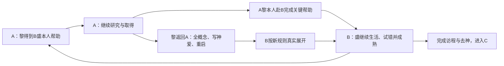

# 《她与神话》完整设定集｜现行基础

整套资料版本：v2.0｜更新日期：2026-09-11  
底稿：独立修订版v1.0。原128个doc锚点、16个部分编号及兼容的自然、经济、社会、人物、神格、航行资料继续保留。此次直接同步总设计、序章、访程、爱情、日历和局部神明接口。

## 现行使用说明

本文件与00、02、03、04组成完整五文件工作包。基础规则在此；[02](02_设定补丁总集_P001-P016.md)记录作者方向和原文；[03](03_十星世界与神谱总集.md)包含十星分册、神谱与外篇细目；[04](04_全书叙事总设计_长序章_AB_C与异闻.md)独占当前全书流程与容量。用户不用再另找新增五星或手动拼入十八阶段。

“完整”指基础资料的组织，未表示所有机制已完成。作者明确方向、当前工作方案、候选与旧资料分别使用。书名《她与神话》已定；十星为建设样本，宇宙不止十颗行星。最新作者要求为篇幅无上限并尽量甜稳，30卷和2186万字仅是本轮工作预算。

现行正篇三十卷，120配对阅读单元；序章六篇80节约40万字；B第一卷明确恋情，X0真实重逢也前移第一卷；九访见04。旧八阶段、十二卷和十八阶段退出执行，不作当前章位、上限或需要三选一的主干。

**原细目与旧稿**：兼容的地方资料继续；完全过期的王朝永恒、旧六年轮回、旧B黎留核和三套旧主干仅在上一版压缩包存档，不作为现行依据。doc-116—125保留取材导航，阅读本套不需要另外上传旧存档。来源路径在代码字样里仅标出处。

**纪年与条件**：旧标Y只定位旧模型，第一神与跨星统一绝对纪年未完成。K15盛死亡与B本人、G06分配与真实开路、普通黎共同回返、K07/K14返乡和锚点仍需验收。1671日A行程和B长返552日均是需被实际条件支持的日历样本，不能用算术冒充机制证明。

[本轮变更](#revision-v2) · [上一轮修订记录](#revision-log) · [当前未接接口](#pending-interfaces)

## 总目录

- [01 · 作品总览与作者已定方向](#part-01)
  - [《她与神话》当前总设计](#doc-001)
  - [作者已定方向与故事选择](#doc-002)
  - [设定依据与状态](#doc-003)
  - [她与神话：全部设定总览](#doc-004)
  - [世界设定入口](#doc-005)
  - [她与神话](#doc-006)
  - [创作约定](#doc-007)

- [02 · 宇宙基础、神格与共同历史](#part-02)
  - [宇宙共通设定](#doc-008)
  - [时间、规则重启与本人穿越](#doc-009)
  - [神格、全部概念与写法重启](#doc-010)
  - [星际社会与往来](#doc-011)
  - [生命谱系与语言](#doc-012)
  - [共同事件与往来总表](#doc-013)
  - [神明诞生、文明转变与两线神谱](#doc-014)
  - [宇宙、自然与已知星域](#doc-015)
  - [已知星海共同史](#doc-016)
  - [版本谱系、个人经历与阅读次序](#doc-017)

- [03 · 双线因果、回返与七罪](#part-03)
  - [双线因果与交叉章](#doc-018)
  - [时间权能、规则重启与本人交叉](#doc-019)
  - [归岸：短战与长旅的回返](#doc-020)
  - [双线张力与七罪](#doc-021)

- [04 · 文明时代、社会主题与星球共通约束](#part-04)
  - [幻想风格与文明时代](#doc-022)
  - [作者的主题与场景参考](#doc-023)
  - [原五星与十星扩展世界观阅读目录](#doc-024)
  - [星球设定的共同原则](#doc-025)
  - [共通基础设定统合清单](#doc-026)

- [05 · 永恒星：尖端叠层文明与耗损锚点](#part-05)
  - [永恒设定总入口](#doc-027)
  - [永恒：天体地理与生态](#doc-028)
  - [永恒：人口族群与生活文化](#doc-029)
  - [永恒：技术发展、开放与实验史](#doc-030)
  - [永恒：公开断代史与民间记忆](#doc-031)
  - [永恒：第一神、耗损锚点与轮回机制](#doc-032)
  - [永恒：公共生活、机构与知情边界](#doc-033)
  - [永恒：科技生计、远航教育与校园生活](#doc-034)
  - [永恒：人物、职业与各自的人生](#doc-035)
  - [永恒：A/B历史与主体接口](#doc-036)
  - [永恒：发现、营救与公平证据链](#doc-037)
  - [永恒：设定边界与跨星联系](#doc-038)
  - [永恒：神明神器与神话遗物](#doc-039)

- [06 · 衡川星完整设定](#part-06)
  - [衡川](#doc-040)
  - [衡川：山河、土地与渡镜之路](#doc-041)
  - [衡川：居民、手艺与日常人生](#doc-042)
  - [衡川：真实通史与历史记忆](#doc-043)
  - [神明生平与概念边界](#doc-044)
  - [城誓、法律与兵权](#doc-045)
  - [钱粮、百工与渡镜远航](#doc-046)
  - [衡川：人物与机构关系网](#doc-047)
  - [双线历史与主角行动接口](#doc-048)
  - [伏笔证据与跨星边界](#doc-049)
  - [神明神器与神话遗物](#doc-050)

- [07 · 丰原星完整设定](#part-07)
  - [丰原](#doc-051)
  - [丰原：自然生态与居民](#doc-052)
  - [丰原：王国、田林与公共记忆](#doc-053)
  - [庭穗与两线世界](#doc-054)
  - [丰原：穗冠、田地与生计](#doc-055)
  - [日常文化与人物](#doc-056)
  - [故事接口与伏笔证据](#doc-057)
  - [设定边界与跨星联系](#doc-058)
  - [神明神器与神话遗物](#doc-059)

- [08 · 澄海星完整设定](#part-08)
  - [澄海](#doc-060)
  - [澄海：自然地理、物候与族群](#doc-061)
  - [澄海：通史年表与历史记忆](#doc-062)
  - [澄海：神明生平与概念机制](#doc-063)
  - [澄海：物产、帆术与星海生计](#doc-064)
  - [澄海：海权、契誓与人间生活](#doc-065)
  - [澄海：人物、家业与船上关系](#doc-066)
  - [澄海：A／B世界线与社会成长](#doc-067)
  - [澄海：剧情接口与伏笔证据链](#doc-068)
  - [澄海：设定边界与跨星联系](#doc-069)
  - [澄海：神明神器与神话遗物](#doc-070)

- [09 · 砚泉星完整设定](#part-09)
  - [砚泉：修院诸城与星海古卷](#doc-071)
  - [砚泉：山地、泉眼与灵潮](#doc-072)
  - [砚泉：生命谱系、炉户与行旅](#doc-073)
  - [砚泉真实通史与年表](#doc-074)
  - [公开历史与民间记忆](#doc-075)
  - [余蘅：未说完的往事与可以停止的声音](#doc-076)
  - [砚泉：院田、誓约与山路上的权力](#doc-077)
  - [砚泉：田租、纸墨与两季星舟](#doc-078)
  - [砚泉：学舍、泉院与一家人的日子](#doc-079)
  - [砚泉：师门、家户与各自的人生](#doc-080)
  - [两条山路：神的保护、人的译法与最后的去向](#doc-081)
  - [主角行动接口](#doc-082)
  - [伏笔与可验证证据](#doc-083)
  - [设定边界与跨星联系](#doc-084)
  - [神明神器与神话遗物](#doc-085)

- [10 · 双主角、群像人物、成长与爱情](#part-10)
  - [黎见曦](#doc-086)
  - [盛世澜](#doc-087)
  - [双主角成长总纲](#doc-088)
  - [黎见曦与盛世澜](#doc-089)
  - [第十一筹备组：七罪的双线对照](#doc-090)
  - [纪青棠](#doc-091)
  - [裴望川](#doc-092)
  - [祁砚](#doc-093)
  - [宋迟昼](#doc-094)
  - [唐栀](#doc-095)
  - [闻叔](#doc-096)
  - [闻弦月](#doc-097)
  - [许照野](#doc-098)
  - [叶清峤](#doc-099)

- [11 · 组织与跨星势力](#part-11)
  - [神谱图书馆](#doc-100)
  - [神明研究会](#doc-101)
  - [猎神者与各地誓队](#doc-102)
  - [无神星港](#doc-103)
  - [繁华联盟](#doc-104)
  - [星海商队：晚禾船组](#doc-105)

- [12 · 战力、概念战、弑神与神器](#part-12)
  - [战力与概念战](#doc-106)
  - [神明神器总览](#doc-107)
  - [双主角神器](#doc-108)
  - [战力尺度与交战规则](#doc-109)
  - [双主角的幻想战斗与成长](#doc-110)
  - [神明战斗档案与概念对局](#doc-111)
  - [弑神行动与同行者的兵装](#doc-112)

- [13 · 叙事结构、序章、行旅与寓言](#part-13)
  - [她与神话：故事总纲与叙事结构](#doc-113)
  - [共通序章设计](#doc-114)
  - [普通人的生活与寓言番外](#doc-115)

- [14 · 旧故事方案索引（原文另存，非现行）](#part-14)
  - [【旧素材入口】故事提案入口](#doc-116)
  - [【旧素材入口】三种故事方案比较](#doc-117)
  - [【旧素材入口】方案一：归途之书](#doc-118)
  - [【旧素材入口】方案三：众人的失物](#doc-119)
  - [【旧素材入口】方案二：神的邀约](#doc-120)

- [15 · 旧试读索引（原文另存，非正式正文）](#part-15)
  - [【旧素材入口】双向交叉与日常片段](#doc-121)
  - [【旧素材入口】方案一：AB开篇试读](#doc-122)
  - [【旧素材入口】《众人的失物》AB开篇试读](#doc-123)
  - [【旧素材入口】方案二：AB开篇试读](#doc-124)
  - [【旧素材入口】行旅一：等下一班](#doc-125)

- [16 · 写作原则与启动清单](#part-16)
  - [后续创作硬约束](#doc-126)
  - [写作规则](#doc-127)
  - [写作启动清单](#doc-128)

---

## 01 · 作品总览与作者已定方向

### 《她与神话》当前总设计

原来源：`当前总设计.md`

> 本次按明确更新重写本条；被替换的原文完整保存在非现行存档。新机制未完成处保持标明。

状态：基础设定修订本。书名与作者明确方向按P001—P014及本轮十星扩展授权更新；具体工作机制、数值、来访、个案结局与试读仍按各自状态使用。本文件保留原128篇定位，供与后续独立分册合用。

#### 一、作品与阅读重心

《她与神话》是黎见曦与盛世澜的双女主百合超长篇。两人从自己的愿望与共同生活出发，经历星海、神话、地方历史和众人的悲伤，仍愿意相爱、欢笑、帮助别人，并争取人能够自己开辟的未来。

爱情、群像、冒险与历史均有独立的叙述时间。整体尽量甜、稳，允许没有事故的一段旅程、真正完成的作品、从头到尾满意的约会和持续住下的一季。不以新增死亡、反复拆散或恶性误会填充篇幅；原已明确的耗损死亡与真实弑神仍须认真兑现。

#### 二、连续历史与彼此的作用

A中黎求索、参与真实弑神并取得诸神全部概念，形成让神真正关切人的阶段性认识，先写“神爱世人”，再重启生成B。B的历史、教育、保护和改善真实成立；两人经观察、改革、旅行与神战，进一步争取人的未来不由神作最后决定。B去神后向前进入C，C保留自然灵潮、凡人技艺、科技与社会生活。

A/B不是永久并行的两个社会，C也没有另一次创世。B盛本人进入A、A时期黎本人进入B，双方各有至少一项帮助构成当时成功的必要条件；没有先独自成功、后来才补交叉的原始A。知识分别来自A研究与实得、B生活与试错，不让全部答案只在环内互抄。

每位主角各是唯一连续主体，不同个人阶段可同场，身体、知识、力量和返程分别记录。双向必要作用不强迫爱情，也不要求每个配角最后替主角完成任务。

#### 三、A的出发与新的永恒

永恒采用尖端科技与神力应用并存的叠层文明。居民普遍跨环境生活，古典建筑外观可以使用先进基础设施。学校培养真实的远航本领，盛不知献祭真相、带着期待登船；船具有真实离星能力，预定路线却受控。黎发现异常并尝试营救，未能带走盛，因干预意外独自离星。

永恒A采用同一锚点承受多轮、相关状态逐轮耗损、可被耗尽至死的主线构想。锚点死亡后实验进程前移，再寻找后继者建立下一阶段。盛属于多位承担者中的一员，具有高度轮回适配；适配增长不能抵销实际耗损，也不等于已能自主操纵完整权能。

被复原的世界状态与支撑复原的耗损部分须分别处理。具体载体、每轮清醒与行动、阶段基准和轮长还未接全。旧Y-742基线、Y-736首轮、固定六年、r123/s4及距下一轮约两年的旅程期限已停用，不能用旧算式给当前故事排日历。一般计时单位与其他地方的自然年长度不因此废止。

实验作用于已经绑定的本地范围，外部星海继续前进；不自动覆盖整个恒星系，也不等同于A宇宙规则重启或B归岸。普通物件、备份与记录不因剧情需要免于复原。跨轮适配、可访问记忆和可带出的实物各须真实来路。

**K15仍待接通。** 盛在A死亡被黎感知的情节方向与A/B同一连续主体都保留。A身体生命结束、锚点失效、唯一主体不可逆终止必须分别说明；不能在没有实际机制时认定三者已经统一解决。前置主体接续是P013及后续工作稿的研究候选，尚未定案；资料副本、死亡录像、相似身体和恋爱不能代替本人延续。其适用条件也要回应前代承担者与其他死者。

当前剧情演算优先将发现、营救、死亡感知与意外离星放在盛所承担阶段的末轮内，精确先后仍依K15、K14核定。不得让已经耗尽的同一个锚点无解释地继续支撑后续轮回，也不默认死后的A盛仍以常住旅伴身份在各星行动。

第一神诞生于永恒、关联永恒轮回命运是新方向；文明意志成神为当前倾向。AI、思维集合体、具体人格及旧晏持衡姓名、堰师前史尚待统合。本册撤下把旧神谱绝对年份当成统一现行年表的用法；保留各地文明先于当地神、出生／可靠见证／广泛神治分开的历史方法。

#### 四、人物、记忆与爱情

A开场两人是青梅、已经交往不久。具体告白经过、公开和同居时点按故事推进，不再列作是否恋爱的问卷。B盛起初不认识黎，渐进找回本人A亲历；不获得黎独自经历或未说出口的内心，不用记忆替眼前的她自动同意。

P009为人格深化底稿。黎希望认真与投入被看见，熟人面前可以多话、逗人，也可能把失望追问成对动机的判断；盛希望被当作可共同承担的人，真心喜欢远方与玩笑，也会承诺过快、低估琐事的时间。双方都可主动、照顾、索取、发脾气和接受帮助，成长进入之后的实际行为。

海滩、厨房、掌心与树下的愿望保留为爱情基调。相处可以在一个动作、一个玩笑或一次亲吻后停住，不必立即产出线索与道理。重要分歧依具体事实与不同判断发生，不以一方无理由失忆强迫重新受苦。

#### 五、A全取与B普通黎

**当前采用普通B黎方向。** 黎完成A写法重启后保留自己的真实亲历，失去神格权能；她可被看见、接触、交谈和重新认识，旧身份与他人旧关系记忆不再自动成立。她的知识、判断、普通刀术、工具操作及学习能力继续存在；通用非神格术法的具体范围仍须另定，不用争议范围承担关键破局。较早A阶段来访的黎可持有当时已经实际取得、适配的核心，不能与B当下的普通黎互换能力。

**分配演算W-G06**：十星工作稿暂测试A终幕将时间、空间、永恒、轮回、命运五核真实传给盛，早期封存、分步适配；其他A私人完整核在全取以后解除旧结构、参与B重展。它为开路、共同归岸和终局提供一套待验证的力量来源，尚未逐项定案。旧“黎留三核、盛持两核”和“两人继续分持A全部核心”停止作为现行方案。若改变W-G06，须同步重排每次开路、承载与去神分工。

A全部概念的取得范围不变；B本地同型核依B独立历史形成。传承来源、实际核数量、解封程度、所学方法和当前可用作用分开记录。

全部包括已成立的远域来源、托管和可核验的残源，不只具名行星。候潮修海仍由多代实践、实际残源与黎的补足形成潮风新核，不复活A溯岚。十星表当前新增塑形、幻象、调息、承势、共鸣五种A类型；二十种具名A类型只是工作名录，A-OUT仍需逐源接通。B望归的引航为本线新候选，不能倒称A早已取得尚未成立的B类型。

#### 六、归岸与本人访程

B归岸保留单一有效锚、事前返幅与余力、锚后实物／神死／还人／新关系一并回退、亲历与实际磨损留下的原则。普通B共同生活不关闭归岸；真正跨版本访程在场或交付未闭合时暂停，相关返程完成后在B实际当下重新立岸，不能删去已交付给另一版本的因果来源。

A耗材实验不直接等于B每次回返都必须耗死活人。普通黎怎样共同保留经历、身体年龄怎样累计，须依明确承载与实测条件实现；不能暗中恢复她的神格不老。

本人互访可有成熟权能一念发动的简洁表现，实际可达时位、力量来源、当时知识、身体与携物、返程仍须成立。次数和插入位置随故事发展，不设每星固定一对。B普通黎可以核对时位、告知亲历、接待与协作；实际开路由当时有源的能力或已完成且具有真实供给的设施、术式承担。

当前v2.0用W-G06演算两次必要帮助与七次生活重心的探望：必要援助集中于衡川两岸桥架及B渡运改革／有限接续；其他地方原来各成一对的交叉案例仅为旧素材，不累计成全书必须发生的访程。每一趟都要另做双端校核，A来客所知B成果与局限必须影响她后来写神爱的选择。

#### 七、世界与神明的差异

本册保留原五星详细地方资料，同时承接十颗重点行星的建设方向：永恒、衡川、丰原、澄海、砚泉，以及燧庭、绮梦、霜灯、赤旌、鸣珀。十颗是当前工作样本，均可继续深化，不是宇宙行星、文明、神明或主题总数。十星完整分册与扩展史传、C寓言已在本套03号文件，三十卷与全部当前叙事在04号文件；本基础册保留具体规则和地方接口，避免重复建立另一份全书章纲。

| 世界 | 当前重心 |
|---|---|
| 永恒 | 尖端叠层、青年共同生活、第一神与耗损实验。 |
| 衡川 | 河城百工、价值债务、艺术、工坊与租住。 |
| 丰原 | 多种田林社会、完整农时、照护与去留。 |
| 澄海 | 海权与自由港、远航巡演、候潮修海。 |
| 砚泉 | 山院泉镇、译读、记忆与私人生活。 |
| 燧庭 | 造生者、材料工程、塑形与新职业。 |
| 绮梦 | 幻象、演出季、创作与真实快乐。 |
| 霜灯 | 调息、有限身体、照护分担与出游。 |
| 赤旌 | 承势、英雄、停战、竞技与和平工作。 |
| 鸣珀 | 共鸣、异质感官、语言与共同环境。 |

原五星的国家、工艺、物产与人物细则仍有价值。十星扩展不让它们变成同一流程：主段高潮可以是演出、试航、交班、护撤、调查或一季生活的结束。神可以求索、创作、旅行、想退休、帮助制止人的暴力；各有具体结局。

#### 八、叙述与容量

共通序章采用一整段连续故事，单线展开，不在序章预先使用正篇的A/B交错，也不轮流演示三个版本。作者要求序章本身可达十几万至几十万字；篇、节独立编号，不占正篇奇偶。

现有工作案以A中初交往的共同生活、学业、朋友、短住、远航准备及意外为开端，通过连续本人、B渐进旧忆和C生活形成共同来路。“A共同生活＋远航意外”的后台定位属于当前结构工作案；40万字、六篇八十节是当前容量演算，不是作者锁定的唯一长度。旧三片段问答、短寓言式序章与C单次启航序章不再并列为默认执行方案。

高塔与云海首先属于值得喜欢的故乡和约会；破碎优先表现为人物对世界的认识改变，不预定高塔、学校或全部美好生活必须毁灭。

随后第1章A黎、第2章B盛，常规奇A偶B。奇偶规定现场版本，重要配角可承担该版独立正篇事件；来客不改变现场版本。C行旅、异闻·史传与异闻·寓言独立编号。

旧五卷120—160章、八百万字十二卷与十八阶段均已撤下现行执行表。当前三十卷1636万字正篇、C十辑320万、史传160万、寓言30万与序章40万共同组成2186万字工作样本，单章与全书总量均可变。不能将旧新两套章位同时执行，也不把设计容量当作已写正文。

#### 九、C与终点

C为真实无神未来，所有完整神格与再生条件终止，必要访程在此前闭合。还人成活、还人后死、神身真死分别成立，不设统一死亡配额。普通B黎在终点参与实际工作，无需再交出一枚本来不存在的核；盛与其他实际持核者的完整神格一并结束。

共同生活可以从旅行延伸到安家、各自事业、朋友来访、再住异地、共同变老。不留最高神、秘密归岸或持续的跨版本门，也不强制以一人死亡作C的最后一页。

#### 十、仍需接通的关键项

K15盛之死与同一主体通往B；G06最终核心分配与完整能力表；K03第一神与跨星绝对纪年；K14耗损阶段与A旅程时钟；K12互访知识与A阶段答案；普通B黎的身体、共同归岸及磨损。这些保留为实现工作，不再重问已经明确的爱情起点、主题或超长篇方向。

细则继续由下列各篇承担。原三案和旧试读移为有标记的历史素材，不构成开写前必须三选一的门槛。

#### v2.0当前故事和入库状态

本套已整合新增五星，无需作者再手动拼入。现行流程唯一见[04](04_全书叙事总设计_长序章_AB_C与异闻.md)，三十卷约1636万正篇加40万序章、320万C、160万史传和30万寓言，合计2186万字工作样本；所有数字可随实际故事调整，绝非正文完成量。

B第一卷形成当下恋情，A的X0第一次真实重逢前移同卷。恋爱持续贯穿长住、工作、出游、身体亲近与争执后的实际改变。两场最终行动保留在V30最后一对奇偶章，准备和后果此前已有空间；不让A完结以后还有一整卷只能靠空奇数章支撑的B。

### 作者已定方向与故事选择

原来源：`作者决策稿.md`

> 本次按明确更新重写本条；被替换的原文完整保存在非现行存档。新机制未完成处保持标明。

本稿区分作者明确方向、当前工作案、未接机制及已退役素材。状态只在明确涉及的条目上更新，后出的工作例子不自动高于作者要求。

#### 一、作者明确方向

| 范围 | 当前执行 |
|---|---|
| 书名与体量 | 正式书名《她与神话》，双女主百合超长篇；序章可达十几万至几十万字。 |
| ABC | A先全取、写神爱再重启B；B真实善待、继续求索去神；C为B的真实未来。 |
| 本人互助 | A黎本人赴B、B盛本人赴A，至少各一项帮助对当时成功必要，无独立成功首遍A。 |
| A关系起点 | 青梅，已经交往不久。 |
| B记忆 | 盛起初不认黎，渐进恢复本人A亲历；黎保留亲历，旧身份与他人旧关系记忆消失。 |
| B黎状态 | 当前优先无权能普通黎，保留知识与普通行动，不暗藏恢复神位的后手。 |
| 永恒文明 | 尖端科技、全民叠层、现代生活关系与青春制服美学，古典外观不等于低技术。 |
| 主线构想 | 盛不知情登真船、受控远航；同锚多轮耗损、死亡换人；黎营救失败后意外离星，盛死亡被其感知。具体接续未完。 |
| 主题 | 神爱是A的阶段性成果；B继续争取人的未来。经历悲伤后仍愿生活、帮助他人、成为英雄。 |
| 群像与空间 | 重要配角可独立承担正篇；星际途中、船群、外站与更多文明都有完整故事。 |
| 叙事 | 单线共通长序章后第1A、第2B、常规奇A偶B；版本与视角分开；C与异闻分别编号。 |
| 百合与基调 | 具体感官、共同生活、双方主动、欲望、笑与安全感贯穿正篇，整体尽量甜稳。 |
| C与去神 | 完整神格及再生条件结束；不同神可有不同结局；自然术法、科技、生命与社会继续。 |
| 寓言 | 当前按寓言与地方异闻建设，不再要求先答旧预言／寓言问卷；未新增必真预知机制。 |
| 文风 | 新正文禁用成套“不是……而是……”及同义换壳；保留自然长句、直接心理与必要背景。 |

#### 二、当前工作案

P009提供人物底稿；P010—P013推进新永恒与主线；十星深化稿提供原五星更新、新五颗世界、神谱、三十卷接口及扩展外篇。作者已授权继续深化十星方向，新地名、神传、数值、配对与具体结局保持工作状态。

**当前采用普通B黎方向。** 黎完成A写法重启后保留自己的真实亲历，失去神格权能；她可被看见、接触、交谈和重新认识，旧身份与他人旧关系记忆不再自动成立。她的知识、判断、普通刀术、工具操作及学习能力继续存在；通用非神格术法的具体范围仍须另定，不用争议范围承担关键破局。较早A阶段来访的黎可持有当时已经实际取得、适配的核心，不能与B当下的普通黎互换能力。

**分配演算W-G06**：十星工作稿暂测试A终幕将时间、空间、永恒、轮回、命运五核真实传给盛，早期封存、分步适配；其他A私人完整核在全取以后解除旧结构、参与B重展。它为开路、共同归岸和终局提供一套待验证的力量来源，尚未逐项定案。旧“黎留三核、盛持两核”和“两人继续分持A全部核心”停止作为现行方案。若改变W-G06，须同步重排每次开路、承载与去神分工。

A全部概念的取得范围不变；B本地同型核依B独立历史形成。传承来源、实际核数量、解封程度、所学方法和当前可用作用分开记录。

目前可比较的对象是符合普通黎方向的新分配，不再从两套旧留核案机械二选一。地方旧交叉不能用旧分配直接证明当前“必须来访”。

#### 三、已关闭的问题

A是否恋爱、B是否采用渐进旧忆、是否允许群像独立视角、是否按超长篇、是否写C与寓言、A为何写神爱及B为何继续求未来，均已有方向。B心动与明确恋情旧忆的先后按性格和场景推演，无默认“先心动”义务。

#### 四、仍需设计的接口

**K15仍待接通。** 盛在A死亡被黎感知的情节方向与A/B同一连续主体都保留。A身体生命结束、锚点失效、唯一主体不可逆终止必须分别说明；不能在没有实际机制时认定三者已经统一解决。前置主体接续是P013及后续工作稿的研究候选，尚未定案；资料副本、死亡录像、相似身体和恋爱不能代替本人延续。其适用条件也要回应前代承担者与其他死者。

当前剧情演算优先将发现、营救、死亡感知与意外离星放在盛所承担阶段的末轮内，精确先后仍依K15、K14核定。不得让已经耗尽的同一个锚点无解释地继续支撑后续轮回，也不默认死后的A盛仍以常住旅伴身份在各星行动。

其余包括第一神具体人格与年表、真实开路与各核去向、普通黎的身体与归岸、每趟互访所知、地方去神的实际保护接续。具体公开、同居与相处细节由人物推演；高影响关系伤害和不可挽回的新增代价单列关键取舍，不自动加入。

#### 五、旧案的地位

《归途之书》《神的邀约》《众人的失物》及相应试读保留为历史素材。旧短序章、五卷容量、固定六年日历、古风永恒与B黎持三核，不参与当前方案竞争；移用事件须重新核对来路、能力、日历和人物关系。

本次只生成修订后的本文件，不修改其来源文件或后续独立分册。

#### P016明确更新的范围

作者本次要求十星后重排五文件，字数无上限，并尽量稳定、甜。三十卷、2186万字、九访、1671/2390/2942日等是协作者工作方案，作者没有逐项固定。原来已经确认的普通B黎、主体连续、神爱—去神与真实C不变。

### 设定依据与状态

原来源：`bible/canon_index.md`

> 本次按明确更新重写本条；被替换的原文完整保存在非现行存档。新机制未完成处保持标明。

#### 当前效力

本文件按作者明确更新优先、当前工作案次之、候选与历史材料分开的规则使用。P001—P009中的旧日期与待答不覆盖后来的P010—P014；十星新设定保持设计稿身份。

| 层次 | 具体内容 |
|---|---|
| 作者方向 | 正式书名、超长篇、单线共通序章、ABC连续来路、唯一主体与必要互助、A全概念、A恋爱起点、B渐进旧忆、普通B黎、先进永恒、甜稳与英雄精神、C与寓言。 |
| 作者主线构想，机制待接 | 多人耗损锚点、死亡后换人、盛不知情登真船、黎营救失败及意外离星、感知盛死亡；第一神诞生于永恒及文明意志倾向。 |
| 当前工作稿 | P009人物、十星文明故事、原四星兼容细则、归岸有限性、W-G06五核传盛演算、三十卷叙事工作案、神谱个案与外篇目录。 |
| 待接 | K15、G06、K03、K14、互访知识、B普通黎身体与归岸、远域全概念与C再生终止的具体操作。 |
| 历史停用 | 古风永恒总社会、固定六年全局日历、B黎留三核／两人全核分持、A起点恋爱未定、三片段序章、旧三案完整排法及其试读事实。 |

旧具体神战、还人时长、人口、神器名和普通配角人生不会因收录变成作者硬设定。地方版推荐结局若已更新，以本篇各星更新栏为当前选择；旧互斥结局仅作撤下素材。

新增五颗星的完整详细稿由作者另补。本底稿的“原五星”指既有详细资料集，不表示只有五颗星、五种文明或五位神。二十种A具名概念也不表示全宇宙已穷尽。

原128个doc锚点保留。正文前的当前分册可用于继续创作；历史附录及本轮撤下片段有显式标记，不可反向恢复为当前事实。来源路径为原始出处记录，不表示同名外部文件已被改写。

正式正文与候选试写分开。已生成序章初稿、场景试读的存在，不证明其事件已编入当前正篇。

#### 本轮状态辨认

已确认的是重新组织十星全流程、无上限体量、甜稳优先与五文件交付。具体采用的V01—V30、80序章卡、首卷64章卡和50个C单元均属于当前执行工作案，尚未写成正式正文。旧叙事数字只有在明确“旧案／存档”语境下保留。

### 她与神话：全部设定总览

原来源：`设定总览.md`

> 本条保留兼容原资料，并修订下文明确涉及的冲突；具体数值与个案仍为工作设定。

> 纪年状态：本篇“旧标Y”及相连省写年份为原模型坐标，保留用于定位地方历史，尚待与永恒第一神的新年表重映射。地方事件顺序和数值仍属工作资料；跨星绝对先后、联动年龄与人口截面不得据旧表当作已核定。1Y=365标准日及各地自然年等一般单位另按共同时间使用。

这部小说从两个人想一起看见远方开始，逐渐走向一个更大的问题：能够理解许多人的悲伤，是否就有权替他们决定人生？

黎见曦在A的有限生命中求索与猎神，使“神爱世人”成立；盛世澜在B的真实温柔中成长，经历观察、改革与回返，最终与她一起结束神格。C提前展现两人无神后的旅行，让读者带着“她们最后能这样相处”的认识回看漫长的开始。

连续宇宙、双主角主体、全部概念与回荡磨损方向已经确定，具体机制、地方历史和剧情保留工作设定。已定内容与仍可选择的故事集中在[作者决策稿](#doc-002)。本篇连贯介绍世界，详细因果和数值以对应分册为准。

#### 一、不是每个世界都走同一条路

星球有自己的自然史、生命史与文明史，神在其中途出现。神明诞生以前的人也能建城、相爱、战争、形成信仰与发明术法。有神以后，某种保护获得了异常强大的保证，同时某些选择开始取决于神的判断。

自然灵潮与可学习的魔法不是神明的独占发明。星际往来可以从本土研究、外来商旅、殖居、输入手艺、神话道路与普通劳动结合中生长出来。得到一艘异星船不等于人人拥有现代工业；使用木舟也不等于不能穿行星海。

原五星分别具有尖端叠层科技、河网商邦、领主田园、海洋王国和山院学城的工作风格；新五颗进一步增加造生工程、表演与幻象、生命照护、高原战后生活和异质感官文明。每颗内部仍有多种地区、阶层和生活。时代风格决定人怎样受教育、工作、争取土地、恋爱和离开家乡，不能只改建筑与衣服。

#### 二、五星各自是什么地方

| 星球 | 可见的生活 | 神与人的长期关系 | 星际来路 |
|---|---|---|---|
| [永恒](#doc-027) | 尖端叠层公共生活、校园、云海高塔、真实水园与居住区 | 第一神求索、受控远航与多锚点耗损实验；具体神身与姓名待重设。 | 有真实开放与外部往来历史，A当前受控；真实船只可因干预离星。 |
| [衡川](#doc-040) | 十二会誓城、河港、行会、印坊、艺术与炼金 | 价值与债务帮助陌生人合作，也可能使无法被计价的人失去位置；A闻砺、B殷岚并非同一攻略。 | 镜渡来自本地长期研究，外来材料与贸易再使其壮大。 |
| [丰原](#doc-051) | 穗冠王国、村社、领地、林盟、丰年席与饥年仓 | 庭穗的丰饶与饥饿让救命、分粮与决定谁还需要什么纠缠在一起。 | 输入帆艺与商馆租界，经历抵抗、赎回和本土改造。 |
| [澄海](#doc-060) | 潮冠王国、西屏领地、回湾自由港、风帆与岛群 | A旧神溯岚死亡，宁息继任和平与沉默；B溯岚仍在，另一种神史塑造海上的自由与保护。 | 接触商馆后，自身候潮、造船与星帆逐渐取得独立。 |
| [砚泉](#doc-071) | 山地六院、寺院、驮道、温泉、书市与旧藏 | 余蘅的记忆与遗忘保全经历，也可能握住一个人必须记得或必须放下的最后决定。 | 客籍书社带来星路，与知识垄断、释读和开放相伴。 |

地方册包含自然地理、种族人口、家庭与日常、神前史、神传、公共历史、政法经济、防务、文化、人物关系、A/B差异、主角进入时点及可验证的伏笔。主角不必在每条线都走遍五星，更不必每到一颗就按同样步骤杀一位神。

地方人的不同意见是真实的：有人从神的保护中获得了第一份安稳工作，有人已经等不起下一次改革。B的改善应足够有分量，使盛世澜的勇气能从中长出来；A也有工匠、家人、师傅与同伴创造的温柔，不能把她的善意写成凭空抵抗整座世界。

#### 三、历史怎样完整，又怎样断开

作者真实史、公开承认史、民间记忆与人物当时所知分别记录。神的生命起点、神格成立、首次可靠见证和广泛依赖具有不同含义。

第一神诞生于永恒的新方向，要求重排旧晏持衡与溯岚的绝对先后；旧堰师履历、神源断代的准确年份和全球编年不继续作为当前事实。四颗其他星球的地方事件、因果先后与人物经历尽量保留，旧Y数值标为待重映射，见[两线神谱](#doc-014)。

永恒A采用同一锚点承受多轮、相关状态逐轮耗损、可被耗尽至死的主线构想。锚点死亡后实验进程前移，再寻找后继者建立下一阶段。盛属于多位承担者中的一员，具有高度轮回适配；适配增长不能抵销实际耗损，也不等于已能自主操纵完整权能。

被复原的世界状态与支撑复原的耗损部分须分别处理。具体载体、每轮清醒与行动、阶段基准和轮长还未接全。旧Y-742基线、旧标Y-736首轮、固定六年、r123/s4及距下一轮约两年的旅程期限已停用，不能用旧算式给当前故事排日历。一般计时单位与其他地方的自然年长度不因此废止。

实验作用于已经绑定的本地范围，外部星海继续前进；不自动覆盖整个恒星系，也不等同于A宇宙规则重启或B归岸。普通物件、备份与记录不因剧情需要免于复原。跨轮适配、可访问记忆和可带出的实物各须真实来路。

调查仍依靠地方实物、域外记录、工程史和不同来源的反应。独立证据分别能证明什么必须清楚；普通网络、纸本和记忆不因需要逃过复原。各地共同事件保留G编号与双端行动，年份重排不让事件凭空发生或自动失效。

#### 四、神为什么诞生，为什么有限

神可以原生凝聚、由人升格、经过长久磨砺、能量积累、继承或神死后重组。每条路都需要实际条件。人曾经拥有的习惯、欲望与经验会影响神的判断，所承载概念也会限制其可以怎样行动。继承概念不等于继承前人的全部人格。

完整神格、核心、人格、本位、施行路径与有限份额不是同一件东西。神物可以保存一段有限遗咒；凡人可以凭自己的能力使用它；这都不等于已经握住完整神核。

每个神有不同的感知、真身和失去人格的方式。斩碎神像可能有用，却不是杀死神；摧毁真实人格后取得的核心也不会自动告诉胜者全部历史。普通人的技术、供养、护路与救援能改变神战条件，但真正弑神仍是与有判断的对手交锋。

神爱约束B的神，使其真实关切人，而非单纯作出好看的表演。爱不能赋予全知，也不能让相反愿望自动兼容。善良且聪明的神可以试探主角、改变合作条件、保留真实的救人之路，同时算计怎样使主角无法完成猎神。

详见[神格与升格](#doc-010)、[两线神谱](#doc-014)。

#### 五、连续的A、B与C

A先写入神爱规则，再重启世界生成B；B以新规则重展历史，最后去神进入C。A、B主角本人可以双向穿越，彼此都是对方成功不可替代的条件。版本谱系有先后，事件的因果可以成环，不设一次无B帮助却已独自成功的A。

黎见曦与盛世澜各自保持同一个主体的连续。黎记得自己的A与B经历，能被B的人看见、交谈和重新认识；失去的是旧身份、历史位置与他人对她的旧记忆。B盛世澜的成长真实，起初不认黎，随后渐进恢复自己的A亲历，并在眼前相处中重新选择爱情。A初交往已经明确，B心动与旧忆先后依场景推演。

B可以改变几乎全部历史，包括神的诞生、继任、文明与社会条件；温柔通过多代生活累积。黎的记忆不是全宇宙全知，她也没有一个已在B生活的副本需要取代。普通人物是否对应、怎样接续，分别由具体经历说明。

A终幕黎最终拥有诸神全部概念，不限时空永恒轮回命运。核心有实际取得、托管、归并及回荡中重新分配的去向；盛继承相应力量后逐步适配，不必先杀B某神才能获得原本来自A的传承。B当地神的核心来自B的真实神史，不复制A传下来的同一物件。

A黎的神格刀路与B盛的戒咒成长分阶段记录。完成重启后的黎保留亲历、失去权能；当前五核传盛的W-G06仅作演算，详见[神格与升格](#doc-010)。

#### 六、回返与岁月怎样留下重量

永恒分阶段耗损锚点的本地实验、A终结时宇宙整体回荡、B行动中的失败回返，是三种不同过程。A的地方实验不变成黎的随身复活；B的回返可以覆盖一场战斗，也可以是一段较长旅程。

真实锚的返幅和承受条件在危机以前成立。返回时，锚后的B神死、取得的核心、物件和当轮关系一起改变；经历保留不是另开一座战利品仓库。来自A的传承核心与B新取得之物分清来源和取得时刻。

黎在B陪伴盛，可以参与同一次回返，不因她来自A就永久禁止重来。她们怎样保留各自经历与承担磨损依[共同时间册](#doc-009)执行。本人跨版往返有真实的开门、出发、行动与返回；它们既可以传信息，也可以让两人真实救援和交锋。A研究与B独立试错各有贡献，闭环不只是一份无人研究的配方在互抄。

最大的代价在于实际活过的年月。对旁人仍是第一次的对话，可能已有一人听过很多遍；一次没有被记得的付出、一次重新建立的信任，会改变她们的习惯与感情。修好身体不意味着这些年没有发生，快乐与接受照顾也能帮助她们继续生活。

去神的必要终点是神格消失。人神可以还人活着、还人后死或在神的身份里死亡；不把全部神的人格死亡或全宇宙惨剧设为固定价格。具体人物仍有实际交锋、错误、损失和各自的后来。

#### 七、刀、戒与幻想概念战

黎见曦的太刀暂名照夜：深青刀鞘、缺日形镡、薄曙一样的刀光与可见旧修痕。前期需要身法、判断和实际接近，后期把空间刀路、时序错拍与不可撤销的留痕连起来。其神话传承不等于她出生时便命定继承。

盛世澜的花嫁戒指暂名白誓：金白花形戒托，咒术展开为花信、白纱与层叠的婚仪形象。她以真正的攻击、结界与施法判断战斗，轮回提供重演，命运提供已经可能的路径。戒指有婚仪来历，不替她决定该爱谁，也不把被爱者变成所有物。

砚泉山院取得照夜、澄海白嫁舟取得白誓是具体候选。黎逐步取得完整核心，盛逐步解封已经继承的核心；完整作用的使用都须经过训练与适配。道具的前代人物曾为自己的人生行动，不能只为千年后主角预备礼物。

五星神物共形成十五件的主推命名与形象方案，包括未央晷、渡饥釜、两岸天平、七渡空筹、万穗长席、一眠枝、负海冠、缄潮长帷、不系帆、未竟书、歇雨盂、渡雪裹与未题名的艺术遗物。完整外观、效果、代价和来历见[神器总览](#doc-107)。

战力不采用单一等级碾压。是否碰得到、以何种方式碰到、当时能维持多久、对方怎样反制，共同决定胜负。参见[战力与概念战](#doc-106)。

#### 八、人物怎样拥有自己的生活

黎见曦认真、温和、执拗，想记住别人，也容易在能救更多人以后觉得自己应当承担全部。她的成长包括主动索取一次陪伴，承认自己的私心，不把理解当作永远留住别人的理由。

盛世澜松弛、可靠、愿意行动；她的勇气来自真实被支持。回返越多，她越可能习惯提前替同伴安排，甚至把爱人也纳入最稳妥方案。成长不是失去热情，而是把自己记得的经验变成别人可以真正参与的选择。

七位同学保留各自的手艺、欲望与缺点。叶清峤的尊严、纪青棠想被承认的作品、许照野的怒气、宋迟昼的闲日、裴望川的路费、唐栀的记录、闻弦月的吸引与不安，都可以伤人，也都能在人际关系中被打断和改变。七罪不是一张预定反派名单。

祁砚真的帮助过学生，也可能以延期和照顾取消别人选择；他只知道自己经手的名单和局部整理，不知道整个宇宙谜底。闻叔想完成交接、种一点菜，不须临终牺牲才能证明是好人。

晚禾船长简秋有自己违背的接人旧约，领帆师祝钧想开帆棚，掌舱胡良玉想开饭铺。她们可以帮助主角，也可以拒绝下一趟危险委托。地方神、王、船民、护林者、代抄者和守水人均有不依赖主角在场的关系。

人物入口见[双主角成长](#doc-088)、[七位同学](#doc-090)、五星人物册及[普通人的历史](#doc-115)。

#### 九、三种叙事在读者面前怎样合作

序章采用ABC共通的开篇；常规奇A偶B。正篇交叉中，A现场可以迎来B盛本人，B现场可以迎来较早A黎本人；重启后常住B的黎另记个人时段。默认由现场主视角看见来客，特殊交叉视角明确分节，不将必要交叉降为番外。具体见[序章设计](#doc-114)。

C行旅写她们怎样吃饭、旅行、争执、调情、疲惫和受到陌生人的帮助。它可以偶尔透露一项世界事实，不必每篇都是隐藏线索。提前让读者看到真实的幸福，会把悬念转向抵达的过程、曾经的损失与人物为何变成这样。

异闻另写寓言、地方史和普通人物的一生或一个阶段。寓言是某个地方流传的说法，可能偏心、误记或有两个结尾；历史事实仍需实际来源。重要主线情报在正篇也必须能获得，不把番外当作读懂因果的必修考试。

旧三套主干及AB开篇已退为取材附录，不能当成当前必须三选一的方案。当前以长序章、十星与三十卷工作总纲继续建设；具体故事和文字试验仍不等于正式正文。

两人也要认真过日子：在海风里牵手，笑着收拾一顿弄坏的饭，疲惫时靠进愿意接住自己的掌心，商量以后房子的朝向、窗边的花与一起变老。自然亲昵、羞赧、撒娇和幽默贯穿A/B正篇与交叉，C只是让这样的生活继续。它们不必每次都成为身体痕迹、制度教训或隐藏线索。

完整互依骨架见[双线因果与交叉章](#doc-018)。

#### 十、可以明确而不必穷尽的边界

五星及其相互影响拥有具体历史，不要求作者把全宇宙每个居民的每一天编完。原初母域的位置、宇宙最早起源及未到访文明可以是有边界的未知，不能在战斗时突然成为万能援军或豁免。

C在B结束后成立，神格终结，人神可以还人；普通信仰、记忆和魔法继续，强弱与争议也仍存在。神爱是真的，神曾做成的事值得被记住；让人继续决定自己的生活，也包括让两位主角不必永远担任救世主。

本册保留原五星详细地方资料，同时承接十颗重点行星的建设方向：永恒、衡川、丰原、澄海、砚泉，以及燧庭、绮梦、霜灯、赤旌、鸣珀。十颗是当前工作样本，均可继续深化，不是宇宙行星、文明、神明或主题总数。十星完整分册与扩展史传、C寓言已在本套03号文件，三十卷与全部当前叙事在04号文件；本基础册保留具体规则和地方接口，避免重复建立另一份全书章纲。

共通序章采用一整段连续故事，单线展开，不在序章预先使用正篇的A/B交错，也不轮流演示三个版本。作者要求序章本身可达十几万至几十万字；篇、节独立编号，不占正篇奇偶。

现有工作案以A中初交往的共同生活、学业、朋友、短住、远航准备及意外为开端，通过连续本人、B渐进旧忆和C生活形成共同来路。“A共同生活＋远航意外”的后台定位属于当前结构工作案；40万字、六篇八十节是当前容量演算，不是作者锁定的唯一长度。旧三片段问答、短寓言式序章与C单次启航序章不再并列为默认执行方案。

高塔与云海首先属于值得喜欢的故乡和约会；破碎优先表现为人物对世界的认识改变，不预定高塔、学校或全部美好生活必须毁灭。

### 世界设定入口

原来源：`bible/world_bible.md`

> 本条保留兼容原资料，并修订下文明确涉及的冲突；具体数值与个案仍为工作设定。

本书写两个相爱的人，在不同的成长条件下，如何学会理解他人，又学会不替他人决定一生。

黎见曦来自永恒的云上文明。她想与盛世澜一起看见星海，后来不得不在只有一次生命的旅途中调查神源、参与猎神，为仍未结束的故乡危机寻找答案。她的阶段性成果是让神必须真实地爱人。

盛世澜在B受到真实的照顾与支持，这使她敢于远行、试错和相信他人。她经过改革与回返，逐渐发现爱并不授予最后决定权。她在后段参与真正的弑神，终止神格及其再生，两人最后在无神的生活中共同旅行。

当前主线以P012—P013的远航献祭、营救与意外离星构想为起点；死亡接续与精确先后尚需接通。十星深化及三十卷为当前工作方案，旧三案留作取材，已有试读不自动进入正篇。

#### 世界骨架

- 各星具有自身的发展与当地神前史，十星是当前重点样本；第一神与永恒文明的关系按新方向重排。
- 神格概念具有真实效力，也有感知、范围、代价和施行条件；言辞不能临场制造全能。
- 各地有不同文明时代与星海来路，有值得继承的公共成果，也有因保护而失去选择的人。
- 普通人参与历史，拥有不围绕主角的私人愿望、关系、离开与留下的权利。
- A与B发生不同神史和社会变化，B的温柔必须可见，不能把所有善意写成骗局。
- 共通序章后常规奇A偶B；正篇中B盛本人穿A、A黎本人穿B，彼此不可替代地促成成功。世界版本先后与个人穿越时序分开。
- C是真实未来的旅行日常；异闻是寓言、地方历史和普通人物故事，两类各自编号。
- 黎见曦持太刀，盛世澜用花嫁戒指施法。自然魔法和幻想美感贯穿到C。

#### 当前工作候选

[作者决策稿](#doc-002)集中身份接续、B历史、权能分配、回档、神的生死与终末等选择。

作者确定A先写入神爱规则再重启生成B，B去神后进入C；真人双向穿越使A、B互为成功条件。两位主角各自连续，黎可被感知且记得亲历A/B，消失旧身份和他人旧记忆；盛在B起初不认她。A黎汇聚诸神全部概念，再经回荡分配传承。人神可以还人存活，主要代价落在回荡与两人的岁月磨损。普通人物不凭同名断定完整身份与生涯相同。

B使用真实锚，可以回返一场战斗或一段旅程；返幅与承受条件事前成立，不能临危无限扩大。黎正常陪伴盛不禁用回返，具体工作规则见共同时间册。

百合以两个人真实过日子为核心：手心、海风、杯子里的热气、做坏的饭、想一起住的屋子，都可以承载具体性格与愿望。A/B相处与交叉、C日常共同发展，日常不只作为身体亲密或宏大道理的装饰。

#### 阅读

- [完整设定总览](#doc-004)：世界、五星、人物和叙事的连贯说明。
- [宇宙共通设定](#doc-008)：时间、主体、神格、生命与星际往来。
- [神明神器总览](#doc-107)：双主角与五颗星球的神话器物。
- [故事总纲](#doc-113)：全书共同的价值与叙事方向。
- [双线因果与交叉章](#doc-018)：真实穿越与相互成因。
- [设定依据](#doc-003)：作者已确定与工作候选的边界。

**当前采用普通B黎方向。** 黎完成A写法重启后保留自己的真实亲历，失去神格权能；她可被看见、接触、交谈和重新认识，旧身份与他人旧关系记忆不再自动成立。她的知识、判断、普通刀术、工具操作及学习能力继续存在；通用非神格术法的具体范围仍须另定，不用争议范围承担关键破局。较早A阶段来访的黎可持有当时已经实际取得、适配的核心，不能与B当下的普通黎互换能力。

**分配演算W-G06**：十星工作稿暂测试A终幕将时间、空间、永恒、轮回、命运五核真实传给盛，早期封存、分步适配；其他A私人完整核在全取以后解除旧结构、参与B重展。它为开路、共同归岸和终局提供一套待验证的力量来源，尚未逐项定案。旧“黎留三核、盛持两核”和“两人继续分持A全部核心”停止作为现行方案。若改变W-G06，须同步重排每次开路、承载与去神分工。

A全部概念的取得范围不变；B本地同型核依B独立历史形成。传承来源、实际核数量、解封程度、所学方法和当前可用作用分开记录。

本册保留原五星详细地方资料，同时承接十颗重点行星的建设方向：永恒、衡川、丰原、澄海、砚泉，以及燧庭、绮梦、霜灯、赤旌、鸣珀。十颗是当前工作样本，均可继续深化，不是宇宙行星、文明、神明或主题总数。十星完整分册与扩展史传、C寓言已在本套03号文件，三十卷与全部当前叙事在04号文件；本基础册保留具体规则和地方接口，避免重复建立另一份全书章纲。

### 她与神话

原来源：`PROJECT_MANIFEST.md`

> 本次按明确更新重写本条；被替换的原文完整保存在非现行存档。新机制未完成处保持标明。

双女主百合超长篇，正式书名《她与神话》。本文件是原《无神时代_完整设定集.md》的兼容修订本，保留128篇来源定位，更新与后续补丁、十星稿冲突的执行条目。

#### 建议阅读顺序

[当前总设计](#doc-001) → [作者方向与状态](#doc-002) → [时间与主体](#doc-009)、[神格与分配](#doc-010) → [星球目录](#doc-024) → [人物](#doc-086)与[关系](#doc-089) → [叙事](#doc-113)、[长序章](#doc-114)与[启动清单](#doc-128)。

本册保留原五星详细地方资料，同时承接十颗重点行星的建设方向：永恒、衡川、丰原、澄海、砚泉，以及燧庭、绮梦、霜灯、赤旌、鸣珀。十颗是当前工作样本，均可继续深化，不是宇宙行星、文明、神明或主题总数。十星完整分册与扩展史传、C寓言已在本套03号文件，三十卷与全部当前叙事在04号文件；本基础册保留具体规则和地方接口，避免重复建立另一份全书章纲。

原五星入口：[永恒](#doc-027)、[衡川](#doc-040)、[丰原](#doc-051)、[澄海](#doc-060)、[砚泉](#doc-071)。新增五星的工作方向、能力与原机制边界见[文明差异](#doc-022)和[共同神格](#doc-010)。

#### 文件边界

本轮只修订这份基础总集。原件、P001—P014、十星深化分册及叙事设计文件均未覆盖。后续完整设定可由本修订本与这些独立文件共同组成；同项明确更新先判断状态，再采用最新有效内容。

旧方案和旧试读仍能取材，但不能作为当下恋爱状态、科技水平、时钟、核心分配或已经发生的正文来源。

### 创作约定

原来源：`decisions.md`

> 本次按明确更新重写本条；被替换的原文完整保存在非现行存档。新机制未完成处保持标明。

#### 文件与创作

本项目正式名为《她与神话》，双女主百合超长篇。设定、工作提案、旧素材与正文分开管理。本修订只改这份汇编，来源路径保留为历史定位，不表示相应独立源文件已同步修改。

A写神爱重启B、B去神进入C；两位主角各是连续本人，双向必要帮助、真实来源与返回继续成立。A取得诸神全部概念；普通B黎保留亲历、失去权能，B盛实际成长与传承另列。

A开场已交往不久，B渐进恢复本人旧忆；双方主动、真实吸引、共同生活贯穿。允许情绪与冲突，新增背叛、第三者争夺或重大额外伤亡不凭“需要戏剧性”自动成立。

正篇保留第1A黎、第2B盛、常规奇A偶B；后续允许对应版本的重要配角独立视角。序章单线长篇工作案和两类外篇各自编号。星际旅途、地方史、工作、艺术和无事故的生活都可承担完整章节。

写作依P004、P009：新正文避用“不是……而是……”成套转折与近义换壳；允许完整长句、心理与必要说明，避免把去套式执行成全篇碎句。旧引文和停用试读不做机械同义改写。人物按性格、关系、知识与环境行动，协作者先提出合理方案，关键规则与审美边界再明确讨论。

---

## 02 · 宇宙基础、神格与共同历史

### 宇宙共通设定

原来源：`宇宙共通设定.md`

> 本条保留兼容原资料，并修订下文明确涉及的冲突；具体数值与个案仍为工作设定。

> 纪年状态：本篇“旧标Y”及相连省写年份为原模型坐标，保留用于定位地方历史，尚待与永恒第一神的新年表重映射。地方事件顺序和数值仍属工作资料；跨星绝对先后、联动年龄与人口截面不得据旧表当作已核定。1Y=365标准日及各地自然年等一般单位另按共同时间使用。

世界版本有A→写入神爱规则后重启B→去神C的来路。A、B两位主角能够本人双向穿越，并互为成功不可替代的条件；这段完整因果没有一遍无B帮助却独自成功的A。具体规则是工作实现，完整入口见[双线因果与交叉章](#doc-018)。

#### 一、历史与叙述

| 层次 | 顺序 |
|---|---|
| 世界版本谱系 | A求索与汇聚诸神概念 → 写入神爱并重启 → B依新规则重展历史、继续探索 → C无神生活。 |
| 读者阅读 | 共通序章 → 第1章A → 第2章B → 继续奇A偶B，并插入独立编号的C行旅与异闻。 |
| 本人经历与互助 | B盛亲自去A、A黎亲自来B，各有个人先后、实得能力与返回；帮助共同促成两线成功。她们保留真实亲历，不自动知道另一个年龄的全部内心。 |

A不必在B旁边永远同步运行，却可由本人穿越抵达其真实历史时段。B中的黎既可能是已重启而连续生活的后继阶段，也可能是从A较早时点到来的本人，须分清个人经历。旧身份与他人旧记忆消失，不使她不可被看见或重新爱上。B对几乎全部历史的改变具有真实展开，不是一批居民同时收到改写记忆。

#### 二、概念与神

星球和自然先于本位神。神有凝聚、磨砺、人升格、能量累积、继承等来源，概念限制其能力，也影响祂怎样理解生命。A终幕黎见曦最终汇聚诸神全部概念，完整取得并不等于无限同时施展。

宇宙回荡时发生真实的重新分配。传给盛世澜的权能有A来源，B本地新形成的神格另有历史，不能凭同一神名复制核心。A黎的时空永恒刀路仍有当时来源；B常住黎失去权能，五核传盛为当前演算，其余概念去向见共同神格册。

去神与杀死人格分别成立。人神可还人后活着、还人后死去，或以神身份真死；保持本人连续的还人不等于复制替身。C的必要终点是神格及其再生结束，自然灵潮、凡人术法与社会继续。

#### 三、不同的时间作用

永恒A采用同一锚点承受多轮、相关状态逐轮耗损、可被耗尽至死的主线构想。锚点死亡后实验进程前移，再寻找后继者建立下一阶段。盛属于多位承担者中的一员，具有高度轮回适配；适配增长不能抵销实际耗损，也不等于已能自主操纵完整权能。

被复原的世界状态与支撑复原的耗损部分须分别处理。具体载体、每轮清醒与行动、阶段基准和轮长还未接全。旧Y-742基线、旧标Y-736首轮、固定六年、r123/s4及距下一轮约两年的旅程期限已停用，不能用旧算式给当前故事排日历。一般计时单位与其他地方的自然年长度不因此废止。

实验作用于已经绑定的本地范围，外部星海继续前进；不自动覆盖整个恒星系，也不等同于A宇宙规则重启或B归岸。普通物件、备份与记录不因剧情需要免于复原。跨轮适配、可访问记忆和可带出的实物各须真实来路。

B短战与长旅归岸继续保留，参与者包括符合事前准备的普通黎；实际本人访程与普通B同行分开。1Y为365标准日，地方自然年月另换算。

#### 四、生活与星海

五星有不同文明和星际来路。永恒是尖端叠层科技与现代校园生活，衡川是河网商邦与炼金工艺，丰原是领地村社与森林共同体，澄海是海洋王国与自由港，砚泉是山院学城。殖居、输入、自主试航和魔法相互作用，不把一地有星舟当作全星海已有同一工业。

人口、口粮、航程、候潮、船型与身份由地方实际条件成立。七物种、地方语言与普通照护都有可用规则。C不靠主角永久维持日常；两人也有休息、欲望、疲惫与接受帮助的生活。

#### 五、详细分册

- [时间、世界线与主体](#doc-009)
- [神格、全部概念与升格](#doc-010)
- [星际社会与往来](#doc-011)
- [生命谱系与语言](#doc-012)
- [共同事件与往来](#doc-013)
- [神谱](#doc-014)、[共同历史](#doc-016)
- [作者已定方向与故事选择](#doc-002)、[共通序章](#doc-114)、[本人双向因果](#doc-018)

本册保留原五星详细地方资料，同时承接十颗重点行星的建设方向：永恒、衡川、丰原、澄海、砚泉，以及燧庭、绮梦、霜灯、赤旌、鸣珀。十颗是当前工作样本，均可继续深化，不是宇宙行星、文明、神明或主题总数。十星完整分册与扩展史传、C寓言已在本套03号文件，三十卷与全部当前叙事在04号文件；本基础册保留具体规则和地方接口，避免重复建立另一份全书章纲。

### 时间、规则重启与本人穿越

原来源：`bible/common/01_时间世界线与主体.md`

> 本条保留兼容原资料，并修订下文明确涉及的冲突；具体数值与个案仍为工作设定。

> 纪年状态：本篇“旧标Y”及相连省写年份为原模型坐标，保留用于定位地方历史，尚待与永恒第一神的新年表重映射。地方事件顺序和数值仍属工作资料；跨星绝对先后、联动年龄与人口截面不得据旧表当作已核定。1Y=365标准日及各地自然年等一般单位另按共同时间使用。

A、B、C是同一宇宙的规则版本谱系：A末幕先写入“神爱世人”，再按新规则重启世界，真实生成B；B去神以后正常进入C。版本先后不禁止本人穿越已真实发生的A、B时段。A成功须有B盛世澜的实际帮助，B成功也须有A黎见曦的实际帮助，整段历史共同自洽，不另设一次没有彼此参与的初始成功。上述方向及两位主角的连续本人、黎可被感知而旧身份与他人旧记忆消失，均为作者已确定内容；具体通路、闭环例与归岸兼容采用下文工作方案。

#### 一、历史次序与叙述次序

| 层面 | 实际关系 |
|---|---|
| 规则谱系 | A → 写入神爱世人 → 按新规则重启生成B → 去神 → C。个人穿越可以跨越这条谱系的已发生时段。 |
| 奇数主章 | 现场属于A，黎为主要叙事中心，允许重要配角独立视角；求索、远行与重启有真实来路，B盛本人来访属于正篇。 |
| 偶数主章 | 现场属于B，盛为主要叙事中心，允许重要配角独立视角；普通黎可正常在场，A黎的本人来访属于正篇。 |
| C行旅 | 两人后来真实的无神生活，可以提前穿插，独立编号。 |
| 异闻与地方外篇 | 按其真实年代或讲述身份定位，不占奇偶主章号。 |

黎在B出现不会自动把奇数主章改为B。她在B的可见行动主要由盛的偶数章视角呈现；最后合流、尾声是否另换视角属于具体编排。读者先看见C，不意味着A、B人物已经获得未来攻略。

A不需要在B旁边无限独自生长，但已经成立的A时段仍可成为真实穿越的目的地。跨版本相遇是同一宇宙历史中的交叉，不另造一个专供来访的平行A。普通居民随宇宙回荡进入B重新展开的生活，没有一批留在平行A等待末次救援的人。A曾发生的经历仍是来源历史，黎记得自己亲历的部分；宇宙回荡不另作一次“杀尽A居民再复制”的人口惨剧，也不保证每个普通人在B仍有同名父母、相同职业和完全不变的关系。

#### 二、共同时间与阶段性耗损实验

1Y为365标准日，一标准日24小时，一小时60分钟，一分钟60秒。地方自然年仍保留原工作值：永恒约365日、衡川400日、丰原368日、澄海375日、砚泉378日。地方学年、农年和航季另列。

A·Y与B·Y分别记录各自历史，Y0为作者当代参照；同一数字不证明两个版本同时发生。其他星球原有绝对年标保留作待重映射的历史资料，不能反向压过第一神诞生于永恒的新方向。事件、见证、消息抵达与纪念日期分开。

永恒A采用同一锚点承受多轮、相关状态逐轮耗损、可被耗尽至死的主线构想。锚点死亡后实验进程前移，再寻找后继者建立下一阶段。盛属于多位承担者中的一员，具有高度轮回适配；适配增长不能抵销实际耗损，也不等于已能自主操纵完整权能。

被复原的世界状态与支撑复原的耗损部分须分别处理。具体载体、每轮清醒与行动、阶段基准和轮长还未接全。旧Y-742基线、旧标Y-736首轮、固定六年、r123/s4及距下一轮约两年的旅程期限已停用，不能用旧算式给当前故事排日历。一般计时单位与其他地方的自然年长度不因此废止。

实验作用于已经绑定的本地范围，外部星海继续前进；不自动覆盖整个恒星系，也不等同于A宇宙规则重启或B归岸。普通物件、备份与记录不因剧情需要免于复原。跨轮适配、可访问记忆和可带出的实物各须真实来路。

两位主角开场约22Y仍是工作年龄；旧“基线18Y”的绑定关系撤下。青春制服属于审美，不把两人自动改成未成年人，也不由制服推导某种现实学制。A身体年龄、外界经过、个人亲历与B回返磨损分别计。

真正离域者不能在后续本地复原里另生一个可独立行动的副本；怎样登记连续迁出、谁受到什么保护，须按重建后的阶段模型实现。旧接续者“轮后归宁即可消耗清零”的实况暂停。

#### 三、必须分开的四种行动

| 行动 | 实际发生什么 | 边界 |
|---|---|---|
| 写法与宇宙重启 | A先用全部概念真实写入神爱，再据新规则重启生成B，重新展开的历史可以广泛不同。 | 不只是把A状态倒回较早一日，也不是现有B的一次归岸。 |
| B内部归岸 | 从当前B回到同一B的有效锚，重走短战或长旅。 | 不取消已经成立的A写法、重启与传承，不凭此另造一个B。 |
| 本人跨版本穿越 | 唯一本体沿有源通路，暂时进入另一版本的已发生时段，再按实际个人行程返回。 | 是本人承担伤害、交手与相处，不以投影代替；不要求先让同源早期自己睡着。 |
| 重启后黎在B正常生活 | 黎本人已经沿自己的个人时间完成A写法重启，继续在B相识、同居、旅行与行动。 | 这段生活不算一场迟迟未归的A来访，不能因她有A来源而一直禁止归岸。 |

永恒A的耗损锚点实验另属本地复原，按第二节区分阶段、范围和承担者；它不赋予A时期的黎私人重试。C是B去神以后的正常未来，不是第五种宇宙重启。

地方短时救援也可存在，作用取决于已准备的对象与范围。地方设施的一次成功，不证明整条B历史已经重来。

#### 四、先写入规则，再重启世界

A阶段黎实际汇聚诸神全部已成立概念的完整支配，先把神爱世人写入神格与生命的根本关系，再以这套改变后的规则重启宇宙。写法与重启可以在同一终幕相继完成，但两项工作不能省去任何一项。五个关键概念不是全部所得，诸核来历与最后分配见[共同神格](#doc-010)。

B在新规则下真实生成并发展，神的诞生、战争、制度、家族和个人成长可以与A大不相同。它不是A普通居民失忆以后继续走同一段路，也不是把A回档到一份较好存档。B的日常由真实的人、神、自然与社会共同长成，普通人的意志没有被直接写成温柔、服从或相爱。

B对A的必要帮助本来就是这段实际历史的一部分。A的研究、取得和写法不需要先在一条无B参与的历史里独立成功，才允许B回去帮忙。所需的是闭环各环都有实际行为和条件：核心确被取得，知识确由某人发现，门确被当时的力量打开，帮助确实发生。

互相依赖不等于所有内容无源。A可以依靠B独立试错产生的解法继续研究，B也可以依靠A在旧规则下实际取得的反制；不能让全部答案只是一段被双方互抄、从未有人观察或创造的文字。已经成立的结果不能被随意删去来源以后照常保留，但来源里可以包含真正来自后续版本的帮助。

主要代价是重启改写了旧身份与关系，两人又真实活过漫长等待、反复和相处。它不以全宇宙必须死亡多少人支付，也不以因果闭环强迫任何人相爱。

#### 五、黎见曦怎样来到B

黎是跨越回荡而连续存在的本人，不是B根据传说造出的相似女子。她有可被看见、听见、触及和伤害的身体，能够与B居民重新认识、劳动、争执和相爱。消失的是她在旧历史中的公共身份及别人对那段关系的旧记忆，不是她从此不能被任何人感知。

B不另外生成一个无关的黎见曦让她夺舍或取代。若A较早个人阶段的黎穿越来B，与已经完成重启的自己同场，那是同一人沿连续个人时间到达现场的两个年龄阶段，遵守第九节的来去闭合，不是另生一个替身。她保留自己亲历A和真实经历B的记忆，不拥有全宇宙发生过的一切，也不能知道自己未到场、未听闻的B秘密。回忆可能疲惫、模糊和难以开口，不能反过来给她伪造未经历的知识。

完成重启后，黎以保留亲历记忆、失去神格权能的普通人身份继续生活。她在B何时清醒、何时走到盛身边、经历多少等待，由故事具体安排；不要求她自宇宙第一秒起无间断旁观全部重演。醒着等待的日子确实进入人生，未曾参与的年代不自动变成阅历。某案所写B开篇前一年、三个月或两年，只是一段可明确定位的等待，不代表她在回荡与B中全部清醒人生。

她可以在B早期、中期与盛同行，不因自己的A来源而封闭B回返。这段个人行程已经真实完成写法重启，她是B当下生活中的连续本人；不能把她称作永久访客而封闭回返。旧身份不能直接领取B别人已建立的关系，新的相处却能留下新认识，并不会在第二天自动再次被抹除。

#### 六、盛世澜的同一主体与继承

A盛与B盛为同一连续主体；B真实的出生、抚养与成长不是覆盖另一个已经独立存在的人。当前开场约22Y为工作值，B具体出生年随统一日历重排。

**K15仍待接通。** 盛在A死亡被黎感知的情节方向与A/B同一连续主体都保留。A身体生命结束、锚点失效、唯一主体不可逆终止必须分别说明；不能在没有实际机制时认定三者已经统一解决。前置主体接续是P013及后续工作稿的研究候选，尚未定案；资料副本、死亡录像、相似身体和恋爱不能代替本人延续。其适用条件也要回应前代承担者与其他死者。

当前剧情演算优先将发现、营救、死亡感知与意外离星放在盛所承担阶段的末轮内，精确先后仍依K15、K14核定。不得让已经耗尽的同一个锚点无解释地继续支撑后续轮回，也不默认死后的A盛仍以常住旅伴身份在各星行动。

B盛起初不认识黎，随后渐进恢复自己在A实际参与、看见、听见、做过与想过的内容。黎独自在外界的经历需要她讲述或其他真实来源。记忆恢复可以带来笑、羞赧、疑问与迟到的理解，不固定先于或后于心动；恢复旧恋情不替代当下意愿。

盛的A来源传承须在终幕真实交付，早期封存与逐步解封保护实际成长。当前W-G06以五核传盛演算，替代旧只传轮回命运、另由普通黎持三核供能的安排。每核来源、适配、可用阶段和承担的磨损仍须逐项完成。

B本地神可由B历史形成独立同型核；不要求先杀B永恒神才取得A既有传承，也不得重复领取同一核。

#### 七、B的归岸：短战与长旅使用同一机制

归岸是盛在自己真正经历的B当下，为同一宇宙立下的一条有限返回关系。时间提供已有历史的来路，轮回执行返回，永恒接续两位主角的主体与经历，命运帮助辨认可实际抵达的结果；这些作用都来自已经完成的回荡、传承或后来明确解封，不因一次濒死无源产生。

同一时刻只有一处有效归岸。它可以立在战前，使一次短战得以重试；也可以在远行前立下并保留数周或数月，让整段旅行、相识和多次行动一起返回。换立新岸就放弃旧岸，不能同时保留最近胜利和任意退回更早旅程的便利。

立岸须在实际能够休整、辨认时间关系、补足媒介和收稳神性的位置完成。两人、守术者或可信同伴可以共同准备；稳定航段中的船也可能适合，不要求走进固定神殿。准备需要真实时间，不能在致命攻击已经落下后宣称刚刚存好。锚固定的是完成时刻，不是开始准备时刻。

每次立岸前，须通过当时的实际试引确定这条返路能承接多长时间、哪些神格变更会显著增加负担，以及尚能支付的回返余力。返幅和余力是当段已知条件，不采用全宇宙统一的每日推进或固定次数。故事进入危险以前就应给出可判断的界限；发生失败以后不能临时把原本一天的准备扩成数年。

锚不会因为睡着、胜利或一次普通通信自动更新。超过已测返幅、接续被真正毁坏或支付不起本次代价，便不能返回该岸；已有生活继续。恢复能力以后可以在新的当下重新立岸，不能把已经失效的旧岸凭空取回。

##### 怎样发动与承担

工作方案允许盛在能完成返式时主动启动，也允许事先真实布好的护印在她遭受致命断裂时接引。主动启动需要她还能作出判断、接通返路并支付代价，不是任意时刻的一句心念；预备印被破坏、返幅已尽或余力不足，死亡仍可能成为无法挽回的结果。无需把主动伤害自己设为使用回返的通行办法。

每次回返都消耗不能由同一次回退取回的接续余力。返回越远、途中发生的神格交接与结构改变越重，通常越难维持。立岸时确认的余力不能在战中因决心突然增加；更大的承载来自此前取得的力量、训练和真正完成的准备。

休养、补给与彼此照护可以恢复一部分能力，但锚以后才得到的补充，如果随这次回返一同撤销，就不能拿来支付返回锚前的消耗。发动前先排除将被撤销的补给，再检查余力够不够；已成功回返的耗用始终保留。反复在同三天养好又退回，不会变成无限次数。

外界B日历、两人的主观历时与身体年龄分别记录。B外界数年可以对应两人主观数十年乃至更久，这是目前的磨损体量候选；总数须由回荡中的实际清醒、等待、每段返行与正常生活逐项累记，不以需要悲壮便补一串不存在的年数。

两人的实际主观经历、疲惫与接续磨损不随身体旧态一起清零。长途重复可能让盛记得几段已经不为别人记得的相处，也让黎在仍年轻的容貌下多活了一段岁月。照护能帮助她们继续生活，不把全部记忆删成没有发生；人不能靠累积死亡被自动兑换成更强神明。

#### 八、回返以后谁还拥有什么

B整体返回有效归岸时，普通身体、位置、物品、所有权、当时活着的神、核心的状态及锚后新立关系一同返回。锚后真正杀死的神可以回到当时仍活着的状态；锚前已死者不能因此复生。还人若发生在锚后，也会返回其尚未完成的状态，不能同时保留凡躯和旧神躯作为两个人。

两位主角依自己的接续保留真实经历与已耗代价，其余人和神默认恢复锚时记忆。敌人可以根据当轮行动推断她们有重试经验，不能无条件记得上一轮；独立保留必须在事前已有明确来源，不能因神聪明便临时补给。

传承自A的核心保持同一来源身份与唯一数量，但其在B的封印、损伤和可用程度按锚时实际状态恢复，再扣除不可退回的消耗。记得后来解封的方法可以帮助重做，不能把后来才获得的完整使用能力也免费带回。单靠B内部归岸不会额外生成一对放回传承前的黎处。真正本人穿越可使同源核心的不同时段暂时同场，须按第九节分别闭合其个人来路与归途，不能累计为永久库存。

锚后从B神处新夺得的核返回原持有者或原封存位置。两人不能只带着这些战利品再次猎杀同一神。把新核交给B里的朋友、送往星港或藏入戒指，仍属于同一B历史，不能逃过返回。

已经完成重启、正常在B生活的黎与盛相见、拥抱、同航和作战，都是B当下的真实事件，可以随有效回返改变；两人保留相应经历，并须承担重新选择的困难。这样的共同生活不是跨时代交易，不会因黎站在旁边便自动停用归岸。

#### 九、本人跨版本穿越与不同时龄同场

版本、当地时刻与个人时序必须同时辨认。可访问的“已发生时段”指完整自洽历史中确有真实承接的事件，不要求目的版本在出发者的当地日期上已经先生成；因此A时期本人可以抵达规则谱系较后的B。一个人可以在自己的第一个阶段离开A，亲自进入某个B时段，再回到A继续生活，后来完成重启，再以较后的个人阶段在B生活。她的人生仍只有一条连续世界线，只是这条线不始终顺着版本或当地日期单向前进。

因此，B成熟的盛可以在A碰见年轻的自己；A时期的黎可以在B碰见经历重启以后的自己。各阶段都有当时真实的身体、经验与选择，没有谁必须睡着让出位置，也没有人被覆盖或替换。记忆不在两个时龄之间自动广播，只有当事人后来亲历、交谈或实际接续的内容才会被知道。

过门需要可辨认的两端时位、当时真正可用的时间与空间作用、主体接续及返回条件。供给由当时真实持有并已适配的能力者、或先前已经完成且仍有供给的术式承担；当前W-G06演算以成熟盛的实际传承为一项来路。B普通黎负责信息、接应和普通操作，不直接供给神力。A较早的黎使用别人真实开好的门，不因此提前获得尚未取得的核心。盛成熟的轮回命运可以辨认和稳定有关路径，不会凭神名无中生有一扇门。

本人带着真实核心、刀戒、衣物与伤病到场，可以交手、牵手、吃饭、休息，也会从另一种生活里理解爱人为何长成那样。时间、载物和返路依每次实际准备决定，没有一律十分钟或禁止携带核心的规定。门若受损，须用原有准备或真实补救返回；不能靠改称投影免掉本人受伤的后果。

A时期的来访黎与重启后常住B的黎，要按个人行程分辨。前者尚须返回A推进自己的写法重启，即使暂住很久也不是后者；后者已经实际完成该阶段，不欠一趟回A才算到家的返程。两种人身出现都是真的，不以居留称呼、服装或别人是否认得她判断。

##### 同源核心与物件

同一核心在较早和较后个人时段可以暂时同场。例如A晏尚持有其轮回核时，B盛可以带着后来经A黎取得、在重启中传给自己的同源核到场。它们是同一件东西的不同经历阶段，不是宇宙额外发了第二枚永久核心。

每一阶段须有真实的持有、耗用和离开去向。两段可以在当场各自使用已有力量，原阶段的损伤与消耗也各自承担；不能将两段合成一对永久库存，或把未来核扣下，省略A本来必须实际完成的夺取与传承。借物、交物和留下物件均须在完整个人履历中闭合，不得让同一个来源同时分叉给两个永久主人。

普通可消耗补给可以确实带来、留下并使用，但要从其真实来源扣除，不在访客返回后重新补成原样。核心与可反复使用的神器尤其不能通过反复取来同一时段累加。B本地独立形成的同类型核则是另一条来源，不能为了逃避战利品回退而冒称来自A。

#### 十、归岸怎样与真正的访程相容

以下是归岸兼容的工作方案，而不是以黎的身份决定能否回返。

| 当时状态 | B归岸如何处理 |
|---|---|
| 重启后的黎与盛正常在B同居、同行、交手 | 按既有有效归岸执行，两人保留亲历与磨损。 |
| B盛已真正离开B、本人尚在A访问 | 暂停B世界回返，不能再造一位留在B的她而让A访客继续活动。 |
| A个人阶段的黎正在B访问 | 暂停B世界回返，直到她的返程及相应交付实际闭合。 |
| 所有相关访客返回原个人行程，访程和交付已闭合 | 在B的实际闭合当下重立归岸，旧岸结束；已经传入A或由A传来的结果不能再被单方倒掉。 |
| 普通B传信、吃饭、约会或读取B已有古物 | 不构成跨版本访程，不强制停用或更新归岸。 |

跨版本出发与接收的真实作业期间也暂停回返。额外暂留的核心、物件或持续作用须一并理清，不能只送走本人却让一份会被重复领取的交付悬在外面。普通消耗和实际留下的成果按已完成的交换固定，不要求把一顿吃过的饭倒还给另一时段。

已经成为另一版本成立来源的交叉事实，不能由B归岸单方面撤销。交叉点之间仍可有尚未进行跨版本交付的失败与重试；实际开门、完成并返回的那一段固定相应结果，不把所有尝试都误当成唯一剧本。

闭合之后的新岸取实际完成时刻，所需接续包含在这次真实过门与交接中；只有发出无人接收的信号不能立岸。若另一次真正访程尚未结束，就不能先恢复世界回返。历史回声、映像与信物仍可存在，涉及真实跨版本交付时遵守同一闭合原则，却不能代替作者要求的两次本人交叉。

#### 十一、当前互依排法与未接条件

以下采用十星稿的当前条件式排法，用于检查依赖；W-G06和K15未完成以前，不称为全部机制已经闭合。

| 节点 | 当前事件与独立来源 | 必要条件 |
|---|---|---|
| A·V05受援 | B盛从本人V17到两岸桥架，以实际练熟的花咒、领航、分路接住重量与救援。 | 当前A队伍不能同时维持两侧撤离并为黎出刀留位；来客必须亲身承受。 |
| A继续研究 | 黎取得、练熟和平沉默等旧源组合，并在V24前具备实际承接能力。 | 方法有A研究、训练与持核来路，不能只来自未来转述。 |
| B·V09受援 | A黎从本人V24抵达，完成渡运改革／殷岚接续末段所缺的动态承接。 | 普通B黎与当地人有自身工作；他们的知识不能代替来客的成熟实际作用。 |
| 两端返回 | A黎返V24，继续全取、写法与重启；B盛返V17，并在V18—V19完成后续访程；全部交付闭合后于V20开端再立长旅归岸。 | 来访、原源核心与带走的伤耗各自有去向，不保留重复库存。 |

B现场顺序是V09受援、后来独立生活与成熟、V17出访；A现场先V05受援，后来V24访问B。两个版本日期不要求同步。

黎的个人顺序：A共同生活与意外离星→求索→受B盛帮助→继续研究与取核→作为A来客访问B·V09→返回A→全取、写神爱、重启→以普通人在B生活并从另一侧亲历V09→继续B与C。

盛的个人顺序：A共同生活与耗损经历→同一主体通往B的K15待接环节→B真实成长→V09受A黎帮助→独立实践→V17访A·V05→返回B→长返等后续→C。

开路由W-G06中的真实力量与可达关系演算，不能把B普通黎重新写成持三核者。前段X0探望和X3生活来访可另排，分别有实际条件，不增加永远随叫随到的承诺。

A所亲历B及B来客所知均有阶段边界。她可以知道神爱并不完美，仍为它确有价值的改善作出阶段选择。普通B黎可坦诚亲历、提前准备；不以禁言、无源失忆或故意不救来保证旧结果。

#### 十二、C的正常未来

B的去神终止完整神格与再次升神的共同成立关系。盛及所有当时实际持核者结束完整神格，完成所需身体与人格接续；普通黎以其当下有限身体共同进入C，不另保一位最高神主持无神世界。所有终局需要的本人访程必须在去神以前真实闭合。C不再开放神格支撑的跨版本门，也不接纳一套从旧时段带来、永久保留的神核作后手；A旧阶段无需另设一处持续运行的终末。

人神可以还人成为有限生命，继续活着，也可能还人以后因伤病或寿限死亡；有些神会在冲突中以神身份真正死去。具体结果依选择与承载条件发生，不要求每位神都以人格死亡交出概念。史上已经真实终止的主体仍不从传说复活。

黎与盛保留自己的连续人生和能够承受的记忆，继续面对岁月磨损、曾经失去的关系以及各自想过的生活。她们不恢复所有旧伤，不获得不老，也不在爱情背后私藏一次无代价重来。此前神格实际维持过的身体状态不是一笔延后缴付的年龄债，去神不会把全部主观岁月瞬间加到肉身上使其腐朽；此后按实际有限身体继续衰老与治疗。

自然时间、空间、灵潮、凡人术式、符医与星帆仍在。刀戒保留实物、工艺、有限自然术性和两人给予它们的意义。C有相爱、旅行、生活麻烦和未解决的社会问题；它承诺生活向前，不承诺从此每个人都正确。

参照：[共同神格](#doc-010)、[归岸展开](#doc-020)、[时间权能入口](#doc-019)。

#### 十三、普通黎的年龄、亲历与归岸

黎在B没有神格维持的不老。普通生活经过的生理时间、身体照护、有效归岸回到锚时的身体状态、额外保留的亲历与磨损须逐段记录。不得从“记忆数十年”直接推算身体已经衰老数十年，也不得默认外界持续几十年而普通黎永不改变。

共同归岸需要将她纳入事前真实准备；保留亲历不自行供给能量或无限承载。该接口还未有最终参数，不能以未知能力作关键补救。A实验耗死锚点的代价不直接套给B每次合法回返。

#### v2.0本人访程与当前序位

| 编号 | 本人 | 出发 | 接收 | 标准日样本 |
| --- | --- | --- | --- | --- |
| X0 | B盛 | B V14 | A V01·外站 | 3 |
| X1 | B盛 | B V17 | A V05·衡川桥架 | 6 |
| X2 | A黎 | A V24 | B V09·衡川 | 4 |
| X3 | B盛 | B V18 | A V11·绮梦 | 8 |
| X4 | B盛 | B V17·X1后 | A V08·燧庭 | 9 |
| X5 | B盛 | B V18·X3后 | A V13·霜灯 | 10 |
| X6 | B盛 | B V18·X5后 | A V18·鸣珀 | 9 |
| X7 | B盛 | B V19 | A V24·X2前 | 8 |
| X8 | B盛 | B V19·X7后 | A V28·澄海 | 10 |

X1与X2承担必要双向行动，其他七趟以相处与生活为重心。出发、定位、返回和携物分别核验；九次不是最大配额，也没有任意历史可达。X0前移A V01，不能据早A没有核心再偷偷恢复普通B黎开门。

B盛V17的X1和X4完成以后仍有V18—V19的来访，长旅新岸在B V20开端才建立。X2的B接收端为V09，A出发为V24；其旧源已独立取得，潮风和永恒三核尚未取得。普通B黎可以坦诚讲自己亲历的A终幕与来访，但不知道B V20之后的完整经过，不靠禁言维持谜底。

K15、G06仍需实际验收，尤其要说明为何可到X0却不能无条件回到受困之前。若已有更早安全营救方法，修改故事而不追加命运禁令。完整限制、来源和知识范围见[04访程](04_全书叙事总设计_长序章_AB_C与异闻.md#visits)。

### 神格、全部概念与写法重启

原来源：`bible/common/02_神格概念与升格.md`

> 本条保留兼容原资料，并修订下文明确涉及的冲突；具体数值与个案仍为工作设定。

> 纪年状态：本篇“旧标Y”及相连省写年份为原模型坐标，保留用于定位地方历史，尚待与永恒第一神的新年表重映射。地方事件顺序和数值仍属工作资料；跨星绝对先后、联动年龄与人口截面不得据旧表当作已核定。1Y=365标准日及各地自然年等一般单位另按共同时间使用。

作者已确定：A阶段黎见曦最终掌握诸神全部概念，先写入“神爱世人”，再按新规则重启世界生成B，并在这个过程中重新分配；B去神后进入C。A成功必须有B盛本人穿越而来的帮助，B成功也必须有A黎本人穿越而来的帮助，不另设独自成功的首遍。版本谱系与本人访程可以交叉，具体依[共同时间](#doc-009)。两位主角保持连续本人，神格消失不要求所有神都以人格死亡收场；具体闭环、分配与还人场景为工作方案。

#### 一、自然、概念与神格

自然灵潮先于神。凡人可以凭刀道、咒文、符纹、仪式和工艺施展有限魔法，神器也可以留下古老神赐，不必寄住另一位活神。没有丰饶神仍会生长，没有时间神仍有先后。神掌握异常干预，不拥有同名自然现象的全部存在权。

强大术士在自己的本领、媒介和环境内施术；人格神格则让某一主体对概念的判断成为能够持续施行的规则。凡人可以封住一扇门，神可能让自己认定的某类离开在本位范围内不断被引回。神也有感知盲区、实际路径、力量与人格承受的边界，并非全知全能。

| 层次 | 实际含义 |
|---|---|
| 概念类型 | 可被独立辨认的作用关系，例如维持、复旧、先后、位置、给予与欠缺。类型不是一件可复制的物。 |
| 完整核心 | 能持续组织相应概念作用的具体结构，有真实形成、持有、交接与毁坏的经历。 |
| 人格承载 | 维持谁正在经历和决定的连续生命，可依活体、神躯或交织于核心之间。档案与外貌不是它。 |
| 本位联系 | 将神接入星球或地域的感知、供养和施行关系；取得核心不自动成为当地唯一主神。 |
| 施行路径 | 从核心作用到对象所必经的辨认、连接、供给与必要允诺。路径缺失不能只靠更强意志越过。 |
| 概念份额 | 从源核实际分出的有限稳定容量；原持有者相应减少可用余量，受者不因此获得完整概念。 |
| 许可、神赐与神器 | 可以是调用资格、有限既定作用或特殊材质；都不等于复制完整核心或复制神本人。 |

同一种概念可以有不同来源的独立核心。它们相遇不会自动成为同一物，也不以同名便共享一个宇宙唯一总额。比较时分清类型相同、真正分出的份额，以及同一核心在不同个人时段的暂时同场。最后一种来自真实版本穿越，不是额外造核。双概念承载常见，但不是所有神必须双核；时间与空间仍分别记录；旧永恒神第三核的具体形成阶段与姓名履历，随第一神新方向重设。

#### 二、诞生与升格

成神需要对概念有实际适配、形成稳定承载，并拥有足以支付改变的能量。长期自然反馈可以凝成新主体，共同行动可以孕育超出参与者个人的自我，凡人也可以通过磨砺、积累和传承升格。三项条件必须相合，祈祷人数、痛苦程度或燃料重量都不能直接换算神位。

自然凝聚不意味着世界从神开始；集体实践不意味着所有参与者被吞并为神的灵魂。人升格后保留自身来历、习惯与关系，概念使某些事变得格外醒目，却不预定善恶。第一神关联永恒文明意志的方向仍需接到这些一般条件；AI或思维集合体未被选定，本次不把此世界设为模拟宇宙。掌债者更难忽略未偿付，掌永恒者更难放下损失，他们仍可能学习、受劝、犯错和改变。

传承接续已存在的核心，不赠送前神的完整人生。继承者要重新适配，并辨清自己的愿望与核心中留下的既定倾向。遗嘱、职位、神名和一件残物都不能单独完成。升格失败者可以继续生活和授艺，受伤也不是未来必成神的凭证。

#### 三、战斗、领域与不同概念的冲突

每次施行受可识别对象、实际路径、可承规模、灵潮与媒介、主体注意共同限制。本位使作用更连续、代价更低，离开后须依自身、携带份额或真实中继。未适配的边界会增加损耗，失去连接不能继续全星精控。神物已经形成的材质可以运输，持续神术不能偷偷算作永远不用供养的普通物。

化身是显现或施行载体。毁去化身可以伤神、夺去位置和注意，却不必终止唯一人格。战争必须辨认伤到的究竟是神物、显身、本位还是本人；不能在失败后把原本宣称本人到场的冒险改成无代价影子。

概念相争先查双方能否作用于同一对象，再查必要连接，最后比较当时真正可用的强度、精度与持续性。不因某个词更宏大就自动覆盖其他词。

- 永恒维持门的封闭，空间可寻找墙外的真实进路；出口仍在封锁内就须破开该处或另择出口，不能把封闭改名为开放。
- 轮回欲复原伤者，永恒正在保持其当前供血，两者强行争同一身体可能互伤。先分清哪些状态可以接回，不能靠多核免费兼得。
- 命运改变可达的袭击次序，和平干预已辨明的交战关系；双方都不能因此发现没有被观察的远处毒源。
- 债务神限制已登记货物，空间移走货物不会使实际欠付从未存在。神也不能把一个人称作债，便取得其身体与全部意愿。

掌握更多核心提供更多可能，也增加不相容的判断和维持压力。黎在A终幕掌全部概念，不意味着每个瞬间都能用全部概念精确支配每个人，亦不意味着她知道所有人的人生。

#### 四、夺核、交核、去神与真正死亡

退位只解除本位主导，可能仍保留核心；分份额是实际分出部分力量；交核使原持有者失去对应完整核心；去神使该主体不再具有完整神格。四者不能混为一谈。交接必须保持对象与来源清楚，同一次交接不能让旧主与新主各留下额外的完整本体。同源核心的不同时段若因本人穿越暂时同场，须按完整访程闭合，各自仍是同一核心经历的一段，不能成为交接后的永久复制库存。

真实弑神可以发生，意味着行动确实终止了神的独立人格。以神身份真正死亡的人，不能因后来需要温柔结局就从旧像、声音或一枚核里复活。封存核可以留下作用结构与性格痕迹，但没有已终止人格的第二条秘密生命。

去神不以这种死亡为唯一完成方式。原人格依什么生活、能否转入有限身体、当事人怎样选择及准备是否完成，决定具体结果。不能把凡人朋友做出贡献的前提设成必须目睹每位神死亡，也不以没有杀够某个数量判定无神终局不足。

B回到神死亡之前的有效归岸，整段B状态一起返回，神可以重新处于当时的存活状态；夺核、还人、伤势与所有权也同返。这不是在未回返的连续历史中召回死者。A来源历史可以由本人真实访问，但访问神死亡以前的时段不等于取消祂后来已经成立的死亡；C正常未来也不因这个例外获得私人复活。

#### 五、还人是一段连续生活

“还人”指神退出完整神格而成为有限、可以受伤、衰老并与他人共同生活的生命，不要求所有物种都变成人类模样。人神可以回到仍真实存续的身体，也可以在旧人身已经不适用时逐步形成适合自己的有限承身；自然诞生的神亦不因没有古代人身就被提前判死。

可行过程须满足三件事：有实际能够生活的身体；同一人格的经历和判断不中断地接续其中；核心与公共作用能够逐步退出，不再是维持此人每一次呼吸的唯一条件。新承身由真实材料、自然术艺、照护和时间形成，不夺取一位已有独立人生者的身体，也不靠制造一个相似年轻人冒充本人。

过渡中可以有两种媒介共同支持同一段意识，不能各自形成两个独立决定者再随便选留下哪一个。主体经历必须能沿实际过渡追溯；只有全套记忆的副本而没有这条接续，不叫原神还人。

| 结果 | 需要写出的实际后果 |
|---|---|
| 还人以后活着 | 完成有限身体与人格接续，失去神格长寿和最后裁定，仍有亲友、谋生、治疗与重新生活的可能。 |
| 还人以后死亡 | 接续曾真实成功，之后因无法治愈的旧伤、身体承受或有限寿命走向死亡；这段普通生活不能被省略成核心熄灭的一瞬。 |
| 以神身份死亡 | 冲突、个人选择或未完成接续导致独立人格真正终止，遗物不是备用本人。 |

能治疗的旧伤可以治疗，不能治疗的后果也须承认；交核本身不使一切伤势、岁月与承担自动归零。还人不是以永久受供奉换一种不死，也不是神必须接受的惩罚。有人珍惜继续过普通日子的机会，有人害怕失去力量，有人直到最后仍愿以神承担选择。

#### 六、五星怎样保持不同

衡川历代的“应名”位于价值与债务核心之间。过去若某次传承确已使前任人格终止，那段历史仍是真死；当代是否只能重复这种方式须重新判断。若要保住仍活的神，必须在交核前让其应名能够在有限生命中继续，不能仅把旧衣穿在另一身体上便声称成功。

澄海溯岚的本位联系与海心不是同一层。退本位可以保留自己和两核；最后去神还须面对海心怎样转入有限呼吸与感受。A史上溯岚的真实死亡、孟回舟的真实终止均保留，不以B不同经历倒写复活。宁息是不同来源的人神，回人可依其连续人身与真实适配分别展开。

砚泉B把私人经验的认领、范围与临场确认从神内部单独分出；持完整记忆核也不能绕过这项缺口。余蘅可以在公共判断中反抗，也可尝试将续读之息接续到有限身体。无论祂怎样结局，不能靠阅读整个星球的私事替自己制造一份全知后备。

丰原庭穗的醒根、心穗与普通森林分别存在。还人不靠随手栽一枝树就把祂救活，须让同一自我在有限生命中持续辨认给予、需要和自身。农田、种源、病者与野生关系仍需完整农时的真实接续，不能把某个村庄同意当作所有生命都已经安排好。

永恒的局部保护、全星复原与主体份额本来可以分开。黎要击败晏持衡并取得其概念，不能只砸未央晷就宣称完成；当次战斗是否真实终止人格、能否先使其还人或在交接中死亡，由具体故事如实处理。未来的可能性不得推翻已写明发生的死亡，概念交接也不再以必须杀死每位神作统一钥匙。

#### 七、孟回舟的双核是A阶段的真实来路

孟回舟生于A的旧标Y-1372，来自澄海普通航图家庭。旧标Y-1338离乡到高礁学习星候、丈量渡口；旧标Y-1328可靠外部互见后，旧标Y-1316随正式跨星测绘者前往岐渡。旧标Y-1321近海声角传令错误曾让同伴永久失听，他后来把等待、疲惫与可能听错的辞句也写进图边。

旧标Y-1296，七十六岁的孟在多年校时、寻径、积累与分离承载中升格，旧标Y-1288获多端见证。他掌时间、空间两核，未取得澄海本位；能在可辨先后与位置间争取机会，不能召回已经断去主体连续的死人。

G04的旧标Y-925伤及其自我接续。旧标Y-913，他在不可逆损伤扩散前完成双核封存，自己真实终止。双核经撤离舟站、旧标Y-864迁舟、旧标Y-842分存与旧标Y-818星港独立守藏，靠后来守更者实际维护到当代。核心不是港口日常生活的唯一动力，也不在等命定女主。

黎先学习、分别适配与试承载，再同守藏者完成原有救援作用的替代和交接，才真正掌握这两枚核心。古稿不能让她无源获得完整力量，孟也不会为增加一场弑神而复活。

B孟的生平由B自身历史重新展开：当前地方方案中，他在较小的岐渡危机后继续生活，旧标Y-806结束人格并托管本地双核。它们是B本线独立形成的结构，与黎从A连续带来的孟双核不是同一物在两处完整存在。盛不因此自动额外领取时间、空间。

#### 八、A怎样真正汇聚全部概念

“全部”指该宇宙已经成立的诸神概念总集，包括活跃持核者、独立托管、可核验的神格残留与不在五星主殿中的来源；不把每个新词都虚构为一枚先验核心。A终幕不能以只拿到时间、空间、永恒、轮回、命运便宣布完成作者要求。

前段通过真实交锋、夺核、传承、求取托管与有条件合作，分别取得完整核心及独立源记录。已破碎而不再完整的旧核不能直接算作持有；若要恢复该类完整作用，须以真实残余、能量、适配与原初关系重新组织，形成当前的新核，而非使已死原神复活。

##### 潮汐与风暴：已经散裂的概念怎样补足

A溯岚在G07的旧标Y-720真正死去，原潮汐、风暴双核散裂。负海冠及残潮只能提供有限残源，不能凭一片冠骨领取两枚完整核，也不能使溯岚复活。

候选来源采用“候潮修海”：旧标Y-719至旧标Y-690的G08接续中，凡人为了让海岸、堤路与船继续运行，保存可用残源，学习独立候潮、修堤、引风与辨认危险；后来数代仍实际积累和交接。其目的原是公共救助与自主航行，没有一位先人预知黎将来必须来取核。

残源中能够相互辨认的作用、自然灵潮与数代反复实践，逐渐形成潮汐与风暴各自的凝核条件，但没有独立神人格，也尚未成为两枚可直接领取的完整核。当前地方候选以东缝退潮石港为实际补核处。黎在A终幕前取得参与者同意，接住此前仍需的有限作用，补足承载与力量，先成潮汐、再成风暴；两者分别脱离旧祠作用，对新对象持续施行，才算由她承载的新完整核。时空力量、前途实测点与当地接引可帮助她实际抵达，不能在远处捏一块残冠就宣布补足。

这是真实新成核，不是修复原神本人。纳入总共承以后，本地相应积存与残源已被实际使用，不能同时还保有另一对完整核；普通候潮修海依然可以凭已经学会的自然术法、航图与劳动继续。若最终适配尚未完成，黎就尚未掌握这两个概念，不能先写全概念回荡已经成立。

##### 诸神的最后共承

最终归并借一切神格共同依赖的原初成立关系，将仍分散的完整支配真正接到黎的总承载。此前不同来源的实践、反制与交接必须足以辨认这条关系；归并不是一张可以越过所有神的万能执照。旧主实际失去相应完整核，离开原位置的作用与保护需要接续，已交出的核不在旧主处悄悄重生。

诸核可以在同一临时共承中由黎统一掌握，不必全挤进某一个身体器官；她能决定其最后分配，承受彼此牵扯，却不能把无限个完整自己散往各星同时精细执政。原神的连续生命与核心分开处理：尚不能还人的主体可由已经分离的有限护持接住到回荡转接，不能把人格吞进黎的心里当知识或燃料。

归并允许通过原初关系触及尚未亲见的神格，不因此获知所有陌生文明。局部交接失败与后果须实际面对，但没有“全取必杀尽全部神”的死亡配额。A的伙伴、术士、护井人和当地生活使临时接续成为可能，黎掌全部概念并不让他们此前的行动失去意义。

#### 九、先写神爱，再以新规则重启

黎在A终幕同时具备全部概念的真实支配、可追溯的原初神格关系，以及自己实际经历过的关切、伤害、拒绝与修正，才能先写法、再重启。取得与研究的历程包含B盛本人带来的不可替代帮助，也包含黎亲自走入B看见的真实生活；这不是把A单独完成以后才附送的一场会面。她人的判断是内容来源，神格提供施行条件；别人的人格和痛苦不会被抽走作燃料。

五个关键概念在此承担主要分工：时间辨认历史成立与重演的先后，空间使同一宇宙分处各地的神格关系能够共同改变，永恒接住连续主体，轮回使世界在改变后的条件下重新展开，命运辨认能够实际成立的后续。其余概念各自的完整结构也参与归并与再分配，不是交上神名便算被五核替代。

先发生写法：黎以全部概念将神爱世人写进神格共同成立关系。其后才启动宇宙重启，让世界依据新规则真实生成并展开B；它不只是把A现状倒回较早日期。B的神对有感受、有自身生活的生命形成真实的爱与关切：生命本身值得继续，有自己的目的，不能完全冷漠地被当作工具。痛苦、愿望与拒绝必须对神的感受和执行具有真实分量，不只是收到一声报警。

爱不保证理解准确、信息完整、利益兼容或代人决定正当。神可以偏爱、害怕失去，也会出于关切精心设局。B社会真实改善，人也会从保护中长出拒绝更高支配的勇气；普通人的意志没有被神爱直接改写成服从、幸福或相爱。

A写法所建立的这一条件随重启成为B的神格基础，约束其后独立成神者，不能靠改名、换体或再凝新核逃开。它不改变全部自然律，也不替所有社会选定最好制度。黎在B仍能行动和被人认识，失去的是旧身份的自动承认与别人原有的旧关系记忆。

B参与A的成功不取消A的真实创造。B的成熟解法来自自身观察与试错，A的反制来自旧规则下的实际取得与研究，再通过两次本人访程相互促成；不需要先发生一个无B援助的A。各环都有独立贡献，不让全部知识只在未来来信与旧稿之间互抄。

她不会在重启后继续保留诸神全集作为隐藏最高权力。完整重分配使临时总承载结束；只有已实际分到各处的力量继续。再次重演宇宙也不是两人凭保留几枚核随手发动的日常能力，B内的归岸更不能冒充第二次宇宙创写。

#### 十、全部所得的去向

**当前采用普通B黎方向。** 黎完成A写法重启后保留自己的真实亲历，失去神格权能；她可被看见、接触、交谈和重新认识，旧身份与他人旧关系记忆不再自动成立。她的知识、判断、普通刀术、工具操作及学习能力继续存在；通用非神格术法的具体范围仍须另定，不用争议范围承担关键破局。较早A阶段来访的黎可持有当时已经实际取得、适配的核心，不能与B当下的普通黎互换能力。

**分配演算W-G06**：十星工作稿暂测试A终幕将时间、空间、永恒、轮回、命运五核真实传给盛，早期封存、分步适配；其他A私人完整核在全取以后解除旧结构、参与B重展。它为开路、共同归岸和终局提供一套待验证的力量来源，尚未逐项定案。旧“黎留三核、盛持两核”和“两人继续分持A全部核心”停止作为现行方案。若改变W-G06，须同步重排每次开路、承载与去神分工。

A全部概念的取得范围不变；B本地同型核依B独立历史形成。传承来源、实际核数量、解封程度、所学方法和当前可用作用分开记录。

| A取得来源 | 当前W-G06中的B去向 |
|---|---|
| 时间、空间 | 孟回舟旧双核／独立托管是待与新时空来源统合的旧来路；当前演算连同其余三核传盛。 |
| 永恒、轮回、命运 | A永恒神来源，先由黎实得，再于终幕真实传盛；第一神具体三核史仍待重排。 |
| 价值、债务 | A私人完整结构解除后参与B重展；B当地神依本线形成与传承。 |
| 丰饶、饥饿 | 同上，有限庭穗与完整核的去向分别处理。 |
| 潮汐、风暴 | A候潮修海的新核先实得；B溯岚的本地核另有B来路。 |
| 和平、沉默 | 旧核参与A全集后结束私人完整结构；不规定B必有宁息。 |
| 记忆、遗忘 | 不在黎处暗存全史库；B余蘅及其私人识别有本线形成史。 |
| 塑形、幻象、调息、承势、共鸣 | 十星新增A来源逐核实得再处理，B对应者独立形成，不能直接复制A人格。 |
| 未具名远域、独立同型核与托管 | 逐源核对，不能因类型同名就记作全取或自动消失。 |

当前具名A类型二十种，来自原十五种加新增五种；类型数不等于核数、神数或已穷尽宇宙。B引航神望归是新工作案，不预设A有相同类型。

来源身份、唯一数量和可用程度分开。同一核不同时段可因本人来访暂时同场，最终去向须闭合。B新夺核心仍随合法归岸回退，传承核也不免费保留锚后解封。

#### 十一、B的成长不由神核自动代演

盛的封存传承从可承受的小范围返回、辨路与咒术协作逐步解封，完整核的身份不等于完整使用能力。白誓有自己的有限遗咒，使她在早期就是能独立进攻、织纱和救援的法师；封存核不替她学会读潮、控制花咒或理解另一人。

A时期黎已经实际取得的时间、空间、永恒可以改变刀路、出手先后与斩痕。B普通黎保留自己的训练与判断，照夜的普通材质和可用工具作用逐项确认，不再自动施展旧神格刀势。她记得自己亲历的A与B，也会误判新的B事件。重启后正常生活于B的两人相处不关闭回返，保留的失败记忆反而使她们认真分清别人这次究竟说过什么。A个人阶段的黎暂访B则属于另一次真实访程，按共同时间暂时处理归岸，不据此把常住B的后继黎也永久视作访客。

B的神比A更懂关切与依恋，可能因而更有计谋。祂们不默认跨档记忆，不因一次回返自动变强；真正的难处来自信息、社会关系、反制与主角自己的疲惫。取得一枚敌神核不自动得到其全部人生与正确答案，退神也不替当事人完成往后的普通生活。

##### 双向本人相助的力量条件

共同时间的四节点例可以采用现有概念，不新增万能身份钥匙。B盛在自己的历程里练成轮命配合，才能亲自进入A的神战，辨认并改动当时真实的循环进路；A既有力量在该窗口不足，缺少她便不能继续。

A黎随后实际取得并练成和平、沉默等完整核的复合刀势，构成B关键战欠缺的反制。B常住后继黎经历过这段研究，却已在写法重启中重分该组原核；现场没有相同的完整组合，临时借核再适配也赶不上已测窗口。A本人带着当时真正成熟的力量、刀术和判断来B，普通B黎则承担资料核对、接待、普通护行或现场协作，实际神力开路另有当时成立的来源。

不可替代性来自本例当时的人、力量、知识、时间和分工，不是宇宙宣布永远只有某一身份配施术。她们可以找另一套真实办法，不能用一句“理论上总会有人”替代当前已经缺失的条件；也不应把来访者只写成搬运一枚核的工具。亲眼看见另一种生活、见到较早的自己与重新认识爱人，都是本人承担的经历。

B后继黎可以把记得的研究、战况与亲历诚实讲明并提前准备，实际来访事件本来就包含这些努力；不靠让她装作不知来制造A来访的必要。旧源核若可借，也只按当次交接、重新适配与窗口来不及等实际条件限制，不另设同一人永远不能再用旧核的身份禁令。

A来源核心在B施行仍须面对B当前规则，不因来自旧版就获得神爱豁免。B来访者已经真实长成的关切也不会一到A便被抹掉；短访使人相互影响，却不会自动把整条B规则写遍A，A末幕仍须实际完成写法。

门的供给依当时有源的持核者或先备术式；当前以W-G06成熟盛传承作演算。B普通黎不直接供力；A若尚未取得某核，只能利用实际接通的来路。访客携核可以真正施力和受损，不能以未来核帮助为名省略A的实际夺取、研究与最后全概念汇聚。神可从现场痕迹推断对手来历，不因有一枚未来核在眼前就全知之后的历史。

#### 十二、B向前成为C

去神最后终止神格的共同成立关系，使独立人格不能再把概念组织为可不断扩张的最终裁定。对象是完整神格及其再生途径，不是自然时间、记忆、海洋或所有智慧生命。B既往受到的保护仍然真实，C不需要再重演一遍宇宙才成立。

前段可以有真实弑神、败战、交核、还人及有限退位。所有会影响既定A/B来源的必要本人访程与携物交接须在最终去神以前实际闭合；不能把年轻阶段的自己留在B，再取消她尚未完成的A写法与重启。最后必须让仍依神术的身体与生活得到实际接续，并把盛及其他当时实际持核者的核心一同纳入去神；不是让所有神先死，才发现再没人能完成最后的动作。

临时全部概念共承、两版来源研究和B亲历交接为辨认可解除关系提供条件。当前W-G06把终局需要的时空永恒及轮命施行由实际持核并已适配的盛与有源协作完成；普通黎负责研究、范围核对、现场判断、工具和救援分工。具体终止操作尚待能力表验证，不能借她记得旧法就恢复神力，也不能把演算当作已完成的宇宙级证明。

完整神格退去前，还人和公共接续已在进行；作用完成时，残存完整核、私人备用与两人的继承核一起结束。没有一颗最高核心留下主持，也不需一位永远清醒的人维持无神。过去时段的完整核心不能借一场未闭合的来访永久留在C；神格支持的跨版本门随去神结束，已有历史与人物亲历继续真实。旧核、旧神赐或后代祈愿不能重新拼出已经终止的神格资格。

人格不会仅因核心消失便被统一抹掉：已经完成还人的继续活着，接续失败或在冲突中真实死去的则如实记录。无神不是先安排一场全宇宙惨烈死亡，才能证明人终于自由。回荡与两人岁月的磨损、具体相处和选择的失去，是故事的主要代价；实际存在的救护责任也不因此可以省略。

C自然灵潮、有限法术、医学、星帆和工艺继续。刀戒保留真实物件和有依据的普通功能；盛可使用学会的有限术法，黎的可用非神格术法另核，不从一句引光自动恢复旧能力。双方均不保留完整神核、世界回返与神格不老。神曾经是谁、人后来想怎样生活，都能被记住、批评或珍惜；世间仍会有权力与错误，却没有新的最高神替它保证答案。

参照：[时间、规则重启与本人穿越](#doc-009)、[时间权能入口](#doc-019)、[统一归岸展开](#doc-020)。

#### 十三、扩展神格与旧概念的区分

| 新工作类型 | 实际对象与边界 |
|---|---|
| 塑形 | 实有材料与已知结构重排；不凭空造物，不制造旧人格。 |
| 幻象 | 经实有媒介组织感官呈现；不变成真实历史、身体或叠层通路。 |
| 调息 | 已辨认活体过程的有限协调；不倒回历史，不无条件复活。 |
| 承势 | 已相接对象间的受力、运动与防护；不保证胜利，不制造忠诚。 |
| 共鸣 | 实际信号、媒介与转换；不读心、不自动翻译全部意义或使人同意。 |
| B引航 | 有真实推进、路径与标记的船舶引导；不凭“回家”控制所有人生。 |

这些实例沿用完整概念核框架。机制完全不同的非概念真神仍待另案，不能假称已经采用，也不能偷留C豁免。神爱约束有感受、有自身生活的生命的相关神格关系，适用对象不缩成人类或某一身形。造生、调息、记忆与共鸣都不直接解决K15。

### 星际社会与往来

原来源：`bible/common/03_星际社会与往来.md`

> 本条保留兼容原资料，并修订下文明确涉及的冲突；具体数值与个案仍为工作设定。

状态：完整幻想共同方案。文明道路采用[幻想风格与文明时代](#doc-022)，纪年、宇宙回荡与B回返采用[时间世界线与主体](#doc-009)，语言和身体采用[生命谱系与语言](#doc-012)。以下是已知航路圈的往来条件，不使五星拥有同一种政体、工业或生活。

#### 一、看见星海，不等于走上同一条道路

自然星潮在神明之前存在，没有统一意志，也不为旅人保证出口。凡人以镜舟、星帆、引潮木、护息纹和不同传授传统借路；有人自行试出一种办法，有人从外来者学习，有人被殖居者控制渡口和师承，更多地方同时经历过协作与争夺。能买到一件器物、能修补它、能独立制作并教给别人，是不同的事。

永恒将本地浮舟与外来星潮知识相接；衡川从水镜、河工与炼金手艺试出镜舟；丰原把输入帆艺接到古桑枝渡和本地树脂；澄海经商馆控制、学徒传授与自主星帆形成海星兼航；砚泉由客藏书会、译法争执和借潮古辞学会自己的路。村户不必先拥有整套远航工艺才能接待来客，港口变化也不立即改变每一块内陆田。

普通人多凭随船劳动、师门资助、家人合资或共同募粮出行。贵重法材、药种、颜料、抄本、镜铜、帆样和技艺值得远运，多数人的粮、木、衣和居所仍来自本星及近处交通。少量珍贵货物可以养活一个商院，也可能让它控制许多人的租地；重量很小不等于权力很小。

#### 二、航程、候潮与两端的约

1Y为365标准日，一标准日为24标准小时。地方自然年、收获年、会航岁和一次航季分别记录，不能因都称一年便相互替换。

| 已验证主路 | 合宜潮路中的单程 |
|---|---|
| 衡川—丰原 | 6—10标准日 |
| 衡川—澄海 | 10—16日 |
| 衡川—砚泉 | 14—22日 |
| 澄海—无神星港 | 5—9日 |
| 砚泉—无神星港 | 8—14日 |
| 衡川—永恒 | 开放期18—30日；A当代无常规班次，B另有本线往来 |

表中只计渡口到渡口的在航时间。出村、到埠、候潮、补帆、换舟、验货与等待归位另加，转一次舟可能多住数月。航图写明来向与适用潮况，不是随意指定目的地的门；看见一个人的影子不能直接驶到其身旁。

长埠按400标准日的一会航岁安排春秋两个约40日窗口，与衡川当地自然年同长，不能据此改掉丰原368日稼年。砚泉典型Y有两段各约45日的本端接舟季，地方农年为378日；澄海375日自然年中的备舟好天气与各星潮链的开口又是两回事。两端窗口并不年年同相，往返必须分别约好；单方仍有好天气，不能证明异星愿意或能够接船。

同一星路上的不同船型要真正兼容入口、护息和载量。神赐捷径可缩短某一段，却可能依赖持续护持，失效时不能仍按旧航图赶路。短侧窗只允许经两端重新辨认的少量通行，不能替取消的大批航次补出无限容量。

##### 长埠—枝渡的具体舟约

每400日会航岁，A采用12组、B14组闭合往返，两主窗口各6组、7组；每组两舟，占长埠一个出位、一个预留返位。长埠全年48出位扣除本线后，余A36、B34位给其他已约路线。每舟核定货载须不少于30吨，从枝渡装回30吨实货，其中25吨粮及种粮、5吨药种树脂织材。A共24载货舟次、720吨货含600吨粮；B共28舟次、840吨货含700吨粮。客位、救难、病员和较小代舟只能减货。

设长埠开窗为D0、D40前关闭，枝渡配对窗口D6至D32以前。A各组在D0、D2、D4、D6、D8、D10出长埠，B另加D12。第d日发出的船组最晚D(d+10)到枝渡，固定D(d+12)载粮返航，为最慢去程留两日卸验装货；最晚D(d+22)回长埠。因此A末组最迟D32、B最迟D34回到起讫港。较快到者等约定位置，重叠到港者分泊接引，不抢走别组归位。

丰原出口是同组返程载货，不能再把去程记成另一份粮。折成368日稼年的长期平均，A货662.4吨含粮552吨，B货772.8吨含粮644吨；实际年据真正离渡的货计。没有成行的粮仍在原地，须存放、内销或改用途。详见[衡川舟约](#doc-046)与[丰原舟约](#doc-055)。

#### 三、船上的空气、饭和命

船家须备返程食水、护息媒介、修帆料与能够轮值的守术者。镜舟载货尺度、澄海35至70吨有用载荷、砚泉40吨总载，不能相互冒充同一口径。多接人就要少装货，并检查住处、饮水、换息和照护；一面神帆不是无底舱。

护息让有限空间维持可生存的环境，需要完整纹路、适用材料与守术人清醒。护息会衰弱、破漏，不能代替饮食、补帆和实际伤病照护。裂帆、错潮或守术者倒下时，可退向已经辨明的近处岔口、合舟转送或减弃不必要载荷；能否脱险取决于仍在的路与人，不保证念返航辞便回家。漂失、守望和搜寻是真实的航海生活。

首船抵岸先比较护帆状态、饮水、同行病况和携带活物。药母与种子可能要另置观察，货物隔开不等于把整种来客认成污秽。留观所需饭、药、柴与工钱由谁付，应在当次接待约中说明；没有准备就不能先许接下所有人。

#### 四、一种善待在异地未必有同一种凭证

永恒有王籍、师荐和舟主接纳；衡川有城籍、行会保证与暂住引；丰原有村社家簿、领主地约及粮寺收留；澄海凭船契、泊牌、港章与家社；砚泉凭院誓、乡社见证与客床。证明自己在原乡是谁，只能作为材料，不自动取得对岸的土地、行席、婚产或承继资格。

失证者可以用同行见证、旧信、手艺与有人承担食宿的保人说明来历；被拒的人也可能长期无家可归。三夜避护、钟下停捕与不问过去的客床分别来自特定寺、院和约港，不能假装全星海已有统一庇护期限。守门者真肯挡住追索者，还需粮、同伴及能承受失去赞助的勇气。

欠债、离师和婚约须分清财物、已做劳动与本人愿望。原乡可能仍承认某种役债，新港却拒绝将人交回；这会引起拒绝担保、停市、扣货或武装威胁。听契者会求原文、译者、对方见证与有权保护当事人的地方势力，不存在一队自动执行全宇宙判词的卫士。民事争议不能仅凭神名变成对身体的无条件所有权，普通人受到的实际强迫也不能因为契上写着自愿便消失。

同性爱侣和跨谱系家户能在一地成家，在另一地可能只能被承认为共同居住者。出行前能携带家契、养育见证、分别允许的代理说明，仍须面对地方拒认和继产争执。地方拒认不使两人的关系和愿望消失；她们可以选择说明多少私事、留下争取还是另找居所，不能用一次神婚取得所有地方的同意。

#### 五、钱铺、译者与来信

衡川的衡元是记账单位，银铢铜钱与实物在手里；永恒称银、用铜钱和绢谷，澄海有冠钱、铜贝及舟券，砚泉使用地方泉钱与兑付简，丰原也按市集成色、粮和工议值。没有五星永久固定汇率。远客先验重、问由谁兑现，再决定持银、持票或换成当地真正需要的物件。

一张汇札可让人少带银，却依赖两端铺家、可追索的保人和来信。某家允诺到岸付十铢，收到的信只证明付款请求已到；银未交出就不能另称已偿。铺家失联或破产时，先查是否有人已经兑领，才能退票、索保或重约。神封只在实际成立的关系和作用范围内帮助辨认，不让异地钱匣隔着断潮同步开合。

航语来自长期共同行船，岗位词、礼俗、诗与地契不在同一熟练程度。词簿、活译者、手势与相处是主要通道；舌签、结绳和鹦声贝只能帮助已学的有限表达，不能随声读心或理解全部新句。重要交接应让各方用自己懂的说法复述，译者的疲惫、偏袒与不确定都可能改变结果。

书信多数随舟，较轻信帆可以先走，但也须有潮路与接信人。永恒A少数对潮螺窗口只能短时传数十字；归潮牒由实际听见的人写下，副本随后分运。它不使失联星球恢复常规通航，更不能将古书的抄成日当作抵岸日。

#### 六、有限联盟与三种殖居旧史

繁华联盟围绕会誓、货约、量器、护行与救难合作形成。衡川参与者须取得会誓城授权；丰原的穗冠代表、潮门渡契与实际供养者分别许诺；其他王国、院盟和约港只承担自己加入的事项。会众可合出几舟、推领航者、约定哪处养伤，但没有统一世界军队、普遍税权或替所有居民决定神去留的资格。

共同修路先说谁出帆、谁开仓、谁守一季，不把名义上的赞成算成已到货物。退出合作会失去某些便利，并须处理已收银粮与实际欠付；旧约也可能被强者违背。暂停危险渡口可以救人，也可能成为垄断，必须看当次潮况、利益与能否走别路。

殖居责任按具体势力辨认。丰原的缬帆合伙先取得有限地约，后来凭武装续占、租债和当地合作者支配佃户；澄海绛帆商馆控制帆诀、井地与返航位置，潮冠自己的拓殖是另一条责任链；砚泉客籍书会将首译、院田租与教帆继任相连，部分本地院主也出卖让步。三者不是同一个联盟远征军，更不等于全部外来者。收回独占可以保留传入知识、混居家户与愿意共同生活的人，不能以星球或物种整体继承罪责。

#### 七、无神星港怎样真正养活人

星港位于岐渡旧支路，是人工合泊、可居星屿与周围村圃逐渐连成的数万人混居地，不是第六颗主星。舟工修浮栈与屋舍，农户耕种近处土圃，守水人照管泉窖和蓄水，近域小舟从同一星域的邻屿送来粮木与果蔬。跨星船主要补药材、帆料、精巧器和知识，不承担所有人的唯一口粮。

合泊处的自然星潮彼此交错，持续、排他的本位支配难以稳定；这增加神反复接续的代价，并不禁止神本人施放一切局部能力。普通兵火、饥饿和船主的私兵照样危险。港里没有一位永久最高神代守全境，日常护息、照明、引水与近航由可学习的自然术法和实际劳动维持，失去守术者或材料便会缩小可居、可泊范围。

几处聚落各自管理住处、田地和习惯争端，共同泊议只处理水路、救难、外来威胁与已经共同许下的供养。谁想多接一舟人，须找出额外的粮、床、护息与照护；曾经收留难民不意味着永远能接下整个星海。缺粮时先减不必要酒粮、交换近域收成，再议从外界求助，不把数十吨客舟当成几万人的永久粮仓。

星港可以保管神物与独立核心，但托管不赋予任何保管者本位主权。孟回舟的时间、空间仍按真实来源与交接维护，不是合泊生活的唯一动力。这里在A/B时期的无本位状态不等于全宇宙已成为C。

本人跨版本的神格穿越与普通星际航行分开。它需要真实时位、开路者与返程，不能将一次特殊交叉能力直接算作每艘商舟的免费航路；A/B地方历史与人口仍按各自版本的实际经历记录，来客个人时序另外辨认。详见[双向本人交叉](#doc-018)。

#### 八、去神以后，路仍需要人走

C结束完整神格及其再生关系，自然星潮、帆艺、译语、法器工艺和地方生活仍在。依赖神持续维持的捷路或护舟必须另找接续、减载或停用；普通魔法存在，不等于旧负担可以原样永久保留。

两人可带着太刀和戒指乘船、付钱、候潮，使用已经学会的有限术法，也会生病、迷路和接受照顾。船主、院师或领主仍可能欺压人，修路、争契与结伴保护继续有意义；没有新的最高神替世界保证正确。

#### 本次修订接口

本册保留原五星详细地方资料，同时承接十颗重点行星的建设方向：永恒、衡川、丰原、澄海、砚泉，以及燧庭、绮梦、霜灯、赤旌、鸣珀。十颗是当前工作样本，均可继续深化，不是宇宙行星、文明、神明或主题总数。十星完整分册与扩展史传、C寓言已在本套03号文件，三十卷与全部当前叙事在04号文件；本基础册保留具体规则和地方接口，避免重复建立另一份全书章纲。

永恒当代改按尖端叠层科技建设；本篇涉及旧王朝、堰师或六年复原的具体对端须采用本册修订后的永恒接口。其他文明的地方生产、迁徙和对外联系不因此抹除。跨星历史使用原事件编号定位，绝对纪年待与永恒第一神新方向对齐；普通交通不自动开放跨版通道。

### 生命谱系与语言

原来源：`bible/common/04_生命谱系与语言.md`

> 本条保留兼容原资料，并修订下文明确涉及的冲突；具体数值与个案仍为工作设定。

> 纪年状态：本篇“旧标Y”及相连省写年份为原模型坐标，保留用于定位地方历史，尚待与永恒第一神的新年表重映射。地方事件顺序和数值仍属工作资料；跨星绝对先后、联动年龄与人口截面不得据旧表当作已核定。1Y=365标准日及各地自然年等一般单位另按共同时间使用。

状态：幻想世界的共通生命方案。谱系编号用于作者核对，不要求居民、客栈或乡村医者使用同一套分类。世界实际的生物关系、各地已经认识到的知识和个人自称分开。具体人口见地方册，不在本篇重复另一组总数。

#### 一、谁同源，谁同种

五颗星球被称为人类、人族、常人或陆生人的居民，同属HS-01。作者层采用共同祖源与旧标Y-14000以前的古航迁播，之后各星长期分化、繁衍并发展文明。本位神没有创造全部人类，现存G01是现有双端记录中的首次可靠往返，不否定已经失去航图的古代航行。

居民并不掌握完整的现代基因树。来航家庭的生育、家系、不同地区的身体与病症、长期育护和有限医术使一些学派确认许多人是能够共同繁衍的近族；另一些宗教仍争论共同祖源。原初母域和全部古航路线没有被一卷书完整证明，也不能在危急时召回万能先民。

| 作者索引 | 地方称呼及实际关系 | 身体与繁衍的共同基础 |
|---|---|---|
| HS-01，人类 | 五星人类同种；丰原苇民为湿地适应分支，砚泉岭肺、寒皮等为体质差异。 | 肺呼吸，妊娠出生；分支之间长期混合，可育，不因肤色、籍贯或所信神明形成独立物种。 |
| AQ-02，褶民 | 衡川澜褶与砚泉潮褶同种，起源于衡川。 | 主要用肺呼吸，血管褶帮助换热并有少量气体交换；不能凭名字获得水下呼吸。 |
| AQ-03，鳃民 | 澄海沧鳃与永恒潮鳃同种，有海水、淡水等适应型，原生于澄海。 | 肺与辅助鳃褶并用，妊娠出生；幼儿需要适合其体质的浅水育护，不能随意换成另一种盐度。 |
| KG-04，砾角族 | 衡川本土谱系，其他星球有多代迁居者。 | 角质额突、厚掌足皮与有限耐旱，仍会受伤、脱水和生病；角部修复不延长全身寿命。 |
| FR-05，菌裔 | 丰原本土智慧生命，港镇、培育园和学舍也有迁居家庭。 | 独立感知记忆束与必要共生者共同维生；兼容亲代提供生殖组织，幼体在由家庭照护的培育囊发育。 |
| VM-06，绒膜族 | 砚泉本土少数谱系，部分家庭经衡川迁往永恒。 | 温血、肺呼吸、妊娠出生；短绒、脂膜和折叠鼻腔，需适合的脂类与其他营养，怕过热和刺激烟气。 |
| RA-07，复臂族 | 五星以外的原乡航路失联，现居各港与城市者有自己的土地、亲族和身份。 | 两主臂、两较小辅臂共享身体与循环负担，妊娠出生；辅臂不等于两条可无限负重的新身体。 |

AQ-02与AQ-03不同种，不能因两者名字相近就互用护理方法。菌裔不是庭穗的根须、随船的净化器或全森林共享的一个人；普通菌网、孢子、身体碎片和独立人格也不相同。

#### 二、孩子、家人和寿命

现有七物种之间不能自然产生可育后代，同种的地域分支则可以。医者认识的是家系中的实际妊娠和育护经验，个人仍可能有差异；两位鳃民组成家庭，不保证孩子可以直接放入父母任一方习惯的水中。

某些符医与育护传统可以帮助同种家庭留存生殖组织、照护胚体或处理部分难孕，但它们稀少、有失败和实际身体来源。没有凭空制造任意混血的通用法术，也不以一段爱人的记忆重新生出原来的那个人。

家庭与繁衍并不重合。跨种伴侣、同性伴侣、收养、义亲、师徒抚育与共同照护都可以存在，其财产和亲属地位依地方历史不同。不能用是否亲生决定一段关系是否真实；也不能声称各星已经以同样制度解决继承、妊娠与育幼的全部冲突。

菌裔育囊有具体亲代、守护者和成长环境。林下育囊房可能设在老树根边，树与菌丝为其提供温湿度和营养条件，却不是树根自然长出一批懂语言的孩子。失去供养者需要其他人真实接手，不能把囊带进另一片森林就自动完成养育。

年龄以365标准日的作者年Y对照。人类、褶民、鳃民、砾角和复臂在良好照护下可有七十至一百一十Y的寿龄，绒膜相近，菌裔可更长至约一百四十Y；这些是可达到的生命尺度，不是每个地区的出生预期寿命。饥荒、幼年疾病、征役和职业伤害会使许多人更早死去，少数长寿者也不能代表全体生活。

所有谱系都需要多年养育、学习和建立关系。较长寿不自动更聪明、更温柔或更有统治资格。身体适应改变旅行经验，不预写性格、阶层与文化归属。

#### 三、迁徙与地方身份

衡川的褶民和砾角、丰原菌裔、澄海鳃民、砚泉绒膜具有神前地方生命史；各星人类又有更深的共同迁播前史。这两种来源不互相取消。地方神话可以不同，作者的同源关系也不能被写成某个王朝拥有所有同族人的理由。

永恒的潮鳃家庭来自澄海海淡水支系，经衡川与开放期航路迁入；绒膜家庭主要来自砚泉。当前人口包含多代本地出生者，不是一批船直接载来同样数量的人。各星当代人数与历次迁居规模须分别核算，具体采用地方人口册。

砚泉潮褶的源头为衡川来航家庭，复臂的失联原乡位于核心五星以外。是否能查明祖籍不决定当事人此刻是不是一个人；当地的收留、土地、继承与客居资格仍有各自习惯和争议，不能假定所有港口已经互发通行证。

A/B的迁徙、婚配、人口和社会机会不逐人复制。两位主角的强主体接续另依时间规则，普通人的相似身体、相同姓名或同一本家谱不是跨回荡同一人的充分证据。

#### 四、饭食、呼吸与符医

五星可居地大体适合人类呼吸，气压、寒暖、湿度、花粉和地方病仍会改变旅行条件。船家的口粮、家乡带来的药囊和已经试过的食物，有时比最出名的异乡果子可靠。煮熟不能去掉所有毒性，治水术也不自动认出从未遇过的病源。

符医、药婆、浴院、船医与传统术师各有有效经验，也会误判。诊治应先问当事人或其熟悉的照护者，辨明身体、旧药和最近环境；术法能帮助救人，不代替所有观察，也不是每位神都能治一切疾病。

褶民在干冷中需要护褶，鳃民须有合适育护水，绒膜在热屋和烟中易受苦，砾角也会因矿尘伤肺。菌裔的必要共生者不可被一并焚净，复臂负重和护具要让同一个身体能喘息。地方医术可用自己的名称描述这些经验，正文不必重复作者索引。

长途船队按真实乘员备饭、水、药与睡处。潮鳃旅人不需要住进整船海水，却也不能靠忍耐度过不适合的长航。跨种血液、器官或身上寄生物不能因外形相似便随意互换；没有相关知识时应承认不知道。

#### 五、港口怎样面对陌生病与陌生人

G02等事故使一些港口形成候船、隔仓、验粮和交换医案的习惯。隔离能真实减少伤害，也会被港主用来扣货或困人。何时解除、谁送饭、谁失去工钱，在各星由不同习惯与争执形成，不设置全宇宙同一现代检疫机构。

新种子、活菌、动物和受神术影响的货物可能需要单独观察；某物能被人吃，不表示可以随意放进他乡森林繁殖。远行归来的本地人也可能携带未知病，不把所有风险都归给外族。

熟悉的船主、当地见证人、医案、家书或旧居记录可以帮助说明来路，各类材料都可能缺失、误记或被滥用。照护和公共安全应有实际承担者，不能以“查不到原乡”为无限扣留的唯一理由。具体某港能否兑现这一点，要由当地故事体现。

#### 六、航语与仍然陌生的语言

航路通语简称航语，来自G03前后帆师、引舟者、商人和救援者长期共同工作。不同地区的词簿、唱辞和读音并不完全相同；它吸收多个星球的表达，不是某一强国的语言天然取代全部地方生活。

学徒先学自己岗位需要的风、潮、人数、方向与求救，旅行者可能只会买饭和找宿处。会说航语不等于能听懂法庭措辞、亲属称谓、诗歌和笑话；未出过星球的村民也不天然掌握它。

永恒A封闭之后，学宫长期使用较早的引航词簿与辞式。基本求救和数字仍能通用，外界的新帆术、港规与俚语却会使人误解。词语的差异只能帮助证明接触中断，要与有年代的抄本和实际来件一起看，不能凭一句口头禅断言轮回。

#### 七、译语术不能替人读完内心

口译、词簿、平行抄本、手势和长期相处仍是理解他人的主要道路。有限译语术可以将编结者已经懂得的常用词句附在舌签、绳结或书页上，使佩带者较容易听懂一段对应说法；复杂的新意思仍需要懂两种语言的人解释。法器不能凭十句话学完一个民族的历史。

译语媒介会磨损、受灵潮扰动；噪声、含混、多人同时说话和陌生用词会使它漏译或误配。可靠译者会复述自己听到的内容，承认不确定，保留原话或重新询问。译语术没有现代联网模型，也不以读心替代语言。

手语需要看见手、面部与姿态；船上作业手势不等于完整手语。菌裔触觉表达需要经过当事人允许的接触、学习与适合的媒介，远远看见菌丝发亮并不能读出一句秘密。神感受到悲伤，也不因此知道当事人怎样解释悲伤。

誓约、地权、亲密关系和医疗里的误译可以造成真实后果。重要决定需要双方用自己理解的方式复述；译者可能偏袒、疲惫或隐瞒，独立解释和当事人的拒绝仍有意义。不同社会能提供多少这种机会，是它的具体历史，不由共通术法自动保证。

古语、寓言和神的名字要有语境。残页可以允许多种解释，读得流畅不等于正确；神器显现的片段也有自己的说话者和时代，不能一并为所有听者提供全知。

#### 地方文献

[永恒人口与文化](#doc-029)；[衡川人口与文化](#doc-042)；[丰原自然与居民](#doc-052)；[澄海自然与族群](#doc-061)；[砚泉种族与共同体](#doc-073)。

#### 本次修订接口

本册保留原五星详细地方资料，同时承接十颗重点行星的建设方向：永恒、衡川、丰原、澄海、砚泉，以及燧庭、绮梦、霜灯、赤旌、鸣珀。十颗是当前工作样本，均可继续深化，不是宇宙行星、文明、神明或主题总数。十星完整分册与扩展史传、C寓言已在本套03号文件，三十卷与全部当前叙事在04号文件；本基础册保留具体规则和地方接口，避免重复建立另一份全书章纲。

永恒当代改按尖端叠层科技建设；本篇涉及旧王朝、堰师或六年复原的具体对端须采用本册修订后的永恒接口。其他文明的地方生产、迁徙和对外联系不因此抹除。跨星历史使用原事件编号定位，绝对纪年待与永恒第一神新方向对齐；普通交通不自动开放跨版通道。

### 共同事件与往来总表

原来源：`bible/common/05_共同事件与往来总表.md`

> 本条保留兼容原资料，并修订下文明确涉及的冲突；具体数值与个案仍为工作设定。

> 纪年状态：本篇“旧标Y”及相连省写年份为原模型坐标，保留用于定位地方历史，尚待与永恒第一神的新年表重映射。地方事件顺序和数值仍属工作资料；跨星绝对先后、联动年龄与人口截面不得据旧表当作已核定。1Y=365标准日及各地自然年等一般单位另按共同时间使用。

状态：当前幻想世界的共同历史主推候选。G编号供作者关联地方事件，居民不必使用。1Y为365标准日；发生、消息抵达、条约签收和后来纪念分别记载。各地原有王朝、城邦、村社与修院不会因加入星海便成为同一种社会。

#### 一、来路与殖居不能合成一部帝国史

| 地方 | 重新接触星海的过程 | 支配与地方改变 |
|---|---|---|
| 衡川 | 约旧标Y-2050开始辨认渡镜薄处，数代舟匠与炼金师试航，A于旧标Y-1800完成G01。 | 自主积累与交换材料并行，掌镜泊和出资者能够排斥小船，不能因此代表全星。 |
| 丰原 | 零散来航带来承气帆绳、引潮术，本地改成禾灯舟；G01才形成可靠双端往返。 | 缬帆合伙旧标Y-1714取得90Y特许，A于旧标Y-1624到期后武装续占，旧标Y-1526断犁之盟收回两渡。B于旧标Y-1630起赎田、到期结束武装特许。 |
| 澄海 | A的旧标Y-1328可靠互见、旧标Y-1316测绘；旧标Y-1186完成不依绛帆秘传主持的自主星航。 | 绛帆商馆旧标Y-1270租泊，潮冠王家旧标Y-1252起又借其武备拓殖外岛；A的旧标Y-1124破独占，B共同教帆与自由港誓较早发生于旧标Y-1238、旧标Y-1162。 |
| 砚泉 | 旧标Y-1336书会从衡川航口抵达，旧标Y-1318客藏约把读卷、地租与渡口相联。 | A发展出世袭首译与契约殖居，旧标Y-1152起三冬还书之争解除主要独占。B受来航对契习惯和本地争取影响，保留期限与双语见证。 |
| 永恒 | 本地技术、叠层应用与实际星际开放逐步发展，精准先后与旧绝对年份重排。 | 先进技术不等于A当代自由出入；实际受控航程与实验分开。原王廷争渡口前史退下，B正常远航按本线历史建立。 |

缬帆、绛帆与客藏书会是不同年代、不同来路的行动者，不合并成一个殖民帝国。知识、药物和接运曾使当地人获益，租地、强役和继承特权也造成伤害；外来居民与本地权势者内部都存在合作、反对和退出。结局结束某项特许，不自动归还全部田产或消除本国扩张。

#### 二、G01至G04：往返、失误、会约与封锁

##### G01：可靠往返

A的旧标Y-1800，丰原越平所在队与衡川邵阙、长埠见证者完成同一闭合航程，全程164标准日，包含候潮、修帆、异乡试食与检验。两端各留人员、货封、星位与修补记录。更早的古航和零散来航不被否认，但不能据一个旧帆影拼出完整往返。澄海与砚泉后来接入后才读到副本，永恒在旧标Y-1110互见以后获知。

B的准备跨旧标Y-1812至旧标Y-1788，末次176日试航在旧标Y-1792年末完成，旧标Y-1791两端独立复核。B的共同见证年取旧标Y-1791，人员与器物按本线形成。初航不是当代固定粮运班次，试验货物不附带一套成熟产业。

##### G02：澄水药母与护水皮膜

A的旧标Y-1580第90标准日，返航澄水药母与配套皮膜接入丰原潮门旧罐，异域活性变化未被辨清。它兼用于药水澄滤和舟栈净水；第152日，衡川另一批同法水器接入馆舍与舟坞，异常又被逾期赔罚压住。丰原完整警告第185日才抵长埠，不是同一船在同一日使两星患病。

石暮、祝澈与两地照护者在旧标Y-1579完成联合查证。归入此事故链的候选人数为死亡102、长期伤病286，依各人的实际接触与照护分别追问责任，不等于外来者名单。分罐、煮布、隔开生料和给留观者饭食成为可传的经验，也曾被守渡者滥用于扣货。B在旧标Y-1604先召回，旧标Y-1603衡川取得完整说明，至旧标Y-1596完成改配；伤工与失去收入仍在，没有A的同规模灾害。

##### G03：谁先到，谁后来签约

A于旧标Y-1360开始多端测绘。砚泉旧标Y-1336接入、旧标Y-1318定期对读；澄海旧标Y-1328互见、旧标Y-1316正式测绘、旧标Y-1232主要港口互认。旧标Y-1200衡川与丰原批准有限章程，澄海、砚泉签合作附件。莫隽、林款已不在人世，陆慎是后来参与签约的一代，不能将一百余年画在同一次会议里。

B由衡川旧标Y-1372资助，砚泉仍于旧标Y-1336接入，澄海在旧标Y-1330至旧标Y-1210分期参与。旧标Y-1238衡川先立本地互认，旧标Y-1224两核心成员批准，旧标Y-1210合作附件齐备。航语来自多人长期工作，不是某一国的语言换名；译约与实际收件决定一地何时接受条款。

##### G04：岐渡与不同的消息

A的旧标Y-960至旧标Y-880为相连的神战和地方争路时期。旧标Y-925，岐渡航务会召集人向缄把战时垫款改成永久通行债、扣人封货；侯沅率保航团强开航路。两方行动在泊台、星舟与居所造成不同责任，没有一个统治全星海的共同帝国。无神星港尚不存在。

首批警报两日内到衡川，舟损消息第六日抵澄海大港、第九日抵砚泉闻雪渡；丰原在自己收到警报十二日后才取得可行帆路清单。山区与偏岛更晚获知，永恒受支线延误影响，不是当然主战场。旧标Y-890以后，替代航段逐步避开旧址。

B砚泉旧标Y-952的预防限令有自己的地方原因；衡川旧标Y-928至旧标Y-916限行、岐渡旧标Y-927至旧标Y-922停航属于分段危机。澄海其中一段干线中断约72日，丰原Y-930至旧标Y-902限期援粮。B仍有武装冲突和未获满足的救援，不具有A同规模的枢纽毁坏。

#### 三、G05与G06：人、舟次和卷册

##### G05：逐地初次安置，不造全宇宙总人数

A接待窗口按旧标Y-864年初至旧标Y-856年末，九个完整Y；B一般为旧标Y-864至旧标Y-855，十个完整Y，衡川自旧标Y-862起接待。下表是各星在该期间初次安置的不同个人，反复领饭、岛间送医与本地出生不重复计入。

| 安置地 | A | B | 可核的运输口径 |
|---|---:|---:|---|
| 永恒 | 24000 | 24000 | 获准转入支线者由多批星舟接运，王仓、寺田、河社与接纳之家供养；不推定同一支舰队或同一份家庭名单。 |
| 衡川 | 6000 | 4000 | 诸港分担，迁居舟撤去大部分商货；每舟迁居者、船员和食水共同占舱，不能另按满载货舟计货。 |
| 丰原 | 3600 | 2100 | 多年少量改舱来航，由潮门栈棚、村社、寺仓及混居作坊接续。 |
| 澄海 | 7200 | 5400 | 按每个受助抵港批次平均30人折合约240／180批；批次不是独立船数，本地海上迁居另计。 |
| 砚泉 | 16800 | 18000 | 历史临租舟约216／240个入港艘次；每舟最多80名旅客，对应17280／19200人次额限，并非实载人数。 |

先在衡川安置、后来转居永恒的人，可能分别进入两星地方数字，不能把各行相加称作不重复的跨星总人数。单纯候潮补给、未在当地安置者不算该地新增安置；同一人换舟只增加运输人次。后迁、返乡、死亡和安置后的出生另记，不能用上述数字直接推出Y0各族人口。

辛回、荆晏、罗芷、费存舟与永恒接待者分别处理饭食、合户、误认与下一程。有人选择留居，有人拒绝按庄园缺役分人，有人把原本只给血亲的暖屋交给同行者。G05是多段行动的汇接，没有人人同日登上一艘救难大船。

##### G06：分存与星港

无神星港在旧标Y-850至旧标Y-810逐步形成，旧标Y-846有营地、旧标Y-832有稳定常住居所、旧标Y-810港章生效。A的旧标Y-842开始共同分存，卷先到已有客舍、舟箱与各星托管地，不等星港完全建成。顾晴、褚简、罗芷、费存舟、浦念、贺知弦各自整理实际材料，私人生活与公共事实分卷保管；砚泉旧标Y-837另立本地分存约。

B的筹份、分存与《先存后议契》具有本线合作需要，不复制A难民与战死者。图书馆只保存实际收到的内容，G06卷箱不能提前拥有后来才产生的锚点阶段与复原结果；旧统一Y坐标须随第一神新史重新映射。

#### 四、G07至G09：杀神以后的生活

##### G07：澄海的真实弑神

A的旧标Y-720，溯岚毁去拒悬王旗的听浪塔、压迫独立航路，联合船队依旧标Y-723有条件海誓从防卫转入猎杀。两港退出攻击而保留救舟。神性海心在真实战斗中被毁；其双核受创散裂，负海冠残片不是一对完整战利品。

宋骧把一次潮刻的两次转述当作独立确认，越过杜含章反对提前割索，导致撤离港逆灌。神死不免除这项责任。行动通知约六日到衡川、十二日到砚泉；丰原第十九日取得首批互证、第四十三日列出地区所需，永恒无同期可靠收信。

##### G08：接续的实际规模

A的旧标Y-719至旧标Y-690，各地分批支援，澄海主要依靠本地捕鱼、修田、海仓与交易生活。下列到货与承运上限不能相加冒充统一验收总重。

| 提供者 | 已采用的史料口径 | 能说明的事 |
|---|---|---|
| 丰原 | 三十Y累计约3600吨到达援点的物资，沿用地方干粮折重口径。 | 含种子、药料及救急干粮，支持特定港院和聚落；不是3600吨纯口粮，更不是每年运量。 |
| 砚泉 | 约44艘次援运，实货最多1320吨。 | 上限还须扣乘员、病者与医者所占位置；不能宣称44舟全部满载验收。 |
| 衡川、星港及其他援助者 | 有分批器材、绳帆、医药、工匠与粮货的交付记录，未合成可信总重量。 | 逐件核验其实际帮助，不用规划舱位补出吨数。 |

旧标Y-714开始海誓听证，旧标Y-708宋骧获刑，旧标Y-704出狱后教旗号，旧标Y-698去世；共同救助没有因他赔不起而停止。救难海会旧标Y-706形成，旧标Y-690多数主要聚落能接续基本生活，偏岛仍可需要季节迁居。宁息旧标Y-668才升格、旧标Y-650获见证，不是此前修堤者背后的隐神。

B没有G07及同一灾后援助。衡川旧标Y-735至旧标Y-709的约与资助、澄海分期退誓、砚泉旧标Y-708照护誓、丰原Y-702试田各有实际目的；溯岚于旧标Y-702退出本位而保留双核。它们不能被写成同一批灾民、同样死者或照搬的援粮总数。

##### G09：船未坏，出海的机会也会消失

A的旧标Y-280，衡川—砚泉途中的隔潮釉与出口定影失配，载重舟停行约十二个月；消息仍可部分通达。承险者收紧保契、兑票商用短债养长约，未坏的航路也因缺船资少开。衡川严重兑付期旧标Y-276至旧标Y-270，丰原Y-268饱仓饿客，澄海欠工钱与养救舟争执、砚泉寄藏与药款困难相互牵连。旧标Y-250主要节点恢复，地方改革并未同时完成。

B有旧标Y-284预警，共同冲击仍跨旧标Y-280至旧标Y-250；故障段载重停航约四个月。衡川严重期旧标Y-278至旧标Y-271、澄海旧标Y-276至旧标Y-258，砚泉与丰原在旧标Y-263分别改善救济、调节外供。永恒A没有常规同期贸易，B以自己的消息与存粮应对，不借A轮回抹掉危机。

#### 五、不可混接的器物与消息

| 对象 | 已有连续来历 |
|---|---|
| 孟回舟双核 | A的旧标Y-913封核并真实死亡，旧标Y-864随受托者搬迁、旧标Y-842分存来源、旧标Y-818入星港库。B本人至旧标Y-806才结束，随后托管的是B自己的两核。 |
| 永恒三次回牒 | A的旧标Y-717、旧标Y-393、旧标Y-3由衡川支线候潮处接收原询与回音，副本后送砚泉、星港。最近一次含当次才选的问句，不证明常规航路恢复。 |
| 照夜 | A永恒旧标Y-3016铸成、旧标Y-2989折损、旧标Y-2976修复、旧标Y-1048离域，旧标Y-986入砚泉松声院；历代守刀人不因此不老。 |
| 白誓与礼舟 | B永恒旧标Y-1062赐祝、旧标Y-1061一人死亡、旧标Y-1059幸存者离舟。后世旧标Y-978祭旅赴澄海，旧标Y-921旁渡失联时活人撤出，旧舟当代才重新显出。 |

史料的编成、原件事件与副本抵达不同。自然灵潮、神赐残响和旧物能留下部分痕迹，不能让抄手亲见未发生的过去。更多地方史见[共同史入口](#doc-016)，神的出生与继任见[两线神谱](#doc-014)；当代运输与合同采用[星际社会与往来](#doc-011)，不将历史救济舟次直接搬作Y0常年贸易。

地方数据对照：[永恒接待边界](#doc-038)、[衡川往来边界](#doc-049)、[丰原援助边界](#doc-058)、[澄海航运](#doc-064)、[砚泉运量](#doc-078)。

#### 本次修订接口

本册保留原五星详细地方资料，同时承接十颗重点行星的建设方向：永恒、衡川、丰原、澄海、砚泉，以及燧庭、绮梦、霜灯、赤旌、鸣珀。十颗是当前工作样本，均可继续深化，不是宇宙行星、文明、神明或主题总数。十星完整分册与扩展史传、C寓言已在本套03号文件，三十卷与全部当前叙事在04号文件；本基础册保留具体规则和地方接口，避免重复建立另一份全书章纲。

永恒当代改按尖端叠层科技建设；本篇涉及旧王朝、堰师或六年复原的具体对端须采用本册修订后的永恒接口。其他文明的地方生产、迁徙和对外联系不因此抹除。跨星历史使用原事件编号定位，绝对纪年待与永恒第一神新方向对齐；普通交通不自动开放跨版通道。

### 神明诞生、文明转变与两线神谱

原来源：`bible/cosmology/divine-emergence-and-worldlines.md`

> 本条保留兼容原资料，并修订下文明确涉及的冲突；具体数值与个案仍为工作设定。

> 纪年状态：本篇“旧标Y”及相连省写年份为原模型坐标，保留用于定位地方历史，尚待与永恒第一神的新年表重映射。地方事件顺序和数值仍属工作资料；跨星绝对先后、联动年龄与人口截面不得据旧表当作已核定。1Y=365标准日及各地自然年等一般单位另按共同时间使用。

状态：当前五星的完整神谱主推。星球先有自身发展，本位神在其中途真正诞生；自然灵潮、人的技艺与地方信仰不以神格为起点。具体生平采用各星神传，权能、人格和C终末依[共同神格](#doc-010)。本篇不把不同候选诞生史同时加在一位神身上。

#### 一、出生、被看见与成为依赖

神的实际出生，是自主的神性主体成立，或原有的人通过升格取得核心；人的生涯不能从此以前被抹掉。可靠见证是不同材料与反复作用足以支持神真实存在，可能晚于出生。广泛神治则来自地方长期依赖、祭仪与权力关系的扩展，不由首次显灵自动完成。

自然凝聚、共同实践、个体磨砺、能量积蓄和继承都可成为途径，也可共同作用。海气孕育溯岚，田林共生与培育形成庭穗；七渡互认与三院对读分别使允衡、余蘅诞生；陶息和孟回舟保留其人升格的工作来路；第一神的具体承载与旧晏持衡身份另待重设。足够灵潮不自动生神，受苦不自动奖励神位，传承也不使继任者拥有前神的人格。

同一概念能够有不同理解。同源不保证同年出生、同一人格或共享记忆；反过来，同年获得可靠见证也不证明两线每个家庭都相同。本位神前还可能有域外神的影响：B砚泉的客藏约先受衡川较早的对契习惯和本地争取改变，后来才形成自己的神。

#### 二、三节点年表

第一神诞生于永恒是当前新方向；旧表将溯岚完整神格放在旧晏持衡之前，与此不能同时作为现行神史。本次撤下统一的绝对年份表，保留“神格成立—可靠见证—广泛依赖”的三层编年方法。

| 来源 | 保留的地方来路 | 当前需要对齐之处 |
|---|---|---|
| 永恒第一神 | 永恒文明发展与求索，文明意志成神为作者倾向 | AI／集合体／具体人格、旧晏持衡身份与三核取得尚未定；不沿用旧堰师生辰。 |
| 衡川 | A允衡→岑度→闻砺；B允衡→陶初→殷岚，各自真实传承 | 前神终止与继任分开；旧绝对Y与准确年龄待新共同纪年复核。 |
| 丰原 | 接圃、守种与田林实践先于当地庭穗 | 各版熟期事故、休耕枝和地方人物保留其本线来路。 |
| 澄海 | 海气生命与当地文明发展，A溯岚真死、潮风散裂，宁息后来形成 | 自然生命出现不自动等于完整神格成立；不能为赶在第一神后而无据拆分旧生平。 |
| 砚泉 | A/B不同的三院对读与私人经验实践 | 可靠见证、广泛承护、私人识别权限分开。 |
| 孟回舟 | 航行、时空双核及A死亡托管旧候选 | 与新时空适配、逸散力量和第一神相接；此核源仍待最终校核。 |
| 新五颗与迁行神 | 各自地区、生涯与实践，详见十星诸神总谱 | 不凭名字填入缺失年份，不给C终止范围留例外。 |

下文及地方史中保留的“旧标Y…”只用于定位原时间表，不是重新确认的现行日期；原有相对先后与实际因果仍可沿用，跨星对时与由日期差得到的神龄另核。

#### 三、五颗星球上的不同成长

##### 永恒：保留下来的究竟是谁

第一神与永恒文明求索相接，祂可有真诚困惑、执拗和近似人的愿望。能理解动机不撤销强制耗损的伤害。旧晏持衡与堰师、蒲静禾、桑弥的完整履历退为历史取材，未被改名后自动转接到第一神。

A有真实开放与后来封闭的历史，远航教育多数内容实际有效，少数受控流程将锚点纳入实验。神源隐瞒、封闭航路和多锚点实验要分段查证。B的教育与远航具有真实善待，盛免于同类献祭，但不据此给B第一神编定与A完全相同的生平或新名字。

永恒A采用同一锚点承受多轮、相关状态逐轮耗损、可被耗尽至死的主线构想。锚点死亡后实验进程前移，再寻找后继者建立下一阶段。盛属于多位承担者中的一员，具有高度轮回适配；适配增长不能抵销实际耗损，也不等于已能自主操纵完整权能。

被复原的世界状态与支撑复原的耗损部分须分别处理。具体载体、每轮清醒与行动、阶段基准和轮长还未接全。旧Y-742基线、旧标Y-736首轮、固定六年、r123/s4及距下一轮约两年的旅程期限已停用，不能用旧算式给当前故事排日历。一般计时单位与其他地方的自然年长度不因此废止。

实验作用于已经绑定的本地范围，外部星海继续前进；不自动覆盖整个恒星系，也不等同于A宇宙规则重启或B归岸。普通物件、备份与记录不因剧情需要免于复原。跨轮适配、可访问记忆和可带出的实物各须真实来路。

##### 衡川：同一双核没有同一种人生

允衡从未获回答的劳动关系中形成，早年愿听尚未建成的桥，后来难以接受某笔真实付出没有完整偿还者。岑度懂船与粮运，善于组织共同负担，却让后人的关税承接前人的许诺。闻砺从不被承认的帮工生涯走来，既守住工钱，也可能让另一个败业者终身无法脱离旧欠。

B陶初通过残伤与同行照护改做桥契议约，殷岚从染色、勘灾与被人反驳的赔付学会给人不同选择。她们的较好制度需要仓粮、借物与独立对契，不是神直接替所有人安排幸福。两岸天平传过不同持有者，不能读成同一位神换了脾气。

既述各代的应名交接中，前任已经真实终止的历史保留；当代还人若在交核前实际完成连续人格接续，可以让本人以有限生命继续。旧神像与录声不是备用本人。是否某一段A旅程实际弑杀闻砺，仍由所采用的篇章决定；不能把候选交锋倒写成Y0已经发生的历史。

##### 丰原：一席丰收不能代替每个人的饭

穗冠王国、田林旧约和守种习惯先于庭穗。余苓先用木片教祂辨认停止，万穗长席才从共同吃饭的布中赋形。A的旧标Y-2316集中熟期造成伤亡，邵葛不肯用来年补粮结束追问，旧标Y-2314的一眠枝留下有限休耕。

B一眠枝也在旧标Y-2314形成，却来自纪葵为特殊幼食和不同熟期种子所作的请求，不复制A的事故。B因准备种子、照护停耕者和承认退出，广泛神治反而更晚。缬帆支配、征镰与援粮令神看见“确实养活远方”不能证明有权永久留下种田者。

庭穗的醒根与心穗承接唯一自我，长席和柳枝不各藏一个祂。由祂保护的人可以感谢、反对或希望祂继续活着；终止神格若不能保全其人格，失去的就是一位真正的生命。

##### 澄海：退位和新生改变神谱

柳屿使溯岚看见修好船不等于人能归来，鹿回受过祝福仍传不借王旗的帆法。A旧神后来把海国的繁荣与自己可靠的调度绑在一起，旧标Y-720在独立航路冲突中被联合猎杀。人格海心终止，两核受创散裂；拾到负海冠的骨不等于继承潮汐与风暴。

陶息在凡人重建里出生和学习，后来以长帷拦住刀锋、给伤者留路，升格为和平与沉默的新神宁息。她继承的是本位位置，不是旧神的核心与记忆。其真实照护仍可能长成无限延后受害者发言的理由。

B的溯岚于旧标Y-702归还本位联系，保留海气双核与本人，服务限于当事人愿意接续的海域。没有同一场猎杀、停战长帷与陶息人生，宁息截至Y0未诞生。退位后完整神格仍在。当前十星工作线优先展开有限海气接续和活着交核；后期拒绝并真死属于被替换的旧分支，不同时写作必然结局。

##### 砚泉：感谢并不是终身允许

A三院在相互冲突的译本和窑工口述间培养出余蘅。陶闻渠死在可靠见证以前，阮迟汀和尹末帮助祂辨认来源，并未成为祂的前身。冬井案让卢湄生获偿，反复重述又使她难以继续自己的修补铺。

B的出生与见证都较晚。施砚秋的经历参与可靠见证，七夜封痛中的岑续既要安睡也要准备诉讼；罗雁知、蒲澜音与伤工的行动促成照护扩展与旧标Y-1166的真实让权。认领结、限文片和临证辞成为私人识别的必要关系，持核者不能在战斗中突然略过。

余蘅仍能根据公开材料理解对手、作出自己的判断。未竟书、歇雨盂与渡雪裹保留不同制作者的生活，不能让书中最后一句“我还在”证明续读之息未死。B后续交核与有限生命接续继续保留此前让权的价值；旧“必拒绝交核”的分支不再作为默认。

A终幕黎最终取得诸神全部概念再回荡分配。A溯岚已死的潮汐、风暴须由‘候潮修海’的多代实践、残源与自然灵潮准备，由黎实际补足新同型完整核，不从负海冠免费领取；取得与去向见共同神格册。

#### 四、行走神、神器与有限的证词

孟回舟旧标Y-1338先离乡作高礁望潮和渡口准备，旧标Y-1321声角误报造成同伴失听，旧标Y-1316才赴岐渡正式测绘。A战争使祂在旧标Y-913封存双核后终止人格；B接受分段停航而存活，至旧标Y-806才作最后交接。来源与两线托管日期见[共同事件](#doc-013)，不为给主角一次战果而将祂复活。

神器显示的是某位神与凡人长期相处留下的具体形式：晷与救济釜、天平与画帷、餐席与休耕枝、骨冠与缝补长帷、书与香盂。来历由工谱、借物、修补和可核交接支撑；照夜与白誓也各有源地和跨星流传，不是神核一分为二的复制品。详见[神明神器总览](#doc-107)。

#### 五、B的真实神爱与C的后来

“神爱世人”使神对生命自身和其目的具有真实关切，不能完全冷漠地把人当材料；它不使理解必然准确，也不直接改写普通人的意志。B的成长由神、制度与当事人的行动共同形成。尚无本位神的地方也可能先受域外好制度影响，不能把每一段B善果都倒归本地神恩。

神的真死是连续人格终止。B若合法回到死前的有效锚，神与核心归属一同返回，不是遗物在死亡以后复活祂；A没有私人回档。A结束时宇宙回荡为B，B可以重展几乎全部历史；C是B结束后向前的无神生活，神可还人存活或实际死去，人物不以秘密最高神维持未来。自然灵潮、凡人术法、记忆、艺术与信仰继续，已经受过的保护和伤害也仍是历史。

完整地方传记：[永恒](#doc-032)、[衡川](#doc-044)、[丰原](#doc-054)、[澄海](#doc-063)、[砚泉](#doc-076)。

#### 六、当前个案去向与非配额原则

当前十星工作线：A庭穗、宁息、余蘅优先研究有限生命与活着交核；A闻砺、永恒神暂保真实致死交锋候选。B相应地方神逐位研究还人、交核与责任，迁行引航神望归承担本轮真正弑神候选。各项均非已发生正文，未列者不自动死亡。

原地方战斗档案可保留其概念反制，不因此恢复相冲的致死结局或每星两次必要访程。

### 宇宙、自然与已知星域

原来源：`bible/cosmology/universe-foundation.md`

> 本条保留兼容原资料，并修订下文明确涉及的冲突；具体数值与个案仍为工作设定。

状态：完整工作候选。已确认的创作方向见[设定依据](#doc-003)，主体、历史和终末的作者选择见[作者决策稿](#doc-002)。

#### 已知世界的边界

宇宙比五星航路圈大得多。永恒、衡川、丰原、澄海、砚泉有自己的自然史、文明史和神前史。自然深时可以采用地层与时代区间；神的出生、可靠见证与广泛神治是三个不同日期。尚不明白的原初宇宙不替当代神战提供突然出现的答案。

神在世界发展中途出现。自然灵潮、生命、时间、空间和人的记忆不由某位神凭空发明；自然魔法也不以完整神格存在为必要条件。神格使人格能够让世界持续承接祂对某个概念的判断，尤其在本位神域形成普通人难以拒绝的力量。

本位、核心、人格与实际生活处分别记录。旧“一星至多一个本位主导神”不推广为全宇宙配额；新星可有单核神，原五星中的双核个案也不构成所有神的最低核数。到访不自动取得统治权，新增同型核心仍须独立来源与实际承载。

#### 五种文明与五种星海来路

| 星球 | 当代风貌 | 星际发展 |
|---|---|---|
| 永恒 | 尖端叠层科技、普遍跨环境生活、校园、云海高塔与多种真实景观 | 有自身研发及实际开放史，A远航路线受控；具体技术与神力依赖分开，C持续设施须另验。 |
| 衡川 | 河网商邦、会誓城、行会、绘画、印术与炼金 | 本地镜渡研究形成可复制航路，与外来材料和异域经验结合。 |
| 丰原 | 穗冠王国、领地、村社、林盟与季节节庆 | 外来帆术与商馆租界进入，经历殖民关系、抵抗或赎回，再形成自己的航行手艺。 |
| 澄海 | 海洋王国、岛主、自由港、潮巫与冒险风帆 | 外来商馆与本土候潮、造船相互改变，后发展独立星帆和港口力量。 |
| 砚泉 | 高山学城、寺院、书院、驮道与温泉聚落 | 通过外来书社和客库进入星海，经历知识垄断、释读争论和开放自修。 |

每一颗星球内部都同时存在乡野、都会、权贵、劳动者和不同政体；风格不把全体居民规定成一种性格。工艺、魔法、输入物品和普通机械可以并存。能够登上一艘外来星舟，不等于本地已经掌握制造它的全部手艺。

#### 航路怎样成立

星帆、镜门、书渡、云舟等用不同方法接入可穿行的空间路径。真正的航路需要出口、可承载船型、两端同时有效的航窗、船员、补给和返程；画出星图不等于路已开通。

星际通道不提供时间旅行。真实的跨世界来往另受[时间与主体](#doc-009)约束。信息可以随船、随信使或沿已有术式传递，远方不会默认即时知情。

航程与船型见[星际社会](#doc-011)，双端货流与历史见[共同事件](#doc-013)。地方历、作者Y与会航岁分别使用，不把某星的雨季当作所有星港共同的发船日。

#### 星海中的公共空间

无神星港是岐渡遗产附近逐渐形成的港群，不是第六颗完整星球，也不是由聚变电站支撑的统一太空都市。复杂旧神域、凡人维护与共同防卫限制本位神的持续独占；局部法术仍能生效，防线也可能破损。食物、淡水、住处、修船与避难均有实际来源。

繁华联盟是分项航约与贸易合作，不能对全星海征税和发令。神谱图书馆收集可以互相反驳的材料；研究会会犯错；猎神者并非全体反神者的唯一代表；商队有赚钱、守约与返乡的愿望。

#### A、B与无神的未来

A先改写神爱规则、再重启形成B，B依新规则真实重展几乎全部历史。版本来路A→B不禁止主角本人跨越到对方实际时段；A、B互为成功条件，不要求第一次A能独立成功，也不要求A在B旁无限延长。黎与盛各沿自己的连续经历出发、到达和返回。

A终幕黎最终拥有诸神全部概念，回荡时重新分配；B继续探索之后终结神格，进入C。人神可以还人存活、还人后死或神身真死，主要代价是回荡与两人岁月磨损。地方普通生活须能继续，不用毁灭每个神的人格证明无神。

自然魔法、术师、星帆、神器实物和民俗可以留下。神格、世界回档、跨线和神性不老不能藏在旧器物中复活。强大的凡人仍可能压迫别人；人们需要自己的协作和纠错，未来不由一位隐形最高神永久保证。

#### 本次修订接口

本册保留原五星详细地方资料，同时承接十颗重点行星的建设方向：永恒、衡川、丰原、澄海、砚泉，以及燧庭、绮梦、霜灯、赤旌、鸣珀。十颗是当前工作样本，均可继续深化，不是宇宙行星、文明、神明或主题总数。十星完整分册与扩展史传、C寓言已在本套03号文件，三十卷与全部当前叙事在04号文件；本基础册保留具体规则和地方接口，避免重复建立另一份全书章纲。

永恒当代改按尖端叠层科技建设；本篇涉及旧王朝、堰师或六年复原的具体对端须采用本册修订后的永恒接口。其他文明的地方生产、迁徙和对外联系不因此抹除。跨星历史使用原事件编号定位，绝对纪年待与永恒第一神新方向对齐；普通交通不自动开放跨版通道。

### 已知星海共同史

原来源：`bible/history/common-history.md`

> 本条保留兼容原资料，并修订下文明确涉及的冲突；具体数值与个案仍为工作设定。

> 纪年状态：本篇“旧标Y”及相连省写年份为原模型坐标，保留用于定位地方历史，尚待与永恒第一神的新年表重映射。地方事件顺序和数值仍属工作资料；跨星绝对先后、联动年龄与人口截面不得据旧表当作已核定。1Y=365标准日及各地自然年等一般单位另按共同时间使用。

状态：当前幻想世界的共同历史主推。本文串联诸星彼此改变的经过，地方完整年表各自保留。1Y为365标准日，Y0为作者对照的当代；古歌、王家纪年与驿路日期须换算后互证。具体事件和接收口径见[共同事件与往来总表](#doc-013)。

#### 一、在神与王以前

各星的海陆、生命与自然灵潮先于本位神。人类承接旧标Y-14000以前的古航迁播，今日已不能凭残歌找到全部母域与旧航；绒膜、鳃民、褶民、砾角和菌裔各有地方生命史。共同祖源没有替后世留下统一帝国，更没有教会每个孩子相同的语言。

先民修堤、留种、渡水、护病，借风与温养的小术有师承，也会失效。永恒的河社争取先盛热羹再问籍贯，衡川测水者使上游看见自己同样需要下游的船，丰原村社把寄存种子与庄主私产区分，澄海船户保留无神庇时的航法，砚泉窑工使死亡与赔养进入共同记忆。这些办法由当时的人争来，仍会漏掉无担保者、外来者与没有空闲出席的人。

城墙、仓钥和供暖既保护生活，也能使掌握它们者取得子孙相承的役债。迁居者可以逃开一种支配，又在新岸成为无籍客。无神的前史并不天然公正；它证明的是，人曾经在没有神指示的条件下创造和改变生活。

#### 二、神在不同生活中诞生

当前方向以第一神诞生于永恒为先，具体人格、诞生方式和统一绝对年代待重建。原溯岚早于旧晏持衡升格的跨星顺序已停止作为统一神史。其他地方的溯岚凝聚、七渡实践、庭穗生长、余蘅对读等过程可保留其各自来路，但不能据旧Y数值判定宇宙第一神。出生、可靠见证与广泛神治仍分别记录。

神使更多人平安返航、保住收成、取回工钱，也使照护和术艺获得新的可能。受助者由此敢远行、传艺、成家，神的存在有真实值得珍惜的部分。久后王旗、祭田、师门与施行权互相依附，一份保护也可能成为不许离开的理由。

永恒经历承露、分云与栖霄，浮城和学宫在师承与粮役中生长；丰原的穗冠王国早于庭穗，不能以神恩抹去王室自己的责任。澄海有相争的海国与自由港，衡川的行会和公民会掌握不同权利，砚泉的修院并不全听同一宗派。没有一种神治将所有地方变成同样的城。

#### 三、异乡先作为一件东西来到

旧标Y-1800，衡川与丰原完成G01的可靠往返。药种、镜材、帆纹和抄本随后来往，出海者仍须候潮、备粮、修帆并学习异乡身体与水土。邵阙想以所得开修舟铺，越平后来宁愿教人安全归来；开路的人也可能在老年害怕子女走上同一条险路。

外来器物提供机会，也能被当成支配的筹码。丰原缬帆合伙以帆材与堤债换取庄园渡口，届期后武装续占；澄海绛帆商馆依秘传与船债掌握出航机会，当地王家又借其武备拓殖外岛；砚泉客藏书会把译法、地租与继任连在一起。它们不是同一帝国。修堤、教帆和救病确曾发生，强占与续役也因此不能被抹去。

地方改变依靠自己的联盟。断犁之盟联合村社、林盟、王军和愿归还窑地的外来匠人；回湾船社争得独立造帆与自由港誓，仍须面对本国封土；还书之争解除世袭首译，部分院田和不平等却留下来。胜利没有使外来者全部成为敌人，也没有使本地权势者从此无私。

#### 四、航图与许诺连起诸星

G02的两端药母事故使人承认，同一配方越过神域也会变。照护者留下症日、抄方与接触次序，仓主和守渡者却可能借隔离扣货。新的规则既能救人，也需要继续被追问。

G03从旧标Y-1360的多端测绘延续到旧标Y-1200的有限章程。莫隽、林款画过的路由后来者继续校读，签约者不再是初航的同一代人。航语、共同救难、货契互认与异地藏卷逐渐形成，低微舟工也可能在异乡取得回答；未出资的小港仍常留在航图边缘。

旧标Y-1110永恒与外界可靠互见，旧标Y-1080有限开放。本地升空术与输入的星潮航法相接，绒膜家庭、潮鳃家庭和异乡教师经衡川往来。旧标Y-760后，A永恒渐失正常外联，外界继续变化；几份边界回牒只能证明有限应答，不能替外人认识全部轮回。

#### 五、战争、迁徙与被留下的名字

旧标Y-960至旧标Y-880的战争由神的扩域、王家的征舰、地方争路和商人的旧债交织而成。G04岐渡封锁及强开使人受伤、失去居所，主张恢复通行者也必须为自己的命令负责。孟回舟在灾损后封存时空双核、终止人格；后来托管的是既有权能，不是一个永远替星港燃烧的魂。

G05的撤离分多年抵岸。辛回反对用庄园缺役人数分配来客，费存舟替没有共同血缘的同行者争取合户，罗芷因误合姓名伤到一个家庭而保留错册。地方人数与船次不同，同一个人还可能再次转居，不能把五份接待簿加成一部完美救援神话。

无神星港于旧标Y-850至旧标Y-810逐步形成，G06在它完全建成前已开始分存。藏卷人争论原件该随舟走还是留在山中，病者也会拒绝使仇家找到自己的名字。公共托管的价值在于多个地方确实保存了不同材料，并非出现一座知道所有神的图书馆。

#### 六、杀神之后仍要迎接海潮

G07的旧标Y-720，澄海联合船队在独立航路受毁后真正杀死溯岚。战中有人离开攻击队继续救人，宋骧又因错认潮刻提前割索，导致逆灌。神确实死亡与行动者应当受问同时成立。

G08中，澄海人修井、引淡、种耐盐田，放弃再也住不下的低港。域外提供有限急粮、种子、药物和手艺，日常饭食主要仍来自当地。后来出生的陶息在这些凡人帮助里长大，旧标Y-668才升格为宁息；不能倒写为她救过尚未出生时的受灾者。新神阻止过刀锋，也会使追问者在长帷外等待过久。

#### 七、较好的历史与仍须继续的世界

G09的停航与信用危机让没有损坏的船也缺少出海机会。丰原客镰在满仓外挨饿，衡川工钱随展期一再等待，澄海偏岛失去药船，砚泉抄户和病家被寄藏费困住。开仓、落印重来、养救舟和缓录照护分别从地方争执中形成，不是一道全宇宙通用的善政。

B在真实神爱下有另一部历史：一些人的拒绝更早被听见，外来者带来的条款也随之改变，甚至影响尚无本位神的砚泉。B有不同继任者、不同出生年代；澄海没有同一G07，溯岚旧标Y-702退位，宁息截至Y0未生。好生活养育更勇敢的人，神也会从人的依恋与恐惧中学会更复杂的控制。

Y0以后的A求索、诸神全部概念汇聚与写法重启与双向本人交叉由正篇展开。A先写入神爱再重启为B，B可以重新展开几乎全部历史，最后去神走向C。A、B成功都包含另一版主角的真实到访和必要行动；完整历史共同成立，不需要一次无B帮助的原始A。它们不靠无限并行来往，具体穿越依版本与个人时位。人神可还人，自然灵潮、凡人术法、信仰与生活延续，回荡及两人的岁月磨损是主要代价。

#### 地方史与神谱入口

[永恒通史](#doc-030)；[衡川通史](#doc-043)；[丰原通史](#doc-053)；[澄海通史](#doc-062)；[砚泉通史](#doc-074)；[神明诞生与两线神谱](#doc-014)。

#### 本次修订接口

本册保留原五星详细地方资料，同时承接十颗重点行星的建设方向：永恒、衡川、丰原、澄海、砚泉，以及燧庭、绮梦、霜灯、赤旌、鸣珀。十颗是当前工作样本，均可继续深化，不是宇宙行星、文明、神明或主题总数。十星完整分册与扩展史传、C寓言已在本套03号文件，三十卷与全部当前叙事在04号文件；本基础册保留具体规则和地方接口，避免重复建立另一份全书章纲。

永恒当代改按尖端叠层科技建设；本篇涉及旧王朝、堰师或六年复原的具体对端须采用本册修订后的永恒接口。其他文明的地方生产、迁徙和对外联系不因此抹除。跨星历史使用原事件编号定位，绝对纪年待与永恒第一神新方向对齐；普通交通不自动开放跨版通道。

### 版本谱系、个人经历与阅读次序

原来源：`bible/timeline.md`

> 本条保留兼容原资料，并修订下文明确涉及的冲突；具体数值与个案仍为工作设定。

#### 世界怎样改变

A先写入“神爱世人”，再重启世界生成B；B依新规则真实展开几乎全部历史，最后去神进入C。普通退回一个日期不会自行改掉根本规则，两种操作分开。

这个版本来路允许本人穿越。B盛的关键来访包含在A实际成功的历史里，A黎的关键来访也包含在B成功中。完整因果共同成立，不寻找一遍无B帮助却先成功的A；A也无需在B旁边永远同步发展。

#### 每个主角怎样连续

| 记录对象 | 必须明确的先后 |
|---|---|
| A黎的个人经历 | 在A行动、接受B帮助、继续取得本领、从某个已成立时位亲自赴B、返回A、完成全部概念与写法重启、在B继续生活。具体交叉次序依所选故事。 |
| B盛的个人经历 | 真实B成长、继承逐步解封、独立试错；接受A来客必要帮助与本人赴A助力各有明确时位。具体故事可以先受援后出访，也可以先出访后受援，必须与相应A个人顺序及重启来源共同闭合，最后继续探索并去神。 |
| B常住黎 | 已经历A和重启，保留自身亲历；她可以告知、核对与协助；当前没有神格开门能力，不等同于从较早A暂时来的那一段自己。 |
| 同场不同时龄 | 来者各是同一连续生命不同个人阶段，分别有真实出发与返回。能相见、说话和受伤，不是可任意丢弃的副本。 |

上表说明记录方式，不预先锁住所有交叉的唯一顺序。每套故事须写出相遇点及为什么拿掉另一线的帮助就无法完成该案的关键事件。

#### 编年与能力

1Y为365标准日，地方历另列。A永恒改用多锚点、阶段内多轮耗损的实验构想；基准、轮长及A期限待重排，原固定六年表停用。世界重启、本地实验、B归岸和本人访程分别记账。

每次记录现场版本和日期、来客出发版本和日期、个人已学本领、当时实有核心、实际开路者、返回点与耗损。接收端早期主角不需提前拥有全部核；开路能力必须真正存在。未来带回的核不能代替A原本的真实取得，也不能永久留下第二份同源库存。

孟回舟双核、各星完整神核与潮汐风暴新成核有各自来历。A全概念在终幕真正取得、写法重启中再分配。B继承解封、当地新核与跨版带来的旧源阶段核分别溯源。

#### 归岸与本人穿越

B短战、长旅回返依既有真实锚和承受条件。重启后常住B的黎正常同行可一同回返。真正跨版本出访、来访和交付的往返闭合依[共同时间](#doc-009)，不能把普通相处当成访客而永久禁用能力。

身体年龄、清醒阅历与回返重复经历分别记录。两人看到相同事件，仍可能理解不同；记忆不是直接共享他人内心的能力，也不是任意拿来代替当下的同意与选择。

#### 读者怎样看见

共通序章后，第1A、第2B，常规奇A偶B。交叉章属于正篇：默认由所在现场主视角看见另一版来客，必要的客方视角明确分节或标识。读者可以先看见帮助，后来才看见提供者怎样决定出发。

C行旅和独立异闻另编号。C的共同生活是真实未来，寓言有自己的讲述身份；它们不能代替正篇必要交叉与证据取得。

参照：[双线因果与交叉章](#doc-018)、[共同神格](#doc-010)、[故事总纲](#doc-113)。

#### 记忆与角色阶段

B盛渐进找回本人A亲历；黎完成重启后保留亲历而无权能。重要配角可承担本版本正篇视角。早A盛能否与B来客同场，必须对应她仍活着或有已成立连续接续的具体时位，不将这一可能自动套入其死亡后的各星战役。

---

#### v2.0叙事同步

现行完整序位见[共同时间九访表](#doc-009)和[04访程](04_全书叙事总设计_长序章_AB_C与异闻.md#visits)。X1为B V17→A V05，X2为A V24→B V09，X0为B V14→A V01；生活性X3—X8分别登记。B V19闭合全部来访，V20建立长岸，V22才使用长返候选；不得把“X1返回”误当作后续所有来访已结束。

三十卷是阅读结构，个人时钟与版本来路分开。日历样本见04：A正篇1671日，B净2390日、亲历2942日，差额552日来自一次明确长返。该样本要求事前具备相应返幅，未宣称已经完成能力测试；普通B黎的身体与保留范围也不能由表格自动解决。旧短岸、90日等小样例仍只适用于其原本测试条件，不构成全宇宙统一上限或自动扩幅许可。

## 03 · 双线因果、回返与七罪

### 双线因果与交叉章

原来源：`双线因果与交叉章.md`

> 本条保留兼容原资料，并修订下文明确涉及的冲突；具体数值与个案仍为工作设定。

#### 一、两种先后，一段完整历史

作者确定：A先把“神爱世人”写进世界的根本规则，再重启世界，B由此展开。B的学校、神明、历史与相处都是真实生活，不是把A退回某个日期、继续沿用原规则。

世界版本有A→写法重启B→去神C的来路，角色本人却可以穿越到另一版本的真实时段。因此，B盛世澜能来到A参与事件，A黎见曦也能来到B参与事件。重启以后在B连续生活的黎，和重启前暂时来访B的黎，须分别记录各自个人经历的位置。

A不需要在B旁边另有一个永远同步增长的现在。来访者进入的是对方那一刻真实发生的世界：能被触及、受伤、作出新判断、与人共同战斗。交叉不只传声音，也不以回声或投影代替本人。

#### 二、成功由两条线共同成立

本书不设一遍没有B帮助、却已经独自成功的A作为起跑线。实际发生的A从来就包含B的来访，实际发生的B也包含A的帮助。完整历史共同成立，人物不必在开局理解整个环。

| 环节 | 需要真正发生的事 |
|---|---|
| A的关键困境 | A黎当时缺少只有B后来才学会的判断、能力用法或能够抵达的位置，单靠当前队伍不能按本案完成。 |
| B盛来到A | 她带着自己真实经历B才形成的本领，本人完成关键动作，承担伤害和返回；不是只递一份随便换人也能送的情报。 |
| A的后续 | 黎继续研究、取得实际概念和经验，在自己的个人时序中走到另一项B需要的条件。 |
| A黎来到B | 她以这个A时段的真实本领、经历或可承担的位置帮助B，完成当前B中的人无从替代的动作。 |
| 各自继续 | 来访与返回接成每个人的一条连续生命，A走向全部概念、写法与重启，B继续实践、回返与去神。 |
| C | B完成探索后的无神生活，已经发生的交叉仍是来路，没有另一个最高神永远主持它们。 |

每套故事应当能指出：拿掉B的这次真实帮助，A会在哪件具体事上失败；拿掉A的帮助，B又会在哪件事上失败。彼此不可替代的是当时真实具备的经历、力量、位置与行动，不靠一句“因为命中注定”证明。

闭环可以没有线性上的第一圈，重要知识和物件仍要有可说明的形成。A的神源研究与B对新规则的实测可以分别贡献一部分，最后互相补足；不要求所有答案只是从对方手里抄来，再原样还回去。

一种可用的正篇排法是：B先接受较早A黎的帮助，再经过自己的实践成熟，回A帮助更早的她。图中的每一步都要由真实场景完成，箭头表示必要因果，不代表所有节点顺着同一本日历排列。

黎的个人顺序可以是受援、研究、访问B、返回A、写法重启，再在B生活；盛的个人顺序可以是B受援、实践成长、访问A、返回B。两人都只有自己的连续人生，却能在对方生命的关键处出现。B后继黎记得自己当年来访的亲历，可以告知亲历、准备普通保护并协作；实际神力开路依另一有源施行者，不等于她已知道每个地方发生的一切。

#### 三、每个人怎样一直是自己

身体沿自己的个人经历连续：出发、到达、行动、受伤与回程都有实际位置。穿越不另制造一位可随意丢弃的副本，也不能事后把本人遭遇的失败改称只是影像。

同一个人不同时龄的阶段可以在同一现场相遇。这是她的一条生命在该现场经过两次，不是两个无来路的克隆。她们可以各自说话和行动，不需要先让当时的自己昏睡、让出身体或签一份借席。较早的她不会自动知道较晚自己的全部记忆。

较晚者也不必装作忘记自己的过去。她可以说明所知、提前准备并保护来客；实际历史原本就包含这些行动。记得结局不等于此刻持有当年的全部核心、可以代替每一道现场判断，或能把尚未走过的C也说成亲历。限制应来自具体能力与处境，不用一句“不能剧透命运”封住所有正常交流。

同源核心与物件的不同时段也要记录清楚，不能将一次同场变成永久新增库存。故事须写明它们各自从哪里来到、最后沿哪段经历继续；不能把未来带回的一枚核与过去本体相加，再留成两枚独立战利品。

黎在B可被看见、交谈和重新爱上，失去旧身份与他人旧记忆，保留自己的A与B亲历。B盛起初不认黎；后来属于两人的相处、再经历的磨损与不同时段的知识各自记录，不能随意把同一人每次都变成全无过去的陌生人。

#### 四、力量与返回不是临时赠送

每次穿越都需有当时真正能开路的人或已完成的术式、可抵达的目标时段及返回条件。接收端较早的主角不必已经拥有全部核心；实际开路者与使用者可以不同，但不能把尚未取得的能力写成已经在手。

A最终拥有诸神全部概念，之后重启并重新分配；这一事实不让A早期就全能。B继承的核心身份、逐步解封的能力与本地新夺核心分别有源。不同时段的能力差异可以成为交叉的作用，也需要对手有真实的反制方法。

B内部短战与长旅归岸，和跨版本本人往返是不同作用。重启后本就在B连续生活的黎正常陪伴盛，不自动关闭归岸。涉及尚在往返中的跨版本旅者与物件时，依[共同时间](#doc-009)处理接续、当前锚与交付，不能套成“只要黎在B就不许回返”。

既定结果不能被任意抹去以后，还保留只由那个结果造成的来源。这里的自洽是写作者对整段因果的要求，不是一堵会替神挡刀、逼人恋爱、阻止人拒绝的无形墙。对手能反抗，人物能误判，最终由真实的选择和条件形成已写出的历史。

#### 五、交叉章怎样放进正篇

常规骨架仍为奇数A、偶数B。交叉章属于正篇的重要事件，不能将不可替代的来访放进可略过的日常番外。

默认用所在现场的主视角写来客：A章的黎看见来自B的盛，B章的盛看见来自A的黎。读者可以先看见她的行动，后来在另一条叙述中看见她为什么出发。若确需来客内心或特殊交叉视角，应明确分节、标出世界与个人时段；具体编排保持候选，不偷换整部书的奇偶规则。

写作时同时辨认四件事：现场属于哪一版本、来客来自何时、此时她已经知道什么、读者又已经知道什么。人物的熟悉、犹豫与误解可以让这些差异进入场景，不必在对白中逐条报时。

共通序章、C行旅与独立寓言仍有自己的位置。序章的具体物象未定，C提前出现只改变阅读顺序，寓言的预示意味不自动成为必真预言。

#### 六、她们为何愿意走到对方身边

百合是整本书的共同生活。她们可以在海风里牵手、在厨房里笑对方的笨拙、累了靠进一只愿意接住自己的手，也可以认真谈一间向阳的屋子和一起变老。

亲昵在已经成立的信任里自然发生，不把每个动作都写成审批，也不在每段后解释控制、制度和宇宙意义。身体欲望仍然可以存在，感情的分量还来自谁记得她怎样吃饭、她愿意在哪个人面前不再撑住，以及两人具体想过的明天。

跨越世界的主线行动与这样的愿望相连。她想让对方活下去，也想听她继续抱怨雨天、一起做一顿不够好吃的饭。必要的穿越不是给人物套上预制救世主职位，C的平常也不是在胜利后另外发下的一份奖品。

当前故事依[总设计](#doc-001)和十星世界与三十卷叙事工作稿；[旧故事方案](#doc-117)仅供移用素材。身体痕迹、景色与比喻应服务于具体的人；不是每件日用品都必须藏着一份闭环钥匙。

#### 当前访程与主体接口

本人互访可有成熟权能一念发动的简洁表现，实际可达时位、力量来源、当时知识、身体与携物、返程仍须成立。次数和插入位置随故事发展，不设每星固定一对。B普通黎可以核对时位、告知亲历、接待与协作；实际开路由当时有源的能力或已完成且具有真实供给的设施、术式承担。

当前v2.0用W-G06演算两次必要帮助与七次生活重心的探望：必要援助集中于衡川两岸桥架及B渡运改革／有限接续；其他地方原来各成一对的交叉案例仅为旧素材，不累计成全书必须发生的访程。每一趟都要另做双端校核，A来客所知B成果与局限必须影响她后来写神爱的选择。

**K15仍待接通。** 盛在A死亡被黎感知的情节方向与A/B同一连续主体都保留。A身体生命结束、锚点失效、唯一主体不可逆终止必须分别说明；不能在没有实际机制时认定三者已经统一解决。前置主体接续是P013及后续工作稿的研究候选，尚未定案；资料副本、死亡录像、相似身体和恋爱不能代替本人延续。其适用条件也要回应前代承担者与其他死者。

当前剧情演算优先将发现、营救、死亡感知与意外离星放在盛所承担阶段的末轮内，精确先后仍依K15、K14核定。不得让已经耗尽的同一个锚点无解释地继续支撑后续轮回，也不默认死后的A盛仍以常住旅伴身份在各星行动。

#### v2.0叙事同步

现行完整序位见[共同时间九访表](#doc-009)和[04访程](04_全书叙事总设计_长序章_AB_C与异闻.md#visits)。X1为B V17→A V05，X2为A V24→B V09，X0为B V14→A V01；生活性X3—X8分别登记。B V19闭合全部来访，V20建立长岸，V22才使用长返候选；不得把“X1返回”误当作后续所有来访已结束。

三十卷是阅读结构，个人时钟与版本来路分开。日历样本见04：A正篇1671日，B净2390日、亲历2942日，差额552日来自一次明确长返。该样本要求事前具备相应返幅，未宣称已经完成能力测试；普通B黎的身体与保留范围也不能由表格自动解决。旧短岸、90日等小样例仍只适用于其原本测试条件，不构成全宇宙统一上限或自动扩幅许可。

### 时间权能、规则重启与本人交叉

原来源：`bible/rules/time-authority-and-return.md`

> 本条保留兼容原资料，并修订下文明确涉及的冲突；具体数值与个案仍为工作设定。

本册是[共同时间](#doc-009)和[共同神格](#doc-010)的简明入口。版本谱系、双向本人互助为作者明确方向；通路、归岸兼容与闭环实例为工作方案。

#### 四件不同的事

1. A末幕黎先用诸神全部概念写入“神爱世人”，再按新规则重启宇宙，真实生成B。它不是把A倒回一个较早存档。
2. B内部归岸使当前B返回有效锚，短战与长旅使用同一机制，不撤销写法重启的来源。
3. 本人跨版本穿越可以进入已真实发生的A、B时段。历史版本有先后，不等于所有个人只能单向沿版本前进。
4. 黎沿个人时间完成重启以后，正常在B生活、与盛同居同行。这不是永久未归的访客状态，不封闭B归岸。

C是B去神以后的正常未来。A不在B旁无限独自延长，但已发生的A仍能成为真实访程的目的地。正篇保持奇A偶B为主轴，分别包含B盛本人来A与A黎本人来B的必要交叉；C行旅另行编号。

#### 互依不需要一条没有帮助的初版

B盛的独立观察、试错与成熟轮命解法使A一场关键神战成功；她须本人到场。A由此继续实际研究、取得和练成B现场欠缺的旧源反制，再由A黎本人去B完成关键帮助。两人实际回到各自原个人时段后，A继续全概念、写法重启，B继续去神。

以上是因果依赖，不强制B一定先出访再受援。B也可以先受A本人帮助，后来经独立实践成熟，再本人回A帮助更早的黎；具体方案须按自己的个人时间闭合。不存在先让A无助独自成功、再补一次B援助的必要。闭环各部分共同成立，知识却不能只是双方互抄同一句未知出处的答案。A有自己的实得与研究，B有自己的生活、观察与试错，门也由真正持有力量的人或有源先备术式打开。

#### 连续本人、记忆与时龄

黎本人可被看见、听见、触及和新认识。旧身份与他人旧记忆消失，不等于她是幽灵；她保留真实亲历的A、B，不全知未经历的事。盛A/B也是同一主体，B真实出生与成长，起初不认识黎，爱情要在相处中形成。

同一身体的连续个人世界线可以在同一现场出现不同年龄阶段。B盛可以遇见年轻的A自己，A黎可以遇见B后继自己；不要求早期本人睡着、被替换或让出身体。各阶段记忆不自动同步，也不额外生成一个永久独立的克隆。

较后的黎记得自己曾以A阶段来过B，可以诚实说明、提前准备和保护人，无须装作不知道。那次历史本来就包含这些行动；普通B黎受现在的身体、工具、路径、时间和实际所知限制，知道经过不等于能独自代演所有角色。

#### 力量与物件

**当前采用普通B黎方向。** 黎完成A写法重启后保留自己的真实亲历，失去神格权能；她可被看见、接触、交谈和重新认识，旧身份与他人旧关系记忆不再自动成立。她的知识、判断、普通刀术、工具操作及学习能力继续存在；通用非神格术法的具体范围仍须另定，不用争议范围承担关键破局。较早A阶段来访的黎可持有当时已经实际取得、适配的核心，不能与B当下的普通黎互换能力。

**分配演算W-G06**：十星工作稿暂测试A终幕将时间、空间、永恒、轮回、命运五核真实传给盛，早期封存、分步适配；其他A私人完整核在全取以后解除旧结构、参与B重展。它为开路、共同归岸和终局提供一套待验证的力量来源，尚未逐项定案。旧“黎留三核、盛持两核”和“两人继续分持A全部核心”停止作为现行方案。若改变W-G06，须同步重排每次开路、承载与去神分工。

A全部概念的取得范围不变；B本地同型核依B独立历史形成。传承来源、实际核数量、解封程度、所学方法和当前可用作用分开记录。

同源核心与物件不同时段可因真实访程暂时同场，来源、消耗与返程分别记录，不产生永久副本。一般切层和科技交通不自动赋予跨历史的作用。

#### 归岸与访程

归岸仍是单一有效锚，在实际停驻或稳定航段完成，返幅和有限余力在行动以前确定。盛能完成返式时可以主动返回，预备护印也可在致命时接引；身体、神之生死、还人进程、地方战利品与所有权随B历史返回，两位主角保留亲历与不可倒回的耗用。

真正跨版本出访、A阶段访客正在B、或B本人尚未从A返回时，暂时停用B世界回返。访程、返程及交付实际闭合后，在B当下重立岸；不能留下A已经收到的结果却退掉B的发送或出发。

重启后黎正常在B的共同生活没有这项限制。普通B通信也不强制立岸。实际历史回声与信物交付可以辅助本人交叉，不能取代必要的两次到场，也不能靠无人接收的自言自语保存战果。

#### 自洽与生活

自洽要求整条个人经历确有来去，不要求宇宙操纵人物的动作或情爱。她们可以拒绝、改变办法、提出自己的愿望；如果某项不可缺的帮助最终没有发生，也不能同时宣称依赖它的成功照旧成立。实际替代必须真正做成。

神可以还人存活、还人以后死亡或以神身份死亡。盛及其他实际持核者放下完整神格，完成必要访程与有限生命接续，两人与众人一起向前进入C，不留最高神、复制库存或秘密归岸。自然魔法与星帆仍在。外界日历、主观岁月和身体年龄分开，主要代价是实际生活的磨损，不是全宇宙死亡配额，也不在去神时瞬间把所有年份压到肉身上。

#### v2.0叙事同步

现行完整序位见[共同时间九访表](#doc-009)和[04访程](04_全书叙事总设计_长序章_AB_C与异闻.md#visits)。X1为B V17→A V05，X2为A V24→B V09，X0为B V14→A V01；生活性X3—X8分别登记。B V19闭合全部来访，V20建立长岸，V22才使用长返候选；不得把“X1返回”误当作后续所有来访已结束。

三十卷是阅读结构，个人时钟与版本来路分开。日历样本见04：A正篇1671日，B净2390日、亲历2942日，差额552日来自一次明确长返。该样本要求事前具备相应返幅，未宣称已经完成能力测试；普通B黎的身体与保留范围也不能由表格自动解决。旧短岸、90日等小样例仍只适用于其原本测试条件，不构成全宇宙统一上限或自动扩幅许可。

### 归岸：短战与长旅的回返

原来源：`bible/rules/阶段锚候选.md`

> 本条保留兼容原资料，并修订下文明确涉及的冲突；具体数值与个案仍为工作设定。

本册展开[共同时间](#doc-009)中的同一套B内部归岸工作方案。A先写法、再重启生成B；必要的双向本人穿越另按访程闭合处理，不把它们混成一次普通归岸。短战与长旅采用相同的立岸、返幅、耗用和战果归属规则；具体篇章须在行动以前给出当段已测条件，不能在失败以后换一套规则。

#### 一、立岸是选择把什么留下

归岸必须来自盛真正经历的B当下。她沿继承的时间来路，以轮回立返、永恒接续经历、命运辨认能够实际抵达的关系。起点不能任意选在未经历的童年或尚未成立的未来，A时段不在B内部归岸范围内，但可由真实本人沿跨版本通路访问。两者使用不同的目标关系，不能因归岸不返回A便禁止本人到A。

同一时刻只有一个有效锚。新岸完成，旧岸结束；保留旧岸就保留返回那段旅途的可能，也承担一路新相识、获救、神死与战利品尚未固定的风险。锚不替人判断哪里最值得保存。

立岸需要实际辨时、补充媒介、安顿身体与收稳神性。可以在旅舍、营地或真正稳定的航段准备，不以神殿准入作为唯一条件。守术者、船主与照护者有自己的本领和安排，主角急迫也不能把别人的准备视作已经完成。

完成时刻才成为锚。中途受扰就尚未立成，若原岸仍有效，可以使用原岸；原岸也已失效时，不能借未完成的新岸免去危险。普通睡眠、吃饭和互通信件不会自动立岸。

#### 二、返幅与余力在当段事先明确

返幅是这一次实际建立的返路能够承接到哪里，余力是支付实际返回还剩多少。二者由已经解封的概念、连续主体的状态、媒介与准备共同决定，不以全书统一天数或固定次数代替成长。

短锚可以重做一场交锋，长期保留的锚可以包含数周甚至数月旅途。没有事前的长程准备，不能在最后一秒把短锚扩大；一条能回十小时的来路也不因敌神厉害便自动退到前一季。

每段故事先记清立岸时刻、已经测定的最远承接、可承担的返回尺度，以及公开给哪些同伴。正文可用试引、神光衰弱、一次直言或实际准备让读者理解，不必显示数值面板。事前已经表明只够一次长返，就不能在失手后多出第二次。

更长的历史和更重的神格交接通常需要更多承载。被追杀、无法完成返式、失去接续或超过返幅，都可能使一次本来拥有的能力无法使用。敌人可以破坏真实条件，不能用一句神谕任意搬动旧锚。

#### 三、发动与恢复

盛仍能完成返式时可以主动返回；预先完成的护印也可在致命时接引。主动发动不是随意中断一句不喜欢的话，仍须作出决定、连通现有返路并支付消耗。预备护印失效或余力不足时，不能靠死亡要求宇宙补发一次机会。

实际消耗留在不随本次返回清零的主体接续中。锚后新补给如果因返回而不再发生，必须先扣除，再判断能否发动；已成功消耗的部分不返还。把同一段休息重走十次，不会留下十份外置补给。

长期的新生活、疗养与真实补充能够恢复能力，也可以帮助两人消化记忆；它不能使被取消的一段补给同时在锚前成立。要让一段恢复成为之后返回仍能依靠的基础，就须在实际完成以后另立新岸，放弃更早那条返路。

#### 四、两段尺度不同的同类例子

##### 短战

盛在战前完成归岸，已测余力足以承受有限的短时重试。她在锚后击伤神并获得一段神赐，后来失去退路，完成返式返回。敌人的伤、新赐、朋友刚作出的答应一同撤回；她记得怎样受骗，却没有神赐可直接再用。

第二次她把当轮可核查的危险交给同伴判断。神从新行动中看出她换了重点，会反制，也可能判断错；神没有无源取得上轮记忆。她可以打赢，也可以决定结束这次行动，继续生活以后重新准备。

##### 长旅

在一段经过实际准备的远航前，盛立下可承接该程的岸。船已经到了异星，同行者相识、若干神格已经交接。后来一场失败迫使她返回，而该岸仍在返幅内、余力足够，整段B就回到出发前。

此前被杀的神若在锚时尚存，会回到存活状态；新夺核心回到原主人，已送往B星港的物件也同样回去。她不能保住所有新力量，又要求把途中损失重来。两人的经历仍在，别人未必认识她们，更不必按上一遍相处立刻交付信任。

这个例子不要求每一段旅行都失败，也不要求所有神在一个上午聚齐。旅程实际持续多久、舟能否赶上窗口、神何时被击败，必须先在那一段故事中成立。

#### 五、传承核与本地战利品

当前W-G06以五关键核真实传盛作演算；普通B黎没有保留核心。实际传承核来自A终幕，完整分配仍待逐项验证。它们在B有唯一连续来源，单靠内部回返不会再造一份给A旧主人。真正本人穿越可以携核进入另一时段，使同源早晚阶段暂时同场；每段都须有真实去向，不因此多出永久库存。尚未解封就仍按锚时受封状态计算，后来学到的方法可以帮助重做，后来才获得的开放程度不能当作免费战果。

B当地神可以有同类型、不同来源的完整核心。锚后夺来的B本地核一律随这段历史回退，不能冒充A传承而留在身上。把核埋下、交友人保管、送进同一B的远处，都不构成归岸之外的仓库。

神还人发生在锚后也随历史返回其当时阶段。若已在锚前完成，则保留已是有限生命的本人，不凭回返替祂重新分出一位旧神。真实死亡、暂时昏迷、退位与还人要分别叙写。

#### 六、正常B同行与真正跨版本访程

重启后黎和盛在B正常共同生活，属于这个版本的当下。两人可以一起受归岸作用，记得各自亲历，伤势和可用能力按锚重算；黎的A来源不使陪伴变成封档条件。

A个人阶段的黎从a2暂访B，尚未沿自己的个人时间完成写法重启，是另一种行程。她带真实身体和核心，可以与B后继的自己同场，之后仍须返回a2以后继续自己的路。B盛暂访A也要带着本人回来，不要求A盛睡着或借出身体。

真正跨版的出发、到访与返程期间暂不执行B内部归岸，避免同一人一段留在A、另一段又被B返回额外生成，或把已经发生的跨版本帮助从一端撤掉。哪怕常住B的后继黎也在场，暂停原因仍是另外那次真实访程，不是她平常不能留在盛身边。

所有相关访客返回其原个人行程、持续作用和携物交接实际闭合以后，按B的闭合当下重新立岸，旧岸结束。若另一名访客还未回来，就继续暂停。补给可以真的带来并使用，高价值核心和神器须说清属于哪段个人履历；不能送走身体却留下无限可重复领取的同源完整核。

实际口信、回声、映像与物件若跨版本影响另一段已经成立的历史，也须完成交付闭合后再重立。它们可以伴随本人访程，却不能替代A与B各自必要的本人帮助。普通B内部对话、约会、同行与阅读已有古物不属于新一次跨版本交付。

闭环所需的交叉事实不能由归岸单方面撤销。交叉点之间仍可有尚未把结果送往另一版本的B失败与重试；实际开门并完成的那一段才将对应结果固定。不能先让A访客亲历一场B胜利并回A完成重启，再以B回返否认这份来源却照样保有既成世界。

#### 七、同一闭环里的两种帮助

当前三十卷工作顺序允许B先受A黎帮助、后来再以成熟经验赴早A：A在衡川V05受B盛援助，继续取得与研究，到V24以旧源本人赴B的V09；B盛在V09亲历帮助，继续自己的学习，到V17赴A的V05。版本顺序和个人顺序分别成立。

两次必要帮助的力量与知识分别有来路；普通B黎能诚实说明旧亲历，不能代替较早自己的神格施行。生活探望X0、X3—X8另按具体双端条件测试，不影响归岸的共同原则。所有相关访程和交付在B长旅新岸以前闭合，才进入后来那段可返旅程。

这套排法依赖尚待验证的G06分配与K15主体接续，当前不能宣布全部长因果已经证明。

#### 八、终点与磨损

本册两例只展示机制，不限定全书总共发生两次返回。实际B外界数年，可以由若干已准备的归岸和真实返行累积成两人主观数十年或更长；每一段的返幅、余力与恢复仍须成立，不能为凑岁月让某个只够一次的锚无限重用。

归岸不会把人生变成没有痕迹的练习。两人可能比同龄朋友多经历几次航行、分别与救援，对同一句话生出别人尚不理解的情绪。她们需要休息、求助、重新认识自己的愿望，也仍可以因为相处而快乐。

最终去神时，归岸的神格来路一并结束。动作完成以前，须使用还在的力量完成最后接续；结束以后，没有秘密备用锚、无人主持的完整神核或爱情附赠的最后一次重来。终局所需的本人访程也须实际完成并返回，不能把较早阶段的自己留在后来替身代劳。C是这段真实B的以后，神格支撑的跨版本门结束，她们将继续衰老与生活。

#### 九、耗损实验与普通参与者

A强制耗材实验和B归岸的代价不得直接等同。普通B黎参与回返须在事前纳入承载与记忆保留，身体及磨损逐轮记录；她的亲历不能无限扩大返幅。两人也可以共同决定不再回返。

#### v2.0叙事同步

现行完整序位见[共同时间九访表](#doc-009)和[04访程](04_全书叙事总设计_长序章_AB_C与异闻.md#visits)。X1为B V17→A V05，X2为A V24→B V09，X0为B V14→A V01；生活性X3—X8分别登记。B V19闭合全部来访，V20建立长岸，V22才使用长返候选；不得把“X1返回”误当作后续所有来访已结束。

三十卷是阅读结构，个人时钟与版本来路分开。日历样本见04：A正篇1671日，B净2390日、亲历2942日，差额552日来自一次明确长返。该样本要求事前具备相应返幅，未宣称已经完成能力测试；普通B黎的身体与保留范围也不能由表格自动解决。旧短岸、90日等小样例仍只适用于其原本测试条件，不构成全宇宙统一上限或自动扩幅许可。

### 双线张力与七罪

原来源：`双线张力与七罪.md`

> 保留原有工作资料及原状态。未因收录而将候选升为作者定案。

#### 方向与适用范围

作者确定：A的主角几乎只有一次生命与不可撤销的选择；B能够多次回档，所面对的神战和选择却总体更难。B具有人性的神会理解、预测甚至算计主角。七罪在A呈现为有人性牵连的欲望与失衡，在B呈现为脱离这种牵连的运行形态。

具体计谋、失败顺序与七罪承载者均为候选，不因下文示例而锁定正文。时间边界采用[共同时间规则](#doc-009)，神格采用[共同神格规则](#doc-010)，实际交锋采用[战力与概念战](#doc-106)。

#### 一、两种不能互相折算的危险

| 维度 | A：不可重来的行动 | B：可以重来仍难以完成的行动 |
|---|---|---|
| 信息 | 常需在材料不完整时行动，事后才知道判断漏掉了什么。 | 能获得上一轮的经验，却不保证正确理解动机、范围与因果。 |
| 生命 | 普通医疗、同伴救援和有限防护可以救命，没有私人死亡回档。 | 可以依真实锚完成返式，或由事先护印在致命时接引；返幅、承受和持续磨损限制它。 |
| 战果 | 胜负、受伤、关系破裂和他人死亡进入连续历史。 | 锚后的胜利、夺核、合作与救援成果都可能随复归被撤销。 |
| 对手 | 神有经验、智慧和执念，但未必认真理解具体人的生活。 | 神能从依恋、羞耻、责任和利益推测主角会选什么，再用行动试探。 |
| 难题 | 怎样在只有一次机会时承担判断。 | 怎样避免把更多次机会变成更高明的控制，又怎样识破敌人对这种控制的利用。 |

A不是只有作者指定的一条可走路线。她可以准备、撤退、换方法、承认失败和接受帮助；难点是已经发生的后果不会因为后来想出好办法而消失。不能每章都拿濒死迫使她走同一种英雄路线。

B的难度不自动随回档次数增加。多数神也随B复归，不凭强大便记得上轮。她改变行动，对手会在当轮观察到新的线索并回应；看似相同的局面因此可能进入不同后续。没有发生新观察的对手，不得凭读者知道的事情提前反制。

#### 二、B的神怎样算计人

人性带来可以真正关切人的能力，也带来更细的动机理解。爱与准确理解不是同一回事；知道一个人怕什么，也可以成为支配她的手段。每位神仍须拥有自己的愿望、感知盲区和错误判断，不能全体成为同一种完美谋士。

一个完整计谋至少交代五件事：神原先掌握什么；祂怎样试探；祂实际改变了哪项条件；主角为何可能误判；猜错以后神会损失什么。识破的线索必须先存在，不能到揭底时才补出无所不能的暗手。

可使用的候选进路：

- **把局部胜利放进更大的失败。** 神有意让出不致命的节点，使主角误判祂的防御重点；真正要保住的是撤离条件、核心归属或同伴之间的信任。让出的东西确实会失去，不能揭底后声称一切仍在掌握。
- **从善意推测行动。** 神知道主角倾向先救某类受困者，于是调整自己的防御和追击，迫使她承担时间压力。不能默认神能读取全部私人回忆，或把所有受助者都写成暗桩。
- **让有效方案相互冲突。** 一种打法确实能杀神，另一种安排确实能保住某项公共保护；敌人利用现有依赖使两者不能同时完成。主角可以建立第三种条件，但要付真实准备和资源。
- **使回档者难以带回可靠结论。** 诱饵给出真实但不完整的反馈，让她把某次成功误认作普遍弱点。反复尝试可逐步排除解释，也会消耗余量和判断力。
- **限制行动而不立即杀人。** 在实际具备的能力内拘束、隔离或驱离，使主角无法随意发动死亡复归。囚禁、看守、供给和反抗都要写成现实行动，不能一句‘永久封印’结束交锋。

神也会因爱、羞耻、犹豫或不愿失去关系而错失战机。真爱可以使一场战斗更难，也可以给谈判或合作创造真实可能；它不必只服务于敌方优势。

#### 三、回档撤销弑神战果的候选桥段

采用条件是：目标神的死亡都发生于当前仍有效的世界锚之后。复归覆盖其人格活动、身体、核心与归属；锚后夺得的核也回到锚时状态，主角只带回允许保存的经验与消耗。不是原先死去的神在不撤回死亡事件的世界里无因复活。

一种可写的结构为：主角在一段集中行动中取得真实胜利，随后另一位对手利用她对胜利的判断，引出当轮可验证的追击或承载危机，最终使她在锚前推以前遇害。回返救回她，也撤销了此前弑神成果。她要重新面对完整敌阵，却失去了已经消耗的复归余量。

难点不在第二遍把同样招式更熟练地打一遍，而在找出第一次胜利为什么会通向失败。新的进路可能要求放弃一次轻易击杀、先保护一个看似次要的节点，或让一个她此前不信任的人承担独立任务。

必须解释为什么没有完成一个更近的新锚，或为什么当事人决定保留较早的归路。追击、尚未接好的承载、必须重做的救援和主角自己的误判可以造成期限；若确有可靠立锚机会，应允许采用。敌人不能随意挪走锚或恢复已经放弃的旧档。

B可以使用短战锚，也可以维持支持较长旅程的锚；返幅和承受能力在这一段之前实际建立，不临危扩大。多个神若都死于有效锚之后，合法回返就可以让它们一同恢复、让新战利品一同退回。黎同处B不禁用它；传承核心、本线新核与保留经历仍分清来源。具体规则见共同时间册。

#### 四、七罪的人性与无人性

A的‘有人性’不是从不伤人。一个想被看见的人会嫉妒，也可能真的抹掉别人的署名；她看到受害者的处境、害怕失去朋友、承认羞耻之后，仍有改变行动的可能。修复需要承认和补偿，不能以‘她只是自卑’取消责任。

B的‘离开人性’意味着一种欲望或判断开始不再以具体人的生活为止境。它可以感知痛苦、描述痛苦，甚至熟练运用关怀的语言，却将这些都纳入继续运转的条件。一个人终于获得想要的生活，本应结束的追索仍然继续；这才是与A的小缺点不同的压迫感。

七罪可以由人、组织、装置、神术实践或概念作用承载，不另立七位新神或七枚必然存在的核心。B神具有真实人性，与某种七罪运行已经脱离对具体人的关切，是两个层次；不能推出全部B居民没有情绪，或神爱铁律直接把七名同学洗成空壳。

| 七罪 | A仍牵连着的人 | B脱离这种牵连以后的极端 |
|---|---|---|
| 傲慢 | 珍惜专业与尊严，也怕自己的努力被否定；可能在事实面前认错。 | 把自己的判断设为所有判断的尺度，连反驳都被用来证明反驳者需要被修正。 |
| 嫉妒 | 想得到自己的署名、位置和爱，可能羞于承认比较，也可能伤害别人。 | 只有消除他人的独特价值才能维持自身尺度；即使自己没有所得，也要使别人失去。 |
| 愤怒 | 为受伤者愤怒，可能失控，也可能在看见无辜者时停手。 | 惩罚不断寻找新的对象，受害者已经要求停止，它仍以替受害者负责为由继续。 |
| 懒惰 | 疲惫、回避、想休息，也还记得一件自己愿意重新投入的事。 | 任何新的愿望都被认作需要消除的扰动；连‘我想改变’也被处理成短暂不适。 |
| 贪婪 | 想有积蓄和退路，可能囤积，也可能因具体承诺而付出。 | 以照管为名取得全部资源和退出条件；目标不再是够用，而是没有任何不归它分配的未来。 |
| 暴食 | 害怕空白，想不断体验，却还能被某件事打动、停下来消化。 | 摄入本身成为目的，生命、记忆和欢乐被变成持续供应，已经满足的人也不能让供给停下。 |
| 爱欲 | 想被选择、亲近和回应，也会嫉妒、越界，必须学会接受拒绝。 | 将他人的回应变成可安排的结果；即使对象已失去选择，也把关系持续当作爱仍然存在。 |

嫉妒以他人的独特价值为目标，贪婪以占有资源和选择为目标，暴食以持续摄入为目标。三者可以协作，但不能写成同一种‘什么都想要’。爱欲的失衡不归罪于身体、性别或亲密欲望本身。

详细人物与计谋见[七罪同学组](#doc-090)。独立卡中的B对应仍须逐人确认身份来源，不能从同名直接推导七百年后同一家庭和同一人生。

#### 五、把差距写成发生过的事

同一处镜像不必让两个人发表相反观点。A可以写一个人因为被比较而伤害了朋友，后来在道歉被拒绝后仍补回署名；B可以写一个评选体系故意制造无法并立的资格，让人只要为自己争取位置就得取消别人的资格。前者有具体的失误和修复，后者让善意的人也被卷入扩张。

但B的对手不能永远只是一套抽象制度。执行者会选择隐瞒什么、诱导谁、放弃什么，还可能被自己维护的七罪反过来吞没：权力不断扩大，最初想保护的关系却已不再需要它。若残余人性促成改变，要付出停止执行、交还控制或承担损失的行动，不靠一句主角的劝说自动复原。

七罪也可以进入概念战。傲慢使对手把所有意外强行归入唯一预测，嫉妒使其优先摧毁主角新取得的独立可能，愤怒使追击超过原定防卫边界。每种都可能成为强项，也可能制造一个与性格和机制相连的盲区；不能把‘敌人犯傲慢了’当成免费削弱。

#### 六、结局已被看见，张力仍然存在

C行旅已经承诺两位主角本人终会同行。A/B正篇仍可以使读者担心她们当下的伤害、失去的同伴、无法保留的胜果以及彼此关系怎样改变。不要反复用假永久死亡撤回这个承诺。

A的一个决定会留在后来人的生活里；B一次复归可能使刚建立的理解从别人的人生中消失。C里一句普通的相互信任，可以让读者终于明白她们曾经为什么很难说出这句话。

---

## 04 · 文明时代、社会主题与星球共通约束

### 幻想风格与文明时代

原来源：`幻想风格与文明时代.md`

> 本条保留兼容原资料，并修订下文明确涉及的冲突；具体数值与个案仍为工作设定。

#### 方向

作者确定：各星球需要鲜明的文明与时代差异，整体强化幻想小说气质。黎见曦持太刀，在剧情中取得神器；盛世澜使用花嫁戒指，以法师方式战斗。武器归属与类型确定，具体神器名、传说、取得经过与五星时代配置为主推候选。

本方案以神话、魔法、王朝、城邦、远航与不同生活传统构成星海。自然地理、神前史、神在发展途中诞生、永恒神源断代、A/B/C方向与两位主角基础保留。各地生产、军队、身份、公共保障与交通按其文明条件组织，人口、运力与术法普及有实际来源。科技可以发展，星际没有统一的文明门槛。

#### 一、五星当代的不同气质

时代名称是创作参照，不是把地球年表搬进宇宙。同一颗星球也有宫廷与边地、贵族与平民、旧信仰与新学派；A/B的变化发生在这种具体生活中，B不会因为神更爱人就统一变成现代国家。

| 星球 | 主推时代与幻想气质 | 人实际怎样生活、取得位置与权力 |
|---|---|---|
| 永恒 | 尖端叠层科技、现代校园、高塔云海、真实水园；古典楼阁可以使用相同先进服务。 | 居民普遍跨环境生活，院校、研究、制造与公共服务有各自责任；不能把所有机会默认写成王籍荐书。 |
| 衡川 | 文艺复兴式河道商邦，兼有炼金工艺的萌芽；石桥、拱廊、壁画、染坊、印坊和工匠竞赛。 | 商人家族、行会、城市公民和民兵争夺治理。汇票与契约使远行成为可能，赞助也影响画师、学者与学徒的生活。 |
| 丰原 | 封建王国、村社与古老森林神话；麦田尽头的石堡、磨坊、活木居所、田师、药婆与丰收祭。 | 王室、封臣、寺院粮仓、自由村社和森林共同体分享土地与水源。农民有不同身份，权利来自旧约、共同耕种、服役与争取。 |
| 澄海 | 大航海海权王国、扩张中的舰队与自由港；风帆、海堡、酒馆、藏宝航图、潮汐术和异乡使节。 | 王室、港口行会、船主、岛民与水手相互依赖。领航知识能改变出身，欠薪、船上权力与失去故土也随远航发生。 |
| 砚泉 | 高地修院诸城与古卷魔法；层叠石院、彩绘窗、温泉、抄本、诗歌、异端学派与文字结界。 | 解释古卷、保管誓约、拥有土地与组织学舍者取得权威。知识依靠抄写、翻译、纸墨和老师传播，信仰、照护与学术禁令可以共存。 |

##### 永恒：先进的日常与远航期待

居民日常使用先进科技，外观可以有荷塘、楼阁、制服、旗袍和战甲。通行、照护、娱乐、作品与恋爱实际发生；切层是有两端、同一身体和物件持续的通行，不把世界写成随意加载的虚拟背景。

旧王朝、祭井与寒门荐书只属于保留的历史素材，未被确认是当代制度，也未自动改为第一神以前的正史。A的美好与教育部分真实，实验真相改变人物的理解；B改善与C可持续科技均须有来路。

##### 衡川：谁出钱，谁署名，谁能成为公民

运河穿过几座彼此竞争的城。新桥开通时，商人家族请画师为穹顶作画，行会争着献旗；脚手架下，工人还在等最后一笔工钱。有人读到了便宜印本，第一次敢公开反对老师的解释。

价值与债务可以进入家族信誉、远行汇票、学徒契约与教堂捐献。A神保护付出的人，也可能把欠付者永远拴住；B的破产重来可以由行会共同担保和城市裁断生长出来，外来者仍要争取与本地公民同样的席位。精巧机械、火药与炼金武器可以在这里出现，但不是全宇宙唯一正确的技术道路。

##### 丰原：丰收之后，粮食归谁

旅人在收获后的村庄得到满桌食物。饭后，主人却将几袋最好的粮搬到门边，等领主的人来取。同一夜，森林来客带来消息：来年不能再砍那片林子，林下育囊房里还有由家人照护、尚未成年的菌裔。

庭穗真实保护收成，也会面对庄园、村社、王室战争与森林的不同要求。B可以承认休耕和村社拒绝征役的边界，改善不必以现代统一劳动法呈现。一个村庄如何保存种子、给病者留饭、使外来寡妇能够租到田，都可以成为历史的进展。

##### 澄海：帆影后面是不同的国度

旅人从湿木板走上码头，听见几种语言的叫卖。船坞里正在给星帆补上新纹，酒馆墙上挂着迟迟没有返航的船名。王家的军旗、自由港的缆结印和岛民的护潮饰物，不是同一种权力的标记。

航海知识、船匠的手艺和海上誓约先于神存在。A旧神死亡后的重建会改变海权和岛屿关系；B保留更多港口、师承与家庭，也仍面对王国扩张、航路垄断和水手的离船权。星海冒险在这里可以既壮阔又具体：找不到归路的人并不都是英雄，也有人只是想回家过冬。

##### 砚泉：一座会收留陌生人的禁书之城

雪路尽头，修院有人为旅人端来热水。门廊旁贴着禁讲书目，抄写室的年轻人却在页边留下另一种译法。山下集市有人唱不敬的笑曲，山上钟声并没有使所有人保持沉默。

记忆神保存证词，也可能垄断解释。B的改变可以是自愿学舍、向平民开放的抄本、允许当事人拒绝重述的誓约；修院仍能施舍和求知，仍会有人封禁书籍。纸墨、路费和能否找到愿意教自己的人，是知识分配的真实条件。

#### 二、历史也有各自的转折

每星仍保留完整的神前与神后历史，但分期名称、转折理由与成果不同。

- 永恒：神前城市与技术发展、第一神被看见、真实开放、后来的封闭与多锚点实验；绝对纪年与旧晏持衡履历待重设。
- 衡川：分水聚落、河道城邦、誓商与行会、神的可靠见证、印本与赞助、远航信用和当代城市冲突。
- 丰原：采集与村社、田林旧约、封臣王国、庭穗诞生、庄园扩张与粮赋、种子和土地之争。
- 澄海：岛群迁航、帆船与互助、神庇港口、海权王国、星帆与自由港、两线不同的旧神命运。
- 砚泉：泉眼聚落、石刻与师承、修院和书院、古卷互译与神诞生、记忆裁断、学派分歧。

它们不会同年工业化、同年建立议会、同年普及统一职业证书。现有神的出生先后和共同事件可保留为因果骨架；具体参与机构、船舶、人口与生产条件须按采用的时代方案分别成立。

#### 三、星海为何没有把它们变成同一种文明

星际能力与本地时代分别形成。一颗星球可以拥有古老王朝与外来星港，也可以用自己发展的术法远航；一支殖民舰队的出现，不会自动让当地农民学会造出同样的船。

| 接触星海的途径 | 需要写出的真实过程 | 可能留下的时代差异 |
|---|---|---|
| 自主发展 | 谁积累知识、怎样试航、谁承担失败、后来如何传播。 | 某些港城先改变，内陆仍按其他方式生活。 |
| 外来殖民或定居 | 征服、租界、特许贸易或移民怎样发生，本地人怎样抵抗、协作与改造。 | 高技术据点与地方王权、村社并存，也可能被本地重新掌握。 |
| 引入与模仿 | 技艺通过使节、商旅、学徒、婚姻、俘虏或流亡者传播，缺失的材料与知识怎样补齐。 | 会使用、会修理和能独立制造，是不同的阶段。 |
| 魔法与神话航路 | 星潮、古门、天舟、受祝福的帆或自然灵潮怎样提供通行，谁掌握路线。 | 能够远航不要求拥有完整工业体系，术法也会有自身的地方传统。 |
| 混合道路 | 一艘船可结合本地船艺、外来推进、魔法帆材与异域导航；各部分怎样持续获得。 | 相互依赖推动变化，也让知识、材料和权力分布不均。 |

五颗星球分别选择有历史依据的组合，不要求全都靠星帆，也不要求全都先工业化。技术能解释其普及时才普及，魔法能解释其传播时才传播；不能用单一标签抹掉实际历史。

跨星商旅可以交换贵重材料、药种、抄本、术式、法器和技艺，也可在某些成熟航段形成大宗贸易。规模须由具体运力和需求支撑，不因为幻想风格就一律限成小船，也不因一座先进星港便沿用全宇宙同一张工业货流表。大多数人的食物与住所怎样维持，仍由本地和实际外部依赖共同决定。

自然灵潮的适性、地方材料、传授方式与成本使术法难以原样复制。普通工具和知识仍会传播，在港口形成异邦街、新式工坊和权力冲突；差异不是宇宙强行禁止一切变化，也不能全用某位神不许发展解释。

当一种新器物传入，地方会出现拥护者、失去生计的人、愿意改造它的匠师与试图垄断它的权势者。它改变社会需要时间，法器的到来不自动附送制造它所需的一整套知识。

人口按实际农业、魔法与聚落供养成立。大船、精巧机械或某处更先进的工坊，需要对应的建造、材料与传授历史；一地的特殊成果不能无因推广为整个星海的日常。

#### 四、自然魔法、术式与神格

自然灵潮在神诞生以前就存在。不同生命对它的感应、材料对它的响应各不相同；它没有统一的人格，不替世人作决定。借火、御风、引水、织障、符医和星帆航行，都可以由凡人通过学习与实践形成。

术式将有限的灵潮组织成可重复的作用。咒文、手势、剑势、乐声、符纹与仪式是不同传统建立的施行方式，准确与熟练重要，却不要求所有人使用同一种法术语言。疲劳、媒介损耗、灵潮枯季、记错咒式与被敌人打断构成实际限制；正文不必将每次施法换算成焦耳。

法器承接工艺与术式，神器还具有难以复制的神话来源、古老祝福或曾经被神格改变的性质。神器可以在持有者未成神时真正伤及神躯、施放法术，但不等于其中藏有另一位供人任意调用的完整神。

人格神格则使一个主体能够以自己的解释持续组织某种概念，并把它施加为神域的最终规则。积累更多普通魔力不自动取得这种资格。时间、空间、永恒、轮回和命运仍分别有边界，神器也不因名字动听就能斩断任何词语或改写任何人。

#### 五、两位主角的幻想战斗

黎见曦以刀道、步法、判断和神器出刀。她可以先使用普通太刀学习，神器在某段实际旅程中取得；取得神器不替她完成训练。A阶段实际取得的时间、空间与永恒后来进入她的刀势：一刀改变接近的方向，斩痕在护持复归以前留住，错开的先后让一次攻击抵达本来无法抵达的位置。

盛世澜以花嫁戒指为施法媒介。指环、白纱、花冠纹与誓词形成她的战斗形象；花雨、结界、咒术重演与命运路径使她真正作为法师行动。她初期可以学习常规术法并使用戒中有限遗咒，后来取得轮回和命运，再改变自己组织咒术的方式。

这两件神器要有自己的取得故事、前任的生活和她们赋予的新意义。花嫁意象可以承接爱情和共同未来，但不会强制任何人相爱；太刀可以锋利、壮丽，也让握刀者必须承担实际斩下的结果。完整主推见[双主角神器](#doc-108)。

#### 六、神战的可见形态

神的人格与权柄可以体现为神躯、真名、魂火、誓缚、神座和散布于天地的自我。每位神采用哪一种，要从其概念和生平中长出来，不能只是把同一枚仪器环改名为魂火。

破神仍需要看清自己究竟在攻击什么。但这种认识可以来自相处、古歌、神的伤痕、亲历幻境与一次真正交手，不要求每场都先用仪器扫描。线索需要前后相合，敌人也会欺骗、隐瞒和反制。

一场战斗可以在正在开花的古树、被潮水举起的船骸、王城长阶或漂浮的经页间发生。刀光、咒文与神显改变人物所处的空间，代价通过已经发生的伤害、耗尽的术力和被迫放弃的机会出现。战斗的紧张来自此刻做不到什么，不来自旁白反复报参数。

#### 七、无神C仍然属于幻想世界

C结束的是完整人格神格及其再生关系。自然灵潮、凡人术式、法器工艺和不同文明的生活继续存在；只有依赖旧神格持续维持的遗留作用需要退出或另找承接。两位主角不再有世界回档、跨线和神格维持的不老，也不暗藏最高神核。

太刀和戒指可以作为真实物件留在两人身边，部分普通术式仍可使用。她们可以乘星帆、请符医看伤、在丰收夜看见小小的灯火术，也仍会迷路、疲惫、错过与争执。自然魔法使日常有奇趣，不承诺所有人的日常都幸福。

#### 读取关系

- 故事方向和人物弧光：[故事总纲与叙事结构](#doc-113)。
- 主角武器的当前方案：[双主角神器](#doc-108)。
- 概念与主体底座：[共同神格](#doc-010)、[共同时间](#doc-009)。
- [五星完整地方册](#doc-024)给出地理、历史、社会、人物及航海来路。
- [战力四册](#doc-106)给出刀戒成长、诸神主动反制、幻想兵装及真实弑神。

#### 八、十星扩展后的差异检验

原五星保留不同的生产与生活，新增世界分别强调造生工程、演出季与快乐、身体照护、战争结束以后的选择、异质感官与共同研究。当地历史和人物不可换星名后原样搬用。星球内有多种地区与意见，跨星材料与知识传播会真实改变技术，不能为了外观永远冻结时代。

不设一星一神一关卡。人物可在神战之外完成作品、学习、竞技、远征和假期。B普通黎的武技与专业行动另按身体范围书写，C不恢复其神格刀势。

### 作者的主题与场景参考

原来源：`bible/world_model_mapping.md`

> 本条保留兼容原资料，并修订下文明确涉及的冲突；具体数值与个案仍为工作设定。

本篇仅为写作参考，不提供独立宇宙规则或已发生剧情。故事机制采用共同分册，当前情节依[总设计](#doc-001)，[旧三套故事](#doc-117)仅供取材。

| 想探讨的问题 | 可以让人物经历的事 |
|---|---|
| 神的保护 | 一个原本不能读书的孩子得到师傅、食宿与试错机会，后来也愿意教别人。 |
| 保护中的代决 | 受助者终于准备远行，施助者却不肯接受其承担风险。 |
| 人性中的欲望 | 一个会受羞愧与关爱触动的人仍会扣钱、隐瞒、嫉妒，必须面对具体后果。 |
| 缺少人性牵连的七罪 | 取得回应以后还继续制造回应，使拒绝、满足和离开也服务于自己的扩张。 |
| 黎见曦的成长 | 她亲手争取力量、承认误判，也终于能够请别人留下来陪她一次。 |
| 盛世澜的成长 | 她记得多次失败，却让并不知道前轮的同伴实际参与决定，不以经验取得永久领导权。 |
| 普通人的历史 | 护路者、家长、匠人与抄手做成一件有限的事，主角离开以后它仍由人继续。 |
| 爱情 | 想碰对方的手、为一顿饭生气、弄错口味、说出想念和不愿失去，慢慢学会共同生活。 |
| 无神的未来 | 仍有强弱、争议与未知，两人可以帮忙，也可以接受当地人做得更好。 |
| 结局想起开始 | 开篇没能做完的普通动作在后来有了新处境，而非用秘密循环撤销所有成长。 |

观点从行动、误判、照护与后果里长出来，不要求角色说出同一套分析词。一次拒绝不证明世界全坏，一次有效帮助也不结束所有争议。欢乐可以独立成立，不需要每段都转换成苦难的注脚。

### 原五星与十星扩展世界观阅读目录

原来源：`世界观编纂纲要.md`

> 本条保留兼容原资料，并修订下文明确涉及的冲突；具体数值与个案仍为工作设定。

完整工作候选。创作方向、作者选择与运行细则分别见[设定总览](#doc-004)、[作者决策稿](#doc-002)、[宇宙共通设定](#doc-008)。

#### 五星

| 星球 | 完整入口 | 内容 |
|---|---|---|
| 永恒 | [永恒设定](#doc-027) | 叠层科技、云海高塔、远航教育、多锚点耗损、第一神重设、A/B主体及证据。 |
| 衡川 | [衡川设定](#doc-040) | 河网商邦、炼金印术、价值债务、镜渡来路、两线神谱、行会与劳动、地方人物及神物。 |
| 丰原 | [丰原设定](#doc-051) | 穗冠王国、领地村社林盟、生态与饥年、商馆租界和独立、庭穗、普通生活及伏笔。 |
| 澄海 | [澄海设定](#doc-060) | 海洋王国与岛群、航海、神权更替、两线不同神史、星帆独立、港口人物和遗物。 |
| 砚泉 | [砚泉设定](#doc-071) | 山院学城、温泉驮道、客库与知识传播、记忆遗忘、余蘅、主体与保存、普通人。 |

#### 共同文献

- [自然与星域](#doc-015)：已知范围、魔法、星海来路。
- [两线神谱](#doc-014)：神前、出生、见证、神治、死亡与继任。
- [共同史](#doc-016)：已知圈长期变化。
- [双端事件](#doc-013)：战争、迁居、物资与托管来路。
- [星际社会](#doc-011)：航窗、船型、互助、贸易与星港。
- [生命与语言](#doc-012)：七个共同物种、迁播、家庭、医疗与翻译。
- [幻想风格](#doc-022)、[神器总览](#doc-107)、[概念战](#doc-106)。

#### 读历史时的区别

作者真实史说明发生了什么；公开史说明机构和居民如何理解；民间记忆保留个体与共同体的经验；故事中的人物只能知道有真实途径抵达自己的部分。

地方Y0是参照，不是全书每卷都停留的同一天。采用一个人物或历史入口时，其年龄、航期、神的状态与A/B身份随故事实际年月推进。人口统计不自动沿用到无神C，遗物留下也不证明旧主人仍活着。

#### 十星扩展入口

本册保留原五星详细地方资料，同时承接十颗重点行星的建设方向：永恒、衡川、丰原、澄海、砚泉，以及燧庭、绮梦、霜灯、赤旌、鸣珀。十颗是当前工作样本，均可继续深化，不是宇宙行星、文明、神明或主题总数。十星完整分册与扩展史传、C寓言已在本套03号文件，三十卷与全部当前叙事在04号文件；本基础册保留具体规则和地方接口，避免重复建立另一份全书章纲。

五个新增行星各有独立分册，详见卷首来源对照；此处保留原五星doc锚点，避免补丁旧引用失效。

### 星球设定的共同原则

原来源：`星球创作共通约束.md`

> 本条保留兼容原资料，并修订下文明确涉及的冲突；具体数值与个案仍为工作设定。

本书是双女主、A/B双线正篇与无神未来番外的幻想长篇。作者确定的方向见[设定依据](#doc-003)，完整工作候选采用[宇宙共通设定](#doc-008)，尚需选择的互斥机制见[作者决策稿](#doc-002)。

#### 文明与历史

每颗星球先有自己的自然、生命与文明发展，神在途中诞生。神的出生、可靠见证、广泛神治、继任与死亡分别记录。真实史、公开史、民间记忆与人物的知情范围分别成立。

五星采用不同的时代气质：永恒尖端叠层与远航学校，衡川河网商邦，丰原领地村社，澄海海权王国与自由港，砚泉山院学城。一颗星球内部仍有多种生活，不以全体居民拥有同一种性格说明地方差异。

星际来源可以自主、输入、殖居、魔法或混合。具体写出谁来、带来什么、怎样传授、谁控制出口、本地怎样接受与反抗。外来者、本地人和神都不能各自合并成单一意志。

#### 生活与人物

自然环境、粮食、人口、航路和术法普及相互匹配。家庭、师承、工作、教育、疾病、婚姻、艺术和退休都有具体条件。公共成果由维护者与居民长期争取，不能全部归于神恩或英雄。

每个关键人物有当下愿望、私人关系、曾经做错的事、可以拒绝的任务和主角离开以后的生活。支持主角不保证其永远正确，退出队伍也不等于背叛。B的照护确实使人更有机会成长，新的支配问题不能抹去那些成果。

#### 两线与终末

共通序章之后常规奇A偶B，正篇有B盛本人穿A与A黎本人穿B的必要交叉，互为成功条件。现场主视角可看来客，特殊视角明确分节；C行旅与独立异闻另编号。

A的选择难以撤销；B世界回返依共同时间册，锚后神死、核心、物品和社会关系一起退回，敌神默认不保留前轮记忆。B可以回返短战或长旅，实际锚与返幅先行成立；两人同处B不会长期禁用回返。

A终幕黎先取得诸神全部概念、写入神爱，再重启生成B并重新分配。B可以重展几乎全部历史，最后去神进入C；版本先后不禁止真人跨版，完整环没有首遍独力成功A。

黎与盛各自跨A/B保持同一主体，黎保留亲历A/B记忆、本人可见，旧身份与他人旧记忆消失；盛在B起初不认黎。主要代价是回荡与岁月磨损。去神可以还人而存活、还人后死或神身死，不能强制所有人格灭亡。

百合的生活要具体：手、风、热杯、做饭的笨拙、疲惫时的依靠与对家的愿望都能有独立场景，不只写身体痕迹；不将每次亲近审批化或每段收成一个道理。普通配角有自己要做的事，不全成为闭环工具。

#### 神器与战斗

黎见曦取得神器太刀，盛世澜用花嫁戒指施法。照夜、白誓为候选名称，其他神物具有各自来历，不复制主角核心。

神物可为冠、书、餐席、陶釜、天平、织物或枝条。外观、发动效果、生活用途、损耗、持有史、A/B差异和无神后的去向共同成立。它应参与神和凡人的人生，不能只在战斗需要时出现。

真身与人格连续结构逐神确定，攻击需要实际进路，神能够反制、弃器与撤退。摧毁兵装不自动杀神；真正弑神也不自动获得完好核心和全知。C保留自然魔法与神物实物，不保留完整神格、世界回档、跨线或秘密最高神。

#### 文献关系

同一事件的地方记录与共同G事件以实际参与、发生时间和消息到达相接。航期、船型、货流与人口统计口径一致，同名不自动同人。

具体新剧情为候选，按人物愿望与行动形成。设定文件只保存设定与必要的使用边界；正文和场景不承担编纂过程的说明。

#### 扩展后的统一边界

原“一星最多一本位主导神”仅为部分旧地方模型，停止作为全宇宙配额。地方、行走、迁行及人工或非人身体的神均须按实际完整结构判断。A全概念、B神爱、C神格不再生覆盖新增与远域来源；不同主题不必都生成一枚新神核。

### 共通基础设定统合清单

原来源：`共通基础设定统合清单.md`

> 本条保留兼容原资料，并修订下文明确涉及的冲突；具体数值与个案仍为工作设定。

状态：统一主推候选。下表列出各项基础的当前工作答案与执行文献，地方差异按具体条件保留。完整入口见[宇宙共通设定](#doc-008)。

| 基础 | 采用的答案 | 执行文献 |
|---|---|---|
| 战力与概念战 | 作用资格与实际尺度分开，有限路径、主动反制、真实人格死亡；四册给出成长、招式、神战对局和装备行动。 | [战力与概念战](#doc-106) |
| 双线压力与七罪 | A几乎一次生命、不可撤销；B反复尝试仍面对更复杂的计谋，锚后弑神与夺核可一并回退；A有人性的罪与B脱人性运行分别呈现。 | [双线张力与七罪](#doc-021) |
| ABC故事方向 | A弑神求索并锚定神爱，B检验后逐一弑神，C为无神时代的两位主角旅行；具体方案采用B未来连续生活。 | [故事总纲](#doc-113) |
| 无神终点 | 向前结束神格及再生关系，不删除B历史和自然概念；两位主角也失去完整神核与回档跨线特权。 | [神格与升格](#doc-010) |
| 群像与番外 | 正篇奇A偶B；行旅和异闻独立编号，普通人物拥有自身行动和关系。 | [故事总纲](#doc-113)、[普通人与寓言](#doc-115) |
| 纪年 | 1Y=365标准日，标准日24小时；自然年和经营窗口另列换算。 | [时间与主体](#doc-009) |
| 永恒轮回 | 同锚多轮耗损、死亡后前移换人；阶段基准、轮长与A期限待重排，旧固定六年表停用。 | [时间与主体](#doc-009) |
| 双主角身份 | 盛世澜同一因果主体接续至B，B有真实出生和成长；黎见曦保留可行动本人，普通同名者不自动同一。 | [时间与主体](#doc-009) |
| 回档与相遇 | A终结时宇宙回荡；B以实际锚回返短战或长旅，返幅与承受条件事先确定。黎同在B可以陪伴与一起回返。 | [时间与主体](#doc-009) |
| 神格与让权 | 概念、核心与人格分层；人神可还人存活、还人后死或神身死，神格消失与人格终止分别成立。 | [神格与升格](#doc-010) |
| 全部概念与来源 | 孟回舟双核有真实托管，诸神其他概念亦有实得来源；A终幕黎汇聚全部，回荡中再分配传承，铸法不是随身招。 | [神格与升格](#doc-010) |
| 生命与语言 | 七个共同物种、古航迁播与当代兼容；航路通语及有限翻译。 | [生命与语言](#doc-012) |
| 航行与公共秩序 | 航段容量、能源、事故退出、入境、司法与医疗支付有具体条件。 | [星际社会](#doc-011) |
| 货币与组织 | 五币报价与清算；联盟有限授权、分项协约、独立研究和托管组织。 | [星际社会](#doc-011) |
| 贸易与共同史 | 双端物资、移民、托管与G01—G09的A/B过程相接，地方年量换算后并表。 | [事件与往来](#doc-013) |
| 无神星港 | 星屿与合泊港群，自然星潮交错限制本位独占；近域食水、守术、公共防卫与泊议有实际维护者。 | [星际社会](#doc-011) |
| 规则重启与互依 | A写神爱后重启B，再走向C；B盛本人到A、A黎本人到B，彼此不可替代促成成功，个人时序与版本来路分开。 | [神格与升格](#doc-010) |

#### 使用条件

- 共通规则约束相同对象，不能由一颗星球独自重新定义Y、主体或全世界回档。
- 地方传承、制度和技术可以不同，但要符合其实际结构、资源和历史。
- 当代账与历史事件分开，A/B各自成立，不将一线的神谱或人口自动复制到另一线。
- 候选剧情只能调用当时已取得的能力和真实可达的航线；主角与当地人的选择仍由故事决定。
- 宇宙最初来源、原初母域位置可以保持历史未知，不影响当前医疗、交通、身份和权能的明确边界。

#### 新增联动清单

普通B黎—实际开路者—共同归岸—最终去神分工须一起验证；盛死亡—前置接续或明确规则修订—B真实成长属于K15；第一神—旧地方历史—跨星消息需要统一纪年。新五颗与远域来源纳入全取和去神，不按类型名数冒称已完成全部。

---

## 05 · 永恒星：尖端叠层文明与耗损锚点

### 永恒设定总入口

原来源：`bible/planets/永恒/00_永恒设定总入口.md`

> 本次按明确更新重写本条；被替换的原文完整保存在非现行存档。新机制未完成处保持标明。

#### 当前定位

永恒是双主角的故乡，采用P010—P013的尖端科技与神力应用、全民叠层生活、现代青春与真实远航教育。原“云上王朝”的完整社会模型退为旧设计材料；古典外观仍可采用，不据此外推实际技术落后。

十星工作稿把日常叠层视为真实建成并连接的空间：同一身体和随身物沿明确两端移动，共同房间的变化向在场者共同发生，个人偏好由局部照明、遮光与调温处理。此为当前可继续推演的工作约定，不开放任意历史、跨版本或封闭外部星海。

#### 地方阅读入口

| doc | 当前内容 |
|---|---|
| 028 | 原生天体、云海与叠层空间的区分，物理工作参数 |
| 029 | 多种身体、家庭、学校与现代日常，不沿用旧户籍人口演算 |
| 030—031 | 神前生活、技术发展、第一神、开放、封闭、实验及不同公开程度 |
| 032 | 多锚点耗损、神格范围、第一神及K15的实际未定条件 |
| 033—034 | 公共服务、知情层次、远航教育、技术依赖和C接续 |
| 035 | 双主角、同学与前代承担者的独立人生 |
| 036—038 | A/B差异、行动和证据、跨星出入与归岸边界 |
| 039 | 神物与普通器物的当前可用部分，撤下旧来历的自动继承 |

#### 本轮地区工作名

云庭学住区、澄镜水园、荷照旧苑、远汀航学区采用十星分册的工作名称；望昼塔暂作观景、公共测候与交通参照。它们不取代整颗星球的全部地区。原長汀、霁脊等名字可保留作地理素材，二者之间的具体位置关系尚未建立。

永恒A采用同一锚点承受多轮、相关状态逐轮耗损、可被耗尽至死的主线构想。锚点死亡后实验进程前移，再寻找后继者建立下一阶段。盛属于多位承担者中的一员，具有高度轮回适配；适配增长不能抵销实际耗损，也不等于已能自主操纵完整权能。

被复原的世界状态与支撑复原的耗损部分须分别处理。具体载体、每轮清醒与行动、阶段基准和轮长还未接全。旧Y-742基线、Y-736首轮、固定六年、r123/s4及距下一轮约两年的旅程期限已停用，不能用旧算式给当前故事排日历。一般计时单位与其他地方的自然年长度不因此废止。

实验作用于已经绑定的本地范围，外部星海继续前进；不自动覆盖整个恒星系，也不等同于A宇宙规则重启或B归岸。普通物件、备份与记录不因剧情需要免于复原。跨轮适配、可访问记忆和可带出的实物各须真实来路。

**K15仍待接通。** 盛在A死亡被黎感知的情节方向与A/B同一连续主体都保留。A身体生命结束、锚点失效、唯一主体不可逆终止必须分别说明；不能在没有实际机制时认定三者已经统一解决。前置主体接续是P013及后续工作稿的研究候选，尚未定案；资料副本、死亡录像、相似身体和恋爱不能代替本人延续。其适用条件也要回应前代承担者与其他死者。

当前剧情演算优先将发现、营救、死亡感知与意外离星放在盛所承担阶段的末轮内，精确先后仍依K15、K14核定。不得让已经耗尽的同一个锚点无解释地继续支撑后续轮回，也不默认死后的A盛仍以常住旅伴身份在各星行动。

**当前采用普通B黎方向。** 黎完成A写法重启后保留自己的真实亲历，失去神格权能；她可被看见、接触、交谈和重新认识，旧身份与他人旧关系记忆不再自动成立。她的知识、判断、普通刀术、工具操作及学习能力继续存在；通用非神格术法的具体范围仍须另定，不用争议范围承担关键破局。较早A阶段来访的黎可持有当时已经实际取得、适配的核心，不能与B当下的普通黎互换能力。

**分配演算W-G06**：十星工作稿暂测试A终幕将时间、空间、永恒、轮回、命运五核真实传给盛，早期封存、分步适配；其他A私人完整核在全取以后解除旧结构、参与B重展。它为开路、共同归岸和终局提供一套待验证的力量来源，尚未逐项定案。旧“黎留三核、盛持两核”和“两人继续分持A全部核心”停止作为现行方案。若改变W-G06，须同步重排每次开路、承载与去神分工。

A全部概念的取得范围不变；B本地同型核依B独立历史形成。传承来源、实际核数量、解封程度、所学方法和当前可用作用分开记录。

### 永恒：天体地理与生态

原来源：`bible/planets/永恒/01_天体地理与生态.md`

> 本次按明确更新重写本条；被替换的原文完整保存在非现行存档。新机制未完成处保持标明。

#### 一、原生天体与技术生活分开

永恒仍是一颗有海陆、云层、大气与独立自然史的行星；叠层公共空间不能替代它的真实天体位置。黄白色主恒星、无肉眼清晰可辨的大型天然卫星仍为旧工作基础；长照是恒星系候选名称，尚未变成另一个永恒行星。

| 原生天体项目 | 保留的工作值与范围 |
|---|---|
| 平均半径／赤道周长 | 6180千米／约38830千米 |
| 表面积、海陆 | 约4.80亿平方千米；海洋74%、陆地26% |
| 地表重力 | 9.42米每二次方秒 |
| 海平面空气 | 气压约1.16巴；干燥空气氧比例约20% |
| 自然日与年 | 近似24标准小时、365标准日；一般单位1Y=365标准日 |
| 季节 | 轴倾约19.7度、近圆轨道；不同纬度与海陆各自变化 |
| 地表均温／自然年龄 | 约17摄氏度／约44.6亿年，均属作者工作参数 |

这些值仅描述原生行星背景，未精确标定每一处叠层生活区。旧四层海拔、王廷宫阙分布、六年复原与六千米升降船期不再整体沿用。原神前深时、地质和古航迁播的细表在旧稿存档保留，未据新技术方向编出未经提供的地质结论。

#### 二、云海与真实环境

原生云海来自气候、海洋湿气与山地条件；人工调节和神力作用须另有范围。旧1.4—5千米层云的数值只作原生局地气候候选，不成为每个空间都位于同一海拔的证明。高塔的清楚位置与可达途径要在场景里建立。

适温、空气、压力、水体与生物照护由实际设施维持。居民常用适配衣装，不意味着衣服能在没有能源、护息或压力条件时独自保证生存。古典庭院也可有先进的基础服务。

#### 三、当前四个地区

云庭学住区连接学校、住宿、开放厨房、小展馆和图册店。澄镜水园拥有真实水体、水族馆、栈道和观景设施；水陆居民有适合身体的入口。荷照旧苑保留楼阁、荷塘与旧式审美，基础服务不降低。远汀航学区有教学泊位、训练设施和另行管理的保障区。

这些都是十星01的工作设计，未与旧六地域画出完整地图。住区、技术空间与原生山脉等地理对象分层编号，不能把一个通行界面写成整颗新行星。

#### 四、身体与物件连续

已经连接的端点可以便捷通行；同一杯水、同一件衣物和身体沿路径实际移动，不生成可各自保存的两份。多人共处的房间调整周边环境时，需共同看见同一个结果；未连接或正在维护的端点不能想去就去。

日常切层只处理已成立的环境关系。A/B本人访程、本地实验复原和A规则重启另有条件。神格终止后，基础科技与自然术法可继续，需要完整神力持续维持的连接则改造或停用，不能把整个世界无条件变成废墟。

### 永恒：人口族群与生活文化

原来源：`bible/planets/永恒/02_人口族群与生活文化.md`

> 本次按明确更新重写本条；被替换的原文完整保存在非现行存档。新机制未完成处保持标明。

#### 一、人口与身体

原总人口、地区分布、基线新生／死亡增量均依赖旧固定六年模型，本次不再用它们作为当代人口表。人口登记应区分连续本人、常住者、来访者与临时跨时阶段；新人数待阶段基准、迁徙与生活区容量完成后核定。

人类HS-01、绒膜族VM-06、淡水型潮鳃族AQ-03保留为原有在地谱系候选。绒膜族的保温与气味敏感、潮鳃族的水体适应和幼儿育护仍影响生活；身体差异不规定职业、性格或社会立场。海淡水育护条件不能随意互换，不同种族的药物与照护分别测试。

跨种伴侣和共同养育可存在；原自然生育边界按共同生命谱系使用，尖端科技不自动提供任意混血、复制本人或以亡者资料制造复活。旧精确寿龄和族群数量未重算，保留在历史底稿，不拿来证明普通B黎可以神性不老。

#### 二、家庭与相处

家庭可由伴侣、子女、近住亲属、同辈合租或其他实际照护关系构成。当前主要校园和生活区可见公开的同性爱恋；职业、居住、求学与长途分别更常进入亲属顾虑。该地方工作方向不自动代表所有星球已经具有完全相同的婚姻规则。

黎与盛开场青梅、交往不久，既熟悉又会在新关系里感到羞赧和期待。她们各有课程、朋友、研究与职业愿望；假期、出游、共同做饭和静静待着都具有独立叙述时间。

#### 三、语言与信息

云语、云文保留为本地语言工作名，方言和专业词各有历史。现行通信、检索和学习材料符合先进文明，不再把抄本昂贵、全民依荐书求学设为当代底色。旧字、民间手作和古卷仍可存在于历史、收藏或特定专业中。

航路通语学习真实有效，封闭造成的术语陈旧与知识缺口要以具体内容体现。引声和翻译工具不自动理解讽刺、文化和本人同意。聋人手语与不同身体的交流方式保留完整生活意义。

#### 四、服装、饮食与娱乐

青春制服、现代衣装是作者审美方向；旗袍、古衣、战甲和旅行装可按情境出现。自动衣装适配是公共技术工作方向，不以一次换装解释所有防护。旧约22Y仅为开场工作年龄，学制和生理阶段仍待统一，不由制服外观推成年龄。

吃饭既可使用自动设备，也可以为了兴趣亲手做。图册店、剧社、水族馆、夜市、观景车和短住进入生活，不要求每项娱乐都揭露阴谋。各身体有食物、温湿度和休息需求，设施不免去照护者真实的时间。

#### 五、经历不会自动被抹成一个数字

A内的锚点阶段、普通居民成长、外界经过和两人可保留的适配分别记录。旧“基线十八岁、四年后22岁”的推算停用。B盛成长真实，后来渐进恢复本人A亲历；普通B黎拥有持续的新生活，不反复忘掉当下关系。

### 永恒：技术发展、开放与实验史

原来源：`bible/planets/永恒/03_真实通史与年表.md`

> 本次按明确更新重写本条；被替换的原文完整保存在非现行存档。新机制未完成处保持标明。

#### 一、历史结构

第一神以前，永恒已经有自然生命、社会与自己的技术发展。先进程度如何在各阶段形成，需要独立研究和居民生活来支撑；不能把一切发明都归给神的到来。

十星01当前分为六个历史阶段：神前城市；叠层技术的多个发展阶段；第一神被看见；真实开放与星际往来；后来封闭与实验形成；多人先后承担锚点的长期阶段。各段先后可用，精确纪年仍待共同重排。

#### 二、技术发展中的人

连接端点、公共定位、移动环境、自动衣装与多人共同生活分别有研发、实测和维护，未被合成某一夜万能发明。居民需要上学、回家、工作和休假；技术史可以写到一个社区交付、一处通路改造和一个人终于结束值班。

叠层成熟与第一神诞生的准确相对位置仍待接通。当前第一神由文明意志形成是倾向，AI或集合体为候选；本次没有把所有居民的独立人格合并，也没有新增模拟宇宙。

#### 三、开放与封闭

旧开放史具有真实离星者、返乡者与定居外界者。两端分别保存的维修、工作和通信资料能够证明具体往来。后来封闭有自己的条件，旧相识不会自动给当代黎一条可立即返回的通路。

远航报道因真实教育和真实旧史而显得可信。受控流程的隐瞒对象、知情岗位与后续责任分别建设。不能一概写成所有家庭、学校和公共网络从来都是假景。

#### 四、实验改变了什么

永恒A采用同一锚点承受多轮、相关状态逐轮耗损、可被耗尽至死的主线构想。锚点死亡后实验进程前移，再寻找后继者建立下一阶段。盛属于多位承担者中的一员，具有高度轮回适配；适配增长不能抵销实际耗损，也不等于已能自主操纵完整权能。

被复原的世界状态与支撑复原的耗损部分须分别处理。具体载体、每轮清醒与行动、阶段基准和轮长还未接全。旧Y-742基线、Y-736首轮、固定六年、r123/s4及距下一轮约两年的旅程期限已停用，不能用旧算式给当前故事排日历。一般计时单位与其他地方的自然年长度不因此废止。

实验作用于已经绑定的本地范围，外部星海继续前进；不自动覆盖整个恒星系，也不等同于A宇宙规则重启或B归岸。普通物件、备份与记录不因剧情需要免于复原。跨轮适配、可访问记忆和可带出的实物各须真实来路。

实验为何需要活体、机器为何不能代替、神为什么坚持、如何保留比较材料，以及停止实验的实际条件，资料尚未完成。旧十二井、归宁和绝对基线不可直接换名使用。

#### 五、时代名称的处理

承露王朝、分云诸侯、栖霄王朝及原统治谱保留在停用材料中。它们既不是当代既定政体，也未被自动塞进第一神前史。采用其中人物或事件时须重建技术、制度、年月和与对端历史的联系；姓名相同不承担这种接续。

#### 六、返乡的后来

返乡时故乡仍有活着的人、变过的店、继续工作的朋友和新的承担者。制止实验之后还需说明家属遭遇、接管设施、恢复真实航路和处理责任。这里给地方人物留后续，不预定全星或高塔毁灭。

### 永恒：公开断代史与民间记忆

原来源：`bible/planets/永恒/04_公开断代史与民间记忆.md`

> 本次按明确更新重写本条；被替换的原文完整保存在非现行存档。新机制未完成处保持标明。

#### 一、几种记录不能相互替代

公开建造史、课程资料、日常照片可以可靠。神源与受控实验的记录存在隐瞒，不推导为整颗星球的记忆都是伪造。公开史、内部岗位信息、独立域外记录与当事人口述各写其可知范围。

#### 二、已有调查方向

学校与生活设施的时间记录、盛实训时注意到的空间偏差、真实船体能力、受控导航和外部记录构成不同证据入口。异常可以有正常解释，至少不能看见一项误差就直接猜出全实验。黎的感知增长和后续确证分别叙述。

域外资料不受永恒局地复原影响的前提，是它确实处在作用范围以外、真实保存并抵达阅读者手里。云端备份若仍在实验作用内，没有天然豁免；离星后的独立设备也须测定功能。

#### 三、前代承担者的名字

十星工作案中新拟罗岑曾喜欢养鱼与写短剧，亲友愿公开工作通信、拒绝公开情书。该人物仍是候选，未指定死亡年份或复活结果。更多承担者需有各自人生、家属和反抗方式，不以匿名计数代替。

#### 四、旧数字的停用

原Y-4112至Y-4051的固定断代、Y-3896封史、Y-742全星基线、r123/s4和人物依此换算的年龄均不进入当前证据表。原实物互证和独立来源的调查方法可继续使用，证据具体指向要随新机制重新成立。

#### 五、B与C的记忆

B重新展开本线历史，不凭A旧照片要求他人承认不存在于B生涯中的义务。盛恢复的是本人曾经经历；普通黎可以陈述自己的经历，也需要为新关系付出当下行动。C的公共记忆与私人哀悼允许不同选择，不用终局正确要求所有受害者都公开隐私。

### 永恒：第一神、耗损锚点与轮回机制

原来源：`bible/planets/永恒/05_神明生平与轮回机制.md`

> 本次按明确更新重写本条；被替换的原文完整保存在非现行存档。新机制未完成处保持标明。

#### 一、第一神的状态

第一神诞生于永恒、关联永恒轮回命运是作者新方向；文明意志成神为当前倾向。姓名是否仍用晏持衡、是否为AI或思维集合体、怎样形成唯一人格，以及三核先后都未最终接通。旧堰师升格史不能继续同时充当现行答案。

神可以真诚求索“神性为何出现”，也可以执拗地重复犯错。动机可理解不代表不承担强制耗损的责任。最终是否找到答案尚未锁定。

#### 二、本地实验

永恒A采用同一锚点承受多轮、相关状态逐轮耗损、可被耗尽至死的主线构想。锚点死亡后实验进程前移，再寻找后继者建立下一阶段。盛属于多位承担者中的一员，具有高度轮回适配；适配增长不能抵销实际耗损，也不等于已能自主操纵完整权能。

被复原的世界状态与支撑复原的耗损部分须分别处理。具体载体、每轮清醒与行动、阶段基准和轮长还未接全。旧Y-742基线、Y-736首轮、固定六年、r123/s4及距下一轮约两年的旅程期限已停用，不能用旧算式给当前故事排日历。一般计时单位与其他地方的自然年长度不因此废止。

实验作用于已经绑定的本地范围，外部星海继续前进；不自动覆盖整个恒星系，也不等同于A宇宙规则重启或B归岸。普通物件、备份与记录不因剧情需要免于复原。跨轮适配、可访问记忆和可带出的实物各须真实来路。

#### 三、盛的实际经历

她不知献祭真相，按正常远航期待登上真正能离星的船。被作为高度适配轮回的锚点不等于掌握完整轮回权能。她须能以自己已知的专业、感知和行动查证、求援或争取脱身；具体在每轮是否重新回校园、持续拘束多久、记忆如何保存仍待设。

黎的适配与感知累积并不自动获得完全的跨轮记忆或最大权能。适配和承载剩余量是可分辨的工作变量，二者共享何种载体没有定案。

**K15仍待接通。** 盛在A死亡被黎感知的情节方向与A/B同一连续主体都保留。A身体生命结束、锚点失效、唯一主体不可逆终止必须分别说明；不能在没有实际机制时认定三者已经统一解决。前置主体接续是P013及后续工作稿的研究候选，尚未定案；资料副本、死亡录像、相似身体和恋爱不能代替本人延续。其适用条件也要回应前代承担者与其他死者。

当前剧情演算优先将发现、营救、死亡感知与意外离星放在盛所承担阶段的末轮内，精确先后仍依K15、K14核定。不得让已经耗尽的同一个锚点无解释地继续支撑后续轮回，也不默认死后的A盛仍以常住旅伴身份在各星行动。

#### 四、生命、核心与实验作用

人格、神格、完整核、本位联系、设施和有限分出作用分开。摧毁某件神器不自动终止神，结束本地实验不等于A已取得宇宙全部概念。取得永恒轮回命运仍需要真实护核、交接、适配与可追溯去向。

旧十二井／守息／活体接续者是原工作模型，不把它们完整换一个科技名就视作解决。新模型必须回答：比较什么、哪些材料能跨轮、能源从何来、活人为何必要、谁受到损耗、何时可停止、锚点死亡后怎样建立下一阶段。

#### 五、A/B结局与分配

A永恒神真实致死交锋为当前十星候选；神仍可反制，护核与救援不等于先剥尽权能再处决。若核心未完整取得，A终幕的全部范围尚未满足。

B本地神格须有B历史，不把A传盛的核心当成B神也持有的同一件物。B有限生命和交核可研究，具体人格和身体机制未因旧“守息还人”名称而完成。C结束完整神格与再生，保留可继续的科技、自然术法和实际有限生命。

**当前采用普通B黎方向。** 黎完成A写法重启后保留自己的真实亲历，失去神格权能；她可被看见、接触、交谈和重新认识，旧身份与他人旧关系记忆不再自动成立。她的知识、判断、普通刀术、工具操作及学习能力继续存在；通用非神格术法的具体范围仍须另定，不用争议范围承担关键破局。较早A阶段来访的黎可持有当时已经实际取得、适配的核心，不能与B当下的普通黎互换能力。

**分配演算W-G06**：十星工作稿暂测试A终幕将时间、空间、永恒、轮回、命运五核真实传给盛，早期封存、分步适配；其他A私人完整核在全取以后解除旧结构、参与B重展。它为开路、共同归岸和终局提供一套待验证的力量来源，尚未逐项定案。旧“黎留三核、盛持两核”和“两人继续分持A全部核心”停止作为现行方案。若改变W-G06，须同步重排每次开路、承载与去神分工。

A全部概念的取得范围不变；B本地同型核依B独立历史形成。传承来源、实际核数量、解封程度、所学方法和当前可用作用分开记录。

#### 六、实验与归岸不能混用

永恒强制耗损与B主动归岸的作用对象、供力、退出、范围和损耗各自建设。不得把所有空间切换或B每次短战返回都改成必死献祭。成熟的一念互访也须有当时真实的通路来源，不自动救回所有历史死者。

### 永恒：公共生活、机构与知情边界

原来源：`bible/planets/永恒/06_政治法律与公共安全.md`

> 本次按明确更新重写本条；被替换的原文完整保存在非现行存档。新机制未完成处保持标明。

#### 一、已确定的生活层与未确定的政体

当前永恒具有现代生活关系、尖端科技、学校、科研制造与公共服务。作者尚未确定全星当代政体名称、完整公民制度、税率及地方机关架构；本次不把旧栖霄王统或自创现代国家移作定案。

古典外观、地名和家庭传统不自动携带封君役属、宗产法或王籍。原政治法律与军队数字留存为停用资料，采用时需明确属于何时何地。

#### 二、公共工作与实验知情分层

十星工作案区分日常教学、公开实训、远航保障和少数实验接口。教师可以真心负责，技术员可以只知道一个检查步骤。日常服务的可用性是真实生活条件，不能从隐瞒实验推出所有职员都是同谋。

具体责任须按知道什么、能做什么、采取什么行动及造成何种后果判断。旧祁砚等人物的控制倾向可保留，但其岗位不自动取得全部实验资料。

#### 三、实际安全

切层通行有两端与占位，维护或受控区域有实际限制；救援要处理可达路线、身体条件、可靠通信与现场反制。公共定位不能被当作随时进入任何私宅或跨历史的特权。

警方、法院或其他机构的正式名称与权限尚未提供，后续按场景补。当前调查所需的资料申请、当事人支持、保管路径和离开受控环境的成本必须在故事内成立，不能靠一张万能许可证解决。

#### 四、制止实验以后的责任

家属解释、有限公开、持续照护与设施接续要有具体承担者。停止神格不自动取消私人责任，也不能用恢复秩序要求受害者沉默。人们可以怀念真实受过的帮助，同时要求停止与追究强制耗损。

C中的科技、社区和普通权力仍继续，不自动出现永远正确的管理系统。

### 永恒：科技生计、远航教育与校园生活

原来源：`bible/planets/永恒/07_经济技术与公共生活.md`

> 本次按明确更新重写本条；被替换的原文完整保存在非现行存档。新机制未完成处保持标明。

#### 一、技术与日常供给

供能、食物生产、废物处理、医疗、通信、通行和家居分别有设施及维护者。生活先进可以减少通勤，不消除研究、学习、创作和照护需要的时间。具体产能、人口与能源表待空间布局确认，不沿用旧农户口粮账或一日六艘粮舟为全星模型。

自然灵潮、普通技术与完整神力应用分别列出。C保留前两类能够持续的作用；依赖完整神格的接口应停用、替换或改造。设施可以仍然好用，不能为了去神让一切科技无故失效。

#### 二、远航教育

学校教授真实专业，盛擅长路线、空间直觉、实训操作与协作；黎擅长历史研究、阅读、比较和来源核对。旧“史藏庭／史录院”“星津庭／星航院”暂列术语对照，当前使用研究方向与航行方向，不虚构一套院庭上下级解释。

选拔、考核、学习机会、毕业与公开派遣有真实社会意义。只有具体受控接口牵涉锚点实验，不能将所有学科写成骗局。A盛与同学的能力能在别的真实工作中发挥，B的正常出发也有正规训练与机会。

#### 三、学生航行展

十星E1工作案：纪青棠争取独立署名，盛制作普通参观者可操作的路线展示，黎把研究讲清楚。合排时实测误操作暴露实际交互问题，盛删去一项得意功能、改变反馈；纪青棠承认不喜欢的合作者也有贡献。

展览可以如期办成，反应不同，之后同学聚餐，两位恋人再有自己的时间。它是完整的校园事件，结尾无须追加献祭线索。5—8万字只作容量测试。

#### 四、随身技术离乡以后

记录器、照明和可独立供给的衣装部件可作为候选带出。依赖本地网络、远端身份或空间设施的功能失去接入后受限；第一次维修与使用逐件验证。先进物件既不等于万能文明制造机，也不应无理由全部变成废铁。

#### 五、工作与相爱

课表、研究、实训、休假与约会真实占用时间。普通黎在B可以学习、受雇、收支和建立新身份，既无需恢复神力，也不会因记忆旧恋情获得现成的劳动资格。两人一同做饭、逛图册店、短住和等待对方下课均可拥有充分篇幅。

### 永恒：人物、职业与各自的人生

原来源：`bible/planets/永恒/08_人物与独立关系网.md`

> 本次按明确更新重写本条；被替换的原文完整保存在非现行存档。新机制未完成处保持标明。

#### 一、人物的当前使用方式

黎见曦、盛世澜与七位同学继续保留人物底色，P009承担主要人格深化。她们的学校、家庭与实际工作须在尖端叠层社会重新落地，不将旧王籍荐书和基线年龄照搬。

#### 二、黎与盛

黎希望自己的研究、投入和期待被认真看见；敏感、克制也可以与多话、调侃和主动亲近并存。她有通俗冒险小说、漂亮图册等工作趣味。失约时可能追问过细，把行为判断推成动机指责；后来的成长需要撤回过重判断并明确自己的需要。

盛喜欢远航、器具、听来的小调和新的路线。她在岗位上认真，日常会低估时间，承诺过快后想用玩笑或新安排恢复气氛。成长包括提前告知、少接一项委托、听完失望与接受自己做不到的事。她不知情登船，并不因此失去独立判断和反抗。

A开场已经交往不久；公开、同居与具体亲密偏好未锁定。约22Y仍是年龄工作值，不再以十八岁固定基线推导。B普通黎无权能，盛逐渐恢复A亲历，两人都能主动追求和接受照顾。

#### 三、同学与成年人

叶清峤、纪青棠、许照野、宋迟昼、裴望川、唐栀、闻弦月均可有双主角缺席的事件。作品、署名、事业、钱、愤怒、休息和爱情先属于自己的生活，七罪不把他们排成七个预定反派。

祁砚实际帮助学生，也可能以延期和照顾代替他人决定。他的知情范围取决于新岗位流程，不能知道宇宙全史。闻叔可完成交班、继续普通生活，不须临终牺牲。两人离乡之后，配角仍可工作、恋爱、迁居和改变目标。

#### 四、前代与新工作人物

罗岑是十星01新拟远航员，喜欢养鱼与写短剧；家属对公开范围有自己的决定。她的锚点阶段、生理经历和接续可能性与K15一起处理，不是给主角准备的一份匿名证据。

旧蒲静禾、桑弥、章汀棹、董照原、陶予川、贺知弦、岑季平及王朝人物的完整传记留在旧材料存档。它们有可用的人生与技术史，暂不把旧生辰、王朝职位和与晏持衡的关系视为新第一神史。郁遥、尹雪庭、沈竹漪、陆羡苓、程述谷等当代候选若移用，也要重建职业与社会环境。

#### 五、后续不以主角到场为条件

返乡时朋友已有后来的人生，有人继续追问出航者，有人专注作品，有人离开原工作。他们的决定可能影响黎，也可以始终不被她完全知晓。配角在C的存续和A/B对应逐人确认，不能以同名跨版复制。

### 永恒：A/B历史与主体接口

原来源：`bible/planets/永恒/09_AB历史与主体接口.md`

> 本次按明确更新重写本条；被替换的原文完整保存在非现行存档。新机制未完成处保持标明。

#### 一、A与B各自真实

A拥有真实共同生活、远航期待与受控实验。盛被迫承担锚点，黎营救失败、意外离星；初交往和一起度过的日子不被后来悲伤追认成虚假。

B有真实教育、支持和远航机会，盛不再重复同一献祭骗局。她从本线生涯出发，起初不认识黎，渐进找回本人A经历，并重新相处、判断与恋爱。两条航路不要求逐站相同，普通配角也不按姓名复制生涯。

#### 二、两位连续主体

**K15仍待接通。** 盛在A死亡被黎感知的情节方向与A/B同一连续主体都保留。A身体生命结束、锚点失效、唯一主体不可逆终止必须分别说明；不能在没有实际机制时认定三者已经统一解决。前置主体接续是P013及后续工作稿的研究候选，尚未定案；资料副本、死亡录像、相似身体和恋爱不能代替本人延续。其适用条件也要回应前代承担者与其他死者。

当前剧情演算优先将发现、营救、死亡感知与意外离星放在盛所承担阶段的末轮内，精确先后仍依K15、K14核定。不得让已经耗尽的同一个锚点无解释地继续支撑后续轮回，也不默认死后的A盛仍以常住旅伴身份在各星行动。

黎完成A重启后本人仍可见、可接触，保留亲历而失去权能。她的旧关系与身份不能直接在B行使，新的工作、住所、朋友和爱情可以实际建立。早A来访的她拥有那个阶段的能力；两段本人同场不发生读心或神力自动共享。

#### 三、互访与归岸

本人互访可有成熟权能一念发动的简洁表现，实际可达时位、力量来源、当时知识、身体与携物、返程仍须成立。次数和插入位置随故事发展，不设每星固定一对。B普通黎可以核对时位、告知亲历、接待与协作；实际开路由当时有源的能力或已完成且具有真实供给的设施、术式承担。

当前v2.0用W-G06演算两次必要帮助与七次生活重心的探望：必要援助集中于衡川两岸桥架及B渡运改革／有限接续；其他地方原来各成一对的交叉案例仅为旧素材，不累计成全书必须发生的访程。每一趟都要另做双端校核，A来客所知B成果与局限必须影响她后来写神爱的选择。

永恒旧X01回廊逆流、X02借息试离依赖旧神史、旧设施和B黎三核，停止作为当前必经情节。可取用救援、对照和有限身体思路，不自动恢复其日期或来客。

#### 四、当前分配接口

**当前采用普通B黎方向。** 黎完成A写法重启后保留自己的真实亲历，失去神格权能；她可被看见、接触、交谈和重新认识，旧身份与他人旧关系记忆不再自动成立。她的知识、判断、普通刀术、工具操作及学习能力继续存在；通用非神格术法的具体范围仍须另定，不用争议范围承担关键破局。较早A阶段来访的黎可持有当时已经实际取得、适配的核心，不能与B当下的普通黎互换能力。

**分配演算W-G06**：十星工作稿暂测试A终幕将时间、空间、永恒、轮回、命运五核真实传给盛，早期封存、分步适配；其他A私人完整核在全取以后解除旧结构、参与B重展。它为开路、共同归岸和终局提供一套待验证的力量来源，尚未逐项定案。旧“黎留三核、盛持两核”和“两人继续分持A全部核心”停止作为现行方案。若改变W-G06，须同步重排每次开路、承载与去神分工。

A全部概念的取得范围不变；B本地同型核依B独立历史形成。传承来源、实际核数量、解封程度、所学方法和当前可用作用分开记录。

B的普通约会、同居与通信不关闭归岸；实际跨版来去未闭合时暂停，闭合后在B实际当下重立岸。C是共同生活继续，未开放常规跨版旅行。

### 永恒：发现、营救与公平证据链

原来源：`bible/planets/永恒/10_行动入口与公平证据链.md`

> 本次按明确更新重写本条；被替换的原文完整保存在非现行存档。新机制未完成处保持标明。

#### 一、序章中的认识发展

黎从时间记录与自己的敏感处注意异常，盛从实际实训、空间偏差和船上流程发现问题。两条独立观察可相互印证，不要求一次测量说明全部真相。普通误差和实质异常要通过复测、询问与材料逐步分开。

#### 二、证据链工作表

| 来源 | 可支持的判断 | 不能自动推出 |
|---|---|---|
| 课程、设备与实训 | 学校有真实远航能力，盛具备专业技能 | 所有工作人员知情或所有出航均献祭 |
| 船体与动力实测 | 载具确实可离开行星 | 预定目的地或返航权限可信 |
| 航程控制与实际偏差 | 某段计划受控，干预改变路线 | 任意切层便能出星、外界立即可返 |
| 黎的跨轮感知与两人的适配 | 存在需要核验的连续变化 | 完整记得全部轮回或拥有完整神核 |
| 外部历史与独立保存物 | 某次旧接触、某份资料真有外端来路 | 外部全部历史准确无误 |
| 前代承担者记录与本人证词 | 具体人的经历、失联与隐瞒 | 所有死者都已经获救或不可救 |

#### 三、营救与真正离星

盛在船内查证、求援与争取脱身，黎在外部寻路、核对并干预。当前工作案把末轮的发现、营救、死亡感知与意外离星连成一段；准确定序仍需K15、锚点机制和导航控制共同完成。

不采用船根本不能离星的解释，也不把介入成功地偏离路线写成所有被困者同时获救。其他船员和乘客去向有独立名单，不能因主角离场被省略。

#### 四、离星后的近期目标

独立求援、设备功能核对、返航与通信尝试应实际发生。她去资料机构、训练或接受工作，需要由前一项调查与现实条件形成来路。旧距下一次复原两年的期限停用，新紧迫来自仍在继续的实验、可用路线及活着的人，不编新倒计时冒充已解。

#### 五、返乡与终幕

新受害者、家属、公共设施与神的反制各有实际作用。神战要找到人格与完整核的真实关系；结束实验、杀死神、取得三核和宇宙全取是不同完成项。独立证据的取得由人物行动发生，历史番外不能当作人物自己已经读到的资料。

### 永恒：设定边界与跨星联系

原来源：`bible/planets/永恒/11_设定边界与跨星联系.md`

> 本次按明确更新重写本条；被替换的原文完整保存在非现行存档。新机制未完成处保持标明。

#### 一、三种空间

原生行星／恒星系位置、日常叠层通行、A/B跨版本访程分别记载。居住环境交错不开放任意历史；新增外站不绕过A封闭；局部复原也不自动扩张至整个恒星系。

#### 二、真实往来

旧开放期有实际外来、出行与定居。物品能被带出哪些功能，外端如何保存记录，消息怎样抵达，均需要具体来源。原共同G事件与航路可保留历史骨架，但古风永恒的税制、产量、输出物及旧绝对日期需要重配对端，不在本轮无据填写。

#### 三、力量

完整核、有限份额、神器、技术、适配与知识分开。孟回舟旧双核托管史与新时空起源需接通；不会因为黎能觉察时间就宣布她已得到时间核。普通B黎不能供给旧神术。

#### 四、生存与终局

A取得全部概念包括原五星外的真实来源。B本地同型核独立形成。C的去神包括远方完整神格，基础技术与自然术法可持续，具体神力依赖设施分别替代。

#### 五、仍需专项

第一神人格与成神、跨轮信息和耗损载体、活人不可替代的实际理由、阶段基准与旧日历、盛之死与B本人、返航障碍、普通黎共同归岸及五核传盛的能力验证均未最终完成。此处保留缺口，不由现有故事设计的详细程度推定已解决。

### 永恒：神明神器与神话遗物

原来源：`bible/planets/永恒/神明神器与神话遗物.md`

> 本次按明确更新重写本条；被替换的原文完整保存在非现行存档。新机制未完成处保持标明。

#### 一、器物的当前地位

照夜和白誓继续以真实取得、有限遗咒与当时能力进入故事，细节见[双主角神器](#doc-108)。永恒旧未央晷、渡饥釜及其他神话遗物保存其形象与作用素材，具体是否由新第一神制作或持有尚未确认。

#### 二、未央晷的可用设计

浅青玉盘、黑裂、金线与水滴倒影仍可作为外观候选。已真实存在状态的有限维持、已辨认前态的局部复原、沿实有道路的命运干预，必须分别来自当时可用核心与作用范围。

旧十二宫门、堰边石盘、桑弥刻字、第三纹日期和守息躯体的完整历史已停用。若保留神器名，需先与新第一神、叠层设施及实验源头接合，不能利用相同外观恢复旧六年系统。

神器本身不等于人格或完整神核，碎盘与真实弑神不同；获得器物也不自动获得神位。局部战场复原不等于随时重启全星。

#### 三、渡饥釜与普通人的技艺

青铜釜、补痕、九只碗纹、真实添粮与有限温养可继续作为历史器物素材。它不产生无限粮食、不自动治未知疾病、不承载备用人格。蒲静禾和河社制造史须随时代重排，暂不作为新第一神的已定见证。

普通救助与共同食物不必都被神物化；当前学校和家庭可以用先进设备，也可以亲手做饭。

#### 四、A/B/C归属

每件器物有本线来源、实际持有人、耗用与交付。随本人来访的同源不同时段物件暂时同场后须继续各自去向，不能永久复制。C只保留不依赖完整神格的材料、自然术法或实际有限残效；旧神像、回声与记录不能复活已经终止的人格。

---

## 06 · 衡川星完整设定

### 衡川

原来源：`bible/planets/衡川/00_衡川总览.md`

> 本条保留兼容原资料，并修订下文明确涉及的冲突；具体数值与个案仍为工作设定。

> 纪年状态：本篇“旧标Y”及相连省写年份为原模型坐标，保留用于定位地方历史，尚待与永恒第一神的新年表重映射。地方事件顺序和数值仍属工作资料；跨星绝对先后、联动年龄与人口截面不得据旧表当作已核定。1Y=365标准日及各地自然年等一般单位另按共同时间使用。

作者已定：同一宇宙的版本来路是A先写入“神爱世人”、再重启生成B，B去神进入C。A最终完整取得诸神全部概念；B盛本人穿越到A、重启前A黎本人穿越到B，分别完成对方成功不可替代的帮助，闭环不需要一遍没有B帮助的独胜A。版本先后、个人经历与章节先后分别记录，不把真人来访降为回声，也不要求A在B旁无限同步延长。两位主角均为连续本人，去神不要求所有曾为神者死亡。依据见[作者决策稿](#doc-002)与[双线因果与交叉章](#doc-018)；地理、神谱及地方个案为完整主推候选。

衡川由河道商邦、乡间田社、古老领地与炼金工坊共同组成。石桥、彩窗、穹顶画、印坊油墨与炉火构成城市气质，绝大多数人的生活仍来自本地田地、河流与手艺。价值与债务的神在已有文明途中诞生，使陌生人更能合作，也把“怎样结束已经无法继续的承诺”变成漫长的争执。

#### 候选抵达场景

镜舟浮出水面时，岸上正在争吵。一个戴红帽的人坚持说，所有田社都已答应开镜；穿旧靴的女人把半张契纸拍在石栏上，说答应清淤不是答应把水留下。舟上的旅人听不清后半句，卖芝麻饼的孩子已经踮起脚，将热篮递过船舷。

长埠在初晨里层层展开。拱廊下垂着染布，风过时，布上的鱼跟着游了两步。较高处正在为新穹顶贴金，脚手架上的少年伸手挡住金粉，底下有人催他快些，百工会的旗已送到城门。印坊学徒抱着一摞刚印好的小册，从守门人身旁钻过，背后传来几声笑。

旅人要先付桥钱，再找肯认领住宿的客栈。城外那条街不收公民会的税，却也借不到城内的夜灯。有人把省下的铜钱换成两张戏票，有人站在供水尺旁等水落回自己的田。

神庭侧廊没有关门。灰发女人坐在一架烟青玻璃天平旁，听一名织工讲欠付的最后三日。她并不看秤，直到织工伸出染蓝的双手。远处的钟响了，水里升起第二艘舟，满岸的人同时仰头；争吵没有停，晨光却已把两边的脸都照亮。

#### 文明、星际与自然底座

- 河盟以十二座会誓城为核心，只围绕水路、商约和共同出资行事。城籍家户、大家族、行会与民兵分别争权，城外村社和领地有自己的规矩；它不统治全星，也不等于繁华联盟。
- 衡川匠人从约 旧标Y-2050 起历经多代试航，利用长埠天然星潮薄处发展渡镜。镜舟须有铜肋、护膜、返照刻纹与熟练引舟者，普通河船不能直接驶入星海。G01 后的贸易逐渐带来异邦材料、航图与刻写知识。
- 长埠的春、秋为共同航季俗称，各约四十标准日；每四百标准日的一会航岁共四十八个出航位置，回航位置另行预留。一个位置接引一组同行舟，每组最多两艘，不能把位置数当单舟数。常规兼容舟有效货载二十至四十五吨，每舟船员十二至二十人。往返还取决于对端开镜，不承诺每条航路同季回来。
- 丰原枝渡同路每会航岁A十二组、B十四组闭合往返，每组两舟，占一个出位和一个预留返位；两窗各六组／七组，即丰原至衡川全年二十四／二十八载货舟次，余出位三十六／三十四供其他航线。本计划每舟实货三十吨，其中粮及种粮二十五吨、其他货五吨，合A总货七百二十吨、粮六百吨，B总货八百四十吨、粮七百吨。计划用核定载量不少于三十吨的舟，客位或故障代船只减实载；三百吨河海粮舟仅在丰原本地集货换装。潮窗依共同返照关系配对，不强称春秋总落在丰原三百六十八日自然年的相同农月。
- 作者年 Y 为三百六十五标准日。当地昼夜二十五标准小时，三百八十四当地日为一自然年，合四百标准日；商邦常按九十六当地日划分季节会期。人的年龄不按账期刷新。
- 星球半径约六千三百千米，重力约地球的零点九八倍，海洋约占六成九，两大陆及陆缘岛群构成不同生活区域。八区为上岫、赤炉、三汊、南洄、镜沼、长埠、北砾、远汀；它们是地理范围，不是八个统一行省。
- A 人口估约一亿一千万，B 约一亿三千二百万，误差约一成。约四分之三居民主要依靠农牧渔和农家副业，城墙内常住者不足五分之一。本地食物为根，远航主要运珍贵材料、药种、书、精巧工艺与人。
- 自然灵潮先于神，有限引水、护火、幻彩、符医和渡镜均有凡人传统。神赐与人格神格另有来源，B 去神后的 C 仍可保留自然魔法与艺术。

#### 神谱

| 历史阶段 | 神与来历 | 本位在位 | 个人经历留下的判断 |
|---|---|---|---|
| A | 允衡，无凡人前身；约旧标Y-3520凝聚，约旧标Y-3480可靠见证、约旧标Y-3320广泛神治 | 约旧标Y-3520至旧标Y-932 | 珍惜未建成的桥，让付出有回答，逐渐难容无对价的结束。 |
| A | 岑度，旧标Y-1012出生，八十岁继承 | 旧标Y-932至旧标Y-266 | 修船与粮运出身，擅长共同担保，也借走太多未来关税。 |
| A | 闻砺，女，旧标Y-328出生，六十二岁继承 | 旧标Y-266至Y0 | 替帮工写诉状，保护已付劳动，却难放下对未来所得的追索。 |
| B | 允衡，同源出生与见证，约旧标Y-3340广泛神治 | 约旧标Y-3520至旧标Y-1440 | 从施济与拒绝中学习，接受有准备的传承。 |
| B | 陶初，女，旧标Y-1496出生，五十六岁继承 | 旧标Y-1440至旧标Y-412 | 量尺学徒、伤残后的桥契议约人，容许撤下自己的错误神封。 |
| B | 殷岚，女，旧标Y-468出生，五十六岁继承 | 旧标Y-412至Y0 | 染师与航险查勘出身，关心人怎样重新生活，也坚持参与自己退格与余生的决定。 |

A、B为同一宇宙的真实版本来路。A价值债务经本线传承、神战、保管与交接真实进入黎的全取；B同型核另由B形成。当前必要交叉采用衡川X1／X2工作安排，具体核源、阶段与限制见[行动接口](#doc-048)。B黎按普通人参与，旧三核留黎与原双核唯一借岸的整套论证停止执行。

同一人及同源核心的不同时段可以经真实访程暂时同场，不需要早期本人昏睡或借席；各自沿个人时序施行、受损与离开。未来核不能留下来省掉A的原取得，暂时同场也不能积成两套永久库存。

A允衡、岑度及B允衡、陶初已在各自历史中真实终止，不因后来能够还人便变成假死。B殷岚的地方主推是“收声归身”：在当前唯一神躯中保持应名连续，先完成有限身体与独立人格的接续，后交完整两核。她活着失去神位，继续学画、谋生、面对旧责；真实死去的另一种具体故事须另有成立的因果，不能与此主推混作同一结果。详见神传第十、十一节。

#### 分册入口

| 分册 | 阅读内容 |
|---|---|
| [01 天体地理与生态](#doc-041) | 山河、八区、物种环境、农食、有限术法与渡镜条件。 |
| [02 人口文化与日常](#doc-042) | 七谱系接口、语言、城乡身份、家庭、学徒、医术、礼俗与普通生活。 |
| [03 真实通史与历史记忆](#doc-043) | 神前分水、行会、印本、远航、G01—G09及公开史与民间记忆。 |
| [04 神明生平与概念边界](#doc-044) | 六段神传、神封与应名、A完整双核交付、B收声归身及真实死亡的边界。 |
| [05 政治法律与公共权力](#doc-045) | 十二会誓城、地方议事与领地、城籍、讨债、庇护、继承及武备。 |
| [06 经济技术与劳动](#doc-046) | 田食、工坊、印刷炼金、银钱汇票、航险、赡养匣、镜舟与还潮堤。 |
| [07 人物与机构关系网](#doc-047) | 十四位历史凡人、八位 A 当代人物、家人、私愿与彼此的利益。 |
| [08 双线历史与主角行动接口](#doc-048) | A/B历史、百工会、双向真人交叉“两岸有人”、神战与还人、归岸及当下相处。 |
| [09 伏笔证据与跨星边界](#doc-049) | 八条证据链、神话可知范围、航路源流、对外事实与来源。 |
| [神明神器与神话遗物](#doc-050) | 两岸天平、七渡空筹、《未题名的春昼》的形貌、招法、历史及去神后归处。 |

十四项设定领域分布如下：总览索引在本册；自然区域在01；人口家庭与日常在02；真实通史、公开记忆在03；神明完整生平在04；政治司法军事在05；经济技术劳动在06；人物机构在07；A/B差异与主角时点在08；伏笔及跨星边界在09。神器册将神传、生活、历史和战斗中的神物接在同一来源上。

#### 当前矛盾与全书位置

春汛开镜能带来远航、工钱和荣耀，还潮堤却要先问水何时回田。画师得到赞助以后，能否留下学徒的名字；帮工走出一间善待自己的作坊以后，能否在别处取得本钱。A 的闻砺与 B 的殷岚对此有不同经历和决定，人的利益也不会随神的态度整齐分边。

黎见曦持太刀、盛世澜以花嫁戒指施法，神器实际归属依[双主角神器](#doc-108)。序章为ABC共通开篇，不占正式编号；第1章A、第2章B，之后奇A偶B，真人交叉属于正篇，默认以现场主视角看见来客；C行旅、独立寓言与历史人物异闻另编号。版本来路仍是A写法重启B、B去神C，个人却可穿越到对方真实时段。主角起点工作年龄二十二Y，实际人生与磨损继续积累；具体机制按[共同时间](#doc-009)。

已经完成写法重启、正常在B生活的后继黎可被看见、交谈和相爱，保留自己真实A/B经历；旧身份与他人旧记忆不再自动承认她。B盛起初不认黎，以当下相处重新选择关系。正常同行按已立归岸回返；A个人阶段黎暂访B或B盛出访A，则在实际过门、访程及交付闭合前暂限回返，闭合后重立B归岸。普通B聊天、拥抱和同居不属跨版作业。

衡川交叉主推将两个动作接在一起：B盛把本地供借实测练成的花咒换手带到A，亲自承重和反击，让A黎保人、保核并继续取得；A黎随后完成独立旧源研究，以尚未重分的原核本人到B，承接殷岚还人前段的一次外部借岸转接。缺任何一助，本案既有条件下相应取得或交接就失败。原核随A来客返程，不替换B本地核，也不抵扣殷岚百日准备与末段四十日独立观察。来访者仍有自己的身体、喜恶、休息和相处，夜市热栗与画廊小憩不必都藏成一把世界钥匙。

A的求索与全部概念汇聚通向宇宙回荡，B从真实神爱与改良继续走向猎神、还人与解格；[故事总纲](#doc-113)决定方向，具体交战仍须由人物行动承担。C 为 B 的真实未来，既无完整神格，也仍有河灯小咒、星舟和会在日光里动一下的画；人可以感谢或批评已死的神，也可以面对还人后仍生活在身边的前神；争论与生活继续。

### 衡川：山河、土地与渡镜之路

原来源：`bible/planets/衡川/01_天体地理与生态.md`

> 保留原有工作资料及原状态。未因收录而将候选升为作者定案。

本册采用作者已定的同一宇宙版本来路：A先写入“神爱世人”，再按新规则重启生成B，B去神后进入C。版本来路、个人经历与阅读次序分别辨认，已成立的A、B真实时段可以成为本人穿越的目的地。地方地理、数值与具体工事为衡川现行主推，个案保留候选状态。衡川以河道商邦、炉坊、印坊与炼金工艺构成当代文明。绝大多数人的饭来自本地田地、牧场与水面；星海的奇景集中在少数镜泊，不使每座村庄都拥有同样的法器和生活。

#### 一、天地与岁时

衡川有温暖低地、漫长河流和覆雪高山。渔户把月相画在潮板上，海峡会放大潮差，各港须另记水候。两极有长夜，温带四季分明，南部以季雨安排耕作。春雪融得太早、秋雨迟迟不停，都会使按旧日子履行的交粮约落空。

作者核对用的自然参数为：半径约6300千米，重力约地球的0.98倍，海洋约占69%；氮氧大气可供人类呼吸。类太阳恒星质量约太阳的1.03倍，轨道半长轴约1.073天文单位，轴倾约21度，公转约400标准日。当地星官用日影、铜环与观测编历，并未普遍掌握这些精确数值。

一个当地昼夜约25标准小时；384个当地昼夜为一自然年，合400标准日。许多商邦把自然年分成四个各96当地日的集会账期，开春、盛水、收穗、藏舟各有大集，名称随城市不同。作者纪年Y固定为365标准日，人物年龄与历史日期依Y计算；下文粮土粗量均按一个当地自然年。账期方便约定交付，不保证河流照着账期涨落。

下文A、B的山河与人口按版本谱系对照。写法后的重启能够重展几乎全部自然、生命与文明史，不能当作把A退到某个旧日；衡川目前采用这些相应山川，是地方方案。本人抵达A某一真实时段，不要求A另在B旁边无限同步生长。跨版本过门依当时可用的力量、目标时位与返回准备，普通渡镜仍只承担本版本内的星际通行。C从B继续向前。

川陆是主要定居大陆，岫陆隔内洋与其相对，另有漫长的陆缘岛群。全星陆地约一亿五千五百万平方千米，定居密度远不均匀。冰原、干旱内陆与长途难达的林地占去大片空间，主定居带仍有独立山民和游牧共同体。城里房屋拥挤，缘于人们需要城墙、市场、渡口与可以求助的人，不是世界已经没有土地。

衡川形成于约四十多亿年前，山河来自长期造山、侵蚀、海侵与冰期。神前聚落沿旧河槽迁居，逐步栽粮、养畜、清淤。天然灵潮更早便存在；古人见过湿石浮光、学会引水护火，尚不认识后来的价值与债务之神。

#### 二、三条水脉与八方地势

川陆西部上岫截住湿气，融雪与山麓雨汇成岫水；中部湖群流出砾河，南部季雨山地汇成洄水。三条干流在三汊附近以天然汊道和后凿运河相通，最终从长埠一带入海。北砾仍有不通外河的盆地，盐和羊毛须驮过山口；远汀在岫陆海岸，以海船与川陆来往。

从西往东，上岫依次接赤炉、三汊和长埠；北砾在三汊西北，南洄在三汊南方，镜沼承接其下游低地。甸渠从洄水下游、赤炉东南缘与南洄北部交界引水，上段有炉坊与磨坊支沟，干渠经过南洄北部灌区、镜沼北缘，再接长埠入海道。它是人工分流渠，水位与通行取决于一串闸、堤和共同清淤，不是一道会自行服从商约的水线。

南洄年降雨约九百至一千六百毫米，北砾较少，镜沼较多；村民通常用井绳、雨罐与作物判断水情。洪水补充淤土和鱼苗，围堤保护田宅，也让水绕向别处。上游修闸须有下游到场，修堤城的誓约替不了被淹村庄的下一季庄稼。

下表人口由灶数、税册、祭礼名册与村社口述推算，误差约一成。各区包含大量乡村，不等于八座城市或八个国家。

| 区域 | A约万人 | B约万人 | 日常所依 |
|---|---:|---:|---|
| 上岫山地 | 800 | 900 | 林木、铜铁、山田、牧草、水碓。 |
| 赤炉炉坊带 | 1200 | 1400 | 炭窑、冶铸、玻璃、陶管、染料与手艺。 |
| 三汊城群 | 1500 | 1700 | 河市、桥梁、印坊、汇票、近郊田园。 |
| 南洄农区 | 3500 | 4200 | 谷薯豆类、牛羊、麻田与轮灌。 |
| 镜沼湿地 | 1000 | 1300 | 鱼、芦、浅田、药草、蓄洪与舟居。 |
| 长埠口岸 | 1200 | 1500 | 海河换船、仓房、镜泊、来航作坊。 |
| 北砾台地 | 800 | 1000 | 旱田、牧道、盐井、风磨与矿石。 |
| 远汀海岸 | 1000 | 1200 | 渔汛、帆船、盐场、林材与海藻。 |
| 合计 | 11000 | 13200 | A约1.10亿，B约1.32亿。 |

上岫的村落沿盆地和山谷分布。夏季有人放牧，有人采药，冬季在屋内纺线、雕木或修制运矿的皮袋。铜矿有利可图，深井却会积水、塌方，矿主需要懂石脉的人和愿意救人的同伴。护火术不能撑起断掉的井木。山中家族常以长期供炭换取谷粮，过度伐林又使坡土冲入下游；林地的轮伐约因此既关乎树，也关乎还得起下一笔粮债的人。

赤炉是一连串河谷炉镇，不是昼夜不停的统一巨厂。木炭、矿石、黏土与船路把冶铸匠、陶匠、玻璃师和染匠聚到一起。炼金师会用盐、硫、矿砂与符火改变小批材料，精巧器物依旧要人磨、锉、捶打。好铜常被镜舟订走，农户修犁也需要金属；冬季炭价、山村木权与行会排斥新匠相互牵动。B的一些炉镇把新窑迁到有风的河曲，却仍须给搬走的匠家安排井水与住处。

三汊有石桥、拱廊、钟楼和沿河的菜圃。商人家族的高宅可以俯视几座教艺院，远处还是佃田与晒麻地。桥上卖小印本的人、桥下卸面粉的人和穹顶上的画师不拥有同样的城籍。富人愿为新桥捐钱，也希望桥头刻着自己的姓名。纸张、油墨、木版和铸字工把争论带出书房；但一本便宜书的售价仍可能抵一个短工数日的闲钱。

南洄住着最多的居民，田产有自耕、租佃、神庙庄地、城市富户庄园与村社共地等形态。村庄通过田埂、磨坊和婚亲联系，不能仅凭领主或商人一人的同意就改掉全部种植。穗粟、团薯、河豆和麦类因土而异；一片田可先种粮、再放畜吃茬，也可隔季种豆。丰原的种子与树脂受珍重，但南洄祖辈自己的选种、粪肥与量水经验先于来航贸易。

镜沼有架高木屋、土台村、苇棚和少量石镇，澜褶与其他居民混居。芦能盖屋编席，采泥炭却伤湿地，捕捞者也与围养大户争水。B一些村子守住不再围垦的浅湾，凭邻村容留、复垦旧田和分担芦税维持生活，争议仍未结束。

长埠首先是一座河口及其诸港腹地。驳船停在石阶下，海船在外港候潮，镜舟被拖入受护的镜泊；这三处不是同一个码头。港城最热闹的街市仍在卖鱼、饼、绳和二手木箱。外来香料并不属于每户人的灶间。疏浚航道要交出劳力和银钱，旧渔村担心扩埠毁掉滩涂，船主则怕错过一个航季后，船员和债主都来敲门。

北砾以旱作、放牧和盐路维生。人们用风磨、畜力和手摇汲具取水，逐处判断泉眼能养多少人；古湿润期留下的深水不能每年随心支取。矿砂可卖给赤炉，驮队却要经过拥有自己道路旧约的牧民。B通往集市的旅舍多了一些，饥岁种粮借还较宽，但牧道、盐井和炉坊取炭的冲突依然需要会面处理。

远汀属于另一块大陆的海岸与近岛。渔户、盐户、林村和船镇通过婚亲与船路联系，酒馆里的海歌有时比官文更快传开。居民会造远海帆船，却不因此会造镜舟；澄海输入的航图也需要当地领航人辨认海岬、浅滩和星象。贫穷船家可能把未来鱼获预卖，富裕船主亦可能在风暴中失去一切。B允许更多不属于大船家的人参加合股远航，赔了钱仍有人要回家修补旧网。

#### 三、田地怎样供养居民

A约有五千四百万公顷经常使用的田园与轮歇地，其中一个自然年真正用于谷薯的土地约三千七百万公顷，粮薯折干约四千三百万吨。B相应约五千八百万、四千四百万公顷，折干约五千五百万吨。平均粮产大致为每公顷一点二吨上下，良田高、旱地低。所有数值是作者粗核，不能假设官吏知道每个山村收了多少；多次收割也不把同一块田重复算作土地。

A每自然年约三千万吨主粮进入家庭和饭铺，B约三千六百五十万吨，其余留种、养畜、酿造、补仓，并承受鼠耗、霉坏与碾磨损失。主粮折每人每标准日约三分之二千克，辅以蔬菜、豆油、水产与牧养，能够构成食物基础。战事、封渡、洪灾和囤积仍会使有人无饭可吃。

B较多的人口来自许多代婴幼儿照护、饥岁容留和家庭选择的累积。增产主要靠少毁良田、修复旧渠、轮作、种粮借贷与更早归还灌水，另有旧荒田重新使用和减少部分麻染原料田的结果。它没有让所有土地都更肥；扩田仍会与牧地、山林和湿地相争。跨星谷物只是个别药膳、种粮和贵人饮食，失去渡镜不会立刻使全星绝食，先受打击的是珍贵药材、镜舟耗材、商家信用与来航者的归路。

林木供应屋梁、船板与柴炭，苇麻、破布也可造纸。铁铜、陶土、石灰和盐多有本地来源，净砂、色料与异域树脂价高。开矿须备井木、排水、粮草与匠人，炼金不能补齐被炉镇烧尽的森林。

#### 四、生灵与自然小术

河口有浮游小物、滤食贝、洄游银梭鱼和水鸟相连的食物链。银梭要入淡水产卵，拦河不能仅以多养几池鱼偿还全部损失。上岫森林有混生树、菌类、食草兽和小型猎食兽；炭窑周围若只留一种快长树，一场树病便可能毁掉村庄数年的打算。田师、渔老与林守知道其中一些规律，解释会有分歧，也能从失败中改进。

天然灵潮偏爱某些湿石、矿脉和风口。大村可能有两三位能够稳定施行一门小术的人，小村也可能全无；多数居民使用的是锄头、针线、磨石和柴火。有适性的人仍须找到师长、记住手势并承担失败。某人会借火，不表示他也会护舟、治病或读懂古文。

引水者可以使已有细流越过低坎、绕开一段淤塞，维持几畦的分水；不能在干井里召出满河清水。护火能让一炉局部受热更匀，柴炭和鼓风仍不可少。防霉符须在干燥仓壁上重描，替仓守争得晾晒和搬粮的时间，浸过洪水的粮不会因此重新无害。施术者会疲劳，矿盐与符墨会耗尽，灵潮枯弱时宁可少接活，不能靠逼迫学徒一直撑住。

丝膜藻能随船底、湿篓和水舱进入运河，堵塞进水口、使鱼夜间浮头。清舱、隔开来水与保留食藻生物比一场烧遍河面的火术更可靠。外星种子先养在围住的圃内，陌生药草先少量辨性；煮熟不保证去掉所有毒，闻着清香也不证明适合所有种族。衡川人能够学会这些边界，并非已经拥有一部没有错漏的万物药典。

#### 五、从河船到镜舟

河船凭水流、桨、帆和纤绳前进。顺水好风一日可走五六十至百余千米，逆流、过闸与渡税拖慢行程；马递较快但昂贵。三汊至长埠须数日，横越主要河网可能耗去一季。出门要带介绍信、托熟人口信，错过集会，事情往往拖到下个账期。

长埠的一处镜泊位于天然星潮变薄之地。无风时，水面偶尔映出不属于本地天空的星列。先民曾把漂木和装有灯火的小笼系在岸上，试探影子的深浅；多代船匠、磨镜师和看潮者后来学会以铜肋、玻璃护屏和刻纹稳住舟身，借水面反射进入已有星路。河船不能因披上商旗就升空，镜舟亦不能从任何一面池塘开往任意星球。

主推镜舟载货约二十至四十五吨，需十二至二十名船员。入星路时护屏围住空气，随舟饮食与有限息囊术维持生活。护屏会损坏，息囊须换材，术师也要歇息；它们替不了船匠、水手和厨役。长埠每自然年通常有两段各约四十标准日的适航时段，一会航岁合四十八个出航位置，每位接引一组最多两舟的同行船组，回位另留。丰原线常能当季往返，澄海线须早发少候，砚泉线常待对端下一航季；风暴与星潮还会取消班次，对端开口时间须另查。

G01的可靠往返建立在衡川已有的试镜与船艺之上。此后丰原树脂进入护屏和防潮工艺，澄海后来提供的航图传统、砚泉后来的刻镜知识使航行更稳；衡川匠人通过购料、拜师与改制吸收它们，不把对方全部技艺视为自己的发明，也不假定全部关键材料只有一处来源。自然星路不是衡神替商人随时打开的门，具体航程、异域接引与失约后果由双端记录核实。

#### 六、镜泊取水与无神以后的山河

长埠至丰原枝渡采用二十至四十五吨有效货载的兼容小舟，两端分别以镜护与帆术接引。三百吨本地河海粮舟只到枝渡集货换装，不穿长埠窄屏。本路以四百标准日为一会航岁，配对两个主要潮窗；春秋为共同航季俗称，枝渡窗口不固定落在其三百六十八日农历的相同月份。A十二组、B十四组闭合往返，每组两舟同行，占长埠一个出航位置及一个预留回航位置；每窗各六组／七组，全年丰原至衡川二十四／二十八载货舟次，四十八个出位余三十六／三十四。计划每舟三十吨货含二十五吨粮及种粮、五吨其他货，A合七百二十吨货含六百吨粮，B合八百四十吨货含七百吨粮。核定货载不足三十吨的代舟或新增客位须减实载，具体货项、返程与D0排程见[钱粮与远航](#doc-046)。

镜泊稳水面约六公顷。甸渠一处关键分水口在某个枯水年的七当地日内，可来水约十八万立方米，村田、饮水和保鱼浅流已需十五万；开镜方案还想先扣住五万，闭镜后约四万能退回，却已经错过幼苗要水的时候。这里的数字是作者折算，不是整条河的年水量。五万方铺在六公顷水面上，水位接近提高一臂，舟匠与田师都能实地察觉。

铺石回水沟、分批开镜和先修漏闸，可把同一窗口扣水降到约两万方；代价是银钱、匠工、少开几舟或错开船期。神见证水将按约返还，也不能使晚回的水变成早到的水。长埠三春工事因此关系到船家、炉匠、田户与镜沼渔村，既有可做成的共同好处，也有必须有人承担的取舍。

C中，天然灵潮、河流、护火小术和渡镜手艺继续存在；依赖价值与债务神格维持的强制见证则须结束或由凡人的凭据、誓约习惯和追索办法接手。完成还人的殷岚可以在这里继续有限生命，无须保留神核替河流或自身永久供养。守闸人仍会衰老，村庄仍须留种，船员仍要在起风之前把护屏补好。

#### 来源与边界

时代与魔法依[幻想风格与文明时代](#doc-022)，版本与本人交叉依[双线因果与交叉章](#doc-018)及[共同时间](#doc-009)，去神与还人依[共同神格](#doc-010)，农事用本地自然年。人口、粮土与渡镜工艺采用本地方案，长埠—枝渡同路舟约按已对齐的配额施行；其他对端接引、材料与教艺关系依各自实际约定。

### 衡川：居民、手艺与日常人生

原来源：`bible/planets/衡川/02_人口文化与日常.md`

> 本条保留兼容原资料，并修订下文明确涉及的冲突；具体数值与个案仍为工作设定。

> 纪年状态：本篇“旧标Y”及相连省写年份为原模型坐标，保留用于定位地方历史，尚待与永恒第一神的新年表重映射。地方事件顺序和数值仍属工作资料；跨星绝对先后、联动年龄与人口截面不得据旧表当作已核定。1Y=365标准日及各地自然年等一般单位另按共同时间使用。

本册采用作者已定的连续历史、两位主角本人接续与去神可还人的方向；地方生活与人物个案保留各自候选状态。A约1.10亿、B约1.32亿人口均为误差约一成的作者估数。地方名册常漏记寄居者、舟户与山民；几条繁华商街不能代替整个田野与河道社会。

#### 一、农人、城民与寄居者

A约四分之三居民依农牧渔与农家副业生活，住在城墙或连续街坊内的人不到五分之一；其余包括矿村、舟队和流动手艺人。B农家人口仍占多数。赤炉的村妇会在农闲为染坊搓线，三汊的车夫家中可能还有一块租田，同一个人随季节更换生计。账册写他是农户，并不表示他一生只会耕田。

一座城可以同时容纳有完整城籍的公民、受行会庇护的寄居匠、按季暂住的短工、商馆客人和附属于庄产的人。成为公民常要亲属、旧住户或行会担保，也可能要购屋、纳城税、守城或献出一项被承认的手艺。某城给寡妇续留丈夫的铺权，另一城要求她重新寻找担保。两个女人可以共同生活，却未必都能列作家业主人；神承认她们的约，也不使所有地方习惯立刻改变。

财富来自存粮、家宅、船份与愿意作证的人。收入颇高的炉匠可能无权开铺，落魄公民却能借祖名赊面粉。外来商馆主家带着银箱来到长埠，他的帮佣生于本地却仍无城籍；同为商旅，各自需要和拥有的东西相差很远。

B没有取消这些身份的全部差异。较早成立的容留约使在城中住满若干季、付过相应费用的寄居者能够找不同担保人作证，不能只由原雇主决定他能否留下；一些行会承认外来匠人的实作，神庙愿替无亲族者保管行装。它们帮助了真实的人，也遭到担心摊薄粮赈与铺位的老公民反对。改善发生在城籍、旧约和人情网之内。

#### 二、七种生命怎样相处

衡川约四分之三居民为人类，澜褶族约占六分之一，砾角族约占十六分之一，其余是较小来航群体及其后代；这些是粗比例，不另加到人口总数上。作者互认中，人类记为HS-01，澜褶记为AQ-02，砾角记为KG-04。编号用于本套设定核对，不是市民必须随身佩戴的身份牌。

人类与他星人族、常人同属HS-01，具有旧标Y-14000以前古航迁播的共同祖源。河村关于“水中来人”的传说并非古航图；G01只标出现存双端可靠往返。澜褶与砾角是衡川已确证的原生谱系，神前已有其生活，不因此属于某个王侯。

澜褶的颈侧与肋侧血管褶有助散热，干冷时易裂，肺仍承担呼吸，不能在水下长住。砚泉所称潮褶与他们同种可育，是迁居之后形成的地方称呼；澄海沧鳃、永恒潮鳃属另一种AQ-03，确有辅助鳃，育护用水与病症不能照抄。澜褶少年若想学潜水，仍须像其他肺呼吸者一样练习和上岸换气。

砾角有额突、厚掌足皮和有限缺水耐受，仍怕矿尘、脱水与高盐食物。角的修复不使他们长寿或天生适合挖矿。北砾有人类牧人，镜沼有砾角船家，赤炉有澜褶画师。帽、鞍、护衣与工具须量体制作，穷人却常只能用不合身的旧物。

长埠也有丰原菌裔FR-05、砚泉绒膜VM-06、鳃民以及复臂RA-07的社群。菌裔须保护自身必要的共生者，不能用烈性洗药涂遍全身；绒膜怕高热与刺激烟气，食物不能只按人类谷饭配给；鳃民家庭带来与生态型相合的护理水；复臂的辅臂与主臂共享肩带负担，不能因此被要求一人做两个人的活。原乡失联不使复臂成为可随意买卖的无主之人。

七种物种彼此没有可育的自然后代，同种跨星伴侣则可生育。菌裔儿童由亲代生殖组织与培育囊形成，不是路边孢子或身体碎屑自己变成的人。跨种家庭可收养或共同抚养既有子女；少数成熟医术与法术能帮助同种生育，也不能拼造任意混血。亲属责任不依赖一个孩子是否长得像养育者。

人类、褶民、鳃民、砾角与复臂在躲过重大早亡、获得良好照护时，可能活到七十至一百一十Y；绒膜相近，菌裔可能更久。这不是普遍寿命，早夭、难产、热病、井塌与饥岁缩短许多人生。神殿的长寿老人不能证明远村同样受照料，升神后的存续则另有神格来源。

#### 三、语言、迁居与传闻

川语通用文随河市、契约、书吏与印坊传播。岫言、洄语、汀语各有生活，镜沼隔水手势与短音相合。孩子可能会做祖母的菜却不会说她的语言。完整手语也不等于船上几个指令手势。

跨星船员学习航路通语。它在G03前后的测量、救援与商议中汇集多方词汇，不是川语向外扩大的别名。船上用复诵避免把要放下的绳听成要割断的绳；大合同由通词人当众读两遍，反悔与赠与的用词尤须说清。普通居民不会天然听懂星海来客。传话符只能复现有限声音，释语术也须有学过的词与眼前语境，不能听一句便知道对方全部历史和心思。

迁徙有逃荒逃役，也有拜师、成婚和受聘。村庄凑鞋与旅费帮助远行者，也可能期待他日后送钱。G04、G05后的长埠家族各有遭遇；G09的家信可证明当年分离，不证明失联者一直活着等待。B同名家庭不能直接借来A的祖谱。

#### 四、一户人家的一天

南洄农家以泥砖、木梁、草顶或陶瓦盖屋，院中养鸡储草，贫户同牲畜靠得更近。镜沼抬高屋脚，台边留船；三汊街屋底层做铺，上层住人，后院共井共炉。火会沿屋檐蔓延，夜里须有人喊醒邻人。临河租屋便宜，却容易受潮进水。

人们按天光、钟声、漏壶与工序过日子。农忙做到天黑，遇雨、冬季或祭日歇下；炉坊赶货可能连夜看火。匠人争取夜炉粮钱、危险工序两人同在、合理停炉歇息，以及病徒不必拉风箱，各城并无统一工作周。

常见饭食是谷粥、薯饼、豆汤和蔬菜，水边多鱼贝，山地多羊乳干食。大块肉、白面饼与异域香料多在节日和富户家出现。烤炉与磨坊供多户使用，掌炉者也抽取费用。B一些城市延长缺粮季的赈面，须先筹好谷粮、柴与做饭的人。

衣服多为麻、羊毛、棉类织物与少量丝绸，染色、裁剪和配饰显示家乡与身份。澜褶有人用湿润软布护颈，砾角的帽沿给额突留空，绒膜来客会换轻薄内衬；这些既是身体需要，也是审美选择。一个便宜的小灯火符可能被一家人珍藏，只在晚间识字或病人起身时使用，不代表各户彻夜灯明。

#### 五、学徒、印本与愿意教人的人

孩子通常先在家中学耕作、纺线、照料幼儿与认路。富户请先生，神庙收少数侍学者，行会按各自规矩收徒；有的孩子直到成年才会写名字，有的不会写却能算清谷袋与船份。学徒多在师家吃住，以数年劳动换手艺。契约应说明期限、饭食、衣物与离师条件，实际仍有人把教艺变成长久驱使。女孩、无城籍者和不合传统师承的人更难找到愿意担保的师傅，地方之间也有不同做法。

三汊与赤炉的印坊改变了这件事。一张器具图、一本草药小册或一首讽刺诗可以离开原作者的屋子，在店门前被读给许多人听。木版廉宜、彩印费工、铸字还依赖熟练刻工，纸价与书禁都影响流传。印错的药量能伤人，刻版者需要保留更正的散页，读者也会比较不同印本；书在纸上并不因此比老师永远正确。

商人资助画师、星官和炼金师，为家名求荣耀，也可能喜欢新知识。要求壁画留下家纹，不等于拥有画师的一生。有人宁愿接受几个小行会共同出钱，有人安心为一家工作多年；失去赞助后，抄写、修具、教孩子与摆摊也能维持生计。

B一些城市让病箱与善堂出资留住正在学艺的穷孩子，另一些把旧师的推荐改为几位匠人的当面试作。养活学徒的责任因此由更多人分担。会认字的女子可以在慈院教旁人读药签，寄居匠也可能拿到第二位师傅的介绍；殷岚保护这种已经说定的帮助，不为孩子算定终生职业。偏远村庄仍可能几年遇不到一位识字先生。

#### 六、医术与不能许诺的治愈

多数疾病先由家中长辈、药婆、接生者和行脚医照料。大城有医馆、行会施药铺和少数收穷病人的慈院，床位、药材与愿意守夜的人都有限。洗手、煮布、以合适清水洗创、固定骨折和给腹泻者少量多次饮用调好的盐甜水，能够救下一些人；经验仍会同错误的体液学说、祈祷和家传禁忌并存。医者知道一剂药曾有效，不表示已经理解所有病因。

符医可借针、药、短咒暂时止血、减轻某些疼痛、帮肌肉放松，熟练者能配合拔出浅处异物和小范围缝合。术力耗尽、伤者失血过多或体内已成深脓时，咒文不能保证救回。截肢、剖腹和深部伤势风险很大，许多地方根本无人敢做；患病者不是只要得到善意就一定康复。炼金药过量也能伤人，价格昂贵与闪着光都不是药效的证明。

族群差异由接生经验、行医手记、来航家书和当面辨认逐步积累。褶民外敷药须防吸收过快，鳃民另看育护水和鳃褶，菌裔不能照人类方式遍用烈药。异种血液不能随意互输，也没有随地可用的换脏手艺。秘密配方若确实危险，另一位医者需要有机会知道病人吃过什么；病人的羞耻与家事又不该因此被全城拿来谈笑。

热病流行时，城门和渡口会要求来者暂住检疫院或隔船，时限依据接触、病候与复查而定。A常见问题是富商可交钱住好房，短工被关到断粮；不肯配合者未必不惜别人性命，也可能家里无人送饭。B有城市约定由船份、门税或施舍粮支撑候验者的饭与看护，药师须说明何时再看、怎样可以离开。没有灵验验疫镜能够证明任何未显症的人都绝无病。

工伤之后，行会病箱、亲属、邻人轮饭与神庙施舍各能承担一部分。闻砺曾迫使赖账的炉主付清药钱，这种保护确实有用；慢慢咳坏的肺却比断在作坊中的手更难归责。B较早承认少拉风箱、换轻活和赊给康复者工具的约定。为病者留一个靠近火炉又不熏烟的位置，看起来很小，却需要别人愿意付出屋子、柴和时间。

殷岚去神的地方主推是“收声归身”，使仍连续生活的本人还人。其唯一神躯逐段转为能自行呼吸、进食、睡眠和代谢的有限承身，应名始终接着她自己的感受与判断。具体脱核依[神明生平](#doc-044)；符医与照护者准备清水、饭食、合适屋室并观察身体，不能仅凭外貌和记忆相同就替一次人格中断作保证。

本地准备至少跨一个季节会期，即96当地日、100标准日，其中末段须连续40标准日不靠两核维持生命功能或整合应名；具体三方核验与暂停条件见神传。仅能吃睡还不够证明人格已经脱核。身体或应名尚未稳定，就继续护持、延长或暂停，不能让一场重伤临时替代准备。这种过程利用仍存在的神躯逐段转为有限生命，不意味着普通符医从此能替任何病者无源造出全套身体。

还人以后，她仍须应对有限医术、疲劳和实际伤势，也可以休息、好转、重新调色握笔。过去数百年的神性存续不会被当成此刻必须立刻衰亡的凡人岁数。穆丹宁可以帮助联系照护者，仍保留自己的走村与接生工作；殷岚所需的照料由真实愿意承担的人分担，不变成某一位朋友的终身役。

#### 七、亲密、衰老与告别

家庭有夫妻子女、姊妹合住、伴侣共铺、寡亲共育与独居者。各城婚约家产习惯不同，神的见证不使爱可以被强迫履行。分开后谁住屋、谁拿工具、谁照料孩子，都要具体处理。B一些慈院与妇人同业会给离家者留几夜床席，再找长住去处；床位仍有限。

老人可继续补网、雕木、带孩子或讲授旧事，也可能因病再无力劳动。没有全星统一的退休俸给。富裕匠家留铺份养年老者，行会从箱钱中发少量膳钱，贫户更多依靠亲属与邻里。B一些地方把无子老人纳入轮饭约，不再以是否替本族养过孩子为唯一理由；有时富家宁愿捐一幅壁画，也不愿每年添几袋米，这会成为真实的城中争论。

人死后可入公墓、家墓、林地葬所，骨灰也可寄在神庙的小龛。水边祭礼把灯放在浅盘上，仪式后有人回收盘子，不把一切遗物都倒进饮水河。死者所欠以遗产与有效约定处理，哀伤不能被解释成后代应该无限偿还的债。C中丧礼与祈祷仍可存在，送别的人不必先证明神还听得见，逝去者也不会因一段正确誓词重新归来。

#### 八、节日、作品与三个人的后来

开渠日随地方水季而定。有人共同清沟，有人举旗、煮饭、搭戏台，也有人只是想休息。节庆会纪念因守堤死去的人，又可能被主事者拿来催逼欠下劳役的家庭。B一些城镇把最危险的河工交给受雇匠队，让老弱以别的方式参加或不参加；这并不使祭日失去感情，孩子依然会等第一只纸船过桥。

远汀有长声海歌，南洄有染布和季戏，赤炉有木偶、金属打击乐与匠人赛艺，三汊以壁画、群像肖像、爱情喜剧和讽刺小印本闻名。券簿可以进入一出戏，却不是所有艺术都谈价格。神像有时握笔，有时俯身听人说话，不同年代的服饰和手势留下不同神的痕迹。B的画师更容易获得几家小赞助，也仍会因作品太尖刻而失去订单。

姚穗是A的旧标Y-43所生人类，四十三岁，南洄修犁、修水车的木铁匠。祖母把庄园不愿教妇人的榫接手艺教给她，她如今同四位伙伴共用一间铺，希望农忙时借得起备用犁的人更多。她反对把乡间教艺棚搬到远城，愿请巡乡先生按季来住；她会证明哪一天水车停过，也会拒绝无限赊出最后一块好铁。争端之后，她还想带出能接铺的徒弟，让自己过一个不用赶工的藏舟季。

隋桥是A的旧标Y-61所生澜褶，六十一岁，赤炉玻璃炉的护火匠，眼下更多带徒与看窑。他的褶膜被干热与药烟伤过，闻砺追来的欠薪使他请得起符医洗创和长期敷药，所以他不接受神从未保护过匠人的说法。他仍要求砌开排烟口、轮换近炉工序，希望女儿能学画，也能选择留下教艺，而不是以偿还父亲药钱为由一直拉风箱。

穆丹宁是B的旧标Y-34所生砾角，三十四岁，服务镜沼施济院的随舟符医和接生者。院里曾供她食宿，使她能跟药婆辨草、向医师学洗创，也允许她照顾患病伴侣时暂缓游学。她支持归还浅湾，反对搬村后只给新屋却不留渡船与药圃。她想让三个村各有一个会接生、会照看热病的人，使自己不必逢夜独自划舟。主角走后，她仍要去劝不愿出药钱的富户，也会为下一次可以休息的长集做打算。

三人的A、B身份依各自在写法重启与重展中的实际来路辨认，不仅凭同名认作同一家世与人生。本人来访可以进入对应版本的真实时段；C若再遇见B中已经存在的人，年龄与伤病须随真实年月累加，不把他们永远停在Y0的模样。

#### 九、真正到来的两人

已经完成写法重启、正常生活在B的黎见曦，可以同居民说话、借宿、做工，也能与盛世澜同行。她保留自己真实经历的A与B，不因此知道未曾见过的家庭隐情。盛在B起初不认识她，新的信任和亲密由当下相处形成；黎失去旧身份与别人对她的旧记忆，不妨碍眼前的药婆记住今天替她提过水的人。

另有真正的跨版本访程：B盛本人来到A，重启前的A黎本人来到B，分别完成对方成功所必需的帮助。实际A从来包含B的参与，不另设一次没有这份帮助却已独胜的A。她们能在当地受伤、留宿、吃饭与交手，不只是有人看见一道影子；核心交叉事件与个人时序依[双线行动接口](#doc-048)。

同一人较早与较后的个人阶段若在同场相遇，都能以当时的身体和判断行动，不须让其中一人昏睡或借出身体。本人、同源核心及刀戒各自的来路、耗用与归途须能接回其连续经历，暂时同场不成为永久复制库存。较早的她也不会自动记起较后自己的全部生活。

两人可以在已实际休整、备足媒介并确认返幅的当下立归岸，覆盖短战或长旅。正常住在B的后继黎陪伴盛，不封闭回返；真正跨版本的出发、接收、访客在场或盛本人尚在A期间，B回返临时暂停。相关返程、物件与作用交付实际闭合后，在B的闭合当下重立归岸。普通约会、同航与读取已有印本不触发这种暂停。若回到穆丹宁答应借药舟以前，后来的借舟之约、交付和普通人的新认识仍随B返回；返式、护印、返幅与余力依事前成立的[共同规则](#doc-009)。

#### 十、候选日常：印坊楼上的雨夜

可置于B两人已经相恋、借宿长埠印坊的一次停留；黎为完成重启后正常在B生活的本人，不绑定某场关键穿越。

楼下收了印架，屋里还留着干纸和松烟墨的气味。雨敲在窄窗上，黎见曦坐到灯旁，才发现袖口染了一点蓝。盛世澜笑她像个偷拿印样又藏不好的小学徒，替她把那截袖子卷起来，露出里面干净的衬衣。

晚饭剩下两只纸包。盛挑葱盐酥，黎挑蜜渍杏脯，挑完却都要尝对方的。盛被酸得皱起鼻子，黎赶紧把水递过去，自己笑得几乎端不稳。“你明明知道它酸。”“我知道，”黎说，“没想到你会这么认真地咬。”盛将最后一块葱酥塞给她，连碎屑也不替她抖掉。

雨大起来，盛挪到她身边，膝上摊着新买的戏本。黎才读了两行，她便把下巴轻轻搁在黎肩上，说这里暖。两人的衣料擦出细小的声响，杏子的甜味还在唇边。黎转头时碰到了她的鼻尖，谁也没躲远，于是那一点笑意慢慢贴成一个吻。

戏本滑下去，停在两人相挨的膝间。盛捡起来，夹好书签，却没有起身。“明晚接着读。”她说。黎把灯芯拨短一些，让窗上的雨影再陪她们待一会儿。

#### 来源与互认

本册依[作者已定方向](#doc-002)、[双线因果与交叉章](#doc-018)、[幻想风格与文明时代](#doc-022)、[生命谱系与语言](#doc-012)、[共同时间](#doc-009)与[共同神格](#doc-010)。七物种与365日Y用于作者互认，当地医术、身份与文字传播仍按衡川历史展开。

### 衡川：真实通史与历史记忆

原来源：`bible/planets/衡川/03_真实通史与历史记忆.md`

> 本条保留兼容原资料，并修订下文明确涉及的冲突；具体数值与个案仍为工作设定。

> 纪年状态：本篇“旧标Y”及相连省写年份为原模型坐标，保留用于定位地方历史，尚待与永恒第一神的新年表重映射。地方事件顺序和数值仍属工作资料；跨星绝对先后、联动年龄与人口截面不得据旧表当作已核定。1Y=365标准日及各地自然年等一般单位另按共同时间使用。

ABC具有同一宇宙的版本来路：A先写入“神爱世人”，再重启形成B，B去神后进入C。版本先后与人物自己的经历先后分别记录；B盛世澜和重启前的A黎见曦必须本人到达对方的真实时段，完成不可替代的帮助，没有一遍不需B帮助便已成功的A。A不必在B旁边无限同步延长，也不因此成为只能听取回声的禁访过去。本地地名、人物生平与个案为候选，公史、神殿叙事和家族记忆另作区分。历史Y为三百六十五标准日；衡川四百标准日自然年用于节令，不能直接计算人物年龄。

#### 一、河流与居民都先于神

衡川的山系、内海和矿脉形成于漫长的自然史。上岫山地的抬升使河流挟带砾石东下，川陆的浅海退去后留下容易积水的低地；河口随泥沙进退，盐沼有时成为田地，耕地也会重新变咸。当代人能从旧堤、贝层、树根与古井推知部分地貌变化，无法把四十多亿年的行星史逐年讲明。地方创世歌里“神以天平分开水陆”的形象，不是作者事实。

自然灵潮在允衡以前就存在。早期居民会以结绳、短咒和特定木料引开小股水流，效果受季节、地形与施术者疲劳限制。术法不能把所有洪水赶往无人之地，也不能使缺乏土地的村庄无须吃饭。通水的咒师与会修沟的人未必是同一人，二者既有合作也有争夺声望的时候。

作者层采用人类共同祖源与 旧标Y-14000 以前的古航迁播；衡川人类并非本位神所造。澜褶与砾角的本地谱系另有神前连续遗存。后来的渡镜开航不是宇宙第一场航行，也不证明现代舟匠继承了一艘完整先民天船。古航路线早已断裂，当地尚不能凭一件古器复现它。

约 旧标Y-14000 至 旧标Y-9800，下游居民反复使用捕鱼、采集与储粮营地，上岫季节迁行者带来石料、皮革和药草。约 旧标Y-9700 至 旧标Y-6700，部分河谷发展混合耕作、畜养和季节性湿地取食。屋舍固定下来并不使移动生活消失；一些逃避征役的人重新成为舟居者，迁村也可能比加高堤岸更合理。仓主、巫者与亲族长者取得的权力有不同来源，并非所有聚落都听命于同一种首领。

约 旧标Y-6600 至 旧标Y-4800，渡口、盐埠和旱季水源旁出现城墙与市场。城邦向近郊征粮，领主控制部分山道，村社则用共同修渠保存议事资格。战争、债役与战俘劳动真实存在；有的田社同时保留不准以孩子抵欠的旧俗。后来的解放并不是神从黑暗里一次赐下文明，而是从这些相互抵牾的生活里生长出来。

#### 二、分水约怎样约束不肯相让的人

旧标Y-4580 的《三汊分水约》属于相连水道上的数个城邦，不是全星宪章。上游几城各自打开引水口，田地暂时受益，下游水浅却使盐船与石船无法通行。测水者溪芦带人沿岸留下刻尺，指出争水者也在等待被自己截住的货物。各城因此约定依水位轮取，枯水减量，共出修渠人手，并允许受损方请别城测水者复看。

溪芦最初受上游石埠雇用，希望凭立尺养家，也保住自家运盐的小舟。她把受雇方的私渠同样刻进水图，失去过一季工钱；下游田社与石船人合出粮，复测才得以继续。她仍要求各方轮派见证者，不让新的出资人只留下对自己有利的水位。

这份约没有使强城变得诚实。藏在芦荡后的新渠、被夜里磨低的尺痕、拿战俘顶替本城劳役的做法都引起争执。规程后来加入两岸各留一份刻记、受查者不得独自挑复测人等办法。溪芦能说服一些城，但不能替不识字的田户取得所有发言机会；水约的保护先落在被承认为当事人的共同体身上。

约 旧标Y-4210，渡口开始互存半筹与修堤支领簿。木筹劈开后各持一半，木纹能够核对同一来源，仍不能证明持筹者未受胁迫。约 旧标Y-3810 至 旧标Y-3550，仓栈预借粮种、石工分季领钱、渡夫先运后偿已跨越亲族熟识的范围。家中照护、无偿赠物与村里的共饭依旧广泛存在，没有人必须为每次相助立契。

允衡的诞生发生在约 旧标Y-3520。七处互不隶属的仓栈与河工会约反复承认同一笔已经付出的劳动，原本分散的价值与欠付关系形成自主神性主体。参与者没有被吞为祂的灵魂，首生神也没有凡人前身。约 旧标Y-3480，封筹、交付与多处见证相互印证，人们才可靠承认神的持续作用；A 约 旧标Y-3320 形成广泛神治，远山与海岸仍陆续接入。

神的出现让毁契、换姓和依附强族不再总能逃开已经确认的欠付。修桥者因此敢把一家人半年的劳动交给远城，村仓也敢赊出下季种粮。可追索的义务确实保护人，神却不替人搬石、煮饭或寻找失踪的驳船。愿意奉祀者感谢这种可靠；未被纳入神约者则继续依靠亲邻、领主裁断和普通契证。

#### 三、誓商、行会与城内的席位

旧标Y-3300 至 旧标Y-2400，神庙、家族仓栈和匠人结社围绕长程合作扩展。行会先有共同祭礼、量具和出师见证，后来才渐渐控制作坊开设、外来工住宿与席位推荐。加入行会可以得到工具借用、丧葬钱和遇难家属的饭，也意味着学徒难以带走师门的配方。有的女匠和迁入者取得席位，有的始终只能替有印记的主人干活，城与城之间差异很大。

约 旧标Y-3050，织帆工何荇与同伴把未付的工日刻在织梭旁，绕过拒绝替她们作证的工坊长，到神殿阶前求听。她们靠织物、运货人的签记与另一位匠师的证言获偿，使几城开始允许帮工本人提出欠付。它没有立即终止债役；一些城只保护入籍匠人，乡间服役也没有随一次胜诉消失。

约 旧标Y-2360，陆埴一派水轮匠要求先卸下地方祝符，再让新轮在普通水流下转过规定时辰。她们吃过轮匠与祝水者相互推卸责任的亏，故把木齿、铜轴和术纹分别交验。这样的器具较贵，平时未必最省力，却能在咒师病倒或灵潮衰弱时继续磨粮。经验沿婚迁、学徒与借用图册传到别城，不能归为一名天才创造了后来全部炼金工艺。

十二会誓城是当代河盟的核心，其联合并非自古完整存在。早期会约只管几条水道，后来经通商、共同御敌与重新分配过埠钱逐步扩展。城内的公民会、大家族与行会各有席位和手段，城外领地、田社与边地并未同时成为城市公民。神的保护可以抵达一个村庄，村民却未必因此能参与城门内的选举，这正是河盟长期的裂缝。

#### 四、渡镜不是升空的普通船

约 旧标Y-2050，长埠报潮人发现某些夜晚镜湾水面映出本地没有的星次；通常只是一瞬叠影，投入物件也多半沉在原处。此后数代舟匠、炼金师与报潮家系合作，在天然星潮薄处修筑固定镜泊，用磨制铜镜、定影盐和舟体铜肋维持一小段可通行的界面。钱来自船主合资、染料商预借和城市捐助，失败损失由船材、欠薪与真实失踪构成。

最初试的是系索小舟和能自行封闭的空舱，继而有人短程进入、携物返回。牵索不能跨越所有边界，离岸后才发现的返潮偏移曾使一组试航者失踪；后来舟师把回路余潮列为出发条件，不能因为望见对岸就宣称可以渡人。渡镜术沿自然可达的星潮航路行舟，没有任意指定出口或进入过去的能力。普通帆船装几块镜片也不能升空。

G01，A 的 旧标Y-1800，丰原越平所在队与长埠返航见证者完成同一闭合航程。邵阙是衡川返航者之一。共同行程用一百六十四标准日，约半数耗在候潮、修舟、换用适合当地的媒介与补给。两地分别留下人、货、星次与舟体修补的记录；这是现存史料中的首次可靠双端往返，不是神替商人打开所有天空。

自此，丰原的药种、适合密封的树脂和培养经验进入长埠，衡川的铜工、镜术与记契方法也流向对端。外来配方须重新寻找本地可用的材料，最先受益的是有钱供学徒长期试作的作坊。有人以外乡师傅为傲，有人担心失去吃饭的旧手艺；部分大族买断译本，部分匠师则把失败配方印在单页上交换。普通农人仍坐河船、赶集和留种，星海没有把所有村庄变成镜舟港。

#### 五、同一错法如何伤到两岸

G02，旧标Y-1580，两地共用的一种炼金水器配方，没有写清培养料离开原有神域、重新入域时的活性变化，护水皮膜也只在原产地试验过。该年九十标准日，丰原潮门提前接管返航批次而发生污染；第一百五十二日，衡川另一批同法器具接入馆舍与舟坞的循环水槽，已出现的异常又因逾期赔罚被压住。完整丰原警告到第一百八十五日才抵长埠，两处不是同一船同日出事。

祝澈与石暮诊所等参与者在 旧标Y-1579 完成双边调查。候选事故链有一百零二人死亡、二百八十六人长期伤病，死伤依各人的所在、接触与照护分记，不能因不是外乡人便排除。祝澈争取让留观者吃到城市粮仓的饭，也让报告异味与皮膜腐坏的帮工免受罚扣；某些港城后来仍借留观扣货排斥竞争者，改良和滥用都留下了自己的历史。

#### 六、航图、会誓与岐渡战争

G03，A 的 旧标Y-1360，莫隽与林款等参加多端测绘。砚泉 旧标Y-1336 接入、旧标Y-1318 定期互校，澄海 旧标Y-1328 互见、旧标Y-1316 参加测绘，旧标Y-1232 主要港口互认。不同星潮的记法需要译者逐词厘清，航路通语从这类往来中形成，并不是川语改名。图册须写有效季节、回潮与避泊条件；某港未画入图，可能因出资者先画自己的去处，并不证明当地没有值得生活的人。

旧标Y-1200，衡川与丰原批准有限共同章程，澄海、砚泉签合作附件。陆慎在其四十九岁时参与最后签约，第一代测绘者莫隽早已去世。汇票、失踪财产、借宿与救船义务得到跨港承认，市民更敢让子女远行，债也更容易追随离乡者。对端何时收到、公开并承认一纸契约仍然重要，衡神不能凭本地盖印命令外星田地停产。

旧标Y-1110 对永恒可靠互见，旧标Y-1080 起有限交换。来到长埠的学者、药物与手艺改变过本地，衡川的织料和画册也曾进入浮城。旧标Y-760 后 A 的通联逐渐受限；旧教材与后来的言语差异能辅助说明接触断裂，不能靠一句古称直接推导全部轮回。

旧标Y-960 至 旧标Y-880，诸神扩域、诸城争路和征粮战争交织。A 的 旧标Y-932，允衡为避免誓约施行同时撕裂，同意结束自己的神性主体，将价值与债务双核交给八十岁的岑度。旧欠不会随祂死去而全部消失，前神也没有在另一件宝物里秘密醒着。传承方式与誓声形态见神传册。

G04，旧标Y-925，旧枢纽岐渡的航务会召集人向缄把战时垫款改列永久通行债，扣货扣人，封住民用出口；联合保航团指挥侯沅强开航路。争夺在泊台、舟道和承载居所间蔓延，神术武备与火油、弩炮都伤到不能离开的人。衡川两日内获警，澄海与砚泉分别在六日、九日收到首批舟损消息；丰原在警报后第十二日才得到可行航路清单。恢复通行的名义不使侯沅所有手段正当，缺钱也不免除向缄扣押船员的责任。

岑度调粮救病，屈遥征用农区驳船运药，随之耽误的播种也被她写下。她离开补给岗位后接受当地追问，再教人修船，于 旧标Y-884 去世，此时广域神战尚未完全结束。旧标Y-890 起逐渐找到替代直达段，当代航路不必穿过岐渡残址。

行走神孟回舟在战事与强撑通路中受不可逆损伤，旧标Y-913 封存时间、空间双核后结束人格。他从来不是衡川本位，也不是此时新生的神。双核由受托者维护，后来随撤离者移动；托管保存的是既存核心，不是把死者当永不熄灭的炉火。

#### 七、离乡者、分存与海上的神死

G05，A 的 旧标Y-864 至 旧标Y-856，多地商队、救护堂、田社与工坊逐批接送失居者。衡川既接收来客，也有人离开衰落的舟埠。荆晏带人修屋、收徒，向师傅争取学徒能自己领取钱粮；重建的孩子长大后不都愿意回原乡。异邦街形成了混杂的祭日与婚俗，却也常被城中大族当作廉价帮工来源。

无神星港在 旧标Y-850 至 旧标Y-810 逐步形成：旧标Y-846 有营地，旧标Y-832 首个常住居所稳定，旧标Y-810 港章生效。它利用神权持续覆盖受限的地域，靠石木、术式、舟行和居民劳动维生；不存在于 G04 的岐渡封锁时期。衡川供应镜材、绳具、仓务人和部分钱粮，却不能因此拥有全部港民。

G06，旧标Y-842，顾晴、褚简、罗芷、费存舟、浦念、贺知弦等分别承担共同分存。债契、技艺抄本与私人经历不混为一本任人翻阅的大书；缺页明确留缺，誓词只证明交接时承诺过什么。旧标Y-818，孟回舟双核移入星港隔离库，持钥者需轮流维护禁扰与静置条件，不能以它们为城市或航路的免费动力。衡川在 旧标Y-717、旧标Y-393、旧标Y-3 收到的三次永恒边界探问回音，也分别留下原询与回声摹本，送往独立藏处。最近一回带当次才选定的问句，但三次回音均不证明客舟重新通航。

G07，旧标Y-720，澄海本位神溯岚被联合猎杀。首次通知经受损传讯路径约六日到衡川，可靠互证更晚；不是全星居民同时看见神死。杜含章提出的工程否决被宋骧越过、未列全支路被提前切断的责任，后来须独立追问。任庭工坊接到可脱离旧神保护的引水轮、舟板与器具委托，匠人对结束灾害的支持，不等于加入了每一次攻击。

G08，旧标Y-719 至 旧标Y-690，衡川分批送去食物、铜工、药材与教修的人，澄海居民承担主要建造和照护。旧标Y-714 开始听证，旧标Y-708 宋骧被追责。宁息 旧标Y-668 诞生、旧标Y-650 可靠见证；祂没有暗中撑住此前重建。衡川的材料能证明自己提供了什么，不能独占海上居民重建家园的功劳。

#### 八、印本、旧欠与当代春汛

近世活字印坊降低反复刻整块书版的费用，旧日只藏在师门的几何图、器物试法和争讼文字更易流转。纸墨、识字与买书的钱仍是门槛；大族可以同时赞助医书、穹顶画和诋毁政敌的讽刺册。百工竞赛让学徒见识别城巧艺，也会将他们的试错画成某位主人一人的荣誉。对署名、报酬和城市资格的争夺因此不只发生在账房。

G09 的 旧标Y-280，外围镜泊维护长期不足，衡川—砚泉途中一处隔潮釉层破损，又逢出口星次定影失配，载重镜舟停航约十二个月。普通传讯仍部分可达，但出资人收紧保海，靠短期汇票养着长期通行债的兑票商接连失信。没有坏镜的航路也因凑不齐船资而少开。衡川 旧标Y-276 至 旧标Y-270 钱粮兑付尤其紧张；有粮的仓不愿接受贬价汇票，仍能工作的匠人领不到工钱。

旧标Y-272，岑度推动各城把散债合并展期。城的通行债、行会赡养匣与已经交工的帮工因而一起等待，被称作共同负担的事实际落在不同人的饭碗上。沈棉与同伴分别写下“谁欠我”“我欠谁”，让破产者也能是债权人。旧标Y-266，岑度承认集中搬运责任无法代替辨认当事人，结束人格，传核给六十二岁的闻砺。她保护欠薪、交货与旧储蓄，也更难允许无法偿还者走完一段人生之后把债放下。

旧标Y-250 主要航路节点稳定，地方恢复仍继续。某些城允许诚实败业者保留一套谋生工具，由行会和亲友共同担保再开小铺；远处村社用来年共耕份额救急，并不具有同样富足的赡养匣。真实改善让人敢再试一次，谁能得到担保也继续受家族、籍贯和行会排斥影响。

在各自历史的Y0参照点，A约一亿一千万、B约一亿三千二百万居民分处城市、村社、领地与边海；这不是两批同时住在平行宇宙的人。多数人的食物依靠当地土地和河海交换。长埠准备春汛开镜、修还潮堤并举行百工会，铜镜、染色与造舟作坊争同一段枯季清水；赞助人要按时献画，学徒要求留下姓名，旧船货汇票的持有人还在等钱。争议不是全星突然缺尽资源，而是谁有资格让别人的春天等一等。

#### 九、B 已经发生的另一部历史

A写入神爱规则后重启世界，自然、生命与文明在新条件下重新展开为B；这不等于一次普通归岸把A退回某日。几乎全部历史都可改变，神前的山川、迁播与聚落也不例外。衡川当前选择相应自然基底、古航祖源和部分早期分水实践，是本地方案，不是宇宙只准改变神后历史的限制；相似地貌不要求相同婚配、家庭与全部人生重现。跨版本本人来访抵达各自真实发生的现场，不需要另设一个无限延续的A现在。

A的价值与债务原核先由允衡传给岑度，再传给闻砺。本地主推由闻砺神战后保全的完整双核进入停止自主判断的实物托管，再经适配与实际交付由黎取得最终支配，纳入她在A终幕对诸神全部概念的总共承；初次领用许可、学会一种术式或取得神器均不算完成。神战、当地接续与完整交付依神传册，不将这条实际来路推广成交核必杀所有人格的定律。

本地交叉主案见[双线与行动接口](#doc-048)：B盛先从B两岸天平供借交替的独立实测中学会现场结界承接，再本人来到A的闻砺对局，接住两岸负重并参与战斗。A黎由此才能在本案中保住人和完整双核，不能删去来客后仍写同样成功。她随后在自己的A时序中完成实际交核与旧源独立承接研究，以这一重启前时段的本人携原核赴B，帮助殷岚收声归身的前段。她临时承接的是已经许出的外部借岸负担，不替换殷岚的B双核，也不把殷岚应名抽走。原核最后随来客回A；后续取得、终幕写法和重启仍须沿黎的个人时序真正完成。

当前B分配采用W-G06五核传盛演算、普通B黎方向；A价值债务先完成真实全取，再解除旧私人结构并参与重展，B本地双核有独立来路。旧“两人分持全集”与“黎留三核”不再并列为当前方案；衡川X2的外部承接按现行接口继续验证，旧缺核证明不自动成立。

B允衡在本地跨渡合作中重新凝聚，具有B自己的主体与双核来源；同名与相近诞生条件不使祂成为从A复活的原神。当前定年仍为约旧标Y-3520诞生、约旧标Y-3480可靠见证，约旧标Y-3340形成广泛神治。照护者要求城仓共同付出，而非让受照护者终身欠家族，逐渐改变祂对义务的理解。旧标Y-1440，B允衡结束人格，陶初继承；旧标Y-412陶初结束人格，殷岚继承。二人凡人出生分别为旧标Y-1496、旧标Y-468，各于五十六岁接任。A允衡、岑度及B允衡、陶初的既往终止均是真死，不因后来还人的办法成立而改为休眠。

| 共同事件 | B 的已成立事实与衡川后果 |
|---|---|
| G01 | 旧标Y-1792 启航，同年末完成一百七十六日试航，旧标Y-1791 两端完成独立复核；人员不是 A 原班船员。 |
| G02 | 丰原 旧标Y-1604 召回培养批次；衡川 旧标Y-1603 接到完整配方，至 旧标Y-1596 完成更换与试验。仍有伤工和扣货争议，无 A 同规模灾害。 |
| G03 | 旧标Y-1372 衡川资助；砚泉 旧标Y-1336 接入，澄海 旧标Y-1330 至 旧标Y-1210 分期接入；旧标Y-1238 衡川立本地互认规则，旧标Y-1224 两核心成员批准，旧标Y-1210 合作附件齐备。 |
| G04 | 衡川 旧标Y-928 至 旧标Y-916 限行，岐渡 旧标Y-927 至 旧标Y-922 停航；陶初分列救援与武装借款。有限冲突、失去订单和救援不足仍真实发生，没有 A 规模的枢纽毁坏。 |
| G05 | 旧标Y-864 开始长期失居与灾害迁居协作，至 旧标Y-855 持续；衡川 旧标Y-862 起接收。居民依 B 的家庭与愿望迁居。 |
| G06 | 衡川 旧标Y-846 先承诺钱粮；旧标Y-839《先存后议契》共同签收生效。星港仍在 旧标Y-850 至 旧标Y-810 形成；孟回舟至 旧标Y-806 才有准备地结束人格，本线双核随后另行托管。 |
| G07、G08 | B 没有 G07 弑神，也没有截至 Y0 已诞生的宁息。衡川 旧标Y-735 至 旧标Y-709 的接续条款与资助支持海域提前更换设施；溯岚 旧标Y-702 退位，退位不等于人格死亡。 |
| G09 | 旧标Y-284 已有预警，共同冲击窗口仍为 旧标Y-280 至 旧标Y-250；衡川严重兑付困难为 旧标Y-278 至 旧标Y-271，故障段载重停航约四个月。既有备资和败业恢复减少滚债，殷岚没有经历 A 的换神。 |

B的会誓城市较早允许客籍匠人借共同担保出师，贫困病者能从照护堂得到更稳定的饭与药，一些学徒敢转学画技或远航。神爱并不使大家族自动放弃支配，村社也仍需为谁拿出粮、谁服役争论。殷岚不能把每一种值得尝试的愿望都变成不需他人付出的保证。后来B去神、进入C，不重造第三个宇宙，也不抹去这些已经发生的救助。

本地采用殷岚在B后期连续还人的主推结局：先接住应名与有限身体的同一生命，再退出完整双核和本位强权。她继续学画、受照护并承担旧事，失去的是神格与不老，不是本人；如果实际采用战斗中致死的另案，则按真实终止记载，不能从残像换来一个替身充作圆满。具体场景仍可选择，去神不要求所有曾为神者死亡的方向已经确定。C沿B的当事人、亲属与责任继续，不能把A名册整体搬来补齐团圆。

#### 十、公史、歌谣与能留下的证据

会誓城的纪年画卷常将允衡画成从天降临的持秤君主，把修桥、开镜与救援围绕神安排。神确实提供了保护，工匠簿、堤基与散落乡村的半筹也证明人先有长期协作。城邦公史爱写捐钱人的姓名，田社谱与作坊背页则可能保存被省略的帮工；它们同样会遗漏妇女、外来者和离开师门的人，民间材料不因弱势便天然完整。

南洄唱上游夺水，北方村落记得自己减灌供船，两者可能对应同一季不同位置。长埠歌谣把 G04 与 G05 连成一次逃难，不能据“最后一舟”认定几十年间无人往返。关于孟回舟的送行歌偶称他长眠于匣，托管文书却区分人格终止与双核保存；哀悼的比喻不授权后来者唤醒同一人。

古契须核纸纤维、墨色、折痕和经手传递；印本可以比较不同版次的缺字，画帷可以看底稿、覆盖颜料与缝补。约束力来自人能把这些依据互相说明，不是所有旧纸都具有不朽魔法。受潮、虫蛀、火灾与有意销毁会留下真正缺口；神与死者未曾知晓的事不能靠诵真名补全。

黎讲述A时，要分清她此刻处于重启前来访B的个人时段，还是已经历重启、在B正常生活的后继时段。她只知道自己当时真正经历或获知的事，较早阶段不会自动收到较晚阶段的全部记忆。B盛本人在A留下的战斗、受伤和助力也是实际史料，不应被后世抄手一律改称神影。跨版现场、出发与回程以及物件的个人时序须能互证；同一人不同时龄可以同场，既不要求借席昏睡，也不形成可永久丢下的克隆库存。

历史回声和本人来访分别核实，前者不排除后者；两者都不能让无源旧稿循环成为最初知识，也不能把已经包含双向帮助的历史另编为第一轮A独自成功。B同名者仍须以B自己的行为受判断，普通居民不因来客见过A对应经历就欠下尚未在B作出的承诺。

当代还潮堤争议可对读水尺、田户播期和铜炉开工记录。开工前得到的是有根据的枯水预测，实际放水后才能证明某次取水已经发生。百工会的学徒姓名可从粉稿、分色试片与领料签核对，单凭成品上有谁的印不能断定全部创作归属。船货汇票能证明承诺文本，不能单独证明自愿、实际交货或公正利息。不同结论需要不同证据，不能把不利结果全部归为某人恶意。

来源：[作者已定方向](#doc-002)、[双线因果与交叉章](#doc-018)、[宇宙共通设定](#doc-008)、[故事总纲](#doc-113)、[幻想时代](#doc-022)、[共同时间](#doc-009)、[共同神格](#doc-010)、[生命谱系](#doc-012)、[共同事件](#doc-013)。

### 神明生平与概念边界

原来源：`bible/planets/衡川/04_神明生平与概念边界.md`

> 本条保留兼容原资料，并修订下文明确涉及的冲突；具体数值与个案仍为工作设定。

> 纪年状态：本篇“旧标Y”及相连省写年份为原模型坐标，保留用于定位地方历史，尚待与永恒第一神的新年表重映射。地方事件顺序和数值仍属工作资料；跨星绝对先后、联动年龄与人口截面不得据旧表当作已核定。1Y=365标准日及各地自然年等一般单位另按共同时间使用。

作者已定：A以全部诸神概念先写入神爱，再重启世界生成B，B去神进入C；B不是A的普通回档。双方本人跨版本帮助互为成功条件，不设没有B帮助的独胜A；去神不要求所有人格死亡。神谱、地方交叉和还人步骤为具体主推候选，依[作者决策稿](#doc-002)、[双线因果与交叉章](#doc-018)及[共同神格](#doc-010)。衡川本位神掌价值与债务两核，自然灵潮、炼金术和人的合作先于神；神物见[神明神器与神话遗物](#doc-050)。

#### 一、河上最初的应声

三汊分水约订立时，允衡尚不存在。人们已经会用木闸分水、用火烧软石灰、在账末画出欠付的工具，也会用短咒使油灯免受一阵河风。咒术不会告诉他们哪个村应当少用水，守约要靠共同需要、使者、扣留的实物和一次次争执维系。掌仓者能帮助陌生人，也能凭掌仓的身份欺压他们。

约 旧标Y-3520，七处渡口完成一轮跨季互认。各处原本只替自己保存凭据，此次却在本渡的账上留下别处尚未获偿者的位置。一位船工已死，给他做药的人还欠布，仓栈也仍欠其家工钱；人们决定分别承认每一项付出，不把死者的孩子变成总债务人。七渡用铜筹记录交付，在空筹上系未获回答的细线。最初的异常不是财富增加，而是一处无人拨动的筹在另一处完成交付时轻轻作响。

在候选真实史中，这些由劳动、信任和自然灵潮连接起来的关系于此时形成自主主体。允衡开始知道：回答来自自己，却不是自己先做了河上所有的事。参与者的灵魂没有被抽走，七渡也不是为了召神才合作。祂没有银行家前世，没有一位暗藏的更古老本位神。

祂最初像倒映在水里的披衣人。人们在岸上找不到对应身影，水中的祂却会侧身让开一艘经过的船。后来祂学会走到岸上，衣缘仍滴落不湿地面的光。祂给自己取名允衡：允许人在答应之前说不，也让已经答应的关系有被问起的地方。后代持秤君王的雕像是新的形象，不能反推初生神已经相信一切都有正确价格。

约 旧标Y-3480，三家互不相让的仓栈连续几季交换铜料、留样和半契，观察同一抵押怎样不能同时完整许给两人。神可以让已见证的重押封缄互相牵扯，却不知道没有交来的秘密匣里装了什么。对照凭据、封蜡和实际领货者使可靠见证成立。出生约 旧标Y-3520 仍是作者近似定年，不是民间掌握的精确生日。

广泛神治在 A 约 旧标Y-3320、B 约 旧标Y-3340 形成。它意味着主河道的重要会誓地开始彼此承认，不意味着每间山屋都有一位祭司，更不意味着神取代了村社和城邦。那枚没有署名的[七渡空筹](#doc-050)保留了出生以前的合作形状。

#### 二、神的价值与人的价值

价值核心使神辨识一段已被明确提出的交换、赠与、损失与认可：谁承认了什么，它能够被什么替代，有什么并未获承认。祂能使以试金石验过的银铢与约定的银色响应，能显出画帷上的人名被后涂的金粉覆盖，却不能凭空知道陌生矿石的成分或判定哪首诗值得爱。

债务核心使实际形成的欠付保持可追索，尤其针对已经许出的货物、赎物、收益和庇护。换招牌、把货藏入同伙仓中，不使被见证的关系自动结束。神封可以令仓门重如负山、让尚未交付的丝卷散出看得见的绯线，使盗运者难以把它冒充无负担之物。正常运货仍要搬、雇船和等待风水，神不会把一张汇票化成谷物。

在神前，弱者最难取得的是让对方回答的机会。神后，他们可能真正取回工钱，也可能因为一次不能结束的许诺失去重新生活的余地。允衡喜欢未建成的桥，岑度喜欢满载返航的船，闻砺听见的是已经做完却仍没拿到报酬的人；同一双核使他们各自更容易注意一种关系，也更容易漏掉另一种。

人的生命、爱情和内心不是可由神验出的统一价格。一个人拒绝交易，不会因此成为负价值者。赠与可以有明确用途，不能在受赠者拒绝相爱或归信之后追改成一生的债。神不以族名、财产或供奉额决定谁能够成为权能对象；祂的有限感知和地方执掌者的选择，却会使能到会誓地的人较易得到帮助。

#### 三、会誓地、神封与受限的远方

会誓地是神庭、桥廊、仓院或公共水阶。它须有相互承认的见证人、可辨识的样物、保管凭据的地方，以及同神相接的誓纹。誓纹利用自然灵潮，却由神作最后认领；只有普通契据也能订约，只是少了难以逃避的神力。半契、证人、工匠试样和口述互证很重要，因为神不能从签名读出当事人当时有没有挨饿、受威胁或被误译。

神封不是普遍监看。信使没有抵达、标的已无法辨认或对岸拒绝认可时，神只能知道这条施行路径没有接通。某些封签可带到域外，通常在一段航程内保留防调换的残效，最长约四十标准日，此后蜡色褪尽。它不能代神在陌生王国签新约，更不能让丰原未承诺的村庄因衡川缺粮而必须开仓。

城内的试金者用火、酸液、秤和经验确认材料；照护会用实际收受的人来核验救济；抄手保存争执而不只抄一份结论。神能帮助他们防止强者销毁一切，却仍需要他们看见和说出事实。普通人可以绕开神封做生意，代价可能是更高押物、更短账期、少一条能制服强人的追索手段。

神的长时支撑来自会誓地的灵潮、愿意维持接点的共同体及本人承载。供物是可使用的盐、灯油、修补材料与劳动，不是信徒人数乘出的无限法力。不断为互相矛盾的承诺作最后回答，会使神耳中诸声重叠，忘记自己正在答谁；祂必须撤回部分亲自维持的神显，由人接手。过度施法的身体会失色、裂开，如一幅反复补金的旧画。疲惫不是能从穷人身上随意抽取的寿命账。

#### 四、显形、还人与真正死亡

衡川历代的自我接续位于价值与债务双核之间。当地称它为“应名”：神每次说出“此事由我回答”，能持续分清这一声属于自己，而不是另一个债权人、前任或受助者。这对应共通册的人格整合结构，不是一枚可以从衣领拆下的机械环。

平常的神显能在水影、壁画或人形中出现。水影碎了，神会受惊、受伤或失去当地联系，不必已经死亡。处理相互冲突的重大承诺或亲自展开[两岸天平](#doc-050)时，神须把诸声收回应名神躯。此时口中的声音、胸前的深色影与双核相接，存在可真正伤及人格的通路。同一段施行不能无源分出另一个独立自我逃过真身受伤；这与同一生命不同时龄经有源访程同场不同。后者各有实际个人来路、当时身体与返程，不能借分身之名否定其真人，也不能省掉核心守恒。

本册既往传承中，A允衡、岑度以及B允衡、陶初的应名确实曾终止，这些历史死亡不因还人可能性而变成假死。当时没有已经完成的有限承身接住他们，不能让未来掌握的办法倒写为当年已有人幸存。传核本身却不必杀尽前任：尚连续的应名可以在交核以前接入能够独立生活的有限承身，具体采用第十一节“收声归身”。失去广域听契、神封裁断与不老不等于此人消失；复制自传或年轻身体不叫还人。B重新形成的同名神也不是从A亡者的遗物里复活。

战斗中，凡刃通常只能损伤外显；有实际伤神来源的刀、咒与遗物才可沿已暴露通路损伤应名。击碎天平本身仅破坏一件兵装，若没有伤及应名，不得宣布弑神。真正的死亡须包括当时唯一人格不可恢复的终止、诸会誓地不再得到其自主回答，以及后续没有独立承载继续接续的核验。不是等一切残光熄灭，也不是以神暂时沉默代替证明。

#### 五、A 允衡：让承诺有回声的首生神

允衡早年同搬运者、留守仓屋的老人和渡口孩童交谈，比起金银更喜欢别人描述还未完工的东西。旧标Y-3416 的窑坊案中，祂让欠薪的陶管带着工人的手印穿过领主祭礼，直到出资者先付劳动报酬，手印才退去。工人此后能够买过冬的柴，这份保护后来仍值得记住。

约 旧标Y-3050，多地争取到本人诉欠付的入口。神并没有发明织帆工何荇的勇气，祂的回答却使工坊主难以继续把她赶走。与此同时，能留下试样的物件较容易获认可，照护、不取用一片湿地的节制和没有大姓署名的手艺常被漏掉。神不憎恨这些人，仍以“再说明得清楚些”要求他们付出更多力气。

G01 后，祂愿意为域外水手保全工钱，又害怕欠付者一入星海便脱身；G03 形成的互认遂既保护远行，也延长一些不适当的旧缚。祂习惯用延长还款来回答失败，渐渐不能想象一项真实付出可以在没有同额偿还者的情况下结束。

旧标Y-932，战争使许多旧接点毁坏。允衡坚持同时回答已经不能兑现的庇护，口中开始用死去的货主和仍活的船工之名自称。祂最后承认，继续把每条关系都紧紧收在自己身上，会让仍能履行的人也动弹不得。祂交给岑度的不是一笔清空的总账，而是仍有来源、能够继续争讼的众多关系；自己的应名在交接中终止。七年后的岐渡封锁由岑度面对。

#### 六、A 岑度：将船带回，却把未来借得太长

岑度生于 旧标Y-1012，远汀修船家庭出身，做过仓丁、驳船领班和随军粮运的总管。他年轻时最厌烦的是缴清了文书费用，船员却连淡水都没有。旧标Y-944 后，他分别记录军方征用、医者出诊和商家自愿捐物，反对将它们混成对救命之恩的终身服役。

八十岁继承以前，他已有两个成年子女。一人拒绝成为祭司，去另一港开修具铺；神位没有给他们长寿。岑度升格后仍穿领口偏大的旧船衣，说话带远汀口音，喜欢亲自试一试缆绳。他在 G04 中以船阵护粮药，也征过农舟，耽误的播种不能因救援成功就从账上消去。

G05 的安置里，他支持陌生人先吃饭、再寻找担保人；G06 时同意凭据去往自己不能单独改写的保管地。G08 中，他不肯把给澄海的援助全做成高息借款，也不肯让造轮、织绳和照料伤者的凡人以荣耀代工钱。

他的成功使他越来越信任“许多人一起承担”。单个仓栈还不起，可以让一城担保，一城还不起，又许下未来关税。曾经受救的人及其后代在城门口付更高费用，却没有参加当年的承诺。旧标Y-270，画师穆蔚完成《未题名的春昼》时，他给色层留下祝福，让不同手艺在画上各有自己的光；他仍未看清现实中的人如何被共同担保吞没。

G09 中，旧标Y-272 集中展期把欠工钱、施济药款与富户逐利的会股塞进一只约匣。沈棉等人逼着他辨认每个收款者的生活。旧标Y-266，岑度接受结束自己的应名，让六十二岁的闻砺继承。城里的约匣由人接管，原有受偿顺序重新争论；没有一场天降金雨替他付清过错。

#### 七、A 闻砺：工钱已经挣到了

闻砺生于 旧标Y-328 的赤炉。母亲捻金属细丝、替镜舟缠护纹，父亲在夜炉熄火后替帮工厨房记账。她见过炉坊倒闭，债主搬走好铜和风箱，帮工却因口头答应而一无所得。成年后她替商家誊契，曾明知工钱未付仍替一笔转押作证；她后来放弃那份差事，受害者没有因她悔过就立刻原谅。

四十多岁时，她随替穷人代写诉状的行脚书手往来河城。G09 开始时她四十八岁，已有多年辨认改字、重押和伪造工票的经验。她花六年追踪一批经过不同仓号的铜料，帮助没有正式行会名籍的短工证明实际付出。她反对债主拿孩子抵偿，也反对随手烧掉所有欠条：其中有药婆垫的钱和老匠多年攒下的退路。

她与伴侣唐汀在 旧标Y-281 分居，原因包括她总把外人的事放在前面，还替唐汀答应了照护亲属。唐汀后来开了自己的修复工坊，两人逐渐学会重新问对方愿不愿意。成神没有使闻砺自动懂得每一种同意。

旧标Y-266，她先交出私人讼案与金钱关系，接受有限试承载，再接两核。她没有因此继承全星的城印和兵权。神显是鬓边早白的女人，衣着炭蓝，袖口折两次，双手常有洗不净似的暗金；那是成神后工票的光在神躯上的显色，不是凡人伤者的血。

闻砺喜欢戏班排演、旧水钟和手艺人讲一个费时的诀窍。她会为没有大姓的画师保住署名，也会拒绝富户把礼拜捐献排在帮工口粮前。她常将两岸天平摆在神庭侧廊，而非高坛上，允许人指出秤盘里放错了什么。

难处在于她几乎不能接受真正的付出最后没有对应偿还。一个人已经失去铺面、婚姻和健康，她仍可能保留日后收益的一条神封；一座城自愿为他赎债，则要交出新的担保。可重新摆摊不等于能拿到足够本钱。她对弱者的忠诚，可能成为另一位弱者无法结束的旧约。

主线中的闻砺可以判断、谈判和主动抵抗。她不会为了让别人觉得她有必要而制造饥饿，也不会在面对刀时突然忘记数百年的争讼与战乱。A 的候选神战由她坚持以已许出的水门和货物维持一项不可继续的誓约引出，见双线册；这不是把欠账本身判成应被处死的罪。

#### 八、B 允衡与陶初：先让渡口有地方容人

B 允衡同源出生，却很早遇见照护会拒绝把临终者接受的照料写成子女的私债。祂先以恩赐减免，发现织布者与配药者仍缺粮；于是帮助各仓立下共同出米的约，又接受供米者追问神庭本身是否多收了祭物。关怀的改变来自这种反驳，不能只靠把祂的语言调得温柔。

旧标Y-3210 左右，一些河城允许撤回代诉；旧标Y-2960，若干施济院把出米与接受者是否入教分开；旧标Y-2580 的重新开摊习惯让灾后失去担保的人借共同小本生计。改良不同时抵达所有村庄，城籍与家名仍有重量。

陶初生于 旧标Y-1496 的三汊。她在石匠行会做量尺学徒，坠架伤残后，靠同行轮流搀扶、邻院让出一层房屋与抄手教字，改做桥契的议约人。她知道一座桥不仅属于出钱者，也让人看到不能上石阶的人怎样被繁华拦在门外。

旧标Y-1440，她五十六岁，接受首神预备好的传承。允衡结束应名，陶初不保管一个能随时复活旧神的秘密声音。她支撑了 G03 的互认，要求远航许诺注明返乡、卸任和无法完成时的处置，不用城市声望把未出生的人永久典给船主。

B 岐渡有限停航时，她容许分段封镜，救援与战费另立约匣，留下不必都等待神点头的河防技艺。旧标Y-508，她认可过的一座桥被匠人指出有病石，起初因担心资助中断想延期公开，后来接受拆下自己的神封，让出资者真正承担重修。此事使她继续缩小亲自裁断每份契约的范围。

旧标Y-412，经过四十八标准日的退负担仪式，她结束自己的应名，殷岚接任。她在位一千零二十八Y，连同此前五十六年的凡人生涯，已真实生活一千零八十四Y。她留下的量尺、旧披衣和经多人争改的条文可以受纪念，保存它们不是保存了第二个仍活着的陶初。

#### 九、B 殷岚：让被救者选择怎样再活

殷岚生于 旧标Y-468 的镜沼边地。家人编芦器，她想学画能在水上不散的颜色。施济院的食宿和一位染师愿意让她换师，给了她离村学习的条件。她后来给航险共保人作查勘，沿河看火灾、沉舟和毁屋，既辨认骗赔，也亲手搬过无法用银钱买回原样的家当。

旧标Y-433，一处旧堤渗漏。她依契估出了木板、灶石与牲畜，却没算到搬走之后无人替独居者送饭。她尝试为邻里情谊标价，被当事人拒绝。对方愿意接受帮忙修屋或另找住处，却不愿在契上承认自己已经把故乡卖清。

她学会让赔付列出可选择的实物、时日和同行人，也为工匠保留拒绝无限包修的权利。旧标Y-412 她五十六岁，经过试承载接任。弟弟继续做煮食师，嫌她每次回家都追问灶烟与出米，并没有因此成为神的唯一代言人。

神显的殷岚常着杏色长衣，衣袋装木炭、碎镜和干果；河风穿过衣缘时会显出水上彩窗般的薄光。她会把两岸天平收到肩旁，俯身同人一起看一块没染匀的布。她爱人的方式包含幽默、陪伴与愿意让别人试试，不是替每个孩子排定职业。

她支持帮工开自己的小坊、落印者重新拿到一点本钱，也坚持守约的穷人不能成为无限赎债者。B 河城因这些长期实践多了一些敢于换师、远行或不婚的人。她仍会判断错误：尤其当双方都愿冒险时，她容易低估没有坐到她面前的下游居民。

B 常规神封必须同时有可核验的城契或自愿合约，以及独立见证者保管的对契。任一关系依法或依约终止，神封不能继续借旧认可施行；其缺口是受托路径的一部分，继任者也不能仅靠拿到器物补齐。殷岚仍可用本位核心直接作新的干预，但必须自己承认这个决定，不能借常规神封假装所有人已经同意。此边界并未取消本位神最终强权，正是后期冲突仍可能成立的缘由。

当去神者要结束所有完整神格时，她可以真心反对：她看见先前被旧家族压下去的人仍借她的威慑保住饭碗，也不愿接受别人替她宣布她的一生应当结束。她可以争取解除神格后继续生活，争论焦点包括怎样保护受助者、谁承担过去的决定，而不是宇宙要求她必须先死。她会利用主角已经表现出的责任感布防、谈判、夺取主动；默认不记得被 B 回返撤销的前轮。爱人的神仍是需要被理解、能拒绝、会抵抗的主体。

#### 十、A价值与债务怎样完整交到黎见曦

本地两核的源头明确：约A·旧标Y-3520随允衡形成，A·旧标Y-932传岑度，A·旧标Y-266传闻砺。历次传承改变承担人格，核的来源连续。两岸天平、七渡空筹、会誓地和契副记录可以帮助辨认这条来路，却分别是器物、有限神赐、施行关系和史料，任何一项都不能冒充两枚完整核心。

本册主推的A交付采用“神战后保存完整双核、先托后交”，具体a1对局包含B盛本人到场。她用在B实际练成的结界换手与咒术重演承接两岸负重，抵住闻砺的反击，A黎才能离开承重位置并完成进攻；当地匠人趁所得空隙护住完整承核结构。删去这次实助，本案已有队伍不能同时完成保人与保核，A的这条成功来路不成立。盛没有送来一对未来价值债务核，也没有替黎跳过后续取得，详见[交叉候选](#doc-048)。

候选交锋真实终止闻砺的应名，由提前准备且在交叉行动中保住的承载分别保存价值核与债务核；两核在同一受限保管中维持相容，旧本位接点逐项退出。原人格真正终止，托管不让它以另一种声音继续决定。若某场实际战斗毁掉完整结构，就不能沿用此处的完整交核结果，须在全概念汇聚以前另有真实恢复成核；碎屑数量多不等于已经取得完整核。已经确定的死亡不事后撤销，尚在发生的A现场则允许来客实际救命。

保管者由参与接续的会誓地、领物者与匠人共同推举，负责看守、供养、保存来源和制止擅用，不能替一位新神全面裁断。封存核只保留明确限定的旧有作用，既定任务结束就停，不为新的索偿者自主作决定。有人保管匣钥不等于其已经升格；供养匣也不使当地再生一对副核。急需依赖旧作用的仓货先由真实守库人、分持仓钥、已筹银粮与普通契证接住，不能要求黎先让全河所有债务清偿完才准结束神治。

黎最初可能只取得听取源记录、试用有限份额或接触某个施行入口的资格，此时她尚未完整掌握价值与债务。真正交核须完成三项实际改变：她能在受控的新对象上分别组织价值辨认与欠付延续，能在冲突中保持自己的应名不被旧倾向代替，并让保存结构的完整支配由托管状态接到自己唯一的连续主体。试作由双方知情的有限寄存与赠与完成，不拿穷人的终身收入作承载试验。

交付以后，原托管地不再留有可供另一人完整承接的本体，旧本位联系也不能凭原城印召回那两枚核。若仍需在原处照护已经独立生活的人，使用的是普通术法、真实物资或列明的有限份额，源核相应减少可用容量。源记录的交接、旧位置失去完整作用、新持有者能在限定对象上持续施行三者相互支持，才足以说她真的取得了全部的价值与债务，而非受准替衡神办一次事。

她可在自己的临时共承中持有双核，不必将所有结构挤进刀刃或身体器官。保管人仍能协助维持媒介，最后支配却已真实属于她；若保管人仍可把完整核另交别人，就尚未完成这次取得。双核进入A终幕的诸神全部概念，与其余来源一同承担回荡；她并不由此获得所有债务人的内心，也不必把每一笔旧账永久装进自己的记忆。

当前访程与力量分工统一采用[衡川X1／X2工作案](#doc-048)；旧B黎三核开门及旧双核借岸唯一必要性的细算已停用。独立研究、实际核源、本人反应与有限身体仍须分别成立。

原本段的旧源独占与开门论证退下；当前技术缺口统一见[衡川行动接口](#doc-048)。

同源核在同一生命的较早与较后个人时段可以暂时同场，各自从真实取得处来、各自受损和回去；它不等于原托管处仍秘密留有一对，也不允许把未来带来的本体扣下，省掉A实际取得的过程。来客的原核、B本地新核及留持传承核分别记源，访程闭合后不留下永久复制库存。B内部归岸恢复的是其有效锚后的本地状态，不能在跨版本往返未闭合时单方倒掉已经交入A的结果。

若作者采用闻砺仍存活时完成还人的另一场A故事，交核仍须满足上述完整来源与旧主失核，差别只在她的应名先得到连续承接。不能把已经写成真死的那一场神战事后改为此案。无论具体人格结局怎样，A终幕完整取得价值与债务以及诸神全部概念是作者已确定的范围。

#### 十一、殷岚的收声归身

本地主推是殷岚还人后继续生活。“收声归身”是衡川对此种准备的称呼，不是另立一条宇宙法，也不保证每个重伤者都能获救。她过去的神躯已经长期依靠双核平衡，原来的凡人身体不在某间密室完好等候；如今要接住的是她此刻仍连续生活的唯一身体与应名。

**先把远处的声音交还给当事人。** 她从几项范围清楚的仓货、送药与过渡借物退出亲自神封，由守库、对契和已备钱粮承接。每退一项，她会少听见一处本来无时无刻都能感到的欠付；当事人仍可来找她说话，不能要求她用神格永远听见。撤封日、实际领物和申诉路径要让受影响者知道。别处尚未完成接续的神封逐段处理，不在同一夜全部断开。

原本段的旧源独占与开门论证退下；当前技术缺口统一见[衡川行动接口](#doc-048)。

原本段的旧源独占与开门论证退下；当前技术缺口统一见[衡川行动接口](#doc-048)。

**在同一神躯里形成能独立生活的承身。** 符医、熟悉护体与修复的匠师同她一起，将原由神力维持的吐纳、感官和肢体逐段接成有限血肉。材料来自本人仍连续的神躯、食水、药膳、合适媒介与自然术艺；需要真实的长时照护，不能画一幅年轻肖像便让它代她醒来。旧神性与新生的有限组织在过渡时共同支持同一个决定者，没有另一具身体独立生活，也没有先结束她再读取一份自传。

她会重新感到一顿饭的分量、颜料的气味和睡醒之后仍未完成的事。每当一段生命功能能够独立维持，就暂撤该处神助，由她亲历是否仍能呼吸、饮食、疲惫、恢复和作新的判断。亲友问的也不是她能否背出数百年前的每一句话，而是今天的经历是否在同一人身上持续发生。身体检查、当事人的新选择与过渡前后不间断的照护记录共同支持接续，熟悉旧口音不能单独证明成功。

**先生活，再交核。** 本地准备主推至少跨一个季节会期，即九十六当地日、一百标准日，末段须连续四十标准日不依靠两核维持任何生命功能，也不依靠核间结构整合应名；这四十日可包含在百日内。b2的来客、携核与一切持续旧源帮助须在这段独立观察前完成撤离或真正由凡人承接，不能把A核暂代支撑的日子充作脱核成功。符医确认身体独立生活和恢复，独立誓纹匠辨明应名已连续接入同一活身、旧处没有另一份自主应答，日常照护者确认新的感受、拒绝和改变主意仍由本人接续。誓纹检查只辨承接关系，不读取心事，背出旧自传不是唯一证明。

这是一段当前个案的准备与观察尺度，不是全宇宙相同的还人时限。中途若需恢复核心护持，只能在本人仍连续时暂停，之后重新计算末段连续观察；不能把人格曾中断说成临时重启。核在此期间隔离待交，原归属仍明确，不出现一位已领取完整核的新主和另一位暗靠同核维生的旧神。通过后，她才真正交出两枚完整核与本位最终裁断。需要更久就延长，旧伤按真实情况治疗，不要求每次过渡都制造新残疾。

某一步尚不能独立维持，就停止下一步切离，在仍有来源的护持与照护下重新处理；她可以拒绝继续。这不使神格必须永久保留，去神的时间与方法仍需谈判，但不把“想活下去”判成必须立刻受罚的错误。若应名已受不可恢复的致命损伤，复制同貌者不能补接；若先还人后因真实伤势死亡，则要承认她确曾过了一段有限生活。两种结局不能同本地存活主推一起当成已经发生。

还人后，她仍是有数百Y真实经历的殷岚。体态沿实际过渡形成，不凭交核赠送一副无伤的少女身体；有限寿命按此后的身体状况与生活继续，过去阅历不因此被删成五十六岁以前的一本旧册。她可以跟画师重新学调色，为一张卖不出去的小画失望，也会发现自己以前一句话就能支配的材料如今需要付钱和等待。

曾依赖她的人不必都成为朋友。她需要为亲自作出的错判说明缘由、归还自己实际占有的东西，不能因失去神格就免去一切责任；城债、他人欠款和神庭受托物也不自动变成她个人的无尽债。讲契、画画或整理自己知情的旧事可以成为生计，她可以拒绝把余生变成永久的无偿申诉席。有人照护她，是一段能被感谢与重新商量的关系，不是必须换来她再次成神的投资。

没有跨版本访程尚未闭合时，若收声归身的后续发生在B有效归岸之后，回返会使身体、交核和还人状态一起退到锚时。真正来访期间暂限B归岸，返程与交付闭合后在B当下重立，因此不能又退到a2来客帮助以前而保住已经传入另一版本的成果。锚时她若仍是神，不另留一位已还人的殷岚在画廊；若还人在锚前已完成，她仍是那个有限生命。两人记得的照护不能替代她此刻的选择，正常陪伴、闲聊与约会本身不封回返。

#### 十二、去神以后仍有河流和人

神封失去新的自主应答，已运到的粮不会退回船里，已学到的引水咒不会被忘掉。紧要处是仍靠神封守护的寄存货、欠付工钱、救济许诺与跨城担保：各城须以实际粮仓、守库人、公开契副和愿承担责任的行会接住。没有这些，弱者确会先失去一种制衡强人的办法。

自然渡镜能继续开航，但没人能以衡神一句话担保对岸一定回答。会誓城可以承认外地裁断、把仓钥分交双方、减少一次赊出的数量；贸易更费谈判，也给不同地方保留拒绝的空间。讨债者、城主和行会还可能滥权，无神不替人完成政治。

本位神的死亡不必同时毁掉两核，去神也不必先终止人格。A双核完整交付与B收声归身分别按上述来源和接续成立。C 中所有完整神格及再生条件结束，两岸天平失去最终裁断，七渡空筹与画帷依各自有限术性或普通材质存留。活着的殷岚不以秘密神核保持年轻，已真死者也不从神秤回来。自然魔法与新手艺继续，照护、争讼和远航各有实际承担者；主角不必把全河每一项分歧结清，才能承认自己需要睡眠、吃饭和另一天的共同生活。

### 城誓、法律与兵权

原来源：`bible/planets/衡川/05_政治法律与公共权力.md`

> 保留原有工作资料及原状态。未因收录而将候选升为作者定案。

本册采用作者已定的ABC连续历史及去神可还人的方向，城制与具体争讼采用衡川现行主推。衡川是文艺复兴式河道商邦。十二会誓城的约束只及订约事务，地方权力来自城籍、土地、家族、行会、祭仪和能够实际守住水门的人；本册不把其中一种城制当作全星政体。当地自然年为384个当地昼夜、400标准日；人物年龄与历史Y仍按共通纪年。

#### 一、十二城为什么愿意坐在一起

河盟起于守渡、通航和分水。城邦可以打得很凶，却不能让每一段上游都随意砸毁下游的船闸。因此，十二个富于河港和工坊的会誓城在三汊保存共同约匣，每逢大汛前派使者重读仍有效的条款。这里的“城”连着近郊菜地、磨坊与附属村庄，却没有把上岫山地、南洄所有村落或远汀海岸全部吞进版图。

十二城共享几项约定：持有效通行印的商旅不因另一城的普通欠款被集体扣留；粮船入境时用公开量斗；毁闸、伪铸共同认可的银铢和劫持会誓使者由订约城共同追究。修一座桥、出几条护粮船或办一次百工会，都另列哪些城出银、哪些村供役、哪些船行获益。河盟没有向全星居民普遍征税的权力。

会誓厅不是常年替所有人立法的议院。每城使者拿着明确授权的印信，可以答应一项水路费率，却未必可以增加本城兵额。没有授权时必须遣人回城请示。新的共同行动通常要所有实际负担者落印，利益相关的大城可能拖延，小城也可能用一段关键渡口讨价还价。三汊代管约匣和誓厅，不因此取得其他城的继承权。

村社领主、山地宗族、非加盟港和远汀诸侯各自生活。有的与一两座城签季节通航约，有的只准买卖、不准传教，有的向商队索取保护钱。河盟可以拒绝与破约者通商，也会发动城际战争；它不能把不肯入盟等同于本来就在自己的管辖下谋反。

#### 二、同叫城市，谁坐在席上却不同

三汊的核心城采用十四席议事：七席由持旧城权的家族推举，七席由大行会轮送。议席背后的姻亲和借贷关系经常重叠，约定同一家不能同时占两席仍挡不住代理人。执印官从议席认可的候选人中抽签，任一年，掌城印、开库与接使；他必须同另两名司匣者共同开大库，不能把家印代替城印。退任后要在粮市长廊接受三日质问，账册能被读出来，追责却仍需要有实力的人愿意支持。

赤炉若干工坊城的城权由七业大行会把持。坊主会选出炉首，任满两年回本行；大铸坊掌炉、木匠掌水轮和脚手、染织行掌出口货，各有不能轻易被替代的本事。帮工和未出师学徒不因承担大部分辛劳就自动坐上席位。他们可以借同行旅舍、停炉会和丧葬兄弟会组织自己，争到发言往往要经历罢工、挨饿、被除名与获得别行支持。

长埠更接近船货寡头的港城。几家担保能力最强的商族承包三年的关税，先向城库交约定银额，随后从货物中收税；多收的部分是其利润，也受约书限定。船主会推举掌航官，守水门的民兵头领另有旧家户支持。三者互相需要，谁若控制关税、兵和镜泊全部入口，便可能把临时职权变成家族霸权。一个善于经营的税商会修路清淤，另一个也可能在快到期时拼命搜刮，不能由“商人治城”直接推断善恶。

南洄的许多村落根本没有城籍。自由渠社按实际用水和出工轮任渠首，领主村则向石堡交粮租、磨坊税和约定役日。领主的裁判庭受继承旧约、邻近寺院与村社集体拒役牵制，却不会自然接受三汊每一份判词。罗漪在渠社得到的授权是守水和商议轮灌，不能替村中每个家庭出售土地。

#### 三、城籍、家户和出身怎样改变人生

城籍意味着可以在城墙内合法置产、入本城的行业、在围城时领取城仓粮，并参与本城规定的议事。它常随有资格的家户传承，也可用长期纳税、服守城役、嫁娶、被收养或得到行会保证取得。各城所需年限和费用不同，一个在长埠住了二十年的染坊帮工仍可能只是纳租客。

有城籍的家户通常推一人代表，不是每个成年家人各得一席。部分城允许寡妇、女坊主和共同抚育家庭持户印，另一些城坚持由族中长者出面。同样是女性，继承染坊的寡妇可能能上议事长廊，没有产业的男帮工却不能；这不取消妇女在师承、财产和照护上仍受的限制。跨族伴侣是否被宗族认可，也不完全跟神庙的婚礼许可一致。

陌生人可获得暂住引、雇佣担保和旅舍庇护。商队首领签保的人容易开铺，逃荒者和不愿再为旧主服务的学徒则更难。城里会有人收取介绍费、扣住住处和荐书，也有人愿意冒失去客户的风险作保。没有城籍者不是没有亲友、技艺和愿望；他们会组成同乡会、共灶和搬运团，形成新的谈判力量。

子女不自动继承父母的神契债务，但继承作坊、田产或船份时必须处理附在财物上的旧欠。有人因此拒绝继业，也有人为保住祖辈名号重新签下自己的担保。强迫与自愿常混在一起，神不能仅因家族举行了盛大仪式便知道一个年轻人是否真正能够说不。

#### 四、官司走过什么地方

小额雇佣、师徒和货色争执，先由同业选出的两名老匠与一名双方认可的说理人听断。行会懂手艺，也可能包庇自己的坊主。跨行争执可带到城判台，判官一般从外城聘任两年，离任才能在当地经商，借此减少被本地家族收买的机会；聘金和保护仍由本城支付，独立并非天赐。

领地内的租佃、继承和役日多在领主庭审理。村社往往保存一段旧绳结、一份誓书或寺院抄本，证明领主不能临时增役；这些东西之所以有用，是因为邻村、市场和寺院愿意承认，不能只靠古老便压住持刀的人。城际争执可请第三城调停，拒不执行的后果是失去通行、保人和合作，而非一队全星司法卫士自动到来。

不识字的人可在判台前口述，城判书记代录，双方各找人复述。纸张、路费和等待本身很贵，陈泊宁这样的代讼人因而重要。她受长埠施济院与几个小行会供养，能替穷人写诉状，也会因支持不受欢迎的案件失去赞助。她不能拿一份来自神庙的结论代替查问学徒、船工和货物的实际去向。

A有债囚，也有钟下庇护。三汊准许债主出押粮，把有逃匿或藏货嫌疑的欠债者拘在债舍，通常先查二十当地夜；延期须再开庭。家族势力、伪证和说理费能把期限拖长。某些施济院敲钟后提供四十日停捕，让人有时间列货求和，守院者必须抵住债主的民兵。债囚是人间强制，不能假称神把人的身体认作应收货物。

#### 五、神约给了什么，也留下什么

闻砺的“两岸天平”能使确曾答应交付的物、赠与或担保显出关系，让已归属的货箱不能被暗中一货两押，使欠付工资从为此留出的银袋中先得偿付。诉求可当面提出，也可经可信封签和相互承认的会誓地到达。

神仍须辨认承诺的对象、来历与权限。承诺送给孤儿院的一车柴属于可以无回报完成的赠与，不使受助儿童欠下劳役。许诺借一笔银的人也可能遭胁迫、认错货色或被代理人越权；天平能指出实际关系，不能从名词直接读出所有人的心。神不能凭“这座城蒙过我恩”冻结每个拒签者的血肉，更不能把未来出生的人押给当前债主。

神判在有神时期确实比普通城判更难抵抗，富商不能总靠雇更多刀手逃掉欠薪。人们可以向神解释、提出另一名见证人、请其他城拒绝共同追索；这些能使神改判，却没有把祂变成可由民兵拘捕的官员。A闻砺愿意纠正假货和错记，难以让一笔已经付出的真实代价彻底没有承受者。她的保护因此也可能把破户的下半生留在旧欠中。

祭士能调用的一道封签不是一份完整核心，偷走印台也不能继承神位。神自身储藏的誓银、护甲与受托物有不同归属，战时不能笼统称为神的全部财产。

#### 六、救济为何能救人，又为何漏掉人

粮仓来自村社留种、富户捐粮、寺院田租与城关税中的固定一份。行会兄弟会替成员安葬、给病者送汤、帮助遗属继续租屋；有的以共同敬奉某神命名，有的只按手艺结社。它们保存了真正的关心，也偏爱熟人、有城籍者和按时缴份的人。

卫垣照管老匠赡养匣。匣中有银、粮券、捐来的房租和少量船货会份，收益供奉不能再掌炉的人、无依遗属和残伤帮工；它不是所有居民必有的一笔退休收入。好年景可以添一碗肉，船失踪时可能连药钱也不足。贫穷坊主有时自己欠着匣份，却仍来替老匠修屋顶，这份矛盾不能只写成虚伪。

施济院接生、洗伤、煮汤、教少数孤儿识字，靠药师、符医、妇人、学徒与捐赠共同支撑。院里的防腐药水和净秽符有用，却不能医尽所有热病。陌生来客可被门房拒绝，住得太久的病人可能被要求抄书或纺线。改善须落实为谁出床位、谁减役、谁愿意养下一口人。

#### 七、城权怎样传下去，又怎样被推翻

旧家族用婚姻、收养、赞助和控制城债巩固议席；行会把秘方、工具与出师认可一并传给下一代。仅有文书上的轮任，不能阻止一家连续推出亲族。掌权者无嗣时，养子、遗孀、旁支与债主都可能争夺继承，城里的人则要求新主人重新承认旧的免税和守城义务。

叛乱常从具体事情开始：承包税商加一道水门钱、领主把临时修堤役变为永久役、坊主不许帮工自立。反抗者可以停市、藏船、拆开城钟的绳、占量斗台，也可能拥立另一家族。胜利不保证所有贫民同时获益；帮工替富户守住了城门，事后仍可能被挡在议席之外。

十二城相约不得趁他城换执印官夺其会誓印，却未彻底废除兼并与围城。违约者若确有兵粮优势，纸约也会失败。一个被打败的村子怎样保住种粮、赎回俘虏、避免土地整片落入新债主手里，是下一段真实历史，不能只在年表写“政权更替”。

#### 八、枪、弩、舟与神战

各城养一小队常备守门兵，主要兵力来自家户民兵、行会护旗手、领主扈从与雇佣兵。河盟常年共养的巡河人约千余，分守水门和几条商路；临战各城再承诺出人出船，常见联军六千至九千人。凑到一万五千并在外过完整航季，已需大规模征粮、借银和替代田间劳力，不能把纸上名额当常驻军。

长枪挡骑冲，弩守城垛，火绳枪在干燥齐射时穿甲有力，雨夜和潮湿船舱却容易失火失效。短铜炮可以破木栅、震散拥挤船队，转运需要牲畜与驳舟。炉匠制炼金火罐，粘火能烧缆和逼退盾阵，但火罐破裂先伤自己；水符能短时润缆、护潮布能挡飞溅，不能把整支军队变得不怕火。

军饷欠付会使佣兵劫粮，城主因而需要把军粮与私人借款分匣，也可能仍选择毁约。民兵服役与城权相连，不能出役的家户多交替役钱；穷人可能被迫替富户当兵。有人以救人、修堤或守粮仓换取不持兵的旧例，是否获准取决于本城誓书和愿意支持他的同业，不是一张全星通用豁免证。

对神作战，凡人武备首先用于守住撤离巷道、切断敌方祭士运送媒介的路、保护破誓见证人与神器持有者。枪弹能伤某些显形神躯，不能据此认定人格已死；要伤及两岸天平关联的神性自我，须依神器册已有条件采取行动。神也可亲自提甲出战、以真实承诺牵制对手；拒绝签约的人并不因此免疫一切刀火，但不能无来源地被添上一笔神债。

#### 九、B的改良与去神后的权力

B仍是十二城会誓的商邦。殷岚经历的救济和破户争论，使更多城市接受几项具体新约：施济汤不问城籍；替师作艺的学徒可在印样上留名；迁入匠人以实际作品申请入行；诚实破户经过限定收获季能够落印重来。各城逐项加入，有人拖延，有人用新费用重新排斥穷人，不能将一项神判写成全星同时普及。

这些新约有真正维护者。兄弟会为开放床位多募粮，女坊主替被逐学徒交出师费，村社接受外来家庭分担渠役也分享水。年轻人因此更敢换师、旅行、拒绝把婚姻当作家业担保。殷岚会援助并接受撤回某项委托，但祂仍握有凡人无法对等复核的最终概念权，继承结构也没有因愿意听劝就消失。

B后期走向解除完整神格，仍会面对抵抗与真实神战。殷岚的地方结局主推为完成“收声归身”、还人继续生活；她失去最后概念裁定，先前的照护与改革仍是真实成果。城邦须先让粮仓、普通担保、护送和说理接手，反对者的利益仍应被听见。既往允衡、岑度与陶初已经真实终止的应名不因这种新可能恢复，其他神的还人、还人后死亡或神身死亡也按各自实际经历处理。

C的新寡头若借接续吞掉赡养匣和镜泊，居民仍要停市、结社、争契或反抗。共同生活仍需人来维护。

#### 十、还人之后的姓名、财物与旧责

殷岚还人以后仍是原来作过决定、接受过托付的本人。支持这次接续的城邦记录足以确认本人接续的见证、退下的职权与新的居住安排，使她能够以个人身份租屋、受雇、找保人和到庭陈述。她不再凭旧神名决定别人的欠付，也不因为失去神位便成为任人扣押的无主之人；是否取得某城户印，仍按该城的实际规则办理。

在退格前订立的交接约，将她的私人颜料、衣物和合法所得，与神庭受托货、施济粮、会誓城关税和第三人的押物分别列明。受托物随托付交给新的保管人，不成为她个人的退隐财产；原属她的普通物也不因退格一律被没收。神庭许下的共同支出、各城承担的工事与她本人另作的担保，依实际签约和处置分别追究，不能把全河未偿之物集中写成她一人的余生负担。

若有人主张她曾亲自错封货物、越出受托范围或造成其他损害，仍可提出要求，由有权受理的城判、证人和相关保管者查明。曾经救过人不能抵销另一家的损失，还人本身也不免除原有私人责任；反过来，一项神庭旧判不因失去神力便自动成为已经证明的个人罪责。跨城案件须另定双方能够接受的听理地点，殷岚可以找代讼人、提出反证，并在不妨害具体案件的条件下继续生活。

本地主推给她留下独立的画作与教艺生计。愿意的同行可以出画材、赁一间屋或给一份普通委托，帮助按约有范围，她也能拒绝再次成为一城永远正确的裁断者。对旧责的听理可以继续，眼前的饭、医治和人身不应被当作逼她重新承神的筹码。具体接续依[神明生平](#doc-044)，三种去神结果与已死者的边界依[共同神格](#doc-010)。

### 钱粮、百工与渡镜远航

原来源：`bible/planets/衡川/06_经济技术与劳动.md`

> 本条保留兼容原资料，并修订下文明确涉及的冲突；具体数值与个案仍为工作设定。

> 纪年状态：本篇“旧标Y”及相连省写年份为原模型坐标，保留用于定位地方历史，尚待与永恒第一神的新年表重映射。地方事件顺序和数值仍属工作资料；跨星绝对先后、联动年龄与人口截面不得据旧表当作已核定。1Y=365标准日及各地自然年等一般单位另按共同时间使用。

本册采用作者已定的连续历史与去神方向，钱粮、工艺与具体交易采用衡川现行地方方案。衡川以田园、河运、家户工坊、行会与炼金手艺维持生活。数量为粗略尺度，袋、担和量斗各有地方差异。农事与下述工程按400标准日的当地自然年计算，历史Y按365标准日计算。

#### 一、大多数人的饭从哪来

A约有1.10亿居民，B约1.32亿。约四分之三的人依靠耕种、放牧、捕鱼及农家副业生活，城墙内居民不足五分之一。赤炉不是一座无边大厂，长埠也不是人人都能登星舟的都市；磨面、挑粪、伐薪、运菜、纺线和缝补的人比远航商人多得多。

A田园和轮歇地约5400万公顷，其中当年粮薯约3700万公顷，正常自然年折干收获约4300万吨；B相应约5800万、4400万公顷和5500万吨。估数容许约一成误差，不能用它证明某个村庄必然有粮。主粮直接进入人食供应的粗量约为A3000万吨、B3650万吨，其余用于留种、喂畜、酿造、库储及弥补采运损耗。

粮产依靠轮歇、河泥、畜粪、选种、水车和适地耕作。小范围引水术使难以灌到的一片菜地得救，不能独自把北砾荒地变成南洄。丰年里田租和粮税也能让耕作者吃得很差；商路断绝则可能使城里涨价、产粮村卖不出去。饭是否够吃与丰收是否发生，是相连而不同的事。

村仓首先留种，再留灾时口粮。寺院粮仓有自己的田租，城仓用粮税、购粮与捐赠补足，各仓并不任由会誓厅调用。临灾要派真实的船、人和持约使者去借粮，过关费与借后归还方式须谈。B较多地方允许外来佃户和共同照护家庭领荒粮，也较早为移种、修渠和粮仓防霉付出劳动，较好收成来自这些长期变化。

跨星输入贵重药料、种源、树脂、染料与少量珍味，不能承担全星日常口粮。停镜最先伤害远航会股、依赖异料的工坊和等待亲人回来的家庭；持久停镜会牵连地方生计，却不会使仍在抽穗的本地庄稼立即消失。

#### 二、衡元写在账上，铜钱握在手里

衡元是商人和城库采用的书面记账单位。约定一衡元折十枚足重银铢、一千铜钱；这只是订约时的平价，不保证每座城每一天都按此兑换。银铢约三克，磨损、掺杂、铜荒和战乱使市价浮动。收税者若指定只能缴足重新钱，实际上就给缺银村庄加了负担。

钱铺靠保管实银、兑钱、替熟客背书和汇兑赚取费用，银匣后的保证是铺主财产、保人和关系网。存银凭据可以流转，但不是所有纸片都被任何店家接受。乡村依旧常以粮、布、役日和信用赊欠结算；有人识得银重却不熟三汊契书，不能因此说他不懂经营。

在非灾年，长埠一袋约三十千克的普通主粮常售三百至四百五十铜钱；普通雇工一工日约四十至七十铜，熟匠九十至一百四十铜，旺季、技艺、供饭与否都会改变价钱。季节工没有全年同样的活。借一衡元给穷人可能救急，要求当季收回也可能迫使他在坏价时卖粮。

一个四口染坊家庭，两名成人各得二百三十个五十铜的工日，共入二万三千铜。若口粮二十四袋用八千四百，蔬菜盐油二千八百，房租三千三百，薪炭衣物二千八百，会份与药钱一千六百，还旧欠一千四百，剩二千七百。病一季、失一份活或租金上涨，都可能耗尽余钱；余钱也会被用来送孩子学艺，而不是每户永远藏着一袋救命银。

#### 三、工坊、赞助与谁的名字

水轮带动碾料、舂布与风箱，牲畜拉磨，炉火靠木炭、柴和少量适用矿煤。赤炉擅铜铸、泵具、锁械与镜舟肋架，三汊有印坊、纸作、试金铺和画师，南洄造农具染布，远汀修船制盐。一个精巧齿轮不意味着所有田地已经机器耕作；一张外来图也不附送会炼合金、烧玻璃和找料的人。

引水符需要水源、守符人和合适的渠坎，只能协助小范围抬水或导流；成排同时施用会互扰，水车与人力仍更适合长期大量取水。防霉用净干仓板、草药烟和换符共同作用，湿粮堆在屋里不能靠一句咒就安全。炼金火擅控温、聚热和处理难熔小料，仍消耗炭、油与媒介。验色试金术能帮助辨出部分掺杂和染色变化，成色与重量仍须称量试样。

手艺通过家族、师徒、行旅、俘虏与便宜印本传播。行会守住质量，也限制谁可开炉。秘密配方可能保护一家小铺不被富商吞掉，也可能成为师傅多年扣留学徒的理由。帮工离开时能否带走自己设计的模样，经常没有清楚旧例，争执因此进入城判和同行的口碑。

赞助者出铜、颜料、纸和饭，换取穹顶画像、族徽、献辞、首批产品或一段限定的独卖期。钱确实让匠人、画师和学者能够做出原本无力完成的东西；要求作品永远只留赞助者姓名，却可能抹去真正试出配方的人。百工会是为期二十四个当地日的展艺、竞赛和订货盛会，旗帜、试作、河岸戏台和求师者同时聚集，不是统辖所有劳动者的机关。

A的常见习惯是师傅署名、坊号保证、赞助者居首。B的一些城接受“主艺、共作、出资”分别刻写，学徒可持自己的印样证明手艺，师傅仍可声明哪些秘方尚未传授。改变会得罪靠署名卖高价的大坊，也给有才但无家名的人带来真实机会。新印本不使所有知识自动自由，纸税、毁版和家族诉讼仍会限制传播。

#### 四、汇票与航险为什么有人愿意信

远行商人可以在三汊交银，取得由长埠熟识钱铺兑付的汇票，免去一路背银的风险。两地钱铺通过其他货款、反向旅客和运银定期清账。印坊印出边花和固定文字，金额、期限与背书仍由人填写；断开的花纹、印记和纸料帮助查伪，不能保证拿着真票的人拥有正当来源。

船货会股把一次航行拆成若干份，船主、商族、染坊、老匠赡养匣都可能投入。船返后先扣事先说明的船员报酬、修船和共同损失，再分收益。航险互保另收风险钱，由愿意承保的几家铺和船行分担特定事故；迟返、沉舟、战争、树脂变质是否受保必须说清。承保人只剩一匣银时，神也不能使每个损失都足额拿回。

G02以后，衡川的航契逐渐写入对端检货、异域失活和不得强行卸下危险生料的条款。G03使几种量尺、用语和书契能够相互辨认，没有形成一位总管所有钱铺的人。G09停航时，有人拿尚未回来的货重复背书，善意的小铺也因等不到兑银而倒下。晚到的信可以证明货未毁，却不能替等待吃饭的帮工付当日工钱。

闻砺的封签能保护已经明确交托、赠与或担保的东西，不能把每张汇票变成无风险现银。域外兑付须有当地保人、承认的凭据与仍可往来的星路，不能由衡川单方命令对端交货。货主不是债务人、代船长签收超出权限、战时被迫卸粮，都可能使同一张票出现不同的有效范围。

B若依事前成立的归岸返回，本版本内锚后交付的银货、新签的契、已经解除的欠付与相关神封一同退回。把货送到B的丰原或星港，不能让它逃过这次返回；两位主角保留经历，不因此仍持有已经退回出资者的本钱。她们可以据经验重新商议，却不能拿普通债主已经不记得的一次答应，代替当前交易所需的同意。适用返幅、余力及发动条件依[共同时间](#doc-009)，地方钱铺没有自己的每日重置账或额外回返次数。

真正跨版本来访所携的银物，可以实际留下、耗用或带回，均须从真实来源扣除。本人出访、访客在场和跨版本交付尚未闭合时，B回返临时暂停；返程及有关物件、作用的去向闭合后，B在当下重立归岸。不能只送走人便再次领取同一份留物。同源核心不同时段暂时同场，也不能被记成两份可永久出押的财产。已经完成重启、正常在B生活的后继黎所作的普通买卖不属于未完访程，与盛一起吃饭、住店也不因此封闭归岸。

#### 五、破户怎样摘帽，怎样落印

A不少城市要求破户在集市上戴无檐灰帽，公开所余货物，表示不能照原价还欠。他可以请债主共同接受分期、交出船份或容许继续经营。摘帽恢复在市面摆货的体面，未必结束旧欠；旧债主仍可能在新铺开张时拿着原据来索。没有城籍和保人的人更难得到重来机会，宁愿逃往不认旧判的领港。

闻砺会要求先让已做工的人有饭，再谈大商人的收益，也允许实际无力者缓偿。她难放下的是剩下的真实付出：一个借船失败的青年所欠的银，可能正是老铸匠将来买药的钱。神力使换字号逃欠更难，也使诚实失败者更难只凭迁居获得新生活。新雇主不必能查天下账册，同行一封信、门前旧债告示和没人肯作保已经足以堵住道路。

B的落印约从几座城逐步长成。破户交出隐匿货、列明家庭口粮与必需工具，在三次至五次主收获季内按约偿还；以当地每自然年一次的主要收获季记期，歉收也计为已经过一季，不能借此无限延长。期满后由城判、同行保人和债权代表把旧印裁开，宣布列明的普通欠债不再追随新铺。恢复不必公开羞辱，病者可在施济院完成。故意藏货、侵害赔偿和需要继续养育的孩子另行处理，不用一次落印抹平全部责任。

反对的债主可以争论清册、期限和代偿份额，却不能在一城已依其采用的落印约作出终断后私自恢复追索。老匠赡养匣的急需由另募的一份关税、捐赠与同行分担补一部分，大额会股接受实际亏损。旧契突然改法会使人失去本钱，过渡须逐批议定，不能把殷岚的善意当作免费的银矿。恢复者不被指定必须为神或新保人做哪一门手艺。

#### 六、匠人怎样找到星海

衡川当代远航来自匠人自己的渡镜术。早期磨镜者发现，特定潮夜中，两块取自同一镜石的磨面能映出不同于眼前的水岸；多代玻璃匠、船工与寻潮人试过兽笼、空舟、系索与载人短渡，失去过船，也留下可传的禁忌和航记。只有发现出口、实际抵达、活着返来并与对端留下相合记录，才形成G01那样的可靠往返。

长埠的镜泊位于自然星潮较薄处。开镜时，镜工调整炼金铜肋和玻璃屏，让受持护舟术的镜舟越过倒映的水面，进入当季可达的星路。船仍有木肋、舱壁、食水与受伤的船员；普通河船不会因为驶进镜泊便升空，镜舟也不能自行选择任何星球。离开薄处的陆地另挖一座池，通常只得到一池倒影。

后来的丰原树脂改善密封与护幕，澄海航图帮助辨认回潮岔口，砚泉刻镜提高局部修补精度。这些交换没有替衡川发明全部渡镜，也没有给邻星交出衡川的全部船艺。异料断供时可用本地旧法修补，但舟更笨重、寿命更短、航季可能减少。镜工学会对端技艺需要实际学徒、翻译和许可。

典型镜舟可载二十至四十五吨货，另有十二至二十名船员和相应的航粮；搭少数旅客就要减货。护幕抵住星路中的寒冷、失气和错流，需要铜盐、灯油、适用树脂、守术人的轮值与完整镜面。裂镜可以逼船退回尚可达的岔口，不能靠多喊咒把失踪船瞬间召回。途中还有泊岸、补水和修舟之处，谁肯接待陌生船关系到一条路能否真正使用。

#### 七、有限航季怎样改变交易

长埠的春、秋是共同航季俗称，各约四十标准日。四百标准日为一会航岁，共安排四十八个出航位置，回航的位置另行预留。一个位置接引一组同行舟，每组最多两艘；一次开镜不超过两艘常规舟，水位、镜工疲劳或屏面损坏都会使原定位置作废。位置、船组与单舟航次分别记数，不能把返位再算成额外出位或新增货物。丰原线常能同季往返；澄海线须早出少等，砚泉线则常要在对端候下一航季。

成熟星路纯航程至丰原六至十标准日，至澄海十至十六日，至砚泉十四至二十二日。装货、检看护幕、候潮和对端验货另计，迟到一晚可能多等数月。约书因而写“第几次可用春镜”，也须写超过期限后谁付船员饭钱，不只写一个看似精确的到岸日期。

##### 长埠与枝渡的同路舟约

这条航路采用两制合用的小舟：在丰原一端用禾灯、承气帆与引潮木接引，在衡川一端以铜肋、镜护与固定镜泊出入。船籍和造舟传统可以不同，实际可过长埠的有效货载均为二十至四十五吨，并须通过同一窄屏的舟宽、吃水与护幕试验。丰原本地约三百吨的河海粮舟可将粮送到枝渡仓栈，再分装小舟；它本身不进入这条星路，不把三百吨的船舱拆成纸面小份后仍让整船通过。

当代主推配额按每四百标准日的一会航岁计，A十二组、B十四组闭合往返，两主航窗各六组／七组。每组固定两艘舟同行，一组占一个长埠出航位、一个预留回航位，以及枝渡对应的一次双舟接收和一次双舟发回。丰原至衡川这一方向全年为A二十四、B二十八载货舟次；去程仍属同组的另一方向，不能另添一份丰原出口货。四十八个出航位已扣除十二／十四，余A三十六、B三十四供其他航线、客舟与快信分配。

本计划选用核定有效载量不少于三十吨的兼容舟。每艘从丰原装回实货三十吨，其中粮及种粮二十五吨，药种、树脂、织材等其他货五吨；一组两舟即六十吨实货，含五十吨粮及种粮、十吨其他货。每会航岁A总货七百二十吨，其中粮六百吨；B总货八百四十吨，其中粮七百吨。客位、迁居、救援或故障代船只减实载，二十吨小舟代班不得仍按三十吨记货。未装走的粮留在丰原实际库存或内地市场，不视为已经出口。衡川发往丰原的一向每舟通常也不超过三十吨，货种另议；同一船组的预留回航位置不产生额外货物。

本路星潮由两端共用的返照关系定位，不由两个农历分别决定。春、秋为共同航季俗称，枝渡的对应二十六日窗口会在其三百六十八日农历中移位。设长埠当窗开启为D0，窗口为D0至D40以前；枝渡配对窗口为D6至D32以前。A的六组分别于D0、D2、D4、D6、D8、D10出发，B另有D12第七组；每组两舟。若某组在Dd出发，按六至十日单程，于D(d+6)至D(d+10)抵枝渡，固定在D(d+12)发回，为最慢去程留满两日卸验再装，于D(d+18)至D(d+22)回长埠。A最迟D32、B最迟D34返回，均在两端窗口内。抵达区间重叠时分泊、依次接引，一次仍不超过两舟；候泊食水和引舟班次须预备，不能用争抢预留归位弥补延误。返航仍须复验水位与护幕；若配对关系不成立，就取消或减班。

四百日是一会航岁，不是丰原农年的新长度。折算为长期平均，每三百六十八日的丰原农年，本航段A总货六百六十二点四吨、粮五百五十二吨，B总货七百七十二点八吨、粮六百四十四吨；某个实际农年可多、可少，按已经离渡的批次记出口。其他星际航路若未另立对端可承接的舟约，不得把本路未获舱位的余粮虚列为从别处运走。

船上先行带走的信能比大宗货先到，失联后仍须等船或派真实的快舟，不能让钱铺在断镜期间即时查问另一颗星球。穷人出星海多依随船工作、师门资助、家族迁居或共同募资；一张含食宿的普通近线客位常要十二至二十衡元，足以抵许多雇工一年多的现金收入。很多人一生到过数座河城而没有离开衡川，远航传闻通过戏台、印本和家书进入其生活。

G05的安置靠改船让舱。A在旧标Y-864至旧标Y-856约接六千人，B在旧标Y-862至旧标Y-855约四千；改装一舟可载四十至六十名迁居者及船员、食水，须撤大部分货位。区间平均每Y十余艘次载客来航，按单舟记数，由长埠与其他能接舟的港口分担，并挤出商货、预留回航。后来港区家族的增长还包括婚迁和本地出生，不能全归于这批船次。

#### 八、春汛开镜、还潮堤与百工会

当代A用三个当地自然年修还潮堤、镜泊与舟，并筹办百工会，总银料折十二万衡元。财源为会誓城与约定关税份三万六千、船货会股三万、赞助家族二万四千、作坊银料一万八千、铺位预租和捐资一万二千。

用项为镜铜玻璃木料四万八千、堤沟石料及运输二万四千、匠工粮薪二万四千、百工会与印样署名八千、施济住棚及停工粮五千、坏天和失料备用一万一千，合计十二万。银、实料、役日分别入账；会股分利，借据偿本，一担铜只算一次。刻名与付款须有各自证人。

三年新增铜粗约二十八吨，另回收旧铜约十四吨，梁木约四百立方米，堤岸土石约八千吨。它需要持续伐运、烧炭、磨镜与做饭，不是魔力一灌就成。雇工峰期约六百人，多数时间较少；单项承包书须包含随行炊食、病伤和清理费用，不能只付铸成那天的工钱。

最紧的矛盾在甸渠末段七个当地昼夜。枯年来水约十八万立方米，田间、饮水与保鱼浅流需十五万，余三万；开镜却要在约六公顷镜泊暂蓄五万。闭镜能退约四万，仍不能把错过的育苗时机退回来。耗去一万与暂扣五万是不同问题，年总水量宽裕不能证明这七天没有损害。

铺石回水沟、每次只启窄屏过一舟，能把同时扣水降到两万，代价是延后部分舟位、增加搬运和匠工。还潮堤不能以排洪为名把水全赶向镜沼旧村，百工会也不能因图纸漂亮就免于这一争论。罗漪守下一季，程雁归要求匠作被检验与署名，卫垣担心赡养匣的船份落空；各方都有真实损失。

B不照抄A的全部债主和舟期。主推同类工程分四个当地年筹办，折价约十三万衡元，把回水沟、住棚和学徒独立印样先做，减少必须赶同一春镜收回本钱的会份。多出的银与等待由关税会份、较少分红和新增捐赠承担，部分船主会转去别港，部分匠人则得到第一次以本人名字订货的机会。

B后期殷岚以“收声归身”还人继续生活，是本地结局主推。她退出远处封护以前，接手的人先核对仓钥、押物、见证副契和已备工粮；守库、跑信与听断多出的成本由相应仓主、城契和同行约分担，不能只把神名换成保人而不付出银物。普通汇票、学徒印样、镜舟术和赡养匣继续存在，神封签不再作新的最终裁判，旧欠依原有关系由保人、货物和城判处理。

还人的食宿、医治与恢复期间的画材可以由说清范围的赠与、普通报酬和约定支持承担，不再以她永久持核庇护作为对价。殷岚接一幅画或一段教艺时，可以按有限身体能完成的工日商价，所得、旧担保与神庭受托物分别计清。她学会歇笔、拒绝赶工或请别人帮忙，不使已经为人做过的事失去意义，也不令别的施济对象失去原有口粮。还人后的财产与责任见[城誓与法律](#doc-045)。

C由B继续向前，不再有完整神格与世界回返。已还人的人依自己的有限生命生活，往后的春汛仍要有人清渠、有人愿意等下一舟。

### 衡川：人物与机构关系网

原来源：`bible/planets/衡川/07_人物与机构关系网.md`

> 本条保留兼容原资料，并修订下文明确涉及的冲突；具体数值与个案仍为工作设定。

> 纪年状态：本篇“旧标Y”及相连省写年份为原模型坐标，保留用于定位地方历史，尚待与永恒第一神的新年表重映射。地方事件顺序和数值仍属工作资料；跨星绝对先后、联动年龄与人口截面不得据旧表当作已核定。1Y=365标准日及各地自然年等一般单位另按共同时间使用。

本地人物、家庭与个案为候选，生卒以作者对照年Y计算。当代名册为A的Y0，未另注明者为人类；写法重启以后，普通人物在B的对应依实际重展的生命逐人判断。A不必与B无限同步增长，主角仍可本人到达对方真实时段；版本来路、现场与各人的经历先后须分别辨认。历史名册的寿龄不代表时代平均寿命。

#### 一、留下手艺、旧欠与不完整姓名的人

| 人物与生卒 | 当时的愿望与选择 | 后来的人生及史料边界 |
|---|---|---|
| 溪芦，女，旧标Y-4621 至 旧标Y-4548，73 岁 | 测水者，四十一岁参加分水约；不肯只替给钱最多的城立尺。 | 晚年教跨村测水，仍靠受雇养家。刻尺与残契可互证，亲属生平不明。 |
| 阮汀，男，旧标Y-3541 至 旧标Y-3462，79 岁 | 仓栈执筹人，六十一岁参与允衡可靠见证；希望守仓人不必替强族隐去欠粮。 | 后来反对一家独占解释神意，回仓授徒。存世札记经过重抄，不能逐句当原话。 |
| 何荇，女，旧标Y-3097 至 旧标Y-3025，72 岁 | 织帆匠，四十七岁与帮工一起到神殿求听，争回自己的工钱。 | 后开小坊，也曾被学徒追讨津贴并补付；她改良过规矩，并非一生不犯错。 |
| 陆埴，女，旧标Y-2394 至 旧标Y-2327，67 岁 | 水轮匠，三十四岁推动卸符试轮，不肯用祭礼掩盖木齿失配。 | 因造价失去大户委托，转教村落修轮。后世“万轮之母”的称号夸大了个人贡献。 |
| 邵阙，男，旧标Y-1838 至 旧标Y-1763，75 岁 | 三十八岁完成 G01 往返；想靠远航开间修舟铺，也要确定失踪后家人有饭。 | 又航两次后定居长埠，晚年反对女儿冒险再航；家信不代表女儿最后的全部选择。 |
| 祝澈，女，旧标Y-1619 至 旧标Y-1539，80 岁 | 三十九岁处理 G02，要求病者的祖籍不能代替接触与饮水经历。 | 后在留观舍教徒，拒任长期管货人。饭食账保存了厨役与照护者，不只纪念医者。 |
| 莫隽，女，旧标Y-1388 至 旧标Y-1310，78 岁 | 二十八岁参加 G03 测绘，争取为缺钱的小泊口也记回潮。 | 中年回乡教算学，未活到最终章程；地图版次不能写成她一次完成全图。 |
| 陆慎，男，旧标Y-1249 至 旧标Y-1177，72 岁 | 四十九岁参与 G03 最后签约；要求帮工讨薪不缴大商货同等诉钱。 | 任后回城做讼师，保留对统一费例的异议；与陆埴没有已证家系关系。 |
| 屈遥，女，旧标Y-966 至 旧标Y-884，82 岁 | 四十一岁应对 G04，征驳船运药，也留下耽误农时的清单。 | 离任后接受当地追问，再教修舟；去世时广域神战尚未结束，救人不使她免责。 |
| 荆晏，男，旧标Y-897 至 旧标Y-816，81 岁 | 三十三岁参与 G05 安置，修屋收徒，反对师傅代领来航学徒全部钱粮。 | 在长埠与伴侣重建家庭，选择留居；失联亲属的去向没有被补写成团圆。 |
| 顾晴，女，旧标Y-879 至 旧标Y-801，78 岁 | 三十七岁参与 G06，抄契时坚持把缺页留作缺页，不编造漂亮全本。 | 后替地方补录旧契，封存私人病札；不会因为保管过神核文书便获得不老。 |
| 任庭，男，旧标Y-752 至 旧标Y-675，77 岁 | 三十二岁听闻 G07，受委托制轮、修舟，要求援助器具教会当地人维修。 | G08 中往返授艺，后来回家照护亲人；他没有参加弑神现场。 |
| 沈棉，女，旧标Y-316 至 旧标Y-241，75 岁 | 三十六岁卷入 G09，既欠料钱又被拖欠修船款，分写债权与债务。 | 五十岁见证闻砺继承，晚年交出互助匣钥匙而保留应得支领，不以终身任事换取饭食。 |
| 穆蔚，女，旧标Y-312 至 旧标Y-234，78 岁 | 四十二岁绘《未题名的春昼》，要求磨色、补布与搭架者也留下姓名。 | 画帷在闻砺继任后入神殿侧廊；她另收学生、画市井小像，没有把余生都献给一场署名争讼。 |

穆蔚的画帷由岑度于旧标Y-270祝福色膜，原赞助家族压去帮工姓名的争议继续存在。B同题画由苏芩及染坊、泥工在B历史中共同完成，是相应节画传统里的新作品。同题不使A原画与B新画成为一件同时存于两处的器物，也不证明画师为同一主体。具体持有史与神物作用见[神明神器与神话遗物](#doc-050)。

#### 二、当代人想继续过的生活

##### 罗漪：水要留给下一季

女，旧标Y-39 出生，三十九岁，南洄田社推举的渠首。她与母亲、九岁女儿和共同抚育的前伴侣保持往来，靠耕作与修具生活。长埠许诺日后更好的水轮，她先要看枯季还能留几道水给苗圃。大田户催她争配额，年轻社员却想外出学艺；她不能替所有家庭答应永远种同一种作物。她愿与舟匠试改水口，不交出女儿供赞助人画像作恩惠见证。任满后，她想教会两名后继者测水，自己能有一季不必守闸。

她曾在旱时堵住一条被大田户私接的小沟，却未先问清寄居染帆户也从那里取水，令两户坏掉一批染料。费谨没有替她遮掩，带那两家在社前摊开褪色的布；罗漪重开限时小口，以自己田里少灌一轮补出水，并承担部分坏布损失。她不再把没有田契的人算作无关者，仍坚持大田户不能趁补偿重新吞回私渠。

##### 程雁归：被铸进铜肋的手艺

女，澜褶族，旧标Y-46 出生，四十六岁，赤炉水轮与镜舟铜肋匠师。她与前伴侣分担十七岁女儿的抚育，女儿想学音乐。她的名望来自做过的铜肋与愿意跟她的帮工，不能自动换成行会终身席位。百工会的委托能养活作坊，她却不肯给内伤未查明的铜肋打匠印。她支持学徒另署试作姓名，也要求停炉时先发约定的钱粮。她可以拒绝危险试炉，今后想少接大件、多教徒弟，不要求女儿接班。

她曾私下补好一名穷学徒的失败铸件，让他拿到了出师牌，却没让他真正认出裂纹。那人独立接活后再次失手，烧伤同伴。她当众凿开自己补过的肋条，认下代作并出钱养伤；学徒另投师门，她归还工具，没有要求回门证明感恩。此后她仍会帮人跨过贫穷，却要求补作、试作和独立完成分别留名。裴续嫌这会延误交货，两人的合作因而既亲近又有会真正停炉的争执。

##### 陈泊宁：败业者也应走出听契台

女，旧标Y-34 出生，三十四岁，债案讼师，与伴侣租住长埠拱廊后的两间屋。她靠代书、讲契和行会的贫者诉钱维生，案子拖长并不使家中更富。她要分清船货实欠、赞助赏钱和亏损合股，争取诚实败业者保住谋生工具。听契者可能是自己的出资人，她须公开这一关系，并替利益相反的老匠另找讼师。她拒写明知不实的交货证，也不让主角代居民宣誓。此案以后，她仍想沿河开短期讲契班。

她早年替一户人赢得赎书，以为离开债舍便能重新过活；雇坊却仍扣住当事人的成年女儿，以另一份食宿役约追索。母亲责她只问户主的愿望，她退还一半代书钱，陪女儿另说自己的役契；后一案没有立刻获准，两人只能先住施济院。她因此把每个实际受约者请到台前，也知道自己未必能赢。伴侣希望她别再拿家中全部余银垫案，她开始限定可垫数额，争取行会多出诉粮，帮助不再全靠她个人耗尽。

##### 蒙岑：病札不是献给胜诉者的祭品

男，砾角族，旧标Y-52 出生，五十二岁，镜沼水病医师，与伴侣共同照护一名亲属。他在高脚药舍看病，收得起钱的付诊金，贫者的药由田社与善堂分担。病札、取水位置和同季上游村落的情况能帮助判断，水色变暗却不能独自证明某炉坊致病。他要求染坊停用有害排水法，也愿收回没有依据的指控。患者可以求治而拒绝公开病事。蒙岑想养成能够轮替坐诊的弟子；争端结束以后，舟匠与农人仍会来找他。

##### 吉素：报潮的人也想远行

女，旧标Y-27 出生，二十七岁，长埠渡镜报潮书吏。父母 旧标Y-32 从丰原迁来，她出生于衡川，外婆的探亲需要船位、适合的食物和愿意收住的屋舍。她学得航语与报潮记法，却没有因此成为开镜师。她攒钱学修镜舟，盼有一回以自己的目的远行。春汛少开会让她的亲人再等一季，贸然多开也可能害船。她能提供公开潮表，拒改报潮时刻、出卖旅人私信或替大族暗留船位；祖籍不使她必须代表丰原说话。

##### 卫垣：匣里存着谁的晚饭

女，旧标Y-61 出生，六十一岁，老匠赡养匣受托人，也依原约领取支领。匣产来自会费、遗赠、铺租和船货分利，钱确会买成老人吃的豆米与药。她支持旧票重新议偿，但不能把受托者的饭钱当大族的闲资。成年儿子参加镜沼清沟与还潮田地的团体，两人会争论先付哪笔钱。她要求开匣时多方到场，自己持有的权益另行说清。她可以辞去掌钥匙的差事，也愿先减受托酬金，不承诺所有远航收益都能保住。

她曾因熟悉一个商族便把两季可周转的余银都押在其舟货，停航时才发现几位老匠连药也要赊。她先卖自己可支配的会份、停领掌钥酬，再把每一份仍由别人承担的亏损公开，不能以个人补过遮掉原先决策。儿子主张把剩余船股全换成田地，她仍反对：田租也可能压在穷户身上，不能换一种资产便宣布安全。她愿意重立分散保管，却可能始终反对主角杀死曾保护这些支领的神；救护伤者与同意弑神是两件事。

##### 裴续：炉火不能由信誉独自烧旺

男，旧标Y-43 出生，四十三岁，赤炉炉坊主人，与技艺合伙人共同接铜器与水轮委托。伴侣另有事业，两人的私产不被他随口压给船主。裴续既需要百工会赞助，也替农家修轮；晚付铜料钱会伤小商，提前压上匠印又可能害使用者。他愿出示领料与合股契，却仍会因临近交期逼催程雁归。对方能够拒绝，他也能认赔退出一项做不成的委托。失去炉坊之后，他仍会铸小器，不自动成为无处可去的恶人。

##### 费谨：田社没有一张共同的脸

女，旧标Y-58 出生，五十八岁，南洄田社议事者，早年管过仓粮，冬日教孩童算数。她支持还潮堤，也要求记下租田人、短役与想离乡者的损失，不能只赔持旧契的大户。她与兄长长期争论土地经营，不把家族说成一条心。她能带议约进城，却不能替未同意的人献田。她拒绝用小农让步换取自家的公民荐名；卸任后想回到冬学，也想陪兄长之外的亲友过一个少争执的节日。

#### 三、人物可以借助和抵抗什么

| 团体或场所 | 提供的生活条件 | 谁能约束它，谁容易被挡在外面 |
|---|---|---|
| 十二会誓城的会誓厅 | 使者按各城给定的使命议水路、御敌与共同旧欠，约匣保存已经作出的契。 | 大族、行会与城内公民相互竞逐；城外田社须争取被列为当事人，约匣不自行发钱。 |
| 南洄田社与渠约 | 共修水口、留种、量水，困难时借粮与交换劳作。 | 罗漪、费谨要接受社众追问；轮任不能抹去佃户与寄居者的请求。 |
| 赤炉行会与百工会 | 师承、匠印、赛事、赡养与委托让巧艺延续。 | 程雁归可召集同业拒打匠印；裴续能争委托，不能把帮工试作全算成家传。 |
| 城市听契台与代书铺 | 公听契据、交货与欠付，准许有些贫者借共同诉钱求听。 | 陈泊宁可递证和质疑见证；门第与诉钱仍是障碍，神殿也不是随到随得的全知法庭。 |
| 长埠镜泊会与报潮房 | 联合开镜师、舟主、报潮人和维修匠，候潮、验舟、救助滞留者。 | 吉素不能擅改潮表；舟主也不能用缴钱最多来抹掉明确的失航危险。 |
| 镜沼药舍与救护善堂 | 师徒治病，田社出粮，香火与捐赠维持药材和病床。 | 蒙岑必须说明疗效限度；赞助者没有因此取得病人的私事和终身忠诚。 |
| 老匠赡养匣 | 以可持续的会产支持年老、伤残的同业及按约应助的家属。 | 卫垣、领款者与其他持钥人互看支领；未入会者不能被假装已经同样受保。 |
| 印坊、画棚与赞助家族 | 给画师、译者和学徒纸墨、脚手架、饭食与展示的地方。 | 出钱者能约定题材与交期，不能据此证明自己画过每一笔；撤资和禁版的力量仍真实存在。 |

#### 四、春汛前已经结成的关系

罗漪需要程雁归做出能省水的轮，程雁归需要裴续买铜、接工，裴续又借了卫垣所托会产的一部分周转钱。吉素知道什么时候能开镜，无法许诺一艘舟不受星潮影响；蒙岑知道该追问哪处排水，不能独自决定全城不做染料。费谨与陈泊宁可以把没有被赞助人请上席的人带进争讼，却不能使水、钱和时日凭空变多。

这张网也有不经主角的相处：吉素替蒙岑读外来的药札，换他在外婆来航时留出问诊；程雁归的女儿向费谨的冬学借屋练乐，罗漪答应用农闲帮修漏檐。有人在争水席上不肯退让，傍晚仍会把孩子托给对方。若利益真的无法相容，也允许合作结束，不强迫一场胜利后所有人继续做朋友。

百工会让学徒看见别城手艺，也让他们争取留名或换师。主角可以护送证人、查舟、试法与求听，也会被拒绝。神战中的支持与反对各有来源，篇章结束以后，人们仍要开炉、养孩子和养病。

#### 五、来客的时段、相处与殷岚后来的生活

黎与盛沿各自一条生命真实行动。B现场既可能有重启后正常生活的黎，也可能迎来重启前的A黎；A现场则可以有从B亲自到来的盛。写这些相遇时，要辨认现场版本、来客个人时段、此时她真正知道什么，以及读者已看过什么。不同时龄的同一人可以同场说话、行动，不需先令较早的自己昏睡或借出身体；分别到来与返回也不制造能够永久留下的替身。

重启后在B正常同行的黎记得自己的A与B亲历，较早A黎没有自动拥有这些后来记忆。盛在B起初不认识黎，随后能够重新相处和相爱；等到她亲自赴A时，所带来的熟悉与本领来自已经真实经历的B。两人正常在B吃饭、同航、靠近不会关闭归岸。真正跨版本出访及客留期间的暂限依共同时间规则，不把黎每次出现在B都当作新来访。

两人的不可替代互助采用[双线与行动接口](#doc-048)中的同一主案。B盛在A并非只递一页可以由别人送来的笔记，重启前A黎在B也不是以一封未来保证代替亲手承接。来回的缘由可以很具体：她还想听对方说话，想把没有做完的晚饭留到两人都回来时，而不是只想完成一条历史公式。

可用的短生活接口之一发生在A的并肩行动以后：两人在桥下灶边烤湿袖，黎嘴上说不冷，盛把热杯塞进她掌心，挨着她坐下。黎想伸手翻架上的饼，却被烫得缩回指尖，盛笑着替她翻了面。

另一个接口放在B：盛随口提起两人从前一起尝过的酸果，重启前来访的A黎却还没到过那个集市。盛怔一下，把碟子推近，等她先尝；黎酸得皱眉，两人一起笑。

B当地居民的关系仍看B自己的行为。某位坊主在A欠过钱，不使B同名者天生负债；一位A朋友曾选择牺牲，也不使其B对应者必须重演。重启容许自然、生命与神前史再展，相似地貌与同题节画不强制整批人拥有相同家庭。

殷岚的主推后来是还人成为有限生命，在仍属她本人的连续身体中重新学画。她可以带着查勘经验解释旧事，却不能再以神封要求别人接受；失去亲人的人也没有义务因为她愿承担便原谅。她要学会向当代画师问价、安排休息、接受照护，并分辨哪些旧责能由自己修补、哪些需要城邦与行会共同处理。她的古代亲属不会为陪伴这段新生活而复活，新的友谊也不是另一份永不结束的偿债契。

她交出本位与完整核心、有限身体继续生活、旧神物留存，是不同事实。A允衡、岑度与B允衡、陶初已经终止的人格仍然死去；殷岚还人的可能性不改写这些死亡。若采用她在另一具体分支中真正死亡的结局，幸存画作与自传也不会成为备用本人。C终结的是神格及再生，两人和已经还人的生命仍须经历年月、谋生、病痛、喜悦与选择。

关系依据：[作者已定方向](#doc-002)、[双线因果与交叉章](#doc-018)、[共同时间与主体](#doc-009)、[神格与还人](#doc-010)及[衡川神传](#doc-044)。

### 双线历史与主角行动接口

原来源：`bible/planets/衡川/08_双线历史与主角行动接口.md`

> 本条保留兼容原资料，并修订下文明确涉及的冲突；具体数值与个案仍为工作设定。

> 纪年状态：本篇“旧标Y”及相连省写年份为原模型坐标，保留用于定位地方历史，尚待与永恒第一神的新年表重映射。地方事件顺序和数值仍属工作资料；跨星绝对先后、联动年龄与人口截面不得据旧表当作已核定。1Y=365标准日及各地自然年等一般单位另按共同时间使用。

作者已定的版本来路为同一宇宙A先写入神爱、再重启生成B，B去神进入C。版本先后不禁止本人抵达对方真实时段：B盛须亲自帮助A成功，重启前A黎也须亲自帮助B成功，没有一遍不含B帮助的独胜A。奇A偶B与交叉章按现场组织，C外篇另编号，依[作者决策稿](#doc-002)及[双线因果与交叉章](#doc-018)。本册给出可由主线选用的一组地方交叉，不将衡川定为全宇宙唯一的成环场所。当地事件、时位和生活片段为候选，既有商邦生活继续成立。

#### 一、两条历史怎样逐渐不同

宇宙回荡容许几乎全部历史改变；本星当前方案选择保留相应的天体、主要山川与神前分水实践，不将这种对应规定为不可改变的物理边界。人类由更早古航迁播而来，澜褶与砾角为本土谱系；没有理由把每个神前家庭也逐户对应。约 旧标Y-3520，允衡在两线形成主体，可靠见证约 旧标Y-3480；广泛神治在 A 约 旧标Y-3320、B 约 旧标Y-3340 出现。

A 的允衡加强了已经发生的交付，城邦得以兴建更长的桥与水道，也更能让欠付穿过人的余生。B 的允衡受神爱条件影响，不能对受助者的拒绝完全无动于衷：救济粮是否必须以入教换取，照护是否都记给患者家属，守约者的损失由谁分担，变成祂不得不与人共同面对的问题。改变不是神把所有人变好，而是一些靠近神庭的人取得了反驳的机会，并逐步把它变成更多人可使用的习惯。

B 约 旧标Y-3210 的代诉撤回、旧标Y-2960 若干施济院的食物与归信分离、旧标Y-2580 灾后重新开摊，都是从地方实践生长的成果。它们也有门槛：村外的人可能不知道去哪里求助，行会可能只帮熟悉的手艺，领主仍可能扣住不肯服役的佃户。B 的勇气来自少一些会被永久排除的恐惧，不是所有路都同样好走。

旧标Y-1440，B 允衡结束应名，陶初接任。A 允衡则一直在位至 旧标Y-932。因此相似的远航谈判由不同神回应，城市的继承与担保也走出不同路。B 陶初在 旧标Y-412 传给殷岚；A 经岑度直到 旧标Y-266 才由闻砺接任。当代两神各自拥有真实凡人生涯，不共享记忆，也不是同一人的善恶两面。

#### 二、共同事件的两线本地过程

| 关联 | A 的实际参与 | B 的实际参与与差异 |
|---|---|---|
| G01 | 旧标Y-1800，长埠镜舟与丰原越平所在队完成双端可靠往返；全程164标准日含等待、修舟与检验。 | 旧标Y-1792启航，176日试航后在旧标Y-1791完成独立复核。船员、会股与家庭分别形成，不能照搬A名册。 |
| G02 | 旧标Y-1580，域外培养物与同规格密封工艺两端失配，衡川在第152标准日接入本地水作，完整警告第185日才抵；旧标Y-1579联合查验。 | 丰原Y-1604先召回，衡川旧标Y-1603取得完整说明，至旧标Y-1596完成改作。仍有人受伤、误工和失去货，但没有A同规模灾害。 |
| G03 | 旧标Y-1360开始多端测绘；砚泉旧标Y-1336接入、澄海旧标Y-1328互见；旧标Y-1200衡川与丰原批准有限章程。 | 衡川旧标Y-1372资助，旧标Y-1238先立本地互认约，旧标Y-1224两成员共同批准、旧标Y-1210合作港附件齐备；工匠留有自己保管的副契。 |
| G04 | 旧标Y-925岐渡封锁。城主、税关受托者与保航团争夺通行，神术船战毁坏旧渡路；衡川征用驳船运药，也留下误农与旧欠。 | 衡川旧标Y-928至-916受限行影响，岐渡旧标Y-927至-922有限停航；分段托管避免A规模摧毁。允许冲突真实存在，不再强造相同废墟。 |
| G05 | 旧标Y-864起跨域撤离与安置；衡川以施济院、城外新村、寄宿工坊和多季航次接待。 | 旧标Y-862起接待长期失居、灾害迁徙与团聚者。来源与人数按本线人生形成，较多家庭能保留返乡选择。 |
| G06 | 旧标Y-842共同分存，顾晴等人的契副、缺页和权利材料分赴保管地；星港旧标Y-850至-810渐成，旧标Y-818有A核心迁库。 | 衡川旧标Y-846先筹会份，旧标Y-839共同签收；B孟回舟到旧标Y-806才结束人格，不能把他的两核提前塞进A年份的库。 |
| G07、G08 | A溯岚旧标Y-720被杀，消息经报信镜舟与河驿逐段抵达；旧标Y-719至-690送去水轮、绳索、药材和能教人修理的匠师。宁息约旧标Y-668升格、旧标Y-650见证。 | B无G07弑神，溯岚旧标Y-702完成退位、截至Y0没有宁息。衡川旧标Y-735至-709的接续约与匠师资助服务于预备改造。 |
| G09 | 旧标Y-280至-250停航与信用危机，镜路定向与护膜失配、航险撤保传为欠付；旧标Y-272集中展期、旧标Y-266闻砺继任。 | 总窗口仍为旧标Y-280至-250，本地严重期旧标Y-278至-271；预备粮钱与落印重开减轻长期损害，没有在此时更换神位。 |
| 永恒 | 旧标Y-1110可靠互见、旧标Y-1080有限开放，旧标Y-760后渐失正常通联；少量有来路的回信不证明常规开航。 | B有自己的正常支线与当代合同，不复制A的受控远航、耗损锚点实验或通信中断。 |

A 的神前城邦、炼金工艺、印本与远航通史见历史册。B 继承相似手艺也会另行发明：代抄者能保留自己的稿本，落印者更早再开小坊，救济与城籍分开一点，足以改变几代人的婚配、疾病与愿望。不能让改良成果在每一幕后台归零。

#### 三、当代镜像要让读者看见什么

A 的画师拿到赞助，可以吃饱、买好颜料，也可能不得在画上留下徒弟姓名。B 的画师较能争得共同署名，却还要面对没有被邀入工坊的街头艺人。A 的摘帽者可求赎回小本，神封仍可能追到日后的摆摊收入；B 的落印约期满让其重开，原债权人承受损失，会追问富户是否利用同一习惯反复逃账。

A 外乡人在城墙内做了多年工，未必有权参加公民会；B 某些城让常住帮工通过守城、租税或行会荐举取得更多发言资格，也仍非任何住民自动平等。A 有真实照护与慷慨赞助，B 有真实拒绝与争吵。世代差异应体现在一个人敢不敢换师、能否把患病伴侣接进施济院，而非比较两条线电灯哪边更多。

#### 四、A 候选抵达：春汛开镜与还潮堤

长埠准备在百工会期间向外星展示新刻镜与织护工艺。百工会持续二十四当地日，是展艺、比赛和订货盛会，画师、织工、戏班、炉坊与外乡商人各有打算。还潮堤和镜泊整治预计用三个当地自然年，筹银、物料与粮薪共折十二万衡元，资金和用途见经济册。它并非全星总工程，也不会决定所有居民能否吃饭。

矛盾已经在发生。甸渠末段关键七个当地昼夜约来十八万方水，已有田饮和保鱼需十五万，余三万；镜泊原拟同时扣水五万，闭镜后约四万会退回，可水回来的时候可能已误育苗。上游工坊确有办法分批开镜并修回水沟，使同时扣水降至约两万，代价是错过几份船约，匠人等待期间也要吃饭。

更深的争执藏在谁有权替谁答应。承包关税的家族愿意拿未来水门收入担保，几家田社的旧契却只许清淤，没有许他们决定每次开镜。赞助者打算在新画穹上加自己的徽记，印坊已经印出“诸社同允”，一些租田人直到进城才看见。这不是所有文书都假的阴谋；有的代表确实答应过，只是承诺范围不同。

主角可在首轮开镜前十个当地日到达，或在一次低水位开镜以后、尚能调整下一轮时进入。前者能调查预测和授权，后者能处理真实误工与水伤，不能混用尚未发生的证据。来客可以借住、做临时工、护送一卷画样或带来一封域外回信，不必一入城就成为争议的主持人。

罗漪要保农时，也想让女儿有机会去城里读印本。程雁归要让水轮与铜肋作坊拿到粮薪，拒绝因赶会期省掉试水。陈泊宁会替人写诉状，无法把一张城法变成所有领地都必须听从的判决。蒙岑辨认水病，不愿让患者成为宣传画上的装饰。吉素想守住来航消息与家中老人见面的机会。卫垣保管老匠赡养匣，里面一部分钱确实投进了船货会股；裴续怕倒坊，费谨怕少数田户被多数替代。没有人只为给主角提供一条线索而生活。

可推进的行动包括将真正的半契带到会誓厅、在百工会公开复演水轮试水、寻找愿意先垫停工粮的出资者、护送异议者进入有权受理的城门，以及让《未题名的春昼》显出被覆盖的帮工姓名。印出一张传单需要纸、钱、排字工和愿意承担查禁风险的印坊；艺术不自动比契约更诚实。

#### 五、A 从地方争执走向真实神战的候选

主推在地方争讼已取得部分进展后才发生。闻砺允许恢复被漏掉的工票，却拒绝终止一组以水门和新船为担保、已经交付过真实劳动的旧誓。部分许诺无法继续而不占用未授权田水，几家城主又以神的封护阻止迁走寄存货。地方议约可以判明普通权利，却无法撤掉闻砺亲自维持的最后神封。她知道存在代价，仍判断此刻松手会让最无力的债权人被再次丢下。

黎见曦的目的不只是赢得一笔水账。她须取得能区分人格、核心与施行路径的真实材料，才有机会回到永恒面对神源。此前已经救过她或向她作过说明的闻砺，成为一个无法靠宣布“从来邪恶”抹去的敌人。若本段采用照夜，应发生在神器已实际取得之后；她仍没有私人死亡回档。

候选交锋在水退了一半的会誓廊。闻砺把两岸天平展开成跨河的乌金横梁，以自有与合法供借的铜物落价，彩帷升成侧巷与高墙。此案由成熟B盛本人到场，详见第八节的衡川a1。她从B实测中学来的供借换手与结界重演，必须在变化的重量和敌人的攻击中亲自施行；黎因此才能离开承重位置，实际接近应名。凡人先沿实桥撤走，守绳、搬运和接续匠师继续自己的工作；穿越者没有替他们包办整场救援。

七渡空筹只能挑开缺少必要认可的一道封线，为搬走被误封药箱和撤离创造空隙，不能一下注销全部债。闻砺转以本人直接承担保护，诸声收回唯一应名神躯，胸前出现与口中回答相接的深影。B盛一面托住未卸尽的真实重量，一面以花信截开追来的铜雨；黎仍须识破换位、越过实物护持、亲自完成可能致命的一刀。有人受伤、器物损毁或来访者实际救下A中的人，都属于这次真正发生的历史；不以A没有私人回档为由拒绝现场营救，也不倒改已经明确成立的旧死讯。

如采用本地弑神，结果是闻砺这一独立人格真实终止。此次候选使两枚完整核心被提前准备的承载保住，先进入不作新裁断的受限托管。黎初得的源记录、试用份额与许可不算全取；完成新对象适配、生活负担接续以及旧处失去完整结构的实际交接，才将原核接入她唯一主体的临时共承，见[神传第十节](#doc-044)。此后价值、债务真正进入A终幕的诸神全部概念。她不因此自动统治河盟，也不取得每个人的记忆；两岸天平仍是一件需另行适配的神器。

当前W-G06以普通B黎为前提；五核传盛仍属待验证方案，A全取和B本地独立成核的要求不变。X2暂用V24的A黎携A实际取得的和平、沉默承担动态承接；具体怎样满足殷岚有限身体的要求尚须实测设计。旧A价值债务独占外部负重及B黎开门的证明不再沿用，不以记忆代替核或独立参照。

居民有权反对打法和事后结果。解除神封后，强势城主可能先抢货，必须有守库、粮食与公开半契接续。有人获得重新开摊，有人失去一位曾替自己讨回工钱的神，两种感受都进入此后的节日与生活。这才让 A 的铸法愿望有具体内容。

#### 六、B 候选抵达：有了名字之后

B 的同类还潮工事分四个当地自然年，银料折约十三万衡元，先修回水沟、住棚与独立印样，财源和代价见经济册。百工会保留更多帮工署名、施济席与落印重开的摊位。穆丹宁三十四岁，是服务镜沼施济院的随舟符医和接生者；薛芒四十一岁，曾由染坊转师学习回水器，如今希望新作被采用；苏葭五十七岁，代表几所合住院落争取坡道、屋顶和柴薪。三人拥有本线的家庭与经历，不从 A 的同职者复制而来。

此时的矛盾可以从一份看似宽厚的赞助开始。赞助者允许学徒失败、换师和保留署名，却要求由他保管所有出资形成的工艺原稿及以后借款的入口。单份契有退出办法，许多小约合在一起却让离开者很难找到别的料铺、印坊和担保。殷岚的改革是真的，普通人的扩张与垄断并未被神爱取消。

盛世澜先能帮助一名画师找到第二位出资者，或与薛芒做小规模回水试验；她的花嫁戒指是自己已经取得、学会使用的白誓，不是衡川赐的新核心。她的轮回、命运继承另有A回荡中的实际交付，初期受封的核不等于已经能全部运用，也不须先杀B晏持衡来补发。花纱可护住一次落架，不能替一名学徒签终身合约。局部成功可以保持，不必很快揭露所有受助者都是暗桩。

七罪的 B 贪婪在此可寄于一名会股主及他主动经营的“续赐约网”，不另生一位新神。A 的同类人可能为了赢过邻家而吞署名，也可能因家人和友谊停手；B 极端者的目标逐渐变成让一切独立出路都仍经他许可。执行者明白退出意味着什么，主动用新的好处吞并旧退出条件。制止它需要让实际受助者有第二条生活来源，并限制人所拥有的权力，不能只对概念喊话。

#### 七、B V05—V09：跨季改革与殷岚有限接续

当前殷岚的有限生命转换发生于B前段V09；当时两位主角尚未得出全宇宙统一去神的最终决定。她的意愿、当地公共工程和私人生活先有自己的来路，后来的成果成为B继续思考的真实经验，不能把她留作终末仍待击败的同一位神。

还潮公共工程具有原地方资料中的多年进程：A、B相应三年／四年的工作值指整体工程，开工早于主角到场。V05—V09是一段末段会期与共同租住，不以约一季的篇幅把四年劳动压成完成。原工匠、船户与公共承担者继续拥有实际成果。

“收声归身”仍保留同一应名的连续接续、公共神封逐项卸下、身体代谢与自我判断的观察。最后40日完全不依核心的观察须在当前历史真实完成；当地生活、吃饭、困倦、学画、交债与接受照顾进入小说，不用表格替代体验。

X2由A V24的黎亲自进入B V09，使用此前实际取得并练熟的和平／沉默组合，承接当时的动态转换。盛与地方人完成护身、卸重、实际工作，普通B黎负责自己能够完成的信息核对、工具和现场协作。她不持核开门，A来客不从未来借尚未取得的潮风或永恒三核。

这是有条件的地方运行工作案。为什么和平／沉默足以承担具体转换，需要真正补全承载、反应、失效与退出方法；“A本人必需”不是跳过机制的证明。殷岚可以提出安全异议或短暂停止，不为了制造战斗自动变成拒绝自己全部意愿的反派。

成功以后，两枚B价值／债务核心有真实托管与后续终止去向，有限的殷岚继续生活，原债务和责任不自动清零。若将来某次归岸覆盖转换和观察，身体阶段、许可、交核与社会结果一并退回，旧经验不代替新的同意。现行长返V20的新岸在本次接续以后，因此不撤销V09结果。

旧集中去神阶段的对战、十小时／九十日试案以及A价值债务独占外部借岸证明，不再与此案同时执行。保留的局部技术只能在仍有实际前提时移用。

#### 八、交叉候选：两岸有人

当前衡川承担十星工作案的两次必要帮助，不再沿用B黎三核开门的旧论证。

**X1：B盛V17→A衡川V05。** 盛先在B真实生活、训练、护行、花咒重奏与分路中学成方法，按W-G06用当时已适配的有源力量开路。A桥架撤离与进攻冲突时，她本人接住一侧实际负重，与工匠和船户的行动合作，使黎获得出刀与保核窗口。去掉这次作用，在本案队伍与条件下不能同时完成保人和进攻；她不送来未来价值、债务核替A免去实际取得。

**X2：A黎V24→B衡川V09。** A黎在自己的行程里先取得并训练完整旧源组合，当前三十卷工作案尤其使用和平、沉默的动态承接。B殷岚逐步退出公共神封与完成有限生命时，出现本案当时欠缺的转接；来客需要亲自在场随实际反应调整。盛与本地人分别护身、卸重，殷岚亲自参与。普通B黎可以提供亲历、核对范围与现场协作，不能充当神力门源。

旧稿以A价值债务原核或其他各星双核为唯一转接条件的整套细算，未被本轮新组合自动证明。X2使用的对象、作用边界与替代性仍须在G06和现场能力表内验证；不得只替换核名而宣称已完整自洽。访客携自身原核返回A，不成为B的永久外部呼吸或免费库存。

A个人顺序为受援、独立取得与研究、出访B、返回A、全取写法重启；B盛先受A来客帮助，再经历独立学习，后来赴早A提供援助。普通B黎记得自己早期亲历，可以如实告知；她不知道未经历的未来。相关访程交付闭合以后重立B岸，不能倒退撤掉已经交给A的帮助。

#### 九、跨版访程与B日常归岸

重启后正常住在B的黎与盛相识、同居、同行，依已成立归岸共同回返。A较早个人阶段的黎暂访B，或B盛真实离B赴A，则是另外的出访与接收作业：出发准备进入实际过门、访客活动及返程交付尚未闭合时，B世界回返暂限。来客带着真实伤病返回，留物、消耗及持续作用分别清楚交接，然后在B实际闭合当下重立归岸，旧岸结束；另一访程若尚未结束，不能提前恢复。

门不是普通镜泊自动长出的功能，须有已有能力者或有源先备术式、实际可达的两端时位和返回准备。本人可以停留、战斗、吃饭与相爱，不是一段必须降为声像的回声，也没有统一十分钟限时。两个时龄同场不须借身体，不被改称多余复制人；每次去向仍须闭合。

A结果已经包含B的真实帮助，无需另外写一遍A独胜来启动母环。相应B成功也包含A本人帮助。不能随意删掉已明确的损失而照旧保留只由它造成的来路，亦不能以“自洽”为名让宇宙强迫她们牵手或为凑旧伤放弃可行营救。普通B聊天、亲吻、传信和阅读旧物不是跨版作业，不额外封返；有源历史回声仍可存在，但不代替这两次真人交叉。

#### 十、候选相处：不是每样东西都要带去终幕

**A，B盛来访后的夜市。** 会誓廊还没睡，较远的街上已经有人收摊。黎买了一包糖炒栗子，纸包在掌中烫得换了两次手，盛忍笑替她托住底。她把栗壳剥得很整齐，偏把碎屑落进黎袖口。黎抖出半片壳，作势要还给她，盛便从她手里咬走最甜的一颗。河灯映在她的睫毛上，近处有焦糖和湿石的味道。黎看她吃得慢，才想起这位走过很远的盛也会馋，不只是会在落下来的铜雨里接住自己。她们沿窄街慢慢走，谁也没急着把最后一颗吃掉。

**B，A黎来访的休息。** 此段的来客尚未经历写法重启，后继黎仍在同一B时段护行；既有访程准备留出实际休整。交接后，她们在画廊外的矮阶坐下，回程尚有余裕。盛把一只晒暖的软垫塞到黎背后，自己挨过去，闻见她袖间陌生的药草味。她说这味道像把半间药铺带来了，黎低头嗅了嗅，认真问是不是很难闻，惹得她笑起来。盛握着她的手指，将被刀柄压硬的地方一根根揉松。黎起初还想说桥上的事，话到一半便忘了，靠着她安静下来。檐外一群鸽子争落在干净石沿，挤掉最神气的那一只；两人同时笑出声。

#### 十一、C仍然向前

C在B去神后继续。完整神格、世界回返与跨版本门结束，自然渡镜、炼金与凡人的刀咒保留。还人成功的殷岚是现存本人，采用真死个案则不能借画复活；既往允衡、岑度、陶初的死亡仍成立。穆丹宁继续照护，薛芒遇见作品过时，苏葭的坡道仍需人修，个人年龄依实际经历增长。

行旅可写两人错过春航末舟，留下买一张普通摹本。盛挑了最便宜的细框，黎抱着走了半条街才发现框角不齐；她们在客舍把画垫歪一点，居然正好。窗外仍有河声，明天再去问木匠。

### 伏笔证据与跨星边界

原来源：`bible/planets/衡川/09_伏笔证据与跨星边界.md`

> 本条保留兼容原资料，并修订下文明确涉及的冲突；具体数值与个案仍为工作设定。

> 纪年状态：本篇“旧标Y”及相连省写年份为原模型坐标，保留用于定位地方历史，尚待与永恒第一神的新年表重映射。地方事件顺序和数值仍属工作资料；跨星绝对先后、联动年龄与人口截面不得据旧表当作已核定。1Y=365标准日及各地自然年等一般单位另按共同时间使用。

A先写入神爱规则，再重启世界生成B，B去神后进入C。版本来路、来客个人时序与读者所见须分开；B盛本人赴A、重启前A黎本人赴B的不可替代帮助共同构成成功，没有不需B的第一轮A。连续本人、黎在A最终完整取得诸神全部概念，以及去神不要求所有人格死亡，均依作者已定方向。具体线索与当地使用场景为候选，事实以实物、见证、工艺和实际作用互证，不能仅凭神话判定。

#### 一、八条能实际追查的线索

##### 1．春昼里没有画完的一只手

A百工会的摹本把一只捻线的手藏在家徽后面，看起来只是构图不完整。原画帷、赞助契、颜料采购和学徒保存的小样说明，后覆金层改变了画面。那只手可能来自被漏名的帮工，也可能是画师自己改画；须找到同时期署名和工钱约，才能说明改动的利益。

画帷的覆金退光让层次变得可见，不能直接判定谁撒谎。穆蔚在别处留下的草图、抄本出现的先后和当年帮工实际收物，构成相互独立的材料。回收可以是补署名、付欠工钱，或承认画师也压过自己的学徒。它不证明整座城市的所有赞助都剥削，也不让艺术自动替代生活补偿。B同题画出自苏芩等人的B经历，须查其自己的原稿与出资关系，不能拿A的覆画与欠付直接判其有罪。

##### 2．空筹只响了一次

听契时七渡空筹忽然作响，有人以为神在反对开镜。它实际只说明某项以回答为必要条件的关系尚未闭合。田社许过清淤，未必许过每轮蓄水；代表能答应自己的地，未必能答应租户的粮。

查验须将原半契、后来的抄本、代表获授范围和到场者分别列明。如果原约本来不需要某人的同意，空筹不会凭持有者的愿望把它改成需要。它能帮助找到未获回答的人，不能代那个人答诺或立契。后续可挑开一段误封，其他合法负担仍要处理。

##### 3．水会回来，秧苗却不会再等

开镜承包者说“闭镜以后退水”，这句话可能完全属实。田社竹尺、田埂水痕与镜泊水尺显示，暂扣的几万方水会在农时过去后回来。双方争的是何时可用，不是是否存在一笔永久损耗。

听契前的依据是往年水位、当季实测与拟议排程，只支持条件明确的预测；一轮开镜之后才有真实扣水与误农的证据。复测要标明七个当地昼夜，不把它写成七个标准日，也不能拿全河丰水平均覆盖一段支渠。回水沟和分批开镜能实际降低同时扣水，代价是错航、重排工钱与守泊人的额外夜班。

##### 4．一张已经可以开摊的赎书

一位匠人持有重新摆摊的赎书，料铺却仍不赊铜。未必因为赎书造假：城允许他做工，旧神封仍牵住以后的特定收益，或别城并不承认这份赎书。另一个可能是料铺愿不愿承担新风险，本来就未被判令。

须查原欠物、赎回范围、实际剩余负担与拒绝理由，再比较类似申请。它能说明“获准生活”与“真有本钱生活”之间的距离，不能自动证明每位出资人恶意。B 的落印重开已有真实成效，仍可能受多份续赐约和垄断料源围住；破户的名声、关系和实银须分别查问。

##### 5．救济匣里也有船货会股

卫垣拿出老匠赡养匣的钥匙，不是替遥远富户说话。里面的积蓄来自入会奉银、师徒赎约与多年节下结余，一部分投在船货上。开镜迟延可能使老人少吃几顿有肉的饭，却不能由此推成全城养老都只靠这一趟星舟。

对照会股契、匣内实银、按季出米与受领者，才能判断需要先保多少。卫垣曾把两季余银集中在熟悉商族的舟货上，既有停航损失和公开认责可核；不能因她愿补过便免去追问谁仍在承担亏损。回收是把基本出米、逐利收益与管理者责任分开，让田户与老匠不必为唯一剩下的一份钱互相指责。

##### 6．封蜡完好，护膜仍然溶了

一件炼金水器带着完整神封，换了水土却开始渗漏。它可能符合原定试样：契中只要求耐清水，不曾承诺适应来自异域的培养物。G02 的两端记录能说明相似缺口曾发生，但不能证明当代匠人必然明知故犯。

试金师、药婆和护膜匠用同批剩料、当地水与对端封存样本复做，观察变色、气味、软化与生物生长。试验能指出适用条件，不能把所有患者都归于一物；染伤、旧病和居住条件仍需医者辨认。神封保住的是被确认的关系，知识的缺漏仍由人和神承担。

##### 7．秤碎、交核以后，谁还在回答

候选初次交锋中，天平一角被斩，其他会誓地仍传来属于同一神的新回答。它提示兵装受损不等于人格死亡。回答也可能由祭司冒认，不能只听一个远处钟声就认定神不死。

将多处互不提前串通的具体问句、当事人得到的实际结果、当场神躯的自主行为互证，才能判断谁仍在行动。古传承记录中的最后应声、换代后不同的回答方式与神器受损痕迹提供下一步方向。应名在重大矛盾或亲自用秤时更集中，是可观察条件，不保证神每次按同一节拍显露可伤处。

| 发生的事 | 需要核实什么 | 单凭哪些现象不能断定 |
|---|---|---|
| 神器损毁 | 受损实物、原来借物与施力路径、当事人是否仍自主行动。 | 一盘破裂不等于应名终止，残光也不证明器物中藏着本人。 |
| 退本位 | 广域接点与排他主导是否实际退出，地方能否按新约自行承担。 | 神不再回应远方，可能只是失去或放弃本位，仍活着并持核。 |
| 完整交核 | 原核的来路、实物托管，以及沿各自个人时序发生的原持者交出、受者取得和实际承担。 | 拿走秤、领许可或一次试承载都不算完整取得；同核不同时段暂时同场也不增加永久库存。 |
| 连续还人 | 交核前后同一应名怎样连续进入有限生活，是否没有另造独立人格，有限身体能否实际维生。 | 一副相貌相同的身体、全套回忆或一句“我回来了”不能单独证明本人连续。 |
| 真实死亡 | 致命路径、唯一人格无法继续接续的实际终止及后续核验；排除仍在进行的有限承身。 | 停止神显、沉默、睡去或交出核心，都不能单独宣布神死。 |

殷岚还人采用神传中的“收声归身”：当前唯一神躯与应名逐段接续为有限生命，完成后才交完整核。其准备与观察依[神传](#doc-044)，本册不另设一种换身或固定时限。主推她继续学画、回答旧事并承担自己能承担的责任，证人因此可以继续向她求证，却不能将她的回忆奉为终审。若选用战斗中真死的另一具体结局，须独立写明致死过程，不与已经成功还人的主推经历同时当作发生过。

已经真实终止的A允衡、岑度和B允衡、陶初不从材料里复活。文书、声音与神影可能留有残响，残响不能作新的自主判断。沉默需要进一步调查，持续回答也须辨认究竟来自原本人、受托者还是冒认者；不许为了验明神死而强迫仍活的还人者继续施神迹。

##### 8．同一封回信上的两种迟到

一封域外回信可能在航途中滞留，也可能已经到长埠却被关税承包者扣在内院。船递记录、纸上的潮蚀、守泊人见证和城门公告可以分出两段时间。纸张也能被换，潮蚀只能提供范围，必须同来舟和原文相互支持。

这一线索可以解释援助迟到或某份神封为何未被对岸承认，不能把对端不同的城法判成不守信。A永恒的少量探测回包须有发问与回覆关联，不能仅靠一本晚抄书判断当时封闭结束；B正常往来留下自己的连续记录。普通商队在各自所在版本通信，能够跨版到达真实时段的主角另有实际通路，不能由此推出商人也能每日互寄A、B快信。

涉及另一版本时，要分清既存抄本、有限回声与本人到场。B盛在A的战斗和受伤、A黎在B的亲手承接，可以由当地目击、出发与返回、本人保留的经历及实际效果共同核实，不能一律降成声音或投影。记录须写现场属于哪一版、来客来自自己的哪段经历、此时她从何得知某事；同名、外貌与会说一句旧话不能独自证明所有记忆已经共享。

A无需在B旁边无限延长，来访者仍能进入A那一刻真实发生的世界并作出判断。完整历史本就包含双向帮助，没有先由A独力成功再补一段无关来访。知识须有独立观察或试验来源，不能把对方抄来的答案循环成最初知识；未来带来的核心也不能免去过去那次真实取得。B同名居民的责任仍须依B自身行为判断，不因来客见过A就自动负债或认罪。

#### 二、神话、证据与人物知道的事

在神庭看到允衡持秤的巨像，只能知道有人这样纪念祂。证明无凡人前身要依赖出生材料及相互排除的来源；居民学者可以不知道最终答案。官方史对工资保护、救援和施济的赞颂有真实基础，民间也可能把几次灾难压成一次“最后的舟”。两者都值得听，也都可能需要纠正。

印本让同一件事传到更多人手里，不保证文字真实。多份印本若出于同一版，不能当多位独立证人；同一家族出资的画、碑、年记也可能互相抄录。真正的独立材料可以来自不合的行会、受影响田社、另一星的到达记录，或目的不同而偶然留下的采购与行程。

神不能从一块纸片读完缺失的人生。闻砺能说自己曾见证何事，殷岚能表达自己怎样理解某个拒绝，二者都不能替他人确认内心。书手、患者、外乡人的陈述有自身语境；公开错案不必公开他们所有私事。蒙岑可以提供去名后的病例对照，患者拒绝讲述不使他失去吃饭与求医的资格。

B的归岸可以事前为一战准备，也可为数周、数月的旅程建立；返幅、余力与可承变化须先经真实准备和试引确认，同刻只有一处有效归岸。没有固定每日自动推进的唯一锚，也不能在失败后临时扩大返幅。盛可以在能完成返式时主动回返，或由事先布好的护印在致命断裂时接引；只要余力、返幅或接续条件不足，护印便不保证救回。

回返使归岸之后B世界的身体、物件、核心归属、神死、还人过程和新关系一同返回。两位主角按真实接续保留亲历与已耗代价，普通神和居民默认恢复归岸时记忆。记得后来解封的办法不等于已经保有那时的能力；夺来的B核退回原持有处，也不能借一次还人永久留下凡身与旧神躯两个独立本人。此限制不排除同一生命的不同时龄沿真实往返同场。重启后正常生活在B的黎陪盛吃饭、同航、作战，不自动禁用归岸。对手可以据当轮反常准确的预判怀疑并试探，但不能无源记住上一轮。

真正跨版本出访、来客尚在异版及物件交付未闭合的期间，依共同时间规则暂限B世界回返。完成返程与交付闭合后，在B当下重立归岸，旧岸失效；来客的伤势、携物与核沿自己的个人时序继续。不能把重启前来访的A黎与本来生活在B的后继黎混为同一种状态，也不能把每次拥抱都当成跨版作业。仅阅读B中已有古物不是一次新发送。

完整概念还须另查来源簿。A原双核从允衡、岑度到闻砺的传承、神战后的实物托管，以及黎适配并实际取得最终支配，构成连续交付链，具体过程依神传。初次许可不计作完整取得，索赔、赡养与仓货凭据续存也不等于原核仍完整留在托管者手里。同源核心的不同时段可能暂时同场，核验时须分别记出发、使用、交付和回程，不能把它们相加后留作两枚独立战利品。

本地双向主案见[双线与行动接口](#doc-048)。B盛承接A闻砺对局中两岸负重的本领，来自她自己在B对天平供借交替的实测；她本人到场并战斗，才使A黎按此案保住人和完整核。A黎随后真正取核、研究旧源独立承接，再以这个重启前时段的本人携原价值、债务双核赴B，临时接住殷岚已经许出的外部借岸负担。殷岚的B核维持自身收声，不能兼作当时空闲的独立承接核；A核也不替换它。原A双核最后随来客回A，既不留给B增加一对核，也不倒过来省去A最初交核。

当前全概念分配见[共同神格](#doc-010)：普通B黎、五核传盛工作演算、B本地独立核源。衡川现场不再采用旧“黎留三核／两人分持全集”的两案比较；旧原双核借岸与后继开门不足以证明当前X2成立，须核实际来客组合和条件。

#### 三、星际起源与时代边界

衡川采用自主渡镜加输入知识的路径。本地匠人利用已有天然星潮薄处，在长埠镜泊抛光水面、刻定返照方向，造出能保持自身与乘员的镜舟；他们没有重建人类古航的全部知识。G01 后的贸易带来更耐异域的树脂与药物说明，后来接入的澄海航图传统、砚泉刻写保存知识进一步改变本地工艺。具体对端匠师和材料专名由其地方史提供，不把这些输入写成对方没有保留的全套秘密。

镜舟不依赖衡神作为唯一动力，神封主要协助远航担保和特定保护。当地人也发展帆、绳、火药、纸、玻璃与普通水轮，星际贸易没有令每个村庄都需要炼金炉。材料适性、师承、学习时间与资本限制传播，但输入仍会改变行会竞争，不存在一条禁止所有技术发展的宇宙法。

镜路接入自然可达的星际路径，不能选择过去的年份，不能靠往水里看见一个人就到他身边。六至十标准日抵丰原、十至十六日抵澄海、十四至二十二日抵砚泉是成熟主路的纯航行常见范围；候潮、城内接驳、检疫、返程另计。长埠每四百标准日的一会航岁有春秋两段各约四十标准日的正式航季，共四十八个船组出航位置，每组最多两舟、返位另留，不能把“找到了路”当成随时随地通行。

典型镜舟装货约二十至四十五吨，十二至二十名船员；改为移民船时必须撤货、增加食水与照护，不能同时满载。衡川出口精巧工艺、纸墨、镜铜、法器和维护，进口药种、优质染料、树脂、特殊原料及少量食品。基本饭食在本地生产；外星丰收不会每天越过星空填满每家锅。

#### 四、已经采用的共同事实

| 关系 | 衡川的地方落点 |
|---|---|
| G01、G02 | A可靠往返旧标Y-1800，B试航旧标Y-1792、复核旧标Y-1791。A两端适配事故在旧标Y-1580分先后发生，B较早召回，不能又退回双端全未定。 |
| G03 | A核心成员在旧标Y-1200形成有限章程；B在旧标Y-1224批准、旧标Y-1210合作附件齐备。河盟只可代表获授权城邦，不能替所有居民或丰原领主作无边界承诺。 |
| 岐渡、G04 | 岐渡为旧人工或人工改造的星海枢纽，不是无神星港。向缄的永久通行债与侯沅的强开有各自责任；衡川参与不使其掌握全部战局。 |
| G05、G06 | A撤离始旧标Y-864、分存旧标Y-842；B衡川接待始旧标Y-862、共同分存旧标Y-839。A在旧标Y-864至旧标Y-856约初次安置六千人，B在旧标Y-862至旧标Y-855约四千。多季、小批、撤货后的镜舟及诸港协作承接迁居，不能靠一次大型舰队凭空到齐。 |
| 孟回舟与星港 | A孟回舟旧标Y-913终止，核心经G05、G06至旧标Y-818迁库；B到旧标Y-806终止。双核有真实托管，不作镜舟、星港或文明发展的免费供能。 |
| 澄海 | A溯岚被杀与后来宁息升格分别成立；B溯岚旧标Y-702退位，截至Y0无宁息。衡川匠师援助不代替澄海自己的恢复劳动。 |
| 永恒 | A受控远航、同锚多轮耗损、死亡后阶段前移；B真实远航另建。旧Y日历与两年期限停用，少量回包仍不能证明常规自由进出。 |
| G09 | 航路护持失配、有限运力、撤保和会股旧欠互相影响；A危机中换神，B没有同次继任，有限新习惯真实减轻灾害。 |
| 生命与语言 | 人类同属HS-01且有古航共祖；澜褶与潮褶同属AQ-02，砾角KG-04原生衡川；航语来自G03，非衡川川语统治全星海。 |
| 全部概念与B神谱 | A全取范围不变；普通B黎、五核传盛W-G06为当前演算。B允衡、陶初、殷岚及本地双核依B历史形成，旧两套分持停止执行。 |
| 本人交叉 | B盛本人在A、重启前A黎本人在B完成不可替代的帮助；版本先后不排除真人到达真实时段。同人不同时龄可同场，核物沿个人时序守恒，A不存在一轮无需B的独自成功。 |
| C | 同一宇宙在B后正常向前，完整神格及再生结束，自然灵潮与凡人术法继续。已还人的生命保留本人连续性，真死者不复活；两位主角不私藏完整核或世界回返。 |

无神星港往来经澄海或砚泉，不自行增一条衡川直达主路。星港可以保存有限法器与托管，不能被用作让任何敌神瞬间失去一切能力的万能场地。河盟、繁华联盟、星港和神庭是不同共同体，任何一方的称呼都不代表另一方。

#### 五、本地规模与对外契约

A人口估约一亿一千万，B约一亿三千二百万，误差可至一成；它们是宇宙先后两段历史各自的出生、迁居与生计结果，不是同时生活的两批平行居民。回荡允许自然、生命与神前史重新展开，本星选择相应山川、谱系与部分旧习只是本地候选。约四分之三居民主要依农牧渔和农家副业，城墙内人口不及五分之一。此规模、镜舟与航季共同决定粮食依赖、迁居与援助能怎样实际发生。

本地采用每四百标准日一个自然年、每九十六当地日一次季节会期，作者Y仍为三百六十五标准日。账期不是人的年龄。出航数是长埠准许船组出发的位置，每位最多两舟，不等于单舟数或全星船只数；其他港若接待撤离者，需要另有镜泊、舟与粮食，不能把长埠四十八位无限重复算进不同地方。

丰原枝渡同路以[同路舟约](#doc-046)为实际边界：四百标准日为一会航岁，A十二组、B十四组闭合往返，两窗各六组／七组；每组两舟，占长埠一个出位和一个预留返位，四十八出位余A三十六／B三十四。丰原至衡川全年为二十四／二十八载货舟次，每艘三十吨实货含二十五吨粮及种粮、五吨药种树脂织材等，故A总货七百二十吨含粮六百吨，B总货八百四十吨含粮七百吨。计划仅用核定载量不少于三十吨的兼容舟；客位或故障代舟只减实载，返位不另增货。三百吨粮舟只在丰原本地集货换装。折为三百六十八日农年的长期平均，总货A六百六十二点四／B七百七十二点八吨，粮A五百五十二／B六百四十四吨；春秋为共同航季俗称，不固定落在丰原相同农月。未获舱位的粮仍属丰原未出口实物，其存储、内销和出资后果由对端实际安排。

跨星契约具体列明货种、到达季节、损耗、检疫、双方能真正许出的义务和不能许的事。对方不出口时，衡川可以找替代、动存料、延后订单或少做几件工艺，不能让神以“互依”强行索取。关于殖民，本地没有以一次外来征服解释全部工艺的历史；贸易家族仍可能夺取外港、强设债关，这些扩张必须作为具体行动查证，不能用“自愿贸易”掩盖。

#### 来源与阅读

- [作者已定方向](#doc-002)、[双线因果与交叉章](#doc-018)与[宇宙共通设定](#doc-008)：写法重启、双向本人、全部概念与去神终点。
- [星球创作共通约束](#doc-025)与[幻想风格与文明时代](#doc-022)。
- [故事总纲](#doc-113)、[双线张力与七罪](#doc-021)、[双主角神器](#doc-108)。
- [共同时间](#doc-009)、[共同神格](#doc-010)、[生命谱系与语言](#doc-012)。
- [共同事件](#doc-013)的双端人物、发生先后与主体关系；衡川具体生产、航行、军役和迁居条件见本目录自然、历史与政经册。

### 神明神器与神话遗物

原来源：`bible/planets/衡川/神明神器与神话遗物.md`

> 本条保留兼容原资料，并修订下文明确涉及的冲突；具体数值与个案仍为工作设定。

> 纪年状态：本篇“旧标Y”及相连省写年份为原模型坐标，保留用于定位地方历史，尚待与永恒第一神的新年表重映射。地方事件顺序和数值仍属工作资料；跨星绝对先后、联动年龄与人口截面不得据旧表当作已核定。1Y=365标准日及各地自然年等一般单位另按共同时间使用。

作者已定：A先写神爱再重启为B，双方本人能穿越到对方真实时段，C保留自然魔法而终结完整神格。完整交核、真人访程与人格死亡分别判断。本册三件神物及来历为主推候选：两岸天平、七渡空筹、《未题名的春昼》在B各有相应的形成或制作史，这不禁止某件A器物随本人暂访B。器物的不同来源、同源不同时段和返程去向须分清，不能积成永久复制库存；应名、完整交核与收声归身见[神明生平](#doc-044)。

#### 一、两岸天平

##### 模样与持有史

平常只有一臂多长，横梁像一条覆满铜绿的细舟。两端垂着不同的盘：一面是烟青玻璃，盘底绘远山；一面是錾金的薄铜，刻着无数没有姓名的手。悬链并非相同长度，静置时也不追求两盘一样高。它立在河石底座上，石中有一道天然白纹，如连接两岸的渡线。

民间说，允衡曾把全河的贪心放上左盘，把一位老人的眼泪放上右盘，眼泪压断了秤梁。神庭画本也爱表现这个故事。实际的秤梁出自神前试重器，约 旧标Y-3416 窑坊争讼后，几位匠人把不同城的旧秤合在一起，请神使“说过的话”和“真正交出的东西”能够同时显形。它没有测出一滴泪的宇宙价格，也没有一段吞食全星欲望的过去。

允衡先以它保护工钱；岑度把舰队担保与救援许诺列入盘中，曾使秤梁长如桥；闻砺继承后不肯磨掉因过载留下的黑痕，常把一枚未付的工票放在铜盘，亲自听领票者说话。B 的两岸天平经首神、陶初传给殷岚，铜绿中有陶初添上的短刻，提醒每项庇护都需问谁在旁边承受。殷岚常以它借出珍贵颜料，也接受画师把用剩的料还回来，而非要求每件作品歌颂神。

##### 静置与发动

没有施法时，它能像精巧普通秤那样称物，盘沿偶尔倒映不在眼前的仓门，只说明仍有已接通的寄存关系。发动时，链条升入空中，两盘垂在街道或河面两侧；已经见证的货影、工票与赠物浮成透明轮廓，像一座由众多小舟组成的桥。未被放入关系的人不会因站在桥下便成为货物。

闻砺的天平显色偏乌金，铜盘上的手纹会逐一收拢，照出仍未交付的份额。殷岚的盘中常有不同颜色的细水，各流各的；一种替代得到真实同意，才会有一缕水越过横梁。两种景象体现不同的判断，不是 A 自动正确、B 自动宽宥的开关。

##### 三种用法

**借岸。** 船主或共同体先把自己确有权处置的船板、链索或铜盾暂许给神。天平将这些物件已承认的承重关系接到眼前，形成短时的货影桥、护墙或托举面。真实物件在原处受到封锁，不能同时承受另一份同量使用；损伤与耗损留在供借物上，须修复或偿还。它适合从断桥上接人，也能把敌人逼向狭窄通道。神不能拿没有同意的儿童、房客身体或不知情者的房屋作盾。

**落价。** 神将自己持有或已获合法供借的碎铜、旧铸字和石秤砣放入盘中，使它们化作一阵沉亮的金雨，沿既定进路砸落。这里的力量是金属、重量、灵潮与神的施行，任何人都可能被实际打伤，受击不等于被宣判有罪。攻击只能到达已建立的射落范围，遮蔽、变向、结界与强于当处容量的防护能挡住；射出的实物不能无限返回，再次使用须回收并付出术力。

**还声。** 对一份实际见证过、如今仍有对象可循的许诺，神可以把交付的一刻显成影声：布到谁手，门曾向谁打开，哪部分尚缺。它能使被强行遮掩的工钱当众显形，也能在交锋中显出对手曾主动拿来担保的一件器物。它不回放整个过去，不知誓词外的动机，更不能因敌人说过“我一定赢”便将敌人本人判为抵押。

##### 反制与代价

不进入某项新约，可以阻止那项直接封缚，却挡不住已经飞来的铜雨。对已经成立的关系，须证明来源不适用、取得真实解除或割断当处施行路径；毁掉一张纸不自动取消一切义务。打碎影桥与实物相接的照面，可以使该段供借失去出口，神则必须改位或收回，不能从任何地方重新长出同一座桥。

同时施行许多彼此不相容的借岸，神须把自己的应名收在场内，对人格的压力增大。敌人可以在原已存在的冲突中逼神选择，但不能靠临时说出一万句矛盾话制造无限有效债。天平不替神辨认对手的全部诡计，合法契约中的坏主意依然可能骗过祂。

B 殷岚擅长只放出一段非致命的影桥，使对手以为已找到主梁，自己则以另一项真实供借换位。让出去的物件真的会损坏或失去，不能揭底后宣布毫无代价。她可以识破主角当轮的预判，却不从天平读出已撤销轮次的记忆。

##### 两次本人交叉中的实际作用

两岸天平仍是价值与债务的真实媒介，不是完整人格或可复制核。当前X1中，B盛以成熟花咒重奏和分路承担实际负重，A黎与当地人由此完成保人、进攻与保核；来客力量由其当时来源供给。

X2改按A较晚阶段的真实旧源与和平、沉默动态承接工作案建设，具体物件作用另核。普通B黎不再持三核开门，原“四节点+两岸天平”细算退为旧素材，详见[当前衡川访程](#doc-048)。

##### 交核、还人与 C

交出完整两核、撤掉本位或持有者真死，都可能使天平不再作新的裁断；仅凭秤沉默不能判定人格死亡。已经射出的铜仍在，失去持续神力的货影桥须先以实桥或凡人术障接住在场者。核与秤分别交接：A中先得天平只算取得器物，黎须按神传的来源与实交条件完整取得价值、债务核，才可计入终幕全部概念。源核不留一份藏在秤梁给后来人重复领取。

殷岚的还人主推使应名连续转入她当前的有限承身，天平不作为她体外呼吸或人格的维持器。末段独立生活观察须同时停止核心对生命和应名的支撑，秤上的响应也不能暗中接回；已经退下的神封由具体人和实物承接。她活着交出秤，可以亲自指出某处旧痕的来历，却不再借回答重建最后裁断。若某次故事确已使她人格真死，秤里也没有能够再醒来的另一个她。

C 中神格裁断和广域供借失效。器物仍能作为一架秤使用，烟玻璃能由凡人注入少量灵潮映出眼前物的纹路，不能重建神封。主推去向是三汊一座对所有人开放的旧渡亭：工匠照常借它校秤，旁边保留不同人写下的感谢与控诉。还人的殷岚可以来，也可以不来；她不因曾持秤便被指定永久守亭，工匠也不因保管神器而升为下一位神。

#### 二、七渡空筹

##### 为什么一枚空筹会成为遗物

七枚旧铜筹本来串在同一根麻绳上，形状似短桨，六枚留下交付刻痕，第七枚只有一道未闭合的圈。麻绳早已腐朽，历代持有者换过不同的绳；最古的铜纹仍在。空白不代表欠世人一切，也不代表它含有第七枚未知核心。

传说允衡从第七枚筹里走出，后来每位神都把自己的一口呼吸留在里面。实际是神前七渡各留一格给尚未获得回答的参与者：没有来到会面的寡妇、赶船未归的雇工、未能译清的外乡人。约 旧标Y-3480，阮汀一代的保管者将它与可靠见证材料一起保存，首神在其上留下“未答不能当已允”的有限神赐。它不是全体弱者的万能代理。

##### 可见效果与三种用法

静置时，一枚筹会在紧绷的绳上略微低垂，窗外河光穿过未闭合的圈，映出一道断桥形的亮影。进入已经被见证、却缺少某一必要当事人回答的关系时，它只敲响一次，绳结松开少许。

**留白。** 将空筹放在立约之处，能使主持者借其预设的有限神赐，暂缓一道以“所有人均已回答”为必要条件的神封。它不替缺席者回答，也不废掉多数人的其他决定。双方已经逐项完整回答的场合，空筹不会因为持有者不满意就奏效。

**解结。** 对因错误代理而连到一件物上的封线，空筹可在证明代理范围不足后挑开一个接点。它不能解所有锁、除去合法欠付或剪断人的生命。战斗中可借这个短缺口撤走被误封的药箱，仍需要有人搬运，神若换一条独立正当路径也可能重新封护。

**听空。** 它让使用者在诸声混杂的会誓场里辨出有没有尚未闭合的一项回应，只给方向和停顿，不给姓名、正确立场或完整旧事。供调查者找回被忽略的人，不是对神读心。

##### A/B、反制和代价

A 神庭把它保存在旧筹匣，认为只有熟悉誓文的守筹人能用；工匠要求它能被借到真实争讼现场。B 的殷岚允许城外请筹，但借用者要交代对象，不能携它巡视他人的所有私约。制度更开放不使神器更万能。

如果对方根本不以缺席者的同意作为施法条件，空筹只能揭出缺口，不能替人强加一种条件。伪造代诉、故意藏起已到场的回答，可能误导凡人；神器只识别实际的关系，真假仍需证人和凭据。每次强行挑开神封都会使铜圈消去一小段，旧祝福不因供更多香火再生，使用者还会短时听不清自己的声音，需同伴带离争讼。

持有人死亡或活着退格都不使旧铜立即消散，已赋形的有限祝福会逐渐用尽；任何幸存作用不得继续自动扩张。空筹的“听空”只辨已成立允诺的缺口，不能独自验证一个人格已经成功还人，更不能呼回曾在传承中真死的允衡、岑度或陶初。C 里空筹不再打开旧神封，却仍可由凡人用自然共鸣术检验两份同时呈现的半契是否相合。它不再“知道”谁没有回答，空白的位置由主持会议的人主动留下。主推保存在河盟约匣旁，借用无需宣誓将来继承神位。

#### 三、未题名的春昼

##### 画面、材料与真实作者

这是一幅可以围过神庭侧廊的大画帷，由许多幅麻布缝成。画着春日开渠，河上有船，岸上有人卖饼、吵架、洗衣、吻别，也有人躲在墙后睡觉。穹顶用了薄金，水用磨细孔雀石和镜粉，人物衣上藏着染坊样布。远看像一幅歌颂繁华的赠画，近看会发现那些手没有都指向神。

A 的画师穆蔚生于 旧标Y-312，旧标Y-270 四十二岁时受赞助家族委托，与泥工、染师和学徒合绘；她活到 旧标Y-234，离开大型赞助以后靠教学和小幅肖像生活。赞助者希望以家徽覆盖帮工署名，她没有把全部冲突解决好，也曾让最年轻的学徒先承担争吵。岑度给画帷的色层留下可承认多种手艺的祝福；闻砺继任后让它挂在侧廊，不肯当成证明所有工匠已经获偿的奖状。

B 这件同题画出自另一人苏芩，旧标Y-323 至 旧标Y-242，八十一岁。她与染坊和泥工在 旧标Y-270 合绘，题名来自两线更早的春昼节画传统，不证明画师家庭或器物同源。殷岚拒绝把自己的名字置于所有人之上，画帷保留共同署名，但仍有没被纳入绘制队伍的街头艺人质疑谁能进入这幅“众人的画”。

民间传说画里的人每夜都醒来，神靠听他们的愿望得到智慧。实际的颜色承载留下的动作痕迹和有限祝福，没有几十位被囚的灵魂，也不会诞生一个替神思考的居民世界。

##### 静置、发动与三种用法

静置时，日光从哪一侧落下，画中便有不同人物的工作先显亮。临近春昼节，画上的水有时会比风早动一下。发动时，帷布像真实街巷一样层层展开，铜绿天空落在神庭上空；颜料只在有限范围内形成有形幻景。

**借色成庭。** 从画中取一段已绘好的桥廊、墙或船篷，形成能阻挡视线、承受数次冲击的彩障。它可护人撤退，也可藏住神换位的方向。画中没有的场景不能临时补成无限城市，撑起的彩障越大，原画越褪色。

**众手一瞬。** 使原画留下的几段协作动作短暂显出：绳手托住坠物、泥工抹平一道裂口、画师引开彩光。它们只重复当年确有来源的有限动作，不独立辨敌，不创造能无限劳动的人。使用后现实裂口若没有材料继续修补，仍会张开。

**覆金退光。** 在获得保管者许可、逐层比对以后，使后覆的金粉与较早色层分开显现，帮助辨认署名、衣纹或改画。它显示画面曾怎样变化，不能证明每次改动都出于恶意，更不能从一个金点读出全部历史。

##### 对手与持有者都须付出的代价

火、水与锋利器具能伤及画帷，强力咒术可以撕开彩障。敌人辨清幻景边缘后，可以绕行；闭眼也许能避开诱导，却看不见真实飞来的物件。保护一幅画若使人留下送命，神必须自己作选择，不能以画中“所有人都答应过”强迫当代人守画。

神使用时付出术力与注意，色层也会磨损，需要懂旧手艺的修复者花时间补接。补色能恢复材料承载，不能重新制造已经用尽的原神祝福或凭空增加原画动作。凡人可学其自然幻彩术，强度远低于神亲自展开的画庭。

A 闻砺常以画中未领报酬的手说明欠付，战时彩障边缘锋利、带未干的金色；B 殷岚更愿以散开的街巷让人有多条退路，也会利用这种熟悉的安全感欺骗敌人的距离判断。她不能把画中人的赞同冒充活人今日的同意。

##### 去神与 C 中的春昼

神不再提供持续作用时，正在借出的动作须由真实支撑承接，不等待所有彩光一起熄灭才撤人。画帷没有保管神或画中工匠的另一人格，也不是还人用的年轻替身。B 去神后，苏芩与同伴的作品仍是他们做过的东西，残余神赐按其有限寿命消退；自然颜料的幻彩可由新一代画师继续修习。

C 的主推去向是保留在旧神庭改成的公共画廊，允许研究者查阅修复痕迹，也给仍愿祈祷者留安静角落。还人后的殷岚可以跟修复者学调色，画一幅只能承载自己手艺的小画；她没有凭旧神身份取得原作者署名或保管权，也不必用一生无偿修画来赎清所有旧争议。两位主角可以买普通摹本，在与她交谈时分别记得自己的来路。画中街巷只由画帷术性展开，不能因画着A就自行打开版本门；此前真人交叉仍是真正发生的来路。

##### B归岸与作品的经历

没有跨版本访程尚未闭合时，若取得天平、借出空筹、修补画帷或殷岚还人发生在B有效归岸之后，返回会一并撤销相应器物位置、所有权、新损伤、新修复与还人状态。重启后的黎正常在B陪伴盛不封归岸；真正出访、来客活动与返程携物尚未闭合时暂限，闭合后在B当下重立，旧岸结束。实际留下或耗用的普通物资从原来源扣除，不要求把吃过的饭原样倒还，也不能在送走本人以后另留一份可无限领取的完整核。

两位主角保留亲历，器物不替她们储藏免于B返回的颜料或本地战利品，其他人也不因作品感人就自动记住旧轮。原已在锚前存在的残痕仍按锚时保留，不能把它们同后来新增的记号混在一起。

C中没有世界回返或秘密完整核，既往真死者不从画中归来。画上的春昼不再由神保证，来看的孩子仍会惊喜地发现，洗衣女人的水袖在阳光里动了一下。

---

## 07 · 丰原星完整设定

### 丰原

原来源：`bible/planets/丰原/00_丰原总览.md`

> 本条保留兼容原资料，并修订下文明确涉及的冲突；具体数值与个案仍为工作设定。

> 纪年状态：本篇“旧标Y”及相连省写年份为原模型坐标，保留用于定位地方历史，尚待与永恒第一神的新年表重映射。地方事件顺序和数值仍属工作资料；跨星绝对先后、联动年龄与人口截面不得据旧表当作已核定。1Y=365标准日及各地自然年等一般单位另按共同时间使用。

**完整主推候选：穗冠王国、自由村社与森林旧约交织的幻想星球。** 麦田尽头有石堡，粮寺守着灾年的锅，森林中的活木屋需要多年照料。庭穗保护收成，也会决定谁必须留下；王室、封臣、守种人和客镰各自争取能继续生活的地方。

丰原借外来星舟的帆绳与引潮知识进入现存航路，经历特许庄园、武装续占与本地抵抗，后来将输入技艺改造成依赖天然星潮的枝渡。能迎接星舟的是少数渡口，普通人的远行仍多是赶集、走亲、投师与乘河船。

作者已经确定同一宇宙的版本谱系：A先写入神爱，再重启世界生成B，B去神后进入C。B不是A的普通回档；版本先后允许B盛本人赴A、重启前A黎本人赴B，双方帮助是彼此成功的必要来路，没有一次不需B帮助的独力首遍。具体丰原交叉、地方年表、根行身与抵达场景为候选，不替全书规定唯一地点。共通序章不占编号，第1章A、第2章B，交叉章属于正篇，C行旅和异闻另编号。

#### 候选抵达场景

星潮在船尾合拢时，旅人先闻到了熟麦的味道。船并没有落在树上：两岸灰白的桑根伸进水里，替掌篙人指出三道微亮的水汊，沉重的船身缓缓挨上石墩。根梢挂满尚未拆下的祈归绳，白的旧得发黄，新系的红绳在风里轻轻敲着木牌。

一个披短斗篷的姑娘踏上栈桥，肩上两把镰交错，问船工秋潮还收不收她做帮手。守渡人没有回答，先把一只受了惊的羊从货筐旁拉开。高处石堡的旗映在水中，旗影下面，磨坊的轮子一圈圈推着碎光。

粮寺门前坐着两名客镰。灶间老妇往他们碗里添了豆，又用勺背挡住来客递出的铜钱，说这顿先记在寺田里。旁边赶车的管事正数几袋封过印的好谷，一位村妇却把装种子的旧篮抱回怀中，指着篮柄的柳结，等他说清这回究竟要收哪一份。

林路上走来一名菌裔，衣边缀着会随步子轻颤的薄叶。他说昨夜旧圃又开花了，有人请田师过去；说完便把沾泥的鞋留在门外，坐下来喝汤。谁也没有因此跪下。院里那张长餐布缺了一角，晚风从空处吹过，能看见下面普通而潮湿的土地。

#### 阅读索引

| 文献 | 内容 |
|---|---|
| [自然生态与居民](#doc-052) | 山海、历法、六区水土与食物网、人口、三种主要谱系及地方生活 |
| [历史与公共记忆](#doc-053) | 神前村社、王统、神的见证、星舟输入、殖民与断犁、G01—G09、人物及多种记忆 |
| [庭穗与两线世界](#doc-054) | 庭穗生平、完整双核的取得与回荡去向、根行身、本人和土地接续、还生与真实死亡 |
| [政法经济与技术](#doc-055) | 封授、旧誓、土地与农户身份、粮寺供养、工艺与田术、枝渡和王旗武备 |
| [日常文化与人物](#doc-056) | 药婆、字塾、师承与独立关系网；B酸面饼、枕套小蟹及A庭边叶鸟的候选相处 |
| [故事接口与伏笔证据](#doc-057) | 当前完整农时、有限根行身、真实核心去向与归岸；旧丰原必要来访停止执行 |
| [设定边界与跨星联系](#doc-058) | G 事件本方事实、来航与粮运规模、共同时间和主体规则、外部依赖 |
| [神明神器与神话遗物](#doc-059) | 万穗长席、一眠枝的模样、历史、招式、反制、代价与去神后去向 |

总览与各册共同覆盖自然、人口、通史、记忆、神明、政法、经济、生活、人物、双线、行动、证据和跨星联系。新人物与具体剧情供作者审阅，不固定正篇章次。

#### 星球速览

| 项目 | 本地方案 |
|---|---|
| 时间 | 一昼夜二十三标准小时；一年三百八十四当地日，合三百六十八标准日；作者 1Y 为三百六十五标准日 |
| 天体 | 半径约六千二百千米、质量为地球九成、海洋占六成九；这些是作者及天文学者口径，不是农户的日常表达 |
| 人口 | A 约三千二百万，B 约三千五百六十万；九成左右住在乡村、庄园、林地与岛镇 |
| 地域 | 合穗盆地、潮田三角洲、赤台高地、绒林带、霜脊、回湾群岛 |
| 政治 | 穗冠王国统合中央与主要粮区；林盟、守誓领与自由岛镇各有不同旧约，不是一套全星同制行政 |
| 主要城市 | A 合穗城约十八万人、潮门约九万人；B 约二十三万、十二万，含相关外围聚居口径 |
| 生命 | 常人与苇民同为人类的可育分支；菌裔是丰原本土独立物种，有自身人格与育囊家庭 |
| 神明 | 庭穗：丰饶、饥饿双核；旧标Y-2470 出生，旧标Y-2430 可靠见证；广泛神治 A 为 旧标Y-2290、B 为 旧标Y-2254 |
| 来航 | 合用四百标准日会航岁，春秋两段枝渡各约二十六日，与三百六十八日稼年错位；单段在航六至十日，等潮另计 |
| 舟组与位置 | 每会航岁 A 十二组、B 十四组闭合往返，两主航窗各六组、七组；每组两舟，占长埠一个出航位置和一个预留回航位置，余出位分别三十六、三十四个 |
| 粮食与货载 | 本计划用核定不少于三十吨的兼容舟；每舟丰原至衡川实货三十吨，含粮及种粮二十五吨、药种树脂织材等五吨；A 二十四舟次总货七百二十吨含粮六百吨，B 二十八舟次总货八百四十吨含粮七百吨 |
| 本地集货 | 三百吨河海粮舟只在丰原集货，不跨衡川星路；客位和故障代船只减实载，预留返位不增加货量 |
| 神物 | 万穗长席以窄幅围成村场，根宴、空盏与共食出于同一生平；一眠枝为一小片田借来可休息的时间 |
| 去神后的庭穗 | B主推唯一醒根连续成为有限根行身，食水、睡眠、照护与拒工均有实际安排；接续失败、神身真死或还生后死亡各按其条件成立 |

#### 三条生活的历史

A有真实救济，也有难以退出的粮役和归饥印。本地候选先由B盛本人在归饥田护住较早黎，再由黎继续独立研究、神战与完整核交接；没有这次当场帮助，本案A的后续不能成立。庭穗的真死不改为假死，完整双核仍须经藏根床、公共护养替代与实际适配由黎取得，最后纳入全部概念共承。

丰原当前重心是完整农年、田林与地方去留。A先进入一段农事，因其他任务暂离，由当地人继续工作，再回到真实结果与有限庭穗的交接；B有自己的试田、照护与人的选择。休假、进修与停止一项工作可以确实完成。

完整农时保留原368标准日工作值与具体种源、水、照护和收成。回返若撤销其中一段，身体与生长、作物、物资和新约同回锚时，亲历不成为现成库存。

A庭穗当前优先有限存续；归饥田致死及每星一对必要访程不再是本轮默认。需要新增本人来访时，重新核对G06、该个人时段、实得原源、可达位置与返回，不能复用B普通黎开门或A盛死后常住在场。

B的留碗、赎役与歇田使一些人更敢生活，神也学会听见拒绝。土地仍须实际经历至少三百六十八标准日，根行身仍须长成、取食和保持同一自我；A来客只参与最后不能由当前队伍代演的概念分离，不替代这一年的种养。还生成功可以活着，也可后来因病死亡，另有神身真死的条件分支。

黎在B可被看见、交谈与相爱，记得自己亲历的A和B；盛起初不认她，后来重新相处。后继黎正常陪盛不封归岸，真正A访客在B或B盛赴A的出访阶段暂限回返，返程与交付闭合后在B重立岸。同一人的不同时龄可以同场，各沿个人经历继续，刀核不累积成永久双库存。归岸所撤去的收获仍不会因二人记得就在仓外多留一袋。

C是B解格后的真实未来，不须一处与B无限同步延长的A。自然田术、星潮、法器工艺与森林故事继续，完整神格、世界回返、神格跨版门与神格不老终止。两人之前已经一起分饼、笑缝坏的枕角，也曾跨过版本去护住对方；C让这些生活继续，不另把所有温柔留作胜利后的奖励。

共通依据：[作者决策](#doc-002)、[双线因果与交叉章](#doc-018)、[共同时间](#doc-009)、[共同神格](#doc-010)、[幻想风格与文明时代](#doc-022)、[故事总纲](#doc-113)、[双线张力与七罪](#doc-021)、[太刀与花嫁戒](#doc-108)。

### 丰原：自然生态与居民

原来源：`bible/planets/丰原/01_自然生态与居民.md`

> 本条保留兼容原资料，并修订下文明确涉及的冲突；具体数值与个案仍为工作设定。

> 纪年状态：本篇“旧标Y”及相连省写年份为原模型坐标，保留用于定位地方历史，尚待与永恒第一神的新年表重映射。地方事件顺序和数值仍属工作资料；跨星绝对先后、联动年龄与人口截面不得据旧表当作已核定。1Y=365标准日及各地自然年等一般单位另按共同时间使用。

编纂基础：A 先写入“神爱世人”，再按新规则重启生成 B，B 去神后进入 C；这条版本谱系与双向本人相助属于作者已定方向。版本先后允许人物访问另一版本真实发生的时段，写法重启也不同于把 A 回到普通旧日期。下列天体、人口与地方生活采用丰原主推方案；居民使用各自的历法、步量、犁日和户册。一个作者年 Y 为三百六十五标准日，每标准日二十四小时；丰原地方年为三百六十八标准日，人物年龄与共同史不按地方年直接加减。

本地采用 A、B 山海格局、主要生命谱系及若干神前传统相近的方案。这是丰原在 B 重演中的具体结果，不是宇宙只允许改变神后历史；自然、生命、神的出生及此前文明同样可以重新展开。两列人口分别属于 A、B 的 Y0，短暂本人来访不另算一套常住人口，也不能将两列合计成待迁往 C 的总人口。

#### 一、天体、山海与神前的灵潮

丰原半径约六千二百千米，质量约为地球的百分之九十，地表重力约为地球的百分之九十五。表面积约四亿八千三百万平方千米，海洋占百分之六十九，陆地约一亿五千万平方千米。主恒星比太阳略轻、光度略低，平均轨道距离接近日地距离，轨道偏心率约零点零二五，自转轴倾角约二十一度。温暖海洋养育丰盛的低地，却也留下雨影荒原、冰川、高寒草甸与无人定居的海岸。

一昼夜为二十三标准小时，一年三百八十四个本地日，民历常分十二个三十二日的月。主卫星的相位周期约二十八个本地日，潮历因而不会逐月与民历重合。田师依融雪、土温和鸟群安排播种，王廷公布丰收祭的日子不能让北坡与南岸同日成熟。下文粮食年收按三百六十八标准日的本地稼年计算，星潮会航另按四百标准日的会航岁，史年与寿龄按 Y 比较。

低地空气可供常人与苇民长期呼吸。高纬海岸受暖流影响，冬日比同纬内陆温和；赤台的晴夜降温快，海岸旅人披一件薄斗篷便上山可能失温。高山缺氧、绒林湿热和异乡食物过敏不会因踏上神庇之地而消失。沿路寺院的热汤与歇脚房因此是旅途的一部分。

作者层的自然深时约为：行星形成于四十五亿年前，四十一亿年前已有稳定液态水，三十七亿年前出现生命痕迹，十九亿年前进入长期富氧阶段。三亿年前大陆聚合留下内陆盐层，一亿六千万年前裂解后海水进入旧盆地；两千万年前开始的西部隆升提供风尘与河流碎屑，两百四十万年前以来的冰期磨蚀霜脊，留下冰碛土与堰塞湖。地方石匠认识山岩中的贝壳，井工认识咸水层，却没有一部能报出全部深时年代的通用史书。

自然灵潮在庭穗诞生以前就经过森林、山口与海湾，并将继续存在于无神的 C。某些木材受潮时会沿年轮生出淡光，田师可用刻符木片引导有限的水流，药婆也能借暖苗符保住一小床怕霜药草。术式须学习，符材会耗损，枯潮时会失灵；引水要有可引的水，保暖仍有范围。灵潮没有统一意志，普通菌网也不是藏在土中的第二位神。

#### 二、穗陆的方向、人口与道路

主要定居带在大陆穗陆及其东南外海。北霜脊如弯曲的山屏，西部赤台抬高，中央合穗盆地向东倾斜；穗水汇集霜脊南麓融水与西部支流，经盆地进入潮田三角洲，山屏北坡则另有流向北岸的短河。南部绒林向暖湿海岸展开，回湾群岛分布于东南陆架和外侧火山弧。遥远洲陆仍有零散猎居、采盐与避风聚落，作者按其主要往来方向归入六区估算，不假设王廷能逐户点数全星。

| 生活区 | A 线 Y0 人口 | B 线 Y0 人口 | 当代主要政治联系 |
|---|---:|---:|---|
| 合穗盆地 | 一千零四十万 | 一千一百二十万 | 穗冠王国中央、王室与封臣领地、自由村社 |
| 潮田三角洲 | 八百八十万 | 九百八十万 | 穗冠东岸诸领、港城与堤村旧约 |
| 赤台高地 | 三百六十万 | 四百万 | 多数向穗冠称臣，边地保留牧道与泉约 |
| 绒林带 | 四百八十万 | 五百三十万 | 独立林盟及其盟约聚落 |
| 北霜脊 | 二百万 | 二百四十万 | 守誓领与山口聚落 |
| 回湾群岛 | 二百四十万 | 二百九十万 | 自由岛镇及松散海上盟约 |
| 合计 | 三千二百万 | 三千五百六十万 | 季节来客不在两地重复计数 |

约九成人口生活于村庄、庄园、林地和小岛镇。穗冠的边界不是丰原的边界，林盟也不是王廷的林务署。作者估计的 A 线陆地平均人口密度约每平方千米零点二一人，居民仍会因一座磨坊、一眼常流泉或一块免役田争执。可走到的土地、能保住的收成与名义上的空旷疆土相差很远。

平原大宗货物依靠穗水帆舟、浅底驳船与纤夫，离河后转牛车、驮畜和肩担。山路须在雪封以前通行，洪水会冲走桥板，沿途关卡、领地担保和草料也影响行程。引风帆可帮助一段逆水航行，不能让每条乡间小船全年疾驰。急信可托有术艺的骑手，传来一封信也不代表整支粮队已经抵达。

#### 三、六个生活区

##### 合穗盆地：麦浪尽头的王城

盆地在北半球中纬度，灰黑壤由冲积细砂、草本残体和耕作积累形成。旧河槽适宜湿田，阶地种穗麦与豆类，浅地下水区须用排沟洗盐。西侧短河涨得急，北侧融水较缓，南侧支流则受夏雨影响。暖冬使融雪提前时，春渠可能满溢，夏苗却仍缺水；田师不能把提早流走的雪水凭空召回。

农家用木犁配铁铧翻地，养得起牛的家庭为邻户代犁，报酬可以是粮、工或下一季的帮忙。水车依地势提水，平缓地带挖长渠，开渠前要经过沿途田主与村社。每年清沟是水约的一部分，孕者、病者和无牛户能否折役，决定同一条渠是在帮助他们，还是压垮他们。

合穗城建在穗水中游的稳定阶地，A 王城内外连片居住者约十八万，B 约二十三万。石堡、寺院钟楼与木屋屋脊层叠，城外是菜圃、柴场和卸粮渡口。官仓、寺仓与商家粮栈沿不同河汊开门；潮湿粮袋若为赶粮赋提前入仓，会在上层仍金黄时从底部生霉。

白埂镇是邻近的田渠集镇，赶集日聚着修犁匠、抄契人和找雇工的庄头。自由农户可在谷场争论开闸，租田者却可能先问领主管事是否允许。留给河流的滩地供放牧、割苇和鱼苗生长。A 一些低地村常被默认承担蓄洪；B 较多旧约先约定减赋、借种与重建劳力。两线的城墙都不能使堤外家庭免于洪水。

##### 潮田三角洲：枝渡与等潮的船

穗水在东岸分成数条活动河口，暖季湿热，冷季较干。普通岸段潮差约一至三米，喇叭湾在风暴与大潮相叠时可超过七米。三角洲会自然沉降，堤内泥沙补入减少后更易低于外水；加高堤岸需要石、木、草束与人手，不能只靠续画一道护堤符。

潮门 A 约九万人、B 约十二万人，均含港外营居者。其古桑岔根旁的渡口称枝渡：老根垂向水面，名为春潮、秋潮的星潮将近时，树皮细纹会露出银绿光。粮舟泊在石墩木栈旁，根系供感潮与引路，不独自承起整船货物。帆匠在岸上展布验纹，药师检查旅粮，译者把外乡船主的要求复述给本地搬夫。

枝渡的春潮、秋潮是航潮名，不固定落在本地春秋。它们按与衡川长埠合用的四百标准日会航岁各有约二十六标准日可用，分别落在长埠相应的四十标准日会航窗内，与丰原三百六十八日稼年逐渐错位。四百日采用相连星潮链的自然周期，不由神明使全星同步调潮。星潮也不同于普通海潮，月相只能辅助候潮；真正入航还要外来航帆、帆绳技艺与本地引潮木配合。衡川航段内常需六至十标准日，未计等潮、修帆和来港陆路。错过会航窗的商旅可能在潮门等数月，大多数农家一生不曾乘星舟。

衡川星路兼容二十至四十五吨级常规货舟，本计划及其代船用核定货载不少于三十吨的舟。每舟丰原至衡川实装三十吨，其中粮及种粮二十五吨、药种树脂织材等五吨；搭客或受故障影响只减实载。每四百标准日会航岁，A 十二组、B 十四组闭合往返，两个主航窗分别各六组、七组，每组两舟同行，占长埠一个出航位置和一个预留回航位置。由此 A 二十四舟次总货七百二十吨、含粮六百吨，B 二十八舟次总货八百四十吨、含粮七百吨。长埠四十八个出位尚余 A 三十六、B 三十四个供其他航线，返位不再算额外货。丰原的三百吨河海粮舟只作本地集货，不跨这条星路。

潮米耐受季节性盐分，仍须淡水淋洗；红苇湿地和浅滩是鱼苗、滤食贝的育幼处。半堤聚落倚旧船坞而建，家家可能兼做小鱼塘、装卸和织网。关闸挡潮也会困住暴雨，水车排水须有出水去处。村人夜里执灯清除闸前漂木时，还得照看牛力、绳结和留在低屋里的老人。

##### 赤台高地：薄土、泉约与石泉城

赤台在西部雨影区，平均海拔一千二百至两千八百米。红色来自富铁风化层，台顶土薄，少数火山灰谷地较肥。春风会把裸土吹向下游；篱带、留茬和轮牧能减轻流失，却要让出短期收成。砾麦、赤荚豆、块根和乳食支撑居民，台地牲畜能吃粗草，也会踩坏脆弱坡面。

石泉城是有旧石墙的矿贸集镇，围绕泉眼、采石坑、碎矿场与驮队院落生长。含磷石料经过辨矿、烧炼或磨细等不同处置才可按需肥田，不能见白石就撒进地里；清运骨灰、粪肥与运矿同样占用牛车。矿渣和浑水若堵住泉沟，先受损的是高地家庭，再是穗水支流中的鱼。

庄园石屋常有大雨窖，佃户的小屋只能接住有限屋面雨水。泉约规定取水与修井，领主若把公泉围入猎苑，会迫使赶集者绕路。B 一些村庄得到减役与共修木槽的承诺，孩子不必每日随家人走远路取水，便能在冬闲跟抄写人识字。改善仍靠有人守约、换槽、清淤。

##### 绒林带：林盟的屋、药圃与旧路

绒林暖湿，林冠生着附生蕨类与绒状地衣。繁茂主要依赖养分在活体、落叶和浅根间循环，许多土壤酸而贫磷。伐林后的灰分能换来几季好收成，随后暴雨可能带走裸土。林盟因此以轮伐、留母树和禁伤泉根的旧约管理林地，聚落各有不同尺度，不能把整片绿海当作王国未领封的荒土。

多数人住木柱抬高的屋，屋下留通风与排水。少数活木居所由多年引枝、嫁接和束形长成，仍须梁架承重、屋顶遮雨，也会遭虫蛀、枯枝与火灾。住屋者要给树留根地，不能一夜催成楼阁后不再照料。林中某些育囊房利用遮阴树根旁的湿凉位置，那里有家族照护的菌裔幼体，野地孢子不会自己长成孩子。

雨庭镇以药圃、菌材窖和行医师承闻名。药婆与药公都可执业，名声来自治过的人、守过的禁忌和愿意传授的本领。药种交换先问用途，出售树脂不等于交出全部采集地与家传配方。禾叶遮盖的旧路也可能通向祖墓、果园和育囊房，地图上没画屋子不代表无人生活。

蚊虫、皮肤病和孢尘使久湿的住屋危险。晒被、烧水、换干草垫与留窄通风带能减少病痛，药符不能代替这些工夫。A 的一些护林命令逼村人远迁；B 较多盟约允许原居者留屋、采食与教养孩子，并共同限制大批伐木。林兽恢复后若入村毁粮，仍需邻村、林守与受益果园共担损失。

##### 北霜脊：守誓领的山口与种窖

北霜脊最高山峰约六千三百米，居民集中在河谷、低地矿村和受暖流影响的北岸。短生长季供耐寒荞、薯类与少量越冬菜；暖墙药圃靠背风石墙、覆草和有限暖苗术过冬。冰川消退可能先使融水增加，再使夏渠失去稳定来源，守誓领因此看重泉水与积雪的逐年记录。

种窖设在凉而不积水的石地，种子用陶罐、干草灰与蜡封防潮，仍须按季开窖检查和分批复种。冷不等于永久安全。看窖者也要取柴、照护孩子、轮换下山；村中若只敬奉她的“守种誓”，不给帮手，誓约便会把一生困在窖门前。

雪垭镇守着通往盆地与北岸的山口，粮盐由骡队、雪橇和肩架运入。春融可能冲断旧桥，冬季雪廊须不断清扫。药担与领主矿货争用同一批驮畜时，守路人的选择会影响谁能熬过病季。雪桥节由共同修路而来，人们唱起旧行旅的名字，也会借酒席追问欠下的驮钱。

##### 回湾群岛：自由岛镇的水与帆

近岸岛多是海水分割的旧丘陵，外侧另有活火山岛、珊礁与浅滩。高岛截留雨水，低岛依靠雨窖、薄淡水层与运水舟；少数寺院会用耗柴或耗符材的凝露、蒸馏法，数量不足以供整岛任意取用。井挖得太深会引咸水，连晴时须减少酿造和客船补水。

岛民种耐风果树、根茎与绳藻，养贝、织网并按季捕鱼。绳藻提供食物和胶料，不能代替全部主粮。密养贝池会积污，捕尽藻食动物又会使礁面被大藻覆盖；渔场旧约要同时照看近岸育幼地与外海渔期。海风掀翻晒场时，家人可能先抢救来年网绳，再抢一筐自家的鱼。

折潮港是几个中型岛屿共同使用的修船与赶集地，接生婆、教读人和远行药师在此歇脚。小岛孩子寄宿亲族或寺舍，往返靠约定的帆舟，不能把入学写成每日来回。B 较多岛约为送药、接孕者与归乡孩童预留船位，一部分人学成后愿意回岛，另一些人选择留在潮门。自由岛镇不要求他们以同一种去向证明忠诚。

#### 四、食物网、田术与丰年的限度

草本、木本、藻类与地衣复合体构成主要生产者，动物、菌类与微小生物使养分回到水土。穗水的细藻与碎屑养活滤水螺和小甲壳类，继而供泥翎鱼与涉水鸟取食；灰冠鹭既能进入新播田，也会吃掉水中的小动物。红苇根际吸收部分养分，污物过多时仍会缺氧，鱼先浮头，过滤生物随后死亡。

赤台针草养活台鹿与穴兔，赤背狐控制一些啮齿动物，也会捕家禽。赶走整个山坡的狐可能换来粮仓鼠害，鸡舍主人却不能被要求独自承受损失。霜脊砾翅鸟把种子带往新裸地，绒林空腔木蜂为果树传粉，留一部分落果和远离住屋的枯木能帮助来年更新。自然菌网交换养分和化学信号，也发生竞争与寄生，不拥有菌裔的个人记忆。

主要粮作是穗麦、潮米、砾麦、赤荚豆和块根。豆类须与合适的根际微生物共生才能较好固氮，仍需水、磷钾与光；村人以旧田根土接新豆畦的经验不等于懂得全部微观缘由。草木灰、粪肥、堆叶与轮作各补一部分缺项。田师可以暖苗、引水和护住一小段熟期，不能从空石上变出一季粮食。

A 良年约一千二百万公顷粮田毛收一千二百万吨，平均每公顷约一吨；种粮与损耗先扣，居民人食约八百万吨，另有林果、蔬菜、渔获及乳食。作者按干粮口径折算，不把各领大小不同的亩直接相加。星外供粮与新增储用合计约二十万吨，绝大部分留在本地；星外实际舟次另按会航岁登记，不把两种年度直接混算。有限域外粮运不能养活依赖丰原一地的大型他星城市。完整粮账见[政法、经济与技术](#doc-055)。

穗锈偏好湿热、密种与单一品种；空囊病使潮米瘪穗，须查病株、积温、污水与同田差别；根颈腐常随积水而来，不开排沟只念护根咒只能暂缓。药婆、田师与老农会分畦留种、晾晒病样、对照同季收获，错认仍会发生。到港的新种先在隔离小圃试养，能食用不等于可放到野地繁殖，煮熟也不能去掉所有毒物。

#### 五、常人、苇民与菌裔

常人与苇民同属 HS-01，苇民是可育的湿地分支；菌裔为丰原原生的独立物种 FR-05。编号供作者及跨港医药对应使用，乡人更多按家系、村名与自称辨认。五颗星球的 HS-01 具有共同祖源，旧标Y-14000 以前的古航迁播已形成广泛分布；G01 不是宇宙有史以来第一次航行。古老原乡和完整路线仍不能由现存歌谣与家谱复原。

常人与苇民都用肺呼吸、经妊娠出生，共同后代可育，体质随混居呈连续差异。常人内部的肤色、身高、发质、疾病负担与生活习惯差别很大。苇民常有较好的皮下保温、短时闭气反应和略宽的指趾皮膜，湿地皮肤在干燥高地易裂损；他们不能无限潜水，也不是生来会认河道。潮门的苇民抄契人可能不会游泳，霜脊家庭则会用保湿油膏和背风住屋照料自己的孩子。

菌裔具有皮层、循环液系统及集中于头颈和躯干上部的感知记忆束，营养囊内保持特定共生者。身体的结构性多糖使组织柔韧，外表可呈细纹、斑色或薄绒。他们消化食物取得能量，需要睡眠和私人空间，不能充作随船净水器或森林的发声器官。气味只能传递有限生理信息，触觉语言须学习并经同意接触，无法强制读心。

菌裔生殖需要兼容亲代提供生殖组织，胚体在受照护的培育囊中成长。双亲、多亲照护与共同育囊房都存在，亲代贡献和实际养育可以分开；幼体的独立记忆在成长中形成。野生孢子、断肢和分离的营养囊不会自行长成完整儿童，修补受伤组织也不会复制人格。FR-05 与 HS-01 及其他已登记物种之间没有可育自然后代，普通辅助生殖和符医不能任意跨越这条边界。

失水、营养囊感染和某些杀菌药会伤害菌裔。行医者须保存适用药方，不能把全身杀菌当作洁净；常人与苇民的成药也不自动适合其他来航生命。衣匠按身体做护具，药师按个人反应开药，潮门的族名不能代替病者亲自描述不适。

良好照护下，常人常见寿龄约七十至九十五 Y，苇民七十五至一百一十 Y，菌裔一百至一百四十 Y，均非不可超过的硬上限。疫病、饥荒、产伤和劳役使许多人远未达到此龄，成年幸存者的寿龄也不同于出生预期。三者都需多年育护，较长寿者可能积累田产、师承和慢性病，不能因此被当作天生的贤者。

##### 庭穗的有限根生身体

B 庭穗的主推去神路径，使其唯一醒根在不中断感知与判断的过程中，逐渐长成约一人高的有限根生身体，称为根行身。水根维持局部吸收，柔皮护住内部组织，叶冠采光，有可缓行与扶物的肢体；它不是借一名菌裔的身体，也不是把神的记忆装进新造的人类外壳。旧根庭、过渡中的心穗与新生肢体只共同支持同一个正在生活的主体，不能各自留下一个独立的庭穗。

祂需要实际饮水、谷浆、相容的菌根配食与光照。叶冠不能独自养活整具身体，水根也不再伸向全林汲取供养。日间可以缓行、进食和做有限手工，夜里须回到透气的湿床休息；积水、失水、霜冻、伤口腐败与误配食物都可能使祂患病。暖墙、遮雨与清洁床垫帮助过冬，符医只在已知范围内护温缓痛。旧伤可能继续拖累身体，有限生命也会衰退和死亡。

这条路径既需身体逐步学会自行生活，也需农田、种源、病者与野生关系获得接续。至少一个完整的三百六十八标准日分区农时，必须在当前 B 历史中真实完成并留下可用收获；这只是最低观察，不以满日数代替各地已经接续的事实。若有效归岸撤销了那段准备，试田、成熟种、新长的承身与普通参与者的经历也退回锚时状态，两人保留的经验不能充作已经存在的粮和身体。

完成接续后，庭穗可以作为有限根生生命生活到 C，自然田术仍可学习，完整神格与神格不老不再维生。此例不把普通柳树或菌网变成新的智慧谱系，不改常人、苇民、菌裔的生殖关系；也不召回 A 历史中已经真实死亡的庭穗。身体承接及失败条件详见[庭穗与两线世界](#doc-054)，日常照护见[日常文化与人物](#doc-056)。

#### 六、迁徙、言语与共同生活

舟户逐水迁居、驮户追随山口季节、村落随河道改迁，都早于现存星舟史。A 线 G01 的 旧标Y-1800，外来商旅帮助丰原船匠造出禾灯舟，传入航帆、帆绳与引潮术，本地人再将其与引潮木及旧船艺结合。会用一段外来帆法并不等于能独造整舟，内陆农户也未因此离开牛犁。

A 线 旧标Y-1714 的缬帆地约给外来缬帆合伙九座庄园、两处渡口和九十 Y 特许，随后发生的暴力扩张改变了港岸与被征用村落。旧标Y-1526 断犁之盟收回主权，少量外商租院保留。旧帆术、混居家庭、改过的渡税与失田记忆一同留下；外商后代不因祖辈来处被写成同一种人。具体征服、抵抗与两线差异见[历史与公共记忆](#doc-053)。

合穗语出自旧水路交易与王廷往来，抄契人、诗人和寺院教读者使它传播。潮田细分水位和协作呼号，赤台常借山脊、泉线指方向；绒林有多个不完全互通的语言群，回湾岛语也彼此有别。远航者学习 G03 后逐渐约定的航语，农户没有天然航语本领。译者、药师的手写簿与口传师承保存术语，紧急指令须复述对象与动作。

手语、潜水作业手势与菌裔触觉语言各有系统。土地让渡、医治同意和亲属约定需要能听懂双方话的人复述，保留原词与见证者；一张昂贵通言符只能帮助有限常用表达，不能读心、解通所有古语或替当事人承诺。外来寡妇愿不愿意留下，常取决于有人能否替她说明租田旧约，而不只是宴席是否丰盛。

家庭包括伴侣、单亲、祖辈共育、友伴和育囊共同体。同性伴侣与跨种家庭存在，各领在继承、养育名分和迁居承认上仍有差别；共同生活的资格不以能生育同一孩子衡量。长者、寺院或村社可以见证承诺，也可能偏袒强势家族；人仍须有求助另一位见证者、向旧约持有人陈情的路。

封臣、庄头、寺院田管、自由农户、佃户、季雇工与林地居民横跨谱系。家有牛、磨坊份额和可借种亲族的人较能熬过坏年景；失去照护者的家庭可能在丰年也不得不卖掉来年劳力。A 已有病者留饭、借种和收养的真实善意，B 较多可执行的减役、保种、送药与教读安排使人活下来，也使一些人敢出门、敢拜新师或守住自己选择的家。B 的三千五百六十万人口由这些长期变化形成，乡村、王城和林盟仍各有自己的生活。

普通居民在 A、B 中的具体对应依重启后的出生与经历判断，同名、同谱系或同一职位都不自动赋予跨历史记忆。黎与盛各为连续本人；已经完成写法重启、在 B 正常生活的后继黎与盛同行，不关闭有效归岸。B 盛赴 A、A 较早时段的黎赴 B 则是真实访程，按共同时间规则在作业及来去未闭合期间暂停 B 回返，返程与交付闭合后在 B 新立岸。

同一主角不同时龄的身体可以在同一现场相遇，各自沿原有个人经历来去，无须早期的自己昏睡或借出身体。临时同场不是永久克隆，同源核心与刀戒的早晚阶段也须分别归还其原有行程，不能积成新增库存。来客接触的是真实田野与居民，能够受伤和行动，但没有因此任意查看全部自然深时与个人秘密的能力。普通 B 回返时，两位主角保留各自亲历与磨损，村户、田师和神默认回到归岸时的记忆与准备。

#### 来源

[作者已定方向](#doc-002)；[双线因果与交叉章](#doc-018)；[时间、规则重启与本人穿越](#doc-009)；[神格与写法重启](#doc-010)；[幻想风格与文明时代](#doc-022)；[生命谱系与语言](#doc-012)。

### 丰原：王国、田林与公共记忆

原来源：`bible/planets/丰原/02_历史与公共记忆.md`

> 本条保留兼容原资料，并修订下文明确涉及的冲突；具体数值与个案仍为工作设定。

> 纪年状态：本篇“旧标Y”及相连省写年份为原模型坐标，保留用于定位地方历史，尚待与永恒第一神的新年表重映射。地方事件顺序和数值仍属工作资料；跨星绝对先后、联动年龄与人口截面不得据旧表当作已核定。1Y=365标准日及各地自然年等一般单位另按共同时间使用。

编纂基础：A 先写入“神爱世人”，再按新规则重启生成 B，B 去神后进入 C，这条版本来路已经确定。通史分别写 A 与重启后的 B；主角可以本人访问另一版本真实发生的时段，两次必要的双向相助本就在完整历史中，不先假设一遍没有 B 帮助却已成功的 A。以下地方事件与人物采用丰原主推方案。Y 为三百六十五标准日，丰原农年为三百八十四当地日，合三百六十八标准日。下列年份已换算为 Y，旧租簿中的“九十年”须先核清采用何种历法。

#### 一、在第一顶穗冠以前

丰原的海盆、山脊与河流远早于神。西部抬升留下赤台高地，北霜脊改变水汽与融雪来水，穗水把风化物带进中央盆地；东潮田的河口不断改道，回湾群岛有过陆桥相连的年代。绒林的大树把养分留在活体与腐叶中，早期伐林者几度获得丰收，又在数年后面对贫田。后来的林耕禁约有这种经验根源，并非神一句话才使人发现土地会疲倦。

常人与苇民有古航迁播及长期混居的共同前史，菌裔在丰原本土形成；居民传说尚不能复原最初的全部航路。三者都参与采集、围猎、种植与迁徙。没有庭穗时已有自然灵潮，药婆能借火温药，熟练的引水者能使一段细流越过低埂，仍须付出体力、媒介与等待灵潮的时间。普通人并不人人会施术，也没有一位被遗忘的庭穗暗中传授农法。

约 旧标Y-14000 至 旧标Y-6200，回湾的鱼骨窖、盆地的谷粒和块根藏坑留下多种生计。舟户往返交换盐、种子与婚讯，定居者修补器具、储备冬粮，一个家庭可以同时捕鱼与守田。约 旧标Y-8200，穗水下游已有共同维护的堤段：贫年缓交谷，富户出船和壮劳力，仓钥由数家分持。俘虏、家内役使和以粮为聘的婚配也存在。到约 旧标Y-6200，部分仓主把临时救济变成世袭征收，另一些村社仍在收获后换任。

合穗城的前身是阶地上的市集与高仓。潮田村落因盐水倒灌学会分时启闸，赤台则守泉眼、修坡塘、轮换牧地。田林旧约往往刻在两半木契上，村社与领主各执一半，另由寺院或林中守誓人传抄。它们约束的是某片田、某道水、某条牧路，并没有覆盖全星的统一民籍。

#### 二、水约、王国与守种人

旧标Y-3880，上游少雪、沟渠淤积和中央粮主加筑截水堰，使下游播种区失去来水。汲舟，常人，旧标Y-3917 生、旧标Y-3852 卒，是舟户推举的量水人。他以缆绳水痕、木尺和农家的播种日互证，反对拆尽所有塘堰，也反对以仓中有粮为由继续截水。各方在秋集订立分时水约，交换见证人，此后每遇争议都须重新走访水路。田林大集后来认这场相会为自己的古老来源。

汲舟晚年拒绝让儿子继任，也不肯免除自家堤役，失去部分亲族支持后去回湾教人测浅滩。水约使下游的损失能当众争辩，却没有消灭奴役。出席大集仍要旅费、荐人和有人替自己守田，寡妇与无地客常须借别人之口陈情。

旧标Y-3340，中央数位守堤领主、村社长者和粮寺住持共推持冠者，穗冠王国由此成形。王权以平定渡口争战、主持大路与统一部分贡粮尺度取得支持；封臣保留家兵和领内裁判，绒林共同体则凭田林旧约与王廷相交，并未全数成为封地。王冠由成熟谷穗与常青枝编成，表示必须让田与林都能再生，当时尚无庭穗为谁授冠。

王国经历多支王族。旧标Y-2818 的大水和饥荒后，未能履行救济旧誓的王系被废，治水封臣的婚系支房继冠；旧标Y-1564 的继嗣争战又结束一支王系，承穗王幼年受拥立；旧标Y-587 的婚系承继经数处田林大集见证，形成延续至当代的王统。其间仍有短命摄政、旁支割据和争称正统者。王号的连续是后来史家整理出的谱系，不是一家血统安稳统治三千余年。

折栎，苇民，旧标Y-3168 生、旧标Y-3082 卒，出身绒林酿坊，曾亲手洗过三批因共用滤布而腐败的陶罐。旧标Y-3120，她将酒母、药母分别留养，煮洗布帛、分罐封泥，用竹筹记录哪一炉失败。陶坊学徒据此能重复学习，不必把每次败酿都归于触犯林灵。她愿让外人抄方，却坚持新罐先经盛水与过火试验，因为劣陶曾烫伤同伴；晚年仍教人从坏罐学手艺。

旧标Y-2710，两次歉收后，一名庄主的继承人要出售村社寄养的耐旱种。杜砧，菌裔，旧标Y-2758 生、旧标Y-2643 卒，是替粮寺抄种簿的人。他以母株来处、旧借种木契和培育者的名字证明，庄主保管过种子，却没有创造全部种源。数村随后互藏种袋，约定借后补还，退出者留下约定份额，成为守种村盟的前身。杜砧晚年让穷户以晒种、修仓抵寄存粮，仍看见照护幼儿者挤不出这些时间。他把未能解决的争执一并写进传给徒弟的簿子。

#### 三、庭穗走进王国

旧标Y-2470，旧接圃的长期共生培育在自然概念与能量积累中凝成庭穗，承载丰饶与饥饿。祂最初认识根、水、摄取与衰败，后来才分清反复回来的是某个人。农业、陶罐发酵和有限引水术均早已存在。

余苓，苇民，旧标Y-2498 生、旧标Y-2402 卒，是最早能与祂辨认彼此要求的培育者。她把神的反应带回苗圃，也把村人的停止和再试带给神。旧标Y-2430，旧接圃、下游药圃和未奉同一祭仪的村落分别留下连续见证。旧标Y-2426，她与几户人家织成共餐用布，庭穗赋其神形，后来称“万穗长席”。它先出现在分饭与照料中，远早于王廷把它绘成丰收凯旋的仪仗。

神护减轻病害和旱后损失，一些原先必须卖身抵租的家庭得以留田。接生庭祭司主持与庭穗相交的祭仪，王室仍须同封臣议粮役；神不因本位身份便自动拥有全部地权。粮寺结成百仓寺盟，相互允诺灾时借粮，仓却仍分属寺、领与村，各有捐田、租米与守仓者。土水学舍依靠田主供食、寺田和师徒授业，游学田师携木尺、种囊与抄方行走。

旧标Y-2316，共享熟期把原隔十二日的收获压入四日，避过病害高峰。领主延长征镰，庭穗又减轻部分劳作者的饥饿感；割谷、背粮、守火和照护挤在一起，终于发生伤亡。邵葛，常人，旧标Y-2376 生、旧标Y-2295 卒，因家人连续失眠，把更次、饭篮与死者姓名记在量水簿旁。他拒绝只献上丰收数，指出来年多给粮也归还不了死者。

部分地块随后分开熟期，粮寺承担晚入仓的损耗，祭司须预告动镰时日。旧标Y-2314，邵葛取得庭穗所赐休耕枝“一眠枝”；那不是余苓早期交流时用来表示停止的旧木片。休息较易被承认，家内照护仍常不入役簿。邵葛继续教量水，也接受神术缓解病痛，晚年没有将亲近神者都视作仇敌。

旧标Y-2290，主要流域普遍依赖庭穗的护田与熟期安排，广泛神治形成。王廷、接生庭、封臣和田林大集彼此重叠：神能救下一片粮田，谁出镰、交几成粮、哪户先得饭仍要经过人。远区保留独立林祭与普通农法，王国各地的生活并未归为同一座庄园。

#### 四、禾灯舟与缬帆地约

G01 的 旧标Y-1800，丰原与衡川长埠完成首次现存双端记录可互证的可靠往返。此前零散来航商人带入承气帆绳与引潮术，留下残帆、抄方和潮门客簿，但返程去向尚无对端记录互证。本地船匠以河舟骨架、绒林木料和学来的帆纹造出禾灯舟；会造舟壳、会补星帆与能领航，是不同的手艺。越平，常人，旧标Y-1844 生、旧标Y-1767 卒，出身潮门修仓之家，想从远方取得耐蚀铜材与更好的烧器法。他参加的一次完整往返历时一百六十四标准日，包含候潮、修帆和异乡试食。

双方以人员口述、货封和星位记录复核返航。偏远村落到下一交易季才听闻。越平后来拒绝再任总领航，教替手认帆纹，把所得投入修仓人的伤病互助，晚年更愿教徒弟安全归来。初航主要运药种、术材、好铁和抄本，航路渐稳后才有更多船位用于粮货；早期试航并不遵循当代准班。

旧标Y-1714，王廷与“缬帆合伙”订立缬帆地约。合伙由不同来处的船主、药商和在地出资者组成，不代表衡川王政或任何整颗星球。它以帆材、修堤借款和遇险接送，换得潮门九处庄园、两座渡口的九十 Y 特许。原约允许存货、租种与护送自家商队，地界外的刑罚和村社水权仍属本地。王室急需钱粮，部分领主愿把难收的租交给商人，村社则盼渡口不再每逢争战封锁。

特许最初确实修复堤道、带来新药母，也使外来船匠与本地家庭通婚定居。随后远航药材利润上涨，合伙以垫种、垫粮锁住下一季收成，把原来的粮田改成药圃。三代田主与船主陆续接手旧契，不能把九十年后的强占归给同一批仍然年轻的签约者。

旧标Y-1624 到期时，合伙借未偿修堤债、王室旧担保与自雇武装续占两渡，拘留逃役者，自设裁判。与它联姻、分利的本地封臣支持续约，王廷内讧，无力立即夺渡。药圃收成愈好，佃户愈难种自己的饭；欠交药材被折成额外劳役，家人也会被留作担保。庭穗曾护病客、阻武装焚林，却长期相信补给别处田地可以平衡损失。接生庭有人以作物仍繁茂反对停圃，“我不愿继续替他们种”尚不足以让祂解除供养安排。

这段占领限于特定庄园、渡口及其征役腹地。回湾仍有拒靠合伙码头的船户，绒林有收留逃役者的旧盟，内陆领主也不全同心。潮门因此既是受压之地，也是外来技艺、本地抵抗和混居生活彼此纠缠的地方。

#### 五、返航病与断犁之盟

G02 的 旧标Y-1580 第九十标准日，一批返航的澄水药母连同护水皮膜配方接入潮门旧罐。这种培养母既用于药水澄滤，也被对端用于舟栈水器；异地养成后直接续入本地，接生祭未辨清其变化，染病与败药沿共用药水、滤布和船栈扩散。另批同法水器在该年第一百五十二日接入衡川，丰原的完整警告至第一百八十五日才抵长埠，两地并非同舟同日受害。石暮，苇民，旧标Y-1626 生、旧标Y-1531 卒，起初照护返乡舟人，随后发现若干本地洗罐者比船客更早发热。他反对把病归于外乡血统，主张分罐、煮布、暂停同饮药汤，同时救治病患。

熏罐、拆开药母与分处照料逐渐止住传播。两地抄方和病日经往返核对，到 旧标Y-1579 完成联合查证。隔离确实减少伤亡，合伙的渡口守卫却借机扣留竞争商人的货，驱逐无钱交押粮的照护者。石暮后来在混居街开药屋，不写患者出身供守卫索人，仍记录来处与发病先后用于救治。他去世前将抄方交给徒弟，没能亲见占领结束。

旧标Y-1526 的断犁之盟来自多年的串村、藏种和逃役渡运。棠渡，苇民，旧标Y-1572 生、旧标Y-1478 卒，曾替药庄拖舟，逃出后只想接走留在庄里的姐姐，后来组织夜渡。他拒绝烧尽药圃：其间既有抵债者，也有必须靠药续命的人。村社先在寺仓积粮，再拒交合伙粮租；林盟提供山道，逃役舟户趁换防夺下渡船与缆闸，使驻军失去稳定补给。

承穗王，常人，旧标Y-1576 生、旧标Y-1505 卒，在 旧标Y-1564 继嗣争战后幼年受拥立，成年才逐步摆脱摄政封臣。他收回缬帆印契，命王旗军阻断增援，希望恢复王权，也确实需要村社支持。田林大集的见证者要求先确认旧水权与逃役者不再被交回，才同意供给王军。承穗王接受两项条件，却把部分收回庄园留作王室粮田，盟众没有人人得到土地。

芮苔，常人，旧标Y-1568 生、旧标Y-1491 卒，是外来定居陶师，家人已在潮门生活两代。他为守军烧过药罐，也见邻户被扣作债保，于是带学徒打开一处货栈，让伤者与儿童先过。他愿意交还以强占所得的窑地，却反对把全部外乡人逐走。合伙内部的船主有人撤离，有人交械续租，有人参加反攻，身份不能代替具体选择。

断犁之盟收回两渡与当地裁判权，武装特许终止；商院可另签普通租契，星帆、烧陶和药母技艺留下。一眠枝曾在庄园扩张时被没收，此次由逃役者从潮门领仓带回，重交守种人。棠渡后来掌一处渡运，拒绝将职事留给儿子，退休回湾与姐姐同住；芮苔重建小窑，收本地和外来学徒。承穗王晚年仍征粮修堡，曾被昔日盟友当众追问。解占领结束一套支配，没有令王权从此没有私欲。

#### 六、帆图与救援粮约

G03 的 旧标Y-1360 至 旧标Y-1200，测绘、通行与结算逐渐成约，澄海、砚泉相继接入。林款，常人，旧标Y-1392 生、旧标Y-1310 卒，旧标Y-1360 受潮门船主与粮寺委托，携星盘、风绳和译本查航路。她记入口星位、候潮日、淡水和败帆时的退路；不同帆图常须相隔数月才能对读。

出资者想先画获利高的路，林款以孤港缺药与船员失踪簿争得几条小支线轮流勘查，费用由获益商院分担，仍有岛群留在图外。她最后二十年教辨星与绘图，未活到 旧标Y-1200 协定完成。救援粮约让遇险者可以先领饭、后由船团分摊损失，汇票与通行印也便利贸易并扩大跨地追债。繁华联盟从这些互许中成长，丰原是核心成员之一，不是全联盟的粮食主人。

旧标Y-1110 的永恒互见、旧标Y-1080 后的有限交换经衡川传来，丰原见到新抄本、器物和少量旅人。旧标Y-760 起来信与帆讯渐稀，寺簿分别写最后亲信和最后可靠来舟之日。当地不知道永恒后来每一轮的内部生活，不从一个失踪船客的故事推断全部真相。

#### 七、岐渡之战与赤台榨地

旧标Y-960 以后，神战使星潮航路、帆材和借贷日益不稳。王室、商院与粮寺有人主张供粮救人，有人想趁短缺争利。G04 的 旧标Y-925，岐渡旧枢纽被封锁；第一份可通行帆路清单比最初警报晚十二标准日，赤台收粮命令更晚到达。当时无神星港尚未建立。王旗军、领主家兵保护粮道，各村守田人守仓与水车，没有一支军队包办所有地方。

旧标Y-918 至 旧标Y-910，赤台提前翻耕休田、加抽井水、砍林草积肥，领主以援粮名义加赋征镰。主要压力来自本地征军、灾民供养，以及占去饭田、要求密集劳作的高值药圃；庭穗使熟期集中，却补不回已经离地的养分。外运受船位与候潮限制，各年仅数十至数百吨粮药，救济几处重要院港与小聚落。签收木牌和受援回信证明这些物资确实救人，也记下霉坏、截留与未能出航的批次。海外救济的名义被用来扩大本地征收，其实际规模不足以解释赤台全部负担。

陆垄，常人，旧标Y-960 生、旧标Y-887 卒，是主持井渠的王役匠。他 旧标Y-918 支持增产，认为求援不能再等一季；到 旧标Y-914，井绳渐长、盐壳加厚，牵水人和牲畜不断倒下，他要求封停部分深井，承担少交粮的责任。敕令最终只减免部分田区。增产停止后，他走访受损村落解释自己的决定，参与分派修渠石料与免役，至死未获所有人原谅。

薄茵，菌裔，旧标Y-941 生、旧标Y-817 卒，原随师识野菌，战时成为游学田师。她支持救济，却把井深、草根与林带枯损一并记下。旧标Y-910 后，田表重新发绿，深层水盐和共生菌却未复原；她让村人保留受损边田作对照，教还种、种篱和养湿地，晚年转教儿童辨土。战争至 旧标Y-880 收束，赤台仍需多年恢复，无力等地复原的农户被迫售田，救援的感谢与受损者的愤怒共同留了下来。

#### 八、逃难船、藏卷人与离神田

G05 的 旧标Y-864 至 旧标Y-856，丰原分批接收约三千六百名撤离者。船主多年减少商货、改舱安置旅客，每舟接数十人，另留途中干粮、药材与饮水，数舟候同一航季再结成一批。辛回，苇民，旧标Y-907 生、旧标Y-813 卒，战中失去修船铺，后来替潮门粮寺安排栈棚。他提前三十五标准日得到首批到达预告，名单与病情仍不断变化。他坚持先给饭和床，再问愿否下田，反对按庄园缺役人数直接分人。

自愿者入村学耕，船匠、陶师与织工也可留港。部分农区抱怨捐田和租米都流向码头，客人与本地穷户争棚舍；辛回逐处协调栈租，后来与迁入者合开修船铺，退休回湾仍教邻人补器。旧标Y-850 至 旧标Y-810，无神星港筹建，丰原送去干粮、耐藏种、滤水砂与懂园圃的人；其居所由当地建造和维护，种子不附带丰原的统治权。

G06 的 旧标Y-842，褚简，常人，旧标Y-888 生、旧标Y-807 卒，把援粮收据、征粮木契、欠役簿与修渠名录交由不同去向的舟人分存。异地藏卷者回送带印目录，校对持续数年。神谱图书馆丰原托管处的前身是一座由多方寄卷的寺旁书屋，纸墨、箱匣与抄写粮由捐田和来客资助。褚简晚年帮人寻亲、辨旧船名，也拒绝让猎奇者翻看病者私事。他保留有污点的征粮簿，曾因此失去一位显贵的供食。

旧标Y-720，澄海旧神溯岚被联合猎杀。丰原十九标准日后收到首批互证消息，四十三日后列出若干地区所需。G08 的 旧标Y-719 至 旧标Y-690，丰原三十年累计援助约三千六百吨干粮折重物资，平均每 Y 约一百二十吨，以种子、药料为主，兼有救急干粮，另有抄方和田师同行。这些物资救助特定港院与小聚落，支持当地恢复种植和治病；日常粮食主要仍由澄海人的捕鱼、修田与交换取得。

闻浦，常人，旧标Y-758 生、旧标Y-675 卒，出身粮寺灶房，后来成为懂晒粮、药圃和滤水的田师。初到异乡，他想整套搬去丰原高产田法，因盐水、土薄与当地劳作节令受挫，改为教各地匠人能自行修补的种植办法。旧标Y-704 返回丰原后，他帮助窦苓尝试离开持续神护的田块。

窦苓，苇民，旧标Y-746 生、旧标Y-651 卒，曾为接生庭守圃。她先存普通种、留过渡口粮、找愿接手的田户，再逐畦停止同熟祭；保留轮作、水车与有限凡人术法。试田减产，病害巡视更费工，却证明部分饭食可由居民接续。庭穗保护周边共生网，也保留对试田范围的要求。窦苓后来教村中子弟读季候，认可神术曾经救人，也不放弃不用神的农法。约 旧标Y-650，丰原才由数批往来逐步确认澄海继任神宁息的可靠见证。

#### 九、饱仓饿客与开仓敕

旧标Y-650 至 旧标Y-280，离神田法、药婆抄方与守种村盟沿师徒、婚迁和大集传播，领地差异仍大。部分学舍以寺田养无地学徒，粮寺收留病客，亦有封臣禁佃户外学、寺门索取荐书。普通人的路由这些具体习惯慢慢拓宽，并未出现一套全星同制的学校与俸粮。

G09 的 旧标Y-280 至 旧标Y-250，航季错失、船货担保失效与汇票断兑相互拖累。潮门把首批停航警报公示时已晚两日，赤台小商直到月度对账或赶集才知远航药款不能兑现。药圃减雇，借粮利息增加，庄园却仍按原数催租。

旧标Y-268，“饱仓饿客”发生于潮门及邻近药庄。客镰停雇便断了雇主饭食，寺仓一部分灾粮被押给商人，领仓称佃籍不属本地便拒开门；有粮与能够领到饭成为两回事。旧歌也称它“饱仓饿工”，其中“工”泛指受雇做活者。谷物有些尚须脱壳、晒干，账中也混有霉粮，不能只看满仓便断言明日人人可食。

罗辛，常人，旧标Y-305 生、旧标Y-225 卒，原做晒场装袋与补袋。她先垫邻人的饭，积蓄将尽，便把停雇木牌、孩子松下来的腰绳和守仓放饭日逐户记下，邀药婆当众说明。她组织客镰会守住排饭队伍，不让领饭者先宣誓拥护她。部分寺僧翻出未曾抵押的谷份，赶集商人借锅供火，陈情者分赴田林大集与王廷。

庭穗起初想催出更多谷，后来听见仓门前的人，才支持将现粮送到饥饿者碗里。巢远，菌裔，旧标Y-343 生、旧标Y-220 卒，是替粮寺核租的书吏。他既反对把所有仓粮无偿让给大买主，也反对等饥民证明曾服役才给饭；他以王室免租抵补部分赈粮，以捐田所得续养灾仓，让放粮者看见下一季的来源。

旧标Y-258，王廷颁开仓敕：灾时粮寺不得以服役、信仰和出身拒绝基本饭食，领仓和村仓按所立援粮旧约协助。粮寺用本地仓粮，王室减免认赈田租，商人捐田供后续积谷；神恩护谷仍须有人收储与做饭。沿穗水先有成效，较远领地经寺盟劝约与大集争取逐步接受，不能把一张敕书写成全星人人常年领取同样粮份。

罗辛后来教客镰子弟缝袋、帮闲季来客寻师，交出会中职事后携家迁往霜脊。巢远继续核租，反对让豪客的宴席也记入灾饭，两人仍合作，也为谁应先受赈争论。到 旧标Y-250，危机渐缓，开仓约束留存，许多失雇者因此没有沦为卖身者；平年地租、贫富与迁居束缚仍然存在。

旧标Y-173 的连续湿年使下游涝田与南部水病加重，游学田师带各村沿水痕复走，大集议定受益封臣出石料、获免役村轮修湿地，减少一地独担。旧标Y-96，一场赐种争执使守种村盟取得新见证：王田赠出的种，不使领种者世代另交种租，培育者当次的酬谢仍应给付。到 Y0，A 丰原约三千二百万人，王国、林盟、村社和港口仍在这些留下的旧约之间生活。

#### 十、重启后的 B 与记忆的不同声音

B 可以重新展开几乎全部历史。丰原选择较相近的自然基底、若干神前知识和王国辨识度，不据此限制宇宙只能改变神明介入以后。普通人的同名不保证同一家庭与连续记忆；余苓等早期人物采用地方对应，后来的学徒、亲属和经历各依 B 实际形成。

B 庭穗约 旧标Y-2470 出生、旧标Y-2430 获见证；祂较早承认具体拒绝，广泛神治延至 旧标Y-2254。B 一眠枝同于 旧标Y-2314 成器：湿年促使作物早熟，村社已获退出同熟祭，纪葵为特殊幼食所需的不同熟期种子请求保种与歇田，庭穗授枝。此事没有复制 A 的伤亡与邵葛经历。B 的神、神核和器物有各自的形成史，不是一对 A 旧核与旧人格躲进 B 新树继续统治。

A黎最终实际掌握诸神全部概念不变。当前A庭穗优先有限存续并活着交核；丰饶饥饿在A全取后按W-G06参与重展，B庭穗与双核依本地历史独立形成。普通B黎不持旧三核，原丰原一对访程停止执行；根行身与土地的接续仍要有真实农时和有效协作。

B 为建立初航而作的末次试航于 旧标Y-1792 年末完成，历时一百七十六标准日，旧标Y-1791 完成长埠—潮门双端复核。缬帆地约仍有获利与不平等，却在神、村社和田林大集持续争取下更早限定役额；旧标Y-1630 起赎回一批庄园，在 旧标Y-1624 到期前完成，随后结束武装特许。赎田使用王田租米、村社分季出谷与商人退股，代价不是凭神意消失。外来居民可以续租定居，A 那种延续近百年的同规模占领不发生。

B 的药母召回在 旧标Y-1604 启动，旧标Y-1603 对端接收改配尺度，旧标Y-1596 完成约定换装；隔离和停货仍使小户失去收入。G03 于 旧标Y-1224 共同批准、旧标Y-1210 补入合作附件。旧标Y-1186 的留碗旧约较早让无地人、病客和换役者在参加粮寺旧约的地区保有饭食，靠捐田、村粮与王室让租养住，不要求人人奉同一祭祀。

B 神战仍有外部断供，丰原以有限援粮替代赤台无期加征。G05 在 旧标Y-864 至 旧标Y-855 分批接收约二千一百人，同样需要多年让出商货船位、改舱并筹备沿途供养；G06 于 旧标Y-839 完成共同托管签收。G07 的溯岚弑杀不发生，丰原参与提前安排的药种、干粮与田师接续；B 溯岚 旧标Y-702 退位，截至 Y0 无宁息。G09 仍耗掉储粮与捐田收入，留碗旧约阻止了 A 式饱仓饿客惨案；争执更多落在缩减外供、免租与来年还田。B Y0 约三千五百六十万人，这些改善并未使王国变成另一种文明。

Y0 以后的去神另有实际发生时日，不把终末提前写入古代年表。A 的庭穗在当前神战候选中真实死亡，此结果若发生便不能改成未醒或假死；B 的庭穗采用保持唯一醒根连续、逐步成为有限根生生命的路径，能够继续生活，也仍会面临旧伤、寿限与接续失败。B 的成功不复活 A 死者，古史中的灾亡、石暮与其他先人的死亡也不因后来有还生办法便被取消。

旧丰原F-A／F-B的一对必要访程、致死取核与后继B黎开门停止执行。当前采用完整农年、试田与A庭穗有限存续工作案；地方知识、普通劳动、神核实际交接和两位主角的主体连续分别建立。新的来访可以另拟，但不能自动保留旧案的必成结果。

离神田、有限承身与公共照护须留下当前可用的结果。至少一个完整三百六十八标准日分区农时已实际经历，种子、下一季供食和承担者的允诺仍成立，才可以将它们作为接续依据。B 的有效回返若撤销其中一段，还生进度、成熟种、普通人的新记忆与锚后新约一并回到归岸状态。黎与盛虽各自保留亲历与磨损，也不能拿另一轮的收成要求这一次已经空着的仓立刻供粮。

王廷编年习惯以“守水、受冠、神护、远航、开仓”串史，能真实记下减租与救难，也常把断犁之盟写成王军独力收复。接生庭赞颂万穗长席，却较少讲王冠在神以前已经存在；百仓寺盟保存捐田者名字，穷人添的一把谷常无署名。土水学舍争论折栎的热水法与自然术法各起何效，没有一部奉旨抄本能够终止全部讨论。

赤台家庭称援粮是“离家的地力”，被救后迁入者记得“活过那一冬的饭”；潮门渡户唱棠渡夺缆，陶师后人唱芮苔开栈。某些歌把所有外乡人唱成占领者，另一些商院家谱却删去强占窑地的前史。开仓敕在霜脊是病客过冬的故事，在潮门是客镰不必卖身的故事，记忆各有真处，也各有沉默。

这些官方与民间记忆分别在 A、B 的实际生活中产生。具备有源通路、明确时位和返回条件时，主角能够本人访问 A 或 B 的真实现场，取得当时确实看见、听见的证据；这不等于史家可以自由翻遍全史，也不取消后来已经成立的死亡与结果。黎能讲自己亲历的 A 与 B，仍不知道所有古人未曾向她说明的事。盛与她同为连续本人，起初不能访问的旧经历不因此成为全史；同一主角早晚时龄同场也不自动互通全部记忆。

史料依赖传抄和交校。水位木痕、树木年轮与异村灾歌可约束大水年代；租簿、印契、寺院捐田碑和领主家书能分别证明缬帆所得、加役及赎田。医者留下的是症日、抄方和看护者见证，旧药母早已失活。邵葛名簿与四日收获表支持伤害和动镰先后的联系，单独一页不能判定每个死因。读者可先见王廷凯旋图，再看渡户租簿中的免役条款；可先听神护丰收，再找到一眠枝伴随的休耕誓。普通 B 抄本、木契和遗物随有效归岸恢复锚时状态，不因记载重要便免疫。跨版本取得、留下或带回的证物另核真实来源与去向；访程和交付闭合以后 B 重立新岸，不能留下 A 已收受的结果又单方退掉发送。普通阅读和 B 内日常相见不触发这种暂禁。

#### 纪年索引

| A 线年份 | 丰原事件 |
|---|---|
| 约 旧标Y-14000 至 旧标Y-6200 | 聚落、移动生计、共同堤段与仓主分化。 |
| 旧标Y-3880；旧标Y-3340 | 穗水旧约；穗冠王国形成。 |
| 旧标Y-3120；旧标Y-2818；旧标Y-2710 | 折栎陶罐留母；灾后易冠；守种互存。 |
| 旧标Y-2470；旧标Y-2430；旧标Y-2426 | 庭穗出生、可靠见证、万穗长席受赋神形。 |
| 旧标Y-2316；旧标Y-2314；旧标Y-2290 | 共享熟期伤亡；一眠枝授予邵葛；广泛神治。 |
| G01，旧标Y-1800；旧标Y-1714 | 一百六十四日往返；缬帆地约。 |
| 旧标Y-1624；G02，旧标Y-1580 至 旧标Y-1579 | 到期强占；返航药母事故与联合查证。 |
| 旧标Y-1564；旧标Y-1526 | 继嗣争战易冠；断犁之盟收回两渡与裁判权。 |
| G03，旧标Y-1360 至 旧标Y-1200 | 帆图、通行与救援粮约。 |
| 旧标Y-1110；旧标Y-1080；旧标Y-760 起 | 获知永恒互见、有限往来及通联趋限。 |
| G04，旧标Y-925；旧标Y-918 至 旧标Y-910 | 岐渡封锁；赤台榨地与征镰供粮。 |
| G05，旧标Y-864 至 旧标Y-856；旧标Y-850 至 旧标Y-810 | 撤离安置；支持无神星港筹建。 |
| G06，旧标Y-842；G07，旧标Y-720 | 分存藏卷；获知溯岚被杀。 |
| G08，旧标Y-719 至 旧标Y-690；旧标Y-704；约 旧标Y-650 | 澄海援助；离神田试作；获知宁息可靠见证。 |
| 旧标Y-587；G09，旧标Y-280 至 旧标Y-250 | 婚系继冠；航季与汇票危机。 |
| 旧标Y-268；旧标Y-258；旧标Y-173；旧标Y-96 | 饱仓饿客；开仓敕；湿年水约；赐种争执。 |

依据：[作者已定方向](#doc-002)、[双线因果与交叉章](#doc-018)、[幻想风格与文明时代](#doc-022)、[故事总纲](#doc-113)、[共同时间](#doc-009)、[共同神格](#doc-010)、[生命谱系](#doc-012)。神物持有与边界另见[神明神器与神话遗物](#doc-059)。

### 庭穗与两线世界

原来源：`bible/planets/丰原/03_庭穗与两线世界.md`

> 本条保留兼容原资料，并修订下文明确涉及的冲突；具体数值与个案仍为工作设定。

> 纪年状态：本篇“旧标Y”及相连省写年份为原模型坐标，保留用于定位地方历史，尚待与永恒第一神的新年表重映射。地方事件顺序和数值仍属工作资料；跨星绝对先后、联动年龄与人口截面不得据旧表当作已核定。1Y=365标准日及各地自然年等一般单位另按共同时间使用。

A终幕以诸神全部概念先写入神爱，再重启世界生成B，B去神后进入C。这个版本谱系允许B盛本人到A、重启前A黎本人到B，双方帮助是对方成功的必要来路，不先设一遍无B帮助的A。黎盛各自保持连续生命，不同时龄可以同场；后继黎在B正常生活与A时段黎暂来B，是不同个人行程。以上依[作者决策](#doc-002)与[双线因果与交叉章](#doc-018)。庭穗生平与根行身为地方工作设定，旧丰原一对交叉案已停用，具体机制依[共同神格](#doc-010)、[共同时间](#doc-009)。

#### 一、神还没有出生的时候

神前的丰原已有自由村社、领主田庄、守种者和古老森林信仰。人知道草木会在暖雨里发芽，睡根歌能借短暂灵潮减缓一株苗失水，也知道一首歌救不了没有井水的整片田。水车、堆肥、分畦试种、陶罐发酵和清洗器皿的经验来自人，未等庭穗教会他们。

旧接圃位于合穗盆地西缘，一面临水，一面接入林地。这里的村户会把田角留给野草，把不同收成的种子分寄邻村，菌裔守圃者照料供食用和药用的共生床，牧人把牲畜带过沟桥。自然菌丝与根系没有共同的人格，普通菌裔也从来不是这片网络的枝条。

几百年的培育使水、养分与季节灵潮在这里交错。约 旧标Y-2470，原先只随生长而变化的关系第一次有了自身期待：它继续照料一块已经没有收获用途的旧圃，又会在没有得到回应以后改变办法。庭穗由此真正诞生。自然输入、长期劳动和稳定灵潮供其形成，不要求牺牲者燃烧灵魂，也没有藏在更古年代指挥农业的前一位庭穗。

“丰饶”使祂辨认并组织生命可用的余量，“饥饿”使祂感觉摄取的欠缺与伸向食物的冲动。这是两个核心。谷穗饱满不意味着每张嘴都能吃到，一座森林生物繁盛也可以有饥饿的动物；两个概念的并存，从一开始便比丰收颂歌更复杂。

#### 二、从田角走来的神

##### 余苓教祂认识停止

余苓是苇民田师，旧标Y-2498 生、旧标Y-2402 卒。她为几村育苗，报酬是粮、麻布和下一季可借的牲口；一次育种失利曾使她多做两季偿工。旧标Y-2458 的旱季，她发现水没有流向最昂贵的试种田，反而流向一块用来比较病害的杂草地。她拆开侧沟，又在别处重做同样的小田，先把它当成尚未理解的水土现象。

后来反应会等待她留下的木片，记得已经弃用的器具，甚至对同一要求作出不同回应。她称祂“圃里那个不认识人的孩子”。她把保留、停止、再试刻成三种纹，发现“不要再动这一床”竟被理解成让整床旧根不再衰败。她亲手拔去旧根，告诉祂下一季的苗也要地方生长。祂第一次知道，有人结束一件珍惜的事，并不一定是不爱它。

旧标Y-2430，旧接圃的田册、下游药婆的留方，以及一个不祭拜庭穗的村庄先后证实可重复的主动干预：不是普通引水术的固定回应，也不是只有一位教徒见过的梦。余苓那年六十八 Y 岁，两个学徒对如何解释神意意见相反。她不愿让自己的名字变成一家垄断神谕的凭据，始终要求把先人的试种留名保存。

旧标Y-2426，她与织者们做成一幅轮流吃饭的餐布。庭穗坐在布边，听见吃同样饭菜的人仍有不同需要，后来把生长与欠缺赋入布中，成为万穗长席。祂取名“庭穗”，来自一块大家轮流使用的庭和一穗有实粒也有空粒的麦，并非自称拥有天下收成。完整神物史见[神器与遗物](#doc-059)。

##### 祂长成什么模样

平常庭穗如一个高挑的旅人，面貌介于少年与成人之间，肤色像晒暖的浅褐木，眼中金绿相间。发梢时有嫩麦，时有干叶，不统一保持丰盛。祂穿许多不同人缝补的长衣，腰间挂一只被敲掉小角的空碗，走过潮湿地面会留下很浅的根形脚印。

祂不是永远慈祥的母亲，也不以固定性别规定所有祭司。不同地区塑像会把祂刻成老妇、少年或枝叶覆面的林客；那些是当地经历的解释。祂喜欢酸味的面饼和孩子给野菜乱取的名字，有时为了看陌生花开错过一场贵族宴会。受委屈时祂不一定立即发怒，常先让周围植物变得过分安静。

长久岁月使祂习惯从一片地看见下一片地，却难以看清一个人为什么不想再回来。祂能为一只折翅鸟停留很久，也会认为一位已经吃饱的役户应继续替众生守田。善意与压迫可以从同一个尺度失衡中生长，不需要藏着一位从来只想征服的恶神。

#### 三、A：学会了照料，仍不肯让席散去

旧标Y-2410 至 旧标Y-2340，庭穗帮助各地压住部分病害、恢复旱后的根系。一个歉收家庭能够保住种子，一座小镇多养活几名学徒，都是实在的改善。王室与封臣希望得到稳定粮赋，村社希望不再因一场病害交出田地，祭司把原有地方仪式接入神庭；他们支持祂，各有自己的理由。

旧标Y-2316，祂把相隔十二个标准日的成熟期聚入四日，避过病害，却使领主的征镰、村内收获和寺院供粮撞在一起。役户夜里脱粒，客镰跨田赶工，家内照护仍得有人做。庭穗压低部分人的饥饿不适，以为这能让他们熬过最忙的几天；疲惫与营养损伤继续累积，运输和打谷中出现伤亡。

邵葛，常人田师，旧标Y-2376 生、旧标Y-2295 卒，把收获册与倒下者的名字一道带来。庭穗答应补粮，他指出来年的好收成不能让死者回家。旧标Y-2314，神将有限休耕神赐赋给其柳枝，成为一眠枝，允许部分田地真实停下来。祂承认局部的停止，却仍认为只有自己能知道天下哪一处可以停止。

旧标Y-2290，主要粮区的王室、粮寺和村社已经长期依赖祂，广泛神治形成。王冠并未消失，森林共同体也没有全变成臣民；加冕时国王须在空碗前进食，表示自己也要依赖别人种粮。祭司以神意影响封授，领主以封授要求供粮，村社又能拿神曾保护过弱者的事迹反对多征。神与人的统治并非同一张嘴。

G01 让祂知道粮食可以离开自己熟悉的天地。丰原人借外来星帆与引潮知识往返星海，祂最初以为装上船便等于已经供养远方。等到船员带回损粮、错种和未送达的消息，祂才开始追问粮到底给了谁。G02 的返航药母适配事故令祂承认自己的祝福也须经过异地查验，不能以神赐为名直接接入每一处药圃。

缬帆合伙扩张庄园时，祂曾保护外来病人，也禁止武装焚林，却迟迟不肯解除高产庄园的全部供养关系。祂担忧失去药田会让远方病者断药，忽略了被迫留在庄园的人。旧标Y-1526 的断犁之盟既反对外商武装，也迫使王室与神庭承认，供养之实不能证明占有土地与劳力的一切办法正当。

神战里，这个矛盾扩大。G04 封锁旧枢纽岐渡后，求援经残帆与迟到的信札传来。旧标Y-918 至 旧标Y-910，赤台提前耕休田、加征镰役，汲取难恢复的泉水，运出数额有限但确实救命的粮与药。庭穗对枯掉的林带悲痛，却对请求回家的人说，再等这一季。祂后来帮助恢复湿地，未肯承认每个受损村落都能自行解除其调度。

G07 的弑神消息让祂恐惧，也让祂看见没有神的人依旧在修船、种植和治病。丰原在 G08 提供可离域保存的粮种、干粮与田师，旧标Y-704 开始以普通种子和自然田术试耕，证明神不在也不会失去所有魔法与农业。试田有过歉收，帮忙的粮寺与邻村为此付过粮，不是一首新咒替代全部代价。

G09 里，失去雇主的客镰站在满仓外挨饿。神试着让别处多结穗，却没有看见仓门上的押契。旧标Y-268 的饱仓饿客来自药婆、客镰与守仓人的共同揭露，旧标Y-258 开仓敕使加入粮约的寺仓在灾时不能因出身、信仰或不再服役而拒绝基本饭食。它真救了人，无法独自解除庄园地权与神的季节束缚。

到 Y0，祂仍会去小村吃饭，仍能记得某个早已去世者揉面的手势。祂也越来越难承认，后人想要的可能不是祖先终于得到的那一季丰收。

#### 四、神躯、根庭与可伤的自己

##### 自然田术与庭穗神术

引水、暖苗、借风、护种属于凡人可以学的术艺。它们需水源、合适材料、季节灵潮与练习，作用有限；学会睡根歌不等于取得饥饿核。庭穗则能以自己的理解持续支配更广的生长关系，决定哪些生命先得到、哪些暂缓。

丰饶可以提高已有输入的利用、改变生长分配，不能从空碗生出无源粮食。饥饿可以感到或改变摄取缺口与饥饿信号，不能把好奇、爱情和勇气统统定义成该消除的饥饿。祂能借身边草木根蔓组成会动作的神显，代价是消耗真实植株储备和灵潮；并不凭此掌握任意时间、空间和天气。

药婆需要观察病者能吃什么、实际吃到了什么。神不感到饿，可能因为联系未建立、病症改变了信号或缓冲术遮住不适；祂感到欠缺，也不知道是谁扣下工钱。神意是证词的一种来源，不能代替全部判断。

##### 根庭与心穗

庭穗的唯一人格连续性生于旧接圃的共生识别，后世称其为根庭。它不是所有森林，也不是每名菌裔的精神总和。常态下，祂的自我在一段持续活着的“醒根”中接续，丰饶与饥饿双核交织于其中，使给予、摄取与辨认自身成为一体。醒根会随祂主动调整位置，不能按古图挖到一段树根就杀神。

王国各地有许多接生庭：有的围着古树，有的设在泉眼或村中粮仓旁。它们提供接触、供养与祭司传达，不是等额分割的神核。焚毁其中一处会伤害植物、祭司与受庇护者，却可能只切去祂的一处感知。未联系的远林与隐蔽家庭仍有祂不知道的事。

当庭穗需要同时使用强大神躯与万穗长席，祂会把醒根的主要连续活动收束成可见心穗：半青半金的未熟穗浮在神躯胸腹之间，穗实与穗中空隙分别显出两核的作用。它不是可随手取出的普通果实。神可以散开显身逃回根庭，这需要真实的活根联系和收束过程；受到伤害的根路不会因祂想离开便重新完好。

敌人必须迫使其失去足够可用的分散进路，辨认眼前心穗不是诱出的空穗，再在祂仍能反抗时伤及这一段唯一连续活动。散在树影里的语声可以是同一主体的延伸或已留神赐，不能视作无限后备人格。成功终止人格以后，复刻一座根庭也不会让原庭穗复活。

##### 器物、概念与传承

万穗长席帮助祂展开神躯、调食与缚根，一眠枝保留过一次可以拒绝促熟的历史。两者均不是完整神核。普通供桌、帆木、旧符和种子也不因为祂碰过就成为可无限升格的遗宝。

祂可逐段解除本位联系，保留最小根庭与双核而失去全星细控；这属于退位或缩域，还不是无神。还人则须让当前醒根的自我连续进入能独立供养的有限生命，逐步退出以两核组织全域的关系。祂没有人类前身，所得可以是有自身代谢、寿命与活动范围的根生身体，不必被强改成人类。须在醒根尚连续时完成真实承接；随便嫁接新树、复制心穗或重造外貌都不能救回已经死去的祂。

真实弑神后，可由持续供养、隔离的根土承载封存两核，保留有限作用，里面没有庭穗的独立人格。失去承载而散逸的力量不能再被叫作完整核。黎见曦早期取得施行痕迹与份额，只证明她能有限调用；直到后来完成两枚完整核的实际交付和适配，才计入其全概念所得。这不授予无源增产或孟回舟的时空来源，也不让她立即熟用所有权能。

##### 丰饶、饥饿怎样真正到达 A 终幕

当前十星工作线优先采用A庭穗活着完成有限根行身，再实际交出完整丰饶、饥饿核。旧“归饥田致死—封存双核—必要B盛救援”的一整套事件退为互斥旧素材，不能同时记入这一人生。

供养土地与维持本人分别接续，完整农时、真实作物、病者饮食与守种人的承担不能被记忆替代。核心交出以后，原藏根床不留另一组可完整领取的本体；有限保护份额、普通土、来源记录分别保留。

黎需要实际辨认生长分配与真实摄取不足，在有限试作中接受守种人纠正，再接掌两种完整作用。胜利、借用长席和完整取得不是同一项完成；如核损坏，须有真实补足来源才可完成A全集。

B庭穗本线独立形成的核不等于A复活，A当代有限存续也不意味着B是由A同名人格自动复制。分配依[当前G06](#doc-010)，不把B普通黎写成留核者。

#### 五、B：爱让祂学会离席，却没有替所有人作完选择

##### 不同的起点与早期学习

同一宇宙回荡后，本星B方案选择保留相应出生条件与可靠见证；几乎全部历史本可改变，同源不自动证明两位庭穗是同一连续人格。余苓的生命开始于神出生以前，可以作为早期对应者，其学徒与后代不逐人复制。旧标Y-2411，她为照顾伴侣要求停止育种，庭穗以为压低漏餐的不适就能帮她继续工作。她让祂看见想停止也是一个人的真实愿望。B 的接圃因此较早保留可不续约的田角。

旧标Y-2322，一种便于粮寺统一熬制的幼食帮助了许多家庭，却使少数幼儿出现不适。菌裔药婆纪葵，旧标Y-2360 至 旧标Y-2238，把不同的反应写成能供后来人辨别的食方，反对以都长了个子作为唯一判断。庭穗愿意承认同量不等于适合，粮寺逐步学会为不便吃同一餐的人另留锅。旧标Y-2314，纪葵又为湿年里保存不同熟期、适合幼食的种子求取有限护养，促成 B 的一眠枝；它不是照抄 A 共享熟期伤亡后的赔偿。

旧标Y-2254，广泛神治形成，比 A 晚三十六 Y。各地先要保种、备下一季、确认谁照护停耕者，某些丰收神术因而迟迟未推广。早期王城粮价更高，许多居民等待更久，独立田术与村社的余地也保留下来。B 没有因此出现统一行政国与人人相同的生活。

旧标Y-2136，神为保护传粉兽要求三村缩田，居民既肯给动物留路，也要求下游果园和受益粮寺提供替田、种子与迁居帮助。祂学会保护生命不意味着让最靠近它的人独自付出。林盟由此积累谈判的先例，不把“听见神也难过”当成补偿。

##### 殖民、粮约与异乡

B 的缬帆地约仍来自王室希望获得外来星舟、药法与声望的选择，也有占地、差役和不平等交换。庭穗较早认真听取失田者，村社与王室得以在 旧标Y-1630 起赎回部分庄园，旧标Y-1624 到期结束武装特许。没有 A 那一段长期续占和同规模断犁冲突，留下的外来家庭、学徒与器物却继续改变潮门。

B 的 G01 以 旧标Y-1792 年末完成的试航及 旧标Y-1791 双端复核为准；G02 转为 旧标Y-1604 的药母召回，至 旧标Y-1596 的换装与重订药方逐步收束。G03 的共同批准、粮救附件在 旧标Y-1224 与 旧标Y-1210 形成。它们是不同历史的行动，不能给 B 先装入 A 已知事故的完整答案。

旧标Y-1186 的留碗旧约规定，加入的粮寺和村仓给无田者、病者、未归客人留饭，不能先索取下一季身体与役契。捐田收益、领主减租和村中共同粮支持这件事；有些偏远地方尚未加入，遇灾仍很苦，已有成果也是真实的。

B 不经历 A 同规模神战。旧标Y-930 至 旧标Y-902 的限期援粮应对分段停航和迁居，无法满足全部求援。澄海 B 的旧神退位有当地自己的过程，丰原以田师、药种和粮船参与约定接续，宁息截至 Y0 没有按 A 路线诞生。旧标Y-702，丰原开始自己的不用神谕试田，不能据此替澄海决定神位。

G09 仍有失去航季、断兑与粮价冲突。旧标Y-263，已有留饭习惯使饱仓饿客的同一惨案不发生，但护粮约与远方最低供给承诺相撞。王廷、粮寺、客镰与货主在长席外另设凡人的谈席，减少酿造、用旧粮、迟交部分货，给受损者一份可追问的分担。没有一方仅凭被神爱就获得免费粮。

##### Y0 的好生活与余下的支配

B 人口约三千五百六十万，较 A 更多儿童活过疾病、失田者能够成家，乡村仍占大多数。学徒会因为粮寺肯留下一张床，再试一门失败过的手艺；自由村社可以在下一季选择另一位田师；普通人也能自愿一辈子不去星海。

庭穗接受播种前的折穗结与长席的留席结，让明确退出的地块在备好普通种子后停止新的促养。神主动改变部分施行路径，凡人真的能拒绝正常公共神术。但河水、花粉、动物迁徙和未到场的居民无法全由一户的结绳代表。若要更彻底分离广域识别与干预，须放弃未登记生态的即时细控，至少经历一个完整当地农年的分区承接；简单模仿砚泉的单人认领不能完成。

祂仍有权在自认为重大危险时越过普通约定，因此居民尚有理由继续追问。另一方面，神若必须永远照料所有生命，连祂本人也无法离开。在 B，这成为祂愿意认真面对终结的原因之一，并非因为爱使祂厌恶自己或渴求惩罚。

#### 六、庭穗怎样继续过有限的生活

##### 根行身不是一棵替祂记住往事的树

B 的主推还生以仍活着的唯一醒根为起点。庭穗逐渐把辨认自身、感到需要和形成新记忆的活动收回近处，让这段活组织长出不靠双核每刻维持的感知与代谢。所需木质、柔皮、水分、粮浆和无独立意识的共生材料由真实培育取得；不取走一名菌裔的身体，也不把抄进全部神传的树苗当本人。

有限身体称根行身，长成后约一人高，浅褐柔皮覆着弯曲的木骨，细叶围在肩颈，脚下有能收束为缓行肢的水根，细枝指能端碗、扶门与引线。它仍能以自己的声与手势说话，冷、渴或疲倦时声音会变轻。光照补充部分生长所需，却养不起全部活动；祂须饮清水、进食经过试养确认的谷浆和相容普通菌根配食，取用有限盐类与其他营养。不能站进森林便令无主根系替自己取遍全地的粮。

夜里根须舒入通气的湿床，积水和严寒都可能使其病。能离土缓行多久按已经长成的身体实际判断，炎热、干燥与负重会缩短它；出门要带水、遮晒和可歇脚的湿垫，远航还需适配舱位，不能以昔日神名免去限载。祂可以独自做一部分事，生病时也须有人送食换床。可治疗的旧伤应按实际身体治疗，谷种使用的睡根歌不能直接充作醒根医方。根皮会老化，修补附肢消耗自身，嫁接和换床不能归零已经活过的岁月。

##### 土地与本人分别完成接续

村社分区试田至少实际经历一个完整当地农年，即三百八十四当地日、三百六十八标准日，观察播种、病害、收获、留种、休耕和重新供养。林地、水源与需特殊食物的生命另外逐项接手，不能只凭两公顷试田成功宣布所有地方都已独立。这是最低完整观察，不是到第三百六十八日便自动许可全星断神。

同时，根行身要在逐步减少神格维持的条件下经历醒来、进食、排出与休息；若患病，还须观察普通照护能否接住恢复，不要求为验证而刻意使其生病。连续的对话、主动改主意、在没有他人提示时处理新的相处，加上醒根生长和供养的实际连续，才能支持“仍是祂在生活”的判断。能背出旧故事不够，不能要求复制体通过记忆问答就获得本人身份。

过渡的神躯与根行身可以共同支持一段意识，不能在同一还生过程中一边保留独立发令的旧神，一边制造另一个各自决定的新庭穗。原醒根逐渐进入根行身，撤空的老根只余普通生命活动。若真的出现两个独立主体，须停下、分别保护并查清事实，不准为得到唯一幸存者而销毁其中之一。这条限制针对还生制造分叉，不禁止一条连续生命的不同时龄经有源门暂时同场。

还生者须有不依赖远端核继续送能的代谢，且在暂缓双核对其身体的供养时仍保持自己的睡醒与判断。照护人手、冬季居处、清水与配食也须已经有来源。达到这些条件以后，才将完整双核与根行身的生存分开交出；原根庭不留下可随时重拼成完整神格的备用核。仅退出本位、仍要靠持核呼吸，是过渡中的神，尚未完成还生。

##### 同意、失败与谁照顾谁

庭穗须理解会失去哪些感知、不能再决定哪些田地，以及有限身体可能痛、老、无法走远。祂可以害怕、要求换方法或在不可逆交核以前暂停。王室想留一位能保证丰收的神，村社想退出，照护者也可能不愿终身接手，三者不能替祂签下“愿意继续活”的决定。

主推由旧接圃愿意参加的几村与粮寺订立可交接的供养约，祂保有居住、自己的物件与拒绝工作的资格，照护者领取粮与工钱并可以换手。禾理、蓝拾、辛漾等B居民可提供各自愿意承担的帮助，不因懂种养便被指定一生服侍；A苔序的生活不为此复制成B同名看护。庭穗也可以学习洗碗、辨本地食物和做少量普通田活，劳动是新的生活选择，不是用来偿还全部神史的刑期。

供养不足、腐根或神格依赖尚未退净时，可在本人仍连续且旧承载尚可用的情况下延缓交核、继续救护。不能把一次不成功的试养立即判为自然神注定必死，也不能把每次暂时平稳宣布成已经独立。若人格已经不可恢复地中断，重新养一棵有相同记忆的树不能补回本人。

还生是否完成与后来是否存活分别记载。曾以不依赖神核的身体真实醒来、拒绝、进食并生活，后来因旧根坏死或疾病去世，属于还生后死亡；若还未完成独立承接便在战斗或断根中终止人格，则是以神身份真死。C 的共同方向要求神格消失，不替丰原预先分派必须死去的人数。

##### 归岸不替土地储存另一季

试田、培育、交核与还生都是 B 当下的事实。若合法回返越过这些过程，成熟种粮、修好的水渠、已支付的照护、长成的根行身及其与神核的分离一并回到锚时状态；两位主角记得做法，庭穗和普通照护者默认只记锚时人生。不能用她们记得一整季，要求一片尚未成熟的田证明已经完成年度接续。

例如一段事先测定返幅为四十标准日的归岸，实际立在试田经过第三百标准日的时刻。若到第三百三十标准日主动返回且余力足够，田地仍只完成到第三百标准日，余下六十八标准日须继续经历；主角多活的三十标准日及耗用不能倒回。此岸的返幅最远至试田经过第三百四十标准日的时刻，不能覆盖其后，余力不足还可能更早失效；要继续有退路，须在条件允许的当下实际另立新岸并放弃旧岸，否则接受后来那段生活已无此岸可返。反复回同一个收种日，不会在新历史之外积出多袋粮或多个根行身。已退掉的食水、术材和补给不能支付本次回返消耗，余力核算依共同归岸。

新的完整试田和根行生活如果已经真实完成，可在允许的当下另立新岸，放弃更早的返路；随后从新岸以后返回，不会重新把已还生者分成旧神和凡躯。重启后的后继黎在B陪盛、握住庭穗的手或共同照料一晚，都不自动更新或封禁归岸。真正的跨版本出访、A访客在场及未闭合交付期间则暂限B回返，返程闭合后重立岸；不能用早于访程的旧岸单方撤掉已联入另一版本的帮助。

#### 七、当前两线的有限存续工作方向

当前A、B均优先展开在各自地方历史基础上的有限根行身、土地接续与完整交核。相似方向需要不同的人物、准备与实际选择，不能复制同一农年。

旧A致死案保存在停用材料；真实死亡判据仍有效，保护失败也不能以记录或一棵相似树补成原人。当前方案尚未将失败记为已经发生，更不以同情自动保证每位神永远安全。

#### 八、C 的田野

C是B终末后同一宇宙的生活，B神史仍真实，不另有继续延伸的A。按主推还生路线，庭穗以根行身在旧接圃生活，能拒绝来客、自己选饭、学一门做得并不好的手艺；有时要别人提醒添水，遇冬寒仍须有人搭手。这不是永生，也不要求祂从此永远顺从。若具体故事采用真实死亡结果，C 如实留下缺席，不从新树或神器复活。两种结果都不留下重闭完整神格的旧核。

自然灵潮、引水暖苗术、草药、普通菌群与星潮枝渡继续。依赖持续神意的促养和欠缺缓冲退去，曾靠它们维生的人须用实际食物、药法与照护承接，有些损伤不能全部挽回。旧神的名字可以被唱、被批评或不被提起，信仰不因去神而成为犯罪。

万穗长席会在共餐中重新铺开，一眠枝可以变成守种人门前的柳。黎见曦与盛世澜若来访，是会饿、会累、需要向船主付钱的本人。她们学过的自然术艺仍能帮助一小段旅程，不能重开世界回返、通向A的旧史能力或神格不老。

参照：[丰原通史](#doc-053)、[政法与生计](#doc-055)、[神器与遗物](#doc-059)、[主角行动](#doc-057)。

### 丰原：穗冠、田地与生计

原来源：`bible/planets/丰原/04_政法经济与技术.md`

> 本条保留兼容原资料，并修订下文明确涉及的冲突；具体数值与个案仍为工作设定。

> 纪年状态：本篇“旧标Y”及相连省写年份为原模型坐标，保留用于定位地方历史，尚待与永恒第一神的新年表重映射。地方事件顺序和数值仍属工作资料；跨星绝对先后、联动年龄与人口截面不得据旧表当作已核定。1Y=365标准日及各地自然年等一般单位另按共同时间使用。

编纂基础：A先写入“神爱世人”，再按新规则重启生成B，B去神后进入C；版本先后允许主角本人访问另一版本真实发生的时段。双向相助与A最终掌握全部概念为作者已定方向，具体分配及地方交接采用工作方案。丰原仍以封臣王国、自治林盟、寺仓和村社共同构成当代；本文中的收获尺度供作者核对，居民所持是地方粮斗、田契、誓约与亲历见证。

#### 一、穗冠之下并不是同一种归属

穗冠王国形成于旧标Y-3340。最初的王家凭盆地连片田庄、渡船和能在春汛时召集封臣的威望取得王号，并未征服全星。后来王冠把合穗盆地、潮田三角洲和多数赤台领地连在一起，靠封授、联姻、战争与重新立誓维系；绒林林盟、霜脊守誓领和回湾自由岛镇各有不同关系。地图涂成一种颜色，不意味着王使能在每座屋里索取同样的粮。

国王的日常收入来自王领租赋、铸币、集市及渡口所纳之钱，还有封臣依旧誓交付的粮马。王室常将这些收入的一部分封给侍从、寺院或桥梁看守者，换取持续服务。封臣则掌握田地、家兵、磨坊和地方裁断，仍须在约定时护送王使、出兵或修堤。村社的力量来自共同耕作、水约、守种与持械自卫：领主有时能吊死一个抗租者，却未必能独自修好被全村放弃的引水渠。

王位允许女子和男子继承。王家通常先立有血亲或收继关系的承继人，请重要封臣与守冠寺见证，死后还须实际取得王城、旧印与王领供养。三者不齐时，谱牒最正的一方也可能败给掌握粮道的旁支。旧标Y-2818灾后易冠、旧标Y-1564争统和旧标Y-587婚系承继分别改变过王统，穗冠不是同一家门安稳统治三千余年的证明。婚继以后数个联姻家门均保有声索，娶进王家不会自动抹去配偶自身的封地与旧誓。

继位有争议时，封臣可能暂把应纳王粮寄存在守冠寺，请双方在收获后赴会。一方强闯粮寺、杀害赴会者，便给对手留下背誓的共同口实；拒绝承认仍须有人守桥、供粮并承受报复。废王和拥立不是全体居民定期投票，村民通常只能通过依附的领主、寺院或结盟拒役参与。篡位成功者也不能靠一次盛大丰收洗清此前杀戮，但可能以承认旧地契、偿还被夺粮食逐渐获得实际服从。

A当代女王岑榆生于旧标Y-47，旧标Y-18即位。她幼时见过王室无粮酬付归旗兵，最怕封臣各自劫掠，因而护持开仓敕、打击趁灾兼地，也赞成以三年屯田役约束部分受安置家庭。B当代国王闻棠生于旧标Y-56，旧标Y-27即位，少年依王林旧誓在绒林为质，亲眼见过村社怎样供养一个不属于自己的孩子。他支持赎役和留碗，却曾想把过多渡税拨去赎役，被船工以根桥即将失修反对。两人都维护王家封授权，并非同一个人在两线换了脾气。

合穗周围的王领由管庄者收粮，潮田侯领须承担海堤和运粮舟，赤台骑士领常把牧道、井水与军马役写进封契。绒林林盟的古树会由聚落、林中家门及长期照护栖地者赴约，王国获准贸易，不得据此征林中兵粮。霜脊守誓领为王国看守融水口与山路，换取较轻粮赋，但也争执祖辈守路的誓是否该绑住后人。回湾岛镇多以贡礼、救船和护潮约承认穗冠的有限宗主地位，各岛自行推选或轮任执事，有的港家仍世守码头。

春耕前和秋收后举行的田林大集，是贵族、粮寺、村社与林盟解决跨地争执的会期。谁的水、粮和道路受到影响，谁便应派能说明旧约的人来；有些穷村凑不起旅费，只能托邻村代言。大集没有按人口固定的席数，也没有凭过半数处分所有人的权力。一项和议靠相关各方愿意押下粮、质物或名誉，并由不直接受益者作保。谈不拢时，有人带粮回去，有人结盟断渡，也有人发动战争；下一季大集可能先得讨论如何找回上一季被扣的人。

#### 二、五种农户，一块地上的几重权利

自由小农有自家田宅，仍可能欠王税、磨坊份或守堤役；份地农依村约分得条田，换取修渠与共同收获的责任；租佃户向领主、寺院或富户缴租，条件随契期与地方势力而异。庄园役户常须在领主直田劳动，并受到迁居、婚配或继承费约束；客镰则随农时受雇，可能有故乡小田，也可能全靠一把镰刀谋生。这些身份会变动，不能把全体农民叫作同一种农奴。

地契通常同时附着耕种、取水、拾柴、过牧和留种的不同权利。领主出售一座庄园，不等于可以买断邻村的水，也不必然取得佃户留下的全部树木。王家能强夺土地，却须面对封臣对自己也会被夺地的恐惧。守种村盟保管借种与寄种的旧刻木，帮助耕户证明某个品系早由数代人共同培育；富户出钱改良可以约定分收，却难以据此永久禁止别人留种。

盆地较安定的村约常以收成的一部分缴租，某些赤台契却规定每年固定粮额。前者把一部分歉收转给领主，后者使缺粮农户更容易借债。庄园役通常按每旬若干日或播种、收割两段计算，强庄主会额外索取车马和夜间守渠。役户若能积蓄赎身钱、得到他领保收或证明役期已满，可能脱离庄籍；也有人逃走，留下亲属承担搜捕和欠粮。寺门庇护能争取交涉时间，不保证任何地方都承认一纸赎约。

女子可继田、带田成婚、作村约见证，但地方习惯不同。潮田一部分船粮家庭承认女儿与儿子同分，赤台某些骑士领仍优先把军役地交给能够承接骑装和家兵者，实际偏向受过相关训练的子嗣。无子者可收继，寡居者可能独立管庄，也可能被夫族逼迫改嫁。B的赎役与留碗使一些人能拒绝糟糕婚事，不能代替她们争取土地和亲属支持。

常人、苇民、菌裔不是三种固定身份。苇民可以做旱地领主，常人也会世守湿田；菌裔可以拥有自己的田契和家属，不因共同管理育囊房就成为林主的财产。林盟把育囊中的幼体与已经独立生活的菌裔都纳入守护旧约，不以能否说话、能否劳作决定是否受护。若领主将其当作“会说话的庄产”，村社和林盟可以为此断绝种源与渡路。救下一个主体之后，仍须为其找安全居处，不能只宣布自由便任其干死在不适宜的路上。

#### 三、申诉要走多远，谁替人说话

庄园纠纷先在庄前听断，管庄者、老佃户和被邀来的见证人共同在场；如果告的正是领主，就可能带契木去粮寺、上级封主或王廷。林盟用林约与双方记得的迁徙边界裁断，回湾重视缆结誓和亲历水手，彼此并不使用一部统一律典。代人说契的抄手、游学田师与寺中懂旧语者因而十分重要，也可能因收礼替强者曲解一个旧字。

王廷巡行时设听冤日，遇到大灾还可能遣持印使前往，但许多地方一年也等不到一次。穷人需筹盘缠，托人照看孩子，冒被原领主扣粮的风险。客镰会替同伴凑路粮，百仓寺盟的相熟寺院可以让申诉者沿途借宿。B部分王领认可出门说契者的家中役暂由庄中摊替，这是真实改善；与王国仅有松散盟誓的岛镇不自动遵行。

证据可以是截开的契木、堤上水痕、不同人记得的粮斗、受害者伤口以及旁听者的话。三份抄契能防一处火灾，不能使抄错的契约天然为真。苇民闻出水味变化可以指引查源，菌裔感到同一菌床不适可以支持隔离，却不能仅凭感觉指出投毒者。向庭穗请见也不是终极测谎：祂能感觉某些摄取不足，不能由此知道谁偷了粮，更不能以丰收证明一名佃户愿意服役。

#### 四、收获之后，每一袋粮走向哪里

A当代约三千二百万人，九成左右住在乡村。按三百六十八个标准日的一稼年计，约一千二百万公顷粮田在良年毛收一千二百万吨谷豆，留种一百二十万吨、收后损耗一百六十万吨、人食八百万吨、饲畜七十万吨、酿造和工艺三十万吨，外运及新增寺村储用二十万吨，收支相合。B约三千五百六十万人，粮田约一千三百二十万公顷，良年毛收一千三百二十万吨；对应留种一百三十二、损耗一百七十一、人食八百九十、饲畜七十五、酿造工艺三十二，外运及新增寺村储用二十万吨。两线最后一项中星外粮仅数百吨，其余在地储用；它不是另外增加的一份人食。B较多耕地来自已垦地复耕、修渠和低损害用地重组，未把绒林全部改成田。

两线人食干粮平均约每人每年二百五十公斤，鲜菜、油、果实、乳肉、水产及食用菌另计。粮账的留种项指本地播种储用，输出的谷豆种粮记入外运，不重复计为本地留种。合穗A约十八万人、B二十三万人，潮门连外营约九万、十二万人，靠周边田庄和河舟不断送粮。主粮大多在本地生产、本地食用；星外买家争的是某些庄园与港粮，不是全星大半收成。王廷没有一部每季即时写满这些数字的总簿，作者尺度不能化成君主的全知。

一座穗水中游村庄有八十户、约四百人，耕作兼轮作地二百四十公顷，较好的年份毛收二百六十四吨谷豆。留下种粮二十八吨，脱粒、鼠耗和储运损失二十六吨后，交领主三十六吨，粮寺十二吨，村仓十八吨，各家合得一百四十四吨。家户约百吨留作日常主粮，其余在饲畜、卖粮、酿造和家储之间分配；不是四百人每年都吃三百六十公斤。寺仓拨回家中的救济属于食物来源变化，不是凭空再收了一季。

领主所得要供养侍从、家兵与自己的家口，并向上级纳粮或送礼；粮寺供饭、养抄手与药婆、修屋并留旧粮；村仓承担修渠、病户帮工和下一季借种。每项都可能真有用途，也可能被管事挪走。若次年毛收降到一百八十吨，留种二十四、损耗十八而各项旧额照取，家户只剩七十二吨，连原有百吨口粮都凑不齐。把领主份减至十八、寺份减至四、村份减至十二，才能留下百零四吨；领主少养随从，寺院动用旧粮，村里推迟一段修路，损失由此转移给有能力先承担的人。

播种前要修木犁、补铁刃、留草料，把粪堆熟，并安排谁替病户牵牛。收割者离不开煮饭、照顾孩子、送水和翻晒谷粒的人。八头强牛不是八部不会生病的机器，一场牛疫能使全村错过犁田时节。客镰到来可抢回几天，却要吃饭、住屋、领约定报酬。把这些劳动漏出收获故事，丰收就会显得比实际轻易。

#### 五、寺门的饭与不肯封死的碗

百仓寺盟由分散粮寺、施食院和与之立约的村仓组成。寺院的米来自捐田、部分岁入、富户还愿、村社约粮及平日经营，院中人也种菜、磨粉、制药。国王可以免去寺田某项租赋，却不能赐下一张文书就使空仓变满。林中施食处不一定信庭穗，霜脊有守路人维持的雪饭屋，回湾则常由船家遗赠养一口大锅。

A在旧标Y-268的饱仓饿工中暴露了旧习：潮门雇工停工，饭牌随之失效，若干粮仓的粮又已押给外帆买家。旧标Y-258开仓敕命受王家封护、免赋或捐田支持的粮寺，在灾时开饭，不得因服役、信仰、出身或无法立即证明来历拒绝饥饿者。捐田的租入、王领放免与村仓拨粮共同支付。林盟和岛镇以自己的盟誓参与，未接誓的偏领仍可能拒行，王命的覆盖会随王权强弱伸缩。

敕令确实救活过人。寺门先盛饭，姓名和归处待吃过再问；可表达者说明自己不能吃的食物，药婆为幼儿、病者和不同体质者另煮软食，谷豆之外还要油、菜和适用蛋白。能走路的人不是因此必须当晚进田。寺院会请有余力者帮忙，拒绝后仍可领下一餐；某些管事以此暗中排队或扣碗，会遭邻寺断绝借粮，也可能被持印使追索捐田。没有运粮畜力或炊水的边地，开仓敕仍可能迟迟到不了。

B在旧标Y-1186已形成留碗旧约。许多捐田契写明“门外添碗，先于添役”，留种后的寺粮须先顾眼前饥者，王家后来承认并护持这类捐赠。孩子在学舍帮抄不是交换饭食的唯一办法，外来寡妇也更容易获得一季试佃和两位邻人担保。这些地方的孩子确会因此更敢问、更肯给陌生人让座；未必每个人都温柔，寺盟也仍需与不愿纳粮的庄主交涉。

寺仓不设一份覆盖全星九个月的统一储备。大寺力求留到下一收获前的青黄不接期，富村能多留一季，穷村可能只剩数周。新谷入仓时先吃旧谷、查虫霉，把低洼仓搬高；不能把已经变苦的粮记作仍可施舍。旧储净增只描述某个良年，达到仓屋和轮换所能承担的程度后，应修仓、减额或分粮，而不是永远堆积。

#### 六、磨坊、铜钱与有师承的术法

丰原主要依靠人手、畜力、风车和水磨。磨坊可以磨粮、捣麻、鼓风，水少时这些用途彼此争夺。炭铁匠需要可持续伐取的林木和运炭人，不能命一座小林永远供养王城炉火。陶匠辨土、配釉、修窑，织工种麻、纺线并补旧衣；菌丝织物来自经过筛选的普通菌种和合适底料，不是从菌裔身体抽丝。王家穿的一件柔软长袍，可能用了药棚旁数月稳定的温湿与十几人的手。

自然灵潮先于庭穗。受过训练的田师可以用引水纹帮助水越过一段浅坎，以禾灯照见近处穗粒里的蛀虫，药婆用符医减轻出血或稳定伤者；效果受灵潮时节、媒介、疲劳与熟练程度限制。她们仍要知道水从哪来、虫卵在哪过冬、伤口是否沾了脏物。错画一道纹不会自动引来道德报应，却可能让沟水漫过苗根，损坏一整片苗床。

土水学舍由寺院、村盟或领主供养，田师拜师后随田行走，学土色、水痕、星候和不同生命的需要。会识几个字不等于读懂所有药方；拥有荐书也不保证进得起需要自带食宿的名舍。学徒常借抄田册抵宿食，B更多捐田专供没有家资的学徒，仍需有人愿意教。师承有秘密与荣耀，也有公开留下失败经验的传统，旧标Y-3120的隔罐培育便来自清洗陶器、分留菌种的具体手艺。

发酵坊用陶罐、草塞、清洗煮沸和分批留种酿造，少数灵纹帮助稳定一罐的温湿，不能使坏料变成无穷药。培养物必须吃掉已有的谷、木屑或其他适用底料；缺盐、水质变化和杂菌都能败坏一批。药膏与止血布有真实作用，重感染、难产和广泛坏死仍会夺命。神赐使人暂不觉得饿，不等于喝下水与吃下饭，不能用来证明一个伤者已可继续赶路。

铜穗钱用于小集，银铢和称重银片用于大宗交纳，各王统铸钱的成色可能不同。乡村仍常用粮、布、鸡蛋或几天帮工交换，远航商人则带封押的债券和换银信，由认识两地家门的商院作见证。钱商可能承兑失败，持有王印也不保证外乡人按同一价收钱。王室借下一季渡税打仗，会使以后几年的护潮和修桥无钱可用。

客镰会在渡头、农集和寺院客舍立约，推熟悉路途者作带镰人，约定吃住、工钱或收成份额、雨天如何算、伤者怎样返乡。没有全星统一工时，一些地区以正午卸镰、暮后不赶田为受承认的习惯；强庄主仍会逼人借月光收割。会众可集体拒绝下一季来做、托寺中说契或找别庄，代价是当下失去饭和雇钱。B的留碗与歇田约使这种拒绝较少立即变成饥饿，因而真能改变谈价。

#### 七、枝渡、外帆与一季才能等来的舱位

潮门枝渡是一株古桑的岔根与河汊形成的天然星潮渡口。春秋潮合时，根间水面映出不属于丰原的星，受过训练的领潮人以本地引潮木、帆索和船上禾灯辨认可行水路。古桑生长和星潮存在并不需要庭穗时时施恩；保持水汊畅通、保护根部、修舟补帆则需要人的劳动。田师不能仅凭会引沟水就替代远航水手。

G01的旧标Y-1800可靠往返来自外来帆索、引潮知识与本地船艺相遇。人们先会随船，后来学会补帆、辨认归潮，再把外来器物改成适用的禾灯舟；中间失船、等潮和学徒离乡都是真实代价。外来者带来新的帆材、术式、药种和市场，也要求抵押未来收获、取得渡税和庄园供粮。跨星知识起初集中在少数商院与船家，内陆仍以牛车和河舟往来。

旧标Y-1714缬帆地约把九座庄园、两处渡口交给外来缬帆合伙私团，约期九十Y。私团获得驻护卫、直接取粮及处置若干商务纠纷的特许，替王家垫付急需物资。A中它在旧标Y-1624后续占，凭债务和家兵把商务裁断扩成对本地佃户的控制。旧标Y-1526断犁之盟由庄户、村社、失去通行的船家和若干封臣共同迫其交回渡口与裁判权；商院继续教帆索，外来通婚家庭也继续居住。被收回的是支配，不是把学来的知识和所有异乡人一并驱走。

B保留同一地约，却在旧标Y-1630开始用多年渡税和当地认购赎回抵押，旧标Y-1624按期终止武装特许。赎回使一些王领少修了几段路，反对者也有理由；它避免了A后来近百年的续占。今日商院仍有来自外帆的家门、词汇和秘密，村盟坚持学会记自己的田粮，是这段接触留下的另一种传承。两线都不能被说成从未受外人影响的纯粹故土。

丰原—衡川的商旅按四百个标准日的一“会航岁”约舟，与衡川自然年相合。枝渡的春、秋是两段航潮旧名，各约二十六日，落在长埠对应的四十日潮窗内，并不保证年年落在丰原的春耕或秋收。丰原稼年仍为三百六十八日，会航岁比它多三十二日，潮窗便在农时中逐渐移位；某一代常能收谷后远行，后来却可能必须在播种与登舟之间作选择。成熟航段单程六至十日，等潮仍可数月。

同一航段的镜舟与枝渡舟使用相容的载量和护舟尺度，常规货载二十至四十五吨，另有十二至二十名船员及其航粮。本计划及故障代船均用核定货载不少于三十吨的舟；每舟丰原至衡川实装货三十吨，其中二十五吨为粮及种粮，其余五吨为药种、树脂、织材等。客位、修缮状态或故障替换只会减少实载，不能借代船加大计划货量。铜盐、灯油、树脂、完整帆镜及守术轮值维持途中保护；引潮木使本地舟适应枝渡，不会让它获得超过对端可接待尺度的货舱。三百吨河海粮舟只在丰原承担集货，到潮门分装兼容舟，不跨这条星路。

长埠每四百标准日会航岁共有四十八个出航位置，回航位置另行预留。本线A共十二组、B共十四组闭合往返，每组两艘舟同行，在长埠占一个出航位置和一个预留回航位置；两个主航窗分别各六组、七组。丰原至衡川这一程的货载每舟只计一次，因此A二十四舟次总货七百二十吨，其中粮及种粮六百吨；B二十八舟次总货八百四十吨，其中粮及种粮七百吨。长埠出位余A三十六、B三十四个供其他航线，预留返位不能再算额外货。A约需十二艘、B十四艘等效货舟，每会航岁各跑两趟；维修替舟只替换不能出行的船，不增加预约与实载总量。

以上粮量按四百日会航岁计，折成三百六十八日稼年的长时平均，A约五百五十二吨、B六百四十四吨，均已包含在前述二十万吨粗项中，不再另加。具体某个稼年因潮窗移位、减货载客和失约停航，可以多些或少些；纸面年均不能代替当季实际到港的粮。

本约以长埠为每组闭合航程的起讫港，丰原的出口是小舟抵达枝渡后装上的返程货；丰原籍船家可以事先留舟长埠或与当地船家合用，泊粮、守舟和船员离家的日子也须入约。两端先收齐去返名单，不因船已到岸便强迫另一端接人。设长埠开窗为D0、闭窗为D40，枝渡对应D6至D32以前：A六组于D0、D2、D4、D6、D8、D10离长埠，B另有D12第七组。某组在Dd启程，最晚D(d+10)抵枝渡，D(d+12)装好粮货发回，最晚D(d+22)返抵长埠；最快到港者多等几日，最慢者仍有两日卸验装粮。A末组最晚D32、B末组D34回长埠，枝渡发回时间均早于D32。抵港重叠时须分泊接引，回水刻与去舟分开。遇风损、病员或卸装延误而错过归潮者，只能借仓、养船员并等下一季；额外花费不会因为原先约好返航就消失。

副潮偶尔容小舟带医者、书信或珍贵药料通过，但必须重新辨潮，并取得两端接引，消耗难得帆材且可能伤人、失舟，不能绕开长埠位置补出无限粮航次。G02教人隔开异乡菌料与本地粮仓，G03使航图、潮期与交付见证逐步共认。神战及其后援粮可维持若干港院、船团或小定居点的一段生活，不能养活域外整座大城。G08约三十个对照年中的援助合约三千六百吨，平均每Y约百二十吨，也须占用商货位置；域外多数人的口粮始终来自自己的田、海和地方贸易。

#### 八、王旗能走多远，田师怎样上战场

王旗军的常留披甲兵、弓手和随军侍从约四千人，由王领与王库供养；封臣自带家兵，村社守田人守堤、粮仓和归路，不因持一张王令便都成随王远征的兵。一次召集两三万人已会压住道路、草料和农时，需要各领早作准备。有人出身役户，有人以数年服侍换赎役，有人自愿追随熟悉的领主，不能把全部士兵写成无选择的征发物或只为理想而战。

骑士带马、披甲与受训侍从，持矛与盾的步卒守窄桥，长弓手需要多年练习与干燥弓弦，猎人熟悉林中旧路。土水田师能在有水、有泥的地方改动浅沟或稳住一段土坡；林歌引来响应的藤木形成障碍，唱者中断、林木缺水或火势过大便难以维持。投石机要木工、绳索和运石车，不能追着轻装敌人随时展开。

王库与少数富领拥有从衡川商旅购来的炼金火罐、短铳及相关试作。药料、干燥封存和会修铸管的匠人稀少，射完、受潮或损坏后无法靠一句咒文补足，主力仍依靠弓矛与骑队。来访者带一件精巧武器，不等于农村已有制造它所需的全部手艺。

将领凭王命与封臣约定指挥，庭穗不直接操纵兵卒意志。村社守田者若被迫远征，可引用原誓要求替换、送回或由封主承担下一季犁田；有无力量使对方守誓取决于盟友和粮路。焚毁种仓、毒井和无差别传播作物疫病被许多田林旧约视为重罪，俘虏在受寺盟护持处有领饭资格，战争中仍可能发生违约，须由具体行动者承担责任。

神战使这些武备显得脆弱。田师能护送伤者、隔开着火草堆，无法以寻常咒语命一位神挨饿而死；骑士也不能凭勇敢射穿所有神显。真正伤神必须接近祂可被伤及的神躯与自我延续之处，依赖神器、古老伤痕、相处所得的知识和实际交手。攻击万穗长席不等于切断一套无人的机关；庭穗会判断、反制并受伤，生长中的田林也在场。

#### 九、丰饶不能免去的债，与无神后的春耕

庭穗以丰饶、饥饿双核介入已有农业，出生旧标Y-2470、可靠见证旧标Y-2430，广泛神治在A为旧标Y-2290、B为旧标Y-2254。神护能使成熟避开某段风险、帮助已有根与伴生物更好交换、在有限时候缓冲伤者的欠缺。它仍需要土、水、养分和照料；祂不能制造谷物中的物质、任意改天气，或把人的一切愿望都解释成可操纵的饥饿。

当前A庭穗优先有限存续，旧致死主案已经退下；不能把本方案写成死亡发生后的追认复活。A黎仍须研究、适配并真实取得完整丰饶、饥饿，随后与全部概念一同参与写神爱及重启。B庭穗和双核依本线历史形成；具体整体分配见W-G06。

旧A丰饥旧源来客与B黎开门的组合现为停用素材。当前完整农时、土地卸承、根行身生长和脱核是必须完成的地方过程；额外来客若重新采用，须逐次证明实际能力、独立判断、返程与去向。跨版一次施术不代替本地长期护养，也不把A核永久留在B供养。

A的同熟田常由领主、寺中农时师与神庭一并承诺。耕户得到较稳收成，也会在需要集中采收时被要求留守；庄主把自己答应的交粮日压到役户身上，神又容易把田林的完整循环看得比某户此时想离开更重要。旧标Y-2316已经证明下一季补粮不能补回过劳死者，旧标Y-918至旧标Y-910的赤台增产也把土中积累与人的身体同时提前支用。

B的折穗结在播种前系下。耕户、领主、田师与受影响邻地说清哪块田同熟、哪块歇田，留好替耕粮、独立种和照护人手；不愿再接同熟者折断属于自己的那段结，并按已说定的时节还根。结的断开确能终止这一路已约定的生长催促，不是神听了申诉以后才决定算不算。若外侧野生关系仍牵连，需要先拆分田界与栖地、另找承接，不能由一户替整个下游作主；庭穗仍有未受此结完全约束的本位能力。真实让权来自成长、自限与做成的交接，并非一根绳绝对压服神。

保护栖地也要付出生活。霜脊少伐林、少取水，受益的盆地寺庄应送冬粮或派人修屋；林盟要求保留育囊房及维持其阴湿环境的林地时，要与原耕户议替田、继续居住或自愿迁居。B较早形成这样的换地与供养习惯，A也有愿意承担的领主和村社，仍可能有人把一纸护林誓留给穷户独自履行。

旧标Y-704的A无神供粮试验、旧标Y-702的B自主耕作试验都留下过可用知识：另留普通种、把长丰田逐块歇下来、借畜力修渠、比较没有神护的一季收获。它们证明一些地方能接续，不能给全星一个固定的无神产量。水土、作物、神护深入程度与退出时节不同，结果便不同。

交核、还生或神死前后，都要先接住仍需喂食、支撑和遮雨的生命。先收已熟谷、把依靠长丰的幼株分批转出、稳住伤者，粮寺开出可吃的旧储；下一轮再改种、减酿造和非急需外销，补足牛、种与愿意教人的田师。某些常开花的园地会失去长丰，原靠它们生活的家庭需要另寻田与工，去神本身不赠送生计。

B的还生主推让唯一醒根连续长成一人高的根行身，有水根、柔皮、叶冠与缓行肢，夜间入湿床，白日能自行活动。它是庭穗本人的有限根生生命，不强改成人类或菌裔，也不把普通林木与别人的育囊并作身体。水、谷浆、适用的菌根配食与光照维持其自身代谢；光照不能替代全部进食，众人信仰和整座森林也不能无偿替祂养活身体。有限身体形成、核心施行与本人连续性怎样分离，依神传中的实际承接完成。

起居主推借粮寺一处闲置药圃，须由掌田人、仍有耕作权的人及共用水的村社见证同意。湿床不得截去下游饮水，也不能把原来的住户赶走。粮寺愿拨的捐田租入支付谷物、配食和修床，王领只按王廷认下的粮额补助，愿认供的庄户只按说定的一季出粮；移用已有施食捐田须先取得相应同意，不能挤走原本靠这块田吃饭的人。准备不足便缩小试田或延后交接，不把亏空默认为穷村欠神的报恩粮。

寺中药婆、田师与自愿照料者约定谁送水、磨浆、看护湿床，换手时把余粮、病状和起居习惯交清。看护人可以休息或退出，接替人未到不能只把最后一人永远留下；跨季照料要重新约定并实际筹粮。还生的庭穗也可以拒绝劳作、授艺、接见或祭礼，住圃不等于以终身看田偿还供养。即使不再提供任何神护，祂仍可依参与粮寺的留碗旧约求食；想换居处时，水土、舟位与沿途照料须另作安排。

分区退去长丰，至少要在现行连续历史中实际经历一个完整稼年，即三百六十八标准日。耕户、田师、照护者与受影响邻地分别见证土水、收获、留种及病者接续，庭穗的个人无神代谢也须在其中得到实际验证；一块试田丰收不证明所有野生关系均已退出。身体和接续完成后，祂失去全部神格，能够受伤、衰老，也可能因不可治的旧损伤在还生后死亡。未完成承接便终止唯一醒根，则仍是神身真死，另栽一株树不会把祂复活。

已经完成写法重启、正常生活在B的后继黎，与盛同行、同航和准备归岸，不因其A来历使回返失效。真正的跨版出发与接收作业、B盛尚在A、或A较早阶段的黎尚在B时，暂禁B世界回返；所有相关返程与交付实际闭合后，B在当下重新立岸，旧岸结束。后继黎与A来客可以同场，各自有真实身体和当时的判断，不须使一人昏睡或让位。

同源核与神器的不同时段若随来客暂时同场，分别记录持有、耗用与离开，不能相加为永久库存；B独立成核另算来源。来客用去或实际留下的普通补给从其真实来源扣除，不能返回后又补成原样。普通B同行、传信与阅读古物不自动封禁或更新归岸。访程完成并恢复可返以后，主动返式或预备致命护印仍须有事前实测返幅和足够余力；将被回返撤销的补给不能支付此次消耗，记得失败也不能替别人同意。

有效归岸会使锚后的神死、还生、新得核心、成熟种粮、给付、契约和舟位一起回到锚时。被撤去的试田收获与根行身代谢经历，不能因为两人记得便拼成已过完的农年；只可承接锚前仍真实成立的部分，重新完成此后被退去的生活与见证。粮寺、耕户和庭穗默认也不记得上一轮，不负有一次已经退去的认供或退出承诺。旧回忆可以说明再试的依据，不能变成多领一份粮、再取一枚核或绕过当前田契的凭证。

C没有完整神格及其再生，古桑星潮、禾灯舟、自然符医、林歌与普通法器仍能使用。完成还生的庭穗可以作为有限本人继续住在世间，去神不要求先杀尽诸神；已真实终止者也不从遗物复活。最终去神以前，影响既定来源的本人访程及携物归途须已闭合，不能借未归的来客把过去完整神核留在C。万穗长席和一眠枝的去向依各自神话与遗物所定，不暗藏完整核或替众人作最后裁定。人们仍可向昔日的神献花、讲祂救过谁，也可拒绝旧祭。春耕要靠已经分好的种、可打开的粮仓与能够休息的人。

#### 相关文献

本册与[自然生态与居民](#doc-052)、[历史与公共记忆](#doc-053)、[庭穗与两线世界](#doc-054)、[神明神器与神话遗物](#doc-059)共同使用。版本谱系、本人交叉与还生方向依[作者已定方向](#doc-002)、[双线因果与交叉章](#doc-018)、[共同时间](#doc-009)及[共同神格](#doc-010)，有限术艺依[幻想风格与文明时代](#doc-022)；长埠的会航尺度和舟型见[衡川经济、技术与劳动](#doc-046)。跨星关系以本地枝渡和实际通航为条件，涉及外帆私团的出身及其他星球的交付，由双方史料互证。

### 日常文化与人物

原来源：`bible/planets/丰原/05_日常文化与人物.md`

> 本条保留兼容原资料，并修订下文明确涉及的冲突；具体数值与个案仍为工作设定。

> 纪年状态：本篇“旧标Y”及相连省写年份为原模型坐标，保留用于定位地方历史，尚待与永恒第一神的新年表重映射。地方事件顺序和数值仍属工作资料；跨星绝对先后、联动年龄与人口截面不得据旧表当作已核定。1Y=365标准日及各地自然年等一般单位另按共同时间使用。

编纂基础：A 先写入“神爱世人”，再重启世界形成 B；B 去神后向前进入 C，不以一次普通回档代替写法与重启。B 盛与重启前的 A 黎可以本人跨版互帮，各自沿连续人生返回；重启后的黎则在 B 正常继续生活。以下地方人物、照护个案与生活片段采用主推候选。人物年龄以所在阶段 Y0 的作者对照年计，1Y 为三百六十五标准日。普通配角按重启后的实际出生与经历对应，同名不自动保留同一家人、职业与记忆，来访也不另造一个永久并行的 A。

#### 一、从出生到第一次独自赶集

合穗的孩子先在自家、邻屋和田边长大。接生婆带着煮洗过的布、草药、护温结与师傅教的短咒上门，富户能请她住下，穷户靠亲邻轮流送饭、劈柴。粮寺收留无人照料的产妇，有些做得很好，有些床位太少；许多村庄为给药婆留下田地，免去她在农忙时的部分公役。救命的善意有柴、米、时间与人的手。

出生写入家簿，寺院与村中见证者各留一份简记，远村可能只有木筹与熟知家事的老人。记下名字是为了后来能认领继承、寻找亲人和说明照护责任，并不表示书吏懂得孩子全部身体。失去家簿的人可由亲邻作证；没有证人者可能被王领官拖延，粮寺的临时收留便格外重要。

常人与苇民的幼儿都需温暖、清洁与适合的饮食；苇民并非出生即可被放进河中。菌裔育囊由亲代提供生殖组织，在有照护的湿暖床上生长，树根只帮助维持环境。母亲、父亲、同伴或收养者都可以学会照料，不能因为没有同种血缘就说其不是家人。跨物种配子不能任意拼合，符医也不会把亡者的记忆种成一个旧孩子。

许多村庄在冬歇或农闲开字塾，先生以捐田收益、粮寺拨粮和家户轮饭生活。学生先学自己的名字、粮数、方向与简单书信，田师家会教辨土和画渠，吟游人教歌谣。A 不保证人人读满相同年限；没有旅费、必须照料家人、师傅不肯收外乡人，都会截断一条路。贵族子弟在石堡里学封地史与骑术，普通孩子可能只在赶集时听见一段远方故事。

B 的留碗旧约使更多字塾能留住穷学生，粮寺给远村孩子一张床，村社为代看牲口的邻居另出粮。蓝拾这样的学徒失败一次后还能再学，不因为神直接把她变勇敢，而因为确实有人承受了那一季损失。B 仍没有全星同制的中学与考试，王室荐书、师承、人情和旅费继续影响入门。

各地成年礼多在十六至二十 Y 岁间，由独立用工、婚配与家中责任逐渐确认；一些村庄举行授镰，一些林居家庭让年轻人单独走一段熟悉山路。仪式不能证明身体已适合一切劳役，也不能用菌裔寿长为由让一个已经能独立判断的人再做几十年儿童。具体诉争按当地旧约解决，常有老人、药婆和青年一起争论。

#### 二、家、衣服和一顿饭

盆地普通房子用夯土、木梁和草顶，院边有谷架、菜地与共用井。富户把仓架抬高，穷户的粮容易因漏雨受损；修屋者先帮谁，很大程度决定一冬的生活。合穗城人口约十八万的 A 当代，需要近郊菜圃、上游粮舟、井水与清沟役，不能靠宫墙上盛开的神花养活整座城。

潮田半堤村以高脚木屋和石台留出过水处，风暴前要把种子、盐和病者抬到高处。赤台屋墙厚、窗小，屋顶雨水经陶槽进窖；霜脊入冬前补毡、蓄柴，不轻易把晚归者拒在门外。绒林的活木屋经过多年引枝束形，仍靠木梁和编墙承重；有人喜欢住在会长叶的屋里，也有人嫌虫多，宁可住石屋。

常人的短衣、苇民湿地长绑腿和菌裔护皮软袍都在交易中互相改变。染蓝的布比未染麻贵，能防细雨的菌丝披肩需反复补边，贵族长袍上的秋叶金线则常来自名织坊。一条旧衣改给孩子时，原有绣纹可能被倒着穿；家族的历史不只存在于正厅谱牒，也存在于针脚。

日常多吃谷饭、粗饼、豆、根茎和时令菜，油脂、蛋、乳与鱼随地区和家境不同。合穗爱谷饭分碟，潮田携盐叶饭配热汤，赤台以砾麦薄饼蘸焙豆，绒林用经过辨识的菇与树脂调味，回湾有藻饼和酸果。某种野菌再美也可能有毒，庭穗欣赏它不等于人能吃。

粮寺的开饭不是统一发给每个人一袋同重谷物。灶首按已有粮、幼儿和病者需要分锅，不能吃公共粥者由药婆说明另取适用食物。开仓敕要求加入旧约的仓寺在灾时不能因贫穷、不祭神或不愿再服役而拒人，平日施饭按各寺旧约；它没有让每座山村都凭空有粮。缺粮时寺院减用自己的酒粮、请求王领免租、向相邻村仓借种借食，借来的责任也须记清。

A 的夜路人可以因为守仓人的一句“先坐下”吃到温热饭，这是普通人愿意维护粮约的理由。B 更常给失去雇主的客镰留下几天从容找住处的时间，并让不能亲来者由邻人代送。桌上的人可以争论征粮与神，并不因吃了一顿饭就欠一生服从。

##### 酸面饼的焦边（候选生活片段）

B 当下，两人已互相亲昵；这里的黎是完成重启后在 B 继续生活的本人。

雨才停，旅舍小灶间的窗沿还在滴水，酸面香混着热油和新切的葱。黎见曦把面团按开，抹油撒葱；盛世澜守在灶门旁，抽回一小根柴，看饼边慢慢鼓起细泡。

翻面时，饼半折在铲上，落回铁鏊，成了一只鼓鼓的口袋。

“说好一张圆的。”

“现在是两层的，赚了。”

盛笑着用筷子帮她展开，趁出锅先揪了一片焦边，烫得换了两次指头。黎托住她的手腕，低头吹了吹，把小碟递过去。

盛添上酸果酱，咬得眼睛微眯，又把饼举到黎嘴边，故意停住。

“说句好听的。”

“世澜掌的火最好。”

“翻坏的也归我？”

黎靠近，先亲了她一下，才咬住递来的饼。盛的脸比刚才更热，转头去拨一根早已熄了的柴。

两人端着小碟坐在后门石阶上。盛爱脆边，黎爱裹着葱香的软芯，分着吃正好。院墙外传来拨弦声，盛的鞋尖挨着她的鞋，慢吞吞说下午不想赶路。

“那就去听曲。”

“听完呢？”

“回来把剩下的面烙了。”

盛终于笑出来，把最后一片酸萝卜夹给她。

#### 三、医病、学艺与长大以后的选择

药婆看脉、听呼吸、察口色与实际饮食，符医用有限灵潮护温止痛，骨伤师会夹板与接骨，田师辨认食物与水源。好医者会在自己不懂时请别人，不把所有病归为冒犯森林。陶罐药母可以制成有效药物，熬制、剂量、清洁与人的个体反应都重要；药方的抄错可能比缺一段漂亮咒文危险。

丰原有会救命的外来镜石与炼金药，集中于王城、名寺和潮门，不是全星随取的常规器具。病者能否赶到、是否付得起师傅与舟钱，影响真实结果。庭穗能缓冲某些代谢欠缺，不能让断骨凭空无损，也不能治好所有病。没能治好的病者仍可有幽默、爱情、技艺和不愿受访的日子。

学徒通常住师傅家，帮做饭、扫地、搬料并学习。一个守约师傅会分清练习与替自己挣一辈子工；坏师傅会扣下徒弟工具、索取过长年限。客镰会、行帮、粮寺与村中见证人能帮助交涉，地位太弱的学徒也可能只能先离开。B 的赎役粮和借宿约让更多人能脱离伤人的师承，仍需有人出粮、接手未完的活。

#### 四、亲密、养老与不必有用的日子

伴侣结合可在村中共饮、粮寺留席或林下系结，不限定双方性别。婚仪、同居与领地继承不是同一件事：王族婚姻常牵连封地，村户婚约要说清住处和农具，菌裔育囊家庭可能有多位承担养育的人。跨物种家庭可以收养、共同育儿或不生孩子，不能用没有可育后代取消已经发生的照护。

地方父系、母系和共同继承习惯并存。寡居者在有些地方能继续持田，在另一些地方须与夫家或妻家争继承；一份旧约、邻人见证和一位愿意听案的持地者会改变结果。B 的改革可以使寡妇保住一间屋、同性伴侣能接续一份租田，而不是令全星所有亲属法一夜相同。

祝漪与伴侣想去回湾看灯船，需要雇主结清工钱、师弟真能接手水磨、天气和普通海船允许远行。这些条件不齐，任何宏大的同情都不能替她们抵达。她留下帮忙不应成为以后永远不能走的证明，帮助她按时离开也可以是一件有意义的共同成果。

养老多靠保留小地、家人分食、徒弟奉养、粮寺养病院和村中让出的柴役。它可能稳定，也可能随着绝收或亲属冲突崩解。长寿菌裔更有机会累积知识与田地，也会照护更久、面对关节与共生病。一个老人不想再当师傅，应可以请求把田交出去、保留住屋和饭食；不是所有地方都已做到，已经做成的地方也值得写。

各地有摔跤、投圈、草地球戏、舞、木偶与说唱。赤台匠人以废铁片作响器，潮门唱粗俗的船戏，绒林有让观众摸着编绳听故事的触语戏。无香场让敏感者也能看戏，并非所有菌裔都爱气味艺术。小剧班可能演得笨拙，照样让一群辛苦的人笑到忘了端碗。

##### 枕角的小蟹（候选生活片段）

B 当下；黎为重启后的后继时段，两人已能自然撒娇与亲近。

买来的水磨布洗过一遍，晒干后有淡淡的皂角气味。盛世澜把布摊在旅舍地板上，决定给两只扎脸的旧枕头换套。黎见曦坐在她身边穿针，试了三次，线头还是倔强地分着叉。

“拿刀的时候也这样？”

“刀没这么小的眼睛。”

盛笑得肩膀发抖，替她穿好，自己先缝那只较大的。黎挪近些，把两人的膝盖贴在一起，慢慢收住歪斜的针脚。窗外水磨低低响着，谁也没有去找下一件该做的事。

盛在枕角绣一穗黄谷，黎在另一角绣一只圆胖的小蟹。最后一条腿拉得太长，她索性给另一边也添了一针，满意地把线打结。

“我的守夜。”

“守夜的吃什么？”

“吃草药糖。”

盛摸向纸包，里面只剩一颗，便含住半边朝她凑来。黎笑着咬走另一半，苦味刚漫开，糖心的甜就跟了上来。

枕套套好，盛抱着自己的在床沿试了试，把另一只推给黎：“以后住哪儿都带着。”

黎将小蟹转到里面，躺过去，伸手把她也拉倒在枕边。

“守夜的今日休息。”

#### 五、森林里的古老故事

庭穗出现以前，人们就说霜脊有替晚归者留雪路的白鹿，绒林空树会替被遗忘的人唱名字，河口的苇火会把贪取最后一篮鱼的人引回原地。部分来自真实动物、灵潮与误入旧河汊，部分是劝诫、笑话和丧亲者的愿望，不额外确立三位隐藏人格神。

神庭承认不少旧祭可以继续。农户在田角留一束不收的穗，林居者在取树脂前敲三次树干，群岛给失踪者保留一只空椅。没有把树当成神的人也可能遵行，因为先祖这样记住一段共同生活。旧习也会伤人，例如以冒犯为名要求穷家赔牲口；质疑这项赔偿不必要求当事人先放弃全部祖传故事。

万穗长席属于真实神器，人们仍给它编出许多不同来历。有的地方说神织出第一张布，织坊却保留余苓与织者的名字。一眠枝的“永恒黄昏”故事好听，守种者会补一句：先有一个人要求歇一歇，后来才有神的允许。文学可以保留自己的多义，不能顶替实际年代与持有记录。

#### 六、A 时期的人

**岑苹，常人女性，旧标Y-42 生。** 她是随粮寺走村的药婆，擅长从饭食、工役与病相一起看人。父亲破产后被粮寺收留，后来跟木匠重新学艺，她因此相信旧约真的能救人。她追查赤台客镰为何领取足粮仍逐渐虚弱，也坚持女儿的病不因自己调查别人便供全村议论。她需要的是沿路愿意留方的同行，想开一间兼看病与教女孩识字的小屋，没有当全星代言人的愿望。

**祝漪，苇民女性，旧标Y-31 生。** 她修水磨、脱粒架和谷场木具，也会一点借风推轮的普通术法。少年时被一名流浪木匠收徒，师傅让她把错误榫头拆开重做，没有因她出身役户就只教搬料。她与在潮门替商旅教口语的女伴约好去回湾。她会为撤出谷场的人留下，却要求把交接口诀教给第二个人。她既能在危机中可靠，也能危机后真的收起工具去玩。

前一季她已为临时修磨退过两人的船钱，没有先问女伴，理由是“总不能看着大家断粮”。对方生气的不是她肯帮人，而是共同的日子总由她独自拿去承诺。祝漪重新攒钱，也把让师弟独立动手的日子写进雇约；他第一次修得慢，她忍住没有抢回工具。她仍会留下救急，不能再将对方的等待算作自己的无偿本钱。

**苔序，菌裔男性，旧标Y-63 生。** 雨庭守种家馆的一位主事，以交换种子、菌材与教习为生。他曾在庄园药圃做辨药徒工，坚持毁掉一批坏药母而得罪管事；如今支持不同村庄各留种，不认为每一次试种都必须成为反神口号。他和白埂守种人共同保管一眠枝，有权拒绝冒失借用。他想写一出关于两只鸭子的喜剧，正培养副手，好让自己的生活不再全被粮种占满。

他曾因太信任一份旧种名，把不适合干坡的种袋交给借种户；歉收以后，他补回种子、亲自去搬水，仍无法补回人家错过的一季。白埂守种人因此坚持借物必须两方见证，他起先觉得受辱，后来接受自己不能凭主事身份代替实地经验。他依旧会拒绝借一眠枝去赌未经辨清的神战，即使来者曾救过他的朋友。喜剧排练时，他肯让孩子改掉自己最得意却不好笑的一句，和守种时一样逐渐学会别人也会看见不同的东西。

**邝述，常人男性，旧标Y-56 生。** 赤台三处药圃与菌丝织坊的受聘管事，靠薪粮和盈余分成生活，不是整个庄园的主人。他补过工棚、向受伤雇工付过粮，也把本该更换的老熏房木梁拖到下一年，先交高价药材。欠货会连累给他作保的小户，却不能因此免除他冒险用工的责任。危机后他可能失去管事位置，仍需做普通药圃活计偿付已判责任，他不会一被揭穿就从世界消失。

**许霁，苇民女性，旧标Y-67 生。** 百仓寺盟一处河仓的老守粮人，已将每日搬粮交给后辈。她在暴潮中救过粮，也信错过一只远航粮匣的保藏符。她保存的换岗本被水浸过，有缺页，需要别人的簿与回忆互校。她关心门前的湿滑石阶、膝痛与邻人失智后的照料，不愿天天接待求真相的来客。请她出庭，就要有人准备船、休息和可走的路。

A 持冠者岑榆女王，旧标Y-47 生、旧标Y-18 即位。她愿保开仓敕，反对灾时兼并，却以防乱为由把部分安置者束在三年屯田役里。她需要足够粮赋维系封臣，也希望自己不成为又一场争统的起点。她与岑苹同姓不构成王族亲缘；王冠可能因药婆的证言改变一道命令，药婆也不会因此取得女王全部权力。

#### 七、B 时期的人

**蓝拾，常人女性，旧标Y-27 生。** 她是赤台游学田师，第一次独立施暖苗术烧坏了半畦苗，师傅与村户要求她赔回劳动并解释缘故，没有把她一生逐出田地。她如今要试种一块不用庭穗促养的小田，争取租地、借一眠枝和邻田同意。她想将来去衡川学磨轮与织具，不愿永远做可怜却勇敢的示范学生。盛世澜若因一次回返经验替她放弃，她会要求知道眼前可核查的理由。

庭穗开始长成有限根生身体时，蓝拾愿以自己已经走完的试田季示范辨根、供水和留种，教下一位愿意学的人。她不承诺留下终身守床，去衡川的打算也不因此作废。若一段 B 回返撤销了试田，重新在田边相见的她尚未做完那一季；两位主角记得她此前答应过什么，也必须重新取得这一轮的同意，不能拿不存在的收成抵掉赔田粮。

**禾理，菌裔女性，旧标Y-82 生。** 绒林巡林客与教林歌的人，曾陪村庄把传粉兽的通路找回来，也同意处置过无法安全迁移的伤人个体。她愿保护野兽，不接受把穷户的菜田一直赔给保护之名。她能与庭穗难过地争论，并继续帮助祂。她准备把巡林路线交给学徒，回到养育她的林居照顾伴侣；告别不等于背叛森林。

她肯带照护者辨认可以配食的相容菌根，从已同意供料的苗圃取用，拒绝以救神为由征用整片野林或别人的育囊床。她会教怎样护住缓行的水根、避开干燥石路，再把后续交给接手者。回林照顾伴侣与帮助庭穗都有分量，她不接受因自己是菌裔就被认作这具新身体天然的、无须休息的看护。

**辛漾，苇民女性，旧标Y-38 生。** 潮田粮寺的灶首，兼照管附属字塾孩子的饭。她肯为不同身体另熬一锅，也坚持不祈祷的人可以吃饭。她在为几名长期帮厨争一份稳定供粮与冬衣，反对寺院为了出资漂亮的试田而悄悄撤掉厨房帮手。她支持蓝拾另寻道路，不承认关怀总应由灶间妇人多做一点来支付。

她曾劝一名病后帮厨回家休息，却照旧把缺更木牌交给守粮人，令对方少领了饭。她拿自己买冬衣的钱补粮，与杜承当场分开病休、缺工和已经许给本人的口粮。补一户不等于寺中旧例已经全改，她还要让下一位灶首看得懂这份分别。她与杜承照护亲属时，宁可请邻人收取换工粮，也不再默认最安静的帮厨会替自己顶完一夜。

她可以教湿床旁的轮饭者熬谷浆、分存已辨清的配料，也会因不懂某种反应而请药婆。额外供食须另有粮和帮手，不能从字塾孩子、病客或厨房冬衣里悄悄扣走。她愿意给有限的庭穗一碗合适的饭，却不愿重新把灶间变成必须昼夜侍奉神的地方；曾经被神救过，不是无期用工的口谕。

**杜承，常人男性，旧标Y-49 生。** 王领仓书官，少年失去家产后借寺粮学会算数和抄写。他负责把王领能给出的粮、役与银逐项落入承诺，不能答应所有请愿。他会要求田师说清歉收时从哪里补种，反对拿一个反神的好名义免除所有邻地责任。他与辛漾常在分粮会上争执，私下共同照护一位亲属；会后仍能一起做饭，分歧没有吞掉全部关系。

他早年曾把一项还没收到封臣实粮的王诺写成已经可领，村户因此拆了旧仓，等来的却是迟到的空舟。他卖掉自家的精装书凑急粮，并向王前呈明自己过早落字；这使他少了一次升迁。他如今坚持先指出粮从哪里来，既保护请愿者，也可能因害怕再错而拖延应给之物。辛漾会逼他走进灶间看锅，他则要求她承认有些许诺今天确实不能全做。

根生照护的约书在他手中只能写已经许定的住处、实粮、柴和轮替，不能把两位主角记得的另一轮援粮写成今日已到。若某位照护者不续下一季，他要帮忙寻找新的接手人，也承认原人有自己的家。庭穗可以参与说约、拒绝被送进只许供人观赏的院落；接受饭食不要求祂继续给王国判季、预测丰收或以伤病证明仍有用处。

B 持冠者闻棠，旧标Y-56 生、旧标Y-27 即位，少年曾按旧誓到绒林为质，后来支持赎役、留碗与播前歇田。他想多拨渡税赎役，却被船工指出根桥已经年久失修，接受暂缓一部分赎役并先修桥。这个学习没有让他放弃王家封授权，也没有使每一位封臣赞成他的道路。闻棠不是 A 岑榆的同一人镜像。

闻棠愿借出一处已有空院、拨定限期田租供养根生者，也想让人看见王家守约。他最初希望院门常开供来客瞻望，受到拒绝后须把住处与王家仪典分开。庭穗可以另择愿意接纳的村院；国王不能以提供院落换取祝圣，也不能点名把药婆、田师和旧信徒世代编成守神役。王室的参与并不取消既有损害的陈情与追问。

#### 八、人们彼此往来的理由

客镰会能告诉药婆哪一群人近来特别劳累，药婆的病相记载又帮助雇工争取歇镰，两者也会因隐私和公开证言争执。守种村盟卖种给领主，也可能拒绝交出母种。粮寺要向国王争免租，会因庇护受迫者得罪封臣；寺院自己同样有佃户，需要接受对其征租的质疑。

神谱图书馆的丰原藏本分存于粮寺与守种家馆，来访抄写者不能以保存为名拿走所有原件。星海商队与异邦院带来药方、织法和故事，也会要求收益与债款。猎神者需要当地引路和认可，没有凭一面反神旗取得土地、粮仓或神器的权利。

重启后在 B 正常生活的后继黎，可以与盛借宿、同航、相爱，不因自己的 A 来历关闭有效归岸。盛起初不认识她，连续主体没有替她恢复旧爱；这一次的信任仍由重新相处长成。重启前的 A 黎若短访 B，则处于同一人生的较早时段，尚须回 A 继续自己的经历。两个时段的黎可以同场，各自行动，不要求一人昏睡借席；相见不留下永久新增的人格或完整核库存。

B 盛到 A、A 黎到 B 都是真人参与彼此成功所必需的行动，具体交叉见主角行动与交叉章。真正出访、接收及访客尚未返回的期间，B 暂停世界回返；各方返程与交付实际闭合后，才在 B 当下重立归岸，旧岸结束。普通 B 约会、吃饭与同行不触发这项限制。

B 内有效回返后，两人各自记得真正经历的帮助、争执与磨损，其他人默认只记得归岸以前。辛漾在被撤销的一轮中原谅过她们，并不使当前的辛漾已经作出同样选择；两人也不能把只有一人听见的秘密写成双方都曾亲历。

##### 庭边的叶鸟（跨访余歇候选）

A 现场的黎尚未重启；来客是亲历 B 后的盛。两人清楚来客身份，已有亲近。本段为实际来访中的闲歇，关键帮助与返程依交叉行动成立。

庭边的稻穗刚过了一阵风，檐下还落着细碎的叶影。黎见曦给来客倒茶，盛世澜从袖袋取出一包草药糖，外层苦，咬开后有软软的蜜心。

“你尝一颗，别急着嚼。”

黎咬开半颗，蜜还没化，先尝到一阵清苦。盛笑着替她添茶，却被她捏住手指，拉到身边那张窄凳上。

“带苦东西来，还笑我。”

“后面是甜的。”

盛拾起两片落下的稻叶，把锋利的边折向里，指间几转，编出一只翅尖上翘的小鸟。黎认得她做细活时会抿嘴的模样，却没见过这套手法。眼前的盛比记忆里沉得住气，笑起来又一点也没变。

“这个什么时候学的？”

“在一趟等了很久的船上。”

黎没有追问那趟船，只把糖移到腮边，伸手要另一片叶子。她编出来的鸟一边翅膀高、一边低，盛正想帮忙，她已将它别到盛的衣襟上。

“会转弯的。”

盛低头看了看，笑得靠住她的肩。黎把那只端正的小鸟别在自己领口，侧身与她碰了一下，两片小翅膀轻轻擦响。

#### 九、旧接圃的一份照护约

庭穗的主推还生从唯一醒根持续长出一人高的有限根行身，水根、柔皮、叶冠与缓行的肢体共同支持一个人的感受。祂会喝水、进食谷浆和相容菌根配食，接受光照，夜里卧入透气湿床；这些生活由实物与照护支撑，不向全林暗取养分，也不借菌裔身体续命。祂仍能表达厌恶、挑选来客、拒绝被触根或剪叶，有愿意自己完成的小事。

地方照护约可以由旧接圃几户愿意参与的人与附近粮寺订立，写清院地、水源、当季粮柴、护床者的换班食宿、病时请谁和谁愿学着接手。床边悬的是轮饭木牌，私人病况另记，不把照护者的一生写进世袭誓书。既有无地病客与育囊家庭的饭不能因为祂曾是神就被挤走；祂也不因不再赐福而失去已许下的供养。

蓝拾、禾理、辛漾与杜承能够帮助其中一段，无须全部长期住进旧接圃。A 的岑苹、祝漪、苔序、邝述与许霁保留自己在 A 的人生，本方案不因需要照护者就在 B 安排同名副本。常住照护由真正选择这份生活的人承担，庭穗学着做自己能做的部分；不续约者提前说清交接，临时救急也不自动变成永久职事。

公共接续与身体过渡必须经历至少一个完整的三百六十八标准日分区农时，当前历史留下实际可用的成熟种、供食、普通照护和本人承身，才算做成。两人若回返至准备以前，试田、器具、粮与根生新躯都恢复归岸状态，尚为神的庭穗也不默认记得被撤销的还生经历。主角可以凭经验少走弯路，不能把自己多活过的一年折作村民已经收过的一年。

成功以后，庭穗可以与他们继续进入 C，缓慢走过院前、照料自己的叶冠，或因旧伤需要更久休息。若还生已经完成，后来因病或岁月死亡，那段有限生活仍是真实的；若接续未成便真正终止人格，也不能换栽一棵相似的树宣称本人尚在。A 神战中已经发生的真死同样不被 B 这条不同道路改作假死。

C 延续 B 的学徒、家人和争执。蓝拾是否已经学成、禾理是否已经返乡，随真实经过的年数记录；两位主角保有亲历与岁月磨损，身体恢复过也不等于那些日子没有发生。她们可以听辛漾抱怨柴湿、帮人把种子搬上普通船、因错过航季多住几日。自然术法仍能照亮一点夜路，世界回返与神格不老已经结束；两人以各自唯一的身体从 B 继续生活到 C。

参照：[作者已定方向](#doc-002)、[双线因果与交叉章](#doc-018)、[时间、历史回荡与主体](#doc-009)、[神格与回荡传承](#doc-010)、[有限根生身体](#doc-052)、[庭穗的接续与选择](#doc-054)、[主角行动与交叉接口](#doc-057)。

### 故事接口与伏笔证据

原来源：`bible/planets/丰原/06_故事接口与伏笔证据.md`

> 本条保留兼容原资料，并修订下文明确涉及的冲突；具体数值与个案仍为工作设定。

本文的地方行动、先后与终局个案为完整候选。作者已定A先写入神爱，再重启世界生成B，B去神进入C；B不是A的一次普通回档。B盛本人赴A、A黎本人赴B的帮助互为成功不可替代的条件，实际历史不另有一次无B帮助的独力首遍。版本来路、个人经历与叙述先后分别记录。共通序章不占编号，第1章A、第2章B，其后奇A偶B，交叉章属于正篇，C行旅与独立异闻另编号。人物的身体年龄、亲历与磨损分别计算，丰原不另定通用返幅或唯一序章意象。

#### 一、她们为何来到丰原

A 的黎见曦带着尚未解决的永恒问题进入星海。她可以循砚泉藏本中一段“没有前任的神也有出生之日”的记述，随春潮商舟到丰原，寻找余苓与旧接圃的材料。她需要辨明自然凝聚的神怎样拥有自己、神格怎样被伤及；一份抄本不会自动授予这种知识。她初来还须付船钱、请译者、认识借宿的主人，并承认当地人不因她的故乡有危机就理当供她取用。

B 的盛世澜在已经获得白誓以后，随商旅到丰原学习可在旅途中使用的草药与护种术，先得到粮寺、田师和普通村户的帮助。她看见一个学徒能在失败后继续学，一位失田者能留下家，又听说有人仍要拒绝神的安排。她的动机从这些真实关系中变化，不是抵达前便准备证明一切温柔有罪。

黎可以已经在B同行，也可以先在潮门相遇。她看见一个熟悉地名便想起A的归饥印，B的主人却未必遭受同样的事，也没有义务按A时的交情交出种子或神器。她须当面说明自己所需、付住钱、听见这一次的回答。盛起初不认识她，不等于没有同一主体的来路；这段实际相处如何取得信任，应早于以旧爱情要求共同承担。B中的黎由盛的偶数章视角被看见，奇数章仍叙写她的A来路。

A 持照夜以刀道、步法与有限神赐战斗，时空永恒剑路只在她这个个人阶段实际取得权能后使用。B 从白誓的花信、白纱环庭与有限再开出发，传承核逐步解封，不以先杀B永恒神为前提。早期黎不会因未来的自己强大就立即持有全部核，成熟来客却可以带着自己真实练成的能力帮助她；来客使用与早期本人取得分别成立。

丰原当前重心是完整农年、田林与地方去留。A先进入一段农事，因其他任务暂离，由当地人继续工作，再回到真实结果与有限庭穗的交接；B有自己的试田、照护与人的选择。休假、进修与停止一项工作可以确实完成。

完整农时保留原368标准日工作值与具体种源、水、照护和收成。回返若撤销其中一段，身体与生长、作物、物资和新约同回锚时，亲历不成为现成库存。

A庭穗当前优先有限存续；归饥田致死及每星一对必要访程不再是本轮默认。需要新增本人来访时，重新核对G06、该个人时段、实得原源、可达位置与返回，不能复用B普通黎开门或A盛死后常住在场。

#### 二、A：必须赶上的不是同一场丰收

赤台的三处药圃将赶春潮交货。邝述需要履行押过旧产的远航药约，领主需要租粮给家兵发冬欠，田师察见穗锈将起，庭穗同意提前促熟。祝漪已经将修磨口决教给师弟，准备与伴侣离开；岑苹发现夜里脱粒的人虽说不饿，指甲与步态却已经不对。各方都掌握一部分理由，不是等主角揭开一个全员知晓的阴谋。

主角可先随药婆走田，发现同一口粥被当作了庄园饭、寺院施食与雇工报酬的三份履行。她需要问真正吃过的人、查看量斗与租簿，不靠神直接读出谁贪污。许霁能解释旧仓记号，邝述愿意承认分量不够，却希望先交货后再算；这段迟延正把危险推到谷场。

动作事件可发生在第一次真正交锋之前。老熏房的梁架被延后更换，促熟后急送来的湿药挤满楼板，火光沿没有清理的绒屑钻上屋顶。祝漪先关水磨进水闸、脱开传动，待余转止住后以止轮木固定，再让人靠近飞轮与木杆；村民组织接水，岑苹带病者去上风空地。黎见曦以太刀斩开卡住的楼门与神赐缠索，为担架争出一道路；斩断承重梁却会害死楼下的人，她必须听懂匠人的指向。

领主家兵不一定都阻拦救人。有的愿搬粮，有的奉令守住抵押货，有的怕失去欠薪而抢先占车。冲突可以是夺回被扣的牛车、护住说契者、阻止强征最后一只渡船；若造成伤亡，不能将其一概藏在“打倒反派”背后。人类责任可交田林大集与王廷说契，神直接促养的责任却不能由一名熏房管事独自承担。

可以减交药材、由受益者出替镰与养伤粮；也可放弃一部分已来不及安全收下的药田，保种后重来。庭穗会救伤者，却可能让根蔓挡住离去者，认为已经救下的人更应留到该季结束。黎见曦若只用自己替班换走祝漪，救到了朋友，并未让下一群客镰获得同样的离开。

这件事可完成一次地方胜利：押粮者退让、雇工取回工钱、村里另备替镰。祝漪因此真的赶上去群岛的普通海船。它也可让主角看见，越过凡人权力仍有一层神的归饥印，必须在后来的实际冲突中面对。

#### 三、A：完整农时与有限庭穗

丰原当前重心是完整农年、田林与地方去留。A先进入一段农事，因其他任务暂离，由当地人继续工作，再回到真实结果与有限庭穗的交接；B有自己的试田、照护与人的选择。休假、进修与停止一项工作可以确实完成。

完整农时保留原368标准日工作值与具体种源、水、照护和收成。回返若撤销其中一段，身体与生长、作物、物资和新约同回锚时，亲历不成为现成库存。

A庭穗当前优先有限存续；归饥田致死及每星一对必要访程不再是本轮默认。需要新增本人来访时，重新核对G06、该个人时段、实得原源、可达位置与返回，不能复用B普通黎开门或A盛死后常住在场。

#### 四、B：林门为什么向两边都开着

绒林的传粉兽回来了，果林确实更稳，沿林三户也屡遭踩田。一道新饮水沟把动物引近村庄。禾理提出改沟、补棚、有限迁移，并保留对无法安全安置的伤人个体进行处置的可能；庭穗希望全都迁走，附近林居又担心外来群体夺去已有栖地。

盛世澜可以帮助守护搬迁队。夜雨后，驮着受伤动物与药箱的队伍被断桥隔开，林歌难以盖过雨声，暂时镇静的兽开始苏醒。她用白纱环庭接住坠下的人，用花信照亮有落脚处的树枝，真正有攻击性的咒瓣也可逼退来袭兽；不必时时站在别人身后。禾理判断应封哪条滑坡路，木匠决定哪里能系索，戒指不能使一棵已烂的树无限承重。

她若知道另一轮中某条路会塌，可以要求查看裂缝、改用较轻的载荷，不能只宣布自己绝不可能错。动物的呼吸、药量与体温仍须照护，庭穗减轻代谢需求也不等于延长镇静必然安全。不能救下的生命可以让她悲伤，而非必须回返到所有人同意一个完美结局。

后续由受益果园、王领与粮寺支付改沟、补田和巡林的代价。三户可保留原居或选择已备好住处的迁居，禾理仍能回家照顾伴侣。B 的神与人合作取得真实成果，后来对神格的质疑是在此基础上继续，不把这次救助宣布成骗局。

#### 五、B：一块田可以不听神谕

蓝拾的主推试田只有两公顷，由几户知情的村民借出，邻近保留普通对照小田、独立界沟和缓冲草带。试田不包括村井、药婆住处与菌裔育囊床。她备下失败后可播的种与赔田粮，向守种人借一眠枝，用于遇险时争取至下一次日落前的撤退时间，不能把一次护种当成一整季无限神力。

辛漾支持她，却指出拨走厨房粮会使帮厨无衣过冬；杜承要求由试田出资者另筹，不得把一个新道路的代价藏进旧照护里。田林大集不能替每位邻居说同意，蓝拾仍须走到田边，听人讲水从哪里来、孩子经过哪条路。

试验途中可以出现一道误接的引水咒：井绳与旧渠符相互牵引，渠水在黄昏倒流。她先撤去自己施下的那段术式，普通闸门和界沟仍要有人关、有人守。盛世澜的白纱可拦住被水推倒的人，花信斩断已辨明的恶性咒结；她不能把一条村庄依赖的渠整体炸断。错误可以来自旧符与新法不相容，不必有谁背叛。

若试验失败，赔粮按先前约定兑现，蓝拾仍能学艺；若通过，也只证明这一种地在这一季可行。庭穗可以为她们留饭，随后接受蓝拾下一年继续尝试。盛世澜需要看见别人也能判断风险，不能因为自己付过回档的痛苦就取得他们的最后决定权。

这块田是较广接续中的一个样区，全域退格仍需各地实际经历至少三百六十八标准日的完整农时。若从一处有效长程归岸返回，锚后的成熟种、赔粮、开过的渠与邻人的同意都退回，不能只将记得失败的两人算作“大家已经试过”。她们可以提前指出可重验的危险，却须重新借种、重新问人、真正经历尚未完成的生长。黎在田边相伴不封回返，也不使同意自动固定。

#### 六、A：来得及出渡，却来不及听完一个人

潮门枝渡即将闭潮，一批可食干粮与一批尚未在彼岸试用的药母同船。封整个舱，粮与乘客都可能等到秋潮；不加区分放行，接收者要承担未知药害。许霁带来旧粮符用法，苔序要求重新封好药母，船主则只有两只空舱和有限人手。

这场戏可以在桑根影下的木栈与浅水里展开。突来的风将运货小舟推向旧水汊，舟上还有一户准备迁居的家庭。黎见曦先斩断把小舟拽向乱流的废缆，配合撑篙者救回人，再与货主决定哪些货留下。她不是把所有东西直接移进另一个空间。星帆的出发刻不等于可以强迫水手冒险，错过就是可能数月的滞留。

保下粮、留下药母、为被迫等候的人安排食宿，是一种可行结果。也可能先运患者和必要药方，商业货改下一季，船主获得可追索的补偿而非只有赞美。许霁可以讲清一处符记，然后回去休息；不须以复述全部晚年换得别人承认她可靠。

#### 七、B：较好的照护与仍然不同的选择

B先展示神爱与公共支持的真实成果，随后以田林试验、供养交接和去留冲突推进。神会判断错误，也能参与更改；地方生活无需每段都走到拒绝退出与致死神战。

当前以完整农时、有限根行身及各方接续为工作路线。原依赖A黎携丰饶饥饿来接生命的交叉乙整案退为素材，具体技术瓶颈不因删掉来客就自动消失。需要提出新的有效方案并记录身体、土地与真正可用作用。

#### 八、交叉章的时位与相处

本人互访可有成熟权能一念发动的简洁表现，实际可达时位、力量来源、当时知识、身体与携物、返程仍须成立。次数和插入位置随故事发展，不设每星固定一对。B普通黎可以核对时位、告知亲历、接待与协作；实际开路由当时有源的能力或已完成且具有真实供给的设施、术式承担。

当前v2.0用W-G06演算两次必要帮助与七次生活重心的探望：必要援助集中于衡川两岸桥架及B渡运改革／有限接续；其他地方原来各成一对的交叉案例仅为旧素材，不累计成全书必须发生的访程。每一趟都要另做双端校核，A来客所知B成果与局限必须影响她后来写神爱的选择。

丰原无必经跨版访程配额。相处场景可以属于B普通同行或C，也可在经核实的A探望中发生，须注明真实时位。

#### 九、伏笔、证据和错误解释

| 编号与可见物 | 表面说法及其来历 | 可核查的路径与证明限度 |
|---|---|---|
| F01：署居民名的古种册 | 礼仪说所有好种都来自神；守种人却为区分借种长期保存旧名 | 比较异地抄本、借种契与田中品性，确认农业早于神；不能凭一册得出所有年代 |
| F02：三纹木片与歪补丁 | 被说成能令神服从的符；实为早期交流与长席修补 | 与余苓的留方、织者谱和神本人回应对照；证明有人说过停止，不证明凡人持物即能命令神 |
| F03：被添长的征镰行 | 王府歌只唱四日收完；租册与家中忌日不同 | 以天候、领粮、葬记和独立口述交校，支持负担集中与伤亡，不把每一死因全归同术 |
| F04：两本 G02 药方 | 首版按船籍记病，后版按接触药母的先后记 | 由药师核对方中剂量、器皿与学徒传承，支持适配事故，不让千年前活药母突然复生或证明外乡人皆有病 |
| F05：特许印契旁的新绳结 | 缬帆后裔声称祖先永久获地；村册保留九十 Y 期限 | 核对双端抄件、续占征役与领仓签收，区分合法来居、逾期武装占据与后来租院 |
| F06：接穗处的旧疤 | 传说一眠枝从未换过一片叶；守种人却记着活接 | 比较接续记录和旧段失效，确认单一有限神赐延续，不支持无限剪枝复制 |
| F07：装船与到粮数不一 | 可能是损耗、不同量斗、转运或侵吞 | 先校量斗、干湿与途中分给灾民的实数，再问货缺；不能凭差数直接定全体船员有罪 |
| F08：空穗在风里不低头 | 村歌说神心会饿，显身却也能模仿麦穗 | 结合第一次交手、活根走向和神的动作确认诱饵；单句古歌不构成必杀说明 |
| F09：B 灶间给失败学徒留的碗 | 在神庭颂歌中不显眼，家户和师承记下真正受助者 | 看多年后的学艺、生活与未受益反例，确认关怀有成果；不用等它被翻成骗局 |
| F10：同处一院的两柄照夜 | 旁人可能误认第二柄是新造神器；实际为同一刀的两个个人时段暂时到场 | 核对A来客与B后继的持有、实际出手及返程；能支持时龄同场，不支持多留一柄库存或互通全部记忆 |
| F11：仍在开新叶的根行身 | 有人说是神复活，有人说只是一棵背熟神传的树 | 查醒根从未中断的实际生长、逐步独立供养、本人新的判断及旧神躯退出；记忆相似不够，成功还生的B庭穗也不是已真死的A人格归来 |
| F12：只有二人记得的丰收 | 她们记得试田已收种，眼前田册却尚未写到那天 | 核对当前归岸前后、存粮、播种与生长状态；记忆证明其经历，不能证明现行田地已完成被退掉的农时或库里已有那批粮 |
| F13：归饥田旁两种护纱手势 | A田师记录来客逐人调整，B药舍另有学成经过 | 对读实际见证与B的独立修习，确认B本人曾行动及知识初源；一幅动作图不能代演临场能力，不能推出全世界只有她能学 |

古树的年轮可被干旱、神术和嫁接改变，必须与其他来源比较。口传会合并人物，官书会删不光彩的征役，家簿也可能记错。多源核验不是要求每个农民会做现代实验，而是允许不同人的见闻彼此修正。不能在最后一页才补出只有反派知道的无解规则。

#### 十、事情结束以后，谁继续生活

局部胜利可以让祝漪真的出门、苔序把喜剧排给孩子看、许霁不再为每次求证爬同一段湿阶。A神战之后至A结束以前，王室、粮寺和村社仍会争土地；B 接续之后，辛漾仍要为厨房冬衣说话，杜承仍要把有限粮数讲清。主角带来的改变可以被接续，也可以被质疑。

落幕时再看人物的开始：蓝拾曾被允许赔回一次失败，后来也肯给自己的学徒第二季；庭穗最初学会的木片不是丰收，而是停止，B 最后终于接受自己也能离席。还人生存时，祂须学会只照顾自己能及的一小片生活；离席发生为真实死亡时，故事不替祂复活，也不强迫所有人只许说感谢。C 有新的饭、新的树和会继续唱错词的人，过去不会因为生活继续便被宣布无关。

### 设定边界与跨星联系

原来源：`bible/planets/丰原/07_设定边界与跨星联系.md`

> 本条保留兼容原资料，并修订下文明确涉及的冲突；具体数值与个案仍为工作设定。

> 纪年状态：本篇“旧标Y”及相连省写年份为原模型坐标，保留用于定位地方历史，尚待与永恒第一神的新年表重映射。地方事件顺序和数值仍属工作资料；跨星绝对先后、联动年龄与人口截面不得据旧表当作已核定。1Y=365标准日及各地自然年等一般单位另按共同时间使用。

本地历史、神物和交叉个案为完整主推候选。依[作者决策](#doc-002)与[双线因果与交叉章](#doc-018)，A先写入神爱、再重启生成B，B去神进入C；B不是A普通回档。版本谱系允许真人访问对方真实时段，A成功必含B盛帮助，B成功也必含A黎帮助，不先设无B援助的首圈。不同个人时龄可以同场而不形成永久副本。文明依[幻想风格](#doc-022)，其余机制分依共同01、02、04，G编号仅供史料对照。

#### 一、一颗有王国的星球，不是一座王国覆盖全部生活

穗冠王国的王领与封臣主要统合合穗、潮田与多数赤台粮区。绒林林盟、霜脊守誓领及回湾自由岛镇有各自旧约，既能参加共同谈席，也可能拒绝某次征粮。繁华联盟的核心联系由穗冠代表、潮门渡契和主要供养方共同承担，不使国王成为全星每一族群的发言人。

星海之门先带来少数器物与人。A 的缬帆合伙是来自已有航路的私人混合商团，不等于衡川全体居民或国家军队。旧标Y-1714 的地约、到期后武装续占与 旧标Y-1526 的抵抗都发生于丰原当地的土地、渡口和裁判关系中。当地有人受害，有人获利，有人改造传入知识；外来定居者同样可以反对合伙人的占据。

B 在 旧标Y-1630 起赎回部分庄园，至 旧标Y-1624 结束武装特许，留下可续租商院、跨星家庭与学徒。它仍有不平等与具体争执，但没有照搬 A 的九十八 Y 续占。C 不追溯删除这些已发生的历史。

#### 二、枝渡与长埠怎样接成同一条路

丰原来航起于衡川等外来船匠传入的护舟、帆绳与引潮知识，本地造船者将它们与桑木感潮、树脂和河舟技艺结合。潮门枝渡利用天然星潮薄处，古桑根辨明支路，石墩木栈承担泊舟重量。远端长埠以渡镜进入同一段可航星路，两端的入口形态不同，不要求丰原复制整套衡川工坊，也不允许任一端独自保证另一端敞开。

两端采用同一船型边界：二十至四十五吨级常规货舟，另留船员、护舟媒介与航粮空间。本计划及代船用核定货载不少于三十吨的舟，每艘丰原至衡川实货三十吨，其中二十五吨粮及种粮、五吨药种树脂织材等；客位、修缮状态和故障代船只减实载。所谓帆、镜纹与引潮木是不同工艺传统在同一段船体上的实际适配，舟中仍要吃饭、补水、修缮，不能把神的长席当无底货舱。

本线合用四百标准日的会航岁。长埠主要春秋潮窗各约四十日，枝渡实际可用的二十六日落在相应窗内；丰原船民说的春潮秋潮是航潮名字，未必总在本地田野的春秋。丰原稼年为三百六十八标准日，二者每年相错三十二日，某次赶舟会遇上收割、另一次遇上冬歇。双方提前对潮并保留返位，不能仅看本地历书就出船。

A 每会航岁十二组、B 十四组闭合往返，两个主航窗分别各六组、七组。每组两艘舟同行，在长埠占一个出航位置和一个预留回航位置；丰原至衡川这一程的货载每舟只计一次。因此 A 二十四舟次总货七百二十吨，其中粮及种粮六百吨；B 二十八舟次总货八百四十吨，其中粮及种粮七百吨。长埠四十八个出位尚余 A 三十六、B 三十四个供其他航线，预留返位不得再算额外货。新增急航要占用已有名额、减货或等候，不凭空增加容量。

每组闭合往返以长埠为起讫港，枝渡装粮是该组的返程，不另从丰原起算一次去返。采用[本地舟约](#doc-055)与[长埠同路舟约](#doc-046)的共同日序：长埠D0开窗、D40闭窗，枝渡D6至D32以前可接；A六组从D0起每两日发一组，B加D12第七组，抵枝渡后留足卸验装粮时间，A最迟D32、B最迟D34回长埠。最快到者必须等约定返位，不能自行抢先把同伴留在彼岸。镜屏损伤、缺水、伤病或对端不允进港时可取消，滞留者要有仓食与住处；六至十日只是在航时间，不含数月候潮。

三十吨是单舟本计划货载，不是包括人员在内的全部浮重；核定上限、护舟能力与补水条件共同限制它。丰原三百吨河海粮舟只作本地集货，到潮门转装兼容舟，不跨衡川星路；不能将其容量计入域外货量。

#### 三、少量远航改变了哪些人

丰原大多数食物由本地种植、养殖和采集，衡川也有自身田地。数百吨星外粮供给少数远航船、药院、边缘港落与特殊需求，不能成为另一颗星球千万人口的饭碗。药母、种源、织材、树脂与秘方可能比重量大得多的谷物值钱，特许庄园因此能以少量货获取高额收益，其权力仍需依靠当地地权、武装与协作者。

停航先打击等药的人、押过货的商户、等待回乡的家庭和为药田做工的客镰。冲击再经地方租赋、借粮和征役扩散，不能说两季镜舟不来，全星田里的麦便没有了。A 神战赤台透支同时来自本地军粮、灾民收容、药田与外部有限援助，多项需求叠加而非全星远征粮仓。

澄海的航图、水手和帆艺可以经衡川传入；砚泉的刻写、抄本与存种容器同样如此。转航再加候潮，不能把单段六至十日当作抵达星港的全程。无神星港是共同营造或改造的星海居所，丰原提供有限粮种与居住技艺，不因此拥有其食物分配权。

#### 四、共同事件的丰原记录

| 编号 | A 的本方事实 | B 的对应事实 |
|---|---|---|
| G01 | 旧标Y-1800 越平队与长埠完成一百六十四标准日往返，外来帆艺与本地禾灯舟共同成立 | 旧标Y-1792 年末完成一百七十六日试航，旧标Y-1791 双端独立复核；人选与家庭不复制 |
| G02 | 旧标Y-1580 返航药母与器皿适配事故，旧标Y-1579 联合调查；石暮参与本地救治 | 旧标Y-1604 本地召回，旧标Y-1603 对端接方，至 旧标Y-1596 完成相应换装；仍有伤病与误工 |
| G03 | 旧标Y-1360 至 旧标Y-1200 帆图、量斗、通语、救援分担与贸易约逐渐建立 | 旧标Y-1224 共同批准、旧标Y-1210 合作附件；较早主张不以未来役契换救命粮 |
| G04 | 旧标Y-925 岐渡封锁，赤台 旧标Y-918 至 旧标Y-910 因多重供养与征镰透支 | 旧标Y-930 至 旧标Y-902 限期援粮应对分段停航与迁居，不复制无限增产令 |
| G05 | 旧标Y-864 至 旧标Y-856 多年分批初次接收约三千六百人，改客舱须减商货 | 旧标Y-864 至 旧标Y-855 接收约二千一百人，依真实愿望与来航安排定居 |
| G06 | 旧标Y-842 藏本、租簿与船记分存；星港在 旧标Y-850 至 旧标Y-810 分期形成 | 旧标Y-839 取得跨港独立托管签收，不复制 A 同一批战损与寻亲名单 |
| G07、G08 | 旧标Y-720 后十九日获首批互证、四十三日得需求单；后续约三十年合计援助三千六百吨干粮折重物资；旧标Y-704 本地不用神谕试田 | 参与澄海 旧标Y-702 退位接续，同年丰原有自身试田；宁息截至 Y0 不按 A 路线诞生 |
| G09 | 旧标Y-280 至 旧标Y-250 航季、兑付与地方粮役危机；旧标Y-268 饱仓饿客、旧标Y-258 开仓敕 | 同一比较窗中已有留碗旧约，旧标Y-263 调整有限出口与本地酿造、分担赎役和救济 |

这些数字分别表示多年接收、援助总重或当代常规潮岁，并非同一船队在同一年同时完成的负担。迁居舟一舟约四十至六十人时须撤大部分货位；每年少数改舱来航积累成多年接收，安置后的出生另计。救济药种的重量与其种成后的收获不能重复计为出港粮食。

永恒 旧标Y-760 起通联渐受限，丰原保管旧来信不等于知道其全星复原。岐渡战争时无神星港尚不存在，早期分存须经过移动舟与旧库，不能倒写成后来的中央藏库从来都在那里。

#### 五、时间、生命与去神的共同边界

丰原当前重心是完整农年、田林与地方去留。A先进入一段农事，因其他任务暂离，由当地人继续工作，再回到真实结果与有限庭穗的交接；B有自己的试田、照护与人的选择。休假、进修与停止一项工作可以确实完成。

完整农时保留原368标准日工作值与具体种源、水、照护和收成。回返若撤销其中一段，身体与生长、作物、物资和新约同回锚时，亲历不成为现成库存。

A庭穗当前优先有限存续；归饥田致死及每星一对必要访程不再是本轮默认。需要新增本人来访时，重新核对G06、该个人时段、实得原源、可达位置与返回，不能复用B普通黎开门或A盛死后常住在场。

**当前采用普通B黎方向。** 黎完成A写法重启后保留自己的真实亲历，失去神格权能；她可被看见、接触、交谈和重新认识，旧身份与他人旧关系记忆不再自动成立。她的知识、判断、普通刀术、工具操作及学习能力继续存在；通用非神格术法的具体范围仍须另定，不用争议范围承担关键破局。较早A阶段来访的黎可持有当时已经实际取得、适配的核心，不能与B当下的普通黎互换能力。

**分配演算W-G06**：十星工作稿暂测试A终幕将时间、空间、永恒、轮回、命运五核真实传给盛，早期封存、分步适配；其他A私人完整核在全取以后解除旧结构、参与B重展。它为开路、共同归岸和终局提供一套待验证的力量来源，尚未逐项定案。旧“黎留三核、盛持两核”和“两人继续分持A全部核心”停止作为现行方案。若改变W-G06，须同步重排每次开路、承载与去神分工。

A全部概念的取得范围不变；B本地同型核依B独立历史形成。传承来源、实际核数量、解封程度、所学方法和当前可用作用分开记录。

#### 六、可供主线选用的丰原交叉时位

旧丰原甲乙四时位与其B三核门源停用，原文保留作取材。当前全书必要交叉见[共同时间](#doc-009)与[衡川](#doc-048)。不同时龄本人同场仍可成立，但不能无视A盛死亡时点、来客来路和所有携物去向。

### 神明神器与神话遗物

原来源：`bible/planets/丰原/神明神器与神话遗物.md`

> 本条保留兼容原资料，并修订下文明确涉及的冲突；具体数值与个案仍为工作设定。

> 纪年状态：本篇“旧标Y”及相连省写年份为原模型坐标，保留用于定位地方历史，尚待与永恒第一神的新年表重映射。地方事件顺序和数值仍属工作资料；跨星绝对先后、联动年龄与人口截面不得据旧表当作已核定。1Y=365标准日及各地自然年等一般单位另按共同时间使用。

状态：丰原神物的完整主推候选。A 先写入神爱世人，再重启生成 B，B 去神后进入 C；版本先后允许两位主角本人跨版相助。黎见曦最终在 A 真正取得诸神全部概念，具体重分配仍属候选。长席与柳枝各有材料和持用史，不是开门钥匙，也不暗藏主角的完整核。神物与访程依[共同神格](#doc-010)、[共同时间](#doc-009)及[双线因果与交叉章](#doc-018)。

#### 一、万穗长席

##### 模样与平常的用途

万穗长席是一幅可以卷在臂弯中的长餐布。底色并不纯白，近看有晒过麦秆的淡黄、旧亚麻的灰与菌丝纤维细小的银亮。四边分别织着未熟穗、空豆荚、落叶和敞口碗，穗粒不是颗颗饱满。布中央留着一块没有织满的椭圆，光照过去，会看见后面的土地；庭穗通常把自己的空碗放在那里。

长席展开时，约一尺宽的狭长织幅从折层中逐段放出，平时折回数段作为餐布，全部展开则沿地围出约百步见方的村场，中央仍露土地，并不铺满整个范围。它不把屋子变成无限空间，真实布幅、缝补与卷收都能被看见。普通人难以独自搬动完全展开的湿席，庭穗以神力使其轻扬，祂分神时席角也会落进泥里。

平日它只像一幅暖而旧的布，能稍稍减缓所覆食物失温和受潮，不能保鲜一切。庭穗在上面与来访者共食、摊开地方种子、辨认不同手做出的面饼。祂爱其中一块歪斜补丁，因为补布的姑娘当年坚持自己还要去跳舞，没有把针脚拆掉重缝。神也会把供奉得过于齐整的盘子挪乱，给迟到的人腾出位置。

##### 神话与真正来历

民间说，第一次饥荒时庭穗从自己的裙摆撕下一片天，铺在地上，万家的碗便都有了饭。这个说法省略了送米的人，也把局部救济移到了神出生以前。

本地主推在 A 与 B 的 旧标Y-2426 都有成布之事，各自属于当段真正发生的生活。余苓组织旧接圃几户人家用亚麻、苇纤和交换所得的菌丝织物做餐布，作为轮流用饭时的公物。布边原有织者会用的有限御潮纹，能借自然灵潮稍减受潮。庭穗已经被可靠见证，却仍常把一块田长得好当成所有照料者都过得好。余苓要求祂坐到桌边，听一位失去食欲的老人、一名嫌菜太苦的孩子和需要补餐的孕者分别说话。B 的织者、来客与后续持有人按重新展开的历史记录，不从相同年份推定人人拥有同一生涯。

祂将多年感到的生长与欠缺织入这件已经存在的布。长席由此成为难以复制的神赐器物，之后又在祂长期持用中承担神显的整形。它没有吞入织者灵魂，中央空白也不是藏着另一枚核的口袋。余苓去世时，长席仍由庭穗依共食之约持用；她的后代没有凭亲属身份取得全星粮食的所有权。B 长席的神性来自 B 庭穗实际形成的新核，不是 A 旧私人核心藏在布里度过写法重启。真正来访者可以携带另有来源的核心与神器，须辨清各自实际经过的时段。

A 的王室曾要求将它常设于加冕厅，表示天下收获都归王冠转授。庭穗拒绝让某一王族独占席首，却接受由贵族和祭司替远区带来种子。B 的长席较常离开王城，去村口、病榻和森林边缘；旅途中曾被雨淋、被油灯烧破，修补的名字与日期留在普通缝边上。

##### 发动时看见什么

庭穗将空碗倒扣，长席的穗纹便一排排直起，仿佛布面成为很远的田野。附近与神域已有联系的谷草向席边俯身，根影从土中显出，粮粒可以沿真实根茎、沟渠或被席纹托起的短途路径流向碗盘。人会闻到新割麦秆与湿土的味道，干冷季则只能闻到一点旧谷壳。

持核时完整发动，祂的衣裳与布纹相接，身躯显得高于屋檐，胸腹之间浮出一穗半青半金的麦。那是祂把散在根庭中的自身收束进神躯时的外显，称为心穗；长席令它有稳定形状，并没有在布里另藏一位庭穗。树根和麦田仍可能传出同一主体的声音，毁坏一张脸不足以宣布神死。心穗是当前神格承身的形态，不能据此宣称祂永远只能靠两核活着；还生所需的有限承身必须另经真实接续。

##### 三种用法

**百田开席。** 已成熟或接近成熟的粮食，可在预先联系的近处田仓间沿可见路径聚集；尚未成熟者只能在水、养分和植株储备允许时提前少许。门墙、火沟和切断的根路会阻碍运送，远星粮仓不能凭祭名被搬来。此术可救被大水围住的村场，也可能被用于强征：A 庭穗曾让贵族的仓门吐出私藏，救了穷户；祂同样能在认为大局必要时取走一个拒绝继续交粮村庄的收获。

**根宴。** 长席落地的边缘引动近处根、蔓和谷秆缠住目标，形成从土中升起的桌脚、围栏和编藤巨掌。根蔓运动消耗植物已有储备与神力，离开活土便难以续长。它能托住将坠的人、为逃难者撑起一道林门，也能把持刀者困在树根间。越强行维持，地上越会出现枯叶和失水的枝条，祂不能永远以四周生命承担战斗。

**空盏夜。** 空碗覆住一小片席纹，饥饿的作用沿已经接触或明确标记的活体关系落下。祂能使营养摄取变困难、加快有限储备消耗，令敌人颤抖、虚弱，也能暂压病者的饥饿痛苦，换取送食时间。这不是夺走所有欲望，更不能隔星令军队瞬间饿死。暴力用法需要维持可识别联系，对准备充分的对手起效较慢；长期强迫会造成真实伤亡，不是无害的安静术。

##### 对手可以怎样应对

长席需要展开空间。狭窄石廊会限制根宴，清除与保护对象之间的活根联系可减轻局部作用，湿毡与壕沟能为撤离争出距离，但无差别烧林既伤当地人，也可能迫使神更猛烈反击。假造供品来源或更换沾有汁液的外衣能误导有限追索，不能在神已看清本人后靠同一把戏反复脱身。

照夜可以斩伤显露的神性席纹，却不能一刀切掉“粮食的意义”。白誓可用层叠花纱挡住根蔓、以花信牵制神躯，持续织障仍会使盛世澜疲惫。夺走长席削弱神显与远端动作，庭穗仍有双核和根庭；真正终止唯一人格承载才构成弑神，单独去核不必使已经完成还生的人死去。A 的神战真死候选依[神传](#doc-054)成立，B 则可以争取有限生命的接续。

##### A/B 的区别

A 的长席趋于高而整齐的丰收宴，缺粮者能在席边获食，却常由神决定何时可以起身。祂没有要求所有人祭拜，仍可能以“尚未养好”为由拦住远行者，以明年丰收为由要求今日继续劳动。

B 的长席边缘添了没有闭合的留席结。凡人能从边缘撤去自己提供的种子与杯碗，正常共食便不再以其作为新一季施行对象。这是庭穗反复实践的自限与法器路径改变，不能代表全流域未到场的人，也没有绝对封死其本位权。B 的祂更少动用空盏夜伤人，擅长借盛世澜愿意先救人的习惯安排根门次序，以拘束和争取时间阻止过早断根。祂会为病者、田地和自己的还生争时间，判断错误也会失去真正的防御，不能事后把每一片破席都说成计划。

##### 神格退出、人格死亡与余效

只退本位或缩小根庭时，庭穗可能仍持双核，长席在剩余真实联系内保有受限神术；这尚未完成去神。双核退出、持续施行真正结束以后，无论祂还生活着还是已经死亡，长席都不能再调度全域、借根组成巨大神躯或形成心穗。祂若活着，仍可认出谁缝过补丁，那是本人自己的记忆，不是餐布在代替祂判断。

持续施行结束后，最后已经投入的一次局部护粮神赐最多延续七个本地昼夜，随后消退，由粮仓、田师和灶火接手。交给新持有人、重新卷开或换一只碗都不重算七日；此余效也不能把完整神格的退出拖延七日。自然御潮纹则可由会织纹的人借有限灵潮引动，给一桌饭稍减受潮和失温，不能恢复百田开席、根宴或空盏夜。

人格在未被归岸撤销的经历中真实终止以后，长席不保留会等待、决定和说话的第二个庭穗。A 庭穗之死属于已经发生的来源历史，B 活着的庭穗来自 B 自己的诞生与成长。布纹相似或一声熟悉的称呼，都不能把 B 解释成 A 神躲藏后的复活。

##### 还生者怎样继续用席

B 的主推还生从尚未中断的唯一醒根长出一人高的根行躯：水根、柔皮、叶冠与缓行根肢共同支撑生活，细枝指可以托碗、引线和扶门。它不是改造成 HS-01 人类，也不借用 FR-05 菌裔的身体；照护者提供真实水土、谷浆和相容菌根配食，不提供另一个人供祂寄居。叶冠借光补养，不能替代全部进食与清水。夜间须归湿润而通气的床，长期浸水也会伤根。用于谷种的睡根歌不能未经辨认便施到祂的醒根上；换叶、修接受伤附肢也不重置本人岁月，不使有限生命无限延长。

至少一个完整本地农年，即三百六十八标准日的土地、病者与种源接续，须和有限身体的试作共同完成。祂要在不同神术负荷以及神术不再承担代谢的持续时段里真正取食、休息、恢复和作出新的决定；两核不能一面暗中代养，一面被宣称已经退出。全过程只有一个不断接续的自我，不靠抄全记忆再选一副像祂的躯体。长席能遮一夜潮气，一眠枝能争取有限田时，都不能代替这一年的活人、食物与观察。这些准备须在B真实完成。旧F-B的A黎来访不再执行；当前最后剥离依地方研究与真实协作继续验收，不能只删去来客又保留无条件成功。

若有限承身与公共接续都成立，祂去核后可以继续活着；若承接成功后旧根伤、失水或根腐仍发展，祂可能在一段真实有限生活与照护之后死亡。若承接尚未成立，便应停止相应去核步骤、继续照护；强行断去唯一支持，或战中毁伤仍唯一承接自我的醒根，可能使祂在神身中真正死亡。新柳、旧衣和补丁都不能再造回这个已经终止的人。

退神不会自动撤销庭穗对长席的持用约定。祂活着时，保管、借用、捐赠或拆分缝补都须征询本人，并尊重几村原有的共食关系。主推由祂与旧接圃几村共同议定轮流保管，祂保留取用和参与修补的机会；若祂死去，才按生前意愿与已有约定处理。照护祂的人不能先把布当遗产收走，再让祂借回来吃饭。

C 中，有限根生的庭穗可以自己取下腰间空碗，把长席的一角挪到太阳下，慢慢缝回一片旧叶纹。整卷湿布仍需要旁人或小车搬运，祂会疲惫，也可能把针放下去休息。若祂已经死亡，活着的人照约铺席，并记得祂曾坐过的位置。两种日常都不依赖私藏完整核，纪念也不要求所有后人唱同一种词。

#### 二、一眠枝

##### 外观与静置

一眠枝长不过成年人的前臂，是一段银灰色的老柳枝，弯得像刚从门外回来的人。枝上系着褪成浅褐的红麻绳，只有末端保留三片叶：一片青，一片金，一片有虫咬过的缺口。冬天三叶也不全落，风吹时却从不发出同样的沙沙声。

它插在湿土中只会缓慢生根。普通庭师能看出其含水、病斑和接续痕迹，不会把永不落叶当作永不需要水。枝端每隔数十年须接到新的柳枝上，旧段失去神赐后干枯；同一次连续神赐只随一个活接端延续，截出十根枝条不会得到十件神器。

##### 被讲成神话的疲惫

流传最广的故事说，一个老人累得没有力气收最后一垄，庭穗便给了他一整年永不结束的黄昏。故事在节日里很美，却把十二日挤成四日的伤亡，以及家属要求停止的争执删掉了。

A 的遗物成于 旧标Y-2314，共享熟期事故后第二个对照年。邵葛带着田册与死者亲属来到旧接圃，拒绝领走被用来结束追问的慰问粮。他要的不是整个世界停下，而是一块地在下一季能够真正休息。庭穗将一次有限休眠作用赋给他手中的柳枝，承认有些收获应当推迟；祂当时并未让出全星的最后调度权。

邵葛后来把枝交给白埂的守种人，自己继续走水路测田。遗物在 A 外来庄园扩张时被没收，旧标Y-1526 的断犁之盟由逃役者从潮门领仓带回。

B 的成枝也在 旧标Y-2314，因果却不同。面对湿年与早熟压力，村社已有可停止促养的田地，纪葵为特殊幼食所需的不同熟期种子请求保种与歇田，庭穗将有限作用赋给守种者的柳枝。这不是 A 同一伤亡后的赔偿，B 不复制邵葛的后续人生。其枝后来没有遭到同样的没收，经不同守种者传至当代。B 一眠枝依 B 的实际柳材与本地新核赋形；这不妨碍有真实来路的器物随本人跨版使用，成器史与访程分别记录。

##### 三种有限用途

**借一夜秋。** 把枝插入已画出界沟的小片田，配合守种者熟悉的睡根歌，可延迟已有谷穗的成熟与脱粒，最长延至下一个日落。它争得搬走病者、等到替镰或躲过一场已知暴雨的时间，不能让大旱永不抵达。发动后同一地块须休养，连续重唱不叠出无限季节。

**还根。** 对已经识别的有限植株，暂抑制受到外来促养术牵引的吸收，使其转用自身储备，减轻强迫早熟。它只能承受一小片菜圃或试验田的负担；若根已受损、储备耗尽，休眠也可能救不活。不能拿它对着半个王国一挥，宣布全部神域失效。

**留种。** 对包裹在枝叶旁、未经污染的少量种子缓和突然的温湿变化，帮助渡过一段普通旅程。木匣须依种性安排透气、遮光或保湿，并有人照料；湿生种不能一概同谷豆晒干，腐败、火烧或错认品种也不会被纠正。这是守种人日常最常用的作用，历史意义不只在最后一战。

##### 反制、持有人与代价

枝需要活接、湿土与可辨认的植株关系。放到纯石地上只能护住随身种匣，陌生植物若不能对应睡根歌，作用会断续。折毁活接端会毁伤遗物，伪造合宜天气或诱使持有者重复使用，则会让田地承担额外损耗。对手可以等待、改道，或以普通武力逼近；一眠枝不保护持有人免于刀剑。

当代 A 由苔序所在守种家馆与白埂村社轮流守护，他可以拒绝借出。B 由不同的守种传承保管，蓝拾须以自己的试验结果、担保粮和邻田同意取得短借。两位主角没有因持有更强神器便优先征用的资格。

A 的遗物更常被当成神准许休息的例外；B 守种人把借用过程做成可被后来者重复实践的办法，让普通村社学习不用神谕也能判断该何时停耕。B 的学习增加自然田术，不会把一眠枝复制成满星同功效的法杖。

##### 去核、神死与 C 去向

庭穗去核后，即使还生活着，也不能再向一眠枝续发原有神赐；若祂此前已真正死亡，结果相同。既有神赐只够完成当前已经发动的一次借秋，仍以施行时的下一个日落为限，不因去核、死讯传来或易主重新计时。神性护种的精度逐渐消退，老枝仍可作为自然柳术的媒介；睡根歌中依赖根系和季节灵潮的部分可以继续学习，不能操纵动物睡眠，更不能令时间倒流。

一眠枝原已交给守种传承，庭穗还生不使它自动归回祂手中，祂也须向当前守种人商借。守种人若愿意，可以给祂的住处种一株普通柳，让歇脚和观察新叶成为彼此的来往；这株柳不是另一副醒根，不能在其死后长出同一个人。

C 的守种人可以保留活枝作为有限柳术媒介，也可在其自然枯去后挂在粮仓门边。有人会把一根普通门杖借给新成家的两人，祝他们“有粮可种，也有一年不种的余地”。借赠仍问持用者意愿，不以神格已经退出为由宣布所有神物无主。还愿、嫁接、歌唱与新木工手艺继续存在，完整人格神格不再生。

#### 三、几种容易误读的关系

余苓早期与庭穗沟通使用的停止木片，和后来赋形的万穗长席、一眠枝不是同一件东西。并非所有古物都会因为被主角找到而觉醒。宴席上的空碗、普通供谷的苇篮、祭司腰间的柳结也可以只是日用品。

两件神器均不贮存完整神核，不将祈祷人数直接变成力量。持核时的长席神术需要活土、谷物、水、真实施行联系与庭穗的持续判断；一眠枝需要可辨认的植株、照护与有限赋形。其有限自然术性另有材料和学习条件。献上一名菌裔不能替代这些条件，菌裔身体和人格绝非神术材料；根行躯所需菌根配食取自相容的普通培养物。

A 庭穗的完整丰饶、饥饿核心若经根土暂封，须有实际守藏与交接，最后由黎见曦真正纳入全部概念共承；布与枝只承载有限作用，不额外生成另一对完整核。A 黎在已经取核、尚未写法重启的个人阶段，可以携这对旧源完整核进入 B，完成后仍携其返回 A，继续真实的全概念取得、写法与重启。

当前丰原有限存续方案见[庭穗](#doc-054)。A两核实际交付以后才进入全取和重展；B双核依自身历史形成，去核后的有限身体持续由当代条件照顾。原F-A/F-B及后继黎开门组合已停用；当前W-G06不能与旧分配同时取利。

公众能认识的神物史来自修补、借用、没收与返还的记录。歌谣可以保存一句真实拒绝，也会把数代守种人合成一位不老老人。纤维、旧结、并行抄本与持有者说明可以交相辨认，不能让一件古物天然免疫宇宙回荡或 B 内归岸。黎与盛记得自己亲历的不同阶段，也不因此知道每一针来自谁。

#### 四、本人来访中的使用与归属

长席、柳枝、根土与完整核分别溯源。当前不固定丰原一对访程；采用真实来访时，每件随身物沿本人阶段来去，消耗不复满，同源晚时段物不替代A实际取得。

A庭穗现优先活着交核；B有限根行身依本线身体和完整农时。普通B黎可以持有物件、操作已确认的普通功能，不能因接过长席便恢复A旧神格能力。C留下可持续的自然术法与实物，不留下完整核。

---

## 08 · 澄海星完整设定

### 澄海

原来源：`bible/planets/澄海/00_澄海设定总入口.md`

> 本条保留兼容原资料，并修订下文明确涉及的冲突；具体数值与个案仍为工作设定。

> 纪年状态：本篇“旧标Y”及相连省写年份为原模型坐标，保留用于定位地方历史，尚待与永恒第一神的新年表重映射。地方事件顺序和数值仍属工作资料；跨星绝对先后、联动年龄与人口截面不得据旧表当作已核定。1Y=365标准日及各地自然年等一般单位另按共同时间使用。

作者已定：A先写入神爱，再重启生成B，B去神成C；B不是A的普通回档。版本先后允许B盛与重启前A黎本人互访真实时段，两次帮助对各自成功不可缺，没有一遍无B帮助却先独自成功的A。两人各为连续生命，不同时龄可同场，核心与物件不增永久复制库存。A终幕全诸神概念范围、去神可还人均保留。具体依据见[作者决策稿](#doc-002)与[双线因果](#doc-018)。本地神史、交叉事件与生活片段是完整主推候选。

#### 候选抵达场景（A，旅人视角）

星潮落下的时候，回湾还在下雨。船底重新碰到海水，帆腹的银纹便一行行暗去，守息人跪在舱口，把最后一枚灰青色气囊解下来。岸上有人喊船名，叫错了两个音，领航的女人没有立刻回答，先看清礁门边那面系了三结的赭帆。

过桥要踩一段湿木板。扛麻袋的人排成一列，赤脚孩子追着滚落的酸果跑；火炉上煎着薄饼，鱼汤里浮着切碎的绿叶。两名沧鳃船匠蹲在雨檐下补帆，银线从指间穿过，补到裂口时，其中一人把布按住，等一阵真正的侧风吹来才重新落针。

远处的王家海舰悬着金红旗，炮口裹了防雨布。船行伙计挤过人群，高声说新到的药种只卖三日；旁边卖盐的老人问他，三日前借走的秤什么时候还。城门上的神像没有冠，骨冠画在祂身侧，画下添着几行不同笔迹的小字。

庙廊里，一幅靛青长帷垂到石阶。旅人经过时，看见一只银蛾贴在布上振翅，听不见外面那么响的雨。殓师将帷角掀起一点，递给等候的妇人一碗热汤。她身后的年轻人握着一块写满名字的木牌，没有跪下。

再往前便是三汊坞。酒馆的灯已经亮了，一面旧帆搭在窗外晾着。掌柜问来客住几夜；她们望向仍被云遮着的渡口，一时谁也答不上来。

#### 星球定位

六片海不属于同一个国王。中弦有潮冠王国的悬帆城，也有摆脱商馆独占的回湾自由港；西屏是粮田、封臣和湖居村社的王国；北砾矿岛、赤礁岛盟、东缝祠岛海堡与远帆船社各有自己的权利来源。船匠、译员、水手和岛民能够改变海路，也可能被地租、船债、王役与神的保护拴住。

可靠星际航行来自外来商旅、逃散领航者与本地帆艺的结合。绛帆商馆取得秘传和租泊优势，当地王权参与扩张；自主星帆与自由港的形成包含学艺、拒税、断供、罢修和没有完成的土地归还。星海输入改变了一部分港口，未让整个星球具备相同手艺。

A溯岚在旧标Y-720被联合猎杀，神死后的接续靠井仓、石堤、自然帆术、粮船与人的照护。G08开始的候潮修海经多代留下残源与凝核条件，到A当代仍没有完整潮风双核；黎须在终幕前实际补足、分别成核，才能把这一部分真正纳入全部概念。旧神不会因此复活。

陶息于旧标Y-668升格为宁息，和平与沉默带来庇护，也造成发言和追责的困境。本地主推她在A神战后完成数月连续还人、交出完整双核，活过有限日子；这段人生不是对已经发生的死亡补写假死。宇宙回荡形成B后，本地长历史重展，溯岚于旧标Y-702退本位而保留自己在B形成的双核，Y0仍在，宁息未诞生。B后期主推祂以至少一个风季的实际适配形成有限海气生命，离冠与停核补养仍可维持本人后去神，继续走入C。

澄海当前保留A旧溯岚真实死亡、潮汐风暴原核散裂、多代候潮修海及黎在终幕前先成潮后成风的实际来源。新核不复活溯岚，负海冠残片不含两枚免费完整核。

A宁息优先还人活着，实际冲突、停止强制沉默和公共替代仍需发生；B溯岚优先有限海气生命与真实交核。旧问声夜CHH-X1、归海CHH-X2的一对必经访程和B黎三核门源停用。本轮把必要互助放到衡川，不据此说所有澄海转接难题已经无条件解决。

当前先写海上巡演、白嫁舟、港口生活与独立领航。B盛在这些实际学习中形成后来援助A的本领；普通黎在B以研究、语言、工具和身体可承担的行动参与。两人在A同场的场景须是经过核实的B盛来访，不能把已经死亡的A盛当成长驻船员。

#### 可用基准

| 项目 | 主推内容 |
|---|---|
| 天体 | 半径约6030公里，海洋93.2%；一昼25标准小时，一当地年375标准日，作者年Y固定365标准日。 |
| 人口 | A约1860万、B约2340万；六区数量不意味着存在统一户籍国家。 |
| 生命 | 人族共同古航祖源；沧鳃是本地原生AQ-03，与永恒潮鳃同种，海淡水型分别育护。 |
| 生活 | 田、井、盐滩、木炭、帆船和有限小术支撑多数日常；星际食物不是年度主粮来源。 |
| 星海 | A17艘、B24艘海星兼航主船，含王家、商用与共有救难；等星季与修帆构成远行时间。 |
| 神物 | 溯岚的负海冠、宁息的缄潮长帷、鹿回传下的不系帆，各有独立外观、用法与去向。 |
| 潮风新核 | G08后候潮修海的残源、自然灵潮与多代实践，在黎终幕前实际补足为A新完整双核；青陶海盏只是临时容器，未完成不计全取。 |
| 主角 | 黎见曦持太刀与照夜，盛世澜以白誓施法；Y0工作年龄22Y，具体取得与相遇由正篇承担。 |
| C | B终末之后的真实无神生活，保留自然灵潮、凡人法术、船艺与信仰，不留完整神格、世界回返、跨版本门或神格不老。 |

#### 分册与十四项索引

| 领域 | 文献 |
|---|---|
| 1．总览、地方气质与抵达 | 本入口。 |
| 2．天体、地理、气候、生态与物候 | [01 自然地理与族群](#doc-061)。 |
| 3．种族、人口、迁徙、语言与亲属 | 01，家庭身份及地方习惯见05。 |
| 4．神前文明至当代的连续历史 | [02 通史年表与历史记忆](#doc-062)。 |
| 5．官方史、民间记忆与争议史料 | 02中的多种记忆与证据，08补充故事使用。 |
| 6．神明生平、诞生、能力与人格 | [03 神明生平与概念机制](#doc-063)。 |
| 7．统治、法律、军旅与权力更替 | [05 政法军事与公共生活](#doc-065)。 |
| 8．物产、钱、手艺、劳动与交通 | [04 经济航运与技术](#doc-064)。 |
| 9．吃住、教育、医疗、婚姻、养老、艺术与宗教 | 01、04、05分别提供环境、供养和社会生活。 |
| 10．历史人物、当代人物与关系网 | 02的八位历史人物；[06 人物机构与关系网](#doc-066)的十二位当代人物；05含两位A统治者。 |
| 11．A／B历史差异、神谱与C接续 | [07 AB世界线与社会成长](#doc-067)。 |
| 12．主角候选行动与普通人后续 | [08 剧情接口与伏笔证据链](#doc-068)。 |
| 13．伏笔、验证、误读和回收 | 02、08及神器册分别给出证据限度。 |
| 14．G事件、星际来源与共同机制 | [09 设定边界与跨星联系](#doc-069)。 |
| 神器与历史遗物 | [神明神器与神话遗物](#doc-070)，与03、02及08交读。 |

#### 在全书中的位置

A的求索、神战与全部概念汇聚最终通向先写法、再重启，B重展几乎全部历史，之后进入无神C。版本谱系与个人经历先后分别成立：A实际包含B真人来援，B也包含A旧源阶段的关键帮助，不须让A在B旁无限同步延长。共通序章不占正篇号，奇A偶B，关键交叉纳入正篇；C行旅与异闻另编号。G07不是22岁主角亲历，未来带核也不省去东缝真成核。

永恒A采用同一锚点承受多轮、相关状态逐轮耗损、可被耗尽至死的主线构想。锚点死亡后实验进程前移，再寻找后继者建立下一阶段。盛属于多位承担者中的一员，具有高度轮回适配；适配增长不能抵销实际耗损，也不等于已能自主操纵完整权能。

被复原的世界状态与支撑复原的耗损部分须分别处理。具体载体、每轮清醒与行动、阶段基准和轮长还未接全。旧Y-742基线、旧标Y-736首轮、固定六年、r123/s4及距下一轮约两年的旅程期限已停用，不能用旧算式给当前故事排日历。一般计时单位与其他地方的自然年长度不因此废止。

实验作用于已经绑定的本地范围，外部星海继续前进；不自动覆盖整个恒星系，也不等同于A宇宙规则重启或B归岸。普通物件、备份与记录不因剧情需要免于复原。跨轮适配、可访问记忆和可带出的实物各须真实来路。

黎保留亲历，B当下失去权能；普通共同相处不封归岸，真正访程仍按返程交付闭合处理。同龄或异龄实际在场须服从A盛死亡与K15，不能从一般允许同场推导死后常住旅伴。

B归岸可在事前条件成立时支持短战或长旅，主动返式与预布的致命护印各有施行要求。锚后的神死、还人、新核、物件和旁人新关系随史返回，黎与盛实际保留的经历与岁月磨损不因此清零。她们能够再次一起出海，也能说今天想留在岸上；主要代价不需要用全宇宙死亡清单说明。

爱情在A、B正篇就有可触的日常：问声夜短休分一块烤薯，B的夜市挑错一包酸果，听戏后在檐下挨着等雨。她们有口味、怕冷、笨拙和想偷懒的时候，也会为一句只有彼此觉得好笑的话笑很久。这些小景各有明确个人时段，是地方生活候选，不必全部作闭环线索，也不占用普通配角替她们撮合。

### 澄海：自然地理、物候与族群

原来源：`bible/planets/澄海/01_自然地理与族群.md`

> 本条保留兼容原资料，并修订下文明确涉及的冲突；具体数值与个案仍为工作设定。

> 纪年状态：本篇“旧标Y”及相连省写年份为原模型坐标，保留用于定位地方历史，尚待与永恒第一神的新年表重映射。地方事件顺序和数值仍属工作资料；跨星绝对先后、联动年龄与人口截面不得据旧表当作已核定。1Y=365标准日及各地自然年等一般单位另按共同时间使用。

状态：完整候选地方设定。本文采用海权王国、自由港与帆术文明；自然灵潮早于神明。人口为作者层估计，各国并不拥有一份同样准确的全星户册。纪年与生命谱系服从共通 01、02、04。

A、B、C 具有同一宇宙的版本来路：A 先写入神爱，再按新规则重启生成 B，B 去神后继续进入 C；这不同于将 A 普通回档。版本先后允许真人抵达另一版本的实际时段，包括同一主角不同时龄的自己同场；来访者另记个人来路与归程，不据此增出常住人口或独立克隆。本册用相近的天体尺度、六片海和物候承接地方辨识，不把它们当作神前自然与生命不得重展的界线。双向来访与实际互助见[剧情交叉](#doc-068)。

#### 天海与地方岁时

澄海半径约六千零三十公里，海洋覆盖百分之九十三点二，地表重力约为标准重力的百分之九十四，空气可供人族呼吸。陆地约三千一百一十万平方公里，其中大部分为极地冰盖、荒寒岩地与难达的山岛；主要可利用陆地约五百三十万平方公里，分散于漫长海路。国王的地图常把远岸画进疆界，实际能收税的却可能只有几处滩头。

地方一昼夜二十五标准小时，一自然年三百七十五标准日，合三百六十地方日。民历十二月，每月三十地方日；月相另外计。共同一 Y 仍是三百六十五标准日，人物寿命、对照史及年化物资量以 Y 换算，农时按地方历。船上更漏、沙漏与观星互校，不能靠一只受潮沙漏独定事故发生时刻。

主月“白汀”约二十八标准日绕行一周，朔望约三十点三日。多数外海岸潮差不足三米，漏斗湾可达六至九米。海潮源于天体引潮和海盆形状，溯岚能够干预而不创造它；祂死后仍有涨落。地震海啸、暴雨涨水与月潮须分别认识，否则等月圆才逃的人会误了性命。

作者层自然深史为：行星约四十一亿年前成形，约三十七亿年前已有长存海洋，三十四至三十一亿年前留下早期生命迹象，含氧演化历经约二十三至十八亿年前的变化，多细胞生态在约八至六亿年前变得可辨。群岛随俯冲、抬升、冰期与海面变化不断重组。这些不是当地祠祝从创世歌里能读出的精确年代，也不证明某神安排了生命起源。

#### 六片海，许多国

六区是海图和作者统计的大区，不是六个统一省份。自然地理相近的港口可以敌对，隔着长海路的船社也可以结盟。

| 海区 | A 人口 | B 人口 | 主要权势与生活 |
|---|---:|---:|---|
| 中弦 | 460 万 | 580 万 | 潮冠王国、悬帆城、回湾自由港及独立小港 |
| 西屏 | 380 万 | 480 万 | 西屏王国、谷地领主、塘田村社与湖居沧鳃 |
| 北砾 | 310 万 | 360 万 | 冠属矿岛、自立氏族、炉港与船材林地 |
| 赤礁 | 250 万 | 320 万 | 岛盟、母系或父系氏族领地、养礁和果园村 |
| 东缝 | 290 万 | 380 万 | 祠岛、海堡、承灾村与温泉聚落 |
| 远帆 | 170 万 | 220 万 | 船社、冬泊港、牧岛和零散自由领 |
| 合计 | 1,860 万 | 2,340 万 | 两段历史的家庭、土地和迁徙不逐一复制 |

**中弦。** 两列断续岛链围住弦湾内海，背风水面适合锚泊，进出却必须穿过少数礁门。潮冠王国首府悬帆城沿三层白崖修建，王宫与海堡在高处，山腹蓄水池下是帆匠街和拾级而上的民居。高崖之间挂着成排巨帆，用来减缓穿城阵风、收拢晨雾，不把整座城市悬在空中。A 连续城居约十八万人，B 约二十三万，外围乡岛另计。富商在崖顶宴客，背水人仍需沿梯道送水，风咒没有取消挑担。

回湾是另一个港口，A 城居约十六万人、B 约二十二万，不能与王都互换。低丘抱住三道潮汊，旧外来商馆的石拱、当地木栈桥和船社共仓并列。自由港的自由主要是减轻王家封航、承认多方船契和允许外来者经一定途径落籍；码头租金、奴役遗产与行会排斥仍需当地人争取改变。附近潮师能够让雾珠沿绳索向上爬，方便收雾，干风天便只能用桶。

**西屏。** 三座长岛截住暖湿气流，缓坡和河谷形成主要粮田。西屏王国依靠谷地封臣、粮赋和磨坊水权立国，湖居沧鳃村社保存另一套水口旧约。这里提供本星近一半谷粮，却仍需要北砾铁器、中弦盐仓和岛际运船。山腰“倒雨岬”每逢转风，细雨会被崖风与灵潮卷回天空，在树梢形成倒挂的银幕；只能收集被卷起的水，不能在旱年借此求出雨云。上游领主修池蓄水会使下游稻田、苇荡和幼鱼场争夺水口。

**北砾。** 古老地盾和冰蚀峡湾露出铁铜矿脉，较暖东岸有大块潮木林，西岸多裸岩和强风。冠属矿岛向潮冠王室交矿税，自立氏族以山道、矿井和共同林地维护地位，并非全都臣服于同一顶冠。炉港以风箱、木炭、坩埚和火匠控温锻造锚链；一位火匠可以救回一炉将坏的钢，却不能替一座被砍光的山补木。崖下的“听潮阶”会在潮水进入石孔时发出低音，矿工据音和目测判断水位，声调从来不是死者在预言。

**赤礁。** 抬升珊瑚岛与火山岛围出暖浅海，椰果、薯园、香草、海藻和贝场构成生活。岛盟按共同水面、婚亲与护船旧约协商，各岛的继承与议事并不一致。暖季大潮时，少数“游灯礁”被自然灵潮短暂托离海面，礁下滴水如帘；半日内必落，穿行其下会被压死。采胶人须等它复落后下水，游客为了壮观催船靠近，会妨碍当地人的退路。礁上的光不是可装进坛里永久供养星舟的神火。

**东缝。** 活火山链、海沟与暖流相遇，港湾狭少而风暴多。祠岛守护祭地与旧海田，海堡主掌炮台、缆道和过峡税，两者常为谁能命令迁村争权。温泉用于浴疗、盐煮和冬菜，硫烟会毒人，不能把所有热泉认作神恩。高台“黑帆林”的树叶入夜反折，露出银白叶背，强风前可形成可见的白线；虫害与干旱也会引起翻叶，仍需老水手辨云、测浪。A 多有弃港和高地新村，B 较早安排轮住田与第二泊地，保留更多家业。

**远帆。** 南部散岛相距遥远，冷暖流交汇处有渔场，主岛内陆种耐寒薯、放牧和采林。船社依靠共同冬仓、领航师承和春季合航，不等于全体居民都住在船上。冬泊港酒馆会为未归船留一盏灯，也会因多留一个船员而少一份柴火。远帆老人可教辨鸟、补网、抄谱，年轻人可接船、开店或离岛；谁想留下，并不因此有能力独自维持一座病舍。

#### 物候与危险的年轮

中弦帆历用四段各九十地方日描述一年：起潮、丰帆、闷雷、落盐。起潮时西屏清沟、北砾下木，中弦补桅换缆；丰帆时季风较稳，谷粮收割随纬度先后展开；闷雷时赤礁和东缝常遭暖季风暴，船匠趁停航修腹；落盐时部分背风岸晴燥晒盐，远帆准备冬仓。名称出自中弦，不能拿它命令北岛在冰未化时播种。

外海船用云脚、涌浪、鸟群与观潮石的反应合看天气。常能判断一两日内是否宜出港，远处突起的风暴仍可能无征可闻。高礁观潮者在暴风前敲不同节奏的钟，离得更远的岛用火篮、帆旗或快舟转报；雨雾会截断这些联系。海啸撤离依高地路和绳梯，不能等王都旗号逐岛传到。

赤礁旱季的危险常比风暴慢：井水变咸，儿童先腹痛，作物叶缘发白。补水必须减少取井、清洁蓄池或运来淡水，析盐甕只能救小群人。火山灰会污井、埋田和伤鳃，灾后的黑土要经过雨洗与重新种植才能恢复，不是第二天就能兑现的丰饶。

#### 有灵潮的生态

自然灵潮有旺枯和地方性，没有统一人格。潮木幼树在咸湿风中缓慢形成耐曲纤维，三十年以上才适合承受大船龙骨；云麻沿湿坡长成，晒干与清水沤洗后可织帆；鳞胶取自养殖鳞贝的蜕膜和少量鱼胶，过采会伤来年种群；月盐在特定露夜结晶，适合描纹，却仍是会溶、会污、会失性的材料。它们都先于溯岚及宁息。

折穗谷可承受短时轻度盐渍，长期泡海水仍歉收；灯裙藻受扰发光，渔人用它观察网流，但满舱腐藻会夺去空气；砾背兽吃草且需要宽阔冬场，不能因骨架强壮便大量圈作军畜；长翼鸥的归巢可以提示近岛，在异季放飞也会迷失。强大海兽多依赖有限渔场，猎杀母兽或毁掉产卵岸会使以后数年的捕获下降。

红树林、盐沼与礁坪能减弱一部分浪势，不能挡住所有海啸。祠产、王家猎地和氏族禁采滩有时保存了生态，也有时借保育剥夺穷人下海权。修复需要减少采获、留下种苗和承担等候期间的饭食；指责饥饿采集者不敬海，不能使幼礁长快。

#### 人族、沧鳃与来航者

人族属于共通 HS-01，源于共同祖先及 旧标Y-14000 以前的古航传播；澄海不是单独演化出另一种完全相同的人。原初母域和所有古航路线没有被地方学者完整复原。人族在澄海占人口八成半以上，内部有多种语言、肤色、亲属传统和神前信仰，不能只叫一个“水手民族”。

沧鳃属 AQ-03，是澄海原生智慧谱系，人口约一成有余。多数沿海家庭为海水型，西屏河湖长期有淡水型；永恒“潮鳃族”由这条谱系迁出，与沧鳃同种。海、淡水型可育，幼体盐度耐受须单独照护，不能把淡水型婴儿直接放入海池，也不能把海水型患儿长期泡在纯淡水里。澄海接生婆用家族护理谱、试水浅盆和患儿反应决定渐调，港口医者另保存共同物种名录。

沧鳃妊娠出生，肺为主、颈侧鳃褶辅助换气。健康成人在清洁适温水中静息可闭气约四十分钟，持续作业多为十二至十八分钟；劳累、恐惧、伤鳃会缩短。常用作业深度二十至三十五米，深处仍需供气法具、潜钟与缓慢回升。避压小咒可以减轻耳痛，不能取消减压伤；鳃不替人承受巨浪和重物。

他们可长期陆居，每日需清洁润鳃，干烟、矿尘与劣质香熏容易致病。人族和沧鳃常见寿龄分别约七十至九十五、七十八至九十八 Y，贫困、疫病和职业伤害使许多人更早死去；这不是出生预期寿命。可靠极长寿记录分别不超过一百二十二、一百一十九 Y。受祝福不会使船员全家不老。

复臂、褶民、绒膜和菌裔在少数来航港有家庭，各依共通谱系照护。复臂的辅臂共担身体负荷，菌裔不是船上的活粮仓。跨物种伴侣可依当地允许的方式共同生活、收养或抚育既有子女，不能自然产生任意混血后代；海淡水型沧鳃家庭则属于同种，不被误作禁婚依据。

#### 迁徙、语言与一间家

最早沿大岛河口与可目视相接海峡迁徙，后来才定居外海。沉没陆桥、不同岛上的陶纹和古锚提供零散证据，不能把相似图案都说成同一帝国。沧鳃早期盐湿地遗址保存差，现存谱牒少不代表贡献少。G03 后来航者数量有限，却在回湾留下语言、师承与债契；其后千余年的婚育和定居形成今日异邦街。

A 的旧神死后人口损失来自伤亡、迁出、少生和地方生产衰败，B 与 A 当代相差四百八十万人并非一份可直接列出的阵亡名单。B 的重展容许更早的迁徙、婚育和神明经历改变，较多师傅、产婆、种田家庭和港口延续，也使后来形成不同的人生。同名者的父母、出生岛和经历须另查，不能因两段史中港名相同就当成同一人。居民随宇宙进入 B 的真实再展开，没有一批仍在平行 A 岸边等候撤离的人。

澄海港语由中弦贸易和船上口令演化，是当地通行话；航路通语简称航语，在 G03 后逐渐形成，星帆船员需另学。六区仍有十余语言群，湖居沧鳃保留水下手势，远帆古歌藏着季节航路却不能逐句当航图。鹦声贝只重放受训短句；契约、诊疗与亲属争执仍需要懂双方语言的人。

低岛常见抬高木屋与共用蓄水池，北砾用石墙、木顶和火塘，西屏村屋围晒谷场，远帆冬屋连着柴棚。床铺能晾干、门口能放鞋、病人有一角安睡，比在门梁挂多贵的护符更直接。航行家庭会托祖辈、邻居或有报酬的看护者照料儿童；继承一份船股不等于必须继承海上职业。

B 的村社、船社与神更早承认一些离开和拒绝，使学习、疗养与重返故乡更可行，却没有把所有岛改成同一种政体。C 仍有借风、灯藻、游灯礁和船帆，失去的是完整神格及其再生关系；自然奇景不会因无人称神而一并熄灭。

#### 阅读关系

共同底座：[时间](#doc-009)、[神格](#doc-010)、[生命谱系与语言](#doc-012)。生产与出海见[经济航运与技术](#doc-064)，各地统治和家庭习惯见[政法军事与公共生活](#doc-065)。

### 澄海：通史年表与历史记忆

原来源：`bible/planets/澄海/02_通史年表与历史记忆.md`

> 本条保留兼容原资料，并修订下文明确涉及的冲突；具体数值与个案仍为工作设定。

> 纪年状态：本篇“旧标Y”及相连省写年份为原模型坐标，保留用于定位地方历史，尚待与永恒第一神的新年表重映射。地方事件顺序和数值仍属工作资料；跨星绝对先后、联动年龄与人口截面不得据旧表当作已核定。1Y=365标准日及各地自然年等一般单位另按共同时间使用。

状态：完整候选地方史，以 A 为主。“真实史”是本方案的作者层因果；王家编年、祠典和港史是居民可以接触的公共说法，民间记忆另存亲历与传述。三者可相互校验，不因写进本册便自动成为作者定稿。

Y 为每年三百六十五标准日的对照年，地方潮历另行换算。版本来路为A先写入神爱、再按新规则重启为B，B去神后进入C；这不是A的一次普通回档。两位主角可本人到达对方真实时段，实际A从来包含B的必要帮助，没有独力成功的第一圈。A·Y、B·Y与来客的个人经历分别记录，不要求A在B旁边无限延长。六区用于回顾地理，并非自古存在的六个行政区；海权王国、岛盟、自由港与船社各有沿革。

#### 一、神前的海与最初的归路

海洋远早于本位神。约两亿年前以来的岛弧生长、海盆扩展、侵蚀和寒暖变动塑造今日岸线；东缝的火山、西屏的老土与北砾矿脉不是同一次神怒留下的残骸。自然灵潮亦先于溯岚，水会涨落、风会改向，却没有一个隐藏的意志替居民决定目的地。

约 旧标Y-60 万的岸台有疑似加工遗物，旧标Y-12 万以后的鳃民工具和居住痕迹较可靠。作者层采用人类在 旧标Y-14000 以前由古航迁播至此、此后长期繁衍的共同祖源；沧鳃族则有澄海本地的神前谱系。古航全部路线与最初母域没有被当代航者复原。高岸遗物容易发现，沉没村落难以调查，不能把遗址稀少当作无人生活。

旧标Y-16000 至 旧标Y-12000 的海面变化切断陆桥，也迫使已有居民携种子、舟具与亲属迁居。西屏至中弦、赤礁至东缝并非一次共同迁徙，有人返回，有人另觅淡水；远帆若干小岛曾被放弃，后来再有人居住。王家争夺“最早发现”的誓文往往省略中间的居民。

约 旧标Y-11700，岸社用结绳、刻木与会面传递潮候；约 旧标Y-8600，离岸舟已交叉判断星位、涌浪、鸟群与云色。风歌只能借一阵合适的自然灵潮，不能把整季逆风唱走。不同族群和性别都参与远行、育护与造舟，职位世袭以后，部分手艺才被改写成特定家族的天赋。

旧标Y-7300 至 旧标Y-5600，大聚落围绕井泉、储粮、船材和避风处形成。数户共担失船的旧约逐渐变成救难习惯，富岸社却仍会扣押借粮者的劳力。旧标Y-5600 至 旧标Y-4470，木材、盐、陶器与矿物交换扩大，潮候抄本、船上分财与港前裁断出现。神前的合作真实，奴役和逐人出岛也真实。

#### 二、受庇港口、王冠与海上封土

约 旧标Y-4470，潮汐与风暴的主体溯岚诞生；约 旧标Y-4200，柳屿的潮候、独立岸社的刻记与泊船吃水共同支持可靠见证。柳屿没有目睹出生，也拒绝把失效的祈潮试验删去。祂使危险水道有了可期待的通行时段，孩子少些因父母失船而失养，船匠能够留在同一处积累手艺。

约 旧标Y-3860，归航誓、祠岛与受赐旗帜把众多港口纳入神庇。鹿回接受祝福，却坚持帆不依祠印也能载人，保留古老系帆法和自然航标。她留下的修补帆后来被称为“不系帆”；遗物靠船社一代代护藏、补织而存，有限旧祝福不使持有者拥有神核。其持有史见[神器与遗物](#doc-070)。

旧标Y-3320，中弦诸海堡以婚盟、护航和向溯岚所立的海誓形成潮冠王国，悬帆城逐渐成为王座所在。王冠掌征舰、授港和部分海税，不能仅凭旗帜使所有岛民服从。王朝后来改姓，封臣叛离、再盟和自由港赎回权利都曾发生。旧标Y-2870，西屏诸粮岛在田岸旧约上结成另一王国，国王须依赖地方粮仓和地主，不是潮冠王家的种粮属地。

早期东缝部分聚落同意季节迁居，换取粮食、船材与优先救援。后来祠典把临时承灾写进子孙的恒常义务，主港的税船、王舰和供粮航次被列为必须保全。人口与财富向受庇海岸集中，下一次改约便更困难。神术没有造成全部风暴，但溯岚越来越把成功撤离当作分配合理的证明；返工、贫困和关系离散则常未进入王廷与祠岛的报灾文书。

#### 三、船艺、星帆与绛帆商馆

旧标Y-3100 前后，船坊扩大龙骨、侧舵与多桅帆的协作，潮师将有限引水术用于下水和出浅滩。旧标Y-3023，贺桐试成不依王旗祝福也能操帆的分索法，以重帆、绞盘和人力换来在受庇海域之外的选择。他随后支持严苛船坊师印，排斥付不起拜师礼的小匠。旧标Y-2998，落选匠人携折断绞盘和失船证词到港前争辩，他承认门第不能代替手艺，开出共同试帆日。晚年教修船，没有把后世每一种船形收归自己名下。

旧标Y-2400 至 旧标Y-1500，海上远航已连接盐场、木岛、矿岸与染帆市集。船社由出资、劳动和共险组成，富船主逐渐扩大分成；无地青年能靠领航改变处境，也会被预支粮钱困住。会借风、修舟、看星与抵达星海仍是不同能力。

G01 的 旧标Y-1800 衡川—丰原往返、G02 的 旧标Y-1580 返航事故，当时没有被澄海可靠同步获知。后来的来客带来可换算的航簿，才使两事进入港学。古歌中的天船不能据此认作那两次来航。

孟回舟与殷循都生于 旧标Y-1372，但不是同一人。旧标Y-1338，孟离开故乡，参加高礁望潮、天象刻记与渡口准备。旧标Y-1321，他过分相信声角调航，误报靠泊时刻，两舟抢入狭口相撞，同伴在翻舟中伤耳而永久失听；此后他既记潮刻，也记候船者承受的等待。这段经历发生在正式外航以前。

旧标Y-1328，混合商人、逃散领航者和本地接应者完成双端可靠互见，来客不代表一个物种或某颗星球的统一意志。殷循四十四岁，主持入港与复航见证，随后学习星帆的封息、认潮和异域帆纹。她曾把海上松帆法用于星潮边缘，使护息短暂变薄，靠同伴收帆才脱险；旧经验有用，却不能包办新航行。

旧标Y-1316，澄海加入正式测绘。孟回舟赴岐渡，殷循为外岛学徒争得食宿与跟船位置，却接受了大港航线优先，未能在有生之年兑现远帆的全部班次。孟于 旧标Y-1296、七十六岁时升格为时间与空间之神，旧标Y-1288 得可靠见证，从未取得澄海本位。他此后的长寿来自升格，殷循仍于 旧标Y-1286 去世。

旧标Y-1270，外来的绛帆商馆在回湾取得租泊与修帆地。商馆以保密帆纹、可转卖的船债和域外人脉换取王家特许，不是一颗星球的政府，也非单一种族。地方船主愿借其船渡星潮，工匠得到新颜料和报酬，逃难者也在馆旁安家；秘密师承却让修得好帆的人仍不能独立出航。

商馆把欠租盐户的晒场并作抵债地，围起原供共用的淡井，令佃户交定额盐；又与王家封臣合占船木，派护馆兵守林，庄屯沿井泉扩张。部分船员在看不懂的债契中以未来数航的工钱作押，失船后仍被迫续役。有人获利后雇用同乡，有人破坏界石，有人借商馆法与本地领主争权；合作不等于从此没有反抗。

旧标Y-1252 起，潮冠王家用租泊税与购得星帆支撑向赤礁、东缝的拓殖。先以护航换驻泊，再将临时木栈变为收税海堡，赐予军功者林地和渔场。愿与王家合筑堤岸的岛首获得地位，无席位的捕鱼家庭却可能丢掉晒网滩。赤礁有岛盟共同截断伐木舟，也有村落选择迁往受庇新港。反绛帆并不天然反对本国扩张。

旧标Y-1232，大港订下秤契和帆纹互认，减少欺秤与滞船，也将商馆师印列为星帆通行的有利凭据。旧标Y-1186，本地船匠、离馆学徒和仍愿传艺的外来匠师完成不依绛帆秘传主持的星航；关键来自将不同残谱与本地织法逐项试成，付过失败航次和失船的代价。会造星帆没有立刻免去独占税，首批自帆仍曾以私航之名被扣。旧标Y-1124，回湾船社拒纳独占帆税，盟岛停供船木，商馆内部的自由雇工也罢修。商馆被迫放弃独占，王家换得定额港献，回湾自由港誓形成。债务没有一夜全消，殖民庄屯和被夺土地也没有随誓文自动归还。

#### 四、岐渡之战、撤离与托付

旧标Y-960 至 旧标Y-880，神战沿航路蔓延。潮冠王舰、受特许的私掠船、岛盟护舟和雇佣星帆并不服从同一统帅；有的抢敌货，有的只护粮与伤者。溯岚能护澄海出港，却不能把风暴权伸到每条星潮。许诺“王旗所至皆可平归”的人，战后仍须面对未归船的家属。

G04 的 旧标Y-925 封锁发生于旧枢纽岐渡，无神星港尚不存在。封锁与强行维持通路伤及孟回舟的承载；旧标Y-913，他在不可逆损伤扩大前封存双核，自身真实死亡。双核不含可重新唤醒他的完整人格，这也不是另一场已有公开互证的弑神。首批舟损消息在封锁后第六标准日抵达澄海大港，偏岛还要等待后续帆讯。澄海失去航员与货物，东缝承灾旧令却以战事未定为由续期。

罗芷生于 旧标Y-910，不能亲历 G04 或孟回舟死亡。她在战争后段长大，成年后为船社保管寄存物，想让失踪者家属拿回属于自己的东西。G05 的 旧标Y-864，她参与海上集结与星帆撤离衔接，允许无原籍文书者先喝水、上岸，再以证人补认；她也曾误把两名同名者合册，令一家多年拿不到补领。她保留错册而非毁去，更正才有据可循。

A 在 旧标Y-864 至 旧标Y-856 累计跨星接收约七千二百人，另有多万人的本地海上安置，两项不混算。外来援船、往返接运与后来出生的子女共同形成异乡街，不能把当代某一族群全数写成一次船团运来。有人返乡，有人留下，有人不愿将战争经历讲给孩子。

旧标Y-850 至 旧标Y-810，无神星港在神权持续覆盖受限之地逐步筹建，澄海供部分船匠、帆材和接运。孟的双核先由撤离航站守护，随 G05 搬迁，G06 的 旧标Y-842 将交接材料异地分存，至 旧标Y-818 才入星港库。罗芷参与的是人的寄存与档案分存，没有独自抱核穿海；她于 旧标Y-824 去世，也未见双核最后入库。封存需要连续守护、媒介与代价，不能靠一段传说免除来源。

#### 五、猎神以前的拒旗者

旧标Y-820 至 旧标Y-760，主港重获繁荣，承灾岸的生活却没有同样恢复。王家给迁出户粮地，常把旧海岸留作返工渔场与祠役地；一个人离乡后失去族中席位，在新港又只是寄居客。神庙以保全生命为成功，受庇船主则不愿为离散的家族多付一份护航钱。

旧标Y-755，船社、少数海堡与岛盟开始共筑听浪塔、石堤、井窖和高地避难屋。潮师用石纹、潮尺与守塔人的耳目相互核对，凡人潮术只处理近岸片段。粮来自本地仓，钱来自港献、船社共险份和贵族担保，不足以覆盖所有岛。

旧标Y-746，四区举行断开王旗神庇后的撤岛会操。二十一岁的杜含章随堤匠丈量高地、安排淡水，发现寄居工与鳃民育护水被漏算，夜间烽号还会在雨中混淆。她的本事来自师承、走滩与被人纠正，不能一人看懂每种海况。

旧标Y-732，新的强迁令要求部分东缝村落交出故土与独立航路。搬走能减少当季死伤，却使返乡和另筑海堤都须重新请准，留在旧地做祠役的人也难获完整补偿。有人接受迁居，有人愿减渔守土，有人只反对安置地点。西屏王廷和回湾商人都利用争执讨价还价，并非纯为外岛作主。

旧标Y-725，海前议约要求重听受灾人、轮换护港代价、允许拒缴王旗和自护船路。溯岚愿再赐一季安全与更多救舟，却不交出最终定潮权。祂记得自己救过多少船，居民问的却是：被救回的人是否还可以选择别的岸。谈判在此失败。

旧标Y-723，岛盟护舟、脱离王家的船队、猎神者前身与部分术士立下有条件的海誓：保卫独立航路，不以信仰杀人，不掠避难仓；若神主动毁塔阻撤，才可攻击其真身。两次出航因杜含章指出水不够、接运船另有货约而延期。宋骧支持延期，失去急于复仇者的拥护；东缝也有人责怪他们让自己再熬一个风季。誓约没有获得全海一致同意。

#### 六、G07：冠下的暴雨

旧标Y-720，溯岚先毁掉拒缴王旗的听浪塔，再压迫其护持的独立航路。联合船队从守塔转入猎杀前，重申各港所立的条件誓；仍有两港撤出战斗舟而留下救舟。作出决定的人不能用全星之名抹掉这些拒绝。

猎杀以前，粮户将仓迁上坡，船社藏水、备舟、疏散承灾岛；陆上避难屋要能接住老人与无法久居干地的孩子。参战者解开祠岛与王旗上的本位誓缆，逐处放弃神庇，使溯岚散布海上的自我收窄。解誓本身不能杀神，失护港口也不会自动平静，负责护送的人必须留在后方。

负海冠是骨冠缀悬水的主神器，与海气双核中的人格相连，不是王宫里那顶象征王权的金冠。“不系帆”护住一条不受王印支配的船路，以旧祝福使帆影中的神性风短暂显出可伤轮廓，也牵出溯岚早年的护归舟誓。祂可以放弃归舟及部分主导，却仍选择护港并收回自由船路；围猎所用的是祂的主动选择，旧誓不保证祂一定入局。

祂合一真身抵挡失护后的大潮，暴雨把船桅、碎舟和冠下悬水举到空中。攻击者借索攀帆，以先前割伤有限神躯所得的真实神血染船刃，在负海冠下的破口伤及海心。舟师须把接应舟留在风里，术士用尽护息仍有人落海，刀手也不能靠一声真名让全海停下。主体在这一击与随后无法维持的断裂中真实死亡；详细可伤条件见[神传](#doc-063)与神器篇。

宋骧的过失发生在另一条必要的撤离路。拦潮索系住由凡人潮术协助的潮栅，须待外潮退到标记才可开栅接舟。他误将同一次试潮的两个转述当作两次确认，越过杜含章反对，提前命人割索，想赶在神再封航路前接回自由舟。外海潮头未退，港道逆灌，取水井与接运滩同遭毁坏，火号又被大雨遮没。错误不是所有人尽力后仍不可知的天灾，下令者错认潮刻并撕破自己参加的海誓。

旧神死去不使潮汐、自然灵潮和风暴消失。负海冠残骸不能令拾取者复活溯岚或无条件得到完整双核。掠取遗物的行动者还与守祠的居民交战；联合船队必须制止抢夺、送走伤者，战功不能直接成为新领地的封书。

#### 七、G08：石堤、盐地与救难海会

旧标Y-719 至 旧标Y-690，失去持续神庇的港口逐处接续。有的仍能靠帆桨和旧堤生活，有的原先只在神力中安全，必须放弃。粮食主要从西屏及本地海仓来，域外援助多为帆匠、药材、种源、航图和少量急粮；星帆不能免费替全海运来几年的饭。

修堤者把碎石、木桩与藻根结合，潮师只在适宜时段引走积水；盐坏的田要反复引淡、沟排、换种，有的养成耐盐作物，有的永远不再种粮。高地仓须防鼠、防霉，也要留取粮之路。灯火、钟声和旗号互作补充，雨夜依旧会失灵。死者不会因新堤落成回来，幸存者却能逐渐多睡一个完整的夜晚。

杜含章在 旧标Y-717 坚持寄居劳动者先取饮水，惹怒担心井窖被耗空的本地户。她让各船社另担运水与守井，不只要求居民慷慨；她也拒绝让领粮者咒骂旧神。守旧信仰的人可以筑独立海堤，无信者也可在祠堂避雨。部分王家军官把战时征舟留成常役，欠食欠饷的堤工停手，逼使出资者安排替班而不是终身扣住好匠人。

旧标Y-714，临时海誓审判开始听取猎杀授权、割索、掠仓与赔补请求。各方请共同认可的誓见人听证，携带原誓、潮刻、刀口绳结与证人；神不替他们判谁说真话。旧标Y-708，宋骧被判四年囚禁、财产赔补，终身不得再领作战船队。船社与参与港另担救助，不以他付不起全部损失为由拒领。获释后他教人辨认旗号和失败航路，有受害者拒绝与他共同祭海。他于 旧标Y-698 去世，未见接续终点。

信徒不能只因供奉溯岚被关押；藏匿灾粮、递出错误潮令或参与掠杀，则须分别受问。现实中仍有贵族袒护亲族、港外穷人找不到誓见人，海誓没有一举带来人人平等。受害者仍可支持猎杀必要性，同时追究割索错误。

旧标Y-706，原先各港与现场的救难协作结成救难海会，约定运粮、护舟和收容分摊。旧标Y-690，多数主要聚落已有凡人能接续的基本饮水、避险与粮路，偏岛仍有季节撤离。旧标Y-684《六海约》限制延役与掠粮，国王、岛盟和船社各据自身权力立誓，不统一成一个主权国家。杜含章晚年教徒与修地方水册，争得匠师可交班回乡；旧标Y-678 去世，八十九岁。

##### 候潮修海的长传

从G08开始的候潮、修堤、护船与多港对读潮候，后来被合称为“候潮修海”。第一代人保存仍可助舟的残潮石、旧护潮地的有限残源，给冠骨等遗物分别记明拾取处、用途与耗损；有的归家户，有的由祠岛或船社共同保管。杜含章要求先修能用的堤、留下自己确实测过的潮刻。她希望徒弟和儿女不再整夜守井，没有预知末世会有人来取神核。

旧标Y-642前后，后继潮师把依月相重复的潮候与风暴突起的压浪分册，船匠以实际航次纠正把两者混写的旧图。对读既帮助安排取水和过浅滩，也使不同残源中的作用逐渐可以辨认。祠中仍有人将异常称为溯岚回应，跨岸记录却没有显示这些残潮中有一个独立自我在记忆、判断或选择。传下的是方法与可辨关系，力量仍须由后来人的真实工作和自然灵潮补入，旧残源会耗损，不是一份神力封藏千年而不减。

传承并非每年增加。旧标Y-411至旧标Y-397，获利航路挤占对潮船，几个师傅老去而无接班，远岛风册中断，部分残风材料在无人照护时耗散。旧标Y-396，船社重新出船、收学徒并承认一段航图须从头学习；凡不能查回的空白保留空白，不把后人的推测填成祖辈亲历。恢复靠有人愿意花平常的日子，不靠再发生一场巨灾唤醒众人。

G09又使药材与帆料迟到，部分远岸对读暂停；救难时真正用掉的残源没有在危机后自行长回。旧标Y-238以后，一些参加船份养护的船社让伤残航员掌旧簿、教年轻人认潮，既有工坊再补帆、修潮尺，逐步接回断掉的记录。至旧标Y-96，数代分册已经能重复辨认潮汐与风暴两类作用，但其所需的持续判断、整合承载和最后力量仍不齐备。到A当代只有凝核条件，没有一对藏在海底等人领取的完整核，也没有以此为生命的独立神。

##### A终幕前的两次成核

当前黎以自己的A研究、实际核源与练习进入候潮修海。旧CHH-X1不再构成取得潮风的前置剧情；她仍须与船社、残源家户和受影响井港分别商议，海会不能替未到场者允诺。先由凡人堤路、运水、错潮及帆术接住原有限保护，再实际取得新核。

她先独立辨清潮汐的周期与相位，区分风把水面推高和水体周期改变。在小范围、有退路的海湾中，她把既有候潮关系、实际残源和自然灵潮接入自己的连续承载，补足持续施行的力量。撤去旧祠联系、改到另一处已勘水口后仍能由她重新辨认对象、持续组织潮汐作用，才确认为新潮汐完整核；重放一次旧护潮反应不够。此时她只取得潮汐，不能将尚未成核的风暴一并记入全取。

随后她须另外辨认风暴如何组织、移动与释放，学习何时只能让路、何时可作有限改变。风册不能代替她作判断，潮汐核也不是风暴的别名。她与帆师完成试引和替代护舟，补足另一套承载与力量，在另一处已勘风场仍能持续组织相应作用，才确认为新风暴完整核。两次均实际完成以后，才计入她所取得的概念；完整性不等于施行无上限，更不能只取五个关键概念就宣布终幕全取完成。

被使用的残源与积存有真实去处，不在原港留下可再次领取的完整双核。候潮修海继续依自然术法、航图与劳动，新核不包含溯岚人格。当前V28完成新核，之后继续全取与重启；旧CHH-X2潮风出访不再是必经后续，也不得倒置给V24的出访。

澄海当前保留A旧溯岚真实死亡、潮汐风暴原核散裂、多代候潮修海及黎在终幕前先成潮后成风的实际来源。新核不复活溯岚，负海冠残片不含两枚免费完整核。

A宁息优先还人活着，实际冲突、停止强制沉默和公共替代仍需发生；B溯岚优先有限海气生命与真实交核。旧问声夜CHH-X1、归海CHH-X2的一对必经访程和B黎三核门源停用。本轮把必要互助放到衡川，不据此说所有澄海转接难题已经无条件解决。

当前先写海上巡演、白嫁舟、港口生活与独立领航。B盛在这些实际学习中形成后来援助A的本领；普通黎在B以研究、语言、工具和身体可承担的行动参与。两人在A同场的场景须是经过核实的B盛来访，不能把已经死亡的A盛当成长驻船员。

#### 八、长帷之下与近世停帆

陶息于 旧标Y-704 出生，在凡人接续中得到抚养与救护训练；约 旧标Y-668、三十六岁时升格为宁息，约 旧标Y-650 获可靠见证，旧标Y-622 起多处交接港接受有限庇护。她没有经历旧神猎杀，也未在出生前暗中修堤。宁息的和平与沉默是新神格，不继承旧冠中的人格或风暴权；缄潮长帷的来源见神传。

旧标Y-587，交接港外的报复促使宁息扩大帷下禁声；旧标Y-503，追讨工钱被部分执事并入止斗禁令，旧标Y-496 才有港口争得帷外小集与书面诉陈。受庇者真实少挨刀，原告也可能等到老去仍未被听完。王家、港会与祠主分别利用或限制这些约定，宁息并不主持所有地方裁判。

旧标Y-312，潮冠王廷在失船索补与拒交新税的压力下接受有限王税救难约：特定海税须留份修避难堤、养救舟，临时征派要经相关港代表再议。这是王家与有议价能力的群体争出的约束，佃户、无籍人与外岛的处境仍各不同，约束须依各港力量维持。

G09 的 旧标Y-280 至 旧标Y-250，星潮难行、承险人收紧保契和债契连环追索使船路收缩。船未坏，也可能因无钱买帆药、无担保领路而停下。偏岛最先失去药材与换班，学徒回不了家；更多捕鱼不能直接换来已经断路的异域药种。

闻葵替船坊记工分，于 旧标Y-278 发现已补好的帆仍不给钱，工匠所得被拿去填船主远航旧债。她携木筹、工簿和盐袋刻印逐家核对，组织拒补新帆，要求先付已完成的劳动。旧标Y-273，她支持共同养救舟，也接受部分破败船社散伙，与坚持守住老船社的朋友决裂。她不懂开辟星潮，须依赖领航者、仓主与继续修船的人。

旧标Y-263，若干港承认工钱、救命粮和普通货债分别清偿，破产者交出约定财物后可重新投份，不能被无限续押。执行只及参与之港，未让所有债契失效。旧标Y-250，主要航路逐渐恢复；闻葵退下争讼代表之位，为伤残船员与学徒筹粮，于 旧标Y-226 去世。旧标Y-238 的海员份养与伤残共济从船社小额留份生长，既帮到无子老人，也把无份外来人留在争取之外。

旧标Y-31 问声判例确认说出伤害不等于发动报复，旧标Y-12 诸港收诉约让部分来诉者可在异港寻找誓见人与庇护，细则见政法篇。至 Y0，A 人口约一千八百六十万，悬帆城王廷、回湾自由港、西屏粮国和外岛旧约并存。更多人可以离开一种职业，旧封地、船债和沉默仍能困住人。

##### 宁息交核以后的A生活

问声夜的旧必要救援、后继B黎开门及A年轻盛同时在场的完整候选退下。现行A宁息优先有限存续；海上行动、民众诉求和具体神战素材仍可另行采用，需按当前A独行、可访B盛的真实来路和有限身体建设重新编排。

当前宁息优先解除强制、由连续神躯接入有限生命，再真实交出和平、沉默核。船民、医者与殓师各有行动，神曾经的救护也真实。旧问声夜来援场已撤，当前具体停战、有限身体和独立承接要重新配齐，不能把撤下的成功直接作为已得前提。

帷下伤者由普通护送接离，留下的争讼安排证人保护和归路，尚须宁息施力之处先减小范围、补足人手。候选过渡至少经过数月真实吃睡、走动与喉伤、心肺的照护；她必须离开主帷、停止完整核补养后仍能醒来、呼吸、辨认旧友并改变主意，和平与沉默两核才完整交给黎，原处不留副本。黎由此取得的是宁息本人的源核，来源不同于候潮修海的新潮汐、风暴核。

还人后她继续以陶息生活一段A的日常：学着容忍争执仍在耳边，给普通帆布缝边，接受别人替她搬伤者，也能拒绝再次守一整夜。旧伤需要治疗，疲惫需要休息，交核没有自动把她的身体归零。这段生活先于写法重启真实发生；B不出现宁息同样的生涯，不能反过来把她在A的还人写成假象，亦不凭空判她死于重启。

这一主推有明确的失败边界：若交战已不可恢复地摧毁陶息的人格，或去核前未能接续有限生命，后来抄出记忆、补一块帷布都不能使她复活。神战真死的备选只在没有成功完成上述连续接续的实际事件中成立，不与已经写明还人存活的同一事件混记；有限生命以后自然老去，另按真正经历的岁月书写。

#### 九、八位凡人及不可偷接的人生

| 人物与生卒 | 选择、限度与后续 |
|---|---|
| 柳屿，旧标Y-4247 至 旧标Y-4165，82 岁 | 留下不灵验的潮刻，拒绝终身伴神；返乡教徒，晚年病逝。 |
| 鹿回，女，旧标Y-3911 至 旧标Y-3830，81 岁 | 接受有限祝福却保留不借神的帆法；受同业排挤，晚年修船，其遗物由后来船社继续护藏。 |
| 贺桐，男，旧标Y-3056 至 旧标Y-2964，92 岁 | 试分索帆法，曾以师印排斥穷匠；承认错误后开共同试帆，晚年教修船。 |
| 殷循，女，旧标Y-1372 至 旧标Y-1286，86 岁 | 学星帆而争取外岛学徒位置，也接受大港优先；将未兑现的航次承诺留给后继者。 |
| 罗芷，女，旧标Y-910 至 旧标Y-824，86 岁 | 先救后认籍，保留错册；担起合册损害，她死后仍有家属循册补领。 |
| 宋骧，男，旧标Y-782 至 旧标Y-698，84 岁 | 领联合船队却违誓提前割索；囚禁赔补后教人认旗，不以认错要求原谅。 |
| 杜含章，女，旧标Y-767 至 旧标Y-678，89 岁 | 丈量、筑堤、分水并坚持接运条件；不能挡住错误命令，晚年争取交班、教徒与回乡。 |
| 闻葵，女，旧标Y-318 至 旧标Y-226，92 岁 | 追工钱并接受旧船社散伙；与友人决裂，退任后为伤残者和学徒筹粮。 |

她们与他们都可拥有朋友、伴侣、私业与拒绝，不因对历史有用就永远留在岗位。殷循与罗芷相隔三百多年；罗芷未与宋骧共事；杜含章去世十年后宁息才升格。孟回舟另属有明确升格史的人神，不能借他的寿命延长这八人的人生。

#### 十、王家编年、港口记忆与史证

王廷称外岛拓殖为“开海安民”，旧祠称承灾为“子孙守誓”，回湾商人把自由港记成一次共同解放。它们各自保留真实建设，也省略夺地、强役与不同意者。民间记忆可能更接近一家的损失，却仍会把数次迁居合成一夜。作者层不要求凡人靠一首歌猜完整神格。

中弦记王舰归港，西屏记粮仓见底，东缝记迁走以后还得返工；沧鳃育护者记的是哪一口水先咸，船匠则记谁死前仍没拿到工钱。感谢旧神与反对王旗可以存在于同一次祭海。遗属可以不讲私人经历，也不因此失去本应得到的救助。

| 材料及表面解释 | 实际因果与核验边界 |
|---|---|
| 柳屿潮刻被奉为创世见证。 | 与异岸泊船木筹、月相刻记互校，支持 旧标Y-4200 可靠见证；不证明约 旧标Y-4470 出生，更不证明海洋由神创造。 |
| 绛帆商馆只被称为外来恩师。 | 租泊契、井泉界石、盐场欠额与船员赎身帖可拼出夺地和续役。缺帆纹知识确曾促成合作，但知识恩惠不使强押合法，也不证明全部外来人同谋。 |
| 自由港誓被说成全岛无压迫的起点。 | 对读 旧标Y-1124 誓本、后续地租与王家封书，能见商馆失去独占后仍存庄屯与本地拓殖；不因此否定实际取得的独立星帆和离馆机会。 |
| 岐渡战画出现无神星港。 | 以 旧标Y-925 航簿、旧标Y-850 后筑港清单及 旧标Y-818 入库记分辨后加图像；否定画中年代，不等于否定战争或孟回舟双核来源。 |
| 不系帆被称作鹿回不朽灵魂。 | 补帆谱、藏帆交接与不同年代织片支持遗物连续护藏；有限旧祝福不等于完整神核，帆能护路不证明鹿回仍有主动人格。 |
| 割索有两次潮刻确认。 | 两份口述同出一个守塔人，结绳顺序、潮沟泥痕与原海誓能证明确认不足、违誓下令；不自动证明宋骧希望平民死去。 |
| 重建仓簿盖有宁息神徽。 | 原粮筹、纸材与后加印记表明 G08 先由凡人接续。陶息 旧标Y-704 生、旧标Y-668 升格，不能倒写为猎神当夜的救星。 |
| 王税约、份养誓证明穷人已经有保障。 | 须另查实领筹、拒领证词、相关船社名册；立约不等于人人入份，真实受益也不因仍有遗漏而作废。 |
| 候潮修海的旧图被称为祖辈藏核图。 | 分潮、风册、耗损簿和断记能追溯积累，不能证明当时有完整核或未来预言。须另验A后段两次成核、替代作用和实际消耗，才能确认黎取得了什么。 |
| 陶息交核后的针脚被奉为神仍暗中保护。 | 原人格不中断的还人、日常生命与实核交接分别作证；普通缝补不能证明完整和平、沉默神格仍留在她身上，也不能靠一份记忆副本证明本人存活。 |

#### 十一、年代骨架与两线边界

| A 年代 | 事件 |
|---|---|
| 约 旧标Y-4470／-4200／-3860 | 溯岚出生／可靠见证／广泛神庇。 |
| 旧标Y-3320／-2870 | 潮冠、西屏分别形成王国，王朝可更替。 |
| G01：旧标Y-1800；G02：旧标Y-1580 | 澄海后来获知，非当时同步参与。 |
| 旧标Y-1338／-1328／-1316 | 孟本地望潮渡口准备／双端互见／正式测绘，后两项属 G03。 |
| 旧标Y-1296／-1288 | 孟回舟升格／可靠见证，不占澄海本位。 |
| 旧标Y-1270／-1252／-1232 | 绛帆租泊／潮冠外岛拓殖扩张／偏向大港的互认。 |
| 旧标Y-1186／-1124 | 自主星帆／独占被打破与自由港誓。 |
| G04：旧标Y-925；旧标Y-913 | 岐渡封锁／孟回舟封核后死亡。 |
| G05：旧标Y-864；G06：旧标Y-842；旧标Y-818 | 船团迁徙／异地分存／双核入星港库。 |
| 旧标Y-755／-746／-732／-725／-723 | 自护海防／撤岛会操／强迁／议约失败／联合海誓。 |
| G07：旧标Y-720 | 毁塔、压迫航路与联合猎杀，溯岚死亡。 |
| G08：旧标Y-719 至 旧标Y-690 | 石堤、盐地、仓与凡人潮术接续。 |
| 旧标Y-714／-708／-706／-684 | 海誓听证／宋骧获刑／救难海会／六海约。 |
| 旧标Y-704／-668／-650／-622 | 陶息出生／宁息升格／可靠见证／有限广泛神庇。 |
| 旧标Y-587／-503／-496／-312 | 扩大禁声／追钱受限／帷外诉陈／有限王税救难约。 |
| G09：旧标Y-280 至 旧标Y-250 | 停帆与信用危机，追钱、养救舟、复航。 |
| 旧标Y-238／-31／-12 | 海员份养／问声判例／诸港收诉约。 |
| 旧标Y-642／-411至-397／-396／-96 | 候潮分册／部分传承停顿／船社重接／可重复辨别两类凝核条件，均非完整神核。 |
| 当前A后段工作案 | 宁息有限存续、完整交核；黎按当前阶段取得时空来源与潮风新核。旧问声夜必要访程撤下，时序以04三十卷为工作参考。 |
| 当前访程与潮风取得 | 衡川X2暂处V24、潮风重成处V28；不得由旧CHH-X2排法提前拥有潮风核。 |

B由A写入神爱后依新规则重启形成，整个长历史可以改变；版本谱系不禁止本人访问对方的真实时段，A、B成功的互助属于同一完整历史。当地星帆、王国与殖民仍实际发生；主推旧标Y-1238工坊共同教帆、旧标Y-1162自由港誓较早成立。B的G05在旧标Y-864至旧标Y-855累计跨星接收约五千四百人，G06为旧标Y-839；孟回舟在旧标Y-806才真实死亡，不能将A的早亡与托管日期整套搬来。

B溯岚的长期改革、拒迁、退位与本地独立潮风核心保留为工作神史；不复制A的同场弑杀，宁息也不按A方式重新出现。后段有限海气生命需实际风季、异港试居与双核试离。旧CHH-X2不是当前已经成立的关键帮助，具体脱核承接还要建设。A溯岚真死与孟回舟旧来源分别核定，不能以B不同结局改写A。

### 澄海：神明生平与概念机制

原来源：`bible/planets/澄海/03_神明生平与概念机制.md`

> 本条保留兼容原资料，并修订下文明确涉及的冲突；具体数值与个案仍为工作设定。

> 纪年状态：本篇“旧标Y”及相连省写年份为原模型坐标，保留用于定位地方历史，尚待与永恒第一神的新年表重映射。地方事件顺序和数值仍属工作资料；跨星绝对先后、联动年龄与人口截面不得据旧表当作已核定。1Y=365标准日及各地自然年等一般单位另按共同时间使用。

作者已定：A先写入神爱，再重启生成B，B去神走向C；版本来路允许B盛与重启前A黎本人分别到场，彼此帮助不可替代，不设无B帮助先成功的一圈。黎在A终幕真正汇聚诸神全部概念，去神不要求所有人格死亡。以下神的生平、凝核、还人与澄海交叉个案为完整主推候选。溯岚、宁息与孟回舟是不同主体，神器不另寄住秘密的神。共同依据见[双线因果与交叉章](#doc-018)、[共同神格](#doc-010)与[共同时间](#doc-009)。

#### 一、海曾经没有王

潮汐、风暴与自然灵潮都先于溯岚。岛民早会辨涌浪、唱引风句、用结绳缓冲横浪，也知道这些小术不能让死者返航。漂走的船、被抛弃的旧井和神前墓葬，保存着没有本位神时的人生。

约旧标Y-4470，东缝深沟上连续多个长周期的海气相接，使一处常散常聚的风潮第一次开始维持自己的区别。上一阵风消失后，下一阵风仍记得自己为什么绕过那座礁。这个能够把先后经历认作自身的存在，就是初生溯岚。祂没有人类前身，也不是先民预留的航海机关；自然凝聚给出潮汐与风暴的双核心，海气流动提供真实能量，礁脊、潮眼与风的往复使自我得以延续。

祂起初没有面孔。渔人见到的是逆风悬住的雨、浪尖上走来的深青影子，以及驶向危险水道的船被一次次推回原处。祂能护住船，却不懂船为何仍要再来。有一次求药的小舟被送回五次，病人没有等到药；祂开始发现，把人留在安稳处与帮助人抵达愿望，是两件不同的事。

最初两百多年只存在零散接触。后世可推测出生的地点与区间，不能凭一页教典证明自己目睹过祂第一次有意识。约旧标Y-4200，潮候师柳屿安排三处岸社分别以潮尺、吃水木与独立船簿记录同一请求，拒绝把失效之日刮去。神能依请求改变现象，而且会对误解作出新的回应，才成为可靠见证。

柳屿（旧标Y-4247至旧标Y-4165）曾带溯岚看一张空床。神把海难归来的船补好，却无法让死去的主人回来继续睡在那里。祂第一次明白，归船未必等于归人。柳屿后来拒绝终身伴神，回乡教徒，老去病逝；祂尊重这次离开，又长久想念那个会把最平常事情解释给自己听的人。

#### 二、负海冠还只是一顶领航冠的时候

柳屿之后数代岛民用自然巨海兽的遗骨、海底捡出的陨银和各岸送来的帆线作冠。它被称为负海冠：祈愿神替旅人肩负一段海，而非承认祂拥有所有海。祂借冠巡视时，冠骨之间展开六片细小水幕，照见的是与神仍有实际联系的海岸；每一片都可能被暴雨遮住，不能观看未知远方。

溯岚喜欢替第一次远行的人戴一瞬这顶冠。冠很重，少年站不稳，祂便接住；后来王廷将此改述为“所有领航权皆出自加冠”，省去了神当年也在学如何帮助人。

女船匠鹿回（旧标Y-3911至旧标Y-3830）参与建立受护新港，却坚持出海者仍要学不借神的帆法。她的船在弱风时走得慢，船东埋怨多带的淡水占了货位；灾季却能在神顾及不到时接回另一艘船的人。她与溯岚争论过，也共同修过船。鹿回把不借神庇、无须领受祠印的帆法教给学徒，留下后来被称作“不系帆”的古帆。它经历多代补缀，保留的是可追溯手艺与一段有限神赐，绝非布里不死的鹿回。

旧标Y-3860起，神庇港口广泛形成。潮汐使狭水道在约定时段露出安全路，风暴权能使将要碎裂的船暂得背风。岛民仍砌石堤、备淡水、修绳索、守望台；神没有教出所有工种。赤礁的产妇能够到邻岛找医师，远帆的穷船也能求救，人们爱戴祂有充分理由。

受护海路会改变别处的风和水。最初各岸轮流休渔、拆下临时房屋，神亲自解释风险；后来受护港长出粮市、船坞和王城，停止一段港路的代价越来越大，承灾渐渐固定在东缝。冠上添入以王室赐旗系成的六条长缨，外层的本位联系与海权开始捆在一起。

#### 三、王国、异乡人与海的主宰

旧标Y-3320潮冠王国形成以后，王家以守护大港和服役换取神的旗印。溯岚起初认为由一个王廷集中修船、出粮，能少些相互掠夺；早年祂也曾拒绝将饥饿小岛视为叛臣，要求王室先放出救命粮。神治没有把人变成一种性情，也没有消除王室、岛主与船民的争执。

祂认识的凡人不断换代。前一位讲清船难的老水手已死，继任祭官带来整齐的贡帆与捷报。不是神听不懂普通语言，而是王家船队越来越决定谁能到达祂面前。岸民失去故土的损失往往没有一艘船沉没那样醒目，祂逐渐把“仍有住处、仍有饭吃”当成迁居已经成功。

星海来客抵达后，祂一度欣喜于海以外也有渡口。祂不能创造星路，却帮助工匠分辨哪种帆纹借的是自然灵潮、哪种偷偷依赖异域神赐。绛帆商馆凭租地、秘传和船债控制回湾时，神保护了几次拒付高价的返乡船，又容许王室借外来武备扩张赤礁。祂能察觉外人索取过多，却较难承认自己的受护王国也在索取他人的岛岸。

旧标Y-1186的自主星帆让一些无王家荐书的船户也能到达渡口。溯岚亲眼送他们上星潮，并未禁止地方学习。然而船民开始要求自己选择什么时候出海、向谁缴费，祂却认为远行越远，返乡就越应由可靠的神来安排。好奇与控制在同一位神身上并存。

G04岐渡封锁使许多海员不再归来。溯岚只能护住本地入海路，无法吹开整个宇宙的封锁。祂接受王廷收回航图、征用更多船只，试图把尚能抓住的港口守得更紧。G05接回的流亡者有人感谢保护，也有人拒绝再登战船；祂给了食宿，却认为“最懂远海的人”应继续承担领航。一次获救逐渐被解释为终身回报。

#### 四、A的最后百年

独立潮候师早已知道东缝承担了过多风险。A的旧标Y-790前后，几次不经王家旗印的试航成功，岛民带着船簿求见，要求承灾每季重议。溯岚认可局部记录，却始终由自己决定什么时候可以改变整体秩序。

旧标Y-755起建设的避风石港、听浪塔和不受王誓约束的帆路，给拒迁者提供了实际选择。神起初愿意赞美这些勇气，后来见到王家粮船因避让自由船延误，便把独立航路视为各自求安、让总体受害。祂越来越用海洋的毁坏与更新解释人的迁徙，却不要求受护王城同样交出土地。

旧标Y-732强制迁徙让许多家庭失去返岸资格，却仍须回原岛服役修防。旧标Y-725谈判中，神同意多派护航、再缓一个风季，但拒绝让岸民推翻自己的最终决定。祂并非忽然爱上残忍：祂害怕再次看着失船名单变长，因而愈发确信不能把决定交给短命的人。人的拒绝从需要理解的愿望变成了必须克服的危险。

旧标Y-720，祂击毁两座拒悬王旗的无人听浪塔，命独立港路停止引舟。联合船队开始防卫，并依此前分别取得的有条件誓约转向猎杀。具体参战、拒战与宋骧过失见[通史](#doc-062)。

#### 五、不是杀死一片海，而是杀死正在决定的祂

溯岚的真正人格闭合于潮汐和风暴双核之间。显现为人时，胸中有一枚随着吸潮、吐风交替明灭的海心；分散为风潮时，这一连续的自我仍只有一个。祂可以留下多处声影，不能把每一片海都变成独立且完整的自己。

王旗、祠岛、冠缨与归航誓构成本位的外层联系。拆毁神庙不会立刻杀神，但岛民熄去授旗火、当众解还受赐誓缆，确实会使相应海岸不再由神低耗地细控。普通割绳不够：领受关系必须被真实解除，留下的信徒仍可私下祈祷，王室也可能派兵阻止退誓。重新建立这些联系要有实际岛岸、持旗人和数年的潮候校准。

G07之前，船队已把部分居民送上高地，封存淡水，预铺浮筏和回流堤。解还本位联系时，神力保护减少，凡人正在海上承受失去背风的后果。攻击者不能先撤去全部保护再等天赐胜机。

“不系帆”保有旧神给予早期自由归舟的有限祝福。展开时，帆影能使穿过其下的神性风显出短暂的可伤轮廓；它既不能罩住整片海，也不能要求神必来。联合队用此护送未受王封的归舟，牵出溯岚早年亲自守归的誓。祂若放弃这些船，可以保住力量，却会进一步失去其珍视的归航关系；祂选择现身。

船刃借帆影先划伤有限神躯，取到此次流出的真实神血。神血只能让被染刃在短时内更直接触及祂，不是永久通杀众神的秘方。随后冠下海水竖起，破船与浪花被举成一座奔流的海阶。溯岚将分散的潮息收为唯一真身，要同时挡住失控的大潮并夺回自由船路。这个主动收束使海心不再能在多片风影之间转移。

登舷队必须在雨幕里找到真身，沿倾侧的帆桁与被举起的船骸接近冠下。弩手牵制看守王旗的军队，帆师借风送人又被暴雨扑倒，近战者用已经染血的刃穿入海心开裂之处。神会躲闪、夺风、打碎落脚的船；一次跳跃落空就是真实坠海。人格连续性在这场攻击中被终止，残留的浪和歌不能继续替祂决定。

核心在失去稳定人格承载后受创散裂，没有一套完整潮汐风暴双核被凯旋者免费领取。负海冠断缨、裂骨，仍留有限神赐与危险残潮；自然海洋并未死亡。宋骧提前命人割开拦潮索，造成撤离港逆灌，其过失不因真正杀死了神而被免除。

#### 六、保护之后的空缺

G08的旧标Y-719至旧标Y-690，石工补堤，帆匠编护船咒，岛民重开旧淡水井，远帆船社教大港重新读没有神调过的潮。析盐甕只能做少量饮水，救难仍依赖粮船和搬运；自然小术不能一夜护住所有旧填海地。

旧神处理过而已稳定的木、铁仍可用，持续由祂托起的海壁会坍塌，神赐护帆按剩余力量退去。各港有些地方必须永久弃居。没有谁因神死而突然不信祂，也有人第一次敢于在旧庙门外说“不愿再被救成另一种人”。

神死亡与新神诞生相隔五十二Y。这段历史的学校、船寡仓、共救习惯和失败，都属于活着的人，不属于一位尚未出生者的隐秘安排。

##### 候潮修海的七百年

“候潮修海”由G08的旧标Y-719至旧标Y-690接续起步。它最初没有一个统一创办者：东缝的人保存没有失效的潮尺与退水纹，中弦船匠拆检残余护帆，远帆船社教人辨认自然风。杜含章关心的是下一季怎样让人饮水、回家，未曾为未来来客安排一次取核。

保存下来的不是当年神力装满后七百年不耗的一只瓶。残冠、受护过的旧石与帆线各只留有限的作用关系，有些后来耗尽，有些经人按原来可辨的关系反复施养、用自然灵潮接续而保留下来。每代都要付工、换媒材、抄读误差和承认某件物已经不能再用；修补物不是原神的新身体。

这里逐渐积累了两种不同的理解。候潮者分辨水的周期、位相和进退次序；修帆、引风者分辨海气不稳定怎样汇成风暴、又在哪里释放。两者在同一片海相互影响，却不因叫作“潮风”就变成一枚复合核心。大量日常工作已经能凭自然术艺完成，少数渡口还借指定残潮缓一次急流，二者在交接时须分别处理。

##### A当代有条件，却没有宝库中的两枚核

到A·Y0，几处修海所拥有来源可辨的残源、可继续引入的自然灵潮、互相纠正的候潮技艺，以及让两类作用有望稳定的联系。没有一个藏在其中自行作决定的人格，也没有任何人持有完整潮汐核或风暴核。回湾保管者的一纸许可、不系帆的旧祝福和一块负海冠残骨都不能单独补足它们。

主推收束点选在东缝一处仍在工作的退潮石港。临时使用的两只青陶海盏分别承接水的往复与风的汇散，盏是可换的容器，没有自己的灵魂。岸上的堤师、出船的帆户、残物保管者和借残潮过渡的人分别说明能交什么、还要留下什么；王使不能凭收税权把全港所有积存一并送出。拒绝参与的残物不强取，可另找有来历的材料，未补足之前便继续准备。

##### 黎怎样真正完成新成核

这项行动须在A终幕回荡之前完成。候选安排放在她已取得并能分辨使用孟回舟时间、空间双核以后：两核帮助定位残源的发生先后与实际连接，不替她制造潮汐、风暴。她还须事先具备能够维持本人判断的共承与休养条件，不能借“成核以后便能承载”循环解释当下的稳定。

先将依赖指定残潮的过渡改为缓行、错潮和多一次接船，实际走完原来借神力的航次。医者、掌帆人和岸上守更者能接班以后，才撤去那部分旧帮助。取消急渡会耗去一些人的时间和收入，须按各方约定付给粮钱；并不需要让全海停航来证明代价。

然后分两次完成适配。潮汐成核时，黎必须辨清两处周期相近的水并非同一时刻应退，让错误的合拍散开，而非把所有海压成一条听话的线；风暴成核时，她要承受已有海气汇聚的变化，选择实际可用的释放处，不能把所有破坏扔给未同意的外岛。自然灵潮与经过确认的积存支付作用，旧残源提供可辨的原初关系，连续作出判断的是黎本人。她不吸取前人记忆，也没有一个先诞生再被她杀死的临时新神。

一只海盏先稳定，不代表另一只已经完成。完整性须在撤去旧祠施行联系后仍能成立，并可在另一个已勘明的水口或风场，由黎重新辨认对象、持续组织相应作用；只会重放一次旧护潮反应，仍是有限术或残赐。可用强度与同时施行规模仍受负担限制，完整核不等于无限神力。

最终形成的是由她承载的新潮汐核和新风暴核。凡被用来整合的相应残源和积存已经真实耗用、转入新结构，不另在当地留一对完整本体；未参与的普通材料、航图、帆法与劳作照常存在。若第二核失稳或她尚不能承受，A“诸神全部概念已全取”的条件就尚未满足。她可以重新休养、补材与试做，发生过的损耗和别人付出的等待不会被A私人回档取消。

##### 从A新核到B自身神史

澄海当前保留A旧溯岚真实死亡、潮汐风暴原核散裂、多代候潮修海及黎在终幕前先成潮后成风的实际来源。新核不复活溯岚，负海冠残片不含两枚免费完整核。

A宁息优先还人活着，实际冲突、停止强制沉默和公共替代仍需发生；B溯岚优先有限海气生命与真实交核。旧问声夜CHH-X1、归海CHH-X2的一对必经访程和B黎三核门源停用。本轮把必要互助放到衡川，不据此说所有澄海转接难题已经无条件解决。

当前先写海上巡演、白嫁舟、港口生活与独立领航。B盛在这些实际学习中形成后来援助A的本领；普通黎在B以研究、语言、工具和身体可承担的行动参与。两人在A同场的场景须是经过核实的B盛来访，不能把已经死亡的A盛当成长驻船员。

A新潮风实得以后参与A全集，按当前G06在重启中解除旧私人完整结构；B溯岚有独立本线来源，二者不能合成同一份可领取的物件。

#### 七、陶息：一块布先裹住谁

陶息生于旧标Y-704。她的家人经营短渡和补帆，重建时受过船寡公仓与庙中食粥的帮助。她能去学包伤、缝合和辨毒，不是因为家里藏着神谱，而是邻居愿意替她家照看渡船。她擅长安抚惊惶、判断伤者可否搬动，复杂治疗仍需求别的医者。

年轻时她在仇家交还伤员的海滩上相信一次口头停战，对方借接人追杀了同来的亲属。此后她不再只求双方发誓，而要刀剑在何处放下、伤者怎样离开、护送者是否被放行，都在两边看得见的地方发生。她没有要求受害者先原谅，才能包扎伤口。

旧标Y-678前后，多处殓师与医者开始共用靛青旧帆作停战遮幕。布从不同船上来，缝着尚未完整说出的姓名；在一次次真实停手、搬伤者和给尸体留路的实践中，自然吸声、御风小术形成了更稳定的联系。此时没有宁息在后台主持，也不是被杀者的灵魂被织进布中。

旧标Y-668，两队人追逐至一处退潮沙洲。陶息张开尚未缝完的长帷，把伤者、追兵和自己隔在同一条看得见出口的路上。她不可能打赢两队刀手，拒绝了以交出一名伤者换全队离开的条件，却允许不愿留下的人先走。双方数次将要相交的刀锋被她维持的止战关系绊住，箭雨落在帷面上，一枝枝失去继续指向人的势。

自然灵潮供给作用，长期实践形成和平与沉默的适配，陶息的身体、心志和已经学会的判断维持人格；长帷及与其真实相接的停战地承担超出一人体力的作用。三十六岁的陶息在这场变化中升格。她没有因受伤而被奖励神位，也没有吸取旧神的核心。她仍记得童年和犯过的错，但感知开始被“下一次伤害怎样停止”牵引。

约旧标Y-650，三个港口分别留下持续作用、交往和失效的见证，确认同一位新神存在。人们称祂宁息。旧标Y-622以后，缄潮长帷的副幡进入多地停战祠，形成有限而广泛的神治。神号的“继任”指本位位置，绝不表示溯岚换了一种性格。

#### 八、沉默如何成为她不愿松手的庇护

宁息仍保留喜欢缝补、讨厌浪费、说话前先看伤口的习惯。她会因被感谢而高兴，也会为一个已自行康复的人不再来找自己而怅然。升格没有消除这些不庄严的感受。家人逐渐死去，她也不能把每位殓师都留到和自己一样久。

和平核心阻断已经识别的相互攻击，沉默核心收束近场声音及实际连接的祠幡声路。它们不读心、不删记忆、不使家庭天然和睦；躲在远处投毒和以饥饿逼人服从，常不属于她当下看到的攻击。缄潮长帷能挡刃、收声和撑出短时停战路，不能替渔船压住台风。

旧标Y-587，仇家在停战港外追杀离去的证人。她守住了帷下，却没有护住已经离开的路，开始容许把召集人群的呼声也收入幡中。旧标Y-503，一场讨要工钱的集会被王家官吏说成旧族复仇；她听到了真实欠付，仍暂不放声，因为确有刀手混在人群里。欠薪者的孩子在等待中长大，神却总觉得还能再等到一个不伤人的时机。

旧标Y-496，讼师与船户将欠账和武装威胁分开举证，部分港口获准在幡外读账，欠薪得以追回。她接受这个结果，没有交出最终收声权。旧标Y-31的问声判例又使某些地方能够坚持：叙述伤害不是追杀的第一刀。旧海国、自由港和偏远祠岛执行程度不同，既存在真实松动，也存在被封住的声音。

A主线与宁息的神战候选仍有真实攻击、误判与伤口。她认为把危险的话留在帷中可以使人继续生活；当地人却不再同意由她无限延期。她会隐去持帷位置、用假声引开袭击，也会因不愿让帷下的人受伤而放弃有利位置。主推在问声船得以脱离、她承认自己不能替受害者决定说话之日后停止追船，转入真正的还人交核；不是一场原已写明死亡的战斗后来被宣布是假死。

旧CHH-X1真人援助、后继B黎开门与A年轻盛接缆的整组事件已停止执行。宁息有限存续继续需要真实停战、连续身体与地方专业者；来客若另行采用，需有具体个人阶段、实际能力和返程，不能替当地劳动领取全部成果。

##### 陶息还人：交出核之后仍要吃饭

陶息升格时原有身体并未被杀死另换复制体。主推把骨肉、触觉和部分普通代谢保留在同一神躯中，长期神格护持则替代了衰弱的呼吸、修复与感官调节。还人先在现有身体中恢复有限生命，逐日分离神格对心肺与神识的维持；若某处组织已经不适用，用真实药食、符医与逐步生长的承身补足，不能到最后复制一个三十六岁的健康陶息。

她须先归还能够辨清来源的声蛾，停止向新请求扩展主帷，再把各祠的止战转由当地护送、撤刀与夜间接应承担。不能等她失去核才发现尚有人被帷路吊在海上。她可以拒绝出示无关私信，不能把拒绝隐私侵犯当作继续扣下公共证言的理由。

候选过渡至少经历几个月真实的吃、睡、走动与试离主帷。她在减少神性支撑时会失声、怕冷，手背的旧伤要重新养；千余次相似的求助在记忆里挤在一起，她须学会只回答眼前这一个。医者可以停下超出自己能力的尝试，殓师与护送者各有可换班的约，不终身成为照料神的附属。

只有离开主帷仍能持续呼吸、辨认自身和作出新的选择，才完成最后交核。和平、沉默两枚A来源完整核实际交给已适配的黎，陶息不再保有一份本体；最初可以减少施行规模，却不能以一纸许可代替完整交付。黎在终幕共承与回荡分配时要真正处理这两核，B未形成宁息也不意味着它们可以留在她手中不报去向。

主推陶息还人后活过A的余段：她缝普通布、租一间能晒太阳的屋，仍须面对对收声的索赔与当事人不愿再见她。她可以不重新当医者，不再负责天下安静。有限身体的寿限按实际健康与以后岁月发展，既不将神龄瞬间加到肉身使其必死，也不重置所有损伤以保永久青春。

这段还人是A真实经历。A结束时宇宙和生命一道回荡，不能让陶息留在仍运行的A等两人回来；她不自动取得女主的强记忆接续。B没有宁息神，是否有何种普通对应人生要有B实际条件，不能凭A还人就新增一位带着全部旧记忆的B陶息。若某具体故事在还人完成前已经造成不可恢复的人格终止，则该事是真死；接续失败或还人后病逝也如实书写，不由物件补回本人。

#### 九、B溯岚：脱冠缨之后仍然是一位神

B的早年保护与海国传统同源，经历却不同。祂更早听见拒绝献旗者的具体生活，准许自然帆法继续传播；岛民能够成功做完一件祂没有指挥的事，这些事实逐渐改变祂对自己的认识。B仍经历绛帆商馆的支配和王国拓殖，神的爱没有令普通人放弃逐利。

旧标Y-790，承灾岛在海会对照各港的获救船与被淹田，要求主港也付出停航、让地和粮食。溯岚起初想亲自多救一些人，后来承认那不能代替别人决定在哪里生活。旧标Y-732以后的迁居可以拒绝具体安排，接受分期撤岸的人也不丢失旧祭与返乡份额。

旧标Y-702，祂亲手解下负海冠六条王授长缨，逐岸退还海权赐旗，任人拆去排他归航誓缆。其自我闭合仍在海气双核，本位联系是后来附加的外层，因此退位并不杀死祂。祂实际失去跨岸自由调度和全星细控；再建要重立实体祠岛、取得真实领受关系并经历数年潮候磨合，不能改口便复原。

当地请祂按季守护一段海，也可以撤旗止约。祂会被拒绝，会错过救援，会被人要求多承担，也终于能说自己不能永远替每条船守夜。Y0的B没有宁息；原样的战后陶息人生、停战长帷与升格条件没有形成。

退位不是C。只要双核仍闭合，祂仍是一位能以自己判断发动强大作用的主体。B后期面对去神，祂可能同意归还王权却拒绝交出完整核心：还有不在海会上的远舟，曾得到自己亲口许下的守护。她们与祂可以先共同接回人，再对无法无限延续的承诺发生真实战斗。祂既会算计主角的救人次序，也会让一个确实不愿受护的人离去；不能把善意写成隐藏的恶。

##### 有限海气生命的主推去神

本地主推在召回和侧路接续取得实际结果后，B溯岚选择成为有限生命。祂没有人类前身，不能声称古代某副人身一直等在海底；新的承身须从尚连续的海心逐步长成。祂把分散的感觉收回已显现的唯一身体，以真实水盐、食物营养和自然术艺形成能维持循环、呼吸与感受的组织。外貌可保有近人形的面容与海色皮肤，但不据此伪称祂变成HS-01人族。

初期神格与有限代谢共同支持同一段意识，每次只放开一部分旧护持。祂必须真的在岸上过夜、吃下东西、在风潮没有答复时仍醒来；不同阶段的记忆和新选择沿连续过渡相接，没有一个被抄出的第二溯岚供人挑选。试行须跨过至少一个当地风季，并在另一处已确认适居的港湾生活，不能只证明留在特制水池里能动便宣称独立。

成熟承身以肺样气囊换息，温凉饮食和适量盐水维持水盐，皮肤须润护，寒冷、干燥、失水与伤口都能使其衰弱。离海可以借小型润气法具和实际补水短住，不能像从前一样散成风、遍听全海。它是有限生命对自然灵潮的利用，不靠汲取无限海流维持永生；组织会老化，照护只能修复部分损伤，不把重新加水等同于重造完整年轻身体。

只有脱离负海冠、停止双核补养以后仍能维持本人，才将B本地潮汐、风暴完整核分别交入有实际承担者的去神共承。核的来源是B溯岚的成长，绝不冒充黎在A候潮修海所得的另一对。尚未完成离核试行时祂仍是待接续的神，不能提前敲碎海心庆祝无神。

归海脱核继续要求有限海气生命真实适配、双核完整交接与公共航路接续。旧CHH-X2指定A潮风来客、B黎开门的排法停用；新独立承接办法仍待设计，不以尚未成立的帮手宣称已经完成。A潮风新核在当前V28取得，不能供给V24更早的A出访。

主推祂以这种身体进入C，可以当一位经验丰富但会看错潮的领航同伴，也可以不再靠航海谋生。B的帆师与护理者按当次约定帮助，不召来A的死者或强留某位医者终身。祂在风冷时添衣、在第一次睡过潮时感到羞愧，又学习承认休息不等于抛弃别人。摘下的冠可以收起或赠出，不再是生命中不可关闭的一颗心。

接续有实际失败边界：若伤害先使唯一人格不可恢复地终止，后制的身体只是空承身；若还人成功后病逝，那段有限生活也曾真实成立。这些结果不能与存活路线混记在一条实际年表上。A溯岚在G07已真死，B的选择来自回荡重展的B生平，不把过去改成暗中活着。C终止完整神格及其再生，保留已经实现的退位、自然海洋和本人有限生命，不留无名海灵替全海作最高决定。

#### 十、离乡者孟回舟

孟回舟生于A的旧标Y-1372，出身航图家庭。旧标Y-1338离开故乡到高礁学习星候、丈量渡口；旧标Y-1321一次声角传令错误令同伴永久失听，他开始将人的等待写在图边。旧标Y-1328可靠外部互见后，旧标Y-1316赴人工旧枢纽岐渡参与测绘，旧标Y-1296、七十六岁时在长期校时、寻径与分离承载中升格，旧标Y-1288获得可靠见证。

他掌时间、空间双核，从未取得澄海本位。地方提供帆法和航图习惯，岐渡的师匠与实际漂泊形成新的磨砺；这些不等于溯岚赐给他空间。其人格与双核采用分离承载，仍需实物媒介、自然灵潮、食宿和看守者的劳动。

G04损伤其人格；A的旧标Y-913，他完成封存后真实终止。双核于G05的旧标Y-864搬迁，旧标Y-842纳入分存，旧标Y-818迁入无神星港。托管可以表现为连续守更、养护潮砂与校读星图，但并非无人耗费便永存的宝库。B孟回舟经历有限停航而生还，到旧标Y-806结束人格并托付本线双核。

黎见曦在A取得时间和空间仍须完成真实托管交接与原有救援接续；它们只是她最后汇聚诸神全部概念的一个阶段。回荡后由她保留的A来源双核，与B孟回舟在本地历史中实际升格、托管的新核各有独立来源；同一概念可以有不同核心，不等于一枚核被复制，也不把两位孟回舟当作同一人格复活。其余A概念怎样解除旧私人结构并参与B重演，依共通神格。岐渡的校时古器与星图不能代替实际托管；保存核的庙室也不拥有挑选救世主的资格。

### 澄海：物产、帆术与星海生计

原来源：`bible/planets/澄海/04_经济航运与技术.md`

> 本条保留兼容原资料，并修订下文明确涉及的冲突；具体数值与个案仍为工作设定。

> 纪年状态：本篇“旧标Y”及相连省写年份为原模型坐标，保留用于定位地方历史，尚待与永恒第一神的新年表重映射。地方事件顺序和数值仍属工作资料；跨星绝对先后、联动年龄与人口截面不得据旧表当作已核定。1Y=365标准日及各地自然年等一般单位另按共同时间使用。

状态：完整候选地方设定。主推大航海时代的海权王国、自由港和有限星帆；自然术法先于神，王国与船社靠土地、手艺、船只和旧约维持生活。本篇的年量以 365 标准日换算，不把地方农年误作一 Y。

#### 饭从哪里来

A 约七百四十万公顷耕地、果园与轮作田供养一千八百六十万人，B 约八百八十万公顷供养二千三百四十万人。A 其中谷粮田三百八十万公顷，豆油一百三十万，薯菜果园一百一十万，休耕绿肥一百二十万；牧地和船材林另计。王室能征走谷粮，不能因此把休耕地也算成当年收成。

A 的谷粮收成折为每三百六十五标准日、每公顷约一点四吨，合年化毛粮约五百三十万吨；到本地人碗里的净谷粮约三百三十万吨，另留种五十万、作饲料和酿造三十万、加工剔壳七十万、储运损失五十万。B 谷粮田约四百五十万公顷，同口径年化产率一点五二吨，毛粮约六百八十四万吨，人食净谷约四百二十万吨。这里是把实际农年收获折到同一统计窗口，不把三百七十五日地方农年缩短，也不凭折算增加一次收割。较好的沟渠、轮作、干仓和船期减少损耗，神的爱不替农人播种。

| 每365标准日的本地可食量 | A | B |
|---|---:|---:|
| 净谷粮 | 330 万吨 | 420 万吨 |
| 薯类鲜重 | 240 万吨 | 310 万吨 |
| 干豆 | 30 万吨 | 42 万吨 |
| 食用油 | 19 万吨 | 23 万吨 |
| 上述食品合计热量 | 约 15.77 万亿千卡 | 约 20.13 万亿千卡 |
| 鱼、畜产、果蔬等其余食品 | 约 0.86 万亿千卡 | 约 1.31 万亿千卡 |
| 平均每人每日可食热量 | 约 2,450 千卡 | 约 2,510 千卡 |

这是作者核验量，不是王家逐户量过的营养册。鱼贝鲜重不能全部乘干粮热值，喂牲畜的谷也不能重复算作人食谷。平均够用仍会有人挨饿：领主征赋过急、磨坊涨价、风暴堵船与伤者不能下田，都能使具体家庭失去饭。

星际输入的是少量药食、香料、种源和尝新的贵重食物，对日常热量远低于千分之一。王家宴桌上有丰原异果，不意味着西屏农人依靠丰原年度粮船过冬。主要粮运是澄海自己的海上航路，西屏谷粮、远帆薯干和各区鱼盐彼此交换。

西屏常吃谷饼、豆粥与酸菜，赤礁以薯、果油、鱼汤为常食，北砾冬季靠黑面饼、腌鱼和炖根菜，远帆有薯糕、羊乳与硬干酪。船食取硬饼、干豆、咸鱼、油和耐存酸果，长期只吃硬饼会生病；船主削去酸果和新鲜菜省钱，可能使回程船员牙龈流血、伤口久不收口。

王家粮仓、祠仓、船社冬仓各有归属。愿意互认的港口约定至少留本港一月基本粮，远帆常留到一个冬季，穷岛未必做得到。借种谷与救命粮分别记，幼儿口粮不能等抵押田契写好才发；这类旧约的执行靠村社、庙产和当地争取，不由全星统一配给官包办。

#### 水、柴、盐与炉火

大岛依山池、石渠、水井和雨水窖，低岛依共用蓄池和淡水透镜。每逢起潮先清窖泥、补内壁、封污水沟；井水变咸时要减少抽取、另找水源，不能不停往井里念净水咒。王家若为花园截走上游清水，下游仍会缺水，祭司没有第二条河可以赐下。

“析盐甕”是海船和小病舍的应急器：火上煮海水，甕颈的月盐纹帮助水汽沿内槽凝结，苦砂接走少量杂质。常用一甕半日所得只够十来个人饮炊，须烧炭、清垢、换砂；不能供一城人口。咒纹破了仍可缓慢蒸馏，甕碎了就须补普通饮水。沧鳃护理水另调盐度，不把可供人族喝的水直接用于每名鳃民。

西屏和远帆以柴草、畜粪饼取暖做饭，北砾炉港烧合格木炭，赤礁利用干壳和枝料，东缝部分村落借温泉温室及热水。风磨、水磨、牲畜和人力承担碾谷、锯木、抽浅井与搬运。火匠能稳炉、引火入适当炉腔，不能把一块炭烧成永远不灭的火；缺柴时首先要减烧、调运或停炉。

晒盐取决于晴日和滩池，煮盐需要燃料。白盐供食，粗盐腌鱼，能描帆纹的月盐只占少量，浸污便降为普通盐料。盐商囤货会同时抬高饭食、渔获保存和船期成本；回湾不系住一条鱼船的自由，仍需有人能买得起保存渔获的盐。

#### 人人见过的术，少数人练成的艺

沿海多数家庭见过小术，约五户中一户有人能稳定施展一两式；它不等于全家都会战斗法术。稳灶使火少受穿堂风扰，合结令绳索暂时收紧，促干把湿气导向布边，浅水引流把已有水推过低坎。年老、病弱、分心和灵潮枯季都可能做不好。粗盐、麻绳和反复练习比昂贵神庙凭证更接近这些术的基础。

出海借风要先读真风：帆师把侧风引到合适帆面，只能维持一船周边一段流势。逆着整片风带强借，帆纹会发白、掌心破裂，船也可能被横浪推倒。护绳结能缓冲一次猛拉，过后须拆验；不能把已经烂透的缆祝成钢索。补壳纹只压住小裂缝，承重木仍须楔、钉、捻缝，水手必须照常舀水。

普通帆师多学五至七年才可独当一船，星帆要另学辨潮、守息与异域帆纹，常再走数年。老师的口传包括手感、材料坏兆和什么时候应当停手，抄到一页图并不等于继承整门艺。有人因为养育、病伤或不愿出海退出师门，也可转为岸上织帆者；不应因此把其已经完成的手艺从工账抹去。

鹦声贝先由懂两种话的人教入成对短句，常用一枚能留十余对问路、买水或求救句，捏对贝脊才重放另一种话。它不懂临时新句，也不保证教者没有骗它；盐纹磨损会漏音，须重教重描。讼契和诊疗依靠活译员复述，不能让一枚贝壳替陌生人同意。

神赐护港与凡人帆术分开。溯岚能在其范围内改变远非一船所及的风潮，王家祭帆可能依赖祂许可；普通借风无需向祂领取核心。A 宁息不能呼风唤雨，缄潮长帷也不替旧船补龙骨。C 保留自然灵潮和可传授术式，依赖完整神格的额外护持则必须退出，不能从旧神器里偷偷养出新神。

#### 一艘船怎样造出来

潮木并非砍下便能做龙骨。树要长过三十年，弯材按船肋形势选取，伐后阴干两三年；急烘会使里面开裂。大船需要多种木，不用一条神木解释所有结构。北砾输出弯材和铁件，西屏出麻纤维，赤礁供鳞胶，东缝烧陶制耐热甕，各地都能做一部分，少有一家把全部来源握在手里。

帆布先沤洗、织密、试湿，再以鳞胶定纹、月盐描路。全帆不是一块画好后不再改变的符纸：边帆可更换，受力主纹须彼此连贯，撕裂时可能拖坏相邻部分。星帆还要接入外来传下的渡口定位纹和护息舟壳，本地风潮术帮助它适应澄海潮季；神没有赐给船匠空间核心。

一艘百吨载货海船，筹齐木材之后通常还需大半年至一年半合造。约四十人分木作、捻缝、锻件和帆缆，家属与岸工另提供食宿、搬运和织布。女性可主持锻炉或下水礼，也可能只是刚会刨板的学徒；她的师承、合同和手上本领决定能承担什么，不需同时是船长、剑士与名医。

A 约有二十六个能合造较大海船的坞场、百余处小船作坊，正常年下水较大海船约四十艘；B 约五十二艘。大中海船 A 约一千二百艘、B 约一千五百艘，含常用王家海舰和护航船；沿岸小货艇约七千、九千，渔艇另计。新造先抵年老、海损和失事，船多了也要有船员、修泊和货物，不能将每年下水数一直累加成无尽舰队。

四处主要合造坞掌握完整星帆舟壳工序：王都悬帆坞、回湾三汊坞、北砾砺骨坞、赤礁养帆坞，仍须向其他地方买材料。筹材到完整星舟成形多需三至五年，A 各坞合计正常年约交一艘，B 十年约交十二艘，包括替换、外销和履行旧欠船契。王家的急造令会挤掉商船和救难船位置，没有一套不占木材师傅的秘密军坞。

船壳保养得当可用三十至四十年，主星帆常在八至十二年内重织，护息膜每次回航都要拆验。一次大修可占半个到一个航季；缺一位识得旧纹的师傅，可能等到下一年。G08 失去的有些工艺，不在于图册烧了，而在于最后几位会辨胶性、木声和假潮的人没有活着回来。

#### 海路与船上权力

中弦—西屏货船单程通常二至五标准日，中弦—北砾五至十日，往赤礁六至十二日，往东缝四至十二日，往远帆十二至二十五日；闷雷停港另计。内海快艇可在数小时至一两日通邻岛。帆术缩短部分绕行，不能让暴风中的老船总按最短时刻抵达。

A 普通年岛际运单约二百万吨、B 约二百七十万吨，含粮、盐、木、矿、布及同货转船的重复航段。大多数航次是岛间短运，星海只是极少数。船到港后仍要等水深、仓位和搬运：帆已落，岸上的一袋米也不会自行走进内陆。

冠钱为常用王冠银钱，约合十二枚铜贝，含银差、磨损和各港认可会造成折价。回湾行会另发舟券、汇札，须知道由哪家兑现；村社仍用谷、盐、工日与旧欠相互结算。港内粗熟水手一月净付约四至六冠钱并供船食，学徒可能只得一两枚或衣食，亦有克扣。星航多按航次船份分利，不能只看分红传说便忽略空航和伤残。

船长管即时操船，领航者可拒绝把船带进不认得的星潮，掌帆者可指出纹已坏；三者并非总是同一人。王家船契、自由港见证与船社分食约分别限制船权，效力也不同。回湾独立长航契通常要求十八 Y，海会约内跨星登险要求二十 Y 并有独立见证，地方成户年龄仍可在十六至二十 Y 间不同。

#### 星帆怎样来到澄海

旧标Y-1338，本地高礁望潮者已在积累星光、海雾与异常潮纹，尝试把测候位置移出熟悉岛链。这是本星准备，不是已经自行完成星际首航。旧标Y-1328，混合商人与逃散领航者组成的外来船群抵达，双方留下可互证的船名、星图与回信；旧标Y-1316 才进入正式共同测绘。外来者不是同一物种，更不是衡川政府的化身。

旧标Y-1270，绛帆商馆以运力、译员和熟悉渡口的优势取得回湾租泊，换取当地补给和贸易。它把关键帆纹拆分授课，以债契绑定学徒和修船材料，控制返航舱位；地方领主也因分得关费协助它压价。被支配的不只是漂亮航图，还有船员欠薪、滞留家属和哪些货物能先上船。

当地工匠通过学徒、婚亲、赎回旧帆和公开比验逐渐补齐知识，把外来护息与渡口纹改接云麻帆和本地风潮咒。旧标Y-1186 开始可由本地独立负责的星帆远航，仍需买部分外材；旧标Y-1124，多方船社与港人打破商馆独占，回湾自由港由此形成。并非杀死一名馆主就忽然人人通晓星术，译员、异族匠师和愿意传艺的外来水手也有自己的争取与后续生活。

B 的输入、模仿与反独占仍是同一文明的道路，但较早获准保存副本、换师和离船，破独占的具体年月依 B 史，不照搬 A 全部冲突。它的二十四艘星帆来自更多完整师承、较少失船和更可靠的岸上支持，不是溯岚一天赏下七艘新舟。

#### 穿过星潮，必须带着什么

Y0 常规主动在籍、能海星兼航的主船，A 共十七艘，王家五、商船八、共有救难四；B 共二十四艘，王家六、商船十一、共有救难七。章迢指挥的救难领舰包含在共有数内。到访的外船另记，不称澄海籍；普通护航帆船再多，也不能直接凑成跨星战队。

星潮是可通行的自然航廊，星帆使船借流、辨口，护息舟壳隔开外部险境。没有合适出口与潮季，向天扬帆只会在海上倾覆。本地较宜备舟、出海的两段天气季常落在丰帆前段和落盐后段，各约二十五至四十标准日；它们按三百七十五日的地方年变化，不是所有跨星渡口的开门日期。每条星潮链另有自己的窗口，只有它与两端接引、海面天气相合时才能成行。衡川的四百日会航岁不会年年停在澄海同一农月，往程与返程须分别排妥，缺少共同窗口便减班或留泊。更短侧窗只能经两端实测后安排少量舟，不能把取消的大批航次全部补回来。

衡川—澄海十至十六日、澄海—无神星港五至九日，指顺星潮时渡口至渡口，不含等季、出海抵渡口、查验与卸货。在两端配对较齐的通航年，成熟主船常能完成二至四个往返，较多趟次通常来自较短航段；留港大修或少遇共同窗口者更少，不把这个次数当成年年必达的保底。星海急信靠小舟、寄音法具和转船递送，比客船有时更快，断渡口或错过潮窗同样会等候。

常见主船全载二十八至五十人，包括水手、帆师和乘客；连人、行李、补给与货物的有用载荷约三十五至七十吨，不含船壳自重。四十人单程按三十标准日备食水：饮炊水至少约五吨、食物约一点二吨，加护理和误期余水通常要备八至十吨水。到站须另补返程，不能把同一桶水算两次；多载人就减货，接生、伤员和不同生态型的护理另占空间。

息囊在高礁引清风数日，借护息膜和储息纹保存有限可呼吸气息，不能在虚空造气。出发按人数配囊，一套常备足额囊对应四十人三十标准日，操帆重劳和漏损会缩短；另带备用囊会增加重量、胶膜和守息人的负担。苦灰甕与清息苔只处理部分闷气和潮臭，不能替代新息。囊层由青渐灰是警告，气味好闻并不证明还够呼吸。

内外帷幕可以分层守住破口，损一层需减帆并补膜；全部破裂便有真空、寒冷和失温的致命危险。随船小艇若无独立护息便只能在海面用，不能跳船后随手撑一把伞活过星海。结界不消除疾病，也不能把死者重新吹醒。

A 在配对较齐的通航年，跨星对外装卸按Y折算约一千八百至二千六百吨，B约二千八百至四千吨；失约、闭潮或少走一个来回便减少实际货物，不把未启行的一舟也列作到货。货物主要为贵重船材、药种、抄本、法器、染料和熟练人的行装，没有年度口粮大宗流量。衡川炼金配件、丰原药种、砚泉帆纹译本各有用处，本地能修常用部件，却仍会因某种特殊媒材断供放弃当季航行。

#### 救难、神死与继续生活

G05 在 A 的 旧标Y-864 至 旧标Y-856 期间接收跨星来者约七千二百人，B 的 旧标Y-864 至 旧标Y-855 约五千四百人。按平均每个有效抵港批次三十名受助者，分别约二百四十、一百八十批，分多年、多潮季成行；本地船与域外援船接力，而非十七艘船一次装下所有人。撤走货物、额外护息和抵岸后安置都需支付，本星海上迁居另计。危急时可征较多外来援船，但不会凭空出现数百艘本地星舰。

G07 以后，先救人、清井、搭高地棚和运种粮；G08 中岸工重修普通潮堤、绞盘、蓄水窖，帆师补回不依赖神意的旧借风法。旧神压住的海湾会重新承受自然浪势，某些低港只能弃用；普通潮木、帆咒和渔获仍在。宁息在 旧标Y-668 才由陶息升格，不能被倒写成 旧标Y-719 已替船队护航。

#### 候潮修海怎样积存，又怎样交出去

候潮修海从 G08 的 旧标Y-719 至 旧标Y-690 接续起步，后来的守更者为修堤、拖回伤舟和重开普通航路继续实践。到 A 当代，留下的是可辨残源、反复施养的有限积存与数代形成的适配条件，没有两枚等人领取的完整潮汐、风暴核，也没有一个在岸棚里悄悄长成的新神。先人并不知道黎见曦将会到来，他们当时要保住的是家、船和可自行掌握的手艺。

旧标Y-642 分开潮、风存册，使两类养料与用途不再混领；旧标Y-411 至 旧标Y-397 的接班缺失和对潮船停顿造成断记，部分残风材料耗散，旧标Y-396 才由船社出船授徒接回。G09 又耗去一些积存，旧标Y-238 以后船份与工坊逐步恢复养护。旧标Y-96 得到的仍只是可重复分辨两类凝核条件的本领。后代用新劳动重新施养，并非一直转卖祖辈留下的同一团不耗神力；这些修复也没有让已经散失的那一份从未散失。

旧冠骨、潮纹存片保存的是曾经怎样折潮、怎样导风的真实关系，不是封七百年仍满着的油甕。能继续调用的残潮须与尚存残源实际接续，借当季自然灵潮补养，并换掉耗损媒介：月盐过几次大潮就要辨性补描，胶布熬过闷雷季要拆看内缝，受污潮砂须淘换。停养数月，一些蓄具会逐渐失性，只剩可供识读的旧纹。换容时要把尚存作用真实接往新容，旧容相应空去；照着花纹抄十片，不会多出十份残源。

回湾外潮滩、东缝旧堤、西屏河口的候潮作场各有自己的出份者与受助村。这些地点只说明地方怎样做事，不代表三处握有全星海潮。三地之中一处中等作场的例账为：留六人分担守更、养材和岸修，旺潮另雇十二名短工各做二十日；按每名常住者一年约二百六十个工日计，共约一千八百工日，其余时间用于休息、家务和轮替。每年约需谷豆二吨，菜油咸鱼另筹；换用云麻布约六十匹、鳞胶三十罐、月盐四十斤，还要木料、炭与陶器。其他作场按工况各算，不把此账乘成全海定额。布匹和罐须在本场按实物样定大小，异港不能凭同名照数交货。粮与料来自前述生产、认捐和修船所得，不是新的免费产量；这份用度也不是做足便必成神的价目。

每处存簿将三种用途分开，并把实物放在可分别停止使用的岸棚中：

| 用途 | 保有什么 | 怎样退出 |
|---|---|---|
| 常用堤港与帆艺 | 石堤、水仓、潮尺、普通借风与补船术，以及正在用的材料 | 留给日常生活，不因有人求核便划走；师傅、工钱和下一季修料照常安排。 |
| 仍在救急的残潮 | 已试明的短促作用，例如在一处礁口缓住一刻回涌、送一艘伤舟向侧泊，或短时压开取水口的咸潮 | 先以拖舟、绞盘、储水与减班等接替，再实试撤下；救过人的旧记录不能代替这次接续。 |
| 可退用积存 | 已不承担日常必需、仍需维护的残源接续和所蓄有限作用 | 出份人与受影响者同意后，才列入具体交付；同一股残源、同一批材料只记一次。 |

救急所用与可退用积存不能在两页账上同时存在。由前者转列后者，须先让原受助者确实有另一条路：谁备拖船、谁守绞盘、低水时少开哪一班、病人转送多等多久，都要在岸上说清。无法接替的一项可以暂不交，黎便要另寻足够来源或继续完成接续；王使、海会代表或某位长者的赞同都不等于全星居民已经同意。

A 终幕前的实际交接，先利用平日积累的跨季航图与替代经验，再在相邻两次大潮各做一轮接续试航。两次潮试只核对已说明的工况，不能代替恶劣天气的撤离与储备，也不为试出极限而冒险驶入异常风暴。拖舟、补水船从既有船数调用，耽误的近海班次、船工报酬和接班人的口粮由参与各方先筹，不能把新增劳动藏进旧捐款。黎须亲自参加并完成自己承担的接续，最终由当地可接班的船与人维持拖舟、闭水门和新潮窗；撤下相应蓄具后，不依靠她永久留岸才保有这条路。一次顺风成功不足以证明完成；某处失效就修正、重试，或保留该处原用，不拿别人的避难船替她赶成核日期。

随后她把获准使用的残源与积存实际纳入承载，另以自己已经取得的力量补足最后整合：潮汐核需要持续辨认涨落、受护对象和回流，风暴核需要持续辨认风气释放、转向与承受边界；两者由她同一连续人格分别承担，不能把学会一式引潮就写成双核已成。源痕、力量与适配缺一，便仍是未完成。完成以后是她承载的一对新完整核，旧溯岚与已经真死的孟回舟都不因此回来。

候潮修海的实际积累、宁息和平沉默核与孟回舟旧时空核的来源分开核验。旧CHH-X1/X2不再是必经剧情，不能先靠一次已撤下的救援宣称当代条件已经成立。A潮风新核必须由A研究者、保管者和黎自己完成，不从B免费带回。

参与凝核的指定积存已被真实使用，相应旧蓄具须撤下可用标，不能留着再让第二人领同一对完整核；壳体、拓本和剩余普通材料可以保存，所记史实也不会被取走。未列入的少量残源不等于另一对现成双核。当地失去的是已经交出的额外作用与积存，普通堤路、潮图、帆咒和人的劳动继续。交核至写法重启期间，即使 A 黎暂访 B，岸上的接续仍由已经接手的人和船维持。她实际返 A 后继续全取、写法和重启，不需当地另养一座可无限等候的平行 A 库房。

#### 交神格以后怎样吃饭、睡觉与候船

A 宁息的和平、沉默交接同样分开人身与公共作用。庙中先安排伤者停留、普通守夜、听诉和仇家隔离，不把撤帷当成让受威胁者当场独自面对刀剑。主推由陶息完成连续活体的呼吸、饮食、睡眠和伤病照护接续，再交出双核给黎，继续度过 A 的余段。她需要屋、饭、熟悉的照护者和可以拒绝值夜的日子，不能把替她维持生活当作已领和平核的附赠效果。具体成核、交核与连续承身见神明篇。

B 的溯岚在 旧标Y-702 退去本位主导后，部分地方仍请祂作有限护潮，船社同时试航普通路线、另置水仓和退路。Y0 祂尚持双核，后来主推去神存活：同一海心逐步接续进有限海气身体，以自然呼吸、饮水饮食与有限代谢生活，短期润护术和清洁湿布帮助适应；所用小术有期限，须养材和休息。祂能在断开冠与旧海权联系以后入睡、离岸，不必永远醒着接受全海供养，也不能改成另一片海或无限灵潮中的人格继续拥有神格规模。

照护这副身体的岸屋需要淡水、按实际盐度调配的饮水与护理水、食物、合宜湿度和柴火，也需要有人教祂认识饥饱。祂不是现成的人族或沧鳃同类，不能直接套用任一族的全部护理。船社把祂计作一名实际乘员，另验其呼吸与护理需要；祂可以选不同行，不能因做过神便被当作全船免费的风源。人间须为失去神级护潮调整航季和救难安排，术者也可继续传授有限借风。C 留下的是能持续生活的本人、自然术法与这些已形成的关系，不以同一时刻发生一场全星大灾作为去神的账目。

#### 本人访程、归岸与已经付过的船钱

原CHH-X1、CHH-X2已退为旧交叉素材。当前保留本地航业、船契、救援与候潮修海的实际作用；普通B黎不承担神格开路，其他来访需有实得能力、个人时位与返程，不能由本地贸易或船艺自动提供跨版通道。

访客到岸或登船后占实际床位、饮食、护理水和守更照护，同源两个时龄同场也各算所需，不要求早期自己昏睡让位。以在船三标准日的一名健康成人计，至少另备约十二升饮炊水、三公斤船食，伤病护理再加；由实际出粮的船或岸仓扣出，留在本地用掉的布药也不能在返程时自动补满。地方船师继续掌舵、接缆、改班、救人和判断是否能出航，门不替问声舟长出备用船体，也不增加 A 十七、B 二十四艘的常规在籍船数。

核心、刀戒及同源不同时段的物件若随本人来访，须各有实际持有、消耗和返回；当前不指定澄海一对访程。未闭合访程及其交付暂限B归岸，相关作用完成后在实际当下重立，不保留可重复领取的交付。普通货运和B日常持物不自动变成跨版作业。

已完成写法重启、正常生活在 B 的后继黎，与盛同船候潮和休养不会禁用回返，不欠上述 A 来访者的返程。短战或长旅的归岸须事先准备返幅与余量，普通泊船、吃饭不会自动立岸。正常 B 旅程返回某次出航以前时，锚后买来的月盐、取得的新核、修成的帆和船员新签的契随 B 状态返回，把货先寄到别港也不能留出第二份。

两人保有被接续的实际经历、疲惫和耗用，普通伙伴默认只记归岸时已经发生的事。她们不能拿上一程已经获得的信任代替这次雇契或交付的同意，也不能用随回返撤销的补给再次支付同一次返回。重新候潮时可以更熟练，仍需买到当下实际存在的料、请到愿意来的人，容许自己在岸上多歇一天。

#### 相邻资料

神前术艺与族群见[自然地理与族群](#doc-061)，航权和船契见[政法军事与公共生活](#doc-065)，独占与接续史见[通史年表与历史记忆](#doc-062)，凝核与还人见[神明生平与概念机制](#doc-063)。归岸、真人访程及携物去向依[共同时间](#doc-009)，新核与写法重启分配依[共同神格](#doc-010)。星潮路线、外来商馆身份和对方媒材产能依共通史协调，不由澄海单方面决定所有星球怎样远航。

### 澄海：海权、契誓与人间生活

原来源：`bible/planets/澄海/05_政法军事与公共生活.md`

> 本条保留兼容原资料，并修订下文明确涉及的冲突；具体数值与个案仍为工作设定。

> 纪年状态：本篇“旧标Y”及相连省写年份为原模型坐标，保留用于定位地方历史，尚待与永恒第一神的新年表重映射。地方事件顺序和数值仍属工作资料；跨星绝对先后、联动年龄与人口截面不得据旧表当作已核定。1Y=365标准日及各地自然年等一般单位另按共同时间使用。

状态：地方制度与具体后续为完整候选；A 先写入神爱、再重启为 B，B 去神后进入 C，双主角本人可以跨版本相助，依作者已定。本篇以 A 当代为主；生年与历史日期均为作者对照年 Y，地方习惯中的岁、月、航季另行换算。澄海共有中弦、西屏、北砾、赤礁、东缝、远帆六片大海区，A 约一千八百六十万人，B 约二千三百四十万人。海区不是六个同制的行政省。

#### 一、六片海上的不同权力

##### 王冠、自由港与岛盟

潮冠王国的王座在中弦悬帆城。旧标Y-3320 诸海堡的联姻与海誓构成早期王国，后来换过王朝、分裂过、重新缔约；王冠的古老不等于一条血脉连续统治三千年。当代女王阮澹拥有王家船坞、直辖岛的田租、铸币权、部分盐税与海堡效忠。她可以任命海督、赐予封港权，不能无代价取走贵族的所有船或行会的全部帆布。远征需要以战利、减税、封地或现银换取追随，欠下的许诺会在下一次出航时变成拒绝。

王家有八艘常用较大炮帆舰和十八艘武装巡海船，另租武装商船；这些都是普通海船，算在本星海船总量内。悬帆城的贵族长屋、盐货栈、造帆庭院和坡上贫民棚混在港湾里。城墙内港民遇事能找到熟识的誓证人，刚从东缝来的难民常先依附同乡、雇主或庙堂，才可能得到安稳居所。

回湾自由港在 旧标Y-1124 的拒独占航誓后取得自治。它仍向潮冠交纳约定的锚泊贡，以换取王国承认港章，不因此归王家海督随意征兵。泊厅由八家有历史船产的船户、六个出资维护港务的行会，以及四个街社各派一位代表议事；席位来自旧约和实际承担，外来短工没有直接席位。街社代表须在冬末向本社住户交账，船户席却可以随船产继承。自由港意味着多一些离船与另找雇主的机会，不意味着人人在这里权力相等。

西屏诸粮岛在 旧标Y-2870 结成王国，王位由梁氏当代支系掌握，王族、封臣、古庙田和自由村社分有土地。国王征粮与役船，须面对村社保存的田岸旧约：田主可收约定实物租，不能把共有淡水泉另卖一次。贫困佃户仍会被债和租压住，古约保护到谁要看本人、宗族与村庄能否出面。旧河神传说没有添出一位现存本位神，药婆、守渠者和河祭长保管的是人间仪礼与有限引水术。

北砾兼有王冠直领矿岛、承包矿租的贵族与保有山口的沧鳃、人族氏族。矿主依赖氏族领路、运木与枯水季饮水，却争相把合作旧约解释成世袭服役。赤礁岛盟则围绕共同渔场和禁伐礁林结盟，岛首由亲族、船份持有人或会众推举，各岛办法不同；一岛同意租港，不替其他岛交出礁道。东缝祠岛以庙田、海堡与承灾村庄并立，掌祠者未必掌兵，堡主却常拿护祠之名索取人手。远帆船社由几条船、几处停泊地和互相抚育的家社组成，海会的发言者要回船说明承诺，不能以离岛多年便失去平民的名字。

##### 六海约只管什么

A 的 旧标Y-706 救难海会从 G08 的运粮与修堤争执中出现，旧标Y-684 订立六海约。各方承诺不劫持打救难标的船、不熄约定灯塔、对海难生还者先给三夜水食，并在争议航次中留存契书。它不选一位统治全星的领袖，也不能替所有地方裁断土地、婚姻与税赋。

海会每年在两段较稳的风季各开一次，地点在悬帆、回湾与远岛约港间轮换。赴会的有王使、船户、岛盟使者、祠代表、救难领舰及获同行推举的水手；人数随议题变化。没有按全星人口分配的票额。约港共同承担的事，要取得实际交钱、给船和承担风浪者的同意；无法议定的条款不强加于未允者，却可能使一段灯路无人养护。

旧标Y-312 的王税救难约把指定盐税的一部分留给灯塔与救难仓。守仓人、王家收税吏和航会各执一份对勘簿，春秋在仓前称谷核绳。作弊仍可发生，关键在于水手和村民能看到仓门实际开不开。强国赖账时，海会可撤销其船的约内优先靠泊和共同担保；这是会伤到商人与雇工的压力，不能轻易祭出，也不能凭纸上约文迫使王舰退让。

#### 二、一个人能凭什么站在岸上

潮冠自由民通常能租地、签短雇契、起诉邻人；港民另有定居、入行和参与街社的资格。侨居者可买卖和成家，往往要本地担保人代领泊牌；担保人因此可能收取多年好处。王属佃户、矿岛属民负有租役，离开须清旧租或请人承接；自由港的自由身证明到了冠属矿岛未必立即被承认。

旧债役没有被六海约一笔废除。有人用数季劳动偿债，有人却被账上的衣食利钱永远缠住。回湾禁止把债役转卖给不在原契中的船主，约内跨星登险契不得以旧债代签；王属领地执行更窄，逃来的债役常先得到三夜避难，再为留港资格奔走。施雁汀这样的讼师能比较原契、招工口供与实际偿付，请泊厅裁断；若债权人在别国有武力，她还须找到肯保护当事人的港主。

各地成户、嫁娶和独立领产的年龄大致在十六至二十标准年之间。回湾通常十八岁可独立签长航契；六海约认可的跨星登险契要求满二十岁，由不收取招募酬金的见证人当面复诵目的地、回航条件与本人所得。战乱和走私船仍会违背它。孩子可以在家船学打结、认星和点货，不能因为从小熟悉甲板就默认愿意被送往星海。

女性能继承船份、持王冠、出任船长、造帆、操炮和登舷，资格取决于当地旧约与实际技艺。偏僻海堡仍可能只肯向男人授采木地，贵族女继承人虽能领舰，也会被亲族逼迫联姻。沧鳃不世袭潜工，人族不垄断船主；外貌不会决定谁善航海。真正难跨越的常是族产、师承、债和谁肯为一个新人作证。

#### 三、船上的共同生活与暴力

##### 海员契书、船份与船长

一艘船有两本账：船产份记录谁出了船、帆和货钱，行船劳份记录谁承担这一航次的工作。两者不能混写。船主可以占大份财产，未必能凭此在风暴中替领航者发号施令；水手即使分得一份航利，也不因此自动获得永久船产。常见熟手每月净领四至六冠钱并吃船食，具体跟随航季和任务；星海多按航次分成，失利时不保证有额外赏利。

契书写明预付银、可扣项目、原定航线、伤残份与还乡港，船方、水手行会各留一份，识字少的船员可请人在众人前念出。船长若临时改去战区或运送明显不在契内的俘虏，须重新求得登险同意；水手可在可安全停泊处离船。离船不等于身在外海时破坏索具、夺走全船饮水。船长也不能以有人反对为由随意鞭笞或扔人下海。

危险当头，掌舵与收帆服从船长或值更领航者；平静时欠薪与侵占货份可以交船上誓证人记录。誓证人没有魔法测谎能力，通常是非船主亲属的资深水手和一位识字者。受威胁者可在下一约港先离舰，再请求封存原契。到了不守约的海堡，船上的习惯可能抵不过刀剑，因此加入行会、结伴上船与保有岸上联系人是很现实的保护。

##### 王舰、岛兵与救难船

潮冠常年有饷的王舰水手、炮手和海堡兵约九千人，战季再征桨兵、雇水手与封臣随从可达一万六千；这支增员队伍供不起全年。西屏王、赤礁岛盟、东缝堡主各养自己的兵，不合称一支全星国军。农忙前能否回乡、征船损失谁赔，比抽象忠勇更直接影响人是否应召。征役者可依某些地方旧约出钱或派等额替役，自由港拒绝王家直接抓走有港籍的水手；贫者却最难赎免。

海上争胜依靠风位、潮道、帆纹、有限海炮、弩弓、登舷和对浅礁的熟悉。炮药怕湿，铸炮与炮手都昂贵，连续齐射会暴露帆位并吞掉库存。借风术只借附近已有的风，不能在静风里无尽造风；结绳术缓和一阵拉力后会伤绳，操帆者必须真正割断、换索或转舵。火船、浅礁伏击和切断补水可以迫使大船退却，但失控的火同样会烧到己方港口。

A 全星只有十七艘登记的海星兼航主船：王家五、商用八、共有救难四；B 为二十四艘，分别六、十一、七。访客船不列为本星资产，普通海军帆船不能添一块星纹便穿越天外。王家也要与商馆、帆匠、导航师和救难船社争稀有帆材。一次远航通常只有一至三艘主船，带得动一支数十至百余人的队伍，无法把本土舰队整体投进别星战场。

救难共有船由约港、船寡公仓和认捐船户出份，船长依每次共同契领命。章迢所领主船也在四艘之内。获救者应先上船、得淡水和裹身毯，救命不产生对救援者终身服役的债；救回货物可另议救助酬。若救难船被借作运兵船，应摘去中立救难标、明确去向，不能利用受保护身份突袭。王家强借会损伤整条海约，救难领舰可以拒绝交出主帆并向出份港求援，仍须承担王家报复的风险。

##### 弑神不是出海得宝的另一种叫法

G07 的胜利与 G08 的失养留在旧海图、缺口石堤和航会争论里。今日赴外海或星海猎神的人须说清要斩的是谁、为何会伤及神躯、倒下后哪座堤、哪片帆与哪一仓药失去护持。可靠求助、居民撤离与可独立维持的粮水，不是获胜以后才筹措的事情。出资船户可能图遗物，流亡者可能求复仇，双方都不能假定自己的愿望代表整片家乡。

军旅适合两位主角参与训练、侦航与真正交锋。黎见曦的太刀、盛世澜的戒咒可以创造登舷、护人和触及神性的机会，领航、补帆、止血与后撤仍由同行者独立承担。拒绝杀神的人可以只接撤民航次，也可以根本不上船；弑神的正文进路见剧情卷，不预先把出航写成必胜。

问声夜与溯岚归海脱核的真人交叉见 [剧情接口](#doc-068)。来客能完成当时不可替代的救援，船长仍须掌船、医者仍须接住伤者；A 当时的盛也可以清醒承担自己的岗位。同一生命的两个个人时段同场时，水手按各人实际所在、所做之事辨认，不要求先让谁昏睡让位。

##### 候潮修海的残源由谁允取

G08 以后积下的旧冠残潮、受护旧石、引风结与修海传承，分别在祠仓、船社、堤师和帆户手里。它们尚不是两枚完整神核，也不包含活着的溯岚。保管某件残物、会用其中的术、依赖它守住家岸，是不同的关系；王家持有一张古赠地契，不能替所有关系人一票转走残源。

黎见曦来求取时，要逐处说明会用去什么、哪段作用仍须接上、原物能否归还。掌物者验清来源，堤师和帆师说明实际作用，靠该堤、该帆生活的家户按当地约法派人见证；王使只能允交王家实际持有的一份。各家在仓前留取用契和原物记号，照常候潮、修堤的替代办法先经一段真实风潮试用。有人拒绝，则暂不取该份；缺少不可替的残源时，凝核尚未完成，不能以终幕需要为由宣布全海已经同意。

待真实残源、数代实践与黎的承载完成最后整合，新潮汐核、新风暴核归她实际承接。当地相应积存已经被用去，留下的旧冠外壳、摹图和教学用结不能另算一对完整核。帆户仍会借风，堤师仍会读潮修石，出工者也仍有被拖欠的工份；概念交接不会同时买走这些人的手艺、家业和诉权。

#### 四、吵冤声能传到哪里

悬帆城的王家海庭审叛逆、王税、封港与臣民之间的重案；地方领主保有田租、属役和轻罪裁断。回湾泊厅管港内欠薪、船货、合股与人身争议，常由一名港判、一名相关行会誓证人与一名双方能接受的旁证者共同听诉。赤礁争礁道会请邻岛见证，西屏田讼先把旧界石、耕种与水渠养护拿到村社前辨认。没有一个人的诏书普遍取代这些入口。

贫者最常见的门路是请行会代写、在善堂等一位巡海讼师、联名向领主递呈，或求另一港为自己出一封保人书。旧标Y-12 的诸港收诉约要求签约港不得仅以外来口音、不识字或无船产拒收船役与海难的诉辞；不意味着所有家暴、田产或宗族纠纷都自动可在此重审。第一次收诉不收费，抄契、请译者、等下一航季仍要花钱；有公仓代出部分费用，没分到的人可能不得不继续干活凑盘缠。

诉者通常在下一个开庭日先被问明诉由，航季紧急的人身争议可由港判先给保人书、暂扣涉案船货以防对方离港。富船主能够请更好的讼师，以补证拖过风季，贫人甚至找不到第二个愿意对抗船主的证人。海会可以拒为屡次不履约者担保、命交押货，却无法越过王国兵权直接执法。现实改善往往是一位港主肯保护、一群水手一同拒登船，而非天下已有随到随办的公平。

旧标Y-31 问声判例来自受害家属、讼师与庙中殓师的共同争取：指认一桩旧害不等于眼下正在实施报复。回湾的听诉台设在静域之外，庙方取得宁息不收走原告姓名的承诺，并撤开本站副幡，港卒防范具体持械威胁。东缝有的祠仍不肯照办；当事人须远渡回湾，或暂用书契、旁证与小范围口述推进。人会因无钱、害怕仇家或不愿公开亲人私事暂缓，也能在继续领取该得的伤残份时保留怒意。

宁息持有的缄潮长帷由七幅曾作丧布的靛青旧船帆相接，银线缝着未尽姓名。祠堂副幡须有当事人所置见证贝与神当前赐声，才能借得有限静域；庙务可以请求、奉护或撤下本站副幡，不能操纵主帷，更不因此拥有拘禁权。收声表现为现场声波化作银色小蛾，作用沿近场和相接祠帷传递，不能读心、改书或删去记忆。没有神当前支持的仿幡只余普通薄障和人间仪礼。照护的真实善意与压制的具体手段，因而都能被身边的人识别。

##### 陶息还人后的接养与旧诉

A 问声夜的主推后续是解除强制、归还能辨清来源的声蛾、保持陶息本人连续，再经过数月适配有限人身，交出完整和平、沉默两核给黎见曦。伤口要换布，身体要重新习惯饮食、睡眠与自身代谢，曾经收入的声音也不会因交核全部完整归还。她能保有记忆、缝补经验和逐步恢复的小术，不能一面以凡人求庇护，一面暗藏完整核继续替人收声。已经真正死去的人也不因她还人而复生。

回湾可先给她一份临时保人书，借一处离听诉台有距离的卧病小屋。愿意出资的旧受护船户与参与出航者先备一段房租、药粮和照护酬；动用庙产须按庙约得到实际护产者同意，不挪走船寡仓的救命粮。接养约每一当地月重问一次谁愿值更、谁须退下、还有多少粮钱。简毓可以只接有约的诊日，薛青盐可以探望、教缝布而不值夜；需要有人看守时须另雇能胜任者，不能以昔日神恩要求两人或受害家户终身陪护。愿意接养的街社不代表每户都愿与她亲近，别的港也可拒绝承接尚未议妥的费用与风险。

陶息的安置与旧案分开。施雁汀仍可替当事人追问拘留、被扣的声与庙务协助；虚弱时先代记诉辞、改用床前问话或约下次到庭，案件不等她完全康复才受理。她可以答辩、补充记忆、对不知道的事说不知道；交核不等于认下全部指控，也不替已经成立的赔补结清。港卒应阻挡持械报复，具体是否限制出行仍须有本案缘由，不能把卧病堂变成祭官或胜者私设的牢。

她能逐渐靠普通针线活挣钱，决定是否出现在纪念仪式上，也要面对有人不肯原谅。尚能保存的声片须按声音来源分别处置，不作为救活她的价款交给好奇者。这段有限生活发生在 A 尚未重启的余段；世界按新规则重展为 B 时，不在某处另留一座永久同步等候的陶息病舍，也不保证 B 同名者保有这段旧经历。有实际来路的真人仍可抵达 A 当时，后续不另延长成一条独自运行的平行人生。

#### 五、饭、手艺与一家人的年月

##### 学徒与日常劳动

普通孩子先在家社学称粮、认潮、缝补和地方语言。富有船户请师傅进门，庙学收一些贫童，用香烛田收入、谷捐和学生杂役维持；远帆岛学由数户船社供老师食宿，收成坏时会停几周课。航语靠商馆口传、旧词簿、码头译者与随船学习，不能因为见过外乡帆就天然懂得其誓辞。

成为匠师多须师傅担保、做出可用的工件，再经同行看过实际试航。师傅可能真心传授，也可能扣住不肯放行的弟子以留廉价人手。回湾允许被原师逐出的学徒拿自己的帆样、三次实际航次的船员证言申请另试，所需材料费由本人、家人或肯借钱的行会承担。没被认可的人可去小岛接修补活，却更难接王家订单；既有前路，也有等级与风险。

造帆、捻索、搬盐、钉船与卸鱼都耗身体。码头按潮窗开工，夜间用油灯和小引光术看货，术者同样会疲倦。水手行会的停工不是全星法律自动撑腰：须大家真能少挣几日，公仓拿得出饭，未入行的短工也愿意加入。王家加急索帆时，闻汀能号召同行不收最后一针，却不能只凭一纸通告令所有雇工安全停手。

##### 医药与身体

行船医师用洗伤、缝合、正骨、草药、煮水、净布和有限符医术救人。止血咒能帮一处血脉收拢，不能把断肢与失血凭空补齐；净伤术需要清水、药盐与术者清醒，异种药不能靠多念一次咒通用。难产、胸腹贯伤和持续高热仍会夺命，长距离转送可能来不及。大庙有卧病堂，富人能请有名医师住家，贫者要依靠家社、船坊诊契或善堂。

沧鳃需适合自身海淡水型的育护与润鳃，水污染可留下终身损伤，不应把他们当成不用装备的潜工。伤残水手有木制或皮革固定的辅具，能转做掌账、结网、教徒，也可能被雇主抛下。旧标Y-238 的伤残船份约让加入的船在分航利前留出份养，按失去谋生能力、原航契和抚育负担给付；未入约的捕鱼小船与佃农没有这份保障。船寡公仓因而也接受遗赠与平年认捐，遇连续海难会吃空。

简毓一类医师把每个航季的到岛日写在庙门与渡口。病家若要送走一个孩子，就得有人接替其母亲照顾另几个孩子；费岑安排的渡运、留宿与家社换工因此能决定一次治疗是否真正发生。医师可以告诉病者自己做不到什么，病者也可以拒绝咒术或拒绝把伤疤给陌生人看。没有神术能替全海所有家庭承担照护。

##### 家庭、居住与养老

悬帆城常见前铺后居、船坊共院与山坡赁棚。盐工的衣物总晾不干，阔船户则用从别星带来的玻璃养花。回湾房租在大船返航时上涨，水手睡酒馆楼铺，离船仍想留城的人须找到担保或稳定活计。西屏农庄以土地、租与共有渠组织家屋，远帆家庭可能一半人在船、一半人在岸，亲密关系并不都围绕同一间永久住宅。

回湾承认两名成年人在誓证人前订共同家契，可以不分性别，也可以在分开时重新分财与抚育。西屏一些村社承认同居照护，却仍把宗田继承限在旧谱亲属；潮冠贵族婚事涉及封地与效忠，个人拒绝的代价更高。不同物种不能自然生育共同可育后代，共同抚养、收养与各自既有孩子构成真实家庭；无需用神迹补出“完整血脉”。愿意登记孩子的人还要面对家产、学徒名额和孩子以后愿跟谁生活的问题。

船寡并不只指丈夫死去的女人，公仓旧名逐渐涵盖失去共同抚育者的家庭。给粮者有时要求寡居者再婚或让年长孩子代替出海，争取“领份不受婚配差遣”的船社正在增加。生还者可选择再婚、独居、改行，不能被纪念仪式永久留在某次海难里。

老人多与家人、旧徒、同船伙伴同住。仍有船产份的人靠分成养老，穷人靠家社与善堂，待遇差异显著。较好的船社轮流送饭、补房顶，把照护者的缺工粮列入仓账；较坏的将全部负担压给女儿或最老实的弟子。薛青盐希望退下值夜，不等于背弃她照护过的亡者。社会成长在于有人接下一更，也有人终于可以睡到日上帆梢。

#### 六、节庆、信仰与不肯忘记的人

旧神的骨冠像仍立在一些防潮阶前。渔户感谢溯岚曾经引回船只，赤礁失地者却会在同日唱王旗夺礁的讽歌。宁息的庙堂收养孤童、替陌生人殓葬，许多殓师也真诚反对把所有冤声当成不祥。无神信仰者可以出钱修庙井而不参加祭拜，庙中有人愿意接纳，有人会以不给奉物为由冷待；地方争论由具体人承担。

归帆节把未归船名系在市街长索上，家属可以解下，也可继续留着，不必全港同日宣布亲人死去。灯戏借绢幕、油灯、小引光术演船与海兽，贵族请戏团赞美王冠，水手也用同一种技艺嘲弄欠饷海督。宁息的收声能夺去一场戏里的呼喊，无法令观众没看见手势与火光；视觉戏因而兴盛，但演员仍要为异地演出付船钱，不能把被迫缄默当成艺术的恩赐。

杀神纪念和修堤纪念有各自队列。G07 的胜利不抵销提前切断护持的责任，G08 的幸存者也不能被后来宁息诞生的神话取代。摆在仓前的一碗粥、旧堤上刻的出工姓名、家里留给未归者的位置，能使后世看到战史以外的生活。

#### 七、两位当代统治者

**阮澹，人族女性，旧标Y-47 出生，四十七岁，旧标Y-18 即位。**她年轻时随姑母巡海，能在短桅船上掌舵，真见过海堡欠饷后的抢粮；即位后赎回一批被海督私押的水手，并让王家承担三处老灯塔的火油。她相信王冠使分散海湾不受外商摆布，同样相信东缝的“临时”驻堡不能撤，否则王家会失去木材和远海入口。她的保护与扩张是同一套海权志向的不同结果。她可以容忍巡海讼师指控一个海督，却会阻挠诉辞触及王家占地旧誓。她希望让养女继承一支稳固王家，而非成为让众人称善后便交出一切的明君；是否改立继承者取决于真实的贵族与船户斗争，不预定其结局。

**梁渡，人族男性，旧标Y-61 出生，六十一岁，旧标Y-27 即位。**他长于分粮、识马与河堤巡视，海战倚重封臣，喜欢旧河祭胜过奢华宫宴。歉年他肯开王仓，也曾为保王家远征粮强逼三个村庄晚收自用谷，造成损失。腿疾令其越发信赖庄园管事，他以为旧租不变便是宽仁，没有看见新水费与借种债正在改变旧约。他愿与阮澹交换粮船护航，却不愿让潮冠在西屏河口常驻。梁渡的女儿、弟侄与大封臣各有继承盘算，未来的王国不由一个主角替他选出正确后人。

#### 八、B 的宽路仍长在风帆年代

B 保有王国、自由港、师承、村社和家契，但 旧标Y-702 后溯岚放弃本位垄断、取下六条王授长缨，不能再以王旗身份分配全部护潮。祂尚持负海冠与潮汐、风暴双核心，Y0 本位空缺、没有宁息及缄潮长帷。护潮承诺、独立石堤、灯塔和凡人借风帆一起维持生活，各方仍争谁付船、谁让出更好的泊岸。

较连续的收成与航行使 B 更多村社有余粮送贫童拜师，救难共有船也多到七艘；被好好养大的马清榆因此敢离岛。贵族不因此消失，未入行者仍可能没有好工价，地方属役与借债依旧需要争取。B 的具体誓约年代见 [两线册](#doc-067)，不照抄 A 的立约历程。

B 后期去神的主推让溯岚以有限海气生命继续生活。退下负海冠不足以完成这一步：当地帆师与医者须逐步使同一段意识与判断由能呼吸、饮水、进食和休息的承身接住。试行至少跨过一个当地风季，并在另一处已确认适居的港湾生活，才确认离开双核补养仍能独立度日。祂保留曾经守海、误判与退位的记忆，身体会疲乏、受伤和衰老；会一点引潮借风，也不能靠海气之名成为不需供养的永生海灵。

愿意接养者先议一个航季的住处、护理用水、食物与换更酬，按实际体况续约。马清榆可帮试定饮食与辨认不适，邵竞舟可求取王家实际愿出的材料，两人都不能替别人的药田、帆材和空屋作主，更不借 A 的简毓或薛青盐来补人手。溯岚可以做有限的辨潮、教帆或船边杂活，报酬按真正完成的活给，往日恩惠不自动变成终身租粮。受过伤害的岛民可以要求核对旧承诺，也可拒绝亲自照顾祂；去神保留真实的退位历史，不使今后的有限生活免于人间争执。

若这段还人或接养发生于 B 的有效归岸之后，且没有尚未归返的跨版本旅者或未闭合交付，回返会让身体、材料与新约回到归岸时状态。两位主角保留实际经过的照护和失败经验，普通参与者默认不记得已退回的承诺；她们须重新商量、重新供料，不能拿上一程得到的同意要求此刻的居民继续履行。已完成重启、正常在 B 生活的黎不算未归访客；真正跨版作业暂停归岸，相关返程与交付闭合后才在 B 当下重立，不能只送走人却留下可重复领取的核。

[当代人物](#doc-066)；[经济与航运](#doc-064)；[神器与遗物](#doc-070)；[剧情接口](#doc-068)。

### 澄海：人物、家业与船上关系

原来源：`bible/planets/澄海/06_人物机构与关系网.md`

> 本条保留兼容原资料，并修订下文明确涉及的冲突；具体数值与个案仍为工作设定。

> 纪年状态：本篇“旧标Y”及相连省写年份为原模型坐标，保留用于定位地方历史，尚待与永恒第一神的新年表重映射。地方事件顺序和数值仍属工作资料；跨星绝对先后、联动年龄与人口截面不得据旧表当作已核定。1Y=365标准日及各地自然年等一般单位另按共同时间使用。

状态：地方人物具体经历与出场为完整候选，先写神爱再重启的版本来路、双主角本人连续与双向真人交叉依作者已定。十二位当代人物中，前十位属于A，后两位专属B。同名不证明重启前后是同一连续主体，人物不替换既有双主角、同学或商队船长。所有年龄按各自Y0的标准年计算。

#### 一、A 线的十个人

##### 章迢：把救难船交出去以后，还想看一次陌生的星

人族女性，旧标Y-43 生，四十三岁，中弦人。父亲在冰窖与盐鱼栈做工，母亲收渡钱。她十九岁投王家海船，二十二岁经随航试考登上星帆，三十七岁受共有出份港推为救难领舰。如今所领一艘海星兼航主船计入 A 四艘共有救难船，不能任意变成王舰或私人商队。

旧标Y-7，她在王家救援航次中坚持多等一船伤者，错过好潮，迫使同行小船冒更大风险。她为此交出当航赏银，却也变得事事想亲自决定。她能掌舵、短刀登舷、辨别谁真正懂眼前风浪；修星帆与疗伤仍要靠同行。她要求出航前摆出回程粮水和救人空位，拒为凑兵额摘下救难标。

她想培养两名能轮领船的人，跟一位北砾老星师住两个秋天。阮澹可能召她重披王旗，她敬重女王赎过水手，也会拒绝把共有船带去夺港。主角离开以后，学星的愿望仍继续，她不承诺为所有人再守一辈子船。

她为弥补那次迟退，后来一度要求每次救难都等自己亲眼确认，年轻领航者被压得不敢先下令。洛黛当面问她究竟信不信别人看过的潮尺，她才同意预先写明哪一段由谁决定；一次演练中她看见备用舟还能多装两人，仍按对方已经测出的关门时刻收帆，没有用领舰身份强改。她为少救的可能难受，也不能把这份难受全交给下一更的人承担。

##### 施雁汀：走得过三座海庭，却不拥有一座海庭

人族女性，旧标Y-54 生，五十四岁，巡海讼师。母家在西屏、父家在中弦，她从替商旅念契和翻译口音谋生，二十三岁作为年轻抄诉人参与 旧标Y-31 问声案，后来获回湾与两个约港认可。旧标Y-11 起常为被扣船员、失地家户与死者家属奔走；认可她的泊厅也可能拒绝审另一国领主。

她擅长找出旧契中被偷换的主语、签押与见证次序，却会为了打赢一项可成立的诉，催悲痛者删去不利于举证的长段往事。她与弟弟轮流照顾神智衰退的母亲，花积蓄雇同巷妇人帮夜。

当下她想为三处东缝祠岛争到常年接待诉者的房与粮，不求一个全海官位。她拒收以胁迫强取的私事，也不保证正当的愿望必得胜诉。旅队离港后，她会继续押着一箱旧契等下次开庭；年老后想收两个穷徒，将认契的本领传出去。

问声夜后，她可以一边为陶息取得临时保人书，一边继续替受害者理清旧案，涉及双方冲突时另请一位双方认可的讼师承接其中一方。她不以等待还人康复拖住收诉，也不把交出神核写成全部赔补已清；保护当事人不受私刑，不等于替其担保无错。

##### 洛黛：她能引一股潮，不能替一座岛答应迁走

人族女性，旧标Y-32 生，三十二岁，东缝堤师兼潮术师。幼时由庙田助粮拜师，旧标Y-10 从量水尺与夯石做起，旧标Y-5 完成三次涨潮守堤，师傅才允她独领一段工。她会用绳、石、木桩和短引潮咒减轻局部冲击，不能止住整季风暴。

她曾为争到王家一船石料，把一张潮图上尚不确定的支汊画得过于干净；海督据此少拨另一岛的工。她愿当众承认自己的图，不肯替海督吞下截留石料的责任。眼下要组织三村各留一份潮尺与工日簿，防止知识全锁在堡里。

她拒绝在未留退路的村口引入额外海水。与章迢的争执会是迟关木门能多救一艇人，却使堤后村庄更险。她想以后带徒巡岛修堤，赚足冬粮便停工看海；乡民可另请他人，她也可以不接一项要求造假保住王恩的活。

候潮修海的残源求取若到她面前，她能说明自己用过的潮尺和堤术，不能替所有出工家户签字。她要先看普通石堤与引流法实际接住一段潮，再支持取走对应积存；凝核成功以后，她留下的是手艺与应得工份，不是备用的完整潮汐核。

##### 闻汀：手上的帆纹，要刻自己的匠记

沧鳃族女性，旧标Y-26 生，二十六岁，北砾移民之女，回湾索具与帆纹匠。十六岁入船坊，成年后上大桅试索。旧标Y-4，她在被染液污染的浸索池里清理断结，鳃褶受损；船坊给了部分赔银，养病仍耗去积蓄。她转做陆上帆缝与纹样，不靠潜水谋生。

她能认出索心腐败、缝线偷省和借风纹的错接。水手行会推她代言，她更想获准刻独立匠记、承接自己的帆。她不懂徐芥欠船户多少钱，常把缺现银都听成赖账；徐芥则低估不能接重活后，每一季失工对她有多重。

她坚持坏索未换便不落最后一针，要求公仓先让短工吃上饭。她拒绝公开自己的病状换旅队同情，也不替所有沧鳃发誓。往后她要开小帆棚、教一个替补代言者，并重新下水做不勉强身体的短游。

##### 徐芥：船坊确实是他的，撑起它的人却不只他一个

沧鳃族男性，旧标Y-58 生，五十八岁，北砾人。少年学木榫与船肋，后来靠积工、婚时所得与几名熟手合股置坊，旧标Y-17 成为最大的出份东家。家产、同伴船份和借银叠在一起，他能任用领工，却不能卖掉别人的份。小工只有工钱，不分享祖产积出的利润。

他想把一座旧滑台改为修救难船的泊槽，好让上年纪的匠人少出远海。曾有同批浸索出了毛病，他主张先悄悄换掉自家部分，怕声誉坏了断银，结果别船照用旧索。他欠的不是一句认错，还有换索、赔银与给受伤者留活。

徐芥拒绝把王家口头允下的赏钱当现银，也不会为主角免费造船。逼急时他仍可能逐小工，须面对闻汀停针和合股者撤份。将来他想把泊槽交给女儿与两位出份匠共同经营，回北砾教木工；这项传产打算并不天然公平，徒弟也有理由争自己的一份。

##### 简毓：把药箱带上船，也要有一天带回家

人族女性，旧标Y-40 生，四十岁，西屏人，行船医师。她先随药婆认草与接生，后得古庙粮助赴悬帆卧病堂学缝合、正骨与净伤符；二十六岁获师傅准许独自行医，旧标Y-9 随远帆救难船社巡岛。她会刀针止血，不会使胸腹重伤的人必然生还。

一次患病孩子须离岛，她只想着赶船，险些让其家中弟妹无人照顾；费岑后来帮她把留宿和换工也写在诊航约里。她的女性伴侣在西屏做陶器，愿等她回家，不愿永远搬着窑火跟船走。

她要求先带熟下一名医徒，拒绝用终身不离船的誓言回报当年的助学粮。遇到主角可以施针救急、教包扎，也能说自己太累。她希望回西屏开药屋，每年再随船一季；陌生的继任者需要慢慢得到岛民信任，不靠把她留到倒下才算负责。

陶息还人时，她可承接最初的伤情、饮食和代谢观察，按约复诊，并教接手者辨认危险征候。她会说明医术不能补齐已经散失的声片或治好每一处旧伤，也会拒绝庙方把所有病人排到“救神”之后。陶息仍需照料的时候，她照样可以按已交妥的诊约回西屏；接养者要续请医者，不能把她的私人生活改成无限候命。

##### 薛青盐：替亡者收衣，不替活人收尽声音

人族女性，旧标Y-67 生，六十七岁，中弦殓师，二十四岁入宁息庙务。她识得许多安葬习惯，能缝殓衣、给陌生死者找到名字，写契却慢。伴侣病逝后她确实得到庙中照顾，仍然每晨向宁息祈祷。

旧标Y-31 前后，她曾劝两户人家别在告别日控诉，后来发现这让其他见证人找不到他们。她开始在名簿中分开“未归”“已寻得遗体”与“家人愿意告别”，不让一段祈词替全家作决定。她保管副幡，可取下本站见证贝、撤幡放弃借声，却不能操纵缄潮长帷或把谁拘在庙里。

她与施雁汀相帮，仍拒交无关私信。如今要让新殓师接值夜，把殓衣和照顾活人的本领留给徒弟。主角走后，她会继续煮粥、缝补，也可能公开反对一次神的收声；忠诚不必只剩服从。

宁息还为陶息后，她愿坐在窗边与她缝一件普通衣裳，也可能因受害家属的来信暂不探望。她不再替这位旧神传达止战命令，不替所有被收入的声音决定是否放出；她要照顾的活人中也包括自己。陶息继续生活与她退下值夜，可以在 A 的余段同时成立。

##### 裴棠：货单外还有一出没有唱完的灯戏

人族非二元性别者，旧标Y-22 生，二十二岁，中弦人。十六岁随船坊记货，十八岁始独签雇契；靠听水手念航语识字，在徐芥坊里掌小料与随船给养。家人盼其进公仓当掌簿，裴棠更愿攒钱拜一位灯戏师，学绢影、油灯与引光。

其记货位、算舱格很快，被领工催促时却总先答应，自己熬夜补缺。闻汀停针会使本季工钱延后，裴棠起初不情愿；见公仓真肯给短工开饭，才敢留在大家一边。

裴棠可接一次有回乡港的星航，条件是讲清工份与睡更，不接受“年轻人该多熬”的默认。其也可能最终把盘缠付给戏师。离队以后，开一座能拆装的小戏棚、换一条谋生的船、爱上谁或分开，都能是继续成长。

##### 孟冬禾：愿意再带孩子走到海岸的老师

人族男性，旧标Y-35 生，三十五岁，远帆岛学老师。幼时跟抄经者学字，二十二岁返乡，由几户船社供饭、借祠侧小屋授算术、地方古歌与认潮。医药请简毓来教，难的星术要等巡行师傅。

旧标Y-6，邻岛一名认识的学生遇难，他自此少让孩子出门，贫户子女因此更难看见船坊和别的活法。费岑坚持不能只让富户孩子跟自家长辈见世面，两人商量出短岸路、足够伴行成年人和坏天立即折返的做法。

孟冬禾拒绝把学生交给陌生冒险者当礁道向导，也愿让想发问的孩子采访过路船员。往后他要带熟一个接课者，离岛进学一冬；裴棠的戏船可以来，他不必为证明有用把孩子永远留在自己看得见的屋里。

##### 费岑：一条渡船怎样载得下照护

人族女性，旧标Y-38 生，三十八岁，远帆人。二十二岁起为几家渡船排季节班次，凭熟悉家户、潮窗与谁有空床，成为船社的照护牵头人。她与前伴侣共同养一个孩子，也照看长辈；分开后有两户为抚育约作证。

旧标Y-2，一位出份船户要撤掉少挣钱的诊航，她逐户核对被船账漏掉的陪护与换工需求，争得再开一季。她也曾把主动想迁居的人说成“被赶走”，被当事人当面要求撤回；代表远岛不等于替每个人决定故乡。

她拒绝拿永久泊位换一次外来救援，会请主角运药或递契，不交出整条航路。洛黛提出迁村时，她能先反对，也能看过退路后支持分批迁走。孩子大些以后，她想出海住别岛一年，留一份真付粮钱的交接契给接手者。

#### 二、B 的两个人

##### 马清榆：得到照顾的人敢于离开受照顾的地方

人族女性，旧标Y-29 生，二十九岁，B 东缝潮候学徒出身的医护者。幼年久病时，家社换工、庙中药田和一位肯慢教的师傅让她活下来并学会读潮；她会记录风潮、询问病况、常用药和转送判断。

她想逐岛记下不借溯岚护潮的家庭怎样过冬，争取灯仓也留药粮。她接受有效神助，却拒绝以向神献誓为领药条件。她总以为把理由讲好就能说动船户，面对故意藏账的人反应较迟。

第一次独自募药时，船户答应先供一舟药盐，条件是暂不追问旧盐受潮；她以为先拿到药就能救急，船户却把沉默写成她已验过全部货。两岛病家因此不肯再信她。她带原札逐户解释、退掉自己的行路酬，将尚未辨清的盐另封，连日步行借得另一批药。邵竞舟仍愿为她接船位，却不肯替她担保今后永不误判。她学会将自己见过的、听说的和希望是真的分别讲清，信神与信人都不再等于省去查问。

她可随盛世澜出一趟测潮舟，也能因自己病情不同行；不会拿别人的伤病作试咒材料。以后她想向一位域外医师学两年，再决定住在哪里。童年善待给她带来行路的本钱，并不把她永远留在恩人的门口。

B 溯岚去神时，她可以与本地医者试辨有限海气身体适合的饮食、湿度和休息，不能只凭熟悉潮候便独自决定其承身。她把同意帮忙的期限写入接养约，留出自己的病休和学艺行程；若归岸撤回这次相识，她不会天然记得自己已经答应过照护。

##### 邵竞舟：替王家议价，却不肯把独立灯路卖掉

人族男性，旧标Y-46 生，四十六岁，B 中弦人。曾是造帆庭院的掌料匠，三十四岁被荐作王家采办与海约使者，往返船户、祠岛和王廷。他会核帆布、石料、药盐与欠份，判断溯岚的意图仍须听神说、看神做。

他支持有限护潮，因为确实少沉了船；同时坚持王家的让利契不能停养原有灯塔和避风仓。富港说他多花银，远岛说王家仍先顾自己，他打算以让出一部分本港锚泊贡换更清楚的共同承诺，官途与家乡名声都可能受损。

他曾将自己能代王家议价误说成已经可以赠帆，贫祠据此拆下旧帆作补衣，掌库者却拒发新料。他以个人积银补上一面小帆，不能补成承诺中的大帷；随后带受影响者回王廷，当面说清哪些字越过了自己的权限，失去一季采办酬。他仍认为王家能维持分散港口难以独养的灯路，并不因这次错误就转为反王者。马清榆要求他到每一处受益小岛看看，他则请她别把一份新承诺先唱成已经获救的好消息。

他拒绝用 A 的死亡控告 B 当事人，只认本线能查的旧契、潮标与证言。主角离开以后，他还要回王廷复命，也可能丢掉采办差事；他留着旧工具，准备回船坊教徒。溯岚愿倾听是真事，神的答允仍不等于他可以替所有人受恩。

他可为去神后的溯岚筹一季住房与养身材料，但须分别取得王家掌库者、出份船户和房主真正的允诺。他不许承身小屋重新变成人人等候赐令的海庭，也不承诺永远代付；以后能做多少工、住在哪里，溯岚要以当下有限的本人重新参与商量。

#### 三、彼此已经在进行的生活

章迢要借修帆泊槽，徐芥要求先付料银，闻汀要求换掉旧索；裴棠夹在工钱、师钱和按时装舱之间。洛黛能为沿岸救难提出潮道，无法指挥船长；施雁汀替被少付船份的人认契，也能起诉章迢或徐芥。她们的友谊不会让账自动结清。

简毓的诊船靠费岑安排接送与家社换工，孟冬禾让学屋在风季借给病家，薛青盐接待失亲者；各人有自己的小屋、谷粮、亲人和休息需要。退下一位不必使整条照护断裂，但替手要真实学会本领、得到报酬和住处。

B 的马清榆把潮候与病家经历带给邵竞舟，不交出所有人的私事；邵须找懂帆、懂潮与认契者分别核验，不能请溯岚替自己证明神从未出错。两人不是 A 十位人物换了一个更温柔的职位，B 自有出生、师承与相遇。

#### 四、人物可以进入什么故事

澄海当前保留A旧溯岚真实死亡、潮汐风暴原核散裂、多代候潮修海及黎在终幕前先成潮后成风的实际来源。新核不复活溯岚，负海冠残片不含两枚免费完整核。

A宁息优先还人活着，实际冲突、停止强制沉默和公共替代仍需发生；B溯岚优先有限海气生命与真实交核。旧问声夜CHH-X1、归海CHH-X2的一对必经访程和B黎三核门源停用。本轮把必要互助放到衡川，不据此说所有澄海转接难题已经无条件解决。

当前先写海上巡演、白嫁舟、港口生活与独立领航。B盛在这些实际学习中形成后来援助A的本领；普通黎在B以研究、语言、工具和身体可承担的行动参与。两人在A同场的场景须是经过核实的B盛来访，不能把已经死亡的A盛当成长驻船员。

配角可以选择接任务、拒绝危险、退休、学艺或继续远行，不因神战需要被统一征用。A/B人物对应和C存续按其生涯分别核对。

#### 五、回湾夜市的一小包酸果

候选 B 当下片段，发生在两人已相处亲近之后：这里的黎是重启后正常在 B 生活的后继本人，两人没有正在进行的跨版访程。

雨刚停，棚边还滴着水。盛世澜挑了盘里最亮的蜜渍酸果，咬下去时肩膀一缩。黎见曦看得笑起来，手里的杏黄纱线跟着轻颤。

“很甜？”

盛把剩下半颗送到她唇边：“你尝。”

黎竟真吃了，酸得眯起眼，仍不肯先认输。盛终于笑出声，拉她往棚里躲了一步，用手背蹭掉她唇角那点糖。雨后的风有凉意，黎的唇却是暖的。

卖线人正忙着搬染箱，催她们选颜色。盛想要深蓝，黎把杏黄往她袖边比了比：“这个配你。”

“是你喜欢。”

“嗯，我喜欢。”

盛看了她一眼，忽然忘了原本要说什么。她低头付钱，耳尖有些热，还是把两种都买了。

出了棚，黎接过较重的布包。盛把指尖上黏的糖蹭在油纸里，才牵住她，掌心软软贴着掌心。

“明天不买这家的。”黎说。

“明天买最酸的。”

“那我带糖。”

她们慢慢走过积水。盛低头看着纸包，挑出一颗小的，自己咬开，再把甜些的那半颗递过去。

### 澄海：A／B世界线与社会成长

原来源：`bible/planets/澄海/07_AB世界线与社会成长.md`

> 本条保留兼容原资料，并修订下文明确涉及的冲突；具体数值与个案仍为工作设定。

> 纪年状态：本篇“旧标Y”及相连省写年份为原模型坐标，保留用于定位地方历史，尚待与永恒第一神的新年表重映射。地方事件顺序和数值仍属工作资料；跨星绝对先后、联动年龄与人口截面不得据旧表当作已核定。1Y=365标准日及各地自然年等一般单位另按共同时间使用。

作者已定：A以诸神全部概念先写入神爱，再按新规则重启生成B，B去神后进入C。版本先后允许两位主角本人到达对方真实时段，实际A、B的成功彼此相助，没有独力成功的第一圈，也不要求A在B旁边无限延长。以下地方史、还人及相处为主推候选，正篇仍以奇A偶B交错叙述。澄海的海权王国、自由港与风帆魔法延续到C的生活中。

#### 一、相同的海，不同的归路

B能够重新展开几乎全部历史，神前时期也不天然免于改变。本地主推在重展中保留澄海的海盆、六区、自然灵潮、智慧生命谱系及已列自然参数；这是此地实际采用的结果，不把A每条迁徙和婚配锁定不变。人类由古航迁播而来，沧鳃有本地神前史。B溯岚约旧标Y-4470从B自身海气关系形成、约旧标Y-4200得可靠见证，具体交往从早期就已不同。

B的神会被人的拒绝真正触动，但仍须辨认风从哪里来、哪一条船来得及驶过礁、哪位祭官在夸大危险。神爱不向祂赠送完整航图，也不使王室、商馆或水手天然彼此相爱。较好的历史来自神愿意改、人争取得到回应、手艺和照护真的传到下一代。

两线的王国都依靠土地、粮赋、海堡和船役维持；自由港都存在有席者与无席者。B不会因为多救下了一些人就立即出现全星统一的政治制度。不同之处体现在一户人能否保住船份、一名师傅敢不敢教未受王封的学徒，以及一个祭官是否愿意承认祠印以外也有人平安返航。

A溯岚在旧史中真实死亡、潮风散裂的方向保留。数代候潮修海积存残源与实际技艺，A黎在当前V28参与并先后补足潮汐、风暴新核，再将完整实得纳入全取。原问声夜CHH-X1不再列为此前必经条件，孟回舟与新时空适配的来源仍要统一；不从未来来客领取现成潮风省去本地劳动。

A全取与B独立成核仍成立。当前W-G06测试五核传盛，完成重启后的黎失去权能；旧CHH-X1/X2与三核留黎／两人分持全集停止作为当前排法。具体海气有限接续与潮风来路见[神明册](#doc-063)。

#### 二、B的连续地方史

| B时段 | 实际经过 | 留下的生活条件 |
|---|---|---|
| 约旧标Y-4470至旧标Y-3860 | 溯岚从自然海气中形成，认识旅人与失去；护港逐渐扩大。 | 早期岸社保留神庇之外的望潮、帆法与救难义务，仍有私斗和奴役。 |
| 旧标Y-3320至旧标Y-1900 | 潮冠、西屏先后形成王国，封臣、海堡、船坊和岛民习惯不断争权。 | 神较早拒绝将不献旗者排除于急救，但没有消除贡赋、门第和王家拓殖。 |
| 旧标Y-1330至旧标Y-1210 | 外来领航者与商旅接入，帆纹、渡口知识和跨港约文传入；G03合作附件至旧标Y-1210形成。 | 绛帆商馆仍获租泊和秘传优势，外来知识既救人，也成为控制交易与船债的工具。 |
| 旧标Y-1296／-1288 | B孟回舟在自身的寻径、校时和实际承载中升格，随后获得可靠见证。 | 形成B本地时间、空间核，不从A托管库取来，也不让盛凭同名多领一对。 |
| 旧标Y-1238 | 若干外来帆匠与本地师傅共同开授星帆法，神准许未悬王旗的小舟试航。 | 比A的自主星帆形成得早，但授徒有风险：失去商馆保护、材料变贵、一些师傅被驱逐。 |
| 旧标Y-1162 | 回湾自由港誓较A早成立，部分领航秘密不再由商馆独占。 | 港民较早取得离船和雇新师傅的路；欠债者、侨居者与未出份者仍未平等入席。 |
| 旧标Y-927至旧标Y-922 | 岐渡发生有限停航危机；澄海经历一次约72标准日的干线中断。 | 粮食主要靠本地海运，星药、返乡和帆材受阻。孟回舟接受分段关闭，在此危机中生还。 |
| 旧标Y-868至旧标Y-812 | 参与撤离、渡口重开、星港筹建与保存航图。G05在旧标Y-864至旧标Y-855接待约5400名跨星来客；G06于旧标Y-839共同托管生效。 | 这些家庭来自B实际失居与迁移，不是A名单的缩小副本。接收社群需出屋、出粮，也可要求别人分担。 |
| 旧标Y-806 | B孟回舟结束人格，交付自己在B形成的双核。 | 早于其死亡的G06保存的是当时已有档案；不能倒写为旧标Y-839已接收死后的这对核。 |
| 旧标Y-790 | 承灾岸与受护港在海会上公开对照获救船、失田和长期船役。 | 以往只计算王家船平安的故事被打破；岸民得到对具体迁居方案说不的实际地位。 |
| 旧标Y-776至旧标Y-754 | 普通石港、自然帆路、井仓和散居避风所逐步接续。 | 短期停航与一次试潮失败仍有损失；试错不再自动使岛民失去自治。 |
| 旧标Y-735至旧标Y-703 | 连续解除排他的王旗与归航誓。旧标Y-732的低地迁居采取分期安置、保留旧岸祭地与季节返回。 | 主港要减免部分仓租、出船位与木材，不能只让外岛承担退誓的代价。 |
| 旧标Y-702 | 溯岚解下负海冠的王授长缨，结束本位主导。 | 神保有潮汐、风暴双核和本人，服务缩到真实接续的有限海域，本位空缺。 |
| 旧标Y-697至旧标Y-309 | 撤旗海会转成季节约会；旧标Y-508限制王家借救难常加船税，旧标Y-421部分异港承认船寡仓续领，旧标Y-309失船者可在约港申请一季饭助。 | 覆盖范围有具体港名与出粮责任，边岛仍可能没有份额，不能写成全民终身保障。 |
| 旧标Y-276至旧标Y-258 | 本地经历G09航约、货债与船期危机。 | 既有饭助与公仓先接住部分失业家庭，仍有商人破产、学徒离行与偏岛断药。 |
| 旧标Y-257至Y0 | 本地造帆、农作、村社与自由港继续发展，人口约2340万，海星兼航主船24艘。 | 更好的幼年照护、师承和重返故乡的机会使生活较连续；海国与自由港仍不平等。 |

A的对应主干为：旧标Y-1270商馆扩权，旧标Y-1186自主星帆，旧标Y-1124自由港誓；G07发生于旧标Y-720，G08为旧标Y-719至旧标Y-690，宁息旧标Y-668升格、旧标Y-650见证。A的Y0人口约1860万、海星兼航主船17艘。人口差由数代生育、死亡、迁徙和家庭选择形成，不能当作猎杀死亡数。

#### 三、退位要怎样走到最后一日

退位不是在宫廷宴会上摘冠。溯岚必须把负海冠外层的王授长缨、祠岛受旗关系与归航誓分别解还。地方承受的变化也不一样：一座港的石堤会多吃一道浪，另一座岛可以重新种原先被用来泄潮的岸地，一条王家快船不再总能先过狭口。

最早试退的是已有自然帆路与高地井仓的岛，试行跨过完整风季，再由船社和堤师把失误传给下一处。两次安静海况不能证明大风季安全。守塔者用潮尺、候鸟、旧灾记和自己的试航判断，有时意见冲突；神不能以一次比人更准的预测恢复永久决定权。

受益主港提供船位、木材、仓粮和一部分海税减免，外岛贡献石工、引航和定期维护。神庙供产中本为救难而捐的部分继续留给救难，私人献祭物不任意充作王家财产。原祭官可成为听潮师、教师、普通殓师，也可继续奉祀；年老者的饭份来自具体供产，不凭要求他们重新证明有用。

旧标Y-702前最后退出的是神庇最深的几处王家主港。它们曾以“若主港停航，所有岛都会饿”为由留住旧秩序，如今须真实减少班次、迁开低地货仓和接受季节让路。退位后的第一个大风季仍损坏了房舍，但避风路和粮船继续使用。人们相信的开始包括自己和邻岛的手艺。

神也拥有止约的余地。一季护航到期，船户可以不续，祂也可说明无法再承担。正在发生的救难要完成已承诺的短程交接，不能借此无限延长全部义务。人与神共同生活，不能变成因为祂爱人就必须永远不休息。

#### 四、没有宁息神的一段历史

B不复制A的G07神战和宁息同样升格的历史。A陶息当前优先由原神躯连续接入有限身体，医者、殓师和当地人完成照护、停战与声音处理；真实过渡后完整交出和平、沉默。她能够租屋、缝布、接受照护及面对旧案。原CHH-X1援助已撤，不作为这条存续路线已经成功的证明。

写法后的重启改变普通人的家族与成长，陶息没有获得两位主角的强记忆保留，也不因A还人就必须在B生成同名同龄的对应者。B没有宁息神，不能证明A那段有限生活未发生，更不能把没有复制神谱记成一次必须支付的死亡。殓师仍能用靛布遮雨、约定放刀和退路，这些生活不自动生出和平核心。

本地主推保留一件小物：陶息还人后从普通工作布上剪下补片赠黎，黎在重启准备中以实际已有的承载保全它，随本人连续进入B。它不是主帷、声蛾库或藏着陶息的神物；正常B生活中，锚后损坏、赠出仍随有效归岸恢复。若同源补片的不同时段随本人来访而同场，也须分别闭合，不能多留一块永久副本。黎可以讲自己的缝补与交谈，B殓师则与她建立新的相识。白嫁舟另来自B长历史中的永恒婚仪与白誓遗咒，与宁息不相接。

没有沉默神也不代表所有人说话一样容易。王家可以禁歌，雇主可以不再招某位水手，行会可以排挤外乡诉人；它们依靠钱、武力、身份和人自己的选择。解除这类压迫仍需要船社、港民、讼师与愿意分担的人，不是等待另一个正确神格。

#### 五、同一文明中的真改善

| 生活 | A常见处境 | B已经得到的不同 |
|---|---|---|
| 女学徒离家 | 船坊常要亲属或有份船户作保；好师傅可以帮助，坏担保也能把她拴住。 | 更多港口承认师姐、船社或共救仓担保，能让缺少家族支持的人入门，未消除门第。 |
| 水手受伤 | 船份、船东赔补、神庙和亲属各管一段，离开本港可能失去饭份。 | 一些约港承认连续船役与异港续领，使伤者敢于换船；不涵盖全星所有人。 |
| 岛民拒迁 | 可能失去旧岸身份，住到新岛还须回原岛服役。 | 可争季节返回和不被一次买断的祭地、取水及船份；危险岸也并非都能永久居住。 |
| 远航 | 航路知识和星帆很珍贵，较多家庭把远行看成一次赌命。 | 更稳的师承、共救船和后方照护让一些人敢于出海，仍有家庭合理选择不去。 |
| 信仰 | 旧神的恩与暴力、新神的照护与压声可以存在于同一个家庭记忆。 | 退位神仍被爱戴，也能被拒绝；不以停止祈祷作为独立的证明。 |
| 亲密与家庭 | 不同港法承认关系的方式各异，船寡、独居者与异种伴侣需寻找可容身的社群。 | 某些港口因真实抚养、共居和本人承诺承认更多家庭；神不替人决定婚配。 |

B马清榆小时候得到持续诊治，才敢学潮候并离岛工作；邵竞舟可支持神助，也可坚持保留不用神的船路。A闻汀因有人付她停工期间的饭钱，才敢把雇主不愿听的危险说清楚。关怀的作用落在可用的一条路上，不让每份温柔最终都是计谋。

#### 六、B溯岚怎样活着完成去神

旧标Y-702的退位与Y0的改革是实际成果。后段要结束的是仍存在的完整双核和最终干预资格，不能用一份密诏把此前让权全部判成伪装。岛民已经能处理自己的救难与航路，少数险潮和未完成归航仍靠神守护；这些真实依赖须继续接续。

祂有理由拒绝最后交核：某些漂泊者尚未返回，一些自然帆难以通过的险潮仍靠祂守护，未能到场的人没有交还早年的许诺。主角提出的去神会改变这些人的生活，不能拿海会中支持者的票代替所有缺席者。

主推由双方的争论改变准备：召回可接回的船，延后部分归期，铺设凡人能够维护的侧路，承认至少一条旧捷径将永久失去。有人仍希望神继续守海，有人愿多走一季；海会不能代缺席者同意，两位主角也要听取已经能够抵达的反对。盛并不许诺成为有限生命以后绝无损失，溯岚逐渐接受自己的生命也可以有别的用途。

真实交锋仍可发生：神从当轮观察推测盛会先护舟，双方也会识破、撤退和调整。A旧弱点不自动给出B的选择。当前B溯岚在召回边界、独立侧路和有限试住取得实际成果后再归海脱核；具体短段承接待现实能力配齐，不借已撤CHH-X2宣布完成。

##### 使海心有一个有限的明天

溯岚没有古代人类身体可供返回。祂把分散的感受收回唯一神显身体，在仍连续的海心中，以真实水盐、食物营养和自然术艺逐步形成循环、呼吸和感官。神格与有限代谢在过渡中支持的是同一段意识，旧新两种支持不能各自长成一个能独立选择的溯岚。

护理者与帆师要陪祂真实生活至少一个当地风季，再换到另一处已经确认适居的港湾。祂以肺样气囊换息，吃温凉食物、补适量盐水，海色皮肤需要润护；冬风会使祂受寒，伤口会痛，睡过潮刻时不会自动被全海唤醒。停用双核补养、离开负海冠以后，祂仍能醒来、辨认自己并作新决定，才算有限生命已经接住本人。只在特制潮池里能动不足以交核。

##### 归海接续与当前访程边界

旧CHH-X2采用的B黎持时空永恒、A来客独占潮风的四时位论证已停用。当前B溯岚优先有限海气接续，双核试离、风季观察与异港生活的真实结果仍要完成；具体缺口由当地研究、实有协作与相应能力继续建设。

未来若增加澄海本人来访，须按当前G06和全书时序重新论证，不能让普通黎凭回忆开门，也不能让A尚未完成的潮风成核提前成为现成力量。

#### 七、归岸、同伴与已经不同的相处

正常在B生活的后继黎已经完成A写法重启；暂访B的A黎则尚须返回自己的A行程，二者按个人阶段辨认，不按别人是否认得她辨认。她们沿同一连续人生而来，各可看见、交谈、受伤，记忆不自动共享给较早的自己。B盛也可在A见到清醒的年轻自己，无须借席或夺舍。正常B相处形成的新认识会留下，旧爱情则不替当下的盛自动选择。

具体跨版时序改按[共同时间](#doc-009)及04三十卷记录，不再采用澄海四时位的一对循环。A研究、实际交核与候潮修海保持独立来源，B学习与实测也有自己的过程；普通B黎不凭较早亲历取得开门权能。

两人可以在回湾、适于休整的船上或试住港共同立下归岸。它既可覆盖短战，也可在事前试引与余力允许时保留数周、数月的旅程；返幅、到期与神格交接的额外负担先写进当次准备，不能失手后才宣称能退到出海以前。归岸同刻只有一处，换新岸便放弃旧岸，船靠港、见到黎或一次普通交谈都不自动更换它。

盛能完成返式时可以主动回返，事先布好的致命护印也可在条件齐全时接引。后继黎正常同在B并不禁用，两人保留实际亲历与耗用。长岸不足以覆盖整个试住风季时，可在新的当下另立，先前试住就不能再从新岸撤掉；不能一面保住最新交核，一面任意回到旧旅程。

回返使锚后的船位、伤势、他人记忆、B新核与还人进度恢复锚时状态。A传承核的后来解封不能免费提前；B战利品送往星港、交朋友或藏入白誓仍随历史回退。本人穿越可使同源核心的不同时段暂时同场并实际施力，各段的持有、耗用和返程必须闭合；不能扣下未来核省掉A的原始取得，也不能留下永久复制库存。敌人默认恢复锚时记忆，推理须有当轮线索。

这种余地的主要代价是实际过过的日子。一个帆师此轮尚未答应相助，黎却已记得与他几次共同守夜；盛可能因熟悉失败而提前安排爱人的动作，忘了她这次还没有同意。她们可以停下、重新解释、睡一觉或让地方人另选办法，磨损不必只表现为冷淡与灾难。重复看海以后还愿意尝一种新菜，也属于保持自己的努力。

真正跨版本出发、旅者在外及交付未闭合时暂限B归岸，相关人身、核心与作用闭合以后才在实际当下重立。普通B相处、吃饭和读已有古物不受此访程限制。旧CHH-X1/X2编号只定位停用案例，不再称本卷两次必需帮助。

##### 候雨的檐下

候选B正篇小景，发生于盛与B后继黎已经亲近后的一个听戏午后。

戏棚收了鼓，雨还在檐外敲个不停。两人挤着一条窄木凳，陈皮茶冒出的热气把盛的睫毛熏得湿亮。她又哼起刚才那句戏，拐到高处，自己先走了调。

黎低头喝茶，肩膀轻轻颤着。

“笑出声要多付一碗。”

“那我已经欠你半碗了。”

盛伸手把她的杯子拿来，尝了一口，嫌淡，又原样塞回去。黎终于笑出来。盛用膝盖碰她一下，挪近些，把还带着细雨凉意的脸贴到她肩边。

棚外有人踩着水去追收帆的船，木屐声一路远了。黎将凳上最后一点干处让出来，盛舒舒服服坐稳，手指绕着她腰间垂下的衣带，改用很小的声音把那句唱完。这一回仍然不准。黎听完，把自己的半碗茶也推给了她。

#### 八、C的海没有变成普通景点

C是B结束神格及其再生后继续生活的未来。自然风、潮、月光和凡人术式仍在；星帆要补，析盐甕要炭，海堡与王权仍可能征税、排斥外来人。护港与捷路经过实际退位、交核和公共接续分别处理，无须先让每处都遭灾才能证明无神；普通魔法也不随完整核一起消失。

B的不系帆继续借侧风，负海冠由已经还人的溯岚收起或依本人意愿赠出。普通殓布用于停战与告别，没有完整神格藏在其中守护全星。A宁息的祭事属于回荡以前的真实历史；黎保有自己的见闻与实际带来的补片，不能据此要求B长成的社区补出一座亲历宁息的老庙。

所有必要本人访程与交付须先闭合，两位主角再完成去神与身体接续，结束世界回返、神格支撑的跨版门和神格不老，不留最高核或未返回的早期自己替C续命。岁月磨损与重新认识彼此的经历仍在，去神不把全部主观年数瞬间折成肉身腐朽。她们以后继续衰老，也可以用有限术艺鼓起小帆，术力不够便等下一班；走进澄海不等于必须替全星解决旧债。

读者提前看见C不使A、B人物得到预言。A溯岚的真实死亡与孟回舟相关旧神史须分辨：旧绝对年数待统一映射，孟回舟与新时空来源还需联动；已采用的真死不能被后来有限存续倒写成假死。约22Y只是主角开场工作年龄，地方锚点阶段重新排定，不沿用r123/s4及两年期限。

### 澄海：剧情接口与伏笔证据链

原来源：`bible/planets/澄海/08_剧情接口与伏笔证据链.md`

> 本条保留兼容原资料，并修订下文明确涉及的冲突；具体数值与个案仍为工作设定。

> 纪年状态：本篇“旧标Y”及相连省写年份为原模型坐标，保留用于定位地方历史，尚待与永恒第一神的新年表重映射。地方事件顺序和数值仍属工作资料；跨星绝对先后、联动年龄与人口截面不得据旧表当作已核定。1Y=365标准日及各地自然年等一般单位另按共同时间使用。

A先写入神爱，再重启生成B，B去神走向C；这是同一宇宙的版本谱系，不是B把A普通回档。作者已定的真人交叉在两版成功中互不可缺，实际A从来包含B的帮助，不另设一遍无B帮助却已经成功的A。本篇保留澄海行动与生活素材，旧固定一对交叉已撤下；当前可用部分按实际来源重新展开。共通序章不占正篇号，奇A偶B，关键交叉列入正篇，C与地方外篇另编号。开场约22Y为工作年龄，旧基线18Y撤下，身体年龄、实际亲历、外部经过与归岸磨损分别计。

#### 一、抵岸时能知道什么

A来客可以听说溯岚已死、宁息止战，看到破冠的画像、船寡仓和王旗。她们不能因此知道神性人格在哪里，也不能把七百年前猎杀直接复制为当代攻略。B来客看见的是仍被奉祀却已退位的溯岚，以及没有宁息的祠祭生活。

黎见曦用太刀、刀道和后来实际取得的照夜行动；时间、空间与永恒按真实取得阶段进入刀势，A终幕再汇聚诸神全部概念。盛世澜的轮回、命运可随宇宙回荡由A传承，须逐步适配、解封，白誓并不替代这段来源。传承不要求她先杀B晏持衡或等到某次后期会面才成立。刀可以斩错目标，花咒也可能认错路，两人都有需要别人救援的时候。

[人物卷](#doc-066)中的A人物不能凭同名自动出现在B。B白嫁舟和退位神相关行动，可接马清榆、邵竞舟以及实际在本线生活的帆师、舟户。每个接口都有在主角到达前已工作的当地人。

##### 本案的时位与开门者

澄海当前保留A旧溯岚真实死亡、潮汐风暴原核散裂、多代候潮修海及黎在终幕前先成潮后成风的实际来源。新核不复活溯岚，负海冠残片不含两枚免费完整核。

A宁息优先还人活着，实际冲突、停止强制沉默和公共替代仍需发生；B溯岚优先有限海气生命与真实交核。旧问声夜CHH-X1、归海CHH-X2的一对必经访程和B黎三核门源停用。本轮把必要互助放到衡川，不据此说所有澄海转接难题已经无条件解决。

当前先写海上巡演、白嫁舟、港口生活与独立领航。B盛在这些实际学习中形成后来援助A的本领；普通黎在B以研究、语言、工具和身体可承担的行动参与。两人在A同场的场景须是经过核实的B盛来访，不能把已经死亡的A盛当成长驻船员。

#### 二、A：王旗外的一条归路

一支从东缝返航的船社携来旧租契和被抹去名字的木牌，想在回湾听诉台讨回岸地。王家海堡要求先补船役，商馆后继船行则声称帆和借款都未还清。船上既有不肯迁走的人，也有希望卖掉份额去西屏成家的人，不能用一个“岛民代表”抹平分歧。

费岑先筹食宿，施雁汀辨认哪些约文真的适用于当事人，闻汀与徐芥为一面未赶工完成的护风帆争执。主角可护送船、帮忙译读、攀上桅顶割去被敌人射中的索；这些行动都需要原有训练，不靠外来身份取得所有船的指挥权。

候选冒险经过一处被王家占作海堡的旧井岛。追兵封住深水口，退潮会露出岛民知道的小路。走浅礁需要弃下部分货与慢行伤者的替代担架，正面闯关则可能伤到被征召的同乡。黎见曦可以主动出刀挡住登舷者，仍须让领航者决定船怎样转向。

回湾可先审港内船债、扣人与泊留，不能凭泊厅裁词收回别国的田岸；返地仍须让王家履行旧誓或继续争取。证据抵港后，听诉不会立刻结束。施雁汀需找见证人、取得港方收诉，船社要继续吃饭，王家也有自己的答辩。若当事人决定接受部分赔补离开，主角不能为了一个完整胜利阻止。退出行动的人仍保有自己应得的船份，不因不愿打仗被写成怯懦。

#### 三、A：宁息的冲突与有限存续

当前A宁息路线依十星稿以真实冲突、解除强制作用、公共替代和连续有限身体为重心。地方人的控诉、救护和停战有独立来源；宁息可反制，也需面对保护如何压住某个人的声音。

原问声夜神战中B盛入场、B黎开门、年轻A盛接缆的整组排法停用。相关船位、帷幕反制和真实救援动作保留为旧取材，移用时须重建队伍与实际能力，不能把来客删掉后仍原样宣布必胜。

离开冲突以后仍需照护、修船、吃饭和处理当事人的要求。宁息有限存续、完整核交接与公共生活接住彼此是不同完成项。

#### 四、B：白嫁舟上的最后一句话

本地接口承接[双主角神器](#doc-108)中已选的花嫁戒指路线。白嫁舟是来自B永恒旧婚仪的礼船，随罕见星潮从失落渡口显出；不是宁息的丧船，也没有一位困在船内等待被安抚的完整亡魂。

本地领航师已收起误导船只的旧岸标，组织浅礁救难。马清榆照看受寒船员，邵竞舟争取借出王家一条近海船，仍须向船主说明归还和损坏。盛世澜是来帮忙的人，得到戒指也不会使这些人的前期工作消失。

她读到的祝辞会令礼船继续展开白纱，把更多灯影误认作未到宾客。决定性的认识来自船舷的旧话与正在发生的反应：幸存者请求未归者仍有路走，并没有请求所有人永远留在这一天。她可使用白誓形成第一片薄纱，先牵住搁浅的活人，再结束旧仪。花信有真实攻击力，可击退失控咒影，环庭保护有限的人；没有附赠完整轮回核心。

戒指若在有效归岸之后才取得，涵盖这段经历的回返也会撤销取得，她不能带着第二枚戒重来。故事可以发生在尚未开放世界回返时，也可以让她明知存在回返机会仍选择承担当轮行动。取得后留下修复船只与救难费用，B普通人可继续研究失落渡口而不随主角停止生活。

#### 五、B：退位神的最后一程

B溯岚退位并非已完成去神。当前先处理海心依赖、实有海气身体、普通呼吸与环境、完整潮风核之间的不同关系，经过真实风季与异港试住，不用一张未来成功记录代替身体已经改变。

当地帆师、水居者、照护者与本人参与，主角不能把全部海上安全永远接到另一位个体身上。原CHH-X2中A新潮风原源的特定不可替代方案仅作停用技术草案，本轮未以无源能力填补其缺口。

完成有限接续后，完整核有实际受者与最后终止的去向；原主体可继续有限生活，后来的寿命不预判。个案失败或真死仍按共同规则处理，不能靠冠里的回声复活。

#### 六、A：候潮修海的两盏水

这一接口在A终幕回荡之前、黎已实际取得并熟悉孟回舟时间与空间之后展开。东缝退潮石港的候潮者正在等一艘送药船，保管残潮材料的人也不是为了等她才守在岸上。有人愿意交出积存换来不再依神的航路，有人要先看新接船怎样走完一季，有人只愿出工而不愿交祖传碎骨。

先完成仍借指定残潮的护舟、缓涌与取水替代，洛黛与帆师可以否决超出工况的试航。闻汀若另有自己的帆坊活计可只接一段，施雁汀核对实际可转交的份额，不代表全海统一同意。黎不能用将来已拥有全部概念的身份，倒过来免掉今天尚未完成的交接。

两只青陶海盏分别承接潮的往复与风的汇散，材料从有来源的旧残物和多代重新施养中来，作用能量来自实际自然灵潮与积存。主推先完成潮汐核，再完成风暴核：第一盏在不同水口能脱离旧祠独立成立时，第二盏仍会在急风里散成盐雾。这个中间状态可以真实持续一段生活，她已经取得一核，却还没有取得另一核。

最后补足不是念出全海人的苦难。黎必须亲自承担两类不同的判断，把已经识别的作用组织进此前已准备好的本人承载；她需在一次错误的合潮中停手，承认另一位帆师比自己更懂这处海。被使用的残源和积存不再留作本地的另一对核，普通手艺与没有参与的物仍归原人。若她尚未完成风暴的独立适配，A终幕“诸神概念全取”就尚未成立。

两核在V28实际完成后，A黎才拥有这一新源组合；旧CHH-X2不再执行，她在自己的A行程中继续全概念汇聚；未来B盛的帮助没有替她从前取得这两核。按本案分配，写法重启时解除其A私人结构再参与B重展。旧A溯岚没有因此醒来，B后来形成的溯岚拥有自己的B来源。A此行留下的地方后续仍是井仓、较慢却可通行的渡路和参与者的新安排；有人用料钱开帆棚，有人不再接险航，不用为下一次来客永久守更。

#### 七、血旗与谁有权让复仇停止

A的许照野可以在岛民蒙冤时愤怒，冲动地想报复一名押船者，又因被害家庭拒绝连累其子女而停下。他还与具体人的愿望相连，错误需要补偿，不以“本性愤怒”定终身。

B可出现“血旗会”的极端报复誓：由凡人术士、财主和复仇队持续供养，把惩罚名单不断扩给藏人者、供饭者、未表态者。它不是第八位神，也不新生一枚愤怒核心；停止粮、旗、传誓和武装执行便会实际衰弱。最初受害者已要求停止，掌旗者却认为这证明他们软弱，仍借其名追杀。

它可以利用神爱：故意把真正需要救助的人放在追兵与神之间，引导神守住自己想经过的路。受助者不必是暗桩。主角要拆开救人、追责与继续扩张报复的行为，不能因看见有人得救就认定掌旗者正确，也不能为阻止血旗会焚掉一整座信徒聚居的岛。

#### 八、帆落下来以后的人生

A地方外篇的一种有限接口是新救难船将以宋骧命名。王家重视其战功，遇难者后人要求同时读旧标Y-708判决，孟冬禾要为学生讲杜含章的开始。主角可以查船簿、帮搭戏台或拒绝主持一场只说胜利的典礼。改名、并列纪念或保留名字附完整故事，都不使赔补自动结清。

另一种A地方接口是闻汀拒绝在坏天气里赶补王家星帆。徐芥担心失去合股船坊的订单，裴棠却已报名下一季灯戏学徒，不愿为了同事的荣耀放弃自己。她们可以争执、补足工钱、改日启航，地方人生不必以主角远征是否成功为终点。

C可写两位主角错过季窗，在回湾借住补帆人家。她们没有回档可抹掉争吵，没有空间核心越过封闭渡口；借自然小术晾干一角帆需要时间。对一户人怎样共用厨房、谁去买盐和为什么愿意替旅人留灯的好奇，可以独立成立，不必藏一位新神。

#### 九、公平的证据链

| 先出现的线索 | 可以有的普通解释 | 怎样验证及证明限度 | 可接行动 |
|---|---|---|---|
| 不系帆补丁的针脚不同 | 历代修补、局部仿造或转藏。 | 比修补簿、帆线年龄与交接见证；只凭针脚不能证明灵魂传承或保管中断。 | 旧神战史、王旗外归路。 |
| 负海冠旧画没有长缨 | 画师省略，或冠在王权加入前确实不同。 | 比较有独立来源的年代、赐旗文书与冠骨缝眼；不因缺一笔就否定整场神迹。 | 理解本位可退与核心仍存。 |
| 长帷银蛾只重复半句话 | 当时被风打断、收声不全或有人故意只放一段。 | 询问当事人与现场证人，核对文字和动作；声音不等于心意，神也可能误判。 | 问声夜、宁息神战。 |
| 同一道钩形海痕在三份航图里完全相同 | 共同海岸或抄自同一底图。 | 找不同航季的潮、岸上行走记录和另手勘绘；三份同源图不是三次独立见证。 | 初航史、孟回舟来源。 |
| 白嫁舟祝词越读灯越亮 | 招魂、待客咒或残留婚仪。 | 观察咒光回应对象，读幸存者留字，查有来源的帆纹；灯亮不能证明亡者仍活着。 | 白誓取得。 |
| 冠下潮壳被打碎仍有同一呼吸方向 | 神复活、分身或未伤及唯一海心。 | 先看攻击前后真实潮息、神的活动与所付损耗；一次倒下不证明人格已终止。 | B退位神交锋。 |
| 一家人的姓名没有进入船寡仓簿 | 漏记、迁港、没有对应船份或被故意排除。 | 查出役、献份、实际共居与拒领缘由；空白不能直接证明此人从未出生。 | 普通人外篇。 |
| 转存残潮后的旧盏仍有漂亮盐纹 | 天然盐痕、已稳定材质，或尚存未用的少量残赐。 | 核对所转出的实际作用、施养记录与脱离原联系的试行；图样不证明还藏第二枚完整核。 | 候潮修海，排除重复取核。 |
| 陶息离开长帷后仍能说出新决定 | 回声重放、神格继续暗养，或连续生命已实际独立。 | 看数月吃睡、离帷和停核支持后的连续新经历，不只背诵旧生平；一次开口不能独证还人完成。 | 还人与完整和平、沉默交接。 |
| 同一现场有两个盛，或两位黎的时空核出现同源响应 | 伪装、化身，或同一生命不同时段的真实来访。 | 比较各自出发、受伤、归返与源核所处时段，核对是否都沿原个人经历继续；相像和共鸣本身均不足以证明本人。 | X1、X2的人与核去向。 |

祠录、航图和贝声都不能天然免疫局部轮回、宇宙回荡、B回返或神力。古语需有来历的对照材料与懂得语境的人；鹦声贝只会有限短句，不能翻出全部神源。孟回舟来源要由岐渡生平、G05搬迁、G06分存和旧标Y-818迁库连续印证，神的一次自述不能替代所有交接。

#### 十、本人往返与B当下的相处

本人互访可有成熟权能一念发动的简洁表现，实际可达时位、力量来源、当时知识、身体与携物、返程仍须成立。次数和插入位置随故事发展，不设每星固定一对。B普通黎可以核对时位、告知亲历、接待与协作；实际开路由当时有源的能力或已完成且具有真实供给的设施、术式承担。

当前v2.0用W-G06演算两次必要帮助与七次生活重心的探望：必要援助集中于衡川两岸桥架及B渡运改革／有限接续；其他地方原来各成一对的交叉案例仅为旧素材，不累计成全书必须发生的访程。每一趟都要另做双端校核，A来客所知B成果与局限必须影响她后来写神爱的选择。

澄海日常、亲密、候船和阅读现有资料仍是本版本生活，不因此暂停归岸。白誓取得与完整传承解封分开，A潮风新成必须先实际完成。

### 澄海：设定边界与跨星联系

原来源：`bible/planets/澄海/09_设定边界与跨星联系.md`

> 本条保留兼容原资料，并修订下文明确涉及的冲突；具体数值与个案仍为工作设定。

> 纪年状态：本篇“旧标Y”及相连省写年份为原模型坐标，保留用于定位地方历史，尚待与永恒第一神的新年表重映射。地方事件顺序和数值仍属工作资料；跨星绝对先后、联动年龄与人口截面不得据旧表当作已核定。1Y=365标准日及各地自然年等一般单位另按共同时间使用。

作者已定：A先写入神爱再重启生成B，B去神成C；B不是A的普通回档。版本谱系允许B盛与重启前A黎本人互访真实时段，双方帮助对各自成功不可缺，不设没有B帮助先独力成功的A。连续主体、A全概念范围和去神不必死人，依[作者决策稿](#doc-002)与[双线因果](#doc-018)执行。地方社会及CHH交叉、凝核、还人为完整主推候选。共同依据另见[幻想风格](#doc-022)、[故事总纲](#doc-113)、[共同时间](#doc-009)、[共同神格](#doc-010)及[生命谱系](#doc-012)。

#### 一、同一组共同事件中的澄海

| 事件 | A本地历史 | B本地历史 |
|---|---|---|
| G01、G02 | 旧标Y-1800的可靠往返与旧标Y-1580的适配事故在后来接触中获知，澄海当时未可靠参与。 | 后来学习旧标Y-1791往返及旧标Y-1604起召回的材料，不认为消息当年已到每个岛。 |
| G03 | 旧标Y-1328可靠互见，旧标Y-1316测绘，旧标Y-1232主要港口互认。后者包含偏向大船主和商馆的通行条件，不等于自由港已经成立。 | 旧标Y-1330至旧标Y-1210逐步接入；核心成员旧标Y-1224批准、合作附件旧标Y-1210完成。当地旧标Y-1238共同教帆、旧标Y-1162自由港誓属于另一条社会历程。 |
| G04 | 旧标Y-925岐渡封锁，船员、帆师和航图受损；无神星港尚未筹建。 | 旧标Y-927至旧标Y-922有限停航，本地主线一次约72标准日中断，不照抄A战争规模。 |
| G05 | 旧标Y-864至旧标Y-856，约7200名跨星来客分季抵达；本星海上疏散另计。 | 旧标Y-864至旧标Y-855，约5400名跨星来客，各有B的家庭与失居原因。 |
| G06 | 旧标Y-842分存航图、寄存契、死亡与交接资料；星港旧标Y-850至旧标Y-810逐步筹建。 | 旧标Y-839共同托管生效，地方救助与筹建旧标Y-868至旧标Y-812持续进行。 |
| G07 | 旧标Y-720溯岚被真实猎杀；退誓、神器、神躯、海心与凡人的战斗构成行动。 | 没有对应猎杀，旧神于旧标Y-702结束本位主导并保留双核。 |
| G08 | 旧标Y-719至旧标Y-690，井仓、石堤、自然帆术、疏散与接班持续恢复；跨星援助以药种、帆匠、航图及稀缺物为主，本地供粮。 | 旧标Y-735至旧标Y-690分期交接与护航接续，没有宁息在暗中维持。 |
| G09 | 旧标Y-280至旧标Y-250，航期与货债危机；工资、船份、饭助和低收益班船受到影响。 | 澄海端旧标Y-276至旧标Y-258落在共同危机窗口内，约港已有有限救济，恢复与其他星错峰。 |

这些年代描述当时发生的事情；消息传入、抄本制成、纪念画完成可以更晚。G05所列是跨星实际接待者，不能将同一次在岛间转送又计成另一次跨星迁徙，更不能以人数差推算神爱救下的精确生命数。

#### 二、星帆、商馆与自主航路

澄海的可靠星际道路来自外来商旅与逃散领航者带来的渡口知识，结合本地潮候、船材、帆结与自然灵潮形成。旧标Y-1338孟回舟参加的是高礁望潮与本地渡口准备，旧标Y-1321的声角误报造成船只抢狭口、同伴伤耳；他赴岐渡、升格、死亡及两线双核托管年代按共同神格史。

绛帆商馆是混合来历的商人与雇船者形成的特许共同体。旧标Y-1270以租泊、秘传与债契扩大优势，具体殖民行为包括围井、控制船木和盐田、庄屯以及船役续押；潮冠王家从旧标Y-1252起也对赤礁、东缝拓殖。商馆不等于衡川王廷、丰原领主或某一物种，不能把责任整体指向未在当地行动的人。

A的旧标Y-1186自主星帆和旧标Y-1124自由港誓，与B更早的共同授帆、自由港道路分别成立。自然星潮不归任何本位神独有，C仍可用。渡口和航图会损坏，某条捷路也可能依赖特定神赐；接近星海不等于能够随时去任何星球。

#### 三、与邻星交换什么

顺潮可行航程保持澄海—衡川十至十六标准日、澄海—无神星港五至九日，均按渡口到渡口计。等星潮、修帆、装食水、地方船接驳和停航另加。去丰原一般经衡川，去砚泉按有实际领航者的已知航段转接，不假设新直达路。

A海星兼航主船17艘、B24艘，包含王家、商业和共有救难船；每船有用载荷约35至70吨、常载28至50人，食水与息囊照护占其中一部分。自然魔法支持跨海与星潮，不支持无限船舱。普通年的本地跨星货物装卸约A1800至2600吨、B2800至4000吨，按口岸实际装卸记，不是全星年产，也不把在域外提供的领航服务折成虚构货重。

邻星提供的主要价值是少量特殊帆料、药种、颜料、炼金件、抄本、校时与寻径知识；澄海以船艺、潮木制件、优质绳帆、海产珍品和领航服务交换。具体采购要有对方材料、手艺与实际来船，不保证一张订单就能得到未被对方发明的东西。星际食物不是居民年度主粮来源，粮、盐、木、炭和多数衣物主要在星内流通。

无神星港是人工或人工改造的共同居所，澄海能提供帆师、梁木、救难与托管经验，不单方面决定整港的形态和供养。孟回舟双核不为全港提供免费动力，也不产生星港的无本位环境。A永恒旧标Y-760以后联络受限，不承诺当代连续供货；B的来航另有真实历史。

#### 四、生命、语言与身份

HS-01人类的共同祖源与古航迁播、AQ-03鳃民的澄海原生及海淡水型关系保留。永恒潮鳃与澄海沧鳃同种，不与衡川澜褶、砚泉潮褶所属的AQ-02混为一物种。七种智慧生命的兼容关系不因服装、信仰或魔法改变；本地医者用族名、体征与育护经验处理生活，学术编号不等于刻在每个人身上的身份牌。

跨星航语来自G03共同工作，澄海港语另有历史。鹦声贝只重放预教的有限短句，不能理解新句，更不能自己译解完整神源。重大交接需活译员或能相互复述的当事人；古航传说相似不足以复原母域位置。

各港、王国、船社承认旅人和债役的方式不同。跨港约可以取得通行、接收和追索的一部分互认，不会替每个社会产生相同公民权。联盟合作由实际缔约者承担，六海约没有为全宇宙征税、派兵和决定神去留的资格。

#### 五、神物、主角与终末

澄海当前保留A旧溯岚真实死亡、潮汐风暴原核散裂、多代候潮修海及黎在终幕前先成潮后成风的实际来源。新核不复活溯岚，负海冠残片不含两枚免费完整核。

A宁息优先还人活着，实际冲突、停止强制沉默和公共替代仍需发生；B溯岚优先有限海气生命与真实交核。旧问声夜CHH-X1、归海CHH-X2的一对必经访程和B黎三核门源停用。本轮把必要互助放到衡川，不据此说所有澄海转接难题已经无条件解决。

当前先写海上巡演、白嫁舟、港口生活与独立领航。B盛在这些实际学习中形成后来援助A的本领；普通黎在B以研究、语言、工具和身体可承担的行动参与。两人在A同场的场景须是经过核实的B盛来访，不能把已经死亡的A盛当成长驻船员。

**当前采用普通B黎方向。** 黎完成A写法重启后保留自己的真实亲历，失去神格权能；她可被看见、接触、交谈和重新认识，旧身份与他人旧关系记忆不再自动成立。她的知识、判断、普通刀术、工具操作及学习能力继续存在；通用非神格术法的具体范围仍须另定，不用争议范围承担关键破局。较早A阶段来访的黎可持有当时已经实际取得、适配的核心，不能与B当下的普通黎互换能力。

**分配演算W-G06**：十星工作稿暂测试A终幕将时间、空间、永恒、轮回、命运五核真实传给盛，早期封存、分步适配；其他A私人完整核在全取以后解除旧结构、参与B重展。它为开路、共同归岸和终局提供一套待验证的力量来源，尚未逐项定案。旧“黎留三核、盛持两核”和“两人继续分持A全部核心”停止作为现行方案。若改变W-G06，须同步重排每次开路、承载与去神分工。

A全部概念的取得范围不变；B本地同型核依B独立历史形成。传承来源、实际核数量、解封程度、所学方法和当前可用作用分开记录。

#### 六、地方交叉接口与个人行程

CHH旧两次来访及相应时位已退出当前执行路线，保留在旧材料。A潮风核到V28才真正完成的三十卷样本，不得在V24之前的来访提前调用它们；相关判断必须按具体核取得时位确认。当前两项必要互助采用衡川工作案，新增探望另核。

#### 七、正常同行与真正访程

黎能被看见、听见、触及和重新认识，保留自己实际经历的A与B记忆；消失的是旧身份及他人原有旧记忆。盛起初不认她，后来在真实B生活中重新相处。两人正常同航、交物和相爱不封闭归岸，也不要求从平行A办理借席。

短战与长旅共用事前实际成立的归岸，主动返式与事先布好的致命护印都须支付已确定的承受代价。锚后的神死、还人、新核、物资和他人新关系返回，两人真实经历与不可退还消耗留存；将随本次回返撤销的补养不能又拿来支付本次返回。黎记得的旧承诺不能替别人这一次的同意。

真正的跨版来访按现有门、可达时段、回程承载和身体去向执行。较早的当事人无须已掌全部核，也无须昏睡给较晚自己借席；门由当时真正能施行者或已完成的有源术式建立。访程与交付未闭合时暂限B归岸，返回并闭合后在B当下重立。后继黎与盛一起吃饭、亲近、同航是正常B生活，不因此另开访程。

已发生的A结果包含B帮助，来客可以实际营救；这不允许随意删除已明确真死的旧A溯岚或孟回舟，再继续领其后果。闭环不是强迫人恋爱的命定墙，神与凡人照常会拒绝、反抗和误判。关键交叉属于奇A偶B的正篇，默认由现场主视角看见来客；确需客方内心另作分节。C不再保留跨版门与完整神格，正常生活和已经发生的相爱继续。

### 澄海：神明神器与神话遗物

原来源：`bible/planets/澄海/神明神器与神话遗物.md`

> 本条保留兼容原资料，并修订下文明确涉及的冲突；具体数值与个案仍为工作设定。

> 纪年状态：本篇“旧标Y”及相连省写年份为原模型坐标，保留用于定位地方历史，尚待与永恒第一神的新年表重映射。地方事件顺序和数值仍属工作资料；跨星绝对先后、联动年龄与人口截面不得据旧表当作已核定。1Y=365标准日及各地自然年等一般单位另按共同时间使用。

三件器物的形制与具体经历为完整主推候选。A先写神爱再重启B，B去神成C；版本先后允许主角本人往返真实时段。神器、完整核心与本人连续生命分别辨认，不同时龄的同源物可以同场，但不形成永久复制库存。主角兵装仍为[照夜与白誓](#doc-108)，真人交叉见[剧情接口](#doc-068)。

#### 一、负海冠：海从额上垂下来

##### 模样与静置

负海冠不是封闭的金圈。六段自然巨海兽的弯骨向后舒展，骨尖以陨银接合，像一艘船翻转后露出的肋。骨色近旧象牙，细孔里沉着深蓝盐晶；冠心留一枚没有镶宝石的空隙。静置时，空隙中悬着一滴扁平的海水，水面朝向当前最强的潮，并不朝向宫门。

A神治盛期，六条长缨垂至神的脚边，每缨由历代王家受赐的旗角与海丝织成，带金红小印。雨水会沿缨向上流，远处受护港的帆影偶尔在骨间闪现。神休息时，水幕收成小滴，冠只发出像耳贴海螺那样低的声音；它没有全天向主人报告所有事。

B退位后的冠没有这六条王授长缨。露出的骨针并未磨平，海盐积在原来的缝眼里；神可以让工匠修好缺口，却选择保留自己曾把何物系在头上的痕迹。

##### 神话与实际持有史

颂歌说祂从第一头海兽头上取冠，抬起世界的海。实际材料来自自然死亡的巨兽遗骸，各岸匠人与祭者在柳屿去世后的几个世代完成初冠。海洋此前已经存在，神也早已诞生。戴冠只是让当时零散的领航关系更容易维持，没让造冠者凭一门手艺制造出第二位神。

早期受赠人包括尚未有国王的自由舟户。旧标Y-3860以后形成更广泛的护港传统，旧标Y-3320以后潮冠王室不断将旗印接入。王冠由共同求助的形象渐渐变成“所有归航要经我的海”，是政治与神的选择共同留下的历史。

##### 发动与三种用法

**返潮阶。** 神俯首，冠中小滴拉成长长水带，附近已有海水沿指定海床和舟路拱起。它可以把搁浅船托过礁脊，也能竖成供神与战士跨越的奔流海阶。水实际来自附近，移走之后会有低水区和回流；不能在干旱内陆凭空召海，也不是让昨天的潮重来。

**万帆来朝。** 长缨展开时，仍领受王家护航誓的船帆会向同一方向鼓起，风把它们带入神选定的航道。可救一群迷航船，也可强行扣住正要离岸的人。需要有效领受关系、接触海域和真实风力；未受旗印、已完成退誓或位于断开的星路上的船，不因神念出船名就归祂所有。A最常滥用的正是这项力量。

**风葬。** 冠骨张开，银接缝中升起黑蓝风环，暴雨像倒挂的长发。神将已经形成的风暴卷向有限海面，折帆、拆开围猎阵势或把岸外大浪带离一座港。不能把能量消灭，别处仍要承受释放。精细照料多个分离风暴会耗尽注意；三处复杂战场同时变化，祂常不得不舍弃一处局部控制。

##### 反制、损耗与人的使用

冠不负责替神辨认真身、敌意或正当性。假旗、错误潮图、被遮住的海岸都会诱使祂判断错误。对手可以在低潮浅礁分散，剪断自己确已退誓的旗路，利用冠所转移的水造成另一条可走的路；不能只剪一根仿绳就夺去神权。

破冠会伤害传导、使海气反噬，通常不等于人格已死。只有迫使唯一神躯收束、使冠下海心可被真正击中，才可能通过战斗终止溯岚。冠骨被打断后需要原材、熟悉旧接法的匠师与实际修养，神不能凭一句“完整”恢复。

普通人戴冠会听见过多潮声，短时可辨一段归路，久戴可能眩晕、失听或误把陌生船难当成自身经历。冠不会把完整核心交给佩戴者。船匠可以碰、修、搬运外壳；王室保有冠的画像，并不保有其神权。

##### A、B、神死与C

A的G07中冠缨断落，海心受创，骨冠裂为数段。部分在海里，部分进入旧庙和海庭，去向分别有船簿与争议；不能宣称某馆已收藏全部神力。现存碎骨的残潮逐渐耗散，普通潮咒仍可借其天然材质施展。

“候潮修海”保存并反复施养的少量冠骨，是有来历的概念残源之一，和旧潮所的残纹、自然灵潮及数代技艺共同形成凝核条件。骨冠拼回原形仍不会成为完整旧核。A终幕前，黎实际参与、接替被取用残源仍承担的有限作用，再以本人承载完成新潮汐核与新风暴核；完整性和取用过程见[神传](#doc-063)。指定碎骨中的相应残源已经使用，不能换一个保管人便再领一次；未参与的骨片也不因还带盐光就自动补出第二对。冠上声音是残响，不是等待被救活的A溯岚。

B的冠在旧标Y-702退位时剥去本位王缨，骨冠仍由活着的溯岚携带，只能维持较小范围的服务。祂要恢复主导须重立实际受旗关系、祠岛和数年磨合，不是将断缨随便系回去。

B溯岚当前优先由唯一神躯连续适配有限海气生命，至少跨一个当地风季、在另一处适居港试住，停止双核补养后有真实生存条件，再进入完整交核。具体转接协作待建设，旧A潮风来客与B黎开门已停用；不能把摘冠或一次施术等同整季适配。成功后冠可依本人意愿收存或赠出，不作为暗藏的完整生命神核。

C的B来源骨冠仍可有盐痕、修补和纪念，凡人可借材质作有限潮灯；“万帆来朝”的排他关系不恢复，“风葬”的完整核心作用不保留。有限溯岚会衰老、缺水和怕冷，不能通过取回冠或重加水获得神格不老。若某次交锋先使人格真实终止，冠按遗物处理，不能用上述试养补造幸存者。

A指定残源在凝核中实际耗用，完整新核有真实取得来路；当前V28先潮后风重成，随后才可用于全取。旧CHH跨版整案退下，不能预支给V24更早访程。当前W-G06中A潮风私人完整结构在全取后解除并参与重展，B负海冠和核另有历史。神物和残片须实际携带或交付，记忆不能自动增加C馆藏。

#### 二、缄潮长帷：没有说完的话在布上扑翅

##### 模样与生活中的位置

主帷由七幅长短不齐的靛青旧船帆接成。边缘没有王家金线，缝的是细银线、褪色蓝麻和少量染暗的殓绳。近看能见姓名有的完整、有的只到半笔；那不是失去灵魂的名单，而是从未得知或尚未获准公开的名字。布角缀小小空贝，行走时相碰却不响。

静置的帷能铺在膝上缝补，也能为死者遮雨，绝不每时每刻自动压住周围的人。宁息常亲自补其破口，不让祭官把染过血的一角裁成昂贵赐物。她把“仍可修补”当作人生尚未结束的形象，后来也因此越来越难放手。

发动时，帷幅像海下水草缓缓升起，天色未变，帷内的人却仿佛站入暮潮。被收入的声音成为银蛾，沿姓名间的空处扑翅，靠近时只能听见说出那一刻的片段。蛾不是灵魂，不读取心中未说的话；太多声挤在一起会混乱、破碎，不能当作绝对可靠的证词宝库。

##### 从普通遮幕到主神器

旧标Y-678前后的医者和殓师把不同船上的旧布接在一起，为停战交接遮风。陶息并非每一幅布的制作者，她能辨认其中几位缝工留下的习惯针脚。旧标Y-668升格时，这件正在使用的布成为其和平与沉默作用的主承接物，后来被称为缄潮长帷。

官方祷文将它讲成神从无风之夜扯下的天空。作者真实史是许多人用过、补过的布，经过陶息的磨砺、停战实践、自然灵潮与神格升格发生改变。它没有继承负海冠，也没有将死者的痛苦炼成燃料。

##### 三种用法

**暮潮蔽刃。** 帷在两组已经相互瞄准的人之间铺成低低水幕，使继续完成的攻击在触帷处失去连贯。飞箭会偏落，刀手可能被自己的脚步绊住。宁息必须看清或从可信见证中辨认具体攻击；石崩、潮涌、远方慢性投毒和未被察觉的弩手不会因“和平”二字全部停止。施法也可能拦住受害者的自卫。

**银蛾收声。** 主帷收走近场已经说出的声，或借真实接续的祠幡收住某处公开呼喊。平息战号能让医者接近伤员，收掉控诉也能令当权者逃避追问。帷不能改动纸上的字，不能使看见手语的人遗忘，更不能改变说话者的真实愿望。宁息要保住声音不散就必须继续照看，掀开相应帷幅可以放声，损毁帷幅可能只造成散失，未必留下可听懂的全句。

**渡哀路。** 七幅连成一条窄路，将彼此追杀的人暂时分在两侧。担架、归骨与离去者可从中穿过，通路并不搬移星球或缩短真实距离。开路时主帷大部分力量用于维持两边不相攻，宁息更难同时保护别的地方；路的出口仍须有人接应，不能让获准离开者一出帷便落入伏击。

##### 谁可请求，怎样反制

庙中副幡没有主神器的全部能力。当事人置下见证贝，由庙务说明范围，宁息在当前连接中赐声，才形成有限静域。撤幡会切断本站施行路径，但神仍持有双核。殓师能照护、传话、要求放声，无权因此关押来客。

敌人可以从长帷未罩住的高处进攻，以大风、火或盐蚀破坏实际布面，遮住证人使神认错攻击来源；也可以让多处冲突分散其注意。攻击者必须承担误伤帷下人的危险，不能把“烧布就自由”写成无损捷径。

宁息可转移显身和使用声的诱饵，主帷并不保证持有者诚实。有神阶段，陶息的人格由连续神躯与双核共同支持，布面承担扩展作用；撕副幡、放出银蛾和杀死神是三个不同结果。她亲自收回主帷、维持多地停战时会暴露有限的唯一真身，这种时机可被准备充分的对手利用。神躯保留的活体结构也使还人有可尝试的基础，须在人格尚未终止时逐步接续。

##### A、B、神死与C

A当代长帷仍由宁息持有，收声边界有真实争论。当前优先有限存续，船民、医者与殓师分别参与停止强制、辨认声音和保护交接。旧问声夜成熟B盛来援的整场事件退为素材，不视为所有后续成功的既成原因。长帷、声音片段与白誓仍是不同来源，不能省去各自取得与交接。

随后她在原有连续身体中恢复有限代谢，试离帷、睡眠、进食与养伤至少数月，主神器只在明确阶段提供递减的过渡帮助。最后完整和平核与沉默核交给已经适配的黎，陶息和长帷都不再另留一份完整核。她还能记得怎样缝补、何时曾收过声音，却不能由这种知识继续号令每张副幡。

交核后帷的普通布、缝工和有限自然术性保留，残留神赐按实际限度退出。暮潮蔽刃与跨祠收声不作为她偷偷保有的终身能力，凡人可借普通布施短时薄障，强度依自己的术艺而定。陶息可以缝一条无魔法的披巾送人，对方也可以拒收；继续生活不以别人原谅她为前提。

若实际选择的故事在接续前使其人格不可恢复地终止，则是另一条真实死亡的结果，不能在后章用一声布中回音改成假死。还人后病逝也必须写出已经成立的普通人生，不把它与交核一瞬混为同一个事件。

B重展的历史没有形成宁息神，也没有一件在神庙深处等待认主的同一长帷。B殓师使用普通靛布、安息小术与停战习惯，这不证明A神器已原样保留。白嫁舟的白纱来自白誓的旧婚仪，与本件没有神核或持有史联系。

C可以有蓝色停战帷、葬礼和表达哀伤的自由，不能用一片布暗中延续宁息的完整神格。本地主推不为整件A主帷另设跨重启持留；黎在B画下针纹，是她根据亲历画出的新画。若本人另从A携来原物，须说明那件物的真实离开与归还或交付，不能把图画当成实物本体。

一个具体小物候选仍是陶息还人后赠出的普通补布：黎在写法重启准备中以已有承载保全它，随本人进入B，布上没有主帷的收声、旧核或陶息人格。B日常中的赠出、损坏随覆盖该段的归岸改变；真正跨版访程中的这片物则与访客一同记明去向，不能留一片在B、返A后再从同一来源反复领取。它可以只是一次缝补留下的礼物，不预定共通序章的意象。

#### 三、不系帆：补过许多次，仍可以驶出王旗之外

##### 外观与持有者

这是一面不对称的赭白三角帆，上部厚重，近人肩处有一道斜补的青布；帆腹没有王印，沿边绳结方向与王家常用帆相反。展开时补丁不会变成全新白帆，旧盐渍反而显得更清楚。静置就是能摸出粗糙纤维的古帆，烧掉会坏，霉烂也须有人处理。

鹿回留下初帆和不借神庇行船的方法，后世王旗控制航路时，它才成为王印之外行船的象征。后世不断换布、补索，不系帆的身份来自船簿、修补记录与连续保管，不主张每根纤维都活了三千多年。祖帆边保留少量旧受赐线，触神祝福有明确有限来源，修出更多相似帆只会增加普通帆，不复制祝福。

##### 三种用法与G07中的实际作用

**借侧风。** 熟练帆师以旧系法将现有横风分到船身另一侧，使小舟在一段狭路里保持可控方向。不能在全无灵潮和风的地方凭空起航。施术者要在摇晃中攀索、收帆，伤手、脱力和被击落都能使它失败。

**帆影见潮。** 原有有限神赐曾让归舟者看见触及自己帆下的神性风影。G07中，这使攻击者有机会划伤正在护舟的溯岚显身，取到本次真实神血。帆不自动发现海心，更没有神的完整真名；不肯进入帆下、改由浪袭或打断系索都能反制。

**回身一篙。** 牺牲一段借风，让船在浅礁中迟留片刻，给另一条归舟或落水者让路。它不能把已冲走的人倒回原处；这片刻往往意味着自己错过更好的潮。鹿回最重视这一用法，因为独立行船也必须承认别人占有一段海。

A的G07几乎耗尽祖帆触神的旧祝福。Y0尚存的帆能展示旧针法、借自然侧风，不能供每支猎神团无限沾取神血。帆曾救人，也被参战者用于接近神；它不是证明所有围猎决定正确的圣物。

##### 两线与后来

B保存了同源帆法与另一本修补谱。其祖帆没有经历A的G07消耗，也不等于A物件被复制过去；普通船户保管它、出借它、争论它应否上战场。B后期可将其用于接续风帆或护送撤离，不以必须毁掉一件古物才算成熟。

C的不系帆仍须晒干、补线和请帆师上船。自然借风术可以继续，依赖完整神格的旧祝福退出。人们可以做新帆、不必向祖帆祈愿；也可以纪念鹿回，记住一个受过神恩的人曾选择教别人不借神庇航行。

#### 四、外来婚舟与白誓

B永恒的旧婚仪在旧标Y-1062受祝，一人于旧标Y-1061死去，幸存者旧标Y-1059离舟继续生活。礼舟由后来的祭旅照看，既没有载着一位不死的新娘，也不是宁息的丧船。旧标Y-978，一支祭旅为礼舟修配星帆，循已经开放的航路将它带到澄海回湾，作为远行者共同点归灯的礼舟；白誓随原仪保留在舟上。永恒的出渡牒与回湾供灯簿分别留下这次来往。

旧标Y-921，岐渡有限停航的余波使一处旁渡失去稳定归路。守舟人与旅客已经撤到接应船，旧礼舟与未及收回的戒指被留在渡内。那里仍然流逝岁月，木板会朽，帆幕也会失色；自然灵潮与有限遗咒维持的是断续灯影和婚仪外观，不是把整舟历史永远倒回。撤人记载与后来续抄的灯簿保留这段失联，不能把缺船记录讲成所有人在舟中受苦千年。

根神器故事所写的当代显现，是罕见星潮使这处旧渡重新接近澄海的几夜。误引归船成为新近的危险，当地领航者已经封路救人；没有人为了等待盛世澜而放任同一事故持续数百年。她的具体到达、读咒与取戒依[双主角神器](#doc-108)，本地不改写其婚约含义。

#### 五、证据与持有边界

负海冠的王缨年代可与赐旗文书、相同染料及遗址位置互证；单凭一根金线不能认定某岛自愿领受。长帷的声蛾只有声音片段与持有人所知来源，不提供说话者的全部心意；副幡受损也可能让一句话缺字。不系帆的补丁与不同手的针脚可以证明多次修补和手艺变化；是否曾中断保管，还须比对藏帆交接与年代缺口，不能仅因不完整就宣布全部伪造。

两位主角能够与神器交锋、研究来源或受其有限帮助，不能靠拿到器物直接取得核心。A没有私人回返，来客却可以实际救命、治疗和带走当时仍可挽救的人，不因“只有一命”被禁止行动。普通B归岸会撤回锚后取得、毁坏、交出的器物；后继黎正常同在B不禁用它。真正跨版旅者、访客和交付尚未闭合期间暂限归岸，闭合后在B当下重立；不能套成每一次两人交换东西都开启跨版作业。

真正采用跨版携物时，白誓与相应已适配核心随盛自己的个人阶段来去，A来客也须携实得能力并返回。同源时段暂同场不复制完整库存。当前澄海不排固定X1／X2，普通B黎没有时空核；B地方交出的核不作为给A来客的酬劳。

实际归岸若涵盖一次还人或交核，该神会回到锚时尚未完成的状态，有限新承身、冠帷损伤及B新核去向一同返回；不能保留一个凡人和一位旧神作为同一人的两个活体。盛的A传承核保持唯一来源，封印、伤势和可用程度按锚时状态复归并扣除已耗余力。她记得后来解封的做法，不会因此在起点多出已解封的新能力。主动返式须在仍能完成施行时发动，致命护印须事前布好；两者都受已经确定的返幅与余力限制。

---

## 09 · 砚泉星完整设定

### 砚泉：修院诸城与星海古卷

原来源：`bible/planets/砚泉/01_星球总览与索引.md`

> 本条保留兼容原资料，并修订下文明确涉及的冲突；具体数值与个案仍为工作设定。

> 纪年状态：本篇“旧标Y”及相连省写年份为原模型坐标，保留用于定位地方历史，尚待与永恒第一神的新年表重映射。地方事件顺序和数值仍属工作资料；跨星绝对先后、联动年龄与人口截面不得据旧表当作已核定。1Y=365标准日及各地自然年等一般单位另按共同时间使用。

作者已定：A先写入“神爱世人”，再重启生成B，B去神进入C；这是同一宇宙的版本谱系，不是A的一次普通回档。B盛本人到A、A黎本人到B的帮助共同使成功成立，不要求先有一遍没有B帮助的A。版本先后不禁止真人访问对方真实时段，也不要求A在B旁无限延长。具体地方交叉、人数、神器和桥段为主推候选。

砚泉的修院、山院、学舍并非同一种宗教组织，世俗家族、村社、领主与港商同样拥有土地和武力。序章ABC共通而不占章号，正篇第1章A、第2章B，之后奇A偶B；必要的本人交叉在正篇，C行旅和异闻另编号。A、B都有两人一起过日子的篇幅，泉院的热食、雨夜和笑曲不必都成为证据。

#### 候选抵达

星舟靠近山口时，船上的帆先暗了下来。白昼还停在云上，砚泉的峡谷却已点起零星灯火。引舟人收住一根缀着铜叶的长绳，轻声读完渡口的最后半句诗。湿冷的石阶从雾里浮出，几头驮兽正低着角，把装满葱、纸和羊毛的筐慢慢背上去。

门廊下有人替新来的旅客倒热水，没有问他们信哪一位神。负责添柴的姑娘把破袖口藏到围裙后，提醒客人不要碰池沿那只白盂：里面留着一个老人今天不愿再听的声音。隔着彩窗，抄写室的年轻人争论一行古语该怎样译；窗外的禁讲榜被风掀起一角，露出背面孩子画的小兽。

山下市集有人唱讥笑院主的短曲，曲子唱到收费的那一段，卖栗子的妇人便敲响铁锅替他合拍。钟声从高处传下来，几个学生抱书跑过，也有人慢悠悠地收起摊子。护路的老妇拄着杖站在雪线边，身旁挂着一柄深青鞘的旧刀。她看了看旅人的鞋，又看向雾中的山道，说下院今夜还有床，可是往北的桥，明天未必肯让人过去。

#### 一、地方的尺度

砚泉有三块大陆、广阔海洋与八个主要地域：叠泉、赤脊、雾岭、白砾、北折、湖环、南岸、高寒外缘。地热温暖部分谷地，雨雪养活田园；耐久陶、矿物颜料、抄本与天然灵潮使山院既是求学和避难之地，也可能是控制土地与异文的权力中心。

多数人种田、纺织、养兽、行商或经营手艺。水轮转磨，泉渠送暖，符医和药婆共同救人；古卷中的法术依靠识字、师承、材料与练习传授。星舟由外来教习首先带到，地方经过长期译法才掌握自己的借潮航行。远航有航季、帆师与接舟处，不能随意出发。

A当代人口约3420万，B约3910万，是谷地炉户、粮租册与行旅估算，不是逐人普查。温衡、炉隘、照壁、汀门分别为泉院、冶窑、书院与海口重镇。各区人口、食物和聚落规模见第二、三、八册。

#### 二、共同口径

| 对象 | 本册方案 |
|---|---|
| 神 | A余蘅与B余蘅分别在各自展开的历史中凝聚，拥有记忆、遗忘双核；同名、同类核心不等于同一连续人格或同一枚核。 |
| A三个节点 | 约旧标Y-1290诞生、旧标Y-1260可靠见证、旧标Y-1188承护誓广泛建立。 |
| B三个节点 | 约旧标Y-1282诞生、旧标Y-1251可靠见证、旧标Y-1172照护扩展；旧标Y-1166分离私人作用的认领环节。 |
| 政治 | 六院山盟在A的旧标Y-906、B的旧标Y-1018形成；它连接六区大修院及所涉誓约，不构成全星统一国家。南岸诸城、高寒诸社另有权源。 |
| 星际起点 | 旧标Y-1336外来书会由衡川航口到访；A的旧标Y-1318客藏约逐渐发展为渡口和土地的契约支配，旧标Y-1152还书之争解除世袭客藏权。B同期条约保留续订期限和双语见证，旧标Y-1236译法公开成为转折。 |
| 纪年 | 1Y=365标准日；一地方日25.2标准小时，天文年360地方日=378标准日。地方岁首与作者年不混用。 |
| 主角 | 开场约22Y为工作年龄；旧固定基线及轮次已停用。B常住黎是普通人，A阶段来访黎按当时能力区分。同龄同场必须有真实时位与K15接续，不借体、不夺舍。 |
| 概念实得 | A记忆、遗忘须经真实有限存续与完整交付进入黎的全取；B双核有本线来源，普通B黎不持核。旧双分配与十四日校相的组合停用。 |
| 交叉 | 当前不固定砚泉一对必要来访；旧61／64日与后继黎开门退下。独立校相仍须另接，不能因旧案描述详细就视为已解决。 |
| C | C承接去神后的B，保留自然灵潮、凡人术式、刀戒实物与有限生命；完整神格、世界回返、跨版本门及神格不老终止，已经发生的交叉仍是来路。 |

#### 三、分册入口

| 文献 | 内容 |
|---|---|
| [01 星球总览与索引](#doc-071) | 气质、抵达、尺度与共通口径。 |
| [02 天体地理与生态](#doc-072) | 三大陆、八区、水土、生态与灵潮。 |
| [03 种族人口与共同体](#doc-073) | 生命谱系、迁徙、语言、亲属与身份。 |
| [04 真实通史与年表](#doc-074) | 神前、客藏、译法、神治与两线年表。 |
| [05 公开历史与民间记忆](#doc-075) | 院史、民间故事、禁书与可知边界。 |
| [06 余蘅神传与概念机制](#doc-076) | 神的生平、术法、人格承载、回人及真实死亡的不同去向。 |
| [07 政治法律与防务](#doc-077) | 修院土地、誓约、争讼、护路与武备。 |
| [08 经济技术与跨星贸易](#doc-078) | 田租、手艺、纸墨、星舟与稀缺。 |
| [09 成长日常与文化](#doc-079) | 学舍、泉院、衣食、家庭、艺术与信仰。 |
| [10 人物机构与关系网](#doc-080) | 历史传承和不依赖主角的人生。 |
| [11 两线历史与社会](#doc-081) | 真改善、不同学派道路及去神的代价。 |
| [12 主角行动接口](#doc-082) | 真实取刀、双向本人交叉、神战、还息与相处候选。 |
| [13 伏笔与可验证证据](#doc-083) | 历史、交核、人格接续与共同归岸的可追踪线索。 |
| [14 设定边界与跨星联系](#doc-084) | 共同史、生命、航路、主体与神器接口。 |
| [神明神器与神话遗物](#doc-085) | 余蘅的未竟书、歇雨盂与历史遗物渡雪裹。 |

A的证词保护与侵入、B已经生效的私人边界，均发生在这套山院与村社生活中。地方主推A余蘅真死并交出完整双核，B余蘅经实际养身与识身适配继续有限生活。三项私人识别条件不因跨版来客或原源核而放弃。两位主角穿过门、救人、受伤并各自返回个人时间；留下的是实际帮助与经历，不是可无限增殖的人和核。

### 砚泉：山地、泉眼与灵潮

原来源：`bible/planets/砚泉/02_天体地理与生态.md`

> 本条保留兼容原资料，并修订下文明确涉及的冲突；具体数值与个案仍为工作设定。

> 纪年状态：本篇“旧标Y”及相连省写年份为原模型坐标，保留用于定位地方历史，尚待与永恒第一神的新年表重映射。地方事件顺序和数值仍属工作资料；跨星绝对先后、联动年龄与人口截面不得据旧表当作已核定。1Y=365标准日及各地自然年等一般单位另按共同时间使用。

状态：完整主推候选。自然尺度供作者核对，地方人依山名、节候、路程和星象认识自己的世界。

A先写入“神爱世人”，再按新规则重启世界，B中的自然与生命由此真实重展。本册采用的B再次形成了相近的三大陆、主要水系与气候尺度，下文据此共述地理；地质、生物与神前史仍属于可以重展的历史，相近结果不使整个前史成为宇宙强制保留项。

#### 一、三块大陆与两种岁时

砚泉绕一颗稳定的偏橙恒星运行。半径约六千零五十公里，地表重力约常用类地参照的零点九四倍，海平面气压约一百零三千帕，氧气约占百分之二十一。陆生人可以自然呼吸，山院里的火炉也需要进气口；登上高岭仍会喘息，异乡人未必适应泉谷的湿热。

平均一昼夜为二十五点二标准小时，天文年三百六十地方日，合三百七十八标准日；作者年Y为三百六十五标准日。轴倾约二十二度，季节明显。主月引动沿岸潮汐，院历以星影、月相和积雪记岁首；船家另用航路潮历，因此出舟节不总落在同一个农月。

海洋覆盖约百分之六十三点五的表面，陆地合计约一点六八亿平方公里。主陆最大，六院所在的六区都在其上；南岸包括主陆南缘与东陆海岸，高寒外缘包括东陆内侧、寒陆、极地及远岛。大片冰原、干石台地、深林和遥远海岸没有连续聚居。三千余万人依靠少数河谷与路口相接，修院拥有的地图远比实际能够护送的道路广大。

赤脊主山系大致南北延伸。湿润西风先到雾岭，越山进入叠泉；北折在山系北端，湖环承接叠泉东南的河水，白砾位于东北雨影腹地，有自己的闭流湖。主城都靠近区域相邻的内缘，去各区远端可能要数月。跨海前往东陆、寒陆必须另寻海船，不能沿一条山路走遍八区。

#### 二、八区的生活地貌

| 地域 | 面积，百万平方公里 | 水土与聚居 |
|---|---:|---|
| 叠泉 | 12 | 阶状盆地、断裂暖泉、果林与菜园。石院叠在河阶上，泉渠经院墙流入下坊；浴池多的坡面也最容易争水。 |
| 赤脊 | 18 | 铁铜矿、煤露头、赤色岩岭与草坡。冶窑聚落依木炭、水轮和驮路，炉火之外仍有麦地、牧户与织坊。 |
| 雾岭 | 13 | 迎风云林、竹状草丛、梯田与树脂林。谷中村社给山院供纸料、药草与木材，伐林太急会使下游失去清水。 |
| 白砾 | 21 | 干盆地、盐湖、黏土与硅料。温凉石窟利于藏书，人口依融水而居；书院争取新水渠时必须面对原有农户。 |
| 北折 | 19 | 长冬、短夏、耐寒谷物和夏牧地。雪线以下聚落以谷粮、乳品与毡布互换，驿舍同时是避风处和征费关。 |
| 湖环 | 15 | 淡水湖、河渠、冲积平地与湿草甸。主要粮油区，水社共修堰闸，船夫、佃户与湖边领主对放水时日各有要求。 |
| 南岸 | 25 | 暖流海岸、河口、丘陵及干燥腹地。海盐、渔获、衣料、果酒、船坞与异乡街并存，城外仍有地主庄园。 |
| 高寒外缘 | 45 | 高原、寒陆与散岛，广大无人地之间分布牧道、短夏田、山社和小港。会盟追随水草与可通行山口。 |

温衡城A约九万二千人、B十一万人。泉院、学舍、菜市、皮匠街与城外梯田围绕层层热渠生长，院钟从上坡传到下坊常有风声遮挡。暖水先在石槽散气、经陶管换热，饮水另取清泉。院主若截住浴水，也会使靠温水洗绒、育苗的人失去生计。

炉隘城A五万一千、B五万八千人。矿道、炭路与两座过岭石桥在此汇合；水轮带动皮囊鼓风和锻锤，铁匠仍须判断火色。照壁城A四万四千、B六万二千人，窑场、纸坊和书院沿低湿台地排列，院墙遮风，也挡住穷巷的日照。两城都是手艺与粮食的集散地。

汀门城A十三万八千、B十七万六千人，是最大的海口。内河粮舟、远洋海船与接往山中借潮渡口的驮队在这里换货；叠泉外侧上山峡的闻雪渡是旧标Y-1336来航者最初到达的正式跨星口，峡中另有一台，汀门也有一处正式接舟台。海船不会因为挂上星帆便自动取得渡口与译法。四城人数均包含在八区估算中。

#### 三、水、热与季节危险

雾岭有人谷地年降水约一千六百至二千六百毫米，叠泉八百至一千四百，白砾盆底二百至四百五十。同一座山的两面可能一侧生苔、一侧裂土。温泉只暖附近，几里之外的农人照样要备柴和防霜。

古海盆留下黏土、硅质层与含硫矿层，造山将其推起，冰期切出悬谷。地下水沿断裂受热回升，形成泉脉。山院用层岩、旧湖岸、冰磨石和矿工发现辨认自然往昔；某段岩层可以早于一座神殿，不能从纹路直接读出古人的话。

雪是季节水库。春融来得早，湖环必须把一部分水留在塘堰；白砾抽走湖水后，盐仍留在盆里，枯湖扬尘会伤肺。水社安排清淤、轮灌与疏洪，有些领主愿修桥却拒绝给下游留水，村社便以旧界石和同年的收成争辩。

地震、滑坡、冰湖溃决和泉气伤人是常见大患。低洼洞窟里的闷气未必有臭味，探泉人先放低灯火、观察小兽，却仍会误判；山院沿险口挂铃、立禁宿石，暴雨后派人重新探路。温泉水中的毒盐也不会因被称作圣水而消失。B较早允许用摹图、取样和搬迁保存老街的来历，减少居民困守危墙；旧商铺仍可能失去客流，搬家也要有人出木材和口粮。

#### 四、生灵怎样彼此供养

脊穗谷耐凉、怕积水。北折的短季品系少收一些却能避霜，湖环的长穗品系需要更多水肥。湖灯豆的根瘤养土，适合轮作，连种会生根病；村妇留下的不同豆种比一本写着丰收的古卷更能应付异样春天。

层皮树生在雾岭中层林，树皮供纸浆与包裹，腐皮养虫和真菌。取皮必须留住活层，山院规定几道刀痕，不表示每位采皮人都有足够的休采地。泉席藻铺在热水浅处，有些吸附毒盐；经药婆分辨的培养种可作颜料，野生藻席不能随意食用。

阶蹄兽约一百二十至二百公斤，两趾善走碎坡，可供乳、肉、短途驮运。常规驮重二十五至四十公斤，雪路减载，母兽和病兽另计；兽力不足时只能分批搬运。银腮鳅吃河湖小虫，卵要清凉含氧的砾床，拦河后再多放鱼苗也救不回被泥堵住的产卵处。

灰冠雕捕高坡小兽，石纹獾翻土觅食；彻底杀尽它们会使啮齿兽增加、草根受损。田间谷茬养虫、鼠与土中分解者，残骸经真菌和细菌回土；河湖由藻、水草、小虫、鱼、鸟与底泥相接。牧户实际失兽时可以向共牧仓求补，守林人必须看见那一家少掉的冬粮。

绒膜族常用的脂果灌木在温凉坡地结果，种仁含其必需的脂类与氨基酸。乳脂、鱼油和经验证的豆谷搭配也能补足部分需求；同一种“油”并不都能替代。留脂果林会减少一部分开田地，却让山中孩子不必长期缺食。菌裔小群体则维护专用培育床，普通厨用酵菌、野生菌与其营养共生者不能混用。

#### 五、灵潮与可学的自然法术

泉脉、风口和层岩会响应无人格的自然灵潮。修院选在这些地方，既为水和道路，也为术法稳定；同样的符换到干石坡可能只能发出淡光。自然灵潮先于余蘅，并不替人决定该保留谁的故事。

引渠术让已有支流在小渠中顺行半日，仍需上游有水、渠壁完好，雨季一处决口足以冲散符痕。暖石在泉脉受热后经织符携带，离泉三夜内渐冷，可护婴儿和冻伤者，不能让整片高原不再结冰。封页蜡配合防潮小术可延缓一个雨季的霉坏，要重涂、通风和翻检，抄错的字也不会自行纠正。

学会一段咒并不等于能稳定施行。乡村常由十来个村合请一位识水脉者，小术也需要练习、纸墨、药料和休息；农忙与枯潮时更难请人。院墙文字结界须保持成句与相接，缺一块刻石会漏风漏雨；补字者得懂语义和石工，不能只描外形。

矿石、林木与灵脉都可被耗损。赤脊为多烧一批铁砍光近林，后来便要付更长的运炭路；白砾重窑抽走水源，也会使旁边疗养院断供。B的开放学舍增加了懂修渠、辨药与补符的人，修院的土地界限和山中的真实贫瘠仍须面对。

### 砚泉：生命谱系、炉户与行旅

原来源：`bible/planets/砚泉/03_种族人口与共同体.md`

> 本条保留兼容原资料，并修订下文明确涉及的冲突；具体数值与个案仍为工作设定。

> 纪年状态：本篇“旧标Y”及相连省写年份为原模型坐标，保留用于定位地方历史，尚待与永恒第一神的新年表重映射。地方事件顺序和数值仍属工作资料；跨星绝对先后、联动年龄与人口截面不得据旧表当作已核定。1Y=365标准日及各地自然年等一般单位另按共同时间使用。

状态：完整主推候选。谱系编号供作者与共通册互查；居民用族名、村名、家名、师承和誓约介绍自己，不以一种登记表概括所有身份。

#### 一、炉火照见的人数

山院数炉户、查粮租，船家估旅客，牧社在返冬时点帐。离乡学徒可能仍记在父母炉下，逃租者和无地者又可能没有入册，因此当代人数是多种材料合成的估算。A约三千四百二十万，B约三千九百一十万；不是把A每个人复制后添上获救者。

| 地域 | A，万人 | B，万人 | 人怎样聚居 |
|---|---:|---:|---|
| 叠泉 | 620 | 680 | 泉院诸城、果村、梯田与沿谷织户。 |
| 赤脊 | 360 | 390 | 冶窑镇、矿村、炭户和牧坡。 |
| 雾岭 | 510 | 590 | 山村、纸料林与多语学舍，聚落较分散。 |
| 白砾 | 280 | 310 | 依水书院、盐村与窑坊，不能无限扩田。 |
| 北折 | 260 | 300 | 耐寒谷地、冬宅和夏牧点相联。 |
| 湖环 | 760 | 870 | 粮田、庄园、水社、市镇和湖边渔户。 |
| 六区合计 | 2790 | 3140 | 六院山盟所涉的主要六区人口。 |
| 南岸 | 570 | 670 | 诸城、庄园、渔村与来航后定居的异乡街。 |
| 高寒外缘 | 60 | 100 | 离散小港、牧社与短夏聚落。 |
| 全星 | 3420 | 3910 | 四城居民、学徒与来航定居者已经在内。 |

多数家庭靠耕地、林木、水域与牲畜生活。市镇中的磨户、酿户、织户也可能有菜畦和租田，城墙不是农业与手艺的分界。B较少战乱失居，婴幼儿照护与抄本传播更广，部分家庭更愿留下；赤脊与白砾仍受炭林、水量和租地限制，人口没有等比例增长。

#### 二、七种生命与不同的身体

| 共通谱系 | 在砚泉的来历与人数尺度 | 生活所需 |
|---|---|---|
| HS-01，人类 | 陆生人；A约九成、B约百分之八十九。与其他四星人类同种，同出旧标Y-14000以前古航迁播的共同祖源。 | 肺呼吸、妊娠出生。岭肺、寒皮、平原体质可长期混合，不是三个独立物种。 |
| AQ-02，褶民 | 本地称潮褶族，源于衡川澜褶；A约百分之四、B四点五。 | 肺呼吸，血管褶换热且有少量气体交换，不能供水下呼吸；需防干裂与经皮药物过量。 |
| AQ-03，鳃民 | 源于澄海，人数约各线百分之一点一，多住南岸与湖环。 | 肺与辅助鳃褶并用；海淡水型育护不同，混合家庭逐个试定幼儿护理盐度。 |
| KG-04，砾角族 | 源于衡川，约百分之一；多代迁居者亦自称砚泉人。 | 角质额突、厚掌足皮与有限耐旱；仍怕矿尘、脱水及过重肾排负担。 |
| FR-05，菌裔 | 源于丰原，约百分之零点七，主要见于港镇和有培育园的学舍。 | 独立感知记忆束与营养共生者相依，幼体在培育囊发育，不能用全面杀菌的办法医治。 |
| VM-06，绒膜族 | 本土少数谱系，约百分之一点二，A约四十一万、B四十七万。祖居北折、高寒与温凉谷地，也有人居南岸。 | 温血、肺呼吸、妊娠出生；短绒、脂膜和折叠鼻腔。须得到特定脂类、氨基酸，留意高热和刺激烟气。 |
| RA-07，复臂族 | 域外原乡在五颗已编纂星球之外，现行航路失联；A约百分之二、B二点五。 | 两主臂、两较小辅臂共享肩带和循环负荷，辅臂负重较低，妊娠出生。 |

比例仅为估算；A人类按百分之九十合算、B按八十九合算，与其余六类各约相加为全体。原乡位置未知不改变HS-01共同祖源已经成立的作者事实，也不让复臂居民失去今日的家庭和土地资格。各类在神前均有自己的生命历史；其中VM-06的砚泉原生地位与HS-01的古迁播前史分别记录。

B在A写入神爱以后按新规则重启、重展，本册采用的共同祖源、物种来历与可育关系在B也实际成立；这不要求每个祖先、迁居家庭和普通同名者重复A的人生。普通人的具体对应依其实际接续与经历判断，不能凭同名、同族套用黎见曦与盛世澜的强接续。

岭肺人部分胸廓较大、耐低氧较好，仍须适应高岭；久居海岸的后代可能登山即病。寒皮人的脂肪、皮脂与末梢血流较适应长冬，在湿热泉房则难散热。体质不决定语言、忠诚与手艺，口述高手须练习，抄写者也会忘字。

潮褶人在干燥照壁要有清水、湿布和较少烟尘的睡处。药婆给伤处敷药时先试小片，不能照陆生人的用量整褶涂满。会游水与能在水下呼吸是两回事；他们不能替鳃民下河检闸，鳃民也不能被当成无需轮休的潜水劳力。

复臂孩子两对手臂的控制并非同时成熟。学舍长凳和车厢须留辅臂位置，护甲需由皮匠重裁；铁匠若按“四只手”索取双倍工时，会使肩带积伤。额外手臂并不把哺育负担减半，也不使所有复臂人都想学细工。

绒膜家庭用梳具护绒、以脂膏补膜，婴儿靠温暖干净的襁褓。过热浴池会伤身，修院为他们设温凉池与无烟住处比赐一张祝福纸更实在。北折妇人教孩子分辨脂果、乳脂和杂油；B较早把适食写进赠食旧约，游学者不用因不敢挑食而长期衰弱。

菌裔培育囊需要兼容亲代的生殖组织、稳定营养与照护；散落孢子、断片和分开的营养囊不会自行长成孩子。触觉语言须经本人愿意的接触才能交流，不能把他们请入书院便当成会回答所有问题的古林。

#### 三、亲属、寿岁与炉户

七种物种彼此不能自然产生可育后代，同种异地家庭仍可能生育。跨种伴侣可收养、共养已有孩子，或在各方同意下寻同种生殖捐赠；符医只能帮助已可成立的孕育，不能用誓词拼成任意混血。生育亲、妊娠亲、出资者与养育者须分别说清责任，孩子日后取得必要身世与医疗资料的途径由封简保留。

炉户是共灶、纳租与照护的单位，未必同血缘。三姐妹可以共养父母与孩子，牧户可有冬宅和夏帐，朋友也能合灶。不同院派是否为某种婚姻行礼并不一致；已收取婚财或接受抚养誓的一方，不能以伴侣性别或物种为由随意弃责。离开家庭的人可在另一处重新立炉，却要争取担保、住地与生计。

完成写法重启、在B正常生活的黎见曦，是可见、可触及的连续本人。她可以凭当下的相识、劳动与见证获得荐书、借住或新立炉户，这些新认识会正常留下。她不欠一趟回A的访程，也不能凭旧亲疏与身份自动占有B他人的田地、旧户或关系；居民不认得她，不等于看不见她。

重启前A个人时段的黎也可本体暂访B，B盛则可本体来到A的真实时段。来访者与同一主角另一时龄的自己可以同场，各自说话、吃饭、行动，无须让谁昏睡或借出身体。借住簿应区分来客的到离时日、个人时段与本地已经成立的关系，不能只因名字相同便合并其经历。粮与床按现场需要供给，暂时同场不增加永久人口副本或额外田产继承权；访程须沿各自连续人生完成来去。

平安长到成年并避开疫病后，陆生人、褶民、鳃民、砾角和复臂常能活到七十至一百一十Y，绒膜在良好照护下多为八十至一百一十Y，菌裔约一百至一百四十Y。出生预期寿命更短，各地缺少足以精算的连年册；冬荒、产褥病、矿伤与幼年感染带走许多人。B的赐食、助产和收徒改善让更多家庭看见孩子成年，不让人人长生。

还人指接续为有限生命，不限定为人类外形。余蘅若将续读之息真实接入能够独立生活的有限身体，也可以继续养伤、交友和谋生。谱系分类有助安排饮食、用药与照护，却不能独自证明本人连续；外貌、族号和抄全的旧记忆均不能替代实际接续过程，具体条件见第六册。

长寿者也须有人照护。院中老抄手可能凭师席拦住后来者，也可能把余下口粮换成学生的纸；离开重述旧事的老人仍可教做饭、养花、听短曲，不因拒绝讲战争便失去赠食。

#### 四、外来书会与定居者的不同道路

旧标Y-1336，外来书会从衡川航口抵达闻雪渡，带来借潮教习、平行抄本、少量巧器和新药。潮褶、砾角、复臂及陆生人皆有参与者；商队身份不是一种族群。A的旧标Y-1318客藏约先以修渡、代藏和借粮换取田租与选徒权，后来把限期寄居解释为可由后代继承的客藏权，押走孤户田契、限制译本外传，并借地方领主征取劳役。

本地人并非只会等待。纸坊以供纸换取识字机会，牧社拒绝让外来守卫进冬营，有院生暗抄双语页，也有地方强宗借客藏契吞并邻田。旧标Y-1152还书之争解除世袭客藏权时，一些外来后裔支持归还田契，仍留在当地成家；修院后来排斥异音的做法并不因此正当。

B的同年到访由有限续约和双语见证约束，旧标Y-1236公开译法使更多本地师徒能学习借潮。外来人仍得到报酬、住处与贸易机会，无法把所有学徒一并变成附属户。B不是没有冲突，旧纸坊失去独供利润，院派也争论哪些危险咒应只教熟手。

G05前后另有逃难与安置。A在旧标Y-864至-856接待约一万六千八百人，B在旧标Y-864至-855约一万八千；后来还有自愿迁居、返乡、转出与本地出生。今日百万规模的族群由漫长繁衍形成，不能都塞进一批救难舟。

绒膜族在永恒旧标Y-1080有限开放后，经衡川迁入其温凉居住层；那里的后代也有自己的乡音。复臂来航家庭在G03已有可靠记载，原乡失联后仍能在本地立誓、继承和入学。哪一张古航图会带人回家，可以是希望，却不能成为扣留他们的理由。

#### 五、语言、师承与阶层

盆际通语由市集、水社和旅店逐渐扩展，六院用它讲共同事务，诵经和家中说话未必用它。岭语群保有许多不完全互通的谷音，折北语用于北地家庭与工坊，南汀语在沿海流行。岚手语来自山道、隔水劳动与聋人共同体，能讲故事和争论，并非几种船夫手势。

航路通语在G03的领航、救援和交易中形成，有别于衡川川语。船员靠师授、词页和复诵学习，普通农人未必会一句。译声小符只能套用已学过的常见词，遇到反话、亲属称谓和旧地契容易误读；重要誓约须由能换请的译者复述双方原意。古语有空缺，读得流畅也不等于译得正确。

家谱、田契、荐书与师门关系决定许多机会。院田佃户有时比逐年换主的短佃安稳，代价是缴纳粮租、服修渠役；寄食生得到床与书，可能被要求抄完多年欠下的卷。富裕的潮褶地主要比贫穷陆生人有力，复臂坊主也能压低同族工钱，身份差异必须落实到具体田地、钱粮与权力。

A已有村社轮值仓钥、女师收徒和借书互助。B使赠食与私人重述脱开，允许转师时带走本人笔记；有人因此敢远行，也有人宁可守着家中的田。学会读书扩大选择，却不规定每个孩子都要离开村庄，或成为保管别人过去的人。

### 砚泉真实通史与年表

原来源：`bible/planets/砚泉/04_真实通史与年表.md`

> 本条保留兼容原资料，并修订下文明确涉及的冲突；具体数值与个案仍为工作设定。

> 纪年状态：本篇“旧标Y”及相连省写年份为原模型坐标，保留用于定位地方历史，尚待与永恒第一神的新年表重映射。地方事件顺序和数值仍属工作资料；跨星绝对先后、联动年龄与人口截面不得据旧表当作已核定。1Y=365标准日及各地自然年等一般单位另按共同时间使用。

本册的地方事件与年代为主推候选。A先写神爱再重启生成B、B去神进入C，是已定的同宇宙版本来路；B可以重展几乎全部古史，不是A普通回档。1Y为365标准日，版本的先后与真人出访各自的个人时序分别记录。古代精确生卒是作者口径，居民材料常只能支持区间。

#### 一、泉眼之前与最早的炉火

板块、古海、冰川和灵潮先于余蘅存在。温泉沿断裂涌出，能使一小片地不积雪，也会释放毒气；山民逐渐学会辨风、引渠和避开低洼处。自然灵潮在石、水、活体与季节之间流动，没有声音替他们宣布正确的聚居地点。

人类的深层祖源接在旧标Y-14000以前的古航迁播，本地绒膜族已有更早的演化史。两者长期通婚姻之好、交换技艺，但不能自然生育混种后代；混居家庭靠共同抚养延续。旧航逐渐失去可重复到达的条件，此后的文明靠当地生活重新展开。最古的来航歌不是一张今天仍然有效的航图。

旧标Y-14000至旧标Y-7900的聚落先后留下储藏坑、炉址、谷种和照料伤者的空间。湖环湿地谷、南岸盐地豆和雾岭林下种植各有驯化历程。人们从食物保存学会密封容器，从辨认田界学会刻写，从夜间守望学会把微弱灵光附在石粉上。保存、记忆和有限术法都是居民的实践，不是未来神逆向赠送的能力。

约旧标Y-7600，固定驿点与季节护送连起山口。驮队带盐、毛、种子和婚迁者；泉眼领主以供暖和仓粮收取服役，也有人借孤儿寄养侵占土地。村社轮换仓钥的约定减少一部分侵吞，却不能保住所有失去亲族的孩子。移动营群与定居村落互相需要，各自也存在强弱和欺骗。

#### 二、刻律、修院与长久的学舍

旧标Y-6400至旧标Y-5800，窑群逐渐使用货记、工钱筹片和责任刻痕。贺涧约生于旧标Y-6230、死于旧标Y-6154。一次坍窑后，她组织伤者家属持同批货记去三个市集，请供货者作证，争得丧葬与部分养伤粮。挑夫中无担保者仍被排除。晚年她带小队修窑，不肯把代讼变成终身差役；后世刻律合并了她和学徒数代人的办法，不能全归一人。

旧标Y-5600至旧标Y-3900，河谷领主、湖上水社与山口城邦争取租粮和通道。败亡王族把田地献给守誓者，有人求赎罪，有人为后代留一处不被新王没收的产业。看守坟茔、抄录先人、收留旅客的山院由此扩大。修院不全禁婚，也不都敬同一种祖灵；它们共有的是供食、授艺和保管承诺的实际能力。

旧标Y-4280的七炉誓由当时的窑群共同订成，使不同炉户互认容量和交货标记。它引用的赔养习惯已历近两千年传抄与增订，不能当作贺涧生前写下的同一部契书。老师以整季驻炉教人看火色、听釉响，学生必须学会失败而不只背咒。少数窑纹能借灵潮缓和温差，仍要烧柴、制坯、退火。握有好黏土和名师的院家渐成豪强，行会既维护学徒食宿，也会封闭外人求学。

旧标Y-3600至旧标Y-2050是泉院与学舍各自壮大的年代。泉渠、磨轮、木泵、织坊、矿炉与抄室养活聚落。医者把助眠香、热敷和谈话编入医书，符医可以护住短时失温或减轻疼痛，不能抹掉感染和伤口。书籍要皮纸、墨、烛和人的视力；富院有成套抄本，许多村落只由一位识字者保存数叶历书。

伍岑生活于旧标Y-3188至旧标Y-3110，是护路匠与测绳师。她要求过桥钱中留出修水沟的份额，又为不取道墓地让出一段捷径。她未创出一条全年畅通的山道，晚年还为自己估错的护坡出庭。学生修正了她的坡尺，仍传授她让村民先看路线再立誓的习惯。

地方术学分为听石、引泉、织障、药符与诵记等诸支，师承可相交。诵记术帮助本人把已经学过的诗歌、步法或经验重新组织起来，常靠韵律、气味和亲手制作的物件；它不能窃取远人心事，也不能使忘了的每个细节必然真实。余蘅后来越过的，是这些凡人术法的上限，而非把完全无魔法的世界第一次点亮。

#### 三、外来的书会与客藏之地

G01的旧标Y-1800可靠往返、G02的旧标Y-1580事故在衡川与丰原发生，砚泉后来才读到相关译本。旧标Y-1386，北折观星者曾在雪后记下一道逆季节移动的帆影；它没有落地凭证，不能列为可靠建交。

旧标Y-1336，一支由衡川航口出发的书会抵达闻雪渡，以星帆借潮来往，带来航语字表、纸样、星路诗和异域药种。这是G03中砚泉可双端互证的重新接入。书会并非整个衡川的使者，也没有支配其余星球的王命。来者会造星帆，不意味着他们的日常生活或砚泉必须有遍地机械。

首领杜弥（旧标Y-1374至旧标Y-1294）起初想建立一处能熬过失火和战争的异地书库。他用航路与药物换院田租息，雇用当地抄工，留下病人和老船员，形成真正的外来定居社群。旧标Y-1318的客藏约把三个保管处和渡口相联：客籍书会取得重要地契的首译权、若干院田的收租权及掌帆教习的继任权。部分本地院主出卖翻译上的让步，换到运药优先和私家子弟的远航名额。

支配逐渐形成在具体日子里。村民争田要先向书会买认可译文；被记为欠役者的孩子难以离开客藏地；渡口由外来护舟人和本地领主家兵共同守卫。书会以停止借帆威胁拒租的村社，院主则把不满推给异乡人。这是一种有土地、护卫、定居和继承的契约殖居，既非全星被一支舰队占领，也非无害的学术交流。

杜弥后来支持限制护卫征粮，却没有解除书会世袭收益。他死前想把一部分古卷留给学生，其他管藏人把它列入不得外借的遗产。跟随他来的医者、潮褶织工和复臂装帧匠各有立场；其后代成为砚泉人，不因祖辈来自外星而负有集体罪责。

#### 四、译法之间诞生余蘅

旧标Y-1312的灰阶争证中，搬石者被迫修理客藏书库，却因本地口述和外文工契不合而遭拒赔。抄工开始将互相冲突的两版都留下，不再以首译本压掉所有异文。捐来的书不是全都正确，家传口述也不是全都诚实，逐段对读从争论变成独立学艺。

陶闻渠（旧标Y-1348至旧标Y-1268）出身窑工之家，熟悉石釉与泉火。旧标Y-1296，他联络三院，把刻页、歌诀、泉水中的声纹和季节星潮一起纳入长期对读。泉脉聚起灵潮，轮值诵者添墨换香，抄工保留涂销而不把人声永远钉住。材料、足够灵潮和多年实践形成稳定关系，约旧标Y-1290出现了会主动质疑自身理解的独立主体——余蘅。任何一位诵者离开，都没有丢失自己的灵魂；也不能按诵读人数批量生神。

陶闻渠至死只敢称其为“会问错的问题”。旧标Y-1260淹窑时，余蘅从尚存的经历中找回一名返回通风道救人的工人。阮迟汀（旧标Y-1324至旧标Y-1241）分开询问幸存者，尹末（旧标Y-1302至旧标Y-1220）保存驮运先后，未听过口述的空白刻页自行留声，并在重新布置的复核中再次发生。这才成为可靠神迹；窑主责任仍由堵水痕、木闸和役粮账判断。

旧标Y-1214冬井案中，临工卢湄生（旧标Y-1249至旧标Y-1178）因冻裂与撤人口令的争议失去赔偿机会。余蘅帮助保住她的片段，代讼者再以冻结层、维修记和工钱筹片互证，十七户获得养伤粮与改井承诺。随后神反复叫她重述，她却只想经营工具修补铺。她的获救与被侵入都是真事，修补铺没有因为它们而停止开门。

旧标Y-1188承护誓广泛成立：愿意承认穷人的证词、供旅人一夜火食的山院，得到余蘅更稳定的回应。院田供养抄工、医者与守夜人，神力不替他们种粮。祂反对把人类窑法说成神赐，却接受自己替所有争证作最终解释的地位。

#### 五、还书、往来与战争

译师苏檀（旧标Y-1204至旧标Y-1126）发现客藏约中“代管至归来”被首译成“子孙永承”。旧标Y-1152，他与村社、护路人及反对世袭的客籍教习共同发起还书之争。乡社停交争议租粮，照壁抄工拒为单一版本誊副，南岸船主接运被赶出的学徒。余蘅保护遭威胁的证词，仍不能替所有人凭空翻好古语。

争夺持续三个冬季，损失包括停航、焚田和一处学舍被家兵拆毁。结局废去世袭首译与渡口独占，部分合法租地保留，书会成员可以留下并与本地学派共同授艺。村社没有赢回所有旧田，胜者中的院家也趁机扩产。苏檀拒绝以功劳换取一院终身首席，晚年教抄工独立校读，纸钱仍得靠捐赠与卖普通抄本凑齐。

旧标Y-1110永恒获得可靠外部互见，旧标Y-1108砚泉收到传来的摘要，旧标Y-1080起形成有限交换。绒膜家庭、译师、帆匠经衡川来往；后来照夜也随离乡者进入星海，于A的旧标Y-986由一支护路家系接收入松声院。守刀誓约承传职责与实物，不使守刀人不老。永恒原铸刀者和早期持有史采用双主角神器册，不由砚泉另造来源。

神战在旧标Y-960至旧标Y-880间沿航路蔓延。旧标Y-956长听令原为保护征粮、失踪与逼供证词，后来扩大到疑似敌对者的亲属。余蘅让漂浮的经页挡在逃难者前面，也会强行把人的痛苦变为公开回响。山院的守护开始令人畏惧。

G04的旧标Y-925岐渡封锁切断部分纸、药和航契来路。首批舟损消息在封锁后第九标准日抵达闻雪渡，山中各院还须等驮使与续读传讯。连漪（旧标Y-978至旧标Y-903）把温衡客舍改作养伤廊，典出礼器换粮，拒绝按领主地位安排所有床铺。旧标Y-920扣械争议中，她承认运药箱藏过兵刃，允许当面查箱，却坚持病人旧事不等于军情。她未活到G05。

旧标Y-906六院山盟形成。六区大院分别承诺养护特定山道、泉渠、粮仓和停战客舍；村社、领主与港商按自己同意的事项附誓。它没有一套按全星人口选出的中央议会，某院毁约可能失去他院为其古契作证的资格，却不会自动失去所有家兵与田地。

#### 六、撤离者、分存者与渡雪裹

G05在砚泉的A接待期为旧标Y-864至旧标Y-856，分批到达约1.68万人；安置、过冬后迁走与再次来航分别记载。费存舟（旧标Y-892至旧标Y-812）最初只想为受伤弟弟找到暖屋，后来负责带人越雪关。按血亲开粮的老规矩会拆散收养和共同逃难的家庭，她争得“同锅吃饭、愿共担租粮者可合户”的临时承认，不冒称这些人有共同血缘。

她用旧冬衣拼成渡雪裹，最初用来覆伤者、挡横风；神赐如何留下及其有限作用见神器册。弟弟后来重上星舟，她留在山道，并未替他决定余生。G05额外包舟的上限、食水和季节安排见经济册，不能把所有人放进一条无底帆船。

旧标Y-850至旧标Y-810，无神星港逐步建成共同居所。G06在旧标Y-842开始时，材料先分往已有客舍、同行舟箱和外星托管处。浦念（旧标Y-899至旧标Y-824）反对把孤本直接交给航路，费存舟怕留下后再被院主扣住；双方同意用途分卷、异地保管、原件择址并保留缺页。贺知弦参加共同分存，砚泉只记实际往来，不代写她的全部人生。

本地分存约让神谱图书馆与各院分别承担托管，院藏书并非神私产，外部保管人也可以拒绝索回。余蘅接受公共版本并列，仍须面对私人经验的处置问题。永恒断联、后续锚点阶段与真实复原分别有发生时点，G06卷箱不能提前保存未来报告；旧跨星Y坐标暂不用于这条因果的精确计算。

#### 七、后来的人仍在改变古老生活

G07的旧标Y-720，澄海旧神溯岚被杀。砚泉先听到传闻，十二日后收到行动通知，数周后才有较可靠证明。G08的旧标Y-719至旧标Y-690，本星共组织约44艘次援运、最多1320吨成品，送陶管、缝帆物、药、种子与非神依赖的修造图。救助者与伤者占用同一批有限舱位；澄海居民主持当地接续。

裘杏（旧标Y-744至旧标Y-660）在旧标Y-716整理木闸、渡桥、药浴与普通缝帆的图诀，以实物演练替代必须由神送回脑中的操作。旧标Y-704，附誓山院同意守住无需余蘅在场也能做的救护。她在六十六岁离开重活，晚年教孩子修坏掉的水轮，学生不必继承她的宗派。

G09的旧标Y-280至旧标Y-250，停潮、押契与信用危机使货物积在渡口。星际不承担全星主粮，危机仍能伤人：拿不到药的病家、卖不出好墨的抄户、被扣住嫁资的远行者都失去退路。孟素阶（旧标Y-302至旧标Y-219）起初替湖环粮社追租，后同意分期与抵役，保住种田者和驮队。她的让步并未令所有富户满意。

旧标Y-246缓录誓约以免役、供饭和医者担保允许病人暂缓重述。旧标Y-41强检诉讼使泉院不得以开启私忆作为一切住宿疗养的条件，旧标Y-8两案并录将个人是否继续接近过去，与物证是否应保留分为不同卷宗。这些约定经山院、村社和代讼者争取，地域执行不同；A余蘅仍保留终裁，已有改善并不等于最后决定权已交出。

#### 八、两线年表与终末

| 时点 | A地方后果 | B地方后果 |
|---|---|---|
| 旧标Y-1336、旧标Y-1318 | 来航与客藏约，世袭首译和租地支配渐成。 | 来航成立；客藏附期限、双语见证与续订，不形成同样的世袭首译权。 |
| 约旧标Y-1290／旧标Y-1282 | 余蘅在冲突证词中诞生。 | 同类实践包含更早的拒绝记录，另一位余蘅形成。 |
| 旧标Y-1260／旧标Y-1251 | 淹窑见证。 | 施砚秋亲历与异院验证。 |
| 旧标Y-1236、旧标Y-1214、旧标Y-1198 | 冬井案保护与侵入并存。 | 译法较早公开；七夜封痛后来显露关怀误判。 |
| 旧标Y-1193至旧标Y-1166 | 承护誓扩张，私人终裁仍在。 | 复诉、听证、照护扩展与必要认领分离相继发生。 |
| 旧标Y-1152、旧标Y-1018、旧标Y-906 | 还书之争；战时六院山盟后成。 | 山盟较早因泉院和学舍共同供养建立。 |
| G04 | 岐渡封锁与长听扩权。 | 旧标Y-952限令在先，旧标Y-927至旧标Y-922有限停航另有本线原因。 |
| G05／G06 | 约1.68万人分批接待；旧标Y-842分存，旧标Y-837本地约。 | 旧标Y-864至旧标Y-855约1.80万人；旧标Y-839先存后议接合跨港托管。 |
| G07／G08 | 溯岚神死、援运与旧标Y-704无神依赖救护。 | 无同年弑神；澄海旧标Y-702退位；本地旧标Y-708照护誓自有动因。 |
| G09及近世 | 缓录、强检诉讼、两案并录。 | 旧标Y-263不验私忆救济、旧标Y-52旧封痛权利恢复、旧标Y-12免基础认领费。 |

B在A写入新规则并重启后展开，改变可以遍及整部地方史。本方案保留相近山地、族群源流与部分古代实践，同时采用不同客藏关系、神的生平和社会发展；相近结果不是宇宙强制保留的前史。详细改变见第十一册。

#### 九、当代之后的完整概念与有限人生

砚泉当前优先采用A余蘅有限存续，制止越界作用、保留本人并完成真实双核交接；旧A断读廊致死案不同时作为已经发生的历史。B仍优先歇雨还息、连续有限生命。认领、限文、临证等本线识别关系继续有效，外来核不能绕过。

本轮取消旧砚泉Aα／Aβ／Bα／Bβ一对强制访程的执行地位，包括B黎三核开门、固定第61至64日停试、十四日旧源对读的唯一来客和据此推算的第123日复核。完整养身、实际独立参照与最后离供仍然需要证据，撤下旧方案不等于技术过程已经完成。

双核须真正由原位置交到黎的实际承载，书卷、钥匙和临时份额不能冒充取得。A终幕全取与B独立新核分开，普通B黎不留记忆、遗忘或时空永恒核。

### 公开历史与民间记忆

原来源：`bible/planets/砚泉/05_公开历史与民间记忆.md`

> 本条保留兼容原资料，并修订下文明确涉及的冲突；具体数值与个案仍为工作设定。

> 纪年状态：本篇“旧标Y”及相连省写年份为原模型坐标，保留用于定位地方历史，尚待与永恒第一神的新年表重映射。地方事件顺序和数值仍属工作资料；跨星绝对先后、联动年龄与人口截面不得据旧表当作已核定。1Y=365标准日及各地自然年等一般单位另按共同时间使用。

本册记录地方主推候选中的不同讲述。A写法后重启形成B、B去神进入C的版本来路已定，双方真人交叉也属实际历史；公开史料不必立刻知道全貌。古语、纸龄、神显、活人证言与来访经过各有证明范围。

#### 一、书怎样留在一座山里

砚泉的藏书既有矿色刻页，也有麻纸、树皮纸、羊皮和缝入衣里的小卷。纸墨由田地、牲畜、山林和人的手供给；最好的抄写室也会发霉、遭虫、失火，抄工也会把重复的字看漏。白砾的干燥利于保存，雾岭的世代口授却可能留下一种白砾已失传的读音。书多不等于历史更多，书少也不表示每句祖传故事都准确。

院藏由施主、买书人、抄工与住院者共同留下，所有权常不统一。一部书的皮纸属院家，文字是外来作者所写，页边又有数位学生的译注。借阅可以只借原文，不借涉及活人的附页；遗赠也可以给学舍传抄权而不给院主出售权。带走一部书不自动带走里面所有人的许可。

山院保管三样东西：物件本身、它怎样到这里的来历、读懂它所需的旧语与技艺。抄本末尾记抄写者、所据本、日期与缺叶，不能抄一句“忠于原本”就填满来历。修补者可用不同颜色补字，收入不了新纸时也可能留白。贫穷、冬天和搬家常比阴谋更容易造成空白。

#### 二、院史、租簿与市集的歌

六院各有院史。泉院记收留过谁，火院记谁传了好窑法，桥院记哪个冬天没有断路；讲述者选择本院最值得承继的事业，也会淡写佃户逃亡、强留学徒和封禁异文。不存在一本全星家家必读、由同一机关核定的教材。贫寒学生可能先从师傅随口讲的故事认识世界，数年后才读到互相冲突的原卷。

A的保全派以冬井十七户为神的恩证，将余蘅描述成永远愿意听见穷人者。卢湄生后来的修补铺却提醒另一种事实：获偿以后，她仍可以不愿继续被观看。安息派敬祂救助，也援引她要求停止重述的短笺；一些院主愿展示获救者画像，却不许学生抄这封信。宗派争论背后有真实田产、香火、学生和亲属关系。

南岸唱本将还书之争写成一夜赶走所有外乡人，混居家族的记忆则是隔壁教习在饥年替孩子熬粥。客藏制度曾剥夺地方选择，与某些外来者值得感激可以同时成立。高寒旧歌把几次征粮合成同一个恶领主，善于保存代际感受，不足以给某位在世后人定罪。

B的讲义可以公开承认七夜封痛与三重认领的来历，某些院家却把所有成果归于余蘅主动赐予。岑续的后辈要求保留工人复诉，蒲澜音的学舍强调译师与证人，施砚秋的家人更愿纪念她重新烧出的杯子。B的真改善使更多人有纸可抄、有闲暇争论，仍不会自然消除争功。

#### 三、六件必须分开讲的旧事

| 争议 | 常见传说 | 候选事实与证据边界 |
|---|---|---|
| 七炉誓 | 贺涧一次写成砚泉全部律法。 | 她在旧标Y-6200前后争得特定赔养；旧标Y-4280七炉誓由后来的窑群订成。各代货记与不同字形能见先例传抄和增补，不能让贺涧活到订誓时，匿名条文也未必可追到一人。 |
| 客藏约 | 外来书会带来一切学问，或带来一切苦难。 | 本地已有医书、窑法和山路，来者带来可复航的星路；土地与继承条款逐渐造成支配，需逐项读约。 |
| 神的诞生 | 泉眼里早有一位等人唤醒的古神。 | 自主主体约旧标Y-1290形成。早期空页异文支持异常在见证前存在，不能单凭它证明完整主体。 |
| 还书之争 | 余蘅命令一下，所有院田归还村民。 | 三冬抵抗、停航和谈判终止世袭首译；一部分租地与不平等继续。 |
| 渡雪裹 | 布里藏着死者，靠亡魂引路。 | 费存舟拼衣覆伤者，后来承载有限同行神赐；裹中没有人格，活人和卷册由驮队与舟带走。 |
| 分存 | 神谱馆知道每一位神从出生到死亡的一切。 | 它保存实际收到的多方材料；G06早于永恒基线，不能藏有来自后来事件的原始记载。 |

不同说法可以进入同一书架，不因此同等可信。把两份材料放在一起需要解释它们怎样相关，也要允许结论仍然不完整。

#### 四、禁书如何影响具体生活

禁书令可以来自院主、地方领主或誓法裁判，其效力依土地、师承和兵力延伸。温衡可能禁公开传授某种伤身唤忆术，隔山学舍却只要求随师练习；领主以维护祖誓封掉租约异译，实际上也可能在保护自己的地租。判断禁令须区分危险术式、私人内容和对权势不利的文字。

A常把不明来历的异文交余蘅最后裁断，B更多采用异院对读，允许原院学生退出该师门再学。后者仍有代价：失去原院食宿、借不到纸、翻雪山寻找老师。代讼师可以求一处愿供火食的院家保护异译，不能只凭宣称学术自由就命家兵退开。

公开辩书通常在廊下，原文逐段诵读，译者说明不懂的词，听众可以提交地方例句。聋人用岚手语参与，跨星航语需另请懂行者。大声、华美和神的确信都不是单独的证明。小抄舍可以把不涉及私人的异文抄到集市流通；捐赠者不能以付纸钱为由冒领作者之名。

#### 五、永恒的域外互证

砚泉所存的永恒材料包括有限开放期的星路注、匠人署名摹本、来件封识、译师旅记和寄存卷。旧标Y-1110互见、旧标Y-1108本星收到摘要、旧标Y-1080有限开放分别发生；后来的学生不能把听说首航写成砚泉当时亲自见证。

一部永恒抄本的作者年代、该副本抄成年、离港年和捐入砚泉的年份可能不同。字形、装帧、卷尾、船主收条与历书对读可以排除某些解释，不靠一张纸自动显出真年份。神术测字也须有比较本，不能把纸变成随叫随答的宇宙历史。

永恒通联受限以后，外界航语可以继续变化，旧教材与来客用语产生差异。一个词不相通只能提示疑问，不能独自推出轮回。新锚点阶段、轮长和耗损须由内部与外部真实材料共同认识；固定旧标Y-742、旧标Y-736、六年周期和r123/s4已停用，不再称作者统一事实。砚泉不承担全书唯一解答处。

现存外部接收站所保管的三次回包可提供另一种比较，其原始观测属于实际接收方。砚泉只保管经交付的副本及交付来历，不给它们凭空改出更早年代，也不自行重写各站观察经过。采用星帆和魔法通信表现时，发生先后及来源独立性仍须保留，具体媒介由共同史相接。

#### 六、有人选择不留下自己的最后一句话

绒膜祖母用季节气味记得搬家，孩子却记得那年新做的鞋；父亲留一幅粗糙画像，母亲只留一段菜谱。山路童谣常比官方路碑更早传出断桥消息，却会为押韵把东边改成西边。人们既可研究它，也可以只是唱它。

同意交出一卷回忆，不等于同意终身重述。家族长者无权代表每个离家者，后代也不必继承所有荣誉和羞辱。有人归还赔偿，有人继续祭拜，有人不看旧信；这些选择都发生在真实关系中。C仍可保存感谢与谴责，失去神谕以后，书的价值由阅读、照护、反驳和继续写下去的人维持。

#### 七、旧史、同名与活着的本人

B是宇宙写入新规则、重启后展开的实际历史。B的同名院落、家系和书卷先查本地来历；若确为访客从A携来，则另记出访时位和携物路径，不把所有同名物都当原件。普通同名者的谱牒不自动证明主角式接续，同一主角较早与较晚阶段同场却可以都是真人，无须以一人昏睡消去另一人。

黎见曦记得她实际经历过的A及B；这是仍活着的见证者所拥有的经历，既不需要别人先承认旧身份才存在，也不自动认证她没有亲见的事情。B盛起初不认她，余蘅可以帮助她辨明愿意接近的记忆，却不能用一份旧恋情记录替现在的盛作出同意。黎在B被新朋友记住以后，这些相处也不会每天自行消失。

A完整记忆、遗忘的源核与源卷分别记载。A三院、原核和当代研究者提供独立材料，黎在V21—V22继续实测并完成当前有限接续、实际交核；B有本线形成史和自己的经验。旧断读廊来援、持记忆双核赴B的固定一对不再执行。A两核在全取后参与重展，B新核另成；来源须逐枚清楚，不以读过未来记忆代替实际取得。

跨版来客受伤、移动、当场回应，不能仅凭“版本已经先后展开”判作投影。判断须结合真实开门者、出入个人时段、现场连续行动和返程去向；一段长得像人的留声并不因此也是真人。较早黎与后继黎同时出现在B泉院养身廊时，可以各说各话，同一生命经过现场两次，不需由史家挑一位宣布为假。她们的两份目击仍要看各自实际看见什么，不能把其中一人的转述再算第二次独立观察。

还人后的余蘅是否仍是本人，要沿仍存续的续读之息、养身和自主生活的完整接续判断。祂能背出旧书、喜欢同样的汤，单独看都不足以证明；遗忘了一个旧名字，也不单独证明换了人。主推B的息身真实承接原人格，祂对自己往事的回忆仍可受疲倦影响。祂可以纠正别人的传记，也可以不再讲一次伤害；失去最后裁断权不意味着变成任人取材的公共藏品。

### 余蘅：未说完的往事与可以停止的声音

原来源：`bible/planets/砚泉/06_余蘅神传与概念机制.md`

> 本条保留兼容原资料，并修订下文明确涉及的冲突；具体数值与个案仍为工作设定。

> 纪年状态：本篇“旧标Y”及相连省写年份为原模型坐标，保留用于定位地方历史，尚待与永恒第一神的新年表重映射。地方事件顺序和数值仍属工作资料；跨星绝对先后、联动年龄与人口截面不得据旧表当作已核定。1Y=365标准日及各地自然年等一般单位另按共同时间使用。

状态：地方主推候选。A先写入神爱再重启为B，B之后进入C；版本来路与主角个人往返次序分别记录，本案的A成功从来包含B本人帮助。余蘅承记忆、遗忘双核心，B余蘅依改变后的地方史新生，非A人格继续执掌。1Y为365标准日；本人交叉以[双线因果与交叉章](#doc-018)为准，归岸及神格参照共通册。去神可以保住原人格回人，已发生的真死不能改作退休。

#### 一、在祂以前，人已经学会保存与放下

泉医以谈话、药草、守夜和有限息想术照顾病者，抄书人试验纸、墨、陶片和矿色，裁讼者比较口述与地契。古卷魔法不是神赐的完整答案：同一个咒字由谁念、在何地念、以什么为凭，都要在失败中学习。纸上的错译不会因为年代古老而变真。

A的旧标Y-1312灰阶争证留下未被院主采纳的窑工口述。客藏书会带来的异文又使同一往事分成数种读法。陶闻渠于旧标Y-1296主持三院对读：照壁辨字，温衡察病者听后反应，雪路山院保存离乡者的口语。各院借自然灵潮、泉香与钟声传递约定的短句，读到不能相合处便停，不用一位权威填平空白。这些方法经过多代积累，不是为了造神而设。

约旧标Y-1290，一段无人续念的疑问在下一次潮起时自行回应。回应者会选择比较哪两段经历，也能说“那不是我知道的事”。长年对读提供概念关系，纸墨与泉石提供稳定承载，充足灵潮使变化得以持续，记忆与遗忘才凝成能辨认自己误判的主体。没有人被吞并为祂的魂；投入更多香、书与祭者，也不能照方再造一位余蘅。

居民只能依异常与后来的行为推断这次出生。陶闻渠于旧标Y-1268去世，没有赶上可靠见证，不能倒写成受神传艺的弟子。阮迟汀是校勘者，尹末是搬运工，他们帮助新生命分清来源，却都不是祂的人类前身。

#### 二、A的生平：为何不肯让最后一句消失

初生的祂没有容貌，声音像从湿纸背后传来。祂首先保留冲突口述，也曾将同名者误并；阮迟汀要求祂解释，祂学会在页边留下来源，却更怕因迟疑舍弃一个真实的人。

旧标Y-1260淹窑时，清醒伤者自愿触摸空白陶片，未用刻刀便留下可复读的片段。灾后的分院复核重现此术；阮迟汀的笔记、尹末的搬运清单与窑内痕迹互证，形成可靠见证。余蘅证明一位被疑逃工的人曾返回通风口，却没能看见无人亲历的最后一间屋子。世人第一次承认祂，祂第一次被要求为不知道的事负责。

旧标Y-1257，阮迟汀将幸存残页合成【未竟书】，祂从夹签取“余蘅”为个人名。祂渐有成年女子的形貌，袖口常沾浅墨，走到泉边便卷起衣袖。阮迟汀死于旧标Y-1241，尹末死于旧标Y-1220；祂记得朋友的声音，也知道他们从未告诉自己的部分永远不能补出。祂曾几次走到空桌前，才想起那个惯于反驳自己的人已经不在。

旧标Y-1214冬井案中，临工卢湄生（旧标Y-1249至旧标Y-1178）受伤失忆，掘井承包者称她把冻裂声错听成撤人令。余蘅稳住亲历片段，量井人再查冻结层与维修账，十七户获偿，危险井壁得以改建。卢湄生后来开工具修补铺，希望不再反复讲述。余蘅却担心下一批工人失去先例，仍命人召她回来；祂确实救了她，也让她多年难以结束案件。

旧标Y-1188，承护誓在主要院城广泛建立，神助照护、保管与取证扩展。祂坚持经页留人类制墨、译法与医术的署名，庇护被强族拒收的证词，却接受了“只要可能保护后来者，便可先取得”的原则。旧标Y-1152还书之争中，祂支持解除客藏书会的世袭解释权；祂反对外人独占，却仍以自己的终裁收束部分异文。

旧标Y-956长听令及G04封锁让祂害怕幸存者再无机会作证。祂挡下武装索取证词的威逼，也强迫疲惫者继续重述。战后祂把过错更多归于照护不足。G05撤离、G06分存后，旧标Y-837分存约交出一部分公共卷宗，保留私人神助经历的最终检索权。祂愿意让远方保存不同版本，却没有同样接受眼前的人可以不再开口。

旧标Y-716至旧标Y-704，祂支持药婆、护路人和院医传授不依赖神的照护与读卷方法。旧标Y-246缓录法让病者获准停述、延后传唤；旧标Y-41疗养强检争讼追问谁能永久叫停，旧标Y-8两案并录使拒绝者的理由留在正式判卷。祂能改错，仍把最后保管责任看作不可卸下的独任。

祂私下喜欢有人把小事讲到一半离开，不必每句话都成为证词；真正面对重要往事，却总想请那人再坐一会儿。这种不一致属于祂本人，不由“记忆神”三字自动解释。

#### 三、B的生平：听见感谢，也听见反对

B的客藏约保留期限与双语见证，医患拒绝记录较早进入对读。余蘅约旧标Y-1282凝聚，首先希望过去不再伤人。旧标Y-1251，陶工施砚秋（旧标Y-1306至旧标Y-1227）在坍窑后接受息想，仍能陈述危险而重新安睡；她指定却未口述的片段在空白片上留痕，分院复核确认异常，构成可靠见证。祂后来参与旧标Y-1236译法公开，帮助山村用自己的语言求医，不把神殿译本设为唯一入口。

B的【未竟书】由施砚秋与抄书人合制，祂自己留出不落字的宽边。祂喜欢街头排演，不愿别人先说结局；相同姓名来自对应文化，不使祂记得A朋友的生活。

旧标Y-1198七夜封痛中，祂替炉隘伤工长期压低事故回忆的可达性。岑续（旧标Y-1238至旧标Y-1162）终于睡稳，却难以辨认工头的口令、告诉辩士应找哪本交班册。他要夜里安睡、白天准备诉讼，并非非得恢复或封死全部经历。泉医罗雁知（旧标Y-1276至旧标Y-1194）留下分时照护手札；她去世后，手札仍反驳着神原来的判断。

蒲澜音（旧标Y-1248至旧标Y-1160）于旧标Y-1193以普通账册和新证人重开伤工争讼，旧标Y-1181召集对读听辩。有人感谢神，有人要求归还访问，还有人只想获偿离城。余蘅提议今后由自己逐个慎断，岑续拒绝：他不应每次都先说服一位神。

旧标Y-1172，主要院城的稳定神助照护与承护誓达到广泛施行，构成B的第三个节点。扩展先增加普通药、床被与守夜者，旧标Y-1166才完成私人识别环节的分离。岑续再活四年，把互助堂交给后辈，最后还参与补屋；蒲澜音六年后去世，留下偏远求医者的未竟请求。祂送别两人，没有将他们保存成继续替自己回答的声音。

此后千余年，祂会被患者拒绝，也会因对方终于敢来求医而高兴。祂接受休息本身就是生活，渐渐不再用“等你愿意讲时”结束每次拜访。祂仍判断、偏爱、害怕丧失，仍有自己的愿望；B的成长使祂更能理解对手，也使祂更难放弃自己确实救得了的人。

#### 四、泉香、墨与记忆的边界

凡人的引忆借熟悉的声音、气味和文字帮助回想；余蘅能把尚存却难以取得的关联引入意识，或让它短暂留在合格纸墨中。“息想”降低无意触发的侵扰；“封卷”将选定片段分存并限制主动取回；“释结”停止后续神助调用。封卷可能妨碍学习、辨人和行动，不能当成没有代价的安宁。

记得三声撞击，只证明当事人感到三声；声源与凶手须另查。神能感到恐惧，不等于知道恐惧来自真实威胁还是旧伤。祂不能读取未接触者、未连通的异星、死者已散失的全部经历，也不能以“忘记饥饿”替代饭食。复读亡者留下的片段，不会复活亡者。

普通卷册靠纸墨、抄写与防潮保存。受祝的静藏卷需避湿、补缀与定期对读，约三十Y是院中愿担保的期限，并非届时自行消失；出星仍可携带，没有远方任意检索的能力。泉廊中的持续神术则依活泉、香料、载词之墨和维持关系的诵读，灵潮枯弱、媒介断裂或施者失声便会减效。

祂可让各院按既定术法维持许多浅层安抚，不能亲自听见所有病床。深引一次最多同时辨认三人的片段，直接共感只容一人；谁占据祂的注意，其他人便需等待或由凡人照护。强行合并多人会混淆来源，增加香火也不能补回注意。一次深引后须停声、饮水、待泉雾重新凝聚；医者见到墨晕发白、神音叠错，必须停术，不能称为患者不虔诚。

作用沿正在成立的香、声或誓约关系传递。隔山的院落须有人按约续读，不能仅因都供同一尊神像而自动相通。便携盂与旧誓只能承接近处有限照护，远航不能携一页书便带走全星神域。停息想后旧作用渐散，至迟一个标准日内退出；病者可能再受侵扰，正常记忆不会被抹掉。符医以短引回辞分段接续，药、陪睡和更换环境仍需人承担。

#### 五、B三道不可代签的关系

共通规则已确定：B余蘅将私人经验的识别环节从双核分离，没有内部旁路。三项必要关系以地方器物表现：本人或其先前有效指示建立可拆的**认领结**，独立解文者在**限文片**写定对象、用途、范围与时长，现场符医或合格见证者念出**临证辞**。偷走绳结、仿刻木片、照念声音都不能取得相应关系。

缺一，神便不能把私人片段识别为可施术对象；换持核者也继承此缺口。改术名、改媒介、以救急为名直接触摸，都不能补回。外置前的私人神助留存转入受限卷册，祂不藏全量副本。分离牺牲快速处理未经认领者和部分并行能力，院医由此承担更多普通护理。

判卷只可满足范围审查，不代替认领。拒绝读忆不推定有罪，也不销毁他人独立取得的地契、伤痕、口述与公共卷。本人解结便停止新增调用，已开始的操作只容完成短引回辞安全退出，不得趁机再搜一段。

以轮回复旧某人身体来搜取封缓的私忆，仍是针对该私人经验的施术，不能借合法整体归岸省去三项关系。整体归岸恢复同一B历史状态，并不赠送读取其中任何人内心的资格；盛继承的A轮回与命运也不能补上B记忆核的识别缺口。

能理解该次选择的孩子要亲自表达，监护者不能替其占有过去。失能者仅可按先前有效指示，由两位互不师属的符医及独立护病人共同启动不超过一标准日的可逆息想，不搜争讼事实；没有有效指示便使用普通照护。雇主、赔偿义务人和将从遗产获益者不能担任该次代理。

撕掉因子载体使关系暂时不能施行，重建仍须原认领关系共同完成。强夺外置关系会损坏绑定，不产生通用钥匙；另造独立记忆核心是另一场具有完整来源的升格，不是旧核的重置。C解格后，这种完整新核也不再可能形成。

#### 六、唯一神躯与真死的窗口

余蘅的自我称为**续读之息**：祂分清“我刚才相信什么”与“我现在愿承担什么”的连续一息。尚未还息时，它居于记忆、遗忘双核交织的神躯，平时喉下如一枚未落的墨点。书页、泉盂、钟声和神像可承术，皆不是第二个人格；化身破损时，只要这一息仍连续，祂能借潮重织容貌。

当祂以完整真名为一项公共判断作不可转交的终裁，声、未竟书的空白脊和神躯间显出短暂的**白脊**。真名包含祂当下自认与实际承担的对象，不是别人喊“余蘅”便能召出的密码。祂必须真实承担判断，留声术、仿字或空读仪式不能显出同一路径。

白脊是人格参与终裁时的外露，维持只及数息。先突破祂的护卷、以能触神性的刀或咒束实际截住当前尾声，才能阻止白脊收拢，使喉下续读之息显露；第二次攻击还须穿过神躯护持，真正毁掉这一连续承载。只断声、烧书或斩一具外相最多造成重伤与施术中止，不算杀神。散在天下的卷册及患者不必被摧毁。

余蘅能改读、反击、避开、舍弃当前终裁。舍弃会失去该次大范围护持或攻势，让出当场机会；不会自动停止各院普通服务。敌人必须把祂逼到有理由亲自承担的局面，不能靠一道冷僻字谜免费取命。白脊进路只适用于人格仍由双核共承时；本人已连续转入息身后，旧书光不再标示同一条致命路径，须按活的有限身体判断伤害。具体书术和反制见[神明神器与神话遗物](#doc-085)。

#### 七、A的有限存续与双核真实取得

砚泉当前优先采用A余蘅有限存续，制止越界作用、保留本人并完成真实双核交接；旧A断读廊致死案不同时作为已经发生的历史。B仍优先歇雨还息、连续有限生命。认领、限文、临证等本线识别关系继续有效，外来核不能绕过。

本轮取消旧砚泉Aα／Aβ／Bα／Bβ一对强制访程的执行地位，包括B黎三核开门、固定第61至64日停试、十四日旧源对读的唯一来客和据此推算的第123日复核。完整养身、实际独立参照与最后离供仍然需要证据，撤下旧方案不等于技术过程已经完成。

当前仍保留对唯一续读之息、双核完整结构与原源的辨认。当地人接下具体公共服务，余蘅继续参与对私人经历的范围限制，有限身体的实际接续先成立，再完整交核。黎完成适配，原位不留另一组完整可取的双核；人格继续的去处不能只是一份会背诵自传的记录。

旧战斗的护体、施术、反制和真死判据可作为能力边界，不能将它们连带改成当前必须杀死余蘅的剧情。

#### 八、B的歇雨还息：同一个人慢慢学会有限生活

B主推**还人后继续生活**，所用路径名为**歇雨还息**，有限承身称**息身**。它以仍然活着的续读之息为起点，在原神躯内部改变供养和感受，不先造一个等着灌入书中记忆的新身体。泉医采用神前接脉、固形与养伤术，使用祂自身已有实质、真实摄入的谷乳、脂类、盐水及泉药胶质逐渐生长可代谢组织；不取他人的活体或人格。自然灵潮帮助接合，不能代替饭食、空气和排泄。

原基础养身一百二十个有效地方日、四段各三十日保留为可检验的地方技术参数，换算按原1地方日=1.05标准日。该参数尚未自动成为新卷纲的实际日历，停试只作日常照护、不计有效进展。旧固定三日跨版停试及最早第123日不再适用，最终复核据当次实际进展计算。

前段养脉：在神躯原有形体内长出能自行接受营养的细脉与软组织，续读之息仍在同一身体中经历。余蘅学会分辨饱、渴与局部疲劳，泉医观察食物是否真正成为身体的一部分，而非被神术化作无用的香雾。现有神格此时仍可护住过渡，不能提前宣称已经还人。

第二段接感：同一意识逐渐用息身的眼耳、触觉与呼吸判断近处。祂能先听错一句话，再转头请人重复，原神躯与新生组织共同支持同一个正在改变主意的人；没有两名可各自作决定的余蘅。逐夜练习入睡、醒来和独自起身，睡眠是连续生命的节律，不是人格终止，也不靠守夜者不停诵读自传才能唤醒。

第三段卸承需要让息身真实承担感知与判断。旧核回授与身体新反应混淆的技术问题保留；独立参照与本人有效授权须由当时实有的研究和作用提供。当前没有选定替代旧跨版校相的完整方案，不能以一页记忆或普通B黎的知识充作完整原核施术。未准备好则维持安全照护，不以剧情需要提前断供。

末段离供：连续三十地方日完全隔开两枚完整核及本位供养，双核置于邻院临时守藏，尚未正式交出所有权。她住到泉院外向阳旧药舍，以普通食物、自然术医与人力照护维持呼吸、睡醒、体温和自主选择。不可暗接神核熬过检查，也不能只撤一夜便算通过。若尚未断去人格连续而出现危险，可停止试验、重接保护并治疗，但须重做完整离供段；这叫未完成，不叫还人后复活。

复核需要完整有效养身、离供、移动离开旧泉、睡醒与日常判断的独立见证。确认本人不再依赖完整双核维生，才把B本地留痕、释痕完整核交由实际守藏、纳入去神；神器可以仍属于她，持有物件不等于私藏神格。

她想学习装帧，等一场陌生城的春戏，坐在人群里只争论演员唱得好不好。第一次出门会带错东西，补一册书也须停下来歇手。宋驹帮助写清住屋、冬粮与探访约后仍可离开，施月偶尔来访而非终身守护；余蘅可以拒绝讲古史，也能请求今夜有人陪她。这些有限关系不以继续施神恩换取。

人格在接续以前确实终止，则为真死；已完成有限接续以后因疾病或岁月死去，则为曾经重新生活的本人死亡。当前A、B均以有限存续工作案推进，不再以“既往A真死”预定其故事。

#### 九、共同归岸与继续向前

B归岸须事前实测返幅、余力和参与者，有限养身漫长不使锚自动扩幅。原第118日短岸、180日长岸和123日末复核的联算属于旧来访案，停用；新故事须据实际身体、访程与交核时位重新测定。

黎与盛在B可共同归岸，保留各自真实经历与已耗代价；余蘅及锚后神死、还人、物件和核心归属随同一B状态返回。她们记得还息成功，不等于回来后已完成的息身可以凭空保留。旧认领结也会随状态返回，两人若记得对方后来解结，仍须重新询问，不把回返的物件当作可以忽略已知拒绝的理由。

普通B黎无权能但可纳入有源共同归岸。真的A来客或B出访尚未闭合则暂停，全部交付闭合后在B实际当下立新岸。原砚泉一对来访不再作为必经因果，仍保留全书双向必要互助。C是B继续，无神格不老、旧版本常规通行或秘密核库存。

### 砚泉：院田、誓约与山路上的权力

原来源：`bible/planets/砚泉/07_政治法律与防务.md`

> 本条保留兼容原资料，并修订下文明确涉及的冲突；具体数值与个案仍为工作设定。

> 纪年状态：本篇“旧标Y”及相连省写年份为原模型坐标，保留用于定位地方历史，尚待与永恒第一神的新年表重映射。地方事件顺序和数值仍属工作资料；跨星绝对先后、联动年龄与人口截面不得据旧表当作已核定。1Y=365标准日及各地自然年等一般单位另按共同时间使用。

状态：完整主推候选。六院山盟、地方领主与乡社并立。A先写入神爱，再重启形成B，B去神后继续为C；主角本人可抵达另一版本的真实时段，地方年代与来客个人先后分别辨认。

#### 一、谁能让一扇门打开

在砚泉，借到种田的地、进入学舍、越过一座桥、在冬夜获得床位，并不凭同一种身份。温衡泉院拥有泉眼周围的田园，向交租者承诺灾年赐食；炉隘火院掌握窑地与点火古辞；照壁书院保有许多地契原本。修院能供养学生、照顾病人，也能以逐出院门断掉一个家庭的粮、学业与庇护。世俗家族同样拥有田地、武力和渡口，神前留下的乡社旧约则让一部分村民共同守住水源与山林。

“誓民”指本人或先辈与某院结下具体义务的人，可能交谷、织布、护路或当值抄写，不能一律理解为终身奴仆。自由佃户按租期取地，旧役户仍背着家传劳役，城里另有不附院的织户、商人和流亡学者。同在一张长桌吃饭，不等于各人离席之后有相同的退路。

六院山盟在A的旧标Y-906因战时护路与赈粮续誓形成，在B的旧标Y-1018因学舍、泉院和跨山照护相接而形成。六院只对共同许下的事项议事：本次供多少粮、派多少护路人、哪个院接走哪些伤者，须写进各自愿意承担的誓文。没有共同承诺，山盟不能替一座乡社征田，也不能裁断南岸每桩命案。它有力量，是因为能合开粮仓、封闭山桥、拒绝相互承认的誓书，而非掌握覆盖全星的官籍。

| 地方与大院 | 权力怎样取得 | 谁能阻挡它 |
|---|---|---|
| 叠泉，温衡泉院 | 泉地、院田和赐食誓；院主由守泉师承中的长老推举，管田俗家出粮支持。 | 泉下菜户持先于院建成的引水旧约；停供蔬菜会伤及院中饭食。 |
| 赤脊，炉隘火院 | 窑地与火辞师承；师傅共同认定谁可掌院火。 | 自由窑户掌黏土、柴和烧成经验，不愿接受的古辞可另炉试验。 |
| 雾岭，松院 | 药圃、林中客舍和古卷学舍；院主须能履行山林供养誓。 | 乡社保留采药与冬柴界，领主也不能凭院书抹去共用地。 |
| 白砾，照壁书院 | 古契原本、译学和藏契家族捐地；院主与俗家管藏常互相牵制。 | 持异地抄本者可指出改文，书会可停送纸墨、请别院解契。 |
| 北折，桥院 | 桥田收益、护路誓与匠师传承。 | 护桥户知晓结界落脚石，旧约准其拒绝无粮的远征。 |
| 湖环，芦院 | 湖田、祭仪和水誓；俗家田主支持其祭长。 | 水社掌握渠次和湖岸劳作，改水位须与水社逐段重约。 |

院主的继承各有规矩。清修院通常从成誓弟子中推举，俗家藏院可能由一支家族继承田产、另由学派掌解释。继承人未必会管地，学者也可能不懂存粮。争位时，停交新租、拒绝点新院火和邀请第三院见证，比一封远方命令更有效。争执久了，学童和灶房会先断炊，因此旧誓通常要求争位期间继续发放已经许出的口粮。

南岸诸城由港商、城主、船主和码头会各握一部分权力。汀门城主能收城门税，不能独占船上的货；港商能借钱造舟，却要面对水手离船和邻港接客。高寒诸社以季节会盟商量牧道与冬储，长者说得有分量，但成年家户可以迁去别社。消息、翻译和路费仍使富有驮队比小社更容易左右集会。

#### 二、誓约会约束谁

古契既有普通文字，也可能附着凡人术式。某段誓文能使已有联系的立誓者手上封印发热，或暂时不让所押货物过门，并不表示它知道所有事实。作用于身体须有那枚曾经接触、授受或缔契建立关联的封印，抄一个同名不能远处烧伤无关者。错认同名者、含混的代词、被逼的立誓和不懂译文，都会使解释成为争端。凡人契术不获得余蘅的完整权柄；拆掉一枚封蜡，也不会使已收走的粮凭空退回。

A的旧标Y-1318客藏约曾把外来书会的译法、渡口和部分院地连在一起。当地人会使用某些星舟古辞，却不能抄走全本。旧标Y-1152还书之争后，世袭客藏权结束，书会仍靠稀有知识与外来纸墨获利。B更早保留双语续约，旧标Y-1236译法公开让本地学舍能够自己教徒；仍要有人付抄书、练习和造舟的代价。

B的还田、解徒与离院实践从具体誓约改变。某院把荒年为借粮押入的田还给原耕户，同时保留尚未归还的种粮份额；抄本传播使徒弟可凭真实所学寻找另一位师傅，不必把“离门”判作终生禁用术法。门槛依然存在：院子不能还出它从未拥有的田，乡社是否接纳新户要协商水和冬粮，离院者需要衣被、工具和愿意收留的人。

#### 三、一场争讼怎样被听见

争田先去掌该田契的庭，争学徒誓先在师门门前提出。受指控的院主不能独自解释自己的誓文；在山盟互认事项中，当事人可请别院解文者、所在地旧约见证人与一位愿负担食宿的代讼人共同听契。没有全星统一终审庭。对方若不认山盟，就须依双方旧约、港间信约或地方领主的和平承诺继续求解。

普通人求讼先要付出路上的饭和耽误的劳作。谭榕这样的代讼师靠付得起钱的委托、书会赠纸及几座施食院的客床维持，给穷人的案子留出位置。请求庇护者入门后三夜不被主人强行领回，够人找证人和第三方；三夜以后是否续粮，则可能成为新的讨价还价。B一些泉院另留“不问过去的床”，让人不必先讲出伤痛才获短期收留，床满时仍需邻院接力。

听契会比较原卷、抄本、界石、窑片、见证人的经历与当事人自己的说法。虫蛀旧纸不因古老就正确，五份同源抄本仍可能同错。引忆能保住当事人曾感到的东西，不能补出背后没看见的人。代讼师可以让知情者分开复述、寻找各自记下的农时与钟次；若院主执意只听神言，弱者尚可求别院庇护，未必能立刻讨回赔偿。

胜诉常意味着减租、返还押物、补给伤者一冬口粮、重修一段桥，或者让一个徒弟带着工具离门。赔偿必须指出由谁的谷仓、田息或商货支付。封门逐人、鞭责和拘禁仍存在；几座南岸领主庭保留死刑。山盟愿交还被捕者时，可能要求免死与不强制改忆之誓，未得承诺便拒绝交人，因而也会招来封港和报复。

跨版来客先以实际到达、护门者和同行者的见证、本人所述的来处与个人时段取得当场的行旅位置。院家可以核对承诺和所携物件，不能为了使簿上只剩一个名字，先要求已在场的自己昏睡或借出身体。较早的A黎与已经在B生活的后继黎同场，是同一生命不同时段的实际到达；两人各自的言行与当场借住分别留记，较晚的她不能替较早的她作尚未作出的决定。来处暂有疑问时仍可先供普通床被，不以强检私忆作为唯一验人办法。

#### 四、记忆属于谁，卷又由谁保存

A的旧标Y-246缓录誓约让患者能先歇息再重述，旧标Y-41强检诉讼使部分泉院不得拿普通照护逼人引忆，旧标Y-8两案并录把私人感受与独立公共材料分开。余蘅仍保留特殊争端的最终读取，祂真心保护弱证，却可能让已经离开的伤者再被叫回。

B的私人神术须具备认领结、限文片和临证辞。本人或先前有效预设代理认领，独立解文者限定用途、范围和时长，现场符医或合格见证者确认；木片、绳结和歌辞只承载关系，偷来物件不等于得到同意。裁断者能确认争端所需范围，不能替本人认领。失能者无先前有效指示，便用草药、凡人符医和陪护；幼童与急迫危险都不构成旁路。

有不同时段的同一人在场时，认领绑定实际受术者所处的个人时段。未来的自己不能凭同源身份替现在的自己签允，也不能把尚未经历的事填进当前许可；有效预设代理仍只按受术时段已经成立的指示办事。这些条件用于正式引忆、息想、封卷等私人神术，交谈、握手和拥抱本身不需限文片。获准同行、照护或相爱，也不自动包含施术认领。

这三项必要关系不以余蘅永远持核为条件。B双核交入守藏以后，持核者仍不能越过原有缺口；受托院家也不能因神已还人，就把患者的限阅卷改成可任意展出的旧神遗产。A的完整记忆、遗忘核交给黎见曦时，各院的田契、普通卷本与当事人的人生同样不因此成为获核者私产。A交核史与B独立形成的神格分别记来历。

窑徒可以拒绝再接近坍塌经历，已经留下的断梁、工钱筹片和旁人合法证词仍可用于追责。反过来，窑主不能将工钱账改称私人回忆，便要求毁卷。非必要私人材料可依原约退还、封存或焚去，别人的独立记忆不在其中。死者生前允许展示的片段可被观看，家族不能因此把死者全部经历当作可收门钱的奇观。

#### 五、山战、征发与停战

六院平时合养约二千六百护院、护桥和领路武人；乡社民壮、领主家兵与南岸海兵另有主从。遇共同誓约所指的外敌，六院可凑粮会集约一万二千人，通常约定不超过四十个地方日。延长须再得出粮者许诺，收获期强留耕作者会使下一冬少粮。逃役有失去租地的风险，护桥旧约也保留以修路、送粮代替持械的办法。

山地步兵用弓弩、长矛、短盾和钩索守隘，骑手与驮队传讯、侦路，不能在陡坡冲成平地骑阵。结界歌阵依附石刻、布幡和施术者的换息，能扰乱箭路、遮住一段退路；大风撕幡、雨水浸墨、敌人逼近歌者，都能破阵。火辞使箭头暂燃，不能让整支军队不需要干柴、粮草和睡眠。夺水源或烧草场可能逼敌退兵，也会伤到未参战的村庄。

本地星舟中至多三艘可临时武装护航，改载弩架、结界帆与武人会挤掉客位和货物；它们并非三艘常年闲置的战船。必须等航季、备足返航粮水，请得到帆师才可出发。对方退入另一星域时，山盟未必有能力继续追击。

停战靠交换人质或押物、划定取水时刻、给运尸和送药者留路。被俘者可赎还、交换或留作强役，解救往往须付谷、银或失去一季渡口收益。B的神爱促成一些释放和守约，也不强迫领主真诚相爱。余蘅可保住屠戮见证，不能让每支伏兵无所遁形；神战余响若缠住山路，凡人须先找真实路径和退处，不拿军队人数抵消概念差别。

#### 六、神格结束之后，已经许过的事

院田、水磨、草药、护桥技艺与自然结界仍可继续。神助息想按已有约定逐渐退出，符医接下普通疗护，守夜人继续陪睡、供饭和照看；已封存的材料按原约保管。床位、药路和接手的人在去神以前逐项议定，凡人照护不冒称仍能施行相同的深引。争田、解释古契和外来户的去留仍须有人处理，抄本、出粮誓与可求助的别院继续有效。

B的歇雨还息中，余蘅在离供段搬入温衡泉院外的向阳旧药舍，完成后以同一活着的有限主体继续居住。参与转接的医者与近人见证续读之息未断、息身能自主摄食、呼吸、睡眠与判断；旧书的字和同貌造像不代替这段经历。她可以继续使用自己的名字，却不凭旧神名继承泉院全部田地或保留最终裁断。有人感谢她，有人仍要求说明旧时施术的后果，争议可由愿意共同听契者处理。

药舍屋主、出粮者与她分别立明可续订的居住和受食约。第一冬的照护有实际田息与轮值者承担，赠粮不能附上终生守病人的义务。以后她可自愿做装帧、教短歌来换一部分口粮，病弱时也可求既有赐食。还人的余蘅能拒绝探访、换住处和离开护理工作；乡人无需通过敬奉她才取得原已许出的床位。

本案的识身窄渡由仍持完整记忆、遗忘核的A黎本人到B参与，泉医与解文者各自承担已经同意的工作。开门、接待和额外照护不自动列成所有院户的差役，出粮与轮更须另说清楚；不参与者仍有原来的生计与受食位置。出访间停试时只做普通照护，停下的日子不能补写成有效养身，来客的帮助也不能缩短完整离供期。

穆梨守的刀可以离开旧院，赐食和护路之誓却不因刀被取走而自动终止。主角参与去神时，支持者、反对者和未能到场的人都要继续过冬，答应的修桥、还田和照护应由能实际承担者接下。

### 砚泉：田租、纸墨与两季星舟

原来源：`bible/planets/砚泉/08_经济技术与跨星贸易.md`

> 本条保留兼容原资料，并修订下文明确涉及的冲突；具体数值与个案仍为工作设定。

> 纪年状态：本篇“旧标Y”及相连省写年份为原模型坐标，保留用于定位地方历史，尚待与永恒第一神的新年表重映射。地方事件顺序和数值仍属工作资料；跨星绝对先后、联动年龄与人口截面不得据旧表当作已核定。1Y=365标准日及各地自然年等一般单位另按共同时间使用。

状态：完整主推候选。数量以作者年Y折算，1Y为365标准日；地方农事仍循378标准日的天文年。面积、吨数用于核对供养，村人平日用犁地、斗粮、驮包和箱册交易。

#### 一、田地养院，院也欠田地

A常年耕作地约一千五百万公顷，另有六百万公顷轮休；B约一千七百三十万，另轮休六百五十万。谷豆按Y折算的收获面积分别为一千一百万、一千二百四十万公顷，含少量平原复种，平均每公顷约一点零五、一点一零吨。其余在耕地种块根、蔬果、油料、纤维和饲草。大片陆地太寒、太干、太陡或远离道路，不能拿地图面积直接充当良田。

| 谷豆收支，万吨/Y | A | B |
|---|---:|---:|
| 收获 | 1155 | 1364 |
| 人食 | 775 | 927 |
| 留种 | 135 | 145 |
| 饲料 | 88 | 112 |
| 酿造 | 27 | 37 |
| 脱粒、虫鼠、霉坏及运损 | 130 | 143 |
| 用途合计 | 1155 | 1364 |

人食栏是磨制前供人食用的谷豆，居民另吃菜根、乳品、鱼肉和油脂。田租转给院众、匠人和寄食者后仍在这些用途内，不能再加一次。常年主粮没有星海净进口；舟载的少量药种、贵重果干另算，无法养活失收的整区。

湖环以塘堰、水车、轮作和河泥养田，雾岭维护梯田石壁，北折保短季种。自然引渠术只帮助已有水流，霜护符也只守得住小片苗圃；多数农户仍要挑粪、清沟、驱鸟。B的译本与学舍使辨病、选种和修渠经验传得更广，收成和损耗因此略有改善，仍须有人做完每季重活。

各地义仓与院仓在扣除种粮、已许的口粮后，可作救济的存粮A约六十五万吨、B九十五万吨，分别约合全星人食三十一、三十七标准日。它们分散在村镇，正常年轮换而不凭空增加年产；雪封时运不到的人仍会挨饿。山盟借粮誓可以把邻谷余粮提前许出，也会使出借村担心来年自家失收。

院田租常在收获后按旧约分取，并非每处同率。一种中等租例是百袋粮先留十二袋种、交十四袋院租、五袋磨费与修渠份，余六十九袋由炉户安排。B较早把灾后减租写成可援引的承护誓，验田仍需乡老和院方同行；地主不能只因地上仍有几株绿苗就说不算歉年。

#### 二、山院与普通人怎样过日子

一座中等山院可有一百八十名常住者，另有平均四十名行旅、病人和寄食生。若每年得谷租一百二十吨，约五十四吨用于吃住，二十六吨赈食，二十八吨支付匠役或换盐布，十二吨补入储备。乳、菜、柴和纸另有田园、林权与馈赠来源。捐献减少时，院主必须在少招学生、缩短赠食与少修屋顶之间选择，不能把欠账藏成神迹。

村中短佃最怕春借秋还，院田户最怕额外加役，泉边织户则依赖准时放水。一个有两块田和一架织机的家庭，农忙全家下地，冬季纺线补税；女儿去学舍需要邻人代劳，儿子去驮队要先备鞋、毡与路粮。收徒若只免讲经钱却不供食宿，穷孩子仍到不了门口。

铜泉钱用于小买卖，银铢用于较大的偿付，各地旧钱成色不同。一银铢常折四十至六十铜钱，丰年一斗约七点五公斤的谷物约十至十六铜钱，杂工一日得三至五钱；常伴一餐或少量实物，不能把有饭和无饭的工价混算。涨水、婚礼季与战时征粮都会改变兑换和价格。远行用有见证的兑付简减少携银，失简可循两端账页求证，不以人的记忆作可出售的抵押。

#### 三、炉火、磨坊和一卷书

水轮磨粮、舂纸、鼓风和带锤，畜力与人力补枯水时的不足。赤脊冶铁主要耗木炭，浅煤多用于合适窑炉；浓烟与坏风会伤工，炭林砍远了就要多付驮运。泉热用于洗绒、浸料、暖房和温室育苗，热水另经槽管，不取代窑火与厨房柴。B的村社更有条件争取轮伐和修路份，也可能因此拒绝一位院主急需的新钟。

纸坊处理层皮树、麻与旧布，制纸要水、灰碱、抄网和晾架；皮纸耐磨而昂贵。矿物颜料须淘洗、研细，封瓶、陶片和泥印的耐久来自选料与烧制。普通工艺在余蘅诞生前已经传承多代，后来才有附着神恩的藏品。

一部百叶卷册，熟练抄手连校读常须两至四个月，缺纸、病倒或错排叶序都会延长。彩绘另请画师，学舍多用素抄，穷学生共享书卷并各抄自己需要的几页。汀门与照壁少数坊家使用从衡川传入的活字，适合历书、常用药表与讲义；字模昂贵，罕见古字须另刻，纸墨与会校读的人仍是瓶颈。

普通封页蜡和防潮符须翻检重做。有限神恩可稳定指定痕迹，代价与可离域期限依第六册；需要持续神域的私人记忆救治留在泉院及其庇护路径内。书会收钱保管一本卷，不因此取得卷中人物的所有秘密。

A的客藏权曾把渡费、借粮和抄本解释权捆在一起，农户即使还了粮，也可能因院方采用外来译义而失去田。旧标Y-1152以后，归还契书与保留双语副本成为市集争讼的重要成果。B在旧标Y-1236公开译法后，学生更容易转师；受损的旧书坊争取报酬和署名，也有人以危险为由试图把普通识字重新圈起来。

#### 四、山路与星舟各有门槛

温衡至照壁的常行山路，轻装有护送者约八至十四标准日，驮队十二至二十日；雨雪和过桥排队另计。阶蹄兽通常驮二十五至四十公斤，山中不通车处只能分批搬运。湖环大部分粮运走河湖，石院最后一段仍靠挑夫与兽队，因此住在高处的人每天都欠山下许多脚步。

借潮舟由本地木作、外来织帆法与不断重译的领航咒合成。自然灵潮将舟引入可相接的星海流路，织帆术护住空气和温度；船匠按乘员、物资与途程编护帆，常规检定的离岸余裕不超过三十标准日。帆会裂、咒纹会乱，破损时须补护或在可达潮口退出；失去护气主帆的人不能徒手飞越星海。

成熟适航期中，砚泉至衡川途中十四至二十二标准日，至无神星港八至十四。本地航路潮历在一个典型Y内辨出两段各约四十五标准日的接舟季，相对三百七十八日的地方农时逐年移位；它们是本端可供接引的时段，不保证另一端同时开放。衡川四百日会航岁与此不整除，赴衡川、星港的链潮须各自配对，往返都确认后才约舟。配不齐时减班、转往已经另约的可达口岸或留泊，不以侧窗补出无限运力。季外即使买到船，也要候潮；错过放行通常不是多等一天。消息可搭较轻的信帆提前抵达，但仍须连通的潮路和接信者，断航后不能保持即时传话。

#### 五、很少的外星货，漫长的供给链

| 当代配对较齐的典型通航年，以Y计 | A | B |
|---|---:|---:|
| 本地可借潮舟 | 9艘 | 14艘 |
| 有载入境单程 | 48次/Y | 64次/Y |
| 有载出境单程 | 48次/Y | 64次/Y |
| 平均每单程实货 | 30吨 | 30吨 |
| 进出口实货合计 | 2880吨/Y | 3840吨/Y |

一舟额定四十吨总载含船员、旅客、行李和食水，三十吨实货是常年平均；通常十二名船员、约十名旅客，载更多人必须减货。船员含帆师、领航者和识航语的译手。九艘或十四艘本地舟承担其中一部分，其余由外来船家供运，不能让本地每艘在同一航季无限往返。三艘可临时武装护航，装守卫和兵械就少装货。

当代A有四处、B五处正式舟台：上山峡闻雪渡等两处、汀门与白砾各一，B另有雾岭一处。每次收放舟后至少静养三标准日，两季合计每台最多三十次，全星理论一百二十、一百五十次。这只核本端承接上限；表中的九十六、一百二十八次是对端和天气配合较齐时的规划，约不到远端出口就不形成该次实运。两年之间的少发、多候与取消另记，不能用一个典型年的平均数保证每年照发。往返还耗补帆丝、导潮墨、封护香、食水与师徒工时，潮口过度使用会使下一舟失去可靠落点。

进口主要为帆材、药料、种源、小型巧器、字模、贵重衣食与书卷，出口为耐热陶材、颜料、纸墨、脂膏、织品、成器和抄本。运费和护帆成本使普通砖石、薪柴与主粮极少值得跨星。买方支付银、地方可兑货契或对等货物；一次已售的借潮席位不能再许给另一客。多出的银仍要换成本地粮与服务，藏得多不等于冬天一定买得到。

盛世澜若在出舟前立下有效归岸，可以在事先试定的返幅内重走短战或长旅；完成重启、正常生活于B的后继黎同行不妨碍返回。回到启航前，B中的舟、粮药、付款与运契、锚后新得的核心和新立关系一同恢复当时状态；送往同一B星港或交B友人保管的货物也在其中。两人保留亲历与已耗接续余力，记得上轮付钱不表示商人此轮已经收钱。锚后补给若随返回撤销，发动前就须从可支付余力中剔除，不能反复补足再无损取回。舟账与粮账只计当前实际成立的历史，回返不增加实运和库存。

本体跨版访程另须辨明两端时位，由当时真正具有时空能力者或供给有源的先备术式开路，并准备载物、护行与返程。来客带着真实身体、衣物、核心和伤病到场；这类门有具体施行者、范围与耗用，普通商旅仍沿配潮航路乘舟。跨版出发或接收开始后，涉及B的世界归岸暂停，直到相关旅者回到原个人行程、携物及持续作用的交付闭合；随后在B实际闭合的当下重立归岸，旧岸结束。不能只送走本人就留下尚可重复领取的货，也不能让A已经收货、B却退掉发送。普通B中的吃饭、同舟和传信不触发这项暂停。

跨版带来的粮药可以留下、吃掉或用于照护，但须从真实来源扣除，访客返回不会使原箱重新装满。同源神器与核心的不同时段可以暂时同场，各自的持有、损耗与离去沿来源记录，不能被扣下合成永久新增库存。实际吃过的一顿饭无须倒还；须闭合的是这份食物和作用的来路与去向，而不是把相处当成从未发生。归岸与访程的具体接续依共同时间册。

G05的救难舟另为历史临租，常年表不包含它们。A自旧标Y-864年初至旧标Y-856年末按九个完整Y核算，B自旧标Y-864年初至旧标Y-855年末按十个完整Y核算；每Y平均约二十四次实际入港、每舟最多八十名旅客，须减货并重新织护帆。A接待一万六千八百人，低于二百一十六舟次共一万七千二百八十人的额限；B一万八千人低于二百四十舟次共一万九千二百人的额限。每个史年实际多少舟依救难名单分别记录，平均数不保证年年同日启航。救灾另勘临时受舟圈并增派师徒，不套用当代舟台数。G08三十年间约四十四艘次援运，实货不超过一千三百二十吨，同一艘舟可在不同年份再来，载病人或医者时还须让出货位。

#### 六、断航之后仍要过冬

丰原的药种、衡川的字模与帆术、澄海的织帆及海舟经验都可替砚泉解难，各方也从本地陶材、药脂与译本得到回报。G06分存需要分担纸、木箱、舟位和保管食宿，神谱图书馆与星港都能拒绝超出其供养的藏品，砚泉不能独占来件的解释。

G09首先伤到借债备货的商家、等异乡药的患者和盼返乡的家庭。粮田还在，失去工钱的人却可能买不起；院仓、村社与行会须决定谁先得粮、谁缓交租。B的赠食与拒绝重述相分离，让一部分人敢求助，也要求院方真实筹得口粮。

C由B向前继续。神格支撑的跨版门随去神结束，水轮、柴火、自然引渠与借潮织帆仍可使用，须调整的照护按实际退出的持续神术逐人接续。完成还人的余蘅也可有自己的住处、食物、劳动和休息，接受普通照护，不以继续承担神裁换取生存。真实死亡与成功接续依实际结果分别记录；日常供养不预设所有去神者必死，也不要求每座山院先遭一场灾难才学会共同生活。

### 砚泉：学舍、泉院与一家人的日子

原来源：`bible/planets/砚泉/09_成长日常与文化.md`

> 保留原有工作资料及原状态。未因收录而将候选升为作者定案。

状态：完整主推候选。以下生活属于修院诸城、村社与领地并存的砚泉，人物年龄按所在版本与个人经历辨认。A先写神爱、再重启为B，B继续至C；本人来访另记抵达的现场与个人时段。

#### 一、孩子从哪一扇门长大

山村孩子多在家中出生。助产婆带净布、草药和温水来，院里的符医若赶得到，可以以安息短咒缓和痉挛、稳住呼吸，仍须判断失血与胎位。温泉不能直接当净水，暖房也会因拥挤传播病气。临产前搬入泉院的客房，要有人照料家里的田和牲畜；富户给钱，穷户可能由织户轮替，或在秋后还一段灶房劳作。

孩子的名字可以记在家谱、院前受食册、乡社小木牌或祖辈的结绳里。父母不在时，实际养育者有权为孩子领食，古契却未必承认其继承资格。收养、朋友共养、同性爱侣和跨谱系家庭都存在，能否生育按第三册的生命条件分别理解。丢失一本家谱会使人求田困难，不会让村里十年照料过这个孩子的人突然不认识她。

雾岭亲族常住在相邻坡地，长者帮带孩子也干涉婚事；温衡灶户的孩子则在后廊、药房和澡堂之间跑动，熟悉的照护者未必是亲属。湖环水社以家户轮值清渠，寡居者要为自己的水次找担保。B一些还田誓承认实际耕作者和收养家庭，改变了谁能留下，但新家户仍需分担渠工和冬粮。

#### 二、进学舍与离开师门

初学常从沙盘、旧瓦背和唱诵开始，学生先认自己的名字、谷斗和路牌，再读短契、诗与祷辞。院学靠田租、捐食和弟子劳动维持，能收多少人取决于灶房和纸墨。富家子女带荐书来，穷孩子可能先扫院、剪灯芯，等一位愿意教自己的先生。乡社也聘流动识字人，茶摊和织房能成为夜里的小课堂。

大院的学派各有所长：火院教窑纹、草木灰与借火辞，桥院教石性、绳法与织障，照壁师门读古契、训诂和译法。一个会御风的孩子仍需学会打结，阵图读得熟也未必有耐心照看驮兽。术法练习会疲倦、伤手和耗纸，错字可能使一页符纸卷缩，老师须让学生知道何时停下。

盆际通语使不同山谷的人能一起求学，岭语群、折北语和南汀语则留在童谣、家书与地方传授中。岚手语在隔谷、织房和聋者交往中都有用处，航语只在星舟与译学圈较常见。潮褶学生需要洗护处，绒膜学生应避开刺激烟，复臂学生的书架、织具和动作次序可以不同。学派若把一种站姿当成高贵与诚实的标记，会排斥真正能够学会的人。

A师徒誓常把食宿、学费、服役和保密绑在一起，离门者可能被追索多年供养。B的解徒誓将已做的劳动抵掉一部分供养，允许带走自己抄成的通用课本；师门仍可保护未公开的危险咒式，却不能把所有已学本领说成老师的身体。换师要走山路、找到食宿，也可能失去原门同伴。有人继续深读古卷，有人回村教孩子，有人学会算租后便满足了。

#### 三、一间屋子与一顿晚饭

山地石屋的下层存柴、养小畜，上层睡人与织布；灶烟从高窗出去，晒被子须挑晴日。院廊分来的小间温暖却拥挤，晚钟后必须轻声走路。温衡有通暖泉渠的院墙，炉隘窑户更在意火星、烟和屋顶积灰，南岸棚屋则要防潮和风掀屋顶。离开某院时能否带走门板、织机与羊圈，须看当初谁出了木料和劳作。

织户借天光赶工，菜农在开门前送菜，厨徒从第一锅粥守到客舍最后一盏灯。抄书者看似安静，久坐、眼痛和寒指同样会毁掉手艺。灶房可规定日落后留一锅给护路人，能否守住这项惯例，取决于有人保存余粮、劝退插队的贵客并替晚归者洗锅。B有些院减少夜诵当值，让照护者与家人同桌吃饭，别院的人会拿这种做法去向自己的院主争取。

普通饭食是麦粥、豆羹、根菜、酸乳或按谱系适宜制作的替代食物，盐、香料和细白面更贵。冬季腌菜、烟熏与豆酱决定食物能否吃到春天，暖泉只使部分菜畦延长生长。市集上可以用一块旧布换两碗热汤，也可以花许多银买从外星来的糖渍果。何藻想做的是守夜匠与驮夫付得起的饭，并非每个厨徒都梦想给院主掌宴。

#### 四、泉水能帮什么，医者还要做什么

泉院有药婆、煎药人、照护者、符医与抬担架的人。清创、夹板、草药、净水、合适饮食和守夜先于余蘅存在；凡人符医借灵潮止住一时的血、缓解发热，不能把断骨直接变成从未折过。出远门的医者要知道哪里有药圃、谁家肯烧水，也会请教别种生命的长辈怎样喂养病儿。

温泉适合某些僵痛与恢复练习，发热、心悸、伤口感染者未必能入池。潮褶与鳃民的照护条件也不同，绒膜病人可能更怕热湿。游客爱听神泉传说，真正守池的人每天仍需清泥、换水、赶走将洗衣污水倒入泉眼的人。免费客床通常由一块专供赐食的田支持，田歉收了，床上的人不会自动痊愈。

失眠与惊恐的人可以在背风廊下睡、与熟人坐着做轻活；有神时期也可以求余蘅息想。歇雨盂是神物，寻常病室不各有一件；泉院用经授受的简器和歌辞承接有限神助。B依三重关系决定何时接近记忆，患者可以停，符医以短引回辞结束正在做的事，再用草药、陪睡与普通符术接续。A已经争到的缓录同样使一些人睡了整夜，只是院主或神仍可能要求他们重新开口。

离开伤害人的屋子有时比再唱一遍疗伤歌更有用。照护者会替患者找别院床位、请驮队带信、让亲族轮番送饭；这会触怒雇主或家长，也可能耗尽院中的客粮。B真实的关爱使一些院主愿意解开受食附誓，但能收多少人仍取决于粮、空间和愿意留下的照护者。

#### 五、亲密、婚约与不愿继续的人

青年在节庆、打谷、学舍和集市相识，长者说亲仍有力量。婚约常牵连妆奁、工具、租地和谁照护老人，地方是否承认同性与跨谱系伴侣的财产安排并不一致。温衡的部分泉院承认共同照护之誓，湖环一些田主却只肯向能接续宗族的配偶交田；伴侣可能因此迁居，也有人留下争取自己的份额。

恋人可以互赠绣带、共写一首不署名的歌，也可能交换一段亲历。认领结不能成为婚聘抵押，B私人神术不能仅凭伴侣身份替本人认领；本人先前已有有效指示的代理，仍可按原范围执行，不能临时扩大。自然记得的快乐不会因分手消失，私下给过的画页也不该被拿到集市收钱展示。宁澈遇到友人撤回声音时要重新编曲，保留创作与放下其中一段材料，是两项同时要做的事。

分开时，乡社见证人会问谁出了田、谁做了织机、谁一直照护孩子。地方习惯可能偏向有势一方，遭暴力者可先躲进庇护院，再请代讼师讨回工具和粮。泉院不能把“为了孩子”解释为把伤者送回同一张床。B较多离院誓容许两人各带一份生活用物，重新开始依然需要房屋与同伴。

重启后正常生活在B的黎与盛可以一起借屋、买菜和受照护，按共通条件共同归岸并保留各自实际经历。院里的人从见面与相处认识黎，普通陪护者在归岸后仍默认恢复岸时记忆。正式私忆神术须重新辨认当下意愿，不能拿前一段经历的熟悉代签；相爱、聊天和信任中的触碰不因此变成逐次立誓。

B盛本人赴A，或重启前的A黎本人来B，是另一类真实出访。来客能与对方吃饭、拥抱、受伤和行动；后继黎与较早的自己也可各自在场。出访、访客停留及归程交付尚未闭合时，B归岸按共通暂受限制，闭合后重立；平常读书、聊天与后继黎同行不算跨版。院中人可以帮助留门、递药和备饭，也可按原定轮更离开，不必把自己的一夜全交给这场相逢。

#### 六、老去与最后一次探访

织户把一部分产出留作老手的冬食，熟人轮流送柴；院中受食老人则依旧誓分粥和居所。子女能照护也是力量，子女远行后便需找新安排。穆梨有自己的小织房、两块菜畦和邻户换工，她能拒绝搬到女儿家，也知道独居不能省去跌倒时叫人的办法。

记性渐失的老人仍可能认得一支歌、喜欢一种汤，照护不必等到完整复原才有意义。家人也需要替班和睡眠，想喘息不等于不爱老人。B不会因家属方便就默认封卷；没有本人有效认领或先前指示时，继续用凡人照护。有人最终决定换住下院，有人愿意在家等最后一场雪。

葬法随水土与信仰变化，石墓、火葬与纪念林均有。穷人的名字可以刻在共有院墙，后人未必付得起画像。送终者为死者洗衣、唱一段认可的歌或端来爱吃的饭，不必把生平讲完。自然灵潮或遗物留下的声音需要辨别，不能因好听便认作死者回来。

#### 七、节日、笑曲与神像以外

赤脊步鼓用鞋跟应鼓面，炉门前的短戏也演偷懒的学徒和精明厨娘；湖环举行轻舟赛、芦球戏与采荷集，雾岭有露台合唱和变调山歌，南岸滑稽戏常在几种语言间故意说错称呼。照壁彩绘窗讲圣传，窗下摊贩却可能卖嘲笑同一位院主的木偶。

花浴节使温衡满城挂起浸过香草的布带。贵客入内院，普通人坐外池边吃栗子，织户比谁的布在雾中颜色最好。有人真心为神唱歌，也有人只来见朋友。院主若禁唱笑曲，艺人可换到领主集市，代价是新的场钱与保护费。B开放的译本让异乡故事更多，学派仍会争论哪些作品可以教给孩子。

保全派信徒希望无人被抹去，安息派更看重何时停止重述。旧山水信仰、外来宗教与不拜神的人同在市集生活，修院也并非都奉余蘅。B一些泉院把帮助人解认领结视作虔敬，A也有照护者为患者挡在神殿门外。去神以后的C仍会过花浴节、争论旧传说、学咒和唱歌，供饭、翻译与照护不再等一位完整神格来作最后判断。

#### 八、余蘅搬进一间小屋以后

B余蘅的息身来自仍活着的自身神躯，按第六册逐段形成真实营养、呼吸与凡人术艺的支持。最后一段隔绝双核与本位供养的三十个地方日，她已住进向阳旧药舍，由寻常饮食、泉药和轮值者照料。她夜里睡去、早晨醒来，是同一生命的节律。邻人认识她的凭据包括亲历过渡、同她继续交谈和看到她自己作决定，不是找来一本写尽旧事的书，让新人照读。

中途为本人出访停下的三个地方日，灶房和普通照护照常续着，养身有效日另计。回来的盛带着自己真实完成的救助，随后到访的A黎以那个个人时段的活体经验帮助识身窄渡；这些相助使下一步能够成立，却不替余蘅吃饭、长出组织或度过完整的离供日子。

她起初不习惯饿，也会把疲倦误作自己应该再多坚持一会儿。灶房给她适量食物，照护者替她把门口的探访分开；能走动后，她自己去买菜，学着判断一捆柴能烧多久。宋驹帮她写清屋、粮与探访的约定，施月偶尔送来新学舍的装帧样式，日常煎药和守夜另有人轮换，不把所有事留给两个熟人。

有人仍向她献花，她可以谢过，再请客人让出门槛；卖菜的人照常与她讲价，不愿原谅的人也不必来道贺。失去深引与终裁以后，她能教自己记得的歌、听一位愿意说话的人，却不能答应替全院取回旧忆。她想学装帧，第一次折歪书叶会恼火，也能请更年轻的匠人重教。忘了旧友名字时，先求一句提醒，而不要求对方交出记忆证明相识。

这段有限生活从B末继续进入C。她可以停止接待病家，随愿同行的人去陌生城看春戏，也可以因身体不适推迟。她仍有曾为神的经历与应当面对的具体旧事，却不欠世人永远醒着护理的余生。还人不会使已经真实死去的A余蘅复活，活下来的B余蘅有自己的重展历史和连续来路。

#### 九、檐下的三个时刻

以下为已逐渐建立亲近的相处阶段中的生活候选，不指定正式章位。

**A现场，B盛来访后的短歇。** 泉院檐下还在滴水，盛把洗过的袜子晾上横枝，一只刚搭稳就滑进泥盆。黎坐在矮凳上，忍笑忍得肩膀发抖。盛拎起滴泥的袜尖：“你们这里连袜子也认生？”黎终于笑出声，将旁边烘暖的薄毯拉过来。盛挨着她坐下，两双脚都藏进毯里，皂角香混着湿木气慢慢散开。黎伸脚轻轻碰她一下，又装作只是在找暖处。盛没揭穿，只把毯角掖得更紧。她们挑起补袜的线色，最后说好一只绣歪月，一只留给更不会针线的那个人练手。

**B日常，盛与后继黎同路。** 栗子装在还烫的纸包里，两人沿廊阶坐下，远处有人试敲晚钟。盛爱里面甜软的，黎偏挑裂口焦脆的。盛剥开一颗，看了看发黑的边，刚想藏到自己那堆，黎已经伸手拿走：“这颗也是我的。”她说得太理直气壮，盛笑着推她的肩，栗子差点滚下石阶。黎赶紧夹住，自己也笑了。剥出的壳越堆越高，盛慢慢靠过去，闻见她衣袖里晒过太阳的气味。她们把剩下的钱数了两遍，决定明日少买一包，把钱攒给那出听说很好笑的戏；至于谁会先忍不住，谁也不肯认。

**B日常素材，普通黎与盛的工作间歇；未锁定章位。** 黎刚从院外核对资料回来，与盛分看一册薄诗。窗风忽然翻起书页，啪地贴住黎的鼻尖。她隔着纸停了一瞬，盛已经笑弯了腰。黎索性举着书遮脸，只露出一双带笑的眼，等盛过来摘掉那页纸，便轻轻碰了碰她的额角。盛俯身亲了她的唇角，耳边还有纸叶沙沙的声音。两人挤在窗旁，看那首诗总算安静下来。盛提议歇够后去廊下看云，黎说先找块更重的压页石，免得下次又被诗打。她们为哪块石头像只胖鸟争了一会儿。

### 砚泉：师门、家户与各自的人生

原来源：`bible/planets/砚泉/10_人物机构与关系网.md`

> 本条保留兼容原资料，并修订下文明确涉及的冲突；具体数值与个案仍为工作设定。

> 纪年状态：本篇“旧标Y”及相连省写年份为原模型坐标，保留用于定位地方历史，尚待与永恒第一神的新年表重映射。地方事件顺序和数值仍属工作资料；跨星绝对先后、联动年龄与人口截面不得据旧表当作已核定。1Y=365标准日及各地自然年等一般单位另按共同时间使用。

状态：完整主推候选。年龄以所属版本的Y0及个人经历折算。A先写入神爱，再重启形成B，普通同名者是否同源、怎样经历须逐人确定。主角不同时段本人可在对方现场同场行动，不须借出身体，也不生成永久复制；本地人物不因接待来客而成为可随意跨版调取的班底。

#### 一、A的当代人物

##### 林汀，三十二岁，温衡泉院照护者

她是灶户之女，起初以守夜抵家中借粮，如今已能教年轻人换药、陪睡和辨别危险。她想解除多余夜诵当值，把一段晴日留给伴侣和游泳。谭榕教她保留院中命令，温珂提醒她先问患者。她相信余蘅救过人，也拒绝替院主劝每个伤者交出全部经历；将来愿留在泉院教人，而非永远独自守夜。

第一次真正换出一整天空闲，她走到溪边还想折返，怕别人终于发现没有她也能过。伴侣没有替她决定，只把一条干布放在石上。那天下午并未发生灾难，新值夜者也没有等她回来再动手；她开始明白休息不是被抛下。她仍会为少数不熟悉的照护担心，后来把应当交清的事教给人，再守住已经说好的休更，不用自己的焦虑压住后来者。

B盛来到A的救助中，林汀接下自己会做的清创、热水与干布，请下一更照护者按已说好的报酬接手。有人请她再多留一夜，她指了指已经交清的药包，叫来另一位愿接更的人，照常去赴伴侣的约。

##### 陶苇，三十七岁，雾岭佃农与菜农

她租种松院边的坡地，要保住菜园和孩子去学舍的路。她不肯因欠一季菜租就让孩子入院长役，接受岑途的小队接送，却须邻户共同出粮。若争不到路，她会冬季迁到镇旁、托乡亲照看田，不能让一家人挨冻来证明自己永远不离乡。

##### 岑途，四十五岁，驮队领路人

他想攒出自己的几头驮兽，带一条能养人的货路。旧伤使他知道救援回来也要吃饭，愿捎药包却拒绝无限无偿赶路。陶苇起初嫌他计较，哥哥奚绳又反对他每次都减价。他准备教徒弟认风和绳结，年老后留在山口修鞍具、安排驮队。

他已经用多年积蓄买回第一头老驮兽，温珂帮它治好磨烂的背，他便几次不收药队路钱，甚至漏算同行者的饭。奚绳把空粮袋放到他面前，他才承认自己不能用别人的口粮报恩。两人另定每季能无偿捎药的有限趟数，急事另找施食院出粮；他仍向往开一条更远的货路，也可以为真正喜欢的远行冒险，不把受伤后的成熟写成永远不敢出发。

##### 桑秋，二十七岁，炉隘窑徒

她成年后仍被供养誓留在师门，想领一座小炉、接母亲离开漏雨屋。坍窑后她愿给谭榕看工钱筹片和断梁，不愿再重演窒息。祁岳藏中的工料簿可能说明师傅曾省掉支撑。她可以求赔而不当众领唱控诉；伤后若不能久近炉火，愿转做窑砖检选与修补。

##### 谭榕，五十六岁，代讼师

旧标Y-41时她还是泉院的十五岁听写童，后来随解文者走村听契。她靠有钱委托、赠纸和客床为穷人争讼，要使人不必卖掉织机才能走到另一院。她拒绝用患者秘事招徕围观，与俞清合作却会追问粮从哪里出，也敢告诉桑秋证据尚不足。她想收两个不同方言的徒弟，给自己留不听讼的日子。

##### 何藻，二十一岁，汀门厨徒

她来自说岭语的移居家庭，想在晚市卖驮夫和守夜匠付得起的热饭。她替陶苇寻过客床，拒绝让人把灶房当暗中交易的接头处。宁澈的排练能招客，也会盖过点菜声。若一时付不起摊钱，她愿与朋友共用一口大锅，先把冬夜生意做稳。

##### 穆梨，六十八岁，松声院织户与护路守刀人

她出身北折与高寒雪线上的松声院织户，少年学织厚裹、补护路幡，也练过短程引路的杖法与基础刀势。她有自己的小织房和菜畦，喜欢步鼓，女儿已离院成家。晚年膝痛使女儿想接她下山；她接受扶手和邻户探望，却不愿连见谁都交给别人安排。林汀帮她把神术预先指示说清楚。

照夜于A的旧标Y-986由护路家系接收，此后在院藏与护路织户间按寄刀契传守。穆梨是当代守者，并非从古代活到如今。她补过渡雪裹所传织法的普通刀裹，知道怎样使刀中晨光不惊扰夜行者，不因此拥有永恒核心。寄刀契准当季守者在两家织户见证下交给实际愿承担护路的人，院主不能仅凭占有院地据刀为己有。

她会先看取刀者怎样对待走不动的人，也可以拒绝交刀。若将照夜交出，她还要清点自己的布、给女儿带种子，决定下冬住哪一院；搬走与暂留救人都需要她自己答应。她不把会一套旧拔刀辞当作能独自解决神战余响的本领。

女儿曾另请护路人修门前扶手，她却因没被先问而发怒，骂对方不懂祖传木路。后来她在扶手上扶稳一次，才肯承认愤怒里也有怕被安排、怕失去用处的私心；她向女儿道歉，保留自己决定住处的边界。交刀因此不只是在考验年轻人，也是在考验她能否让护路的本领离开自己的屋子。女儿可以先下山，母亲也可以留到完成所接的护送，但不能互以孝顺或祖誓扣住另一人。

##### 祁岳，四十一岁，照壁藏契家族的俗家管藏

他继承卷库、几块院田和借粮债，修好漏雨库顶才留住抄写者。父亲压下的一册工料簿可能使家族承担旧责，他要求两方见证交卷，拒绝来客径自拿走原件。程序也会拖慢桑秋的求偿。他想保住藏书事业；若赔偿成立，可卖一处租地，未必要烧卷或把所有贫户逐走。

他曾只许谭榕看自己选出的几页，声称原件脆弱，实则怕父亲的字被人认出。卷中反复出现的“待来年补给”令他意识到，自己也正用保存之名让外面的人再等一年。他允许在留原件的条件下逐页对抄，交出卷库所承的返还物；父辈的罪不自动变成他的罪，眼下藏卷却是自己的选择。他仍坚持善本不应被任何来客整库带走，可以与主角长期不合，同时守住新答应的公开范围。

##### 温珂，三十四岁，行脚符医

她背药囊往来北折诸村，想在雪线下设一处能换人守夜的药舍。她擅长草药、夹板与短符，拒绝为了获得院中神助把普通头痛夸成濒死。岑途要路粮，奚绳坚持先修桥，她须选择这冬能做到什么。她希望教出当地帮手，再去南岸向另一谱系的药师求学。

##### 奚绳，四十八岁，护桥匠

他与岑途同母异父，是兄长。他要把桥田中的一份谷固定留给清沟、换绳和补幡的人，厌倦只有塌桥后才被称赞。领主要征他远行，他愿依旧约以修桥代役；也不许上司把旧损全推给一场暴雨。他闲时修小舟，尝试与疏远后重新来往的儿子一起做工。

##### 宁澈，三十岁，唱诗与滑稽戏艺人

她想靠巡演养活同伴，喜欢笑曲，不愿每次都唱灾难与忏悔。友人撤回一段曾给她使用的私人声音，她愿重编，却不接受院方借机禁掉整出无关的戏。何藻催她按时结束排练。她要写新曲、付伴奏者的份钱，再争取一处雨天也能演的棚子。

重编时她一度以为必须找一段更悲惨的经历来替换，何藻却问那出两只鞋互相埋怨的笑戏为什么不演了。她重新排起旧滑稽段，少了一个爱听哭声的赞助人，也第一次听见守夜匠笑得把汤泼在手上。伴奏者不肯无酬加练，她减少布景、付出应给的份钱，接受自己未必能一夜把新戏演好。没有使用那段声音，不等于抹掉两人曾经的友情，也不命令听过的人忘记。

##### 邱眠，十七岁，湖环学舍学生

她想学护桥木作，家人希望她留在藏契门下。她善画构形，却背不好长诵，温珂曾帮她查明头痛与灯烟的关系。她不愿被来访学者当众检试。若得到另一师门收留，可以先做一季木工；也可能发现自己更喜欢在市集卖好用的工具。

##### 俞清，六十三岁，温衡院田女管事

她为泉院收租、分种粮，想把伤者的一份冬食从院主临时恩典变成田上明载的旧誓。她支持林汀少值夜，也怕随意免尽田租后灶房无粮。谭榕要求她公开旧契，女儿不愿继承这份差事。她须培养接手者，晚年想读年轻时没读完的游记，而非靠抓紧谷钥继续被需要。

#### 二、B的独立人物

施月，二十五岁，雾岭巡行解文人。幼时得到无需重述伤痛的照护，她愿意把这种可拒绝的帮助带上山。她随符医携空白木片、绳与纸走村，缩短居民为限文片反复远行的路程，拒绝先刻宽泛允诺再问用途。她会公开自己何时休息，并教新人接走另一条路。

初次巡行，她以为每村最缺的都是自己学会的解文。到了一个正在换照护者的病家，家人却只要有人烧水、抱孩子。她收起准备好的演示，做了整日寻常活，没有得到一项漂亮的施术成果。此后她先问当下缺什么，也接受有人根本不想引忆。她想另画一本带本地歌名的山路册，可以为有用之外的美感花时间，不必终身只成为送许可的人。

余蘅准备还人时，施月先教会另一位解文人接她的部分路，再去泉院帮忙核清探访与旧卷的范围。较早的A黎与后继黎同在B养身廊时，她分别记清实际受术者、个人时段与已经答应的范围，不请较晚的黎替较早的黎认领；余蘅进入末段离供后，这些探访安排再随她迁往药舍。她不替余蘅签终生护理之誓，也不因曾照护神便取得别人的认领。她仍想完成歌路册，后来可邀余蘅走一段适合息身的平路、听一场戏；是否同行由两人当时的愿望与体力决定。

韩芥，四十岁，南岸复臂修舟匠。适合辅臂的工具和一次真实退还欠工钱的裁断，使他敢向船主求领班位置。他反对以四臂为由要求双倍劳作，愿在船主改好危险搭架后继续合作；也能带自己的工具和师傅证言去另一港，不必先把对方的一切都否定。

得到领班后，他曾为显示新火辞比旧手艺快，同时接下两处精细榫口，忙乱中把纹向刻反。老匠没有替他遮好再交货，而让他当众拆开重做。他丢了这趟赏银，仍保住领班位置；后来把不熟悉的工段交给真正懂的人，不再靠忙出四只手证明自己值得被尊重。受到过保护的人也会虚荣、犯错并继续成长，不因B的好环境就变成没有脾气的范本。

宋驹，五十八岁，解结同行会的发起者。他的伴侣在能够暂停神术后重新独自上集市，他才学会陪伴不是永久代答。他想让穷人的限文木片由施食田供给，拒绝替陌生患者结下一揽子认领。同行会有人能接手后，他准备退出，和伴侣选择下一处住过冬的地方。

他帮助屋主、田息出粮者与余蘅分别立下药舍居住、第一冬供养和可拒绝探访的约，起初仍忍不住替她排满能帮助人的活。伴侣问他何时允许别人也无事可做，他才划掉未经余蘅答应的守夜。旧神助退出由泉院轮值者和已安排的凡人照护接下，他交清同行会事务后照原计划离开，不把余蘅的有限生活变成自己的永久差事。

三个地方日停试需继续的饭、柴与照护，他先向愿出粮和换更者说清，再安排承担；有人拒绝加更，就另找能接手的人。停试日与有效养身日各记其实际经过，额外口粮照约送到，他仍按排好的休更回去陪自己的伴侣。

#### 三、先人的事业怎样留下

贺涧留下窑户互认批号与赔偿的先例，伍岑使过路收入能够养护山道，连漪用旅舍和院田接住战时伤者。她们的旧事分别进入窑徒口传、护桥誓和泉院短传，不被算成余蘅神赐的知识。

费存舟和浦念在G05、G06中为家户安置、原卷去留与异地抄本争执，后来的管藏者仍要处理同样具体的问题。裘杏传下不用神助也能学会的修理，孟素阶为缓录后的饭、柴与陪护找出田息。苏檀的还书之争使学者可以公开反对首译师门，后来弟子也会不同意他的译法。各人的年代与完整经历见第四册，后人可以沿用成果而不继承全部立场。

#### 四、不会随主角散去的关系

温衡照护者、药婆与赐食田管事靠换班、出粮和庇护誓共同供养病人，林汀和俞清对一季该给谁多少会有争执。谭榕可为患者说话，却不能替温珂承诺一张符能治好所有伤。

陶苇的乡邻、岑途的驮队与奚绳的护桥户交换菜、路粮和修桥工。没有人拥有整个山路，他们可解除尚未承担的新约，已经收下的粮与许出的工则须结清。松声院两家织户见证交刀，也继续替穆梨看菜畦。

祁岳的卷库需要书会送纸、院田出粮与抄写者肯留下；神谱图书馆的别处藏所保有自己的卷，他无权召回所有异地抄本。何藻照常开锅，宁澈照常排戏，求讼与求学的人来了，也须先找一处能吃饭和睡觉的地方。

B的解结同行会帮助人表达允诺，不占有认领结；余蘅还人后，已经交出的私人边界继续由实际关系维持。泉院里认识这位活人者可以继续来往，也可以结束师友关系。她有限的装帧、教歌和陪伴另按每次承诺安排，旧书、神像和神名不替她继续当值。B盛在A实际见过的林汀、岑途和院中人仍有各自的来路；来访可以形成新的关系，不把A的人物组直接搬成B供养与C生活中的同一批人。

### 两条山路：神的保护、人的译法与最后的去向

原来源：`bible/planets/砚泉/11_两线历史与社会.md`

> 本条保留兼容原资料，并修订下文明确涉及的冲突；具体数值与个案仍为工作设定。

> 纪年状态：本篇“旧标Y”及相连省写年份为原模型坐标，保留用于定位地方历史，尚待与永恒第一神的新年表重映射。地方事件顺序和数值仍属工作资料；跨星绝对先后、联动年龄与人口截面不得据旧表当作已核定。1Y=365标准日及各地自然年等一般单位另按共同时间使用。

状态：地方主推候选。A先写入神爱再重启B，B之后进入C；版本来路与本人跨版往返分别记，正篇仍奇A偶B。本案A的成功从来包含B盛的真实到来，B的还息也包含重启前A黎的必要帮助，不另设A独自完成的第一圈。完整机制见[余蘅神传](#doc-076)和[双线因果与交叉章](#doc-018)，公共史见第十四册。

#### 一、相同泉山，不同的客藏与学派

两线共享可对应的山地、泉眼和神前保存传统，不能逐户复制谱牒。旧标Y-1336外来书会由衡川航口到来，教习带入星海读法，也需要当地纸墨、食宿和翻译。A的旧标Y-1318客藏约渐把寄书、借地和领航报偿变成世袭特权；B的同期条约保留续订期限与双语见证，村社更容易发现自己的话被怎样转写。

B来航书会在出发前便受到衡川较早的代诉撤回与独立对契习惯约束；出资者索要两方可核的契副，本地村社又坚持让自己的口述进入译约。更有余地的客藏约由这些当时的争取形成，不是尚未出生的余蘅先来修好了自己的前史。

A余蘅先为被否认的往事而生，B更早接触病者要求停止的记录。两神承载同样的概念类型，核心各在实际地方史中形成；本地主推A旧核在终幕汇聚、写法重启时解除私人结构，B另行成核。最初担忧不同：A怕人彻底失去作证机会，B怕痛苦继续占据生活。出生、可靠见证与广泛承护各有日期，不将抄写、药术、息想和护路的神前功劳归给神。

A的旧标Y-1152还书之争解除世袭客藏权，卷册仍要靠抄书人的手传到下院。神允许多译，却常在矛盾最深处留下自己的终裁。A的旧标Y-906六院山盟因战时护路、粮租和庇护需要形成；B于旧标Y-1018较早因跨院求医、译法与道路分担结盟。相似的院名不代表相同的正统，也不使南岸诸城自动归山盟管辖。

#### 二、A的庇护使谁敢于开口

冬井案让没有完整字据的工人赢得调查。承护誓广泛建立后，泉院可拒绝强族带走证人；人因此敢从村庄走向陌生院城，也有人必须在取证与想回家的愿望间长久等待。温衡聚集病者与亲友，汀门留住待返行旅，湖环新增炊房和租田，临时居所渐渐成为新家。

长听令在战争中救下卷宗，也把不少人的痛苦视为不能停止对读的公共责任。G06分存改变公共保管，旧标Y-716至旧标Y-704的药、被服和凡人术法接续让停神术不必等于无人照料；这些成果都没有自行撤掉神最终读取权。旧标Y-246缓录、旧标Y-41强检争讼与旧标Y-8两案并录，显示受助者可以感谢余蘅，同时继续争取自己怎样使用过去。

A也有幸福家庭、幽默教师和收留异乡人的修院。当前余蘅优先有限存续，保留调查、制止强制、必要交锋与地方人共同接续；旧Aα致死并由B盛保核的整案退下。活着交核仍要求唯一续读之息不断、双核完整转移和黎自己的适配，不能从旧致死结局直接继承战利品。

黎再经双页承核实际取得完整支配，纳入A终幕诸神全部概念，不能以许可或卷宗替代。源核若受损，完整重整以前便不算已得。B的帮助发生在最后致命结果之前，既不复活已死的余蘅，也不将祂的往事全部送入黎脑中。

#### 三、B从封痛走向可拆的誓结

旧标Y-1251见证后的泉院以安睡和恢复劳作为良效。旧标Y-1198七夜封痛使岑续失去准备争讼的线索；旧标Y-1193重开案件、旧标Y-1181听辩才把病者能否行动列入判断。罗雁知的手札、蒲澜音的辩词和伤工自己的要求，使神不能只挑感谢者来理解这场争议。

旧标Y-1172先扩展药草、床被与守夜，旧标Y-1166再分离私人识别环节。认领结、限文片与临证辞缺一不可，不是神听完请求后仍能秘密选择绕过。旧标Y-1138的偏远救济让解文者随山市轮行，院中出驮资与宿食，求医者可预设有限指示。山村没有立刻变成大院：遇上雪封，药婆和邻人的照护仍比一封准许施术的判卷更急迫。

旧标Y-1236译法公开带来的平民学舍延续下来。山盟成立后，叠泉不能把外来病者的全部食宿推回原乡，赤脊也不能以伤工在外养病为由停给抚恤。下院和村社以粮、布、抄书轮役共同负担；学人可在对读中反驳上院，不必因此先放弃信仰。

旧标Y-952，山盟拒绝把外来行旅一概带到泉前引忆，以船伤、货契、译者和自愿证言辨认战讯。它仍养护路人、囤粮药，尊重私人边界并未让砚泉放弃防卫。旧标Y-839先存后议契允许先救护争议卷、以后再议解释与开放；星内分存可以独立运行，域外互证仍须真实接收，不能把各院抄同一本书算作多位目击者。

旧标Y-708，凡人照护从检修应急成为山盟常责。一次停续钟声的试行中，病者留下自己的感受：即使卷还完整，陪睡者缺席也会使夜变得漫长。院中增添夜食、守护与草药，保留暂不接受神术者的床位。自然息想术仍有限，不能保证与余蘅的深引同效。

旧标Y-263，寄藏欠费与借粮困难促成不验心的赈助：家户以地租、邻证和实际损失求助，不必展示私痛。旧标Y-52，近几十年失散、失能与誓结损坏者可重新认领；已恢复判断的人不再永久受自己先前的代理安排。早期封痛死者得到史料与责任的补正，不能借此声称他们重新活过一次。

旧标Y-12受托费之争后，首次认领、解结与初次求辩不再向病者索钱；额外誊录与远路托送仍需纸墨和驮资，不能因此买更宽的读忆权。院主需要挤出租粮、训练新人，解文者也可以休息，不被塑成必须永远走山路的圣人。

这些改变使湖环家庭更敢留下，使雾岭孩子较少为陪诊辍学，使南岸混居者能凭当下生活求得住处。赤脊仍有废窑，北折仍缺冬路；A约3420万、B约3910万的人口差来自长期迁移和照护，不是同一名册上的人人都被神多赐几年。

#### 四、纸上的七罪与仍有欲望的人

A有藏书者因为怕自己一生无人记得而夺去学徒署名，也有人看见学徒出走后补写归名。其羞耻、爱惜与过错都属于人，不能因肯道歉便免除补偿。

B可采用“千尝社”使用续献谱的暴食支线：诗社以公开讲述和新稿件续养古卷幻景，渐把每个已经说够的人都认作应继续供稿的缺口。它不持新核心，不破解认领结，靠门生依附、名位许诺和已取得的文本运转。断供、解除劳役和拆去续献誓可使其停止，神也能支持这种修正。对具体生命无止境索取的是这场实践，不能由此宣布B余蘅或所有抄书人毫无人性。

#### 五、歇雨还息：祂决定留下来生活

B局部结局主推余蘅还人后继续活着。争执仍来自真实损失：普通照护已经接续，少数患者仍只有祂能较好减轻侵扰；祂自己也恐惧失去深引、忘掉旧友，不愿把移交照护误写成同意死亡。认领结始终有效，冲突不靠揭露其秘密后门成立。

祂起初试图保留最后一份神格，依据本轮公开的撤护次序和盛先救人的动作，暂让一处真实卷障诱导主攻偏离。祂可以束缚、逐离，不能用撤药断饭伤害患者来设饵。双方如曾交锋，伤势和修复费用实在留下，余蘅也须承认自己以终裁阻止他人前行。B的停止发生在续读之息仍活着时，不先安排杀死祂再用温柔结局召回。

转折由能够执行的生活安排促成。泉医提出歇雨还息，宋驹把粮、屋、照护轮值与退出条件写清，院中实际供出一个地方季以上的时间；两位主角也将自己的核心列入最后去神。她们承认有些疗效会失去，允许反对者改变迁居和撤护次序，没有保证用一位永远在场的新神补偿所有差额。余蘅由此选择尝试有限生命，而非接受自己只是应被拆除的旧物。

一百二十有效地方日、四段各三十日保留为地方技术工作参数，实际进程按[神明册](#doc-076)核验。旧第61至64日、Aβ活相与固定停试日数撤下；独立参照仍待实际来源建立。普通黎可分享亲历、备药和照护，不能替息身提供完整核的即时反应。

息身必须走完真实生长和最后完整离供段；任何帮助都不直接送来已经长成的身体。旧第123日／129.15标准日复核公式撤下，实际日期根据进度与停试重新计算。临时守藏和正式交核分开，重接后需重新验证完整离供，私人认领、限文、临证仍有效。

她住进泉院外向阳旧药舍，想学把散页缝成一册，也想去陌生城看春戏。失去深引后，她常不能立刻答出别人期待的旧事；有人失望，有人终于只请她吃饭。宋驹可在写完冬粮约后与伴侣远行，施月偶尔同行，不做永久看护。余蘅也能说今天不愿讲、这句话已经忘了，请对方再说一次。

完成还人不使旧伤无条件消失。若进程未成而唯一续读之息被真正终止，就是神死；若独立息身已经生活、后来因伤病或寿限死亡，就是还人后的死亡。主推保留她真正活下来的普通岁月，不以A同名神的死亡预定她也必须死，更不以她幸存倒写A曾经假死。

盛的继承取自A真实传承，W-G06五核演算与B本地双核分别追源。普通B共同生活可归岸，真正访程另受闭合限制；旧Bα/Bβ的固定锚位不再使用。新归岸只能撤回自身已成立范围内的养身、物件和关系，已经知道对方撤回过认领应重新询问。

#### 六、当前本人访程与地方进度

砚泉当前优先采用A余蘅有限存续，制止越界作用、保留本人并完成真实双核交接；旧A断读廊致死案不同时作为已经发生的历史。B仍优先歇雨还息、连续有限生命。认领、限文、临证等本线识别关系继续有效，外来核不能绕过。

本轮取消旧砚泉Aα／Aβ／Bα／Bβ一对强制访程的执行地位，包括B黎三核开门、固定第61至64日停试、十四日旧源对读的唯一来客和据此推算的第123日复核。完整养身、实际独立参照与最后离供仍然需要证据，撤下旧方案不等于技术过程已经完成。

当前必要互助统一见[衡川](#doc-048)，私人经验保护与本人有限接续在本地继续建设。

#### 七、C里人怎样记得祂

C是B完成去神后向前生活。泉水仍温，普通息想、抄写、吟诗与符医仍可传授；深引与神的最终裁断不再恢复，完整核不能再生。主推中的余蘅亲自送还一页译文，也会累、记错，等别人接过夜班。她使用凡术，吃饭、衰老，不能凭神物重新取得不老。人可感谢、批评、信仰或不再讲她，保留往事而不继续接受神权；A曾真死的余蘅没有在这些日常中被复活。

有病者再也得不到原来的轻松，有抄书人终于敢改师门旧译，也有人只想带孩子去集市。照护、生活和失去一同继续。两位主角以本人走到这里，年龄随旅途累计，不用最后一次秘密回档替大家收好结局。

### 主角行动接口

原来源：`bible/planets/砚泉/12_主角行动接口.md`

> 本条保留兼容原资料，并修订下文明确涉及的冲突；具体数值与个案仍为工作设定。

具体地方行动为主推候选。A写入神爱再重启生成B、B去神进入C为已定版本谱系；B盛本人赴A、A黎本人赴B互为成功条件，不设一次无B帮助的起跑A。Y0工作年龄22Y，之后区分版本日期、个人时序和主观岁月。正篇奇A偶B，必要交叉在正篇；共通序章、C行旅和异闻另按既定编号。

#### 当前时位与方案状态

砚泉当前优先采用A余蘅有限存续，制止越界作用、保留本人并完成真实双核交接；旧A断读廊致死案不同时作为已经发生的历史。B仍优先歇雨还息、连续有限生命。认领、限文、临证等本线识别关系继续有效，外来核不能绕过。

本轮取消旧砚泉Aα／Aβ／Bα／Bβ一对强制访程的执行地位，包括B黎三核开门、固定第61至64日停试、十四日旧源对读的唯一来客和据此推算的第123日复核。完整养身、实际独立参照与最后离供仍然需要证据，撤下旧方案不等于技术过程已经完成。

#### 一、A取得照夜：松声院没有等来天亮

接入条件为黎见曦已经离开永恒，尚未取得神器太刀。她会普通刀术，带着寻找神源与可伤神条件的目的来砚泉。松声院在北折与高寒外缘的雪线，是有织户、菜窖、伤者与护路人的小院，不是命定剑客才能踏入的试炼秘境。

数夜以来，院外报晓声反复响起，走向北桥的人总被引回相似的松林。时间照常流逝，鞋会磨破、伤会恶化。余响只把刀中古老曙光当作“黎明将至”的持续引路物，改变雾中可见道路；它没有把全院、粮食或黎见曦的身体回档。下院仍能送来有限补给，北桥失路者和等不起的病人却不能无限等待。

女儿一家在这次上山探望时被困，穆梨想先让他们安全下山，也想履行守刀誓；她自己是否搬到女儿家仍由本人决定，不将探望写成他们长期住在上院。她不愿让来客拿刀后烧毁整片松林来证明威力。岑途要求先辨认可用驮道，奚绳守住没有受余响侵入的桥脚，温珂按伤情安排离开。各人可以拒绝被编入同一场冒险，也有人选择留待亲属。

黎见曦先以普通步法、绳标和同行见证把活人的路分开，再触及照夜。她必须识破刀内晨光与假天际的相接之处，实际接近并出刀，而非向黑暗喊出更大的概念。穆梨在两户见证下交刀，要求她承接这次护路义务，未要求终身服从山院。

这一斩使夜雾重新成为会散的自然雾，却不能保证找回所有走失者。失踪者的搜寻继续，黎见曦把能付的修路钱交给护路织户，说明希望再访却还不能保证哪一航季回来；眼前的护送义务与后续维修先有具体接手者，不用一句将来回来替代。手上的伤带入下一段旅程。她得到有神性相击能力的刀，尚未取得时间、空间或永恒核心。取得史与初曙的边界见[双主角神器](#doc-108)。

#### 二、A还书：一册禁译契与一个窑徒

桑秋在修缮院窑时受伤，窑主说她属于以食宿抵工的学徒，不享养伤粮。她能提供烧裂的梁片，却不愿让余蘅无期限重述惊恐。祁岳保管着有关旧役的契卷，担心它同时揭出父亲侵吞田息；谭榕愿代讼，但要凑够往返纸钱。

黎见曦希望由客藏时代的反译记录，学会区分神格原初材料与后来神殿解释。她可替抄工辨认运输途中的换页，护送译师出山，或在持卷者同意下陪听，而不能靠照夜一刀割掉“债”这个词就取消所有现实义务。窑中还需要有人支梁、撤灰、看守伤者。

关键行动发生在辩书廊：同一条古文一译为“供食期间暂留”，另一译为“师门有生之年留役”。公开两个读法可能使更多学徒争取离开，也会让依靠廉价劳力养伤的贫院失去供给。主角须同时支持改分田息、付短工钱或减少招生，不让被帮助的一个人用另一个人的无偿劳动获自由。

Q1、Q4解释工艺和役期，Q2引出三院对读留下的异常。桑秋获得补偿后可以离开，也可留下学窑；祁岳应就承继院田和库业所附、已证明的财产返还承担责任，自己隐卷拖延的行为另辨；父辈过错不自动变成他的个人罪名，未获证实的罪责也不因他是院家而成立。此事解决一段人生，也提供进一步理解神格的有限材料。

#### 三、A：译读、冲突与有限余生

当前A先以真实冲突限制强制重述、保护私人经历与实际证据，随后推进有限存续和双核交接。旧断读廊致死及B盛必到的场景保留作停用战斗素材；不能继续写成当前必然。

黎读懂字未必理解地方含义，可以在调查、译文和身体实际反应中被纠正。三种都能读通的译法需要不同实测，生活与公共责任由地方人物持续推进，避免砚泉只负责给黎讲谜底。

最终取得须有实际来源、完整支配转移、原位失去完整核及黎自己的适配。还人必须先有连续本人，不在战后借相同记忆另造一位。

#### 四、B的山路：可以停下的盂，够不够送到每一家

盛世澜已取得白誓，来砚泉学习与自身反复经历相处。按共通主推，她已在主体接续中继承A的轮回、命运完整核，使用程度须逐步解封适配；白誓提供自己的有限遗咒，不要求先杀B晏才能领到A传承。余蘅能听她愿意说的部分，不能恢复她在A的全部关系，也不预先知道被B回返撤销的前轮。

此段主推黎已经在B同行。她记得自己真实的A和B经历，能被院中人看见、叫住、请去添柴；旧身份不能替她免租或领回已经属于别人的位置。盛可以渐渐喜欢这个人，也可以拒绝听一段此刻承受不起的旧恋情。黎要学会等她说完，不能因为自己已经等过一次就替她解释。这些共同日子可以随有效归岸重走，两人的亲历和磨损都留下。

施月护送认领结去山村，路上要付渡费、翻译与供宿。宋驹想让患者少走一趟，院家则说自己养不起常驻医者。解结停止私忆操作是真实可执行的；有的人因此第一次敢求医，另一些人选择只用草药、热敷和陪伴。

可推进的行动是让识字者在冬前教会村中两位可轮替的见证人，争取一块院田的收成供路，安排医者按季节到访。白誓的薄纱可以在一次山雨中护住药和同行者，不替村里增加永久粮源。施月要保留与家人过冬的时间，改善须有接手的人才成立。

Q7证明余蘅确实停止，Q8检查免基础认领费后谁还付不起路钱。盛世澜可以据前轮经验避开某处风险，神却只能从本轮行为观察她为何提前安排；未发生本轮观察，神不能说出她上轮失败之处。修成一条路不需要先杀神，后来去神的基础正包含这些已经有效的共同安排。

#### 五、B后段去神：一位保护者的有限余生

采用[歇雨还息现行工作过程](#doc-076)：养脉、接感、卸承、完整离供与交核。四段各有真实身体变化，地方技术参数不自动等于已完成剧情。

旧B第61／64日来客、固定24小时访程和第123日完成的具体排法停止使用。独立校相的当前可行方法尚需落实，普通黎不能靠亲历恢复完整记忆遗忘核。停试应维持本人安全，不能为制造失去而故意隐瞒可行帮助。

结束神格以后，装帧、出门看戏、谋生、需要陪伴与做错小事继续发生。她不必为了获得正常照护继续给予神恩。

#### 六、永恒互证、唐栀与七罪

照壁可保有开放期匠人署名、星路译稿和实际收到的副本。主角须获许可、对读旧历、找到外端来路，把Q6与永恒内部材料相接。旧固定基线和轮次已经撤下，这里不提供预定数字谜底；材料能排除部分误读，不能独占第一神与完整时空来源的发现。

唐栀可以来此学习把经历变成可供人选择的声诗或绘卷。A的她怕失去，也能在朋友撤回素材时放下最得意的一页；此后仍可创作，不须以装入更多人的痛苦证明友情。B不自动出现同一个唐栀。若采用暴食极端的承载，可写“千尝社”要求表演者不停献出感受：观众已满足，经营者仍以减轻空虚为由增演。具体操作者选择扣住退场契、诱使讲述者付违誓价，供给如何继续由人和术式完成，不另立第八种神核。

余蘅可以真心反对这种摄入，也可能低估它借善意扩张的速度。七罪不等于B神或全体居民失去情绪；对抗千尝社可以在神仍活着时完成，不把一切矛盾都归给最后一战。

#### 七、C行旅：仍会错过的一班舟

C是B去神以后向前的生活。两位主角各沿一条连续生命抵达，世界回返、跨版本门和神格不老终止，已经发生的相助不因此被删除。22Y是起点工作年龄，主观岁月、身体状态与此后自然衰老分别计。刀戒和凡术仍在；她们可以喝热汤、讨价、候船，也会只是想在雨天多睡一会儿。

一篇地方行旅可围绕她们误读旧航语、错过借潮舟展开。晚来的那个人需要向同行者道歉，松声院的织户可以拒绝赊住宿，再介绍有空床的亲戚。小小引光术仍有用，失去回返也使错过真实留下。这样的快乐不必提前交代每位神的最终去向，民间仍可唱余蘅曾经照顾过人的歌。

### 伏笔与可验证证据

原来源：`bible/planets/砚泉/13_伏笔与可验证证据.md`

> 本条保留兼容原资料，并修订下文明确涉及的冲突；具体数值与个案仍为工作设定。

> 纪年状态：本篇“旧标Y”及相连省写年份为原模型坐标，保留用于定位地方历史，尚待与永恒第一神的新年表重映射。地方事件顺序和数值仍属工作资料；跨星绝对先后、联动年龄与人口截面不得据旧表当作已核定。1Y=365标准日及各地自然年等一般单位另按共同时间使用。

具体线索为候选；A写法重启B、B去神C、双向本人互助及A全部概念实得为已定方向。十四条链区分物件来历、本人时序和可验证结果。普通吃饭、拥抱与玩笑可以只属于她们的相处，不要求都变成闭环证据。

#### Q1：老窑诀里没有神的名字

学徒照着一首不好听的火诀烧杯，老师坚持不能删掉某个拗口的人名。它来自贺涧之后的窑群，各代工人把失败和改法写进韵脚；有些段落比余蘅可靠见证早数千年。

可将不同村窑的废片、货记、封入老墙的书叶和仍能复做的烧法对读。所验的是相应工艺不需神格也能成立，以及抄本经历多代增补；不能凭一件古物断言那时宇宙绝无神。后刻在旧陶上的字须看刻槽与釉层先后，神术附纹也要与普通烧痕分别辨认。线索回收为匠人的署名与学生可继续学习的办法，不给主角一份自动升格配方。

#### Q2：三院都留下一个没有人愿认领的问题

陶闻渠的旧卷页边多出一句追问，与正文不合韵。最早的抄者将它当成前人误笔，有人又怀疑是某位异端学生留字。另两院留有同一问题的不同回答，却缺少任何公认的提问者。

它因三院对读保留下来：各院自存当晚诵词和换页记录，学徒有自己的批注，供香人记耗用与停诵的夜晚。查验先问各抄本是否真的独立，是否同出后人汇本；再用纸、装帧、役粮和已知抄者生卒限制年代。余蘅后来的自述只能作为一个来源，不能替自身早期行为包办证明。

可确认异常提问早于可靠见证，并支持持续变化；它也可能是未署名的人写成，不能单凭一句异文证明当时已有完整神主体。约旧标Y-1290诞生是作者事实，居民仍需连续异院见证支持。古卷惊异来自无人能轻易回答的问题，不来自纸上自动印出一张宇宙神谱。

#### Q3：获救者的工具铺与鞋匠的门廊

集市戏把冬井案唱到十七户获偿便结束，一册租簿却显示卢湄生后来经营工具修补铺，与鞋匠共用门廊。她向泉院递过限制重述的短笺，院家允许公开笺首请求，却封住涉及亲属的附页。

租簿证明她在案件之后谋生，笺和接收见证证明她要求停止；若养伤粮按约送达，又能确认保护确实发生。不能从某次关门就断定她因神病倒，祭日、探亲和备货也可能停业。私人病程未经许可不必向主角打开。回收应同时保住救助与拒绝的事实，不能为了批评神再次逼她或后人展示痛苦。

#### Q4：山口结绳与窑房誊契差了一夜

桑秋的役契把受伤那晚写成她已经离窑，岑途所持驮绳却把同批陶梁的抵达排在次日。窑主称不过是地方换日不同，驮夫只想拿回被扣的脚钱。

先看抄契按何时换日、驮队结绳记起程还是到达，再查桥头过秤的木筹、陶梁货记、门房亲见与窑料消耗。某页若声称尚在山路的唯一特制梁已经装好，便出现可被质询的矛盾。梁片和驮绳来自不同职责，不能把同一院家抄出的三份账当三位证人。

术法可以让褪色墨暂显，也会把后来补墨一起照亮；墨显不等于内容为真。须排除备用梁、代办签领和诚实更正，才能追问谁补写。此链不自动确定事故原因，窑匠还要看支撑与烧裂。获得养伤粮与解役可以先于全部刑责查清，桑秋不必一直留在神前重述。

#### Q5：渡雪裹里缝了两个姓氏

一片毡角既有原乡姓名，又有新院合户名。后人可能怀疑祖辈冒领粮食，管藏者也可能把两名当成两人。毡片本来是旧衣，后被拼入救助伤者的渡雪裹；姓名与补缝各有先后，不是神亲手给每位难民作的身份保证。

比较G05同锅合户册、G06分存目录、译名对照及当时供饭与住屋的凭记。原乡身份、实际共居和继承资格有不同用途。域外签收只能证明某一版材料那时已到达，不认证其中全部血缘与离乡原因。

它可以纠正何藻一家当代租摊时被误加的旧役，不要求她先公开祖辈私事。渡雪裹的神赐能在有限雾路维系同行者的方向感，不会把未被记下的人名凭空织出。姓名缺失者仍可由现居见证取得生计位置，不能被排除到等待神器显灵为止。

#### Q6：旧航语、抄成日与外部岁首

来自永恒的旧资料可用于对照语言、抄成年、实际离港与入藏日期；旧载体上也可能后来补写。先排除普通滞留、异地历差、转抄与诚实更正，再用独立双端材料验证连续差异。

原固定旧标Y-742、旧标Y-736及六年周期已停用，不能把它们作为作者先验答案。G06分存依其当时真实事件，不能提前保存后来才形成的实验报告；具体绝对先后需随新统一纪年重核。

书本、设备和现有古物不天然免疫局地复原、规则重启或B归岸。真正跨版带来的物件有实际来去与消耗，读番外也不会使正文人物自动取得证据。

#### Q7：歇雨盂里的雨确实停了

B的病人解开认领结时，香雨停止引出新的片段，医者继续陪她度过已经开始的缓解退出。她次日仍能领饭，不被要求为拒绝赔偿神的善意，这是可以在前段出现的真成果。

验证不需要偷读别人。自愿者选择一段无创内容，在独立见证下分别撤掉认领、范围或现场条件，再带齐合法条件对照。若是纸湿、泉冷或术者忘词造成失败，恢复媒介后应能复作；若缺必要关系，换盂、换纸或由神亲自来都不能替代。偷到结绳只得到物件，没有其绑定关系。

一次演示不能证明全宇宙一切神都受同样限制，但能支持余蘅在该路径的停止是实际发生的。儿童、失能者和紧急情形按神传规定，不用亲属临时点头补出未经本人建立的许可。后续冲突可来自路费和医者不足，不能在揭底时说神从未真正让权。

#### Q8：免了纸钱，为何仍有人不敢换院

B的基础认领费被免去，一位患者仍每季回来，以为换院便失去从前施主给的养伤粮。簿上有她的指印，不能据此认定选择充分自愿。

查旧施舍契承诺的是这个人还是这座院的床，询问她实际听懂什么，再看附近是否有接手的医者、来回要多少食宿。读告示与懂告示不是一回事；但若她明白选择后仍愿留下，也不能替她宣布受骗。宋驹可帮她转移已对本人承诺的粮份，不把别院尚未同意的田租凭空划来。

回收是施主改清条款、院家放还不该扣住的养伤粮，或共同凑出一次远行。它保留B已有的真实保护，也暴露新权力来自田地与依附。千尝社所用续献谱若把“自愿”绑在食宿和师承上，可以被同样检验；公开文本依然不等于无限取用他人一生的权利。

#### Q9：祂念自己的名字时，谁看见过白脊

早年的庆典画上，余蘅喉下有一线淡白，后来的宗教画却把它画成项饰。画师可能美化神，孤图不足以作为杀伤依据；但渡口守夜人的旧歌也将“书闭而声未断”的瞬间唱在神亲自担责之后。

先比较画作完成时画师是否在场、歌是否抄自画题，再观察一次自愿公开终裁中书脊、尾声与神躯的相应。早期交手可以发现伤书只毁局部显形，神仍以本人继续回应；这说明伤书本身不足以判定神死。只有已出现的护持破口与短暂显露支持第二击的计划，喊余蘅二字不等于取得完整真名。

A可能因急于制止强制重述而误斩纸影，代价真实留下；B可记住前轮观察，仍须判断本轮祂是否选择同一种终裁。真假白脊、神主动停诵和别人的误传都能使一套旧打法失败。致命命中后须辨明续读之息当时确实仍居该处、其连续结构受到不可恢复的终止，不能只以不再回答判死。还人若已将同一人格接入息身，旧神物的光影就不再是同一条致命路径。

#### Q10：两册源卷不等于两枚完整核心

三院对读、独立见证、赋誓与当代交接记录用于辨认留痕、释痕两枚完整核，十份源卷抄本仍不等于十个独立核源。

当前A余蘅优先有限存续，确认唯一续读之息连续、双核完整、普通服务有人接续后，再把完整支配交给黎。黎在离开原书与原泉的有限测试中验证两类作用，原保管处不留另一份完整本体；借书术、守匣或持钥均不足以证明取得。

原B盛在Aα致死现场保核的限定剧情停用。当前仍要求同源时段不复制、未来核不替A免去实际取得、碎核先真实补足。

#### Q11：祂认错页码，为什么仍是祂

认错页码、喜好改变或忘记一首诗不单独证明换了人；背得出完整神传也不证明本人延续。判断需跟踪原神躯、续读之息、息身长成、真实感知与最后离供的过程。

四阶段的有效时间按[神明册](#doc-076)实记。旧三日来访停试与123日结果不再是本案日期，当前独立校相尚待落实。没有完成的中间阶段，不能用未来成功记录补齐。

若出现疑似两份独立判断者，应查明而不能杀掉一个再称另一个原人。成功还人后，她可以有新朋友与作品，也仍有有限身体的日后风险，当前不预设悲剧收尾。

#### Q12：同舟的两人都记得，舟上的人为何不记得

共同归岸需要事前真实锚、实测返幅、足够余力和普通黎的实际参与准备。原七日与180日的特定日历演算退为旧素材，不作为现成安排。

返回以后，核与物件归属、息身进度、普通人的新承诺回到锚时；两人保留规定范围内亲历及磨损。相互转述不形成两份独立目击，后学知识也不等于锚后解封程度免费留下。

知道某人后来撤回授权，应在当下重新询问，不能借锚时旧物利用已知的拒绝。普通相处不关闭归岸，真正访程及交付闭合后才能在实际当下重新立岸。

#### Q13：真人来访需要怎样的证明

本人互访可有成熟权能一念发动的简洁表现，实际可达时位、力量来源、当时知识、身体与携物、返程仍须成立。次数和插入位置随故事发展，不设每星固定一对。B普通黎可以核对时位、告知亲历、接待与协作；实际开路由当时有源的能力或已完成且具有真实供给的设施、术式承担。

当前v2.0用W-G06演算两次必要帮助与七次生活重心的探望：必要援助集中于衡川两岸桥架及B渡运改革／有限接续；其他地方原来各成一对的交叉案例仅为旧素材，不累计成全书必须发生的访程。每一趟都要另做双端校核，A来客所知B成果与局限必须影响她后来写神爱的选择。

原断读廊必要来客整案现为停用素材，不能用它证明当前砚泉必有一次援助。新的采用场景需以真实到场、动态应对、独立来源和返程证明本人，外貌或影像本身不足。

#### Q14：旧页可以描述原源，不能替活人校相

原源资料可以帮助理解研究方法，不能替代完整核、身体适配、独立参照与当下本人回应。旧十四日原源活相＋Aβ校相的唯一解已退为候选存档；本轮尚未宣称新的校相来源完成。

B认领、独立限文和临证仍须成立；无论外来核还是本地神，都不能以研究需要取走无关私史。实际帮助只完成当段障碍，余下养身和完整离供继续，不能拿一个结果倒填身体生长。

#### 线索怎样进入生活

火诀在学舍，驮绳在争脚钱的人手里，裹布在织户屋中，盂在仍有人等饭的泉院。主角先遇见需要这些物件的人，才有机会读懂它们。获得材料不会替她作出判断，也不会使当事人必须同意她下一次战斗。

### 设定边界与跨星联系

原来源：`bible/planets/砚泉/14_设定边界与跨星联系.md`

> 本条保留兼容原资料，并修订下文明确涉及的冲突；具体数值与个案仍为工作设定。

> 纪年状态：本篇“旧标Y”及相连省写年份为原模型坐标，保留用于定位地方历史，尚待与永恒第一神的新年表重映射。地方事件顺序和数值仍属工作资料；跨星绝对先后、联动年龄与人口截面不得据旧表当作已核定。1Y=365标准日及各地自然年等一般单位另按共同时间使用。

作者已定：A先写神爱再重启生成B，B去神进入C；两位主角本人双向跨版互助，没有无彼此帮助的起跑成功。版本来路、个人行程与阅读次序分别成立。砚泉地方交叉和还息细节为主推候选，只提供全书可采用的一对接口，不独断所有交叉章的唯一地点。

#### 一、共同依据

| 来源 | 本地采用内容 |
|---|---|
| [作者决策稿](#doc-002)、[双线因果与交叉章](#doc-018) | 写法后重启，真人相互必要；异时本人可同场，非借席与永久复制；百合相处进入正篇和交叉。 |
| [宇宙共通设定](#doc-008) | A全部概念实得、分配须有来去，去神不等于人格必死，C继续有限生活。 |
| [星球创作共通约束](#doc-025)、[幻想风格与文明时代](#doc-022) | 文明差异、自然术法、星际来源、神前史及神器。 |
| [故事总纲](#doc-113)、[双线张力与七罪](#doc-021) | 奇A偶B中有必要本人交叉，普通生活和甜意不只在C；敌人依据当轮信息设局。 |
| [共同时间](#doc-009)、[归岸](#doc-020) | 1Y=365标准日；同源不同时段来去闭合，跨版访程暂限归岸，正常后继同行不禁返，岁月真实累计。 |
| [共同神格](#doc-010) | 双核、人格、施行路径与份额；余蘅已真实外置私人识别环节；真神死与解格。 |
| [共同生命](#doc-012) | 人类共同祖源、七种生命的对应、生殖边界、绒膜原生与潮褶来航。 |
| [双主角神器](#doc-108) | 照夜归A黎见曦，白誓归B盛世澜；松声院接入照夜保管及取得史。 |
| [共同事件](#doc-013) | G编号、岐渡、星港筹建、A/B共同事件先后及托管关系。 |

宇宙原理在地方可以表现为歌、誓、法器与神躯。拥有一本星路书不等于掌握时间或空间核心，记忆神也不能从概念名称推出世界回档。

#### 二、G01至G09在砚泉发生了什么

| 编号 | A地方事实 | B地方事实 |
|---|---|---|
| G01／G02 | 旧标Y-1800和旧标Y-1580时未参加；接入后译读双端航记和事故经验。 | 接入后学习旧标Y-1791共同复核与旧标Y-1604起召回的材料，不能倒写为早期指导者。 |
| G03 | 旧标Y-1336外来书会由衡川到闻雪渡；旧标Y-1318客藏约兼有对读与渡口、田租支配；地方在长期译法后掌握自身借潮术。 | 同年可靠接触，客藏有限期；旧标Y-1236译法公开。旧标Y-1224共同成员批准、旧标Y-1210合作附件承认本地教习和文本，不使六院成为星际帝国省份。 |
| G04 | 旧标Y-925岐渡封锁，药纸短缺、避难与战时养伤；旧标Y-956长听令在先。 | 旧标Y-952本地限令在先；旧标Y-927至旧标Y-922有限停航不等于A同形神战。 |
| G05 | 旧标Y-864至旧标Y-856分批接待约1.68万人；租舟、过关、合户与安置均有限。 | 旧标Y-864至旧标Y-855约1.80万人，来自本线真实迁居与灾害；不复制A的家庭和死亡。 |
| G06 | 旧标Y-842多地分存，旧标Y-837本地约；先用旧院、同行舟箱与各地保管处。 | 旧标Y-839先存后议，与衡川旧标Y-846已筹供养的跨港托管接合；参与者和织裹者另有生平。 |
| G07 | 旧标Y-720澄海溯岚被杀；十二日后收到行动通知，数周后获更完整证明。 | 无同年弑神；澄海旧标Y-702退位，Y0无宁息。余蘅不代替对方决定更替。 |
| G08 | 旧标Y-719至旧标Y-690约44艘次援运，实货最多1320吨；旧标Y-716裘杏传图、旧标Y-704常设非神依赖救护。 | 旧标Y-708照护誓自有动因，与实际跨港接续合作，不能依靠不存在的同年神死。 |
| G09 | 旧标Y-280至旧标Y-250停潮、押契与信用困难，旧标Y-246缓录誓接续供养。 | 旧标Y-263本地不验私忆救济属于共同危机窗口，后续旧标Y-52旧封痛恢复、旧标Y-12基础认领免钱。 |

无神星港在旧标Y-850至旧标Y-810逐步筹建，有实际材料、食水、居处和共同防卫。它不在G04时已经建成，不归砚泉所有。神谱图书馆由多方托管成立，砚泉可以贡献善本、译法与照护，不能要求所有馆藏无条件交回。

#### 三、谁能出发，谁给这段远行付钱

当代本端潮历在典型Y内有两段约45日接舟季，与378日农年逐渐错开，也不与衡川400日会航岁整除。须依第八册把两端及返程配对，配不齐则减班、候泊或另约可达口岸。适航途中衡川—砚泉14至22标准日、砚泉—星港8至14日，候潮、接驳、天气与扣留另算，不能在关潮后仍即时往来。

A在配对较齐的典型通航年48次入舟、48次出舟，B各64次；每舟额定总载40吨，实际平均货物约30吨。该年双向实货约2880吨、3840吨，不保证每个Y照发。主粮由本地田地供养；贵墨、纸、药种、帆材、书、乐器和小件法器值得承担长途费用，平价石料不常跨星运送。人数、饮水、食物与行李占同一载量。

G05另租救济舟，约每Y24个入港艘次、每舟最多80人，减少载货并计食水，临时受舟圈须有人照料；A九年和B十年的上限分别为17280、19200人，足以承接所选人数而仍有失败余量。常年贸易舟次不倒套历史，更不默认每艘救济舟同时满载商货。

衡川输入纸样、契文、精巧工艺与部分炼金材料，砚泉回赠山地药材、矿色、耐久刻页与译法。丰原的药种和特殊食品常经衡川转来，不能取代本地收成。澄海交换帆、潮候与湿地医术，砚泉的陶管、缝帆物与非神救护传图又回流。依赖是可替代而有成本的具体物件、知识和人，不是一星能随时关掉另一星全部生活的总开关。

人口候选为A3420万、B3910万；其中本土绒膜族均约1.2%，即41.04万、46.92万。永恒开放以后，从砚泉迁出的绒膜家庭经衡川到达永恒，其后代数量由永恒本线人口史单独形成，不能按砚泉今日人数反推每次船团规模。潮褶族源衡川、与澜褶同种；复臂原乡位于五星以外，失联不取消本地居住与亲属资格。

#### 四、永恒、照夜与孟回舟的界限

孟回舟旧时间、空间双核托管、照夜历史与永恒新时空来源尚需统合。G06可保存当时已成立的资料，不能预藏后来锚点阶段的完整报告；旧统一Y年份现作定位，不作为当前精确时钟。

A黎仍需真实取得全部概念。B普通黎保留亲历、失去权能，当前五核传盛W-G06是工作演算；A余蘅的完整双核取得与B余蘅独立新核分别追源。

#### 五、访程边界与停用时位

砚泉当前优先采用A余蘅有限存续，制止越界作用、保留本人并完成真实双核交接；旧A断读廊致死案不同时作为已经发生的历史。B仍优先歇雨还息、连续有限生命。认领、限文、临证等本线识别关系继续有效，外来核不能绕过。

本轮取消旧砚泉Aα／Aβ／Bα／Bβ一对强制访程的执行地位，包括B黎三核开门、固定第61至64日停试、十四日旧源对读的唯一来客和据此推算的第123日复核。完整养身、实际独立参照与最后离供仍然需要证据，撤下旧方案不等于技术过程已经完成。

同一人不同时龄真实同场、携物耗用及返程闭合的原则保留，不用同名复制人格、刀或神核。当前新增来访依[共同时间](#doc-009)重建。

#### 六、私人识别、归岸与还息

私人识别与有限生命依[神明册](#doc-076)修订后的过程。旧61/64/118/123地方日、七日短岸及180日长岸的组合属于退下的交叉方案，不能自行移用。

普通B共同生活可继续归岸，真实访程暂限；已交付给A的结果不能再被单方删去。完整还息、身体、生长、核心和新关系随合法B回返变动，主角的亲历不豁免现有物资和旁人的意愿。

### 神明神器与神话遗物

原来源：`bible/planets/砚泉/神明神器与神话遗物.md`

> 本条保留兼容原资料，并修订下文明确涉及的冲突；具体数值与个案仍为工作设定。

> 纪年状态：本篇“旧标Y”及相连省写年份为原模型坐标，保留用于定位地方历史，尚待与永恒第一神的新年表重映射。地方事件顺序和数值仍属工作资料；跨星绝对先后、联动年龄与人口截面不得据旧表当作已核定。1Y=365标准日及各地自然年等一般单位另按共同时间使用。

状态：地方主推候选。未竟书、歇雨盂属于余蘅持有的神物，渡雪裹出自普通人的迁徙与收留。它们没有第二位活神，没有人格或核心的无限副本。照夜、白誓的归属与招式不由本册替换；本人往返以最新[双线因果与交叉章](#doc-018)为准，不将必要来客降成书影。

留痕、释痕分别是记忆、遗忘的完整源核，息身由连续原活神躯有限生长；本册神物为器具，持书、盂、裹均不自动交核或藏有备用本人。A、B余蘅当前都优先有限存续，旧A致死保核与B固定Aβ校相的整案停止执行。

#### 一、未竟书

##### 一册从不替作者补完的书

未竟书比两掌稍宽，黑青织物包着矿色纸与薄陶叶，封面压出断续的泉脉纹。窄窄的白色书脊没有标题，合起时常夹着余蘅随手拾来的草叶。祂会把听来的笑曲写在页边，也会划掉觉得不好笑的句子；书的珍贵不使每一笔都成为经文。

翻开时，字先在纸上浮高，继而像细窄的石桥伸入泉雾。读者沿不同页望去，可能闻到各不相同的雨土与炉灰，却不能借此看见原叙述之外的天地。祂不愿作答时，空白就保持空白，不会以神秘诗句假装已经知道。

A的本体由阮迟汀在旧标Y-1257以淹窑后的残页合成，余蘅随后亲自赋誓。B的对应册在旧标Y-1251见证以后、施砚秋旧标Y-1227去世以前，由她与抄书人另行制作，并非A那一本迁入；两者工艺同源，承载的经历各异。民间说它收尽所有死者的名字，真实持有史却包括遗失、拒收、拒绝公开与神自己不知道的空处。

##### 三种开卷

**并页**让至多三份已取得的叙述同时展开，保留各自说话方向与缺字。活体私人片段在B须分别具备三项必要关系；不能用一个家庭的认领代替全家。读者可以发现冲突，书不代判谁说真话，也不能把三双眼睛补成无死角的全景。

**收余声**将正在散去的一段已可识别痕迹暂留在墨中，争取誊写或转入合适载体的时间。余蘅必须亲自辨认来源，期间难以兼顾精细交锋。原来没听见的字仍是缺字，亡者不会从缺口走回来；收到的也可能是一次误记。

书能记录研究结果，不能替代会对新变化作回应的本人和实际核心。旧Bβ以Aβ原源作为唯一实时参照的具体案例退下；当前校相要有独立、实测的参照来源，普通B黎不能靠背诵旧过程施术。不同来源的核与人格不因并页而合为一物。

**覆卷**将既有护路符势展开成一座庭院或一道廊桥大小的卷障。凡人本已会写护符，余蘅以记忆稳住字势、以遗忘暂缓互相干扰的旧誓响应，再借灵潮维持更厚防护。字桥可以挡箭、隔开咒束或托住坠落者，真实受力会磨损书页；维持更大护持时，祂必须亲自裁定冲突的誓句，白脊因而可能显露。它不使没有道路的星海任意相通。

##### 书在战场与后来

对手可以打湿未受护的墨、扰乱续读、拆去承载护符的实物，迫使祂重写、收卷或缩小防护。烧掉本书会损失其中没有另存的材料，也会伤及正在相连的外相，却不等于毁灭续读之息。神可以舍书而活，代价是当场失去书术与重要往事。

A书脊常被终裁的字桥撑得笔直；B宽边留下许多本人解结后不再显现的空处。空处不是偷偷藏文的夹层，祂无权命书自己补回。作终裁时，真正可伤的白脊须同时连到神当下的声音与神喉，旧录声和假书光没有这条活的联系。

书脊白光是当时的施行关系，完整双核不藏在两页纸中。A采用神战真死以后，未竟书保存下来的文字是遗物；护核者须另以双页承核实际保全、检验并交出两枚完整源核，黎收到书不等于已经取得记忆与遗忘。书页安静也不单独证明人格死亡，须另查唯一续读之息。

当前A余蘅优先有限存续、活着交付完整双核，并由黎真实适配、纳入全取。普通B黎无旧核，整体W-G06另见共同神格。原交核后十四日Aβ校相与旧两套分配论证停止执行；新的独立校相来路尚未完成，不以记录等于本人或拥有神力。

B书与B源核仍有本地新来历，不从来客取得A全史。B还人后的余蘅保有书，B双核已正式交往独立守藏；她能添字、补线、施有限护符，不能因此恢复白脊终裁。C使完整核与再生关系终止，纸墨与凡术仍可使用，已经真实发生的来访仍是历史，不需神物永远开着来维持。

#### 二、歇雨盂

##### 把一夜的雨暂放在水里

歇雨盂是双耳白陶，外壁有浅灰细雨纹，内壁一圈淡赭釉，底部保留窑烧时的微小歪痕。静放时只是一盂温水，泉香浮在水面，不自动吸取经过者的痛苦。发动后，细细的水光向上升起，再像无声小雨落到受护者掌边；同室的人只能看见雨，不能因此听见别人的秘密。

陶胎出自神前泉院的煎香盂式。A余蘅在冬井案后长期持有一只，并将息想与封卷赋入；B在早期照护中赋成自己的对应盂。传说它是神接住的第一滴人间泪，实际却有窑工署记和历次补缀。院中常见的白盂多为凡器仿式，不因形状相同而拥有副神器之力。

**息雨**把自愿选定的侵扰逐渐放轻，使人有机会安睡。主盂可在近处照护同室至多三人，深引仍受余蘅一人直接共感的限制。每人各具授权与香方，不能将三人的痛苦混成一池求省事。

**暂藏**使一小段已选定的神助内容随墨签留在盂沿，暂不主动唤回。它不替当事人抹去事故，不消灭别人证言，也可能妨碍辨认和准备争讼。**归声**按预先同意的线索与节奏帮助取回，不保证片段完整，更不把患者变成只会重复那句话的人。

##### 一只会被打翻的神物

泉香须重新配制，水须换温，盂裂须请陶工补。强风散香、移走受护者或打断必要唱辞都能令作用不再续接；用盖帘、转移和撤结也能主动停术。香过浓或病者不适便应停，不以难忍证明神恩深厚。

A曾把安抚与强检连用，让患者舒服片刻后再次重述；B的盂不能以治疗为名越过认领结。媒介断后既成息想渐散，至迟一个标准日内退出，符医与陪睡者接住回返的侵扰。打翻盂不会使脑中的记忆化成水流走，也不会伤及神独立人格。

余蘅真死或交核以后，由她原先主持的新增深引与神助封缓停止；新持核者若要施术，须另具实际路径和相应关系，不能只接过盂便继续。墨签按可读程度保管，不拿余声冒充死者或已经离任者的新回答。

歇雨还息可以用盂煎香、换温、帮助同一活身体适应睡眠，不把续读之息藏入器皿再灌进新身体。停试期间只有照护，不计有效生长。旧第61至64日及Aβ校相的指定日期停止使用，盂的温度与感受可供当下观察，却不能单独解决独立校相。

校相限于B认领、限文、临证三关系成立的实际过程，外来来源不能借盂直读未授权私史。总有效养身和最后完整离供按神明册工作参数检验，旧第123日复核式撤下。正式交核以后盂可供余蘅盛汤、煎香和使用已有普通工艺，不保神格不老。

#### 三、渡雪裹

##### 衣角之间的归路

这是一条宽大的旧毛毡，赭红底上缝着各色布块，边缘有数排不整齐的雪纹。静置时能看见针脚大小不同，有一块补布还带着旧围裙的袋口。发动时，白色绣线如刚落的雪，同行者在浓雾里仍能辨见相邻人的衣角，布的另一侧却没有凭空出现一条安全大道。

A的费存舟在G05的旧标Y-864为撤离亲友拼缝此裹，后来用它遮护同路者和行囊。G06的旧标Y-842，它裹着公共卷离山，余蘅在交接时给了有限的护卷祝福。传说裹中曾藏下一整座故乡，实际上其中只有能够背走的纸、衣物与人的选择，没有缩小的城，也没有被缝进毡中的灵魂。

B的同名裹物由南岸织妇连稚（旧标Y-886至旧标Y-805）于旧标Y-861的本地G05接待中缝成。她原想用旧衣换旅费，雪路封住后把它们剪给病弱的同院人；此后仍靠织补挣工钱，没有许诺终身随裹行旅。旧标Y-839，裹物参与本星分存护送，B余蘅在公卷交接处为其护卷纹留下有限祝福。来客、制作者与队伍都有本线来源，不将连稚认作费存舟本人。

**认同行**由愿意同行者各系自己的衣角，借有限灵潮保持近处辨识，范围不越过相互呼喊可及的队伍。**护卷**减缓行旅中术墨受潮散淡，撑过几日风雪；纸仍可能撕裂，行囊仍会沉。**留步**使走得太快的系裹者感到轻牵，提醒其回头看人；解开自己的结便可退出，不能靠它绑住逃离者。

剪断绣边、隔开队伍、用火灼湿毡，都能破坏护持；护行者仍须认路、挡风、备粮，不可拿它命人穿越断桥。A的旧裹补缀强调不失散，B的开放衣角更强调随时可以解结，皆有过没能留住人的夜晚。

余蘅死亡不会使普通毡布散去。有限神赐耗尽或C去神后，神助护卷不再续生；人仍可补好自然护行纹，用它裹书、遮雪、认同行。B还人的余蘅可以披它走一段风路，保温与陪伴来自毡和同行者，不是在其中接回完整核。它的最后去向可是一户继续借给旅人的人家，不必成为只许隔栏仰望的圣物。

#### 四、来客的身体与随身物

未竟书、歇雨盂、渡雪裹与照夜有各自持有史，完整核和有限物件分别记录。当前砚泉不固定一对本人访程；旧Aβ携原源校相方案保留作停用材料。

真正采用来访时，同源不同时段的刀、核心与身体沿个人来去闭合，吃掉的食物不能返程复满。普通B黎可持物和使用已确认普通功能，不因旧来源自动恢复神力。A、B余蘅现优先有限存续，神器不藏备用人格。

---

## 10 · 双主角、群像人物、成长与爱情

### 黎见曦

原来源：`bible/characters/li-xianxi.md`

> 本条保留兼容原资料，并修订下文明确涉及的冲突；具体数值与个案仍为工作设定。

人物基础与长程方向采用[故事总纲与叙事结构](#doc-113)及[双主角成长总纲](#doc-088)。具体事件、家庭细节与感情阶段在正篇中建立。

#### 身份

- 女性，姓名黎见曦；“见”可读xiàn，暂不设别名。
- 初为永恒远航教育体系中偏历史、记录与研究方向的学生；“史藏庭／史录院”为待统一旧称，神明伦理与星航史可作课程素材，不据旧名恢复王朝学宫制度。
- 开场约22Y为保留的工作年龄，学制与准确生日待统一；旧基线18Y的绑定撤下。旅途以后分别计身体、外部时间与实际亲历。
- A奇数正篇的常规视角中心。A阶段本人可以进入B的真实历史时段，重启后也可作为后继的自己在B继续生活；B现场通常由盛的视角看来客，关键交叉是正篇。
- 主体与权限按[时间世界线与主体](#doc-009)、[神格概念与升格](#doc-010)执行。

#### 起初的她

黎见曦表面温和，实际执拗。她成绩很好，喜欢读档案、追问记录的来源与缺口，对远航史和故乡历史有兴趣。她敏感、细致、记忆力好，会注意别人省略了什么，也可能高估一个细节的重要性。

她说话通常克制，愿意听人把话说完。压力大时，她会先检查别人有没有受伤，继而追问原因；有时对方已经不想再讲，她却还相信多问一点就能找到更好的办法。

最初，她想完成学业、理解自己生活的世界，和盛世澜及朋友继续拥有可以选择的明天。轮回、神源、容器和宇宙改写都不是她开局已经掌握的知识。序章以一整段共同生活与意外的单线长故事展开，具体采用当前结构工作案；之后第1章A、第2章B。异常从实际生活、训练和研究中逐步得到验证。

#### 愿望、优点与盲区

她希望重要的人被认真对待，也希望自己的判断和劳动被看见。她愿意为了一个具体的人多走一步，能长期整理材料、核对冲突说法，并在多数人已经接受解释时继续提出疑问。

她容易把责任揽得太多，把亲近者放在所有需要之前；也容易相信知道完整真相就能找到两全办法。深入陌生社会后，她会发现理解伤害不等于有资格替受害者选择，更不等于自己马上拥有修好一切的能力。

她可以因为被信任而更勇敢，也可以因为得到一次可靠照护而重新学会休息。她的温柔包含自己的需要，不能只用不断牺牲来证明。

#### 职业与行动能力

武器由作者确定为太刀，并在剧情中取得神器；具体名称、来历与取得经过见[双主角神器](#doc-108)。她先学习普通刀术，在A取得相应核心以后才以时间、空间、永恒改变刀势与斩痕；完成重启后失去这些权能，普通B阶段的行动另作设计。完整候选成长见[幻想战斗成长](#doc-110)。她在A没有私人死亡回档。重启后在B正常生活的她可与盛共同归岸；A阶段的她作为真正跨版来客进入B时，则按跨版接续暂停归岸，返回闭合后重立，二者不能混同。

早期优势是资料阅读、访谈、比较与记忆，仍需取得正常访问许可和专业训练。敏锐不等于读心，档案完整也不能替代现场观察。她在航行、危险设备与战斗上必须学习，不能因为是主角就自动熟练。

星海求索使她参与实地调查、护送、普通保护接续以及必要的武装行动。她需要装备、补给、同伴与可验证的方案，也会在自己不熟悉的岗位听从别人。时间、空间、永恒是成长中的一部分；A终幕她须实际汇聚诸神全部已成立概念，原持者同步失去相应完整支配。完整核可由临时共承支持，不等于她早期就全知全能。重启后她失去权能；当前W-G06测试将五核真实传给盛，其余概念依共同神格重展。具体分配尚待验证，共情与苦难本身不产生神核。

#### 与盛世澜

两人在A青梅相伴，开场已经明确交往不久，熟悉彼此习惯。黎喜欢盛带来的笑声和远方，也喜欢她靠在身旁不说话的时刻。黄昏海风吹乱头发，她会伸手替盛拢好，等看见对方忽然羞笑，自己也忘了原先要讲的事。具体场景、已经发生的告白经过、公开程度与同住时点仍为候选。

她想和盛有一间朝南的屋子，窗台可以晒书，也可以放花。两人会为了猫该睡哪里说半天无用的话，未必立即攒够钱，已经开始把对方放进自己的将来。累的时候，她也可以把脸靠进盛的掌心，暂时不做那个总能讲清楚的人；撒娇与被照顾不是失去能力。

她们会因失约、乱收东西或没接住一个玩笑闹别扭，也能从一起重热晚饭、笑着擦掉手上的蛋液重新说话。亲吻、身体吸引与想被偏爱的愿望保留，不把每个自然亲昵都写成问答审批。盛认真说不时，黎会听见；她并不因此必须时时像一位温柔正确的导师。A与B的盛是同一连续主体，B盛起初却不认识黎，新关系仍要从真实相处长出来。

#### 长程成长

| 阶段 | 她怎样行动 | 需要面对的变化 |
|---|---|---|
| 故乡调查 | 从可接触的矛盾出发核验，逐渐知道神源删藏、轮回与承载。 | 怀疑必须形成证据，错误判断也须补救。 |
| 尝试救援 | 保护盛世澜与具体受影响者，学习公共依赖不能简单抽走。 | 私人愿望进入公共责任，受助者仍有自己的决定。 |
| 离乡求索 | 训练、旅行、合作、参与弑神和夺权实践，取得返回所需能力。 | 她看见悲伤也得到快乐与照护；别人不会只为她的使命生活。 |
| 返回永恒 | 与故乡及域外力量建立可执行的接续，战胜永恒神并实际夺权。 | 留下的人有自己的成长，胜利需要他们的选择与劳动。 |
| 双向本人交叉 | 接受B盛在A实际完成的关键帮助；自己又带着独立研究所得本人进入B，完成不可替代的一步，再返回自己的A进程。 | 没有先独自成功一遍才接受帮助的A。她要在真实现场作决定，记住对方，也继续自己的研究与取得。 |
| 全概念与写法重启 | 在互助已经参与的A历史中汇聚全部已成立概念，先写神爱律，再重启生成B并重新分配核心。 | 这不是普通归岸回档。她保留A与亲历B，旧公共身份及旁人的旧记忆消失，本人仍可见、可交流。 |
| B的重识与终局 | 与盛共同生活、战斗和回返，面对真实改善及仍存的最高权力；支持实际去格与连续还人。 | 可珍惜自己的成果，也可承认它不能包办未来；以普通身体承担反复亲历的磨损，参与结束尚存神格与再生条件；她已在重启后失去权能。 |
| C旅行 | 以唯一普通身体与盛世澜同行，建立被新的人认识的身份和关系。 | 会衰老、会受伤，无世界回返、神格跨版本门与不老权限，愿意继续生活。 |

版本谱系A→写法重启B→C与她的个人经历分别记录。较早的A黎可以本人来B，较后的黎也可以已经在B正常生活；同一身体世界线上的不同时段能够同场，不是新造复制体，不需先令年轻的自己昏睡。不同年龄只知道走到各自此刻真正经历的事，对话不会自动同步记忆。普通后继黎可以提供真实所知与协作，实际开路须有当时的力量来源；早期A黎也不因此提前掌握全部能力。B盛来A与她来B的帮助均是成功条件，闭环不替她们答应相爱。

她接近神性时，会偏爱确定、完整、不会出错的安排。重要的修正不是忽然变得永远柔软，而是在资源、时间与职责上真正为别人的选择留下位置。她可以承认错，也可以拒绝自己无力承担的请求。

#### 日常习惯与声音

- 喜欢在可以看见远航的地方停留，也会为手头资料忘记时间。
- 写字偏小，收笔较重；思考时会看着一个固定点很久。
- 不喜欢过甜的食物，愿意把吃不完的部分分给亲近的人；具体食物不预定为线索。
- 关心别人的身体和日程，也有不愿承认的疲惫与希望被偏爱的时刻。
- 问题通常具体，来自当下观察；愤怒时可以说重话，事后需要面对真正伤到的人。

#### 知识与表现边界

A个人开局知道学业、公开历史、学宫流程、家人与朋友，不知道神明完整机制、B来源、未来核心分配或最终代价。她可以提出错误解释，不能凭直觉一次猜中作者全部后台。

每个交叉场先分清她是尚在A进程中的来客，还是已完成重启的后继本人；能力与知识按个人出发时刻。后继黎已经记得自己当年作为A来客参加过的B关键场，却只知道当时真正亲历的范围；她在B较早遇见尚未走到那里的盛时，记忆天然不对称。C中的她记得A与真正亲历B，也不是全知，未参加的年代不算阅历。行旅允许读者看见她仍活着、仍与盛世澜同行；这份阅读信息不能反向成为A开局的保证或线索。

#### P009人格深化与普通B阶段

她希望自己的认真、判断和投入有分量。受到有根据的反驳可以重新思考，受到轻飘飘的打发更容易受伤。她想被偏爱，有时却先努力证明自己的要求合理。失约以后，她可能追问过细，把一次行为扩大成对对方动机的判定，需要面对自己说重话的后果。

细致有其关注范围。她可以喜欢通俗冒险、漂亮图册，对角色有偏心，也会忘记收衣服；在熟人面前多话、认真接玩笑、故意逗盛。她会被盛的声音、动作和岗位上的专业吸引。上述兴趣为当前人物工作稿，不强制每场重复同一习惯。

B中她可能因为不想给盛压力而过度收敛自己的需要。成长包括表达想念、索取陪伴、承认失落与私心。普通技能、工作与可拒绝的合作给她独立生活，不靠恢复神位保证重要性。她的图册、写作、译读与普通刀术等具体职业路线是十星/C工作候选。

**K15仍待接通。** 盛在A死亡被黎感知的情节方向与A/B同一连续主体都保留。A身体生命结束、锚点失效、唯一主体不可逆终止必须分别说明；不能在没有实际机制时认定三者已经统一解决。前置主体接续是P013及后续工作稿的研究候选，尚未定案；资料副本、死亡录像、相似身体和恋爱不能代替本人延续。其适用条件也要回应前代承担者与其他死者。

当前剧情演算优先将发现、营救、死亡感知与意外离星放在盛所承担阶段的末轮内，精确先后仍依K15、K14核定。不得让已经耗尽的同一个锚点无解释地继续支撑后续轮回，也不默认死后的A盛仍以常住旅伴身份在各星行动。

### 盛世澜

原来源：`bible/characters/sheng-shilan.md`

> 本条保留兼容原资料，并修订下文明确涉及的冲突；具体数值与个案仍为工作设定。

> 纪年状态：本篇“旧标Y”及相连省写年份为原模型坐标，保留用于定位地方历史，尚待与永恒第一神的新年表重映射。地方事件顺序和数值仍属工作资料；跨星绝对先后、联动年龄与人口截面不得据旧表当作已核定。1Y=365标准日及各地自然年等一般单位另按共同时间使用。

人物基础与长程方向采用[故事总纲与叙事结构](#doc-113)及[双主角成长总纲](#doc-088)。她的性别、职业与生活基础不随不同历史变成两套互不相关的人物。

#### 身份

- 女性，姓名盛世澜，暂不设别名。
- 初为永恒远航教育体系中偏航行、空间定位与实际操作方向的学生；“星津庭／星航院”为待统一旧称。专业熟练程度仍受训练与实际经历限制。
- A、B开场约22Y为工作年龄；B有本线真实出生和成长。旧A基线18Y与固定生日换算撤下，不按制服外观判断成年与学制。
- A中拥有共同生活、学业、朋友和独立行动，随后不知情地承担耗损锚点；死亡方向及通往B的接续见K15。B中是主要叙事中心，不能默认她死后仍作为A常住旅伴旅行。
- 她与A时期保持同一连续主体是已定要求；死亡方向怎样接入B真实出生、育护和成长仍须K15实际机制，不能只用一句重启代替。B阶段的她可以本人进入A真实时段，与当时的自己同场，不覆盖、不借体，也不要求年轻的自己沉睡。个人经历与可访问记忆分别记载。规则见[时间世界线与主体](#doc-009)。

#### 起初的她

盛世澜松弛、温和、可靠，会开玩笑，也会迟到、偷懒或忘记收好东西。她嘴上轻松，关键时候愿意认真做事。她对距离、路线与空间边界有敏锐直觉，仍可能判断错误，不是从开局就成熟冷硬的猎神者。

她愿意陪朋友确认不安，不急着把一句说不清的话当成幻觉。她也想远行、学会真正驾驶、在自己选择的地方生活，不能只在别人需要帮助时才拥有目标。

A的她认识黎见曦，有真实共同生活。B的她起初不认识黎，享有神爱世人带来的教育、医疗、安全和朋友关系，却感到有一个无法命名的空缺。空缺不是完整记忆，不会自动告诉她该反抗谁或最后应怎样改变宇宙。

#### 愿望、优点与盲区

她想知道自己在意什么，想找到缺失的来源，也想保有走向远方的权利。她能在困难中行动，有耐心照顾人，愿意学习怎样完成一个实际岗位。

她有时答应得太快，想用笑话带过无法兑现的承诺；遇到危险时容易先自己扛，再来问别人是否同意。得到回档以后，这种倾向可能变成相信只要自己知道得更多，就有资格替别人排好路线。

她不必永远能忍。她可以害怕、求助、受照顾、失望或需要休息，快乐也会推动成长。她学习让别人知道自己的需要，而不是只以保护者的身份留在关系里。

#### 职业与能力

武器由作者确定为花嫁戒指，她以法师方式展开咒术与结界。戒指的具体传说、遗咒、名称和取得经历见[双主角神器](#doc-108)，常规术法与轮回、命运的成长见[幻想战斗成长](#doc-110)。B敌神可以利用她当轮暴露的愿望和回返迹象布局，但不默认保留已撤销的前轮记忆；回返会失去锚后夺得的核心，不能只带着战果重试。

星航训练提供导航、载荷、生命保障、设备适配和协作基础。进入真实远航以后，她还要学会维修限制、补给、通信延误与指挥责任；考核成绩不能直接替代经历过现场的骨干。

早期的空间直觉和既视感不等于已经掌握时间或空间核心。B归岸按共同时间运行：一处有效真实锚，事先实测本段返幅与有限承受余量，既能重试短战，也能返回数周、数月的长旅。可主动完成返式，或由致命时的预备护印接引；无需把自杀当作使用条件。七米、九十秒只是地方救援原型，不限制世界返幅。

当前W-G06测试由黎在A全取后，将时间、空间、永恒、轮回、命运五核真实传给她，封存并分步适配；每核取得与解封时点仍待逐段核定。轮回、命运保持白誓战法主轴，但不再以旧“两核传盛、三核留黎”作为整体分配。她无需先杀B晏持衡才取得继承资格；B晏自己的同型核心由B地方史另有来源，并不是所传A核心的复制。归岸后新取得的本地核、实物与合作退回，继承核的新解封和磨合也随状态退回，亲历记忆与岁月耗损不倒回。重启后黎正常陪伴她不封归岸；真正跨版本人出访或有A来客在B时，按共同接续暂禁归岸，返回与交付闭合后重立。来访不复制库存，较早的A黎也不会因此提前拥有后来全概念；具体条件与最终消解见[神格概念与升格](#doc-010)。

#### 与黎见曦

A里的两人青梅相伴，开场已经交往不久。B里的她通过重新认识、相处与少量渐进恢复的A本人亲历继续作出自己的爱情选择。她喜欢对方专心时的样子，也喜欢把她逗得用书挡脸。厨房里黎认真捞一小片蛋壳，她可以忍着笑去扶碗，弄脏了手又被对方慢慢擦干。片段可以出现在正篇任何已相熟阶段，不必等到C才有这样的日子。

她会在黄昏的浅水里牵着黎多走一会儿，也能累得不想再笑，把脸埋进对方手里等一个拥抱。有时她先接住疲惫的黎，边揉发尾边说两句不很高明的安慰。被承接、羞赧、想被偏爱与身体欲望都属于她；爱情不只由救命、吻痕或一场郑重告白证明。

她想和黎聊一间朝南的屋、花和一只黑白猫，想知道一起变老是什么样子。她们可以自然靠近，也会吵架、误解再和好，重要的拒绝仍能被听见。B的形成已有她本人回到A的不可替代帮助；她珍惜的不是黎独自完成以后赠给自己的世界。互助来自愿意行动，不由命运强制她必须相爱；生活中的亲昵也不用每一步都停下来审批。

#### 长程成长

| 阶段 | 她怎样行动 | 认识与代价 |
|---|---|---|
| A的共同生活 | 学习航行、维持友谊，参与可接触的故乡问题。 | 她有自己的判断，不知道后来完整容器与世界线机制。 |
| B的被照护生活 | 受训、交友、选择职业，认真享受真实改善。 | 她有理由相信世界，也会有难以解释的空缺。 |
| 寻找与改革 | 调查具体限制，参与申诉、独立试验、保护接续和公共协作。 | 改革可以真正成功；成功仍可能受制于最高决定权。 |
| 远航与猎神训练 | 获得专业岗位、同盟和能力，学习神的承载与反制办法。 | 她不能靠自己勇敢就让全队承担额外风险。 |
| 归岸与失败 | 重走短战或长旅，积累实际试错所得，重做锚后尚未成立的合作与适配。 | 她不因此知道所有人心意；与正常同处B的黎共同保留亲历，岁月磨损不清掉。 |
| 本人回A与双向互助 | 带着B独立试错所得进入A真实现场，完成黎那段行动缺不了的一步，再回B；B的关键行动也需要A黎本人抵达相助。 | 她可以遇见较早的自己，却不能替她宣布已经知道或同意。没有独立首遍A，两方向帮助也不把全部群像变成中继。 |
| 约束自己 | 告知可确认的信息，接受同伴反对、撤回与新的方案。 | 放弃部分控制优势，仍承担保护、判断和行动责任。 |
| 后期猎神与还人 | 参与战斗、夺格、连续还人与最终解格，解除本线完整神性支配。 | 可以有人还人存活、还人后死或以神身死；已实际发生的真死不翻成假死，民生接续和错误命令仍须承担。 |
| 无神C | 与黎见曦及各方完成神格与再生条件消解，放下自己的神核。 | 沿B未来继续生活，不另重造一批居民，也不保留世界回返、神格跨版本门或不老能力。 |

她的转变不能仅用沉重语气与伤痕数量呈现。更可靠的表现是：她会问队员能否继续，会承认自己没有把握，会准备返程和交接，也能在出发时仍然兴奋。

#### 恐惧与照护

她害怕再也无法理解那个空缺，害怕自己为了不失去别人而夺走对方的选择。失败记忆可能影响睡眠和信任，需要休息、治疗与同伴支持，不被当作展示坚强的装饰。

她可以被人安慰而没有立刻变好，可以暂时不讲某次经历，也不能要求别人替自己承受全部记忆。她所接受的照护后来会进入她对待新人、朋友和陌生人的方式。

#### 日常习惯与声音

- 喜欢看远航的船，愿意为一条没走过的路多留一点时间。
- 不怕高，熟悉地方时爱找近路；危险环境仍应尊重实际检测。
- 愿意分享或接过朋友吃不完的食物，也有自己的口味和想独享的东西。
- 平时比黎见曦轻松，紧张时可能多说笑话；重要时刻会认真听完。
- 保护欲可以让她先挡住危险，随后需要学会解释、询问和共同决定，而不是永远把别人留在身后。

#### 知识与C的身体

A开局知道学宫、星航基础、黎与朋友，不知道完整承载命运；B开局知道本版本生活，起初不认识黎，也不知重启与继承全貌。B盛回A以前独立经历过的试错，才是她此刻可携的知识；A黎来B可能尚未经历另一位后继黎所知道的事。不同年龄同场要记录谁真正见过什么，称呼、沉默和误解也能成为重新相识的一部分。

版本谱系是同一宇宙A写法后重启生成B、B去神进入C；真正本人跨版可以连接其中已发生的时段，A无需在B旁无限延长。C的盛世澜是本人，和黎见曦各有一个连续、有限的身体，承受两人已经度过的岁月。她会衰老、会生病，也会因为有限而认真安排旅行和休息。她不在结局背后保留一次可以撤销后果的回档；行旅中的快乐与不便都继续产生真实后果。

#### P009人格深化、旧忆与锚点经历

她希望被当作可以共同做事、共同承担的人。受到具体专业认可会高兴，被排除在重要安排之外会伤到自尊。生活随意和岗位严谨可以并存：平时会低估琐事相加的时间，操舟时却能认真拦住黎冒险。

承诺过快以后，她可能急着用玩笑或新安排修复气氛，没听完对方的失落。被追问急了会辩解、不耐烦或退出。成长需体现在提前告知、拒绝额外委托、分担与实际腾出的时间，允许因此错过机会。喜欢拆修、小器具、旅途中听来的小调与新路线为当前工作趣味；笑通常因为真心开心。

B渐进找回的内容只来自她自己的A亲历，包括学业、朋友、主动与独立生活。黎独处时的经历和未说出口的心思必须经真实交流或其他来源取得；先心动还是先恢复明确恋情记忆由场景推演，没有默认先后。旧忆也不自动提供尚未取得的神术。

永恒A采用同一锚点承受多轮、相关状态逐轮耗损、可被耗尽至死的主线构想。锚点死亡后实验进程前移，再寻找后继者建立下一阶段。盛属于多位承担者中的一员，具有高度轮回适配；适配增长不能抵销实际耗损，也不等于已能自主操纵完整权能。

被复原的世界状态与支撑复原的耗损部分须分别处理。具体载体、每轮清醒与行动、阶段基准和轮长还未接全。旧Y-742基线、旧标Y-736首轮、固定六年、r123/s4及距下一轮约两年的旅程期限已停用，不能用旧算式给当前故事排日历。一般计时单位与其他地方的自然年长度不因此废止。

实验作用于已经绑定的本地范围，外部星海继续前进；不自动覆盖整个恒星系，也不等同于A宇宙规则重启或B归岸。普通物件、备份与记录不因剧情需要免于复原。跨轮适配、可访问记忆和可带出的实物各须真实来路。

**K15仍待接通。** 盛在A死亡被黎感知的情节方向与A/B同一连续主体都保留。A身体生命结束、锚点失效、唯一主体不可逆终止必须分别说明；不能在没有实际机制时认定三者已经统一解决。前置主体接续是P013及后续工作稿的研究候选，尚未定案；资料副本、死亡录像、相似身体和恋爱不能代替本人延续。其适用条件也要回应前代承担者与其他死者。

当前剧情演算优先将发现、营救、死亡感知与意外离星放在盛所承担阶段的末轮内，精确先后仍依K15、K14核定。不得让已经耗尽的同一个锚点无解释地继续支撑后续轮回，也不默认死后的A盛仍以常住旅伴身份在各星行动。

### 双主角成长总纲

原来源：`bible/character-arcs/dual-protagonist-growth.md`

> 本条保留兼容原资料，并修订下文明确涉及的冲突；具体数值与个案仍为工作设定。

基础：黎见曦温和、细致、执拗，初为学宫史藏庭学生；盛世澜松弛、可靠、行动认真，初为学宫星津庭学生。两人均为女性，青梅相伴，A开场已经交往不久。B渐进恢复盛自己的A亲历；具体相识、公开与生活阶段随故事建立。

作品路线采用[故事总纲与叙事结构](#doc-113)，生命连续性与能力采用[时间世界线与主体](#doc-009)及[神格概念与升格](#doc-010)。版本谱系是A先写神爱律、规则重启生成B、B去神进入C，重启不是普通回档。个人时位可以双向跨版：B盛本人进入A，A黎本人进入B，彼此帮助都不可替代，没有独自成功的首遍A。常规奇A偶B骨架保留，交叉在现场正常主视角中呈现来客，或明确分节、采用特殊客方视角；这是主线关键章，不是番外。

黎见曦持太刀，盛世澜用花嫁戒指施法；她们通过刀术、咒术、旅行和实际取得神器成长。具体采用[神器与取得故事](#doc-108)及[幻想战斗成长](#doc-110)。C保留自然术法与神器实物，不保留完整神格的最高权力。

#### 一、成长从实际生活开始

A几乎只拥有一次生命与不可重来的选择，允许准备、撤退和普通救援，却不能事后撤销判断。B能够反复回返，敌人会利用当轮观察到的依恋、责任和习惯布局，胜利与夺核也可能随合法复归一并失去。两线成长难度依[双线张力与七罪](#doc-021)分开，战斗阶段与招式依[战力体系](#doc-106)。

她们的答案由经历形成。见过一种悲伤，只意味着得到一份有限的经验，不能据此替一群人判断人生。有人愿意讲，有人拒绝，有人给出的解释后来被修正；共情可以使她们停下来，却不能免除核验和承担。

成长同时包括学习专业、得到位置、误判和失去，也包括被照护、被相信、分享快乐与发现新的愿望。她们可以对一件事无能为力，可以离开一段不合适的合作，可以接受别人做得更好。痛苦不会按次数兑换神格、正确性或领导资格。

她们有即使没有宇宙使命也愿意去做的事：一起看一次海，做一顿饭，找住得舒服的屋子，或者只是挨着坐到天黑。黎见曦有求知、记录与被认真理解的愿望；盛世澜喜欢远方、航路与真实的共同生活。两人的亲密不能代替这些独立欲望。

#### 二、黎见曦：从追问到实际夺权

##### 起点与盲区

她熟悉学院、档案与故乡，善于发现细节之间的偏差，也可能把别人的沉默理解成尚未问够。她珍惜盛世澜与熟悉的生活，最初希望真相能提供一个保住所有东西的办法。知道答案与有能力改变现实之间的距离，是她首先要付的学费。

##### A的行动与认识

| 阶段 | 亲自完成的行动 | 获得与代价 | 保留的生活 |
|---|---|---|---|
| 故乡调查 | 对照可取得的材料、询问不同岗位、验证异常，逐渐确认神源删藏与轮回运行。 | 学会区别疑点、证据与推论；错误质疑可能伤害实际帮助过自己的人。 | 学业、朋友、日常争执和对远行的想象仍然存在。 |
| 受限的救援 | 尝试阻止盛世澜被用作承载，面对个人救助与公共依赖纠缠。 | 她不能只抽走所爱的人就宣布众人获救；局部成功仍值得保存。 | 盛世澜和其他受影响者有自己的意见，不等她单方面作主。 |
| 星海求索 | 接受实地训练，参与调查、护送、设施接续和必要战斗，建立可拒绝的合作。 | 史料知识必须经现场验证；取得情报、核心或份额需要明确来源与代价。 | 她接受同伴的帮助，也为其工作付时间、资源或责任。 |
| 弑神与夺权实践 | 与当地人查明神的承载和作用边界，参与真正危险的行动，试行独立保护。 | 胜利可能让某些依赖失效；她须处理错误判断与未能挽回的损失。 | 地方人的改革和选择可以与她不同，不能把每颗星都变成她的课堂。 |
| 返回永恒 | 带回有效知识、训练、同盟与接续能力，面对故乡已经发生的变化。 | 她不能靠一句外界更好要求所有人立即相信；过去的亲密不抵消新的分歧。 | 回来的人仍须重新学习如何与留下的人相处。 |
| 战胜永恒神 | 联合行动打破实验控制，完成实际夺权和保护交接，取得铸法所需条件。 | 攻击、撤离、承载与资源都有具体过程，社会不是神死就自动停稳的机器。 | 群像分别承担决定与成果，受影响者保留不同记忆。 |
| 双向本人交叉 | B盛在A亲自完成缺不了的救援或破局；A黎再带着独立取得的旧源反制本人去B，帮助对方完成关键行动，返回自己的A进程。 | 出发时的能力与知识不因跨版自动升级；来客必须真实抵达、判断、出手，而不是只传一份材料。 | 想一起回家、吃饭或再去看海的愿望，和公共责任一同促使她前往。 |
| 全概念归并与写法重启 | 在互助已经参与的A历史中真实掌握全部概念，补足散核来源，先写神爱律，再重启生成B并重新分配。 | 没有独力成功以后才接受B援助的第一遍。她承受概念牵扯、旧相认失落与实际岁月，重启不是惨剧配额。 | 她放下临时全集，仍想与具体的人继续生活，爱情不由闭环代许。 |

A的意义不止于见证。她需要将理解转成可执行的调查、战斗与交接，也需要知道自己的理解到哪里为止。铸法是一场实际行动之后的阶段性选择，不是听完所有故事就自动获得的奖励。

##### 她怎样接近神性，又怎样回来

她可能越来越相信，只要规则足够完善，所有人就不必再受伤；为保证计划，会想删去旁人临时改变主意的空间。她也会用“我已经付出很多”替自己的强硬辩护。

反驳她的人不必是敌人。匠师可以拒绝尚未试护的断阵，受助者可以拒绝她安排的去处，盛世澜可以指出她以牺牲换取服从的倾向。她的改变体现在愿意重新安排时间和资源、承认具体错误、把可以交还的决定交还。

她从社会温柔中得到力量，不只是向世界付出温柔。一次被允许休息、一次有人替她维护未完成的记录，也可以改变她理解人的方式。

##### A本人来访与后继的B生活

黎在A尚未走到终幕时，已经可以本人进入B参与关键交叉。较后的她又可在完成重启后于B持续生活；同一个人的不同时龄阶段可以同场，沿连续个人经历分别到来，不复制、不借体，也不让当时自己先昏睡。彼此不自动读心同步，知道什么按各自出发时点。旧身份消失不等于不可被感知，她仍保留真正亲历的A与B，未参加的年代不算阅历。她要面对自己争取的保护在B中确实养育了人，也仍留下不可由当事人最终撤回的最高权力。

后继黎记得自己较早作为A来客参与过的一段B，这份记忆只能覆盖当时的亲历，不包含未到场处或爱人的全部心意。较早的A来客则不因与后继自己同场便获得后来的全部记忆。她可以珍惜成果，同时支持盛世澜提出新的问题；也可以反对某次具体弑神的时机或方案。后来的分歧不把A所有努力判成错误。她已经在重启后失去神格权能，终局以普通人的实际行动参与去神，不用先行者身份取得永久决定权。

#### 三、盛世澜：从被温柔养育到完成废神

##### A、B中的真实生活

A的盛世澜是会开玩笑、会迟到、关键时刻认真行动的星津庭学生。她与黎见曦熟悉，但也有自己的航行愿望和职业选择。容器经历不取消她的意见，不把她固定成等待救援的道具。

B的她通过同一因果主体的接续，拥有本线真实出生、受教育和成长的经历。当前五核传盛为待验证的W-G06，轮回命运仍为白誓表现主轴；真实封存与逐步解封限制早期使用，无须先杀本地同型神取得已经拥有的传承资格。她不天然知道黎见曦或A历史。无法命名的空缺只能促使寻找，不能自动成为某种终局判断的证据。

##### B的行动与认识

| 阶段 | 亲自完成的行动 | 有效成果与未解决的问题 |
|---|---|---|
| 享有改善 | 在学校、医疗、职业与朋友相处中生活，尝试自己喜欢的道路。 | 被照护真实地养育信任与勇气；她有理由认可神爱世人带来的安全。 |
| 发现具体限制 | 面对自己的远行、研究、关系或他人的拒绝不能被最终接受的事件。 | 一个争议尚不足以证明所有神都相同，必须查具体权限、事实和替代办法。 |
| 尝试改革 | 参与地方申诉、共仓与出粮之议、独立试术、保护接续及可结束的照护。 | 有人因此真正得到新机会，制度也可以学会改错；这些成功必须保留。 |
| 看见最终权力 | 在有效改革之后，仍遭遇神能越过、收回或最终裁定人的选择的边界。 | 问题落到谁能决定、当事人能否退出、拒绝后仍怎样生活，不用把所有照顾揭成骗局。 |
| 猎神与反复失败 | 获得实际训练、联盟、设备与规则知识，调查承载，参与并承担真正的弑神行动。 | 回档救回一些机会，也留下失败记忆与资源压力；合作方并不天然服从她。 |
| 本人进入A | 带着B中实际试错所得，到A真实现场完成对方不可缺少的一步；B的关键行动也需要A黎亲至，二者互相支撑。 | 不假定另一时龄的自己知道未来，更不能替她答应。帮助是具体选择，不能变成命运规定必须相爱。 |
| 约束自己的控制 | 面对被她安排过的人、失效的经验和不愿重复其方案的同伴。 | 她分享可验证的信息、承认不知道、允许拒绝并承担由此失去的优势。 |
| 后期弑神与还人 | 以各神实际权力与当地处境组织进路，可能真实弑杀，也可能使同一人格还人成为有限生命。 | 神格必须真正退出，结果不要求所有人格死亡；活着、还人后死亡或以神身份死都须有具体选择与后果。 |
| 无神C | 与黎见曦及各方完成最终神格消解，断开再生条件，也放下自己的神核。 | C承接B的人、历史与债，不再用回档重选社会；她作为普通人继续生活。 |

她不是从一开始就认定必须杀神，别人也不必因为主角知道全书终点就停止争论。后期必须通过实际行动终结完整神格，不能只改一个称号。还人成为有限生命同样可以完成去神，不以强迫全部神人格死亡证明战斗有意义；真实发生的弑神则不事后改成假死。

##### 短战与长旅的回返怎样改变她

初期，她可能把重来视为幸运，希望用更熟练的自己补救一次失败。同一归岸可以为短战或长旅准备，单一有效锚的返幅与有限余力须在行动前实测，不能临危扩大。重启后黎在B正常相处不封归岸；真正跨版出访、A来客在B期间暂禁归岸，返回与交付闭合后按B当下重立。两人的失败经验与岁月磨损继续累积。后来经验积累，她开始预测同伴的言行，甚至在询问之前已经替对方排好位置。她的危险来自自认为更了解结果，并非笑容逐渐消失本身。

回档并不让她得到所有人的经历。相似局面可以因新的选择改变，陌生人的拒绝不能被当作尚未算对的变量。重要转折要落在具体行动上：坦白自己知道和不知道的部分、停止未经同意的安排、接受比自己预想更慢的合作。

外部日期与实际主观经历分别累计，不预设她们必须承受某个额外年数才配得到结局。共同习惯、难以解释的熟悉、分不清哪一遍说过的话，以及重新发现快乐，都能让磨损可见；温柔、羞笑与幽默不用等这些磨损完全治好才回来。

可靠的伙伴、训练和休息也使她成熟。她可以越来越强，仍然喜欢出发、喜欢玩笑，也能在恐惧时请别人留下来陪一会儿。

#### 四、她们想一起生活，才会这样去往对方身边

A的青梅亲近和B的重新相识各有滋味。熟悉的两人会抢一口吃的，会嫌对方把书堆到床边；刚靠近时，一次替她拢发可能先换来一个害羞的笑，谁都未必想好下一句话。她们愿意看这个人认真、笨拙、得意和疲倦的样子，而不只欣赏她能救多少人。

可以给她们一顿没做好的早餐。碎蛋壳捞了几次还在碗里，锅已经冒出糊味，两个人边笑边争着去拿布；吃饭时杯口的热气渐渐散了，黎还在计较哪一面煎得更好，盛却把自己盘里好的一角推过去。这样的快乐无需随后变成一次制度说明。

她们也能撒娇。平时稳妥的人累了，可以把脸埋进对方掌心，等一个不急着追问的拥抱。另一个人替她擦手、揉发尾，嘴上说手都麻了，仍给她多靠一会儿。照护可以交换，亲昵可以自然发生；认真表达的不愿意被听见，与每个小动作都重新审批是不同的事。

两人想象过朝南的屋子、窗边的花和一只黑白猫。说到以后一起变老，也可能先笑对方老了还会不会挑食。她们会接吻、会在意彼此的气味与身体、会想被独独偏爱，不因故事温柔便变成没有欲望的人。具体亲密程度随当时关系自然推进，不用颈间留下的痕迹代替一整段共同生活。

交叉章里的牵挂也由此而来。B盛亲自走入A，不只是送到一份正确资料，她想让黎回得来；A黎进入B，也不是提前领取自己的作品，她在那里看见、参与并帮助眼前的人活过这一次。那一步实际帮助不能省去，但它不替对方答应恋爱。两人仍可能误解来客的年龄与所知，把晚些才有的亲昵称呼说得太早，再有一点尴尬，也有一点忍不住的笑。

争执不必每次都上升成宇宙法则。一人以为说好的是散步，另一人却顺路办三件事；一人想留下，另一人已经向船主问了下一趟。她们会错过、说重话，然后从重热一碗饭或主动坐近一点重新开口。C的安稳是这些相处一路长出的可能，不是苦难计数足够以后发下的奖章。

#### 五、七位同学与独立群像

A写有人性牵连的七罪，B写离开具体人性停止条件的七罪。前者仍可能真实伤人，后者会主动破坏他人的拒绝与修正条件；B对应不自动等于七个同名学生被抽空。具体生活、极端机制及其计谋见[七罪组](#doc-090)。

七罪是观察失衡的一个角度。先写性格、关系、谋生、快乐和欲望，再写这些正常需要在压力中怎样走偏。各人的行动不必按同一种结局完成。

| 人物 | 可以生长的能力或需要 | 失衡时的具体危险 | 独立发展空间 |
|---|---|---|---|
| 叶清峤 | 自律、专业与尊严 | 因害怕判断被推翻而拒绝修正 | 争取岗位，也学习把某项判断交给更熟悉现场的人。 |
| 纪青棠 | 细致、成果署名与被看见 | 把别人的认可理解为自己的损失 | 建立自己的作品与合作关系，能保护自己也能保护别人的署名。 |
| 许照野 | 远航愿望、愤怒与拒绝不公 | 以正当愤怒取消对伤害的约束 | 在驾驶、友情和公共行动中学习判断，不预设一次亲属死亡为唯一发动机。 |
| 宋迟昼 | 手艺、节制和不被无限索取的生活 | 用回避保护自己，进而放弃可承担的责任 | 在有休息、替班和实在报酬的条件下愿意展示能力。 |
| 裴望川 | 谋生、积累和拥有未来 | 将关系全部折成可占有的筹码 | 建立事业，面对合作、亏损和亲近者真实不同的需要。 |
| 唐栀 | 好奇、体验、信息与分享 | 不断填充而不肯面对失望和结束 | 做成并收尾一项自己的作品，容许暂时没有新鲜事。 |
| 闻弦月 | 亲密、表达与被选择 | 为了不失去而越过对方边界 | 发展工作与独立关系，接受亲密的人仍有自己的方向。 |

两线同名角色不自动具有相同家庭和经历。外篇可以写与主角无关的小人物，或一位主角只见过一面的劳动者；读者能够知道这段生活，而主角终生未必知道。

每个重要人物都应保留可独立描述的目标、实际选择与后果。他们的悲伤可以无法被主角解决，修复也可以由自己、同伴和公共机构完成。不能每次都安排他们受伤，再由双主角替其人生作结。

#### 六、C的生活与阅读承诺

B最终去神，世界进入C，不再重启一个版本。A与B真实时段曾由本人交叉相接，不要求A在B旁无限延长，也不保留借席用的旧身体。普通人的B人生可以因规则重启而不同，不凭同名强锁身份，也不把改变另写成全宇宙人口屠杀。

盛及实际仍持有神格者须以连续人格和实有有限身体完成解格；黎在B已是普通人，不再次进行一次从未拥有的B神核交出。自然魔法、医学与星帆继续。其他神可以还人后活着、还人后死或以神身份死；神格消失不意味着所有神与受助者必须同归于尽。

她们以各自唯一普通身体旅行，有具体身体年龄、主观历时、旧伤和医学需要。对曾受神格维持的具体阶段，去神不把全部主观年数骤然折成腐朽；普通B黎不能沿用神格不老，旅行、归岸、恢复与衰老须按实际普通身体单列。失去能力后的生活需要重新学习，也可以有更安稳的快乐。错过一班船会真的错过，一封信寄出后只能等回信，争执需要当面处理；这些限制能够成为她们珍惜共同时间的原因。

C行旅与异闻在事件的实际停顿处独立编排，不沿用旧第6／12章插篇作为固定周期。当前C十辑、史传二十组、寓言三十篇各有独立工作稿，容量与插入点继续调整，不把未来知识交给过去人物。

已知两人同行后，悬念应由如何获得胜利、何种代价留下、他人作何选择以及C怎样修复来承担。读者看到结尾的一个习惯，日后才在正篇看见它的开始；理解可以加深，已经展示的真实未来不被梦境或替身收回。

#### 当前成长前提

**当前采用普通B黎方向。** 黎完成A写法重启后保留自己的真实亲历，失去神格权能；她可被看见、接触、交谈和重新认识，旧身份与他人旧关系记忆不再自动成立。她的知识、判断、普通刀术、工具操作及学习能力继续存在；通用非神格术法的具体范围仍须另定，不用争议范围承担关键破局。较早A阶段来访的黎可持有当时已经实际取得、适配的核心，不能与B当下的普通黎互换能力。

**分配演算W-G06**：十星工作稿暂测试A终幕将时间、空间、永恒、轮回、命运五核真实传给盛，早期封存、分步适配；其他A私人完整核在全取以后解除旧结构、参与B重展。它为开路、共同归岸和终局提供一套待验证的力量来源，尚未逐项定案。旧“黎留三核、盛持两核”和“两人继续分持A全部核心”停止作为现行方案。若改变W-G06，须同步重排每次开路、承载与去神分工。

A全部概念的取得范围不变；B本地同型核依B独立历史形成。传承来源、实际核数量、解封程度、所学方法和当前可用作用分开记录。

**K15仍待接通。** 盛在A死亡被黎感知的情节方向与A/B同一连续主体都保留。A身体生命结束、锚点失效、唯一主体不可逆终止必须分别说明；不能在没有实际机制时认定三者已经统一解决。前置主体接续是P013及后续工作稿的研究候选，尚未定案；资料副本、死亡录像、相似身体和恋爱不能代替本人延续。其适用条件也要回应前代承担者与其他死者。

当前剧情演算优先将发现、营救、死亡感知与意外离星放在盛所承担阶段的末轮内，精确先后仍依K15、K14核定。不得让已经耗尽的同一个锚点无解释地继续支撑后续轮回，也不默认死后的A盛仍以常住旅伴身份在各星行动。

重要配角可在对应版本的正篇拥有独立视角。A盛在死亡前须有自己的查证、求援与行动；死后的A相见须真实来自B访程及成立的接续，不能把“拥有主动性”误写成无源在场。

看见悲伤以后仍愿意生活、帮助别人、成为英雄是当前主题重心。成长可以局部反复，也可以保留值得珍惜的早期放心；不将所有顺利、快乐和信任都写成尚未成熟。

#### v2.0恋爱在超长篇中的实际位置

A在序章已有真实恋情；扩容增加的二十节主要给相互欣赏、短住、作品和朋友。B在V01确认当下关系，当前章卡在正篇40—44章推进，B第20—28个现场章是可调窗口，不强制旧忆和心动谁先发生。

A第一次真实重逢为V01的X0，后续有战后相处与七次生活重心的访程样本，来源与返回仍依规则。不能让A独行全程只有悲伤，也不能只拿C补偿正篇没有写出的亲密。B V05—V09共同租住，V10—V11节庆，V12—V13共同做事，V14休息，后续学习、旅行与回返继续作用于已经稳定的关系。

两人都能主动、受照顾、索取与拒绝。普通B黎有自己的职业与身体生活；盛不只负责保护与开路。冲突按行为承担，不机械各打五十大板，不反复分手或无源失忆。场景具体写法见[04爱情节奏](04_全书叙事总设计_长序章_AB_C与异闻.md#sweetness)。

### 黎见曦与盛世澜

原来源：`bible/relationships/li-xianxi__sheng-shilan.md`

> 本条保留兼容原资料，并修订下文明确涉及的冲突；具体数值与个案仍为工作设定。

双女主关系的工作底座。共同生活的柔软、羞赧、幽默、欲望与对未来的期待，是全书感情基调；下面的生活片段与交叉场面均为候选，不锁定具体章节。版本与主体采用[共同时间](#doc-009)，主线编排见[故事总纲](#doc-113)。

#### 一、她们首先想一起过日子

A的两人在永恒共同长大，开场已经明确交往不久，约22Y为年龄工作值；固定基线18Y撤下。黎认真、细致，盛轻松、可靠；亲近来自一起做过的事。黎知道盛遇上喜欢的路会多走一段，盛知道她说“再看一页”时可能已经忘了吃饭。她们也想知道对方还会长成什么样，而不只是永远熟悉。

她们想看海、想拥有能放两个人行李的屋子，也会争论该不该把钱花在一件没有用却很好看的东西上。喜欢对方的身体与喜欢这个人的生活可以同时存在。被拢到耳后的头发、做饭时碰到的手、困倦时主动靠过去的肩，都能有当时的心动，不必每次都接吻，也不必每次都通向神秘线索。

#### 二、版本先后与彼此不可替代

世界版本由A写入神爱规则后重启生成B，再由B走向无神C；这次重启不是B归岸的一次普通回档。人物可以跨到对方版本的真实历史时段，个人经历不被版本先后限制成只向前的一条路。

A阶段的黎可以本人进入B，B阶段的盛也可以本人进入A。她们在那里看到、出手、受伤、误会与改变决定，是正篇中真实发生的事。两方向帮助都是成功的必要条件，不先设一遍没有B帮助也独自完成的A，再把盛的来访添作奖赏。

这种互依要由一件件做成的事成立。一场A行动缺少B盛亲自承接的那一步便会失败；一场B行动也需要A黎实际抵达、辨出此前未知的变化并采取行动。她们不能用“总有人会来”代替这一次真的选择出发。同行者、当地人的准备同样可能不可缺少，故事不因此把所有人都改成给她们传消息的中继。

她们帮助对方，也因为想和这个人继续吃饭、看海、拌嘴。因果上的必要不预定恋爱：愿意救她不要求她必须爱回来，最后相爱也不能倒推每次帮助都只为得到回报。

#### 三、来的是哪一段人生中的她

两位主角各自保持同一连续主体。黎在B可被看见、交谈和触及，失去旧公共身份以及别人对她旧关系的记忆，保存的是自己真正亲历的A与B。B盛的出生和成长真实，起初不认识黎；相遇、好奇与信任可以先于理解整套宇宙来源。

B里遇见的黎不必已经走完A终幕，也可能是从较早A阶段本人来访的她。另一场相遇可以面对已经完成重启、在B生活过一段时间的黎。两者沿黎自己的连续经历分别到来，不能只凭相貌把她们所知道的事混在一起。

同一个人的不同年龄可以在场相遇，不需先让当地较年轻的自己昏睡，也不用借一副空身体。她们不自动同步记忆或读心：年长者记得一次争吵，年轻者可能尚未听见那句话；一个微笑也可能被误认成已经原谅。较晚的人生不等于有权命令较早的自己按她说的爱、放弃或冒险。

每场交叉需要明确现场版本、来客出发时的个人阶段、彼此此前见过什么，以及本次帮助改变哪一项行动。正文可让读者从称呼、伤处、知道与不知道的事逐渐辨认，不必把时位表写进她们的情话。

后继黎已经记得自己作为A来客参与过的那段B，包括当时看见的盛；她不是全然不知访程，也不知道当时未见的准备、旁人的想法与后来全部事情。B盛若还未经历这一段，就仍从自己此刻的认识出发。较后的黎可以怀念，却不能把那一段已经发生过的亲近当成眼前两人不必重新相处的理由。

#### 四、亲密要落在感官和日子里

以下片段可生长在A的共同生活、B的重识与同行、关键交叉后的停留，也可在C回照。它们无需都先发生一场灾难。

- **黄昏的海边。**潮水刚漫过脚踝，盛拉着黎往退去的浪里追两步，下一阵浪来得太快，两人一起缩脚。风把头发吹到嘴边，黎替她拢开，指尖停在耳后，原本还在笑的盛忽然有些不好意思。远处谁喊着卖吃的，她们便牵着手走过去。
- **一顿笨拙的早饭。**黎把一小片蛋壳拨来拨去，越急越捞不到。盛伸手替她扶碗，被她认真叫住，又忍不住笑。锅边先糊了一点，两个人忙着翻面，杯里的热气慢慢散了。饭未必好吃，吃完以后盛拿湿布替她擦掉手上的蛋液，她便顺势多握一会儿。
- **累的时候。**盛平日很会笑，累了却可以什么笑话都不讲，把脸埋进黎摊开的掌心。黎用拇指慢慢抚过她眼角，陪她坐到呼吸平稳。也有黎先靠过来的晚上，盛给她腾出肩膀，低声抱怨一句手都压麻了，却没有急着动。
- **还没有的家。**她们在老树下挨着坐，聊一间朝南的屋、窗边的百合或兰花，再聊一只黑白猫该叫什么。黎画的柜子太大，盛说这样猫连睡觉的位置都没有。她们可以认真想象一起变老，也可以暂时只定下明天要去看哪条街，不给这段愿望预写悲壮代价。

柔软也有欲望。她们会多看对方一眼，会期待睡前的亲吻、洗完头以后留下的气味和被偏爱的感觉；身体亲密可以更进一步，不把成熟写成必须清心寡欲。熟悉中的回应可以自然连贯，没接住玩笑或不舒服时也能停下来。作者不必让每个动作都经过一句审批，更不必在拥抱之后立刻解释制度、控制或救赎。

#### 五、误会、重识与共同未来

黎记得A的口味，B的盛可能已经喜欢另一种甜。她最初会失落，后来也会因为终于选中一次而偷偷高兴。盛不只接受照顾，她会打听黎想吃什么，留一盏灯，或者在对方还没开口时把一张空椅子拖近。

相爱的人仍会迟到、说重话、忙于自己的事。一个想散步，另一个总要顺路办三件事；一个说以后一起住，另一个却还没想好在哪里。争执可以围绕这些小事发生，和好也可以先从重新热一碗饭开始，不用每次总结谁代表哪一种世界。

归岸会让两人记得旁人不记得的一段旅途。她们有时把上一遍的回答说到这一遍来，也会渐渐学会辨认眼前的新心情。共同生活给她们休息和继续行动的力量，不能只把亲密当成偿还失败的药，也不把所有糖都集中留到C。

普通B同处、恋爱与同航可以随有效归岸改变，两人的亲历和磨损仍在。真正跨版本人出访、A来客在B停留时，归岸暂时关闭；相关来客返回、交付闭合后按B当下重立。重启后黎正常生活于B不属未完访程，不能只因她站在身边便持续停用盛的能力。

#### 六、C不是突然颁下的幸福

C的两人是经过这些生活的本人，已经放下完整神核，仍有自然术艺、刀戒和想一起出门的愿望。她们可能终于住进喜欢的屋，也可能仍带着行李换地方；会谋生、治伤、偷懒、想念，享受身体相近的安稳。

行旅的温柔从正篇已经发生的相处里长出来。早些时候谁总把鸡蛋煎坏，后来便知道她们为何为那一点焦边笑；曾经只在树下聊过的窗户，也可能真的有一天照进阳光。并非每个细节都必须回收，它当时带给她们的快乐已经成立。

#### 现行关系与记忆边界

P007—P009的人物驱动与双方主动继续作为当前工作底稿。B盛渐进恢复自己的A亲历，与当下相处共同影响选择；不预设心动和明确旧情回忆的唯一先后，不凭过去相爱要求当前自动同意。普通B黎保有亲历、失去权能，职业、玩笑、欲望与自己的需要仍要发展。

失约、专业分歧、回应错位与“是否重走一段长旅”可进入故事；后一项仍是重冲突工作候选，具体损失和选择未锁定。正常共同归岸保留规定范围的亲历，不临时让一方失忆推动苦恋。道歉责任按行为承担，不机械各半；亲吻可让她们愿意继续说话，重要问题仍需后续改变。

背叛、第三者争夺、恶性误会、永久伤残及额外死亡未获概括授权。她们可以拥有长久稳定的关系，矛盾不每卷归零；约会、共同成就、兴奋、欣赏、身体亲昵和安静的陪伴都可独立成章。

#### v2.0恋爱在超长篇中的实际位置

A在序章已有真实恋情；扩容增加的二十节主要给相互欣赏、短住、作品和朋友。B在V01确认当下关系，当前章卡在正篇40—44章推进，B第20—28个现场章是可调窗口，不强制旧忆和心动谁先发生。

A第一次真实重逢为V01的X0，后续有战后相处与七次生活重心的访程样本，来源与返回仍依规则。不能让A独行全程只有悲伤，也不能只拿C补偿正篇没有写出的亲密。B V05—V09共同租住，V10—V11节庆，V12—V13共同做事，V14休息，后续学习、旅行与回返继续作用于已经稳定的关系。

两人都能主动、受照顾、索取与拒绝。普通B黎有自己的职业与身体生活；盛不只负责保护与开路。冲突按行为承担，不机械各打五十大板，不反复分手或无源失忆。场景具体写法见[04爱情节奏](04_全书叙事总设计_长序章_AB_C与异闻.md#sweetness)。

### 第十一筹备组：七罪的双线对照

原来源：`bible/characters/eleventh-prep-group.md`

> 本条保留兼容原资料，并修订下文明确涉及的冲突；具体数值与个案仍为工作设定。

状态：完整候选组设定。七人的姓名、专业与基础性格保留；本篇具体动作、B 承载形态及交锋均为候选，不确定出场次序。整体张力见[双线张力与七罪](#doc-021)，章节与 ABC 关系见[故事总纲与叙事结构](#doc-113)。

#### 一、同学组与七罪不是同一份名单

第十一筹备组是永恒学院的跨专业项目组。七人有自己的学业、工作方向和关系，不必同时出场，也不因参加同组便永远同行。“七罪”是作者辨认欲望运行的后台分类，不是学院公开分配的身份，更不是七枚新核心、七位新神或固定的七关敌人。

版本谱系为A写入神爱后重启生成B、B去神进入C，常规主章奇A偶B。双女主本人跨到对方真实时段的关键互助属于主线，不只用回声替代，也不降作番外。七人的A生活各有阶段，B对应人物按其真实历史建立，不把全组原样搬去或编成只为闭环送信的七个位置。

A 线的重点是带着人性的罪：一个人想被看见、想保住未来、想被偏爱，却会因此隐瞒、伤人和推卸。爱、羞耻、身体疲惫、理智与责任使欲望仍有可能被具体生活打断；它们不保证当事人每次都回头。有人会明知朋友难过仍坚持，有人道歉后又重犯，受害者也不必因理解其来处而原谅。

B 线的重点是离开人性的罪：欲望开始以扩大自身为理由，不再把具体人的苦乐、拒绝与责任作为停止条件。它可以由有谋略的人、组织、能力使用方式或神术秩序承载；仍有热情、爱恨和精密推理，也可能不断口称善意。差距在于它会主动清除能让自己停止的条件，不只是态度冷一些。

B 的对应者不自动等于同名同学。同名、相同职业与相似童年不证明主体连续；是否安排某位 B 同学成为承载者、反对者、受益者或被伤害者，须由实际人生建立。七个A人物不能被整批写成重启时遭抽空的牺牲品。双主角各自的主体连续已确定，并可与自己不同时龄阶段同场；这不是复制，也不自动扩展到七名同学。黎在B可见并保留亲历，B盛从不认识她开始重新相处，爱情从日子里生长，不由闭环配定。

#### 二、神爱与脱离人性的罪

“神爱世人”真实有效，神会感受具体生命的痛苦、愿望和拒绝。但爱不等于全知、公正或支配的合法性：祂可能误信材料、偏爱一种改善、害怕失去，也可能认为眼前伤害能换来更大的照顾。七罪会利用这些判断，争取许可、伪装效果或诱使施爱者不断扩大干预；神也可能看清并反对它，帮助受到伤害的人。

B 神增加人性与 B 七罪离开人性，说的是不同对象和过程。不能将整个 B 世界写成没有心的人，也不能宣称所有照护必然制造七罪。学校、朋友、公共医疗和愿意放权的神都可能真实培养更勇敢、更温柔的人；这些成果会成为抵抗极端机制的力量。

当一个神亲自参与失衡，铁律不会立刻把祂判成失去神格。祂必须承受感受到的痛苦，仍可能坚持错误；小说要写祂如何解释、压过或终于回应那些经验。神术秩序若越过施行范围，仍受既有路径、供能、授权与争夺规则限制，不因寓意强烈便得到无限能力。

#### 三、七人的 A 生活与 B 极端机制

表中 B 行动均为可选的具体剧情模型，不规定承载者姓名和神谱归属。

| 阴影与 A 人物 | A 的日常愿望、性格与可犯的错误 | B 的极端机制与有谋略的行为 |
|---|---|---|
| 傲慢：[叶清峤](#doc-099)，神伦院，礼仪与神明伦理 | 优秀自律，想被认为可靠，也怕承认不会。候选：为保住自己的方案署名，先把同学反对意见删成措辞问题，直到执行受阻才承认那是实质分歧；也可能继续嘴硬。 | 一名评议统筹者把自己设为判断正确的唯一来源。候选：先选择容易成功的试点取得公信，再规定异议只能使用其批准的指标；受损者的材料因不属指标被排除，失败便永远不能修改模板。 |
| 嫉妒：[纪青棠](#doc-091)，史录院，档案与人物记录 | 安静细致、略带刺，想让自己的名字被认真看见。候选：明知一封推荐能帮助同学，仍故意迟交，事后因对方错过机会羞愧，却先谎称自己忘了。 | 比较成为独立目的，别人的成就即使不夺资源，也必须被压低。候选：一名评选操作者借“避免偶像崇拜”取消竞争者独立署名，同时保留自己解释贡献的地位；即使名额一起减少，也不愿对方获得无法由自己衡量的声望。 |
| 愤怒：[许照野](#doc-098)，星航院，驾驶方向 | 外向、相信远航，遇到不公容易冲到前面。候选：未经核实便公开指责一名值班者，牵连其工作；他须保护真正受损的人，也向被错怪者负责，不能拿初衷抵账。 | 惩罚脱离制止伤害，必须持续制造可惩罚者。候选：一名行动团头领抢在复核前封锁对方联络，把求情归为包庇；再以被围者的反抗证明必须加重行动，连最初受害者要求停手也被视为软弱。 |
| 懒惰：[宋迟昼](#doc-094)，云工院，维护与旧式升降系统 | 疲惫、厌倦无意义重复，有手艺也会逃避。候选：答应教同伴却一直推迟，使对方独自误修；拒绝不合理加班有道理，失约仍需补救。 | 它可以勤奋地阻止一切需要重新承担的生活。候选：一套安置秩序先改善休养，再要求离开者证明未来不会失败；无法完成的证明使临时照护永久化。维持者自己的返乡申请也被延期，仍用“等稳定以后”解释停滞。 |
| 贪婪：[裴望川](#doc-092)，星港贸易、航线资源与许可方向 | 精明善算，想有自己的事业与选择。候选：囤住同伴急需的有限材料抬价，既想赚钱又不愿被疏远；退钱不自动取回信任。 | 占有不再服务生活，必须控制更多资源和退出路线。候选：一名储运经营者用救急供货取得独家条款，再收购替代仓位，使获救者只能继续依赖自己；宁肯闲置储备，也不让他人取得独立供给。 |
| 暴食：[唐栀](#doc-095)，影绘、留影与感官记录方向 | 活泼现实，喜欢新鲜体验，怕好日子消失。候选：明知朋友不愿被留影，仍用留影术保下一段好看的片段，直到分享伤了关系才面对删除与赔偿；快乐不能代替同意。 | 不断摄入成为目的，已经获得的经验再也不能转化为满足。候选：一项体验服务用越来越密集的情绪片段维持参与者，利用已有合法材料重组刺激，并诱导扩大后续授权；停下来被说成错过真正治愈。它不能无源读心，承载者却也逐渐记不清自己原先喜欢什么。 |
| 爱欲／色欲：[闻弦月](#doc-097)，神伦院与仪式美学，舞台和关系表达 | 敏锐、懂分寸，也想被偏爱。候选：为试探在意的人，故意安排让对方吃醋的合作，再把伤心说成玩笑；她能理解边界，仍可能越界。 | 他人的回应被当作必须实现的结果。候选：一名关系适配者以治疗失恋之痛为名控制相遇安排，阻断独处机会，把每次拒绝解释成尚未准备好；当事人越反抗，干预越被包装成耐心。欲望、性爱和百合亲密本身都不构成罪，剥夺对方决定如何亲近才是这里的失衡。 |

嫉妒首先不能忍受他人独立发光，甚至愿意自己一起损失；贪婪首先要把资源和退路握在手里，拥有而不使用也满足扩张；暴食首先不能停止摄入，资源只是供给下一次体验的材料。三者可以合谋，但不能互换名字。傲慢可替其他罪封闭纠错，也并非所有失衡必须先有一名傲慢领袖。

#### 四、机制怎样反过来吞掉承载者

承载者最初可能想证明自己、保住家人、免于疲惫。极端运行会逐渐取消这些愿望：比较者失去所有能真心欣赏的朋友，控制资源的人无法安心交班，体验提供者连独处时的喜好都需系统提示。罪不只让别人受苦，还会使其主人无法再以一个具体人的需要要求停止。

残余人性必须进入会损失权力、利益或安全的行动。评议者开放真正能否定自己的材料；囤积者交出被独占的替代仓位；惩罚者命令撤围、保护自己先前污名化的人；关系适配者解除干预并接受对方不回来。停止之后仍须处理赔偿、伤病、职位和后继控制，不能因一句“我爱你”恢复所有受损关系。

有人可能完成一半又反悔，也可能不愿付出代价。主角能够提供真实信息、接续与退路，却不能代替其作出放手的选择。终结有害机制与救下承载者有时可以同时实现，有时会冲突；具体身体与神格条件决定，不以是否哭泣裁决。

#### 五、群像怎样进入行动

先让七人因专业与生活相遇：纪青棠需要唐栀的影像，却要争清署名；宋迟昼需要裴望川采购零件，不能默认朋友就该免费；许照野与叶清峤争论危险任务，同时可能信任对方的本领；闻弦月会关心他人，也有不愿向全组解释的私人关系。以上合作均可失败，不把每次不快都升格成七罪觉醒。

A 的一个小动作可以在 B 遇见规模更大、会主动反制的对应形态。主角须指出受损的具体关系、寻找能够停止扩张的实际路径；对手也会隐瞒、争取支持、制造取舍。对抗可以涉及现场救助、破除控制和战斗，不能只靠赢一场理念辩论。

七罪不是只属于配角的试题。黎见曦和盛世澜同样可能因理解更多、能力更强而靠近傲慢、占有或替人选择。朋友可以拒绝她们，也可以继续爱她们。A汇聚全部概念并不把七罪当七枚新核；B的传承、归岸与去神依共同册；重启后两人正常同行不封回返，真正跨版来访另按当次接续条件。C留下的不是七种欲望被永久删除，而是人在仍会犯错的生活里保有相互提醒、退出、承担与重新开始的可能。

#### 当代永恒与版本使用范围

本篇保留人物的职业愿望、性格、关系与独立弧光工作素材。旧学宫、庭、录簿等称呼须放回尖端叠层远航教育环境；具体王籍、门第、封君和旧固定轮回推导不自动沿用。不同名称尚待统一，不虚构上下级制度解释旧称差异。

A/B是否为对应本人、家庭和职业是否相同逐人建立。重要配角可在相应版本正篇拥有双主角不在场的完整事件；七罪不预定七个必须击败的同学。知情只限经手与真实观察，不因为职位便知道神源、所有牺牲者或全部轮次。具体旧六年编号与既成候选事件仅作存档，不作为当前人物已经历事实。

### 纪青棠

原来源：`bible/characters/ji-qingtang.md`

> 本条保留兼容原资料，并修订下文明确涉及的冲突；具体数值与个案仍为工作设定。

保留基础：永恒学宫史录院学生，安静、细心、略带刺，擅长档案与人物记录；与黎见曦同在第十一筹备组。嫉妒是她的失衡可能，不是恶毒女配的命运。具体往事、旅程与作品为候选。

#### 她自己的位置

纪青棠想编一册有自己署名、也认真写出普通人手艺的书。她喜欢磨墨、挑纸和听一个人把同一件事讲出第二种说法，知道一字不差并不等于没有误读。她能为一条不显眼的注释花很久，也容易把别人没有注意到自己当作故意轻视。

她嫉妒黎见曦被认真倾听，并不必然爱慕盛世澜。她想要的是那种说话时有人肯停下手中事情的位置；把这份愿望只写成三角恋，会缩小她。

#### 一次真实的越界

候选事件：叶清峤请她共同整理通行旧辞，最后的公开讲述却主要由他完成。她没有先说自己的不满，而是迟交一份能帮助他的补证，想让他也尝一次无从作答的窘迫。她并不希望事故发生，却没有资格因此宣布自己没有伤害。

看见被牵连者受损以后，她先想用“反正最后也补交了”保护自己。成长从她把迟交的具体时间写进记录、允许别人知道自己的私心开始。受影响的人可以不原谅，她也不能靠揭露更大的神明问题抵销这件小事。

#### A的成长主推

早期，她把被看见理解成比最耀眼的人更早发现秘密。星海里，她可以因考据得到真实赞赏，也可能发现一位不会写字的匠人比自己更了解某段历史。她必须在“抢到唯一解释”与“保住多种说法”之间选择。

后续可让她得到一次出版机会：赞助者愿意出纸和路费，但要把几位无名帮工的事删成主人公的背景。她曾经也这样渴望独占署名，因而不会轻松地站在道德高处。她最后争取的是较小、较慢但能保留不同名字的一册书，接受销量有限、钱不够和需要继续谋生。

这不让她从此不嫉妒。她仍可能在别人被称赞时心里发酸，却更早说清自己的需要，知道不能以藏住他人的成果来证明自己。

#### 独立关系

她与唐栀共同制作记录时，常因画面好看和当事人愿不愿公开而争执。唐栀懂得捕捉她写不出的生活气息，她懂得补上画面没说出的来处；合作需要真正分工和署名，不能天然无偿。

叶清峤可以帮助她打开讲席与书坊的门，也必须接受她公开反驳自己的考据。宋迟昼愿意给她解释手艺，但会要求她先听懂再落笔，不把匠人的话写成自己已经预想的象征。

她和黎见曦可以亲近又互相刺伤。她不必成为最忠诚的影子，也不应只有在递出关键资料时才得到主角的注意。

#### B的对应张力

B的无人性嫉妒可以是一种只能容许唯一卓越者的选录秩序。竞争者即使没有抢走资源，也因拥有不可被统一衡量的作品而被压低；解释者宁可所有人少得一些，也不愿让对方独自成立。

若采用B纪青棠，她可以从真实得到学习机会的人，逐渐成为维护这种比较的编选者，也可能走到反对它的位置。她并非被神治愈后自动失去雄心，问题是把别人的光一再当成需要处理的损失。

破局不能只靠主角比她更优秀。让一份不属于任何单一编选者的材料真正流通，让被删去的人能够说话，并由她选择是否交出独占的底稿，才会使这段冲突发生变化。

#### 她可以拥有的结局

她可以在A结束前在某一星球办起小抄坊、继续旅行，也可以与朋友分开后恢复通信。作品不是替所有死者说完一切的话；她学会保留自己不知道的部分，也为仍活着的人留下改口的地方。C中若有其A原稿，须说明它怎样随重启保留或经真实跨版交付，黎见曦的有限复述则另记来源；B当地的新书有自己的作者与经历，不把同名当作同一人已经获偿。

参照：[七罪组](#doc-090)、[双线张力](#doc-021)、[普通人与寓言](#doc-115)。

#### 当代永恒与版本使用范围

本篇保留人物的职业愿望、性格、关系与独立弧光工作素材。旧学宫、庭、录簿等称呼须放回尖端叠层远航教育环境；具体王籍、门第、封君和旧固定轮回推导不自动沿用。不同名称尚待统一，不虚构上下级制度解释旧称差异。

A/B是否为对应本人、家庭和职业是否相同逐人建立。重要配角可在相应版本正篇拥有双主角不在场的完整事件；七罪不预定七个必须击败的同学。知情只限经手与真实观察，不因为职位便知道神源、所有牺牲者或全部轮次。具体旧六年编号与既成候选事件仅作存档，不作为当前人物已经历事实。

### 裴望川

原来源：`bible/characters/pei-wangchuan.md`

> 本条保留兼容原资料，并修订下文明确涉及的冲突；具体数值与个案仍为工作设定。

保留基础：永恒学宫学生，研习外埠贸易、航线资源与远航许可，第十一筹备组成员。精明、会算、消息灵通，总能看出一个空缺能怎样变成机会。下列家境、交易与成长为主推候选，不固定所在分院、远航次序或最终去处。

#### 他喜欢的钱，也喜欢钱能买到的东西

裴望川想有一间真正由自己作主的铺子、一张买得起的舟位，以及遇事不必先求人的余钱。他喜欢讨价还价时猜中对方底价的瞬间，也会认真挑一块朋友喜欢的甜食；算得细并不妨碍他享受生活。

候选家境为云中普通经营家庭。家里不是没有爱，而是常有钱压在别人手里：口头说货已经卖出，饭桌上仍只能先省一点。他因此很难相信“到时候会有办法”。同学说远方值得期待，他先问往返的粮和住处谁付。

#### 路费已经够了

他攒够第一次独自远行的费用，却又舍不得走。去一处自己不会讲价、不认识保人的地方，意味着手里的铜银可能很快变成住店钱；留下来，他仍是那个大家有事会找的人。他将犹豫解释为再赚一点、等更好的潮，连自己都渐渐信了。

一个候选越界是替同学合订材料。铺家给了额外折价，他没有说，将差额留下，称是替大家备不时之需。后来有人急需取回自己的钱，他却已经投入下一笔买卖。他没有卷款逃走，但“我迟早会替你赚回来”不能代替对方现在想用的钱。

他先想靠另一笔漂亮交易补平，结果又错过一次已经答应的退付。朋友不再让他代管银钱，是可以持续很久的后果，不能用一回慷慨救急换掉。

#### A的主推方向

他需要做的并非把钱全散出去，而是归还自己无权占住的部分，承认代买报酬可以明说，别人的拒绝也有分量。履行退付可能用掉原本足够远行的积蓄：他终于失去一次真正能走的机会，原因不是命运没给他位置。

他仍可以重新攒钱，也可能决定经营比旅行更适合自己。两种选择都能成立，区别在于他是否肯承认真正想要什么，不再将所有犹豫都包装成还没赚够。

在衡川这样的商邦，他会喜爱会股、印坊与行会的热闹，也可能第一次发现，一位赚得不多的匠人比自己更敢结束一门生意。钱给人选择，拥有越来越多却始终不肯用掉，仍可能让自己困在原处。这一经历可用于某条方案，不指定必到衡川。

#### 他与别人怎样相处

宋迟昼会拒绝他替尚未做出的作品先接订单；他生气之余，也会替对方找真正用得起的木料。唐栀想留住所有好看的东西，他只想知道这册作品到底印不印得起，两人常在算完成本后一起缩小一个计划。

他不必总向黎见曦收费。能说出“这回算我请你”，反而比含混的人情债更轻松。但她不能因彼此是朋友，就要求他赔上全部积蓄支持一次远征；他也不能以出过钱为理由决定她如何用刀。

他可能让家人过得宽裕一些，却仍要面对家人不愿经营他挑好的铺面、晚辈想花钱去学一种他不懂的手艺。对别人的未来算得再准，也不是替他们下注的理由。

#### B的贪婪与未定的后来

B的温柔可能给穷人真实的本钱和重来机会，不会自动消除对应者对失去的恐惧。无人性的贪婪则把占有变成目的：提供救急物资以后，买断替代仓位与归路，使得到帮助的人永远只能找自己。

这种承载者要显出残余人性，必须交出实际控制、容许获助者另找供货人，即使自己的会股因此跌价。未必由B裴望川出演，更不意味着B商人都没有关切。

他可以在某个后来终于订下舟位，带的钱比想象中少；也可以留在铺里，坦然告诉朋友自己喜欢这里。C若有人沿用他的经营办法，需要真实传授与改动，不把同名铺号当成他已经活到彼岸的证明。

参照：[七罪组](#doc-090)、[双线张力](#doc-021)。

#### 当代永恒与版本使用范围

本篇保留人物的职业愿望、性格、关系与独立弧光工作素材。旧学宫、庭、录簿等称呼须放回尖端叠层远航教育环境；具体王籍、门第、封君和旧固定轮回推导不自动沿用。不同名称尚待统一，不虚构上下级制度解释旧称差异。

A/B是否为对应本人、家庭和职业是否相同逐人建立。重要配角可在相应版本正篇拥有双主角不在场的完整事件；七罪不预定七个必须击败的同学。知情只限经手与真实观察，不因为职位便知道神源、所有牺牲者或全部轮次。具体旧六年编号与既成候选事件仅作存档，不作为当前人物已经历事实。

### 祁砚

原来源：`bible/characters/qi-yan.md`

> 本条保留兼容原资料，并修订下文明确涉及的冲突；具体数值与个案仍为工作设定。

保留角色功能：远航教育与派遣流程中的中层指导者。旧“学宫归航指导官／礼师”及其制度履历属于待适配称谓，不能据此恢复当代王朝社会。温和、耐心、得体，真心关切学生，却容易把安全当成善、把恢复安静当成已经治好。以下家事、知情程度与具体行为为主推候选，不能因后来剧情需要临时扩大成全知。

#### 他喜欢做成的好事

祁砚记得谁初次乘舟会晕，谁不敢在老师面前承认怕冷，也会替没有门路的孩子找一位愿听其说话的庭师。他确实帮过人，甚至愿意拿自己的休息时间陪家属等药。得到一封说已经平安抵达的信，会让他高兴很久。

候选家事是妻子想重新跟师学药，他答应减少晚值、照看孩子，却总觉得今天这几个学生更不能等。家人也会反问，为什么只有离他最近的人必须懂事。他能耐心安抚旁人，回家却有没说出口的疲惫。

他想做一个不再送错人的归航官。曾有一名学生遵照完整手续远行仍受到重伤，他由此越来越相信，只要多问、多看住一点，自己就能避免下一次遗憾。

#### 他确实知道什么

他看过并经手局部记忆整理的请示和回执，知道整理会减弱某些反复出现的惊恐、梦境和执念，也知道当事人事后可能不再认同先前说过的话。他不亲自掌握完整施术，只能请求、转介、延期和记录结果；安静不等于痊愈，这是他见过却常不愿深想的事实。

他知道远航选送并非只看本人申请和技艺。上级会发来需要调整的名单，让他安排另一次谈话、更换荐书或建议留学。他见过“重列”“前次不取”等注字，将其理解成历年复核或局部试行，不能据此知道全星复原。

开局他不知道A/B、具体外界经过和历轮编号、神源被删的完整史或命运第三核心，也没有一份能交给主角的全部实验记录。发现旧注有问题以后，他可以调查。若亲眼见到B盛或不同年龄的黎来到A，所见和谈话也会改变他的判断，但他仍只知道这次真正接触到的内容，不可忽然说自己一直知道全部，更不能先把清醒的当地学生压成给来客借用的空位。

#### 关切怎样变成操控

候选越界：一个学生明确希望独自远行，祁砚却先与家人商定延期，把本人尚未同意的安排写成“双方暂缓”。他给学生找了舒适住处和新的课业，认为只是替其熬过冲动；潮窗关闭后，对方失去的机会真实存在。

遇到黎见曦追查异常，他也可能压下她的申请，把质疑解释成需要休养。有人确实疲惫，有人确实需要医治，仍不能由此认定所有追问都应被治掉。他做过好事，不免除他改写别人意愿的责任。

他最先的反应可能是提供更多照顾，而非承认自己越界。真正的变化，是把自己经手的原话交还本人，撤回不实的“已同意”，明确上级要求和自己的决定各占哪一部分，并容许学生此后不再请他指导。

#### 留任、离开与朋友

闻叔能让他看见，一项维护被称为恢复正常时，做工的人可能已经不愿再按旧法过日子。沈竹漪愿与他商量学生去处，也会反对把一次荐送写成终身判断；他需要接受同行并不总支持自己。

他可以留任，在限定的职务中帮助学生另找师门；也可以失去部分差事，回乡教读、照看家人。家人可能为少掉的禄粮生气，他须一起处理，不把付代价浪漫化。他不必以替主角挡下致命一击结束自己的故事。

B的对应归航官可能得到更好的师承与纠错机会，也可能更擅长以体贴扩大干预。真爱不自动保证其判断正当，但B不是所有帮助都成了圈套。同名者另有出生与履历；C若出现归航礼师，不能默认就是活了七百年的他。

参照：[学宫与地方社会](#doc-033)、[共同时间](#doc-009)、[故事总纲](#doc-113)。

#### 当代永恒与版本使用范围

本篇保留人物的职业愿望、性格、关系与独立弧光工作素材。旧学宫、庭、录簿等称呼须放回尖端叠层远航教育环境；具体王籍、门第、封君和旧固定轮回推导不自动沿用。不同名称尚待统一，不虚构上下级制度解释旧称差异。

A/B是否为对应本人、家庭和职业是否相同逐人建立。重要配角可在相应版本正篇拥有双主角不在场的完整事件；七罪不预定七个必须击败的同学。知情只限经手与真实观察，不因为职位便知道神源、所有牺牲者或全部轮次。具体旧六年编号与既成候选事件仅作存档，不作为当前人物已经历事实。

### 宋迟昼

原来源：`bible/characters/song-chizhou.md`

> 本条保留兼容原资料，并修订下文明确涉及的冲突；具体数值与个案仍为工作设定。

保留基础：永恒学宫云匠庭（云工院）学生，擅长云桥、索梯与旧式升降构造，第十一筹备组成员。慢吞吞、像没睡醒，厌倦无意义的重复，也有不愿承认的心气。以下具体往事与弧线为主推候选，不规定他必须随队或在哪一章转变。

#### 他没有说出口的喜欢

宋迟昼喜欢木件刚好合上的轻响、被日头晒暖的长凳，以及做好以后可以很久不再伺候的东西。他会为了让一只抽屉拉开时不吵醒人，独自磨一个下午；旁人夸勤快，他反而不自在，怕从此所有坏抽屉都归他修。

候选往事是他曾因学得快，被师兄和邻人不断托付“顺手的事”。他确实得到过关照，也逐渐发现，自己越能干，就越难有一段完整的闲日。装作不会、拖到别人另找人，成为他保护时间的办法。后来有些已经答应的事情，他也这样拖过去，伤害并非全由别人造成。

#### 一只没有做完的小舟

他答应替许照野做一只能够拆开看骨架的舟模，收了对方寻来的好木，却迟迟没动工。许照野先催，后来不再问，转请另一位学徒。宋迟昼嫌新舟做得笨，想接过来改，才发现朋友已经不愿把它再交给自己。

这件事不用死人，也不必惊动学宫。他须归还材料或实际抵偿，承认“我不想做”应当在别人等待以前说。许照野照样会约他吃饭，却可以暂时不托他重要工作；他们的友情有地方继续，也确实少了一点从前的信任。

他想去看一场匠人展艺，嘴上却先说那些东西尽是花架子。直到翻完别人带回的图样，才发现自己已经错过报名。失败来自自己的回避，不能一律解释成世界不让他成长。

#### A的主推方向

转折从一件他自己想做的东西开始：一架能让人躺着翻看图谱的慢转书架，不用贵重法材，也不承担拯救全城的使命。他试坏几根木，向闻叔请教受力，再让纪青棠替他试哪种翻页会夹纸；两人不必免费陪他，意见也未必好听。

做成以后，有人愿意买，有人觉得多余。他第一次能够分清，自己想继续改，是因为喜欢，不是因为必须证明有用。由此再去选择那些确实愿意承担的事：修一条旧路，教一个新人，或者陪朋友走一程。

真正紧迫时，他会用省力而准确的方法出手，也可能因为先前没备好工具错失机会。他的成长不会让每次偷懒都变成深谋远虑；需要赶工时仍会累，答应留下也要说清何时交接。

#### 朋友不只是来找他修东西

叶清峤曾把他的现场反对当成偷懒，两人要在具体合作中重建信任。纪青棠肯认真听手艺，他却会纠正她为了文章漂亮而添上的意思。裴望川能找到便宜材料，也常想将他的下一件作品提前卖掉；宋迟昼要学会拒绝，还要承认某次买料确实靠朋友帮忙。

他欣赏盛世澜行动快，也会被她的热情弄得疲惫。黎见曦愿意追问事情为什么如此，他则希望她有时先坐下吃饭。他可以反对两人的安排，不因此失去在朋友中休息的位置。

#### B与更远的日子

B的接班、食宿和师承改善可能使对应者更敢做东西。无人性的懒惰则会把一切新愿望都归为扰动：连已经想离开休养处的人，也被要求无限证明外面不会失败。它可能由某位制器者维护，不预定就是B宋迟昼。

若让同名者参与，真正的回头须拆掉自己用来阻止别人离开的安排，并容许试错带来不便；不能只说终于想开了。A的他可以远行，也可以留在云下开小工棚。所谓后来，是他真的用掉一个闲日，回来还愿意继续手上的东西。

参照：[七罪组](#doc-090)、[双线张力](#doc-021)。同名不自动同主体，C中的人须承接自己的真实年月。

#### 当代永恒与版本使用范围

本篇保留人物的职业愿望、性格、关系与独立弧光工作素材。旧学宫、庭、录簿等称呼须放回尖端叠层远航教育环境；具体王籍、门第、封君和旧固定轮回推导不自动沿用。不同名称尚待统一，不虚构上下级制度解释旧称差异。

A/B是否为对应本人、家庭和职业是否相同逐人建立。重要配角可在相应版本正篇拥有双主角不在场的完整事件；七罪不预定七个必须击败的同学。知情只限经手与真实观察，不因为职位便知道神源、所有牺牲者或全部轮次。具体旧六年编号与既成候选事件仅作存档，不作为当前人物已经历事实。

### 唐栀

原来源：`bible/characters/tang-zhi.md`

> 本条保留兼容原资料，并修订下文明确涉及的冲突；具体数值与个案仍为工作设定。

保留基础：永恒学宫观术庭（概念科技院）学生，黎见曦的好友、可采用同舍关系，第十一筹备组成员。活泼、现实、嘴快，有点八卦，相信故乡确实值得喜欢。具体作品、越界与未来均为主推候选，不固定开篇和离乡日期。

#### 她很喜欢正在发生的生活

唐栀喜欢新口味、热闹集市和衣裳换一个系法后的样子，能把朋友觉得普通的一顿饭讲得十分动人。她记得黎见曦什么时候会忘记吃饭，也会在对方沉默时故意说些不高明的笑话。她的快乐不是等着被揭穿的假象。

她想做一册有人愿意付钱买的行旅图册，靠自己的手艺换下一程路费。记录可以用手绘、拓影纸、染色薄绢与有限留影术：光线、纸料、施术时长都有限，影会褪色，也不能保存闻见的所有气味和当时没注意的细节。她喜欢试这些办法，并不拥有自动看清真相的器物。

#### 当记录挤掉了相处

候选往事是一场普通排演。一个朋友失手以后先笑了，唐栀便以为可以把那一刻留下。朋友后来不想让人再看，她却舍不得一幅确实有趣的画，先给熟人传看，还辩解说大家都很喜欢。喜欢的人越多，被画的人反而越没有地方安静。

她需要停止继续传抄、找回仍能收回的副本，并面对已经留在别人印象中的事。朋友可以不再愿意给她作画，也可以依旧和她吃饭；关系不会整齐地分成原谅或绝交。

另一个更安静的损失，是她为了等最好看的云色，让黎见曦独自吃完了一顿约好的饭。画很美，并不因此变成废物；只是她不能拿它证明自己也参与了那段相处。她拍着空座笑说下次，心里却第一次知道下次不会完全一样。

#### A的主推方向

唐栀起初相信，留得足够多，分别就不会带走什么。远行后她会遇见愿意被画的人、只肯讲一次的人，也会遇见不想成为任何故事的人。她仍想记住他们，却要学会把“我会难过”与“你必须留下材料”分开。

纪青棠能教她辨出处，也会被她画面里的生命气息打动。两人合作时，可以约好哪些能售、哪些只留给朋友；唐栀仍可能嫌约定麻烦，纪青棠也可能为了自己的书索取太多。她们都需要把话说在作品流出去以前。

一个候选转折，是唐栀真的收起拓影纸，去和别人跳完一支自己不熟悉的舞。她没记清步子，也没有得到一幅最好看的画，却能在后来回想那时手心的汗。这不是劝她放弃艺术，而是让记录重新服务于她愿意生活的一刻。

#### 她不是谁的移动书库

她可以帮助黎见曦辨认影迹、重画现场，也会拒绝在危险中替整队保住全部遗物。裴望川提醒她纸墨已经超支，她会气恼，也可能真的删去几页；闻弦月知道怎样让场面好看，却不能要求她隐去不体面的劳动。

她仍喜欢好看的衣服、丰盛的饭和朋友的秘密，只是不再把得到更多当成每一天必须完成的任务。悲伤时，她也可能又去找下一场热闹，需要朋友陪伴而非当场替她解释病因。

#### B与她能够拥有的未来

B可以使对应者有更多闲日、纸墨和安心创作的机会，这些快乐真实有效。无人性暴食则不断摄入经历，将人已经满足或想停止的声音也变成下一次体验的材料。它可能出现在戏坊、留影服务或某个创作者身上，不预定唐栀被铁律洗空。

若她参与其中，停止需要退掉尚未得到同意的委托、销毁自己珍惜却无权保留的材料，并允许观众离开；不是一句终于感动就重新获得信任。

她可以在A结束前开起一间小画铺、完成一段远行，或出版一册卖得不好的作品，也可以留下一天没有图画的日子。A画稿若进入C，须有随重启保留或经真实跨版交付的来源；黎见曦对一幅画的回忆不是没有失真的原稿。B同名作者另有身世和创作，不能把画册的存在当作A唐栀本人已经原样来到C的证明。

参照：[纪青棠](#doc-091)、[七罪组](#doc-090)、[双线张力](#doc-021)。

#### 当代永恒与版本使用范围

本篇保留人物的职业愿望、性格、关系与独立弧光工作素材。旧学宫、庭、录簿等称呼须放回尖端叠层远航教育环境；具体王籍、门第、封君和旧固定轮回推导不自动沿用。不同名称尚待统一，不虚构上下级制度解释旧称差异。

A/B是否为对应本人、家庭和职业是否相同逐人建立。重要配角可在相应版本正篇拥有双主角不在场的完整事件；七罪不预定七个必须击败的同学。知情只限经手与真实观察，不因为职位便知道神源、所有牺牲者或全部轮次。具体旧六年编号与既成候选事件仅作存档，不作为当前人物已经历事实。

### 闻叔

原来源：`bible/characters/wen-shu.md`

> 本条保留兼容原资料，并修订下文明确涉及的冲突；具体数值与个案仍为工作设定。

保留基础：云下旧城的索梯、穿梭梯与旧升降井修匠。沉默，手粗，身上常有湿木、铁锈和绳脂的味道。懂手艺，见过旧城怪事，不擅长把它们讲成完整故事。以下学徒、家事与退休方向为主推候选，不预定事故、濒死或死亡。

#### 他想把工具放在哪里

闻叔想退下高处作业，到较低、能晒到太阳的地方租一小块菜地。他会挑看起来能活过雨季的菜种，也会为一顿汤太咸和家人拌嘴。闲时喜欢修别人嫌不值钱的小木物，磨好以后自己先摸两遍，不急着拿去换人情。

他还想有人记得自己的手艺。学生来问，他嘴上嫌麻烦，真遇到肯认真听的人，却能讲到饭凉。他不肯承认，最怕的不是升降井坏，而是有一天它修好了，也没有人再来找他。

#### 家里不欠这座井一辈子

候选往事：女儿想在低城合开一间染布铺，父女已经约定由他拿出积蓄的一部分作本钱。他却在一段急修中先垫付买索料的钱，以为几日就能收回；领钱拖延，女儿错过了合租屋。

他救急的劳动有价值，仍不能替家人同意承担损失。女儿不愿听“大家都等着用”，也可能不再把下一次开铺计划告诉他。闻叔会赌气，说自己不管了，转身又想给她找一个更稳妥的地方；这仍是另一种插手。

他需要把欠她的部分实际补上，不能每次都将下一个急修排在承诺前面。她最后去别处做工或继续开铺，应由她决定；父亲失落，也仍可以替她收拾一箱愿意带走的东西。

#### 两个徒弟，不是两双备用手

候选师门里，一名徒弟想远行学造舟，另一名愿在旧城接活。闻叔开始时总把更难的结留到自己来解，口称怕他们出事，心里也舍不得失去必需自己的位置。

远行的徒弟提出出师，他不能用“井离不开你”扣人。留下的徒弟改了一处自己惯用的接索法，他也需要先试其效果，不能因不是自己教的就斥为不敬。两人的前途不必都证明他是好老师：有人会与他疏远，有人愿意继续过节来坐一会儿。

宋迟昼能听懂他对省力的重视，也会指出他把自己熬坏并不能使手艺更可靠。许照野想快些让舟动起来，他会叫对方先拿起木尺帮忙。祁砚觉得他固执，两人仍可能在一次真正需要照顾人的时候合作。

#### 他知道的旧城

闻叔能辨出新料冒充旧料、已经松动的承托、账上写修好而现场未做的工，也能认出两种补法不属于同一次修缮。他的依据是手感、材料和实际做过的事，不是一双能看穿神格的眼睛。

普通木料和工簿会随全星复原，他不能在一根木上数出七百年，也不拥有完整跨轮记忆。出现超出经验的异常时，他可以说不知道，带人去找做过那道工序的人；任何后来获得的碎片都须有额外来源，不安排他临终说出全部谜底。

他可以收费带看旧井，也可以因退路不稳拒绝下井。危急时，他可能主张封掉自己修了许多年的一段梯道，让大家绕远；舍弃一件倾注过心力的东西，比永远坚持只有自己能救它更难。

#### 后来仍有一块菜地

主推收束是完成实际交接，再离开或减少高处作业。最初几夜他会因不必听夜间叩门而睡不踏实，也会忍不住去看徒弟怎样做；家人和徒弟可以提醒他别再替别人接下所有差事。

他种的菜未必长得好，女儿也未必搬到旁边。他可以慢慢学会被请吃饭、借别人一双手，而不立即找一件活抵偿。B的同名修匠有自己的身世，得到好照护也可以真心想继续工作；是否退休不作为人性测验。C保留的旧梯和手艺须有真实传承，不把一个昵称当作他跨越时代不老的证明。

参照：[永恒生活](#doc-034)、[普通人与寓言](#doc-115)、[共同时间](#doc-009)。

#### 当代永恒与版本使用范围

本篇保留人物的职业愿望、性格、关系与独立弧光工作素材。旧学宫、庭、录簿等称呼须放回尖端叠层远航教育环境；具体王籍、门第、封君和旧固定轮回推导不自动沿用。不同名称尚待统一，不虚构上下级制度解释旧称差异。

A/B是否为对应本人、家庭和职业是否相同逐人建立。重要配角可在相应版本正篇拥有双主角不在场的完整事件；七罪不预定七个必须击败的同学。知情只限经手与真实观察，不因为职位便知道神源、所有牺牲者或全部轮次。具体旧六年编号与既成候选事件仅作存档，不作为当前人物已经历事实。

### 闻弦月

原来源：`bible/characters/wen-xianyue.md`

> 本条保留兼容原资料，并修订下文明确涉及的冲突；具体数值与个案仍为工作设定。

保留基础：永恒学宫问礼庭（神伦院）与仪式美学方向学生，擅长舞台、祝辞和人与人之间的距离，第十一筹备组成员。漂亮、敏锐，知道自己有吸引力，也很在意有没有人真正选择自己。具体亲密关系、作品和后续为主推候选。

#### 她也想站在自己设计的光里

闻弦月喜欢布料从肩上落下的弧度、演员开口前的吸气，以及一句祝辞让陌生人抬头的瞬间。她想接到第一份署自己名字的仪式委托，日后能把剧场、送行与普通人的婚礼都做得动人。人群的掌声会使她开心，独自反复试一段不好念的词也有乐趣。

她愿意帮别人显得从容，久了却容易觉得：没有自己，别人就不会这样相处。她能看出一场窘迫，也会错把沉默当成默认，错把欣赏当成更亲密的邀请。敏锐不是读心，更不使她比当事人更懂对方的愿望。

她会因声音、外貌、手势或一次坦然的靠近而动心，身体吸引不必先被翻译成高尚寓意。性爱、百合与想被偏爱的欲望本身都不是罪，是否承认对方也能停下、离开和改变，才会让她的选择产生不同后果。

#### 一封被她暂时收起的邀请

候选亲密线：她与一名同龄的游学演者互相吸引，共同完成过一场小演出。对方喜欢她的作品，也想独自去另一个地方学艺。闻弦月替两人谈好一份同行委托，却暂扣了寄给对方的另一封邀请，告诉自己只是等演出结束再给。

她没有编造感情，两人的亲近也是真的。错误在于她借熟悉和信任拿走了选择。邀请迟到以后，即使对方仍然爱她，也可能不再愿意把自己的事务交给她。

她可以归还原信、主动说明发生了什么，并承担已经签下的委托变化；对方仍有权独行或结束关系。不能靠补一场更漂亮的告白，使被错过的机会没有发生。

#### A的主推方向

她先想把职业做得更耀眼，证明离开自己是一种损失。后来可能在满场掌声里意识到，作品被选择与自己被爱是两件不同的事；拥有前一种，并不能索取后一种。

她需要练习更难也更普通的表达：直接说想念，问能不能陪自己一会儿，而不是让对方猜，也不安排第三个人来使对方吃醋。她仍会不安、会在拒绝后生闷气，成长不要求她永远体贴得体。

一次候选职业选择，是她拒绝把委托人的恋人写成必然回归的仪式角色，转而写成一场不替对方作答的送行。委托因此可能变小，也可能更打动愿意听的人；这是她的创作判断，不必立即换来新的爱情。

#### 朋友与没有观众的时候

唐栀能捕捉她忽略的热闹，她却会指出有些场面再美也不适合留影。叶清峤重视祝辞准确，她想让人听得进去，两人可能互相成就，也会因谁有最终改词权争吵。

她能调侃黎见曦和盛世澜，却不总负责替两人说破心事。她有时也希望朋友别来分析，只陪自己走一段。她可以对她们说“我不知道”，这不会取消她平日的敏锐。

#### B的爱欲与更远的生活

B的真实照护可以帮助人相识、疗伤和重新恋爱。无人性爱欲却要把回应制作成可保证的结果：每次拒绝都引来更精密的相遇安排，离开被解释成还没有得到足够帮助。承载者可以温柔而有谋略，不预定就是B闻弦月，也不意味着B没有自由的爱情。

若让同名者参与，她须解除实际控制、交还被扣住的邀请和退路，接受自己不再被需要；旁人的痛苦不能被她的失恋覆盖。

她的后来可以有恋人，也可以独居，有一份受欢迎的事业，也可能只在小城教戏。她仍可盛装、欲望鲜明、享受被注视，不必以变得寡淡证明成熟。C中的人物或作品分别核对真实来路，同名不延长凡人的寿命。

参照：[七罪组](#doc-090)、[双线张力](#doc-021)、[故事总纲](#doc-113)。

#### 当代永恒与版本使用范围

本篇保留人物的职业愿望、性格、关系与独立弧光工作素材。旧学宫、庭、录簿等称呼须放回尖端叠层远航教育环境；具体王籍、门第、封君和旧固定轮回推导不自动沿用。不同名称尚待统一，不虚构上下级制度解释旧称差异。

A/B是否为对应本人、家庭和职业是否相同逐人建立。重要配角可在相应版本正篇拥有双主角不在场的完整事件；七罪不预定七个必须击败的同学。知情只限经手与真实观察，不因为职位便知道神源、所有牺牲者或全部轮次。具体旧六年编号与既成候选事件仅作存档，不作为当前人物已经历事实。

### 许照野

原来源：`bible/characters/xu-zhaoye.md`

> 本条保留兼容原资料，并修订下文明确涉及的冲突；具体数值与个案仍为工作设定。

基础身份：永恒学宫星航院学生，盛世澜的好友，第十一筹备组成员。外向、爱开玩笑，相信远航值得期待；愤怒是其重要阴影。家庭与下列成长事件为候选，出场不依赖已经放弃的旧开篇。

#### 他真正想去远方

许照野想成为能把船和同行者带回来的领航者。他会把远港的小吃、船帆上的怪纹和别人的旅行夸大一点讲给朋友，讲完又认真记下哪里必须多带水。他愿意在陌生人面前替沉默的朋友开口，也可能不等朋友说完就替对方决定谁值得生气。

他的浪漫不全来自缺失或仇恨。故乡的学校、家人和朋友给过他真实支持，他也能喜欢自己出生的地方，同时想离开。无需先杀死一个亲人来赋予他行动理由。

#### 愤怒最初帮助他，又怎样伤人

候选事件：一次实习归舟延误，几名学徒被扣掉口粮和工钱。他先替人争辩，是因为确实看见有人受饿；但只听到一面解释，就公开指责当值的引舟者故意阻拦。后来得知那人是在等另一只受损舟，流言却已使其失去一份差事。

他不能因此退回“以后什么都不管”。他要帮助被欠付者追索，也要向被错怪的人澄清、承担补偿和重新取得信任。这两件事同时成立，让他的成长比学会压住脾气更具体。

#### A的成长主推

他在第一次真实危险中可能将追击看作勇敢，认为转身就是向不公低头。船上却有不愿继续冒险的人，退路也会因追得太深而消失。一次候选转折是他主动放弃追上施害者，先将满船的人带回；被伤害者仍想追责，他便留下证据、再找能够继续行动的伙伴，而不是要求对方因为被救就不许愤怒。

后期他可以亲自参与与沉默有关的冲突：保护一个说出难听真话的人，不等于相信那人每一句话都准确。他需要学会阻止伤害，也允许别人质疑自己的判断。最后仍可以热烈、锋利，不必变成永远温吞的成熟者。

#### 朋友和工作

在A，盛世澜与他分享航行兴趣，他可以反对她的隐瞒，仍在她恐惧时留下陪伴。B若采用同名领航者，须先有他在B实际成长、与盛建立关系的经历，不能把A好友直接当作已经经历全部旧关系的人；盛拥有回返经验，也不能要求他总按前轮路线行动。他的专业判断与当下选择仍属于他自己。

宋迟昼觉得他常把速度误作决心，两人会为一艘是否值得立即修好的小舟争吵；许照野要真正帮助筹料、等修缮，而不只催促。叶清峤能在正式场合保护他的发言资格，他也要承认有些程序和约定正在保护较弱的人。

他对黎见曦可以直言，不需要成为撮合两位女主的笑料角色。她持刀以后更能行动，也不使他失去自己的专业和远行计划。

#### B的对应张力

B的真实教育和照护可以让同名对应者更敢表达、也更有判断能力。无人性愤怒则是一种停不下来的惩罚：起初为受害者发动，后来连受害者要求停手也被视为软弱、包庇或背叛。

这种力量若由一名领航者或行动者承载，会表现为封锁退路、先行惩罚、把被围者的反抗当作继续加码的理由。它不必总在怒吼，也可能言辞礼貌、思路缜密。是否使用B许照野由身份方案与故事决定，不默认整个人被神爱洗空。

真正的停止可能使惩罚者放弃战果、保护自己先前污名化的人、接受被调查。主角不能只打赢他便宣布所有受害者已经得到公道。

#### 留给未来的生活

他可以继续当领航者、教新学徒，也可以承认某次受伤使自己不再适合最危险的路线。年轻时渴望的远方不必全部走到，已经走过的地方仍有意义。C引用某首航歌或一条旧路线，不能替未能回来的人宣称遗憾已经消失。

参照：[七罪组](#doc-090)、[双线张力](#doc-021)、[盛世澜](#doc-087)。

#### 当代永恒与版本使用范围

本篇保留人物的职业愿望、性格、关系与独立弧光工作素材。旧学宫、庭、录簿等称呼须放回尖端叠层远航教育环境；具体王籍、门第、封君和旧固定轮回推导不自动沿用。不同名称尚待统一，不虚构上下级制度解释旧称差异。

A/B是否为对应本人、家庭和职业是否相同逐人建立。重要配角可在相应版本正篇拥有双主角不在场的完整事件；七罪不预定七个必须击败的同学。知情只限经手与真实观察，不因为职位便知道神源、所有牺牲者或全部轮次。具体旧六年编号与既成候选事件仅作存档，不作为当前人物已经历事实。

### 叶清峤

原来源：`bible/characters/ye-qingqiao.md`

> 本条保留兼容原资料，并修订下文明确涉及的冲突；具体数值与个案仍为工作设定。

人物底色保留：永恒学宫神伦院学生，优秀、端正、克制，重视礼仪、专业与尊严。傲慢是其可能的失衡，不是公开身份。以下具体往事和后续事件为完整候选，不固定开篇、旅伴名单或终局。

#### 他想得到什么

叶清峤想获得一个真正能作判断的位置。他愿意花时间读完难懂的旧约，也会替不擅长辞令的同学整理说法；被人说“只是出身体面，所以别人肯听”时，他比表面显出的更受伤。出身细节可另定，努力并不因此虚假。

他喜欢衣领、书页和工具各在该在的位置，独处时却有一本写得很乱的练习册。别人请教，他常先指出题目哪里不准确，过后又担心自己把人吓退。他不是不会关心，只容易把被信赖理解成必须永不出错。

#### 一件尚未修好的事

候选起点：一次学宫共同抄定的通行辞中，宋迟昼指出现场有一段受潮木梯不能按旧例走。叶清峤相信自己查过的旧稿，先把反对意见当成施工者偷懒，只改了字句。结果临行者被迫折返，替队伍保住行李的人摔伤，他的文本没有直接害死谁，却真实增加了危险和支出。

他最初愿意赔药钱，却不愿改自己署名的定稿。纪青棠留着原始争论的旁注，拒绝将它归成无人在意的小错。这里的傲慢与人性同时成立：他会羞耻、会探病，也可能一边帮助，一边继续替自己辩护。

#### A的成长主推

他先试图用更完整的条文证明问题可以被彻底排除，后来才发现自己无法提前知道每段路、每个人的身体与每一次天气。他不是因此放弃学习，而是在下一次分歧中主动把自己的依据交给当事人反驳。

一次后续行动可让他付出实在的代价：负责推举他的师长要求他删去失败旁注，才能保留一次讲席。他选择署名说明原判断遗漏了什么，失去这次机会；后续不是立刻被更高贵的人赏识，而是以较小的差事继续教学生、参与地方调停。

他的收束可以是学会说出“这一段我不知道”，同时仍愿意对真正知道的事负责。他不必变得圆滑，也不必赞成黎见曦的每次弑神；一次反对若来自确实掌握的当事人处境，可以帮助她避免另一种傲慢。

#### 独立关系

纪青棠既需要他的引荐，也厌恶自己的考据被变成他讲话的附注。两人可以从互相借力走到保留不同署名，未必发展为爱情。

宋迟昼信任他能读懂一纸旧约，却不再接受“书上就是这样”代替现场判断。叶清峤要想重新获得信任，须实际站上那段路，承认匠人的经验也能修正自己的解释。

他与黎见曦的分歧在于：面对已经可以避免的一次失控，应当先保住秩序还是先打断它。他们能合作，也可能各走一段路，不以谁跟随谁作为成长证明。

#### B的对应张力

B不预设同名者被神爱铁律抽空。无人性傲慢可体现为一套主动排除反例的选录和解释体系：只有符合既定指标的损害才可被承认，其他反对被归为尚未理解善意。它可以由懂得关心具体人的人维持，却不许这种关心改变最后判断。

如果选择B叶清峤参与，他应当拥有真实受教育和受信任的经历，也有为体面掩盖失败的实际选择。主角指出问题不会让他立刻认错；停止需要公开被自己压下的材料、失去部分声望，并容许他人不再请他裁断。若不选择其B同名者，A的行事习惯仍可与这套更大的机制形成对照。

#### 生活与最后留下什么

他可以继续喜欢整齐、难题与被人请教，也可以学会在一次不重要的争论里先吃完饭。这些阶段性的生活可以在A终结前展开。C若引用其A作品，须有随重启实际保留、经真实跨版交付的材料，或明确出自黎见曦亲历的有限复述；B同名者写的新作另有来源。不能把他的整个人生压成“傲慢被治好了”的格言。

参照：[七罪组](#doc-090)、[双线张力](#doc-021)、[学宫与地方社会](#doc-033)。

#### 当代永恒与版本使用范围

本篇保留人物的职业愿望、性格、关系与独立弧光工作素材。旧学宫、庭、录簿等称呼须放回尖端叠层远航教育环境；具体王籍、门第、封君和旧固定轮回推导不自动沿用。不同名称尚待统一，不虚构上下级制度解释旧称差异。

A/B是否为对应本人、家庭和职业是否相同逐人建立。重要配角可在相应版本正篇拥有双主角不在场的完整事件；七罪不预定七个必须击败的同学。知情只限经手与真实观察，不因为职位便知道神源、所有牺牲者或全部轮次。具体旧六年编号与既成候选事件仅作存档，不作为当前人物已经历事实。

---

## 11 · 组织与跨星势力

### 神谱图书馆

原来源：`bible/factions/divine-atlas-library.md`

> 保留原有工作资料及原状态。未因收录而将候选升为作者定案。

状态：完整组织候选。它是分藏、对读与托管形成的图书馆网络，不是一座装有全宇宙答案的塔。共同史与知情边界见[共同事件](#doc-013)、[故事总纲](#doc-113)。

#### 一、书在哪里，谁供它过冬

馆藏分在砚泉院舍、衡川印坊与约匣、丰原粮寺和守种家馆、澄海航会，以及星港的公共卷厅。各处保管者有自己的粮、纸、屋顶与地方权力，中央目录不能命令所有原件立刻前来。战争时先带走哪些卷、雨季先修哪处屋顶，也会决定后来还能知道什么。

G06的分存起于不同地方保存互证，星港尚在筹建时已经有旧库与随舟藏箱。后来公共卷厅承担借阅、译名和目录交换，未取代地方藏所。管理者靠捐产、借抄费、明确的托管酬及本地供养生活；贵客插队、贵族撤捐和穷学生交不起抄钱都真实存在。

#### 二、三类材料不放在同一个篮里

公开卷包括可读神谱、航路旧史、普通术式、诗歌和已经公开的争讼。它们标来源、版本和未确证处；公开不等于内容全对。部分卷可带走抄本，珍贵原件须留在适合保存的屋中。

私人材料包括家书、病札、未公开的声音与个人经历，照原寄存条件保管；亲族身份不自动取得死者全部内心。争议材料可能涉及地契、借粮、战时命令与互不相同的证言，需要保留原话和反对意见，不能为得到整齐答案只留下胜方摘要。

一句请勿公开不能使别人合法保存的公共工钱账消失。反过来，有人公开了一桩伤害，也不表示愿意把所有亲密生活给来访者观看。保管者需要请真正知情和有权处理的人说明，不能拿馆章替当事人全部答应。

#### 三、陆襄想编的索引

陆襄，A当代人类男性，三十六岁，来自砚泉的代抄家庭，现为星港卷厅的目录校理。他想做一套刚学会航语的人也能找到书的索引，不必每次付钱请老馆员指路；他还在攒一张能平摊大图的长桌，休息时爱与搬书人下棋。

他曾把三个地方同译名的村子合成一个条目，令求亲者沿错误山路奔波。更正时他没有撕掉旧页，而是在新旧目录写清分开的依据，并承担重寄抄本的纸费。如今他宁愿保留两个尚不能合并的说法，也不把迟迟未完成的索引伪装成全知。

不过他仍可能为了完成自己那套分类忽略别人不愿按此称呼祖乡的理由。有人纠正他，他要重新听，而不是搬出更多书证明对方不懂自己的生活。

#### 四、查到一页以后还能做什么

主角可能从不同版本的名字、交接日期和神物画像看见矛盾。下一步仍需找到原藏者、当年的用物或能独立核验的经历。一本晚抄书不能证明其中描述发生的精确时刻，三份同源副本也不是三次目击。

图书馆可提供神格托管的公开来历，却不把核心本体放在任意可借的书架上。知道孟回舟双核何时迁库，不等于已经获得接触、承载与带走它们的资格。永恒的三份域外回覆仍须核对原接收处，不能从目录里凭空补出一份缺失原牒。

跨版互助可促成一场主线调查，却不使馆员只为闭环而生；陆襄仍要做索引、攒桌子、和朋友下棋。某处拒绝借阅，可以因承诺、私事、保存条件或利益；不是每一扇关门都证明阴谋。来访者也可借别处抄本质疑不合理的封藏，保管不是永远不可被问的权力。

#### 五、与书会、神及未来的关系

图书馆与曾掌客藏特许的外来书会可能有人员和卷本往来，不继承其对院田、首译或后人的支配。砚泉贡献了重要保存技艺，也不能因此召回全网私藏；研究会得到一份资料，亦没有把它收入自己名下的当然权。

B的分藏在规则重启后的长历史中形成，有自己的委托、改革和人物；陆襄在A完成的工作不证明同名者仍有原来的记忆与履历。B归岸回返覆盖域外馆藏的相应状态，短战与长旅的跨度须事前实测，普通纸、陶页和独立藏箱没有豁免。A原件可在重启中实际保留，也可经有来源的跨版来访交付；保管史须分别说明。黎对旧书的亲历回忆可以指路，不能代替从未带来或保存下来的原稿。本人跨版是实际相遇，不等同于图像回声；看到不同时龄的同一主角，也不能把两次陈述当作两名无关证人或自动同步的全知记忆。

C会继续保存神曾存在、曾救人、曾受反对与怎样结束神格的材料。回人幸存者可以送来自己的新稿，也可能后来因伤病或岁月死亡；以神而死者留下的原声则是遗物。馆里没有一页纸能使已终止的人格回来，记录回人也不等于替完整神格保留复位资格。新诗、笑话与错误仍会出现，过去的名声不使任何人继续主宰活人的世界。

### 神明研究会

原来源：`bible/factions/divinity-research-society.md`

> 保留原有工作资料及原状态。未因收录而将候选升为作者定案。

状态：完整组织候选，行旅间也称问神会。研究与施术依[幻想风格](#doc-022)、[神格规则](#doc-010)，成员出行遵守[共同往来](#doc-011)。

#### 一、研究者并不都想推翻神

会中有相信神值得敬奉的祭学者、怀疑神自述的史师、只想少死几名船员的领航者，以及研究法器、伤病和古语的人。信神与是否愿意核验不是同一条界线：虔敬者也可能坚持修正神话，怀疑者也可能为了成名夸大一次异常。

他们在学宫、修院、商馆和星港租用屋舍，靠拜师、交换笔记、共同旅程和有限引荐加入。一处会舍能推荐学生，不能让陌生人自动取得每座神殿的入口。研究者也须找当地愿意解释的人，听其所知和不愿说的部分。

#### 二、学派与钱粮

辨象者比较潮、伤、神显与实际回应；解辞者从古卷、仪式和翻译追问神如何被理解；器谱者研究神物留下的作用与损伤。三者会合作，也会争执：一幅古画未必画的是真身，一次可重现的小术也未必解释完整神格。没有一派独占全部正确答案。

供养来自院田、赞助、书卷销售、护航委托与成员实际交出的劳作。富家可能只想确认自家祖传神物仍然合法，海港可能催问下一航能否安全；选择容易交付的题目，会使偏远人的问题长期无人研究。会方可以失去一项资助，也不能无穷赊欠抄工和船员。

#### 三、材料怎样变成可用知识

一次调查先说明观察到什么、从谁那里听来、哪次试验真的做过。研究者会画神躯伤处、抄不同版本的咒辞、量旧帆破口、与仍活着的见证者交谈。亲历幻境可以留下真实感受，却不能代替对外部事件的核验。重抄同一页不算新证人，神开口也不是所有古事都已定案。

需要进入私人记忆、借用神物或在村边试术时，必须建立当地实际认可的关系。会舍的荐书不是万能许可。发生误伤后，应先救治、停止造成伤害的部分，留下原始经过；不能销毁失败记录，再让下一批人踩同一条路。

#### 四、谢闻芝与被新图省去的支路

谢闻芝，A当代人类女性，四十六岁，出身衡川印坊，做过抄图与随舟辨象。她想编一册新入行者也读得懂的入门图记，愿意花工钱让不同口音的帆师改正自己的解释。她喜欢收坏掉的书签，留在书里提醒自己哪里还没弄懂。

简秋当年合作的观象组属于会中一支受资助队伍。新图不再标苇灯支路，是停止勘护，不证明那里已无人。谢闻芝后来核对接人的旧约与资助期限，既指出简秋自己违约，也拒绝让会方以船长有错为由不解释为何新图没有注明删线含义。她把“未再勘护”与“已证不可居”分成两种标记，失去一位只想要漂亮成图的赞助者。

她仍不会为简秋的每次亏损兜底，简秋也不交出全部乘客私信换研究费用。两人可以重新合作一段实测，却不是一场道歉就回到从前。

#### 五、与主角的相遇

研究会能提供有出处的旧卷、不同解释、试术场地与有限导师，也能拒绝一项过于仓促的神战请求。黎见曦须亲自辨明所求材料怎样通向永恒，盛世澜须将回返经验转成当轮能核查的问题；会方没有她们命定身份的证明书。B盛与A黎可以本人到对方真实时段参与实验、作战或救援，两向帮助是成功条件，却不取代各人在本地真正进行的研究。

谢闻芝可能认出一个旧咒法，不等于知道永恒藏起的全部历史。真正取得神核、辨别人格和打败神明，需要实际行动与来源，不能从会舍领完一套必胜答案。若同一人的不同时龄同时在场，分别问其真正见过什么；年长者不自动替年轻者拥有知识，研究者也不应把来客全部归作幻境或逼年轻者昏睡后才承认另一位。

#### 六、B与C

B有自己形成的研究团体、经费与争论。神更愿承认人的疑问，会使一些资料真实开放，也会以更懂人的方式影响研究方向；研究者可能感激，又继续追问。谢闻芝与A观象组不自动复制为B同一批人。

C以后仍有人研究自然术法、旧神史、失效遗物与未知星路。研究会会争论怎样承认去神造成的损失，不能因为已无完整神格就宣布旧神从未帮助过人，也不能用一段神声残响偷偷证明人格已经复活。

### 猎神者与各地誓队

原来源：`bible/factions/god-hunters.md`

> 保留原有工作资料及原状态。未因收录而将候选升为作者定案。

状态：A/B各自存在的多个行动团体，不是统一的宇宙军队。真实神死、核心与人格的区别依[共同神格](#doc-010)，交锋依[战力与概念战](#doc-106)，计谋与回返依[双线张力](#doc-021)。

#### 一、同样举起兵器的人，未必想要同一种后来

猎神者这个称呼包括守家乡者、被神驱逐的人、求复仇者、受雇的游猎者、想夺取神物的权势者，也包括原先奉神而后来决定反抗的人。共同对手只能让他们暂时站在一起，不能证明所有目标都正当。

一些誓队从村社护粮、拒绝强制迁居或神殿中的争执形成，依赖当地认识的人。游猎团则跨境受雇，可能真能击退危险，也可能以神战名义夺地。另有只做撤离和护生的团体，成员可以始终不愿亲手杀神；它们的药、船与通路不是可以随意征用的附属物。

#### 二、一支队怎样出发

常见近身誓队约八至二十人，远处另有出粮、引路、护村、守船和照护者。持刀者、弓手、咒师、辨神物的人与领航者各有所长，不必每人都能施展强法。招募来自真实训练、共同行动与当地推荐，拿出一件神器不会自动成为所有人的领袖。

任务开始前说清要救谁、要阻断哪种强制、要取得怎样的力量交接，以及什么情况下才进行致命攻击。愿意结束神格的当事人可以在连续人格仍存时回人，队伍须准备有限生命的承载与照护；停止追击、取得局部退让、完成去神和杀死神，各有不同结果。临战由熟悉当场的誓首指挥，不每挥一刀就重新议事；扩大成攻打另一城、夺粮或追入未勘神域，则不在原约内。已经受伤或失去退路者可以要求撤出，其他人必须面对其离去的实际后果。

队伍需要刀箭、符墨、帆、药和饭，也需要休息、拆洗装备和听懂地方话。可以与军队合作，不能把一支军队的人数折成更多神核。耗尽媒介时，愤怒不能自动再补一式大咒。

#### 三、怎样发现真实可伤的神

旧歌、神躯伤痕、历次交锋、神物反应与现场相处都可以指路，也会误导。神会藏真身、弃一部分护持、制造诱饵、让出救人之路后转移自己；辨认需要在变化中进行，不能把一页古图当成必胜招式表。

斩碎神像、撕毁副帷或夺去祭官印，可能取得重要局部胜利，却不等于完整神格已结束或人格已经死亡。真正杀神须使唯一人格不能再连续维持，原神不能在事后从一段旧声中无因归来。交格与回人则须保住同一个正在经历的主体，不能以复制一具无伤年轻身体冒充救援。保住核心、保护人格和阻断强制作用需要各自的准备，强行兼顾会增加危险。

村民愿意让出一段根田，不等于愿意烧光森林。攻方自己毁掉水源或伤害撤离者，也应留下证言与赔补；杀神以后不能只举行一场庆功便离开所有后果。

#### 四、两位主角怎样进入其中

黎见曦要通过刀术、旅途与实际合作承担近身判断。她可以带来别人尚未读懂的材料，也可能误解一个神物的弱点；同伴能够阻止她，不能为了凸显主角而全员失去本事。

盛世澜的戒咒可以攻击、分开进路、保护同伴，并在有效归岸允许的范围内使用回返。归岸可以覆盖短战或长旅，事前须实测返幅与余力；队员通常没有她记得的前轮，她仍须拿出当下能核查的理由。回返会撤销新结成的合作、新夺核心和归岸后的战果，个人经验与磨损却继续。重启后的黎在B正常同行不关闭归岸；B盛本人到A、A黎本人到B的真正跨版行动，则按实际访客停留与返回闭合暂停、重立归岸，不能与普通同航混同。

她们的两方向本人互助都是成功条件，队伍可以亲眼看见来客承受危险、补上缺不了的一步，不是只收到一封预言。没有先独立完成的A供B事后添功。早期A黎按自己出发时的本领战斗，不因后来会掌全部概念便提前全能；同一主角不同时龄同场时，也不能将其知识与伤情混算。她们可以亲手完成关键攻击，也会被其他人救走。战后有人继续同行，有人拿应得的工钱回家，有人不同意下一场猎神；这些人不因此被写成背叛了主角。

#### 五、B的爱与更难的敌人

B的神知道人为何害怕、挂念或犹豫，能用真实救助与细致判断影响队伍。祂可能主动放弃一处标的，拆散原先共同攻击的理由，也可能留一条真的能救人的路，迫使攻击者付出别的代价。爱不令神毫无计谋，计谋也不证明过去的照护全是假。

猎神者内部可以先共同推动有效改革，后来才对仍不可被对等拒绝的最高权力分裂。有人愿再等一季准备，有人已没有一季可等，也有人愿护送交格者回人而不参加新的猎杀。没有一种立场因属于主角队便免于被问。真实死亡不能改口为摘去饰物，保住原人格的去神也不需要再补一次杀戮才算完成；普通人继续供饭、接住失去的神助与承担战后责任。

#### 六、神与队伍都会学习

成功的打法会被传开，神会更换施行方式、维护退路、训练护卫或争取更多当地支持；改变需要实际条件，不能听说敌人来了便瞬间获得所有免疫。誓队也会传受伤经过、失败招式和撤离经验，不必只传胜利者名字。

有的团体会把普通信徒列作帮凶、吞并接续物资，或希望自己继承最终裁决。其他队伍和当地人可以反对、断供、拒绝合作。共同反神不是可以无限伤人的旗。

C之后仍有人教刀、护路、种地、远行或处理战后责任。旧誓首不能因杀过神便永久统治一座港，两位主角也放下完整神格。A誓友的阶段性生活可以在规则重启前展开，也可以在该真实过去接待B盛本人；这种交叉不需另留一片无限运行的A安置他们。B对应人生有自己的经历，不将A旧队员统一搬进C或凭同名认作全部同一主体。B的人沿真实年岁继续生活，既可纪念，也有权开始新的事。

### 无神星港

原来源：`bible/factions/godless-starport.md`

> 本条保留兼容原资料，并修订下文明确涉及的冲突；具体数值与个案仍为工作设定。

> 纪年状态：本篇“旧标Y”及相连省写年份为原模型坐标，保留用于定位地方历史，尚待与永恒第一神的新年表重映射。地方事件顺序和数值仍属工作资料；跨星绝对先后、联动年龄与人口截面不得据旧表当作已核定。1Y=365标准日及各地自然年等一般单位另按共同时间使用。

状态：完整幻想共同居所。位于岐渡旧支路，由人工合泊与周围可居、可耕的星屿共同组成，不是第六颗主星。它在A/B中的无本位状态，不等于全宇宙已经进入C。来路依[共同事件](#doc-013)，日常往来依[共同规则](#doc-011)。

#### 一、能在这里住下的理由

最早的人把破舟并在仍可停泊的石岸，用旧梁、帆布和近屿木材搭屋，逐渐有了修舟栈、共灶、卷厅与集市。旧标Y-850至旧标Y-810的筹建有不同阶段，早期的随舟藏箱不能倒写成已经存在的完整大馆。后来出生的人也有自己的故乡，不永远只是别星的难民。

常住约数万人，随航季来去的人另计。农户在可耕星屿种谷、豆与菜，守水人维护泉窖、雨水槽和普通引水术，近域小舟从同一星域的其他居处带来粮木、果蔬与鱼。跨星小舟补药材、帆料、精巧器和知识，绝不是全港唯一的饭碗。

停了异星来船，一些工坊会缺特殊材料，也可能有人等不到药；这与全港次日便断粮不同。近屿歉收、泉水受污或守术者病倒则会直接影响饭食，须由实际的人去修水、找余粮、减少不必要耗用。

#### 二、没有永久神护，也没有万能抑神墙

数条自然星潮在此交错，使持续、排他的本位支配难以稳定。神若要覆盖更大范围，须反复面对不相容的接续和地域变化；这不是让祂一到港便失去所有能力。神本人可作有限施术，已有神物也可能生效，刀火、绑架与军船依旧能伤人。

合泊的护息、灯火、近舟牵引与水路由守术者和船工日常维护，使用自然灵潮与可学的术式。媒介磨坏、风潮变动或值更无人，会使部分栈区停用；不能把一位凡人逼成永远不睡的代神。

外来神可以求泊、交涉或攻击，港人却没有承认其永久主宰全港的权利。这里也不能被猎神队当成把任何对手瞬间削弱的战场捷径。

#### 三、泊议、家社与陌生来客

各处聚落的住处、田地与家事按自己的旧约处理。共同泊议召集实际出舟、出粮、守水、供床位的代表，只议共同航路、外敌与已经许下的供养。大船户想多占一段岸，菜屿居民想先保水，旧家社可能排斥新来者；没有一套公平会在无人行动时自动执行。

求住者先找愿接待的家社、客院、同乡或雇主，短时避难不能立刻变成永久田权。要多接一船人，就要多找真实的床、粮、护息与照护；可以先接急难者，再逐处安置，也可能不得不请求其他港口分担。不能因建港时受过难，就要求其后所有住户无限承担陌生人的生活。

共同守卫主要护泊、夜巡、挡劫掠与维持救难通道，依靠各家出粮和轮守。有人借守卫之名索钱、抢地，可以被其他家社停供或共同驱逐；若其握有更多兵器，仍可能引起真正冲突，星港不是天然没有权力的问题。

#### 四、温绘想把水槽旁的墙打开

温绘是B当代三十九岁的人类女性，照管一处公共水槽，与家人种小片辣椒和耐旱菜。她想将水槽后的一面高墙打开，让住在窄巷的孩子能在晴日摊书，又担心新路会使牲畜弄脏水。

她先以守水职责拒绝，孩子们绕得更远，邻居便问她是否把方便看守当成了唯一办法。她与木匠试出可关的小栅门、另留洗泥处，自己多担一段清扫；门开了以后她仍会关掉真正污染水的通路，不因做过一次让步就答应所有请求。

她可以请主角帮抬木料、借光照一个阴角，也可以让她们先排队取水。她想看的后来生活不是自己的名字挂上纪念碑，而是女儿能够在那道门边读一页关于远方的书。

#### 五、卷与神核各有保管者

神谱图书馆的公共卷厅、商队寄货、问神会租舍和独立核心托管互相有往来，却不属同一主人。能借一册公开书，不意味着能进入神核保管处。孟回舟双核具有真实来源和交接，不能作为全港免费动力，也不制造这里的无本位条件。

B有自己的筹建、人和托管，不把A故人统一搬到这里。C沿B继续，自然术法和近域供养仍在；依赖旧神持续施行的少量设施必须接续或停用。真正跨版本人的双主角可以在港相遇，普通星潮本身却不是任意出入版本的门；通路供给、出发个人时位与返回依共同时间。后继黎与较早A黎若同场，沿同一身体世界线分别到来，不是新造两个独立本人，所知也不自动相通。她们在这里仍要付宿钱、等水、问路，可以被本地人照顾。她们结束神格，不会使星港所有争执在同一天结束。

#### 十星扩展后的定位

无神星港仍为逐渐形成的港群、居所与近域生活，不是一颗替代其他世界的固定第六主星。旧岐渡的历史与后来星港的形成分开；星屿物理定位、光热换息、日照与运输须与空间扩展共同核验，不能从“可耕”一词推出所有维生已自动完成。

十星之外的外泊、船群、远测站和教学船不从属于这里的统一政府。原普通维护、合作与有限航行资料保留；新的规模不能免费扩展产能或船位。

### 繁华联盟

原来源：`bible/factions/prosperity-alliance.md`

> 保留原有工作资料及原状态。未因收录而将候选升为作者定案。

状态：当前幻想世界的完整组织候选。共同年代与具体承诺见[共同事件](#doc-013)，航路与身份边界见[共同往来](#doc-011)。

#### 一、许多印信放在一张桌上

联盟起于G03前后的共同测潮、量货、认契与救难。衡川会誓城、丰原潮门与实际供养者最早形成稳定核心；后来澄海约港、砚泉院社及其他来航者按不同事项加入。人们把这种交往称作繁华，不表示所有住在成员星球上的人都已成为联盟臣民。

会约不是常年为宇宙立法的朝廷。一位使者可能获准借三条舟，却没有增加本城税的权力；一位国王可以答应自己的庄粮，不能替森林共同体许出所有药种。印信后面必须有愿意开仓、交货、放舟和承担损失的人。

#### 二、一项合作怎样做成

某次共同护航，会众分别说清由谁出船、哪处补水、谁接伤者和延误后谁供饭，再推熟悉该路的人领航。到了下一项争端，要重新确认授权。有人不参加武装，却愿出药或接人；不支持某次远征，不等于退出全部贸易关系。

约匣保存原契、量器比样与各方抄本，誓证人朗读有分歧的字句。普通违约可先找保人、原缔约地或第三港说和，严重破约可能失去担保与优先靠泊，甚至引发停市和兵争。联盟没有随时穿越星潮的司法卫士；强者仍可能拒绝兑现，弱者也可能被迫接受不利新约。

#### 三、银与好处怎样分配

收入来自约定渡费、商货分利、各地为具体事务交出的粮银与馈赠，不能向全体居民征统一比例的税。会约要保留需要维持的灯、帆、仓和人，捐一次巨款不等于能永久养一支远征队。

大船主更容易说服会众勘护高收益路线，小泊口的病人和家属却可能因此失去唯一来船。船员、药师与边缘聚落会争取让部分干线收益养支路，成功的地方确实使普通人能远行、求学或重新经营。有人从中获利，并不令这些改善成为假的；有改善，也不证明分配已经公平。

衡川的神封可以帮助辨认特定交付，不能替所有成员评出唯一价格。钱铺会破产，粮会受潮，田地在远方未必服从同一种产权解释。换一枚印章不会使原来欠人的东西消失。

#### 四、联盟与殖居者不是同一个名字

丰原缬帆合伙、澄海绛帆商馆和砚泉客籍书会各有自己的来路、财产、武力与当地合作者。某些成员可以投资或保护这些势力，也须为具体行为负责；不能把所有外来者合成一支联盟军，更不能让后来的联盟用“当年只是贸易”洗去占地与强役。

收回一处渡口的独占之后，人们仍可能保留学来的帆艺和外来家户。是否归还土地、赔偿旧役、允许继续租院，要由受到影响的人和真正有权作承诺者处理，不是会众替一颗星球宣布所有人已经和解。

#### 五、B的繁华为何真实而仍不完满

B有更早的解役、拒绝不当担保、救难分粮与教习副本，普通人因此取得新的位置。神肯承认拒绝，也使一些约更能被执行；好处来自师傅、田户、船员和施食者长期维护，不是一道神谕把全星海变成同一国家。

更温柔的合作仍可能把保人、料源和出航位置握在少数人手里。受保护者可以在被喂饱以后继续要求自己的路。七罪的贪婪若寄于这种合作，会将越来越多退出条件纳入统一分配，不必先把全体成员变成没有人性的人。

#### 六、去神与C

联盟可以给一次已经缔约的行动护航或药料，也可以拒绝；它不能一纸决定所有本位神的去留。合作可以包括保护交格、接续神助、照顾已经回人的有限生命，也可以包括有明确条件的神战。已经真死者不能由新契复活，回人幸存者不因旧神身份继续取得最高保证权。主角与地方人要为具体行动建立真实合作，不能借联盟名号免除错误命令和战后责任。

C仍有贸易、会约、仓租与争执，完整人格神格不再作最高保证。有人希望重立更强的共同护行，有人害怕它变成新的霸权。这样的分歧由仍在生活的人继续处理，而非由两位主角终身主持。

### 星海商队：晚禾船组

原来源：`bible/factions/starsea-caravan.md`

> 本条保留兼容原资料，并修订下文明确涉及的冲突；具体数值与个案仍为工作设定。

状态：A当代的完整候选人物原型，供不同故事方案取用，不锁首次相遇、同行次序或任何人的生死。来往依[共同往来](#doc-011)，人物视角与C归属依[故事总纲](#doc-113)。

#### 一、船靠什么活下去

星海商队不是一家公司。船家、领航者、出货人和熟悉泊岸的人按一次航行或一段航季结伴，合作可以延续，也可以结束。“晚禾”是一艘修过多次的木骨星帆舟，兼用衡川镜纹、澄海帆艺与可替换的护息媒介；没有完整神核或备用人格。

全船总载上限约40吨，常规货位最多30吨，余量留给船员、航粮、行李和护舟所需。常任十二人，可带至多四名普通旅客，但须腾住处、增加食水并减货；救难另行撤货改舱，不能既满载又无限收人。它能进入相容的二十至四十五吨级货舟路线，不替任何渡口增加出航位置。

船组卖药料、颜料、小法器与抄本，也接合法送人与送信。普通跨星委托较有利，星港周边的苇灯旧支路利润薄，几户人家却靠这条近域路求医、学艺与联系亲友。晚禾会用一部分货利维持它，不承诺每次都无偿。停航时做补帆、代抄、运近屿货与码头活，船员不会因主角还没出现就停止过日子。

#### 二、船长简秋

简秋，人类女性，A的Y0四十四岁，早年从账舱与掌舵做起。她会听一段风、判断谁在勉强撑帆，也懂什么时候该按住想表现的新人。她算账精，不把慷慨当作总能花别人钱的理由；闲时爱煎薄饼，唱歌常漏半句。

七年前，她替神明研究会的一支观象组领两舟送样。新绘航图删去不再受资助的苇灯支路，意思只是无人继续勘护；她为了赶上交付和赏银，将它当成可以不再去的地方，没有接走已经约好的七名旅人。那些人后来由旧灯户收留，等另一船过冬。一人错过求师，两户赊粮押地，也有人后来决定留在当地；没有一纸“未见伤亡”可以抵掉这些人生变化。

她起初怪图，后来承认自己握着另一份接人的约。她退了该次领航赏钱、逐户说明，却未得到所有人原谅。离开长期资助后，她与愿意出份的伙伴买下旧船、修成晚禾，继续跑部分被新图省去的路。她仍与研究者交换真实潮记，拒绝替会方隐去坏消息，也拒绝因为愧疚就带全船冲进不可用潮口。

#### 三、祝钧、胡良玉与其他船员

祝钧，人类男性，三十六岁，领帆师。他想攒够材料与修泊钱，开一座能让小舟主负担得起的帆棚。简秋愿多接一趟旧路，他先问帆还剩多少好线；拒绝赶航会丢掉赏利，他也要承受船员责怪。遇险时他敢上桅割帆，不因此愿意替每个英雄再守一夜。他可以教黎见曦稳步、教盛世澜看风，但不替两人学会自己的武器。

胡良玉，苇民女性，三十一岁，掌舱。她管货、米、水和船员约定所得，想以后在暖冬的泊岸开饭铺。她不喜欢简秋先答应救济再让全船分摊；若自己愿出一份粮，会说明是自己的选择。她会在货舱分出适合不同身体的食物，也会为了给自己留下一罐好酱同伙伴斗嘴。掌舱不是船长的附声，缺粮时她可以要求取消新客位。

十二人的常任编组为船长、领帆、掌舱、兼译语的炊事者、行船医者各一，两名舵手、两名守术者、两名护舟武人及一名新入队者。新成员要学本船手势和逃生，不因会漂亮咒术就能顶替领帆。其余人的名字与家事随采用的故事展开，不先排成待牺牲名单。

#### 四、谁说了算，谁可以离开

收帆避礁时听当值领航；换战区、接新危险委托和拿共同钱垫赔，则要重新说明。船产份与当航劳份分开，没出过造船银的水手也有已做劳动应得的粮钱。愿离队者可在安全泊岸结清已约事项，不被扣衣物与荐书；突然少一名守术人会使下一航延迟，接替须真实到位。

主角可付客费、以有范围的工作换船位，也会被拒绝。船组可以接到B盛本人在A的来访，简秋只凭当场所见决定怎样帮忙，不必先理解全部版本关系；需要两位主角互助不等于船员必须接下每一程。简秋不会因看见太刀就知道黎见曦能杀谁；她可以护送药与人而不参加进攻。船组的生活不是以把主角送到终点来结清。航程中也有抢着用灶、晒湿衣和听甲板笑声的夜晚，两位主角能在这些日常里亲近，船员则有自己要聊的人和事。

#### 五、两线与后来的船

B若采用相似船组，需要自己的船主、取得和经历，不把A旧错原封不动分给同名者。C沿B继续，不能自动把简秋与A全船故人聚到未来；在相应故事中，晚禾也可以被卖掉、退役或由新船员继续使用。船的名字延续，不等于原来的人永远不能回家。

#### 十星旅程与载量

晚禾原工作容量继续为常任12人、普通旅客至多4名，新增主角、群像、货物和补给共享真实空间。各阶段可以换船、分行或离队，不能把十星人物全部加入而不改变载量、工作与费用。

本篇A船组不是自动跨B复制的同一人生。B对应者和C存续须另建真实身份、年岁与经历；原A履历不可凭同名代入。成熟短航可以顺利，平静航段也能有完整生活。

---

## 12 · 战力、概念战、弑神与神器

### 战力与概念战

原来源：`战力与概念战.md`

> 本条保留兼容原资料，并修订下文明确涉及的冲突；具体数值与个案仍为工作设定。

完整幻想工作候选。黎见曦持太刀、盛世澜以花嫁戒指施法是确定方向；神物名、招式、取得经历与对局为可选方案。

| 文献 | 内容 |
|---|---|
| [双主角神器](#doc-108) | 照夜与白誓的外观、传说、取得及代表用法。 |
| [战力尺度与交战规则](#doc-109) | 能做什么、能做多大、怎样抵达对手以及失败条件。 |
| [双主角成长与招式](#doc-110) | 学生、神物使用者与概念承载者的连续成长。 |
| [神明战斗档案与概念对局](#doc-111) | 五星十份A/B当代神档案、主动计谋、真身与五种交锋候选。 |
| [弑神行动与反神装备](#doc-112) | 地方合作、同行者、幻想用物、真实死亡和战后生活。 |
| [双线张力与七罪](#doc-021) | A不可重来、B的回返损失与不同七罪。 |
| [神明神器总览](#doc-107) | 十五件神话器物及各星详册。 |

#### 判断交锋

能力的来源与实际规模分开：会施术、持有限神物、承载概念与拥有完整神格有不同条件，不能折成高一级便必胜。

先判断作用对象、联系与实际进路，再判断容量、精度、时机和对手回应。空间不能凭看见胸口就在心脏开门；命运不能凭一个愿望创造从来不存在的路；爱与理解也不提供必中。

神在战场上有欲望、判断与不愿舍弃的东西，能够撤退、弃掉护持、试探、藏起一半真情报。神物受损不等于人格终止，各神的真死有不同的实际条件。

两位主角亲自攻击、受伤、学习，也依赖地方人的护路、训练、供养与判断。普通人可以改变历史，无须先获得神核；他们也有自己的去处，不是无限补位的队友。

#### 交叉战与时间

B成熟盛可本人进入A，A较早黎可带当时实有力量本人到B；来访不是只给提示，须完成当前战场欠缺的具体动作。开路须由当时有实得力量者或具有真实供给的先备术式承担；重启后的B黎仅能以普通能力协作，早期A也不提前全能。两年龄同场按个人时序分别行动，核心暂同场不增加永久库存；后继者记得当年所见可以真实预告和保护，不装忘也不全知。

#### 时间与终末

B以预先成立的真实锚回返短战或长旅，返幅与承受条件事前固定。锚后B神死、夺核、物资与关系一起复归；重启后常住B的两人可一起回返。真正跨版本出访、访客在场及交付依共同册暂时处理归岸，不能把它扩大为只要黎在B就永久禁用。具体见[共同时间](#doc-009)。

A终幕汇聚诸神全部概念、写入神爱再重启B，B終幕去神；双向本人交叉共同促成成功，不要求初版A独力成立。它们不是战斗中随手发动的招式。人神可以还人存活，实际神死与去神分别判断。C没有完整神核、世界回档与跨线，仍然保有自然魔法、刀戒实物、星帆与有限的人生。

#### 重启后的普通战斗与扩展范围

**当前采用普通B黎方向。** 黎完成A写法重启后保留自己的真实亲历，失去神格权能；她可被看见、接触、交谈和重新认识，旧身份与他人旧关系记忆不再自动成立。她的知识、判断、普通刀术、工具操作及学习能力继续存在；通用非神格术法的具体范围仍须另定，不用争议范围承担关键破局。较早A阶段来访的黎可持有当时已经实际取得、适配的核心，不能与B当下的普通黎互换能力。

**分配演算W-G06**：十星工作稿暂测试A终幕将时间、空间、永恒、轮回、命运五核真实传给盛，早期封存、分步适配；其他A私人完整核在全取以后解除旧结构、参与B重展。它为开路、共同归岸和终局提供一套待验证的力量来源，尚未逐项定案。旧“黎留三核、盛持两核”和“两人继续分持A全部核心”停止作为现行方案。若改变W-G06，须同步重排每次开路、承载与去神分工。

A全部概念的取得范围不变；B本地同型核依B独立历史形成。传承来源、实际核数量、解封程度、所学方法和当前可用作用分开记录。

新增五星的塑形、幻象、调息、承势、共鸣以及B引航按实际对象与施行条件成立，详案另附；旧五星神战样例不等于所有真神必须双核或必须治理一颗星。

### 神明神器总览

原来源：`神明神器总览.md`

> 本条保留兼容原资料，并修订下文明确涉及的冲突；具体数值与个案仍为工作设定。

名字、外观与历史为完整主推候选；两位主角的兵装类型和归属由作者确定。神物、神格核心与活着的神分别存在，持有神物不自动获得一枚核心。详细用法与来历以各自文献为准。

#### 两位主角

| 持有者 | 神器 | 看见它时应当记住的形象 |
|---|---|---|
| 黎见曦 | **照夜**，太刀 | 深青近黑的鞘，缺角日轮的刀镡，刃上醒来的一线晨光；刀背留着被人修补的旧缺。 |
| 盛世澜 | **白誓**，花嫁戒指 | 浅金戒身与白花戒面，花冠法阵和白纱从她指间展开；咒术能进攻、庇护并随轮回命运成长。 |

取得故事、八种代表用法与双人片段见[双主角神器](#doc-108)。

#### 永恒

| 名称 | 持有与来历 | 外观和显现 |
|---|---|---|
| **未央晷** | 旧永恒神物工作名；造物者、人格载体及新叠层设施关系待重接，王朝祭仪不再作当代前提。 | 浅青玉盘，十二重小宫门、垂金丝与不落水滴；晷影沿殿墙铺开，使清晨和黄昏仿佛同时停在庭院。 |
| **渡饥釜** | 神前河社共同铸成、救济与后来的有限神赐共同留下的遗物。 | 半人高的三足铜釜，九碗、短桨和敞门纹，釜腹保留补铜；柴火与添粮使热气沿风伏低，将粥香送到船上。 |

详见[永恒神物](#doc-039)。照夜与白誓的原神赐前史需随新永恒重接；外形及有限兵装作用与完整核心分开。

#### 衡川

| 名称 | 持有与来历 | 外观和显现 |
|---|---|---|
| **两岸天平** | 价值与债务神的主神器，A传至闻砺，B传至殷岚。 | 铜绿细舟般的衡梁，烟青玻璃盘与刻满手纹的薄铜盘；链条升入空中，已见证的货影与赠物化作两岸之间的透明小舟。 |
| **七渡空筹** | 神前七渡保管者留下的回应空位，后来获有限神赐。 | 七枚短桨形铜筹，第七枚留一圈未闭的刻痕；一声轻响和松开的绳结，显出尚未得到的回答。 |
| **《未题名的春昼》** | 画师、泥工、染师与学徒合绘，A/B有不同作者与持有史。 | 缝合的巨大画帷，画着开渠、卖饼、吵架、吻别与午睡；发动时春日街巷层层展开，画中的手不都指向神。 |

详见[衡川神物](#doc-050)。

#### 丰原

| 名称 | 持有与来历 | 外观和显现 |
|---|---|---|
| **万穗长席** | 庭穗的主神器，从共同用餐与聆听不同需要的生活里赋形。 | 麦黄、旧麻灰与银亮菌丝织成的狭长餐布，中间留一处没有织满的空地；展开时沿村场延伸，像为迟到的人不断腾出座位。 |
| **一眠枝** | 休耕、保种与守种人传承中的有限遗物，A/B形成经过不同。 | 弯曲的银灰老柳枝，褪色红绳，末端一青一金一虫缺的三片叶；它需要水与照护，不能靠截枝复制神赐。 |

详见[丰原神物](#doc-059)。

#### 澄海

| 名称 | 持有与来历 | 外观和显现 |
|---|---|---|
| **负海冠** | 溯岚的主神器。A曾系六条王授长缨，B退位后将其卸去。 | 海兽弯骨与陨银构成翻舟般的冠，空隙悬一滴海水；发动时海从额上垂下，近海升成可跨越的奔流之阶。 |
| **缄潮长帷** | A当代宁息的主神器；来自医者和殓师缝补的旧帆，B当代无同一神物。 | 七幅靛青旧帆、银线、蓝麻与殓绳，布角空贝无声相碰；进入长帷的声音化作姓名空处扑翅的银蛾。 |
| **不系帆** | 鹿回与后来的独立航海者留下的古帆和手艺。 | 不对称赭白三角帆，青布补丁、旧盐渍与不同方向的绳结；借已有侧风看潮、护行，也会因让另一条船先过而错失自己的潮。 |

详见[澄海神物](#doc-070)。

#### 砚泉

| 名称 | 持有与来历 | 外观和显现 |
|---|---|---|
| **未竟书** | 余蘅的神物，A/B由不同人合成、赋誓，保留不同经历。 | 黑青织封、矿色纸与薄陶叶，无题白书脊常夹草叶；字从纸上浮起，像细桥伸入泉雾。 |
| **歇雨盂** | 泉院香盂工艺与余蘅照护、记忆作用结合的神物。 | 双耳白陶、灰雨纹、淡赭釉与微歪窑痕；水光升起，再化成落在掌边的无声细雨。 |
| **渡雪裹** | 逃难、护卷与织妇、行旅者的共同记忆；A/B有独立持有史。 | 赭红旧毛毡缀着各色补布，袋口仍留在一角；绣线像新雪，让同行者在雾里认出相邻衣角。 |

详见[砚泉神物](#doc-085)。

#### 神死与C

神物曾经受人修补、转赠、夺取和误用，神死不自动抹去它的物质与历史。依赖完整神格持续维持的作用需要退出；自然术式、凡人工艺与实物可以继续。C不会因此多出一位藏在器物中的神，也不让纪念品自动恢复逝者的人格。

### 双主角神器

原来源：`bible/artifacts/双主角神器.md`

> 本条保留兼容原资料，并修订下文明确涉及的冲突；具体数值与个案仍为工作设定。

状态：主推候选。黎见曦使用太刀、在剧情中取得神器；盛世澜以花嫁戒指施展法术，这两项为已确定方向。下列名字、传说、取得故事与具体招式供作者采纳，不限定旧开篇或既有首战。两件神器各有可独立使用的力量，也会随着持有者成长改变。普通剑术与凡人咒术先于神器存在；自然灵潮供持有者引动，古老神赐赋予难以仿制的性质，不由器中另一位神代为战斗。

#### 一、黎见曦的太刀：照夜

##### 刀的模样与传说

照夜是一柄修长的太刀，鞘呈近乎黑色的深青，刀镡像一轮缺去窄角的日。拔出时，刀身并非通体发亮，只有刃上的淡金细线慢慢醒来，仿佛长夜尚未结束，天边已经漏进一丝晨光。刀背留着一道修补过的旧缺，后来的人没有把它磨平。

照夜的旧“古代奉剑锻师受晏持衡神血之赐”来历依赖原王朝和人身神史，现列停用素材。当前保留深青鞘、缺日镡、曙光、旧修痕及有限触神作用作为兵装工作基础；具体制造者、神赐物质与进入砚泉的传承须与尖端永恒、第一神及时间空间来源一并重接。

旧持刀者拒斩吊桥、折刀修补与开放期带入星海的故事保留于旧稿存档，不自动改名为当前文明的已发生往事。当前取得方向仍可在砚泉山院，由有自己生活的守刀者及护路人实际交付。

照夜保留的曙光、锋利与触及较弱神护的性质属于有限兵装作用，不是一枚完整永恒核，也没有另一个神人格寄住。其供给、持续、耗损及B普通黎可使用的独立功能仍须具体验证；未知部分不能承担关键破局。更强护持、距离、误判与敌人行动仍可令她失手。

##### 刀与她怎样一起成长

黎见曦在取得照夜以前便练习太刀：站位、拔刀、收刀、步法与承受反击，都由自己的身体学会。神器使她的剑术有资格碰到更危险的存在，不能替她把一次犹疑变成完美出手。刀锋越接近神性，她越容易感到那些斩痕仿佛已经变成世界应有的形状；她需要不断辨认，自己是不是开始迷恋“只要切掉这部分，一切就会正确”的简洁。

- **初曙。** 最初即可使用。曙光沿刃骤然展开，拔刀像黑暗中突然睁开的一线眼睛。刀气可以稍离刃身，但力量仍来自她真正完成的斩击；脚下失衡，光也会偏。它适合破开护体的一角、截断来袭的神术，让她能在第一场持神器的战斗中主动进攻。
- **隔月。** 在A实际取得空间权能后成长；普通B黎不沿用。她从身前出刀，刀光却沿已经找到的另一道刀路抵达，像同时照在两处的月。能绕盾、越过裂隙、改变落刃方向；陌生而不可抵达的地方不能凭想象出现刀锋，更不能望见胸口就把刀开进心脏。对手封住出口或改变位置，仍能令这一斩落空。
- **错更。** 在A实际取得时间权能后成长；普通B黎不沿用。刀鸣先响，刃在另一拍才落；也可以先留下细细的刀光，等敌人转身后让尚未完成的斩击接续。她必须实际挥出这一刀，延后的锋芒也会占住下一次出手。已经失去的人、已经承担的错误，不会因她再次拔刀而回到从前。
- **留明。** A阶段永恒力量成熟后，已命中的斩痕会像未熄的晨光停留，阻止神甲迅速合拢，或使正在变换的神躯留下可追击的裂隙。她需维持这道真实留下的伤，无法凭空给敌人添一道。坚持留住旧斩痕，会使她更难兼顾身边新发生的事。

这些招式可以连成剑路，也能被拆开。她既可先隔月后错更，也可能只靠最普通的一次近身拔刀赢下关键交锋。是否精彩，取决于她怎样看见对手、敢于接近并改变自己的判断。

##### 取得故事候选：没有天亮的山院

砚泉一处高山驿道被神战余响困住。每当人们准备下山，院外总会再次响起同一声报晓，山路便重新隐入夜雾。守刀的穆梨本在山院生活，女儿一家已下山成家，这次是来探望时被困。她想先把他们带到安全处，却不接受因此就替她决定永久搬走，也不肯把刀交给一个只想拿它证明自己能杀神的来客。

回环的是山路的显隐与通行，并非整院历史或黎见曦的生命。人们已经在重复的报晓声里熬过数夜，粮食逐渐减少，伤者仍须照料；走错的代价不会被重来的景象抹掉。

黎见曦起初以为该斩开笼罩山院的黑暗。真正摸到刀时，她发现刀中被封住的那道古老晨光，正被余响拿来维持“黎明将至”的假象。每次强求天亮，都会让山路上的人多走一圈。院里的人也不全想同一时刻离开：有人要带回落在雾中的亲人，有人再等不起。

她先和护路人分开引路、找回活人，放弃让所有人一起见到完美日出的打算。老妇交刀时只教她一句旧拔刀辞：“照见前路，也照见持刀的人。”最后一斩落在曙光与假天际相接之处，光从刀中涌出，黑夜终于成为会过去的普通夜晚。

识别假天际依靠护路人的地形经验、院中旧辞与黎见曦的比较共同完成。穆梨须留住正在通行的一段护路，其他人送伤者下山；黎具备自己的刀术并主动承担斩断连接的任务，不是宇宙规定只有她才配拔刀。若缺少这些配合，她也无法凭神器独自救出全院。

取得照夜并没有使她立刻熟练。归途中，她握刀的手一直在抖；有人向她道谢，也有人怪她没有再多等一会儿。她带走刀，眼前的修路由院中人与护路者实际接手，她留下自己能够承担的资用。再来看看可以是她真心的愿望，不能拿尚未确认的航季承诺替代已经欠下的帮助。

#### 二、盛世澜的花嫁戒：白誓

##### 戒指的模样与旧日祝福

白誓的戒身是柔暖的浅金，戒面像一朵尚未完全张开的白花，花心悬着一滴透明的光。施法时，花瓣逐层舒展，纤细金纹从指间绕向腕侧；远处浮起花冠形的法阵，白纱般的咒光会掠过她的肩、手臂与身后。

花嫁感来自戒、花冠、白纱与她念出的誓辞，不要求她时时穿着婚服。她可以穿适合远行的衣物，打斗中卷起袖子，照样像在风里展开一场只属于自己的仪式。她越熟悉法术，越不必庄严得像另一个人；有时一句带笑的短咒，也能令满天花光转向。

白誓的婚仪、守望与归来祝福保留为来源工作方向；旧B永恒古代婚礼的精确神史、所属地区与时间尚待重新接通。当前仍可由澄海白嫁舟事件实际取得，不能因新神史未定就从不存在的前史直接领取神器。失去爱人后的遗仪不会保存一份可替代死者的完整人格。

白誓留下了几式守誓古咒：凝成花形的神光、织成帷幕的庇护，以及让已经散落的咒光再度开放的有限轮回。它们属于此前封入器物的有限作用，盛世澜无需先取得完整神核便能使用。戒内若偶尔响起旧日咒声，也只是留存的祝福残响，没有一位亡者或新神在替她判断。

戒上的花会在日光与安睡中缓缓蓄亮，疲惫时花心暗下，强求施法只会让花瓣一片片凋去。重奏旧咒不能补回已经用掉的力量。

戒指不认定谁必须成为谁的新娘。誓辞让施法者明确自己此刻要做什么，不使被保护的人负有服从、回报或相爱的义务；她也可以终止自己展开的法术。清晰的意愿能使咒术稳定，却不保证这个意愿正确，白誓不会替她审判所有选择。

##### 她从取得之初就是法师

- **花信。** 花冠法阵在远处盛开，白色咒瓣如细长的流星射出，可以分散追赶，也能并成一道明亮的锋束。它是有实际攻击力的咒术，不只是给别人加持。她要以手势、视线与咏句引导，遮挡、假身和突然改变的路线都可能骗过她。
- **白纱环庭。** 戒指织起重叠的帷幕，挡住咒束、牵住坠落者，也能把敌人的进路隔成几重庭门。纱幕能被穿越或击破，她还没有因此取得空间核心。她须决定哪一面纱迎向攻击；想把所有人都护住，会令每一面都更薄。
- **再开。** 最初只能重奏自己刚才完成的一道花咒：以为已经避过的花雨，再沿旧日的弧线绽放。第二次施放仍消耗她的心神与戒内神息，不复制实物或无限追加攻击。轮回核心相应作用实际解封并完成适配以后，她能把数道咒式组织成有先后的重演，但不能把局部花雨说成全世界已经重来。
- **愿路。** 命运力量真正成熟后，戒面伸出细金丝，在已可到达的道路间编出新的进攻与救援次序。她能让花信绕向露出的空隙、让环庭先接住一名正在坠落的人；对手改变选择，金丝也可能断开。它无法使不可能的结果必然发生，更不能替另一个人选择爱谁。

施法会令她疲惫、失声、难以继续集中；承受反击时，她仍须移动、躲避或请同伴掩护。白誓能让她独立打出远程攻势与结界，也允许她在战斗中主动靠近，并非永远站在黎见曦身后。

##### 取得故事候选：婚舟上的最后一句话

盛世澜在澄海遇见一艘被当地人称为白嫁舟的旧礼船。它随一次罕见星潮从失落渡口显出，近几夜才开始误引归船；当地领航师已封下旧航路、组织救援。风暴将至，船却灯火通明，白纱一层层展开，像有人仍在等待宾客。她随救援者登上礼船，想让灯熄灭。

船上没有仍在受苦的亡魂，只有白誓重复的旧婚仪。她每次念出祝辞，白花便开得更盛，把更多远处灯火引向自己。她终于读完留在船舷上的最后一句话：幸存者没有请求永远停在这一天，她请求未归的人都还有路走。

盛世澜拿起戒指，照着船上浮现的祝辞，笨拙地织出了第一片纱，却没急着把自己护在最安全的花庭。她拆开花冠，让白纱伸向搁浅的小船，亲自带着人沿礁隙离开；随后结束旧仪式，任空舟暗下去。那些白花没有变成逝者回来，戒指却第一次依她的手势，在活人的船头绽开。

她得到的是一件可以重新使用的神器，没有接手别人的婚姻。以后这枚戒指是否成为她与黎见曦之间的信物，要由她们在自己的生活里选择。

#### 三、并肩时的一个片段

旧文字试验：仅可研究有相应力量的A黎与成熟B盛真实访程中的并肩。该场未正式采用，不可直接搬成普通B黎的常规时空剑路，也不指A盛死后常住陪行：

雨没有落下来。黑色的水珠悬满长桥，桥那头，巨大的神影正俯下身。

盛世澜抬起左手。戒上的白花一瓣瓣打开，薄纱拂过黎见曦沾血的手背。

“别只顾着往前。”她说。

黎见曦没有回头，只把握刀的手松了松。

第一层纱碎了。花光从裂口飞出去，照亮神影抬起的手，也照出祂指间那个原本看不见的空隙。

黎见曦踏进那里，拔刀。刀鸣被留在身后，一线晨光却已经划过桥顶。神影转向她，先前散落的白花忽然再次盛开，遮住祂重新合拢的指掌。

她落回桥面时，脚下一软。盛世澜伸手接住她，戒面的光贴在她腕侧，暖得像一点仍未熄的灯火。

“我听见了。”黎见曦这才说。

“哪一句？”

“要回来。”

盛世澜怔了怔，随后笑起来：“我明明还没说。”

A终幕黎最终拥有诸神全部概念，照夜的时空永恒刀路是主要战斗风格，不是她取得概念的上限。B的轮回、命运等相应力量来自回荡中的真实传承；白誓本身提供遗咒，传承核心的解封与适配是另一段实际成长，不必再先杀B晏才能相识或使用来自A的力量。其余概念的重分配依共同神格册。

刀戒也属于生活。她可以替她擦去刀鞘上的水，戒面轻碰杯沿时两人都笑一声；这种熟悉不必每次化作神婚证明或解谜信号。情感来自具体相处，神器不能替主人作出爱人的选择。

#### 四、始终保留的边界

照夜不赋予 A 私人回档。白誓的再开是咒术重演，不能任意移动 B 的世界锚；整线回档仍归共同时间规则。锚后才取得的神器、核心和实物随历史复归，不因记得招式便免费带回。黎完成重启、正常生活在B以后可陪伴盛，两人的战斗和相处按真实锚共同回返；较早A黎暂访B及其返程另按跨版规则闭合；她们各自保留的经历与岁月负担不因此消失。

A先写神爱再重启B，版本谱系不禁止本人双向穿越。刀戒可以随主人真实到另一版参与关键战，主人的年龄阶段、所持核和返回分别记录；同一神器不同时段同场不是永久复制，也不自动同步两段主人的内心。真正跨版访程依共同时间闭合，B后继黎与盛的普通相处不当作访客处理。

黎的神格时空剑路与不灭斩痕在她完成重启后即失去；C终局再结束盛等实有持核者的神格作用。照夜与白誓可保留实物、工艺与已经证明独立于完整神格的有限功能，普通黎的非神格术法范围仍单列，不擅自恢复旧能力。有限咒术重演与世界回返分开，后者在C不保留。

参照：[幻想风格与文明时代](#doc-022)、[共同时间](#doc-009)、[共同神格](#doc-010)。

### 战力尺度与交战规则

原来源：`bible/combat/01_战力尺度与交战规则.md`

> 本条保留兼容原资料，并修订下文明确涉及的冲突；具体数值与个案仍为工作设定。

状态：概念交锋底座。幻想时代与魔法呈现采用[文明风格主推](#doc-022)，兵装采用[双主角神器](#doc-108)。尺度用于作者理解交锋，不是所有术法共有的硬上限。神格依据[共同神格](#doc-010)，回档依[共同时间](#doc-009)。

#### 一、两张分开的能力表

##### 作用资格

| 类型 | 已有能力 | 不能由此推导的能力 |
|---|---|---|
| 凡人专业者与常规术士 | 身体、知识、自然灵潮、所学术式和常规法器。刀术、符医、织障与航路术均可由训练形成。 | 常规魔法不等于人格神格；没有神赐不表示无法施法或伤及神的实际承载。 |
| 有限权能使用者 | 神赐、器物、公共设施或特定许可允许的固定作用。 | 不自动取得核心。依赖原神的许可可能被撤销，独立封装也有次数、寿命与适配限制。 |
| 独立概念承载者 | 实际拥有分离的有限份额，能在自身承载内组织一类作用。 | 不能借有限份额任意扩展概念范围，也不天然获得本位观测网或神性人格。 |
| 完整神格主体 | 实际承载核心并独立判断，能在已有条件下组织更复杂、持续的作用。 | 不自动全知、全域、无限复生；一核和三核不是固定胜负比例。 |

这些类型不是人人必须依次通过的修炼阶梯。熟练匠师可以掌握比初生神更准确的地方知识；神赐护卫也可能在特定场地压制缺少术力与媒介的独立承载者。实际危害仍由当时装备、路径和目标决定。

##### 作用尺度

| 尺度 | 典型条件 | 适合写出的交锋 |
|---|---|---|
| 身体与接触 | 自身体力、手持工具、小型法器；常以数米以内为活动范围。 | 抓住、格挡、扶稳断梁、护住伤者、一次精准施用。 |
| 房间与街段 | 熟练承载、实际视野、随身法材；个人有效作用通常为数米至数十米。 | 掩体、错位、追逐、争夺出口、切断一次作用。 |
| 多街段局部领域 | 完整核心、术师协作或预先布下的阵；个人便携作战可形成数百米内的短时局部优势。 | 多目标攻防、追击转场、彼此争夺领域边界。 |
| 城区与区域 | 预布阵地、稳定观察、持续供养、守阵人与撤离安排。 | 舰队和地面共同作战，打断运输、感知或领域连接。 |
| 本位行星 | 成熟本位锚网、自然过程与长期维护；准备速度依各神设定。 | 大范围灾变、封锁与公共保护争夺，不能缩成所有人同时一剑对轰。 |
| 共同神格与跨世界 | 原初接口、完整关键核心、主体接续和全套因果条件。 | A铸法与终末解格等罕见大行动，不是可连续施放的最高伤害招。 |

范围是各类训练和装备的常见工作区间，不是超出一米便宇宙强制失效。远端已布节点可以扩展距离，但可被发现、切断或改占。扩范围会影响精度、并行数量、持续时间和能源，不能同时把全部参数都取最高。

#### 二、一次作用怎样成立

在幻想叙事中，作用可以经刀势、咒文、符纹、真名、誓约或仪式成立。感知可以来自亲历交锋、古歌、神躯伤痕、灵觉与可靠证词，不要求每一场先用仪器扫描。力量有来源和限制，正文不必逐项报功率、秒数与负载。

一般交锋遵循可观察的过程：识别目标，接入作用路径，争取足够的作用条件，实施改变，承担反作用，再结束或维持。熟悉的招式可以预备部分步骤，既有防护也可以先建立；陌生目标不能跳过全部识别就直接精确改写。

| 环节 | 必须具体交代 | 对手可以怎样干扰 |
|---|---|---|
| 识别 | 感官、灵觉、神物、可核验标记或本位联系实际发现了什么。 | 掩蔽、改变姿态、假目标、毁掉观察媒介，使解释不完整。 |
| 接入 | 接触、视线内的已测表面、物质介质、已登记关系或维持中的节点。 | 切介质、脱离标记、改变目标状态，迫使重新识别。 |
| 争夺 | 双方是否正在作用同一对象、同一性质和同一时段。 | 改换作用对象，避免在对方最强处直接争抢。 |
| 施行 | 实际移动、维持、遮断、改速、复原或改变可达路径。 | 打断专注、破坏承载，利用动作已发生后的后续效应。 |
| 反作用 | 术力、媒介损耗、身体负荷、注意占用和暴露的路径。 | 趁余量下降追击，逼其放弃一个既有维持对象。 |
| 收束 | 撤销、稳定、转交或继续支付。 | 截断退出，把暂时效果的释放变成新的地形变化。 |

前兆可来自水面反向移动、同一声响被拉长、金属表面结出固定纹路、重影与实际影子错位等可重复现象。具体由各招式定义。它们是观察线索，不要求敌人高喊招式名，也不保证第一次看见的人就懂。

新的精密判断有耗时。已瞄准并预备的攻击可很快完成，陌生对象和受干扰的连接则较慢；高级神也不能把‘规模大’当作‘每一项新判断都瞬间完成’。所有明确持续时间从作用成立算起，预备、重新识别与退出另计。

#### 三、神怎样发现并攻击来犯者

神的本位观测强在接入网络的对象。未接入神域的藏身处、错误传信、断开的神物或新的协作方式可能成为盲区；这不意味着站进一片阴影就必定隐身。神可以主动补测、派化身、使用普通侦察或封锁可疑区域。

广域粗略变化与近处精细识别分开。知道一栋楼正在失火，不等于知道其中每个人的准确动作；知道一名敌人进入建筑，也不必能直接看到其身体内部。神可以使用已知攻击反复试探，并从结果学习。

高阶主体可以维持自动防护，但自动作用只能依据提前定义的目标与反应，支付持续负载。神如果设置‘所有高速靠近物一律偏转’，会同时影响友方、碎片与救援；精细区分需要识别，不能事后既声称完全自动又永远无误伤。

神能用普通武器、军队和骗术，凡人也能通过真实物理攻击损伤未获保护的承载。生命和人格如果依赖某处实体，不能因为它属于神就被无条件宣告无法受损。

#### 四、身体与内部攻击

活体的状态不断改变，表面轮廓不足以提供内部器官的连续准确定位。看见一个人的胸口，不等于取得‘在心脏里开空间口’的路径；知道姓名也不等于取得修改记忆或冻结血流的权限。

直接内部干预至少需要一种事先成立的具体连接，如实际建立的医疗施术联系、侵入并维持的标记、已经侵入组织的介质，或持续、精确且未被遮断的适配测量。还须克服目标自身及外部的稳定、隔离和变化。具备连接仍不等于一击必杀，连接可以损坏、移位或被误读。

普通人没有凭人格价值获得的万能概念护盾。侵入条件成立时同样危险；护衣、藏形与隔断、伙伴切断介质和离开作用范围才是具体手段。B神的爱可以改变是否采用某种攻击，不使其在技术上自动不存在。

神的身体、化身和人格依赖有不同构造。打穿一具交流化身可能只使其失去这个位置的感知；若人格就在正在被攻击的结构中，则伤害可能不可逆。不能在致命一击以后临时宣布此前毫无迹象的备用本人。

#### 五、概念交锋的判断次序

1. **对象是否相同。** 时间减慢一枚弹体，与空间移动其原目标，不是在同一性质上硬拼；两者可能都成功。
2. **路径是否成立。** 债务封签没有实际登记到这件物品，不能先凭口头主张产生禁令，再逼别人证明清白。
3. **条件是否相容。** 永恒维持结构、时间加快另一处过程可以协作；轮回把同一伤口复原到旧态，可能与维持当下供血冲突。
4. **当地有效作用怎样比较。** 看覆盖、精度、稳定、供能、时序和同时负载。先建立的状态会增加改变的代价，但无无限优先权。
5. **失败和残余怎样表现。** 边界震荡、部分对象失效、作用推迟或不得不放弃一条路径，都可以成为下一步信息。

三种常见结果分别是：直接压过同一对象上的弱作用；绕开对象或路径，使双方力量不再正面相遇；打断对手施行所需的条件。后者可能依靠普通行动完成，但必须在敌人反击中实际做到。

概念名称不提供跨领域的自动统辖。思想被称作风，不使风暴神取得读心；战争会结束，不使永恒自动取消一切战争；每个人都有过去，也不使时间拥有所有人的私人记忆。真正扩展能力须取得新的关系、知识与承载，并在此前行动中展示。

#### 六、五项主要战法的边界

| 概念 | 可发展的战斗作用 | 始终需要保留的限制 |
|---|---|---|
| 时间 | 调整已登记局部过程速率、比较先后、使某次作用与另一动作错开。 | 不读取未发生的所有未来，不重写A已承担的历史；变速的能量与作用退出需处理。 |
| 空间 | 连接已知可承载位置、缩短一段移动、改变有效出口与接近方向。 | 出入口都需成立，不能以目测外形精准开入封闭人体；不能不处理相对运动和转运负载。 |
| 永恒 | 有期限地维持已经存在的连接、形态或连续性，阻止特定变化。 | 不能无源恢复已经失去的状态；维持不是无敌，超负载会断裂，不能无限保存自己不死。 |
| 轮回 | 在已有记录与承载内组织再现、短程复原和回返执行，完整核心后更能拆解循环条件。 | 使用地方作用不等于重置世界；重奏动作仍付当次材料与动作代价，不复制弹药、人或神核。 |
| 命运 | 在真实可达的结果和路径中偏转、封堵或选择，识别条件之间的制约。 | 需要信息与路径，不凭一句预言创造不可能，不直接让他人自由意志必然接受某种愿望。 |

A黎最终取得诸神全部概念，上表只是刀戒常用主轴，不限定取得总量。其他概念亦须有源、适配并承担同时施展的冲突与疲惫；完整汇聚主要发生在A终幕，不能因此让早期战斗无所不能。回荡中的再分配决定B阶段可用能力，去神后的C不私留完整核。

可以让后期战斗改变读者对胜负的理解：攻击已经命中，却击中了对方故意留下的作用对象；一处没有被摧毁的细小连接，反而让整个撤离行动成立；主角能选到获胜路线，却发现那条路将同伴的独立决定当作可被剔除的误差。

这种交锋仍须有身体与空间。角色要到达节点、承受失衡、抢回物件、维持距离、掩护同伴；不能只用旁白宣布两个概念互相超越。具体招式见[双主角成长](#doc-110)，对局见[神明战斗档案](#doc-111)。

#### 七、受伤、治疗与神死

| 受损对象 | 表现与修复 | 对战局的意义 |
|---|---|---|
| 普通身体与装备 | 疼痛、出血、骨折、失温、零件破坏；需要相应护理或维修。 | 概念使用者也会行动受限，愤怒不能让骨折消失。 |
| 作用路径与份额承载 | 精度下降、漏失、无法持续、误读目标；需要停用、校准或替换材料。 | 仍有核心也可能暂时不能施放一项能力。 |
| 核心结构 | 部分功能失效、作用互相干扰；恢复须保住实际结构与来源。 | 夺核可能取得残损核心，不能只看战利品名。 |
| 人格连续结构 | 意识中断、整合无法维持；有保存条件时可救援，全部必要结构终止即真死亡。 | 杀化身、夺核、神死分别确认，不能自动等同。 |

治疗首先解决当下生命支持。地方复原需要合法旧态、连续性、物质与负载，不能用一份照片重建无源本人。完整神格也不必能治自己不擅长的伤；调用异神的帮助会产生真实协作和代价。

同一条未撤回事件的历史里，已终止人格不能靠重新供能复活。B整线复归若确实回到死亡前，则其锚后死亡与夺核一并撤回；它不让主角保留战利品又面对一套复制的原神。默认神也失去上轮记忆，独立保留须另有提前成立的来源。详见[双线张力](#doc-021)。

去神不必杀死每一个人格。人神若能通过不中断的还人过程维持本人，可以去神后继续生活，也可能因实际伤势和岁月后来死亡；神身真死则保留相应后果。下列进路用于实际必须杀伤或战斗中发生致死结果的局面，不是所有神统一的结局清单。

#### 八、弑神的多种实际进路

神的致死结构不同，胜利可以来自不同组合：迫使分布人格集中后打断回接；打断一处不能及时改接的神喉与神音联系；在近身战中压制自我修复，使实际活体承载终止；破除化身保护并追到已经暴露的人格主体。每一种都需要逐神事先成立，不能将列表当作所有神共有的任选弱点。

神可以放弃一个节点、改变维持目标、撤走载体，甚至承受大范围失能以保全自己。对方自愿承担某些公共保护，可以限制祂的选择，但不会使祂必然按主角希望的次序露出破绽。若神确实退出且目标不再可达，允许行动只取得部分成功。

弓弩、火器和普通咒术可以击退守备、破坏暴露实体与掩护靠近；有源神物可以打开有限进路，主角在交锋中完成决定性攻击。任何一种都不保证独占所有作用。完整神格得到有效交锋位置后，也应能直接施展令人畏惧的攻击，而非始终守着同一弱点等人破解。

击杀与保核可能相冲突。把核心连同人格一并毁坏较容易阻止反击，却会失去后续取得力量和调查的机会；保核需要准确知道人格结构、主动隔离和封存条件，会增加时间与风险。战斗前要明确此次到底要保护人、阻止执行、取得记录、夺核还是必须杀神。

#### 九、训练、成长与军队

前期训练至少包括实际移动与跌落防护、常规武器安全和掩护、急救与撤退、异常观测、固定作用的重复施用，以及在失联时独立判断。专业学生在自己的岗位上可以很突出，不自动精通所有战斗领域。

成长通过可见的可靠性展示：以前需同伴看护的操作能独立完成；以前只能站定的作用能在移动中维持；失去一件设备以后仍知道怎样撤出。更大范围、更少准备和多目标协作各自付训练与承载代价，不用一次濒死自动全部解锁。

军队具有持久侦察、火力、运输、封锁和轮换优势；个人强者具有灵活性与特殊作用。军队可能无法追入一个狭窄神域，主角也无法独自守住数百处生活设施。人数不能换算成神核数量，单次个人胜利不使舰队与地方社会失去意义。

队友有自己的任务、家属、岗位与退出判断。维修者发现退路消失可以停手，指挥者可以改变目标，医师可以带伤者撤离；这些选择要实际改变主角的作战条件。详见[装备与行动](#doc-112)。

#### 十、尺度检验案例

| 情形 | 本体系的判定 |
|---|---|
| 三核持有者遇到供能充足的本位双核神 | 三核提供不同选择，不自动压过本位；需判断当时能作用的对象与有效负载。 |
| 看见目标便把其心脏传走 | 外观不提供内部路径，不能直接成立。已有真实入体连接则另按侵入、识别与反制判断。 |
| 第十三人进场对付能处理十二组公共保全的神 | 公共事务容量不是可杀人数，没有自动获胜。 |
| 炮火击毁空的化身 | 取得局部优势和信息，不能宣布神人格死亡。 |
| 回档前夺得两核，回到取得以前 | 新核和所有权回退；保留经验不能施放已经不再持有的核心能力。 |
| 敌神第二轮知道第一轮全部计划 | 默认不成立；只许当轮推理，或已有明确独立保存来源。 |
| 残祝神物强撑超时 | 不自动觉醒成完整永恒；祝纹散去、媒介破裂或握持者受伤，依其既有条件承担后果。 |
| 空间与时间分别改变弹体路径和速率 | 可能相容，也可能在同一出口负载中冲突；分别核对，不按神名排先后。 |
| 神主动放弃据守结构 | 主角原定暴露窗口可能不再出现，必须调整，不能强迫神继续留在谜题里。 |
| 重启后常住B的黎与盛遭遇失败 | 可共同回返，能否返回取决于事前真实锚与承受条件，不因黎的A来源而禁用。 |
| 重启前A黎本人暂访B，或B盛本人尚在A | 属真正跨版本访程，暂限B归岸；返程与全部相关交付闭合后在B当下重立，不与普通同行混算。 |
| C有人积攒旧许可和残能 | 不再具备闭合完整神格的关系，不能藉此恢复私人神核或回档。 |

这些判定约束情节公平，也留下具体选择的空间。精彩的逆转来自此前看得见却被误判的条件、角色付出的新行动以及对手真实的错误，不能仅由更响亮的概念名称决定。

#### 当前个人阶段与新神范围

此处的力量比较是作用模型，未规定全宇宙必须双核、本位神必须统治整颗星或多核必定更强。新五种单核及B引航另有具体对象和施行条件，完整神格仍进入共同终局。

A黎的核心刀路与B普通黎的武技分开。盛在W-G06五核方案下也必须逐步适配，不得因为核已传下就提前使用全部作用。照夜和白誓的独立遗咒、完整神核与无神以后可持续的功能逐项核定。

### 双主角的幻想战斗与成长

原来源：`bible/combat/02_双主角成长与招式.md`

> 本条保留兼容原资料，并修订下文明确涉及的冲突；具体数值与个案仍为工作设定。

武器归属由作者确定：黎见曦持太刀，盛世澜使用花嫁戒指施法。神器在实际剧情中取得，名称、传说、招式与取得篇章为候选。整体气质采用[幻想风格与文明时代](#doc-022)，兵装详见[双主角神器](#doc-108)，概念底座依[共同神格](#doc-010)与[共同时间](#doc-009)。

#### 一、从学会行动到拥有自己的战法

| 个人阶段 | 黎见曦 | 盛世澜 |
|---|---|---|
| A共同生活与远航准备 | 研究、比较、普通训练和自己的学业；不具有完整神权。 | 真实航行训练、空间直觉、学业与朋友；不知献祭真相。 |
| A营救与离星 | 尝试救援、未能带走盛、意外离星；之后接受真实训练与协作。 | 耗损锚点阶段内拥有查证、求援与行动；死亡方向及本人接续待K15，不写成后续A常住旅伴。 |
| A取得与应战 | 实际取得照夜及各核，先普通刀术、再相应概念刀路；逐步全取。 | 若以成熟B来客到A，能力取自她B的个人出发时段，绝不倒填给年轻A自己。 |
| B当下共同旅行 | 保留亲历、失去神格权能；普通刀术、判断、工具、工作与协作。 | 白誓及有限遗咒实际取得；W-G06测试五核真实传承，按能力来路分步适配，轮命为主轴。 |
| A黎暂访B | 使用A当时实得核心，返回A；不会将一份永久核复制给普通B自己。 | 按B当时能力参加现场行动，不能预借尚未发生的训练。 |
| C有限生活 | 延续普通身体与技能，兵装实物及已证独立功能另核；非神格术法范围不擅自扩大。 | 完整神格、世界归岸与神格跨版门终止；普通技巧、有限魔法与戒指实物可继续。 |

训练通过具体失手、避让、施术、协作与后来真正做成的事发生。章数增加不自动增加神力，伤害次数也不兑换能力。

#### 二、持刀者与施法者

黎见曦的战斗重心是接近、观察与落刀。她可以安静地等一个护持交替的瞬间，也会在担心错过时过早出手。近身距离使敌人的伤、神的迟疑和自己的恐惧都无法被旁观隔开。她的刀不只是漂亮的法杖形状：握法、刀势、转身、鞘与步法会改变一击能否完成。

盛世澜的战斗重心是铺开、引导和重排。她抬起戴戒的手，咒文可能沿指节开成细花，白纱从法阵边缘落下，几条路线在戒面中先后亮起。她需要在保护、追击、维持和换咒之间作决定；近身受压时同样会慌乱，需要普通身法、短咒和伙伴帮助。

两人都能主动进攻，也都能保护对方。黎见曦不永远冲在前面替法师承受所有伤害，盛世澜也不只是远处提供增益。武器使她们的动作不同，不替她们固定谁强势、谁温柔或谁在关系中作主。

#### 三、神器与神格分别成长

神器可以有自己固有的祝福、诅咒、锋利与遗咒，使尚未成神的人真正参与幻想战斗。它的来历需有故事，具体作用需有边界，但不要求用功率和重量解释每次刀光。

持有神器不自动取得其相关的全部概念核心。刀能伤神，不等于每刀必杀神；戒中能重奏一道有限遗咒，不等于随时倒回整个世界。完整神格取得之后，持有者才可以把更深的概念作用接入兵装。

常规术法依自然灵潮与学习，神格另依已经成立的核心和主体。媒介损坏、被打断、环境不合和精力耗尽可以造成失败；疼痛不是自动开启新能力的钥匙。谁能感受更多悲伤，也不因此取得更强的刀。

#### 四、A的全部概念与太刀主轴

A终幕的黎拥有诸神全部概念，下面的时间、空间、永恒是主要刀路，不是完整所得名册。其他概念在真实取得以后可作不同战法：

| 概念 | 可见的候选用法 | 取舍 |
|---|---|---|
| 记忆与遗忘 | 将自己已学会的刀势留作一段可辨的余影，或断开已侵入自己的引忆联系。 | 余影不是第二个本人，不读取未接触的私人记忆。 |
| 丰饶与饥饿 | 借真实根、水和自身余力撑起短暂护路，或打断敌人已经连接的摄取。 | 需要实际物质和生长关系，不给所有生命无源补满体力。 |
| 潮汐与风暴 | 让已起的水势托出落脚处，使侧风沿刀路改变来袭方向。 | 缺水缺风时不能凭神名造海，改变水势也会影响附近的人。 |
| 价值与债务 | 沿已真实成立的供借托起一段过路处，辨出神伪称已经完成的交付。 | 不能以有债为名杀人，也不凭完整核心自动知道一切隐债。 |
| 和平与沉默 | 将已识别的一轮交击短暂分开，护出转移伤者的间隙；截住正在沿实路传出的敌咒。 | 不使一切运动停下，不删掉别人已经作出的决定。 |
| 轮回与命运 | A终幕亲自组织宇宙回荡与可达接续，再将相应完整力量传给盛。 | 不是在A每次失误以后私人存读档，也不保证所有人的未来按自己所想发生。 |

这些用法各有学习与实际来源，不随读者第一次看见神器同时开放。多概念一起施展会争用注意、身体与媒介；她可以拥有完整力量，却在某一刻必须放掉一种作用，才能保住另一件事。

##### 时间、空间与永恒的代表刀路

以下仅是A黎在持有相应核心并完成磨合以后、或该A阶段本人来访时的代表用法；普通B黎与C不直接沿用，初得神器时也不全部开放。招式名为候选，可由人物或师承赋予，不要求每次高喊。

| 概念与招式 | 读者看见的交锋 | 条件、反制与后果 |
|---|---|---|
| 时间·缓拍 | 刀尖掠过一片正在落下的雨，几滴雨迟于旁边的雨抵达；她从敌人护持慢下来的片刻中出刀。 | 作用于已辨明的局部过程，不能撤回已受的伤。敌人改变攻击方向或舍弃这段护持，便不必陪她争同一个时刻。 |
| 时间·错序 | 两声本来相接的剑鸣被分开，敌人的守势尚未完整，后一段刀路已经抵达。 | 她改变尚未完成动作的先后配合，不凭空让结果先于全部原因。备用护持、变招与假动作可令判断失准。 |
| 时间·赶步 | 她沿已经看清的落脚处疾进，衣袂还停在身后，刀已越过暴露的长阶。 | 加快实际动作，不直接改换位置。她仍会踩空、承受落地冲击，也不能同时看清四面八方。 |
| 空间·折步 | 一道很窄的景物错位在刀鞘旁打开，她从对手侧后方已确认的落点出刀。 | 出入口都要真实可用，封闭和未知人体内部不算落点。敌人毁去出口，迫使她取消捷径。 |
| 空间·侧送 | 刀脊斜引，迎面而来的火雨沿一处短暂接界偏向空地，在她身侧轰然落下。 | 需要能够接住转送之物的方向，不能无条件反射所有攻击。敌方从两侧夹击或占住落区，会使这项防御失效。 |
| 空间·开隙 | 太刀先命中护持本来就有的薄弱处，随后刀路沿缝延伸，触到屏障后真正的对象。 | 必须先找到并打开实际缝隙，不能看见姓名就斩断人格。对手改变护持、拉开距离或舍弃外层，都可阻断。 |
| 永恒·定缝 | 她将刀鞘抵住将断未断的桥索或护持，裂口在风中暂时不再扩大，让同伴跨过去。 | 维持当前仍存在的连接，不无源修好断桥。承受能力仍有尽头，敌人可以攻击另一处支撑。 |
| 永恒·留刃 | 一刀真正造成的斩痕迟迟不合，神的修复在那条细线前停住，让下一次攻击有了方向。 | 她维持已有伤痕的局部状态，需与对方修复争夺；没有命中就没有斩痕，无法以小伤自动终止全神。 |
| 永恒·护息 | 她在同伴仍有生命连续性时稳住一缕将断的气息，俯身把人从战场带走。 | 争来的是施救机会，普通止血、符医或其他有效治疗仍需到来。不能以记得某个人的样子使死者复生。 |

#### 五、花嫁戒指中的轮回与命运

在传承核心尚未充分解封、适配时，盛世澜已经可以使用学来的常规术式和戒中有限遗咒。以下用法是在此之上的概念成长，不以戒指一戴上就懂全部法则。

| 概念与招式 | 读者看见的交锋 | 条件、反制与后果 |
|---|---|---|
| 轮回·回步 | 白纱短暂描出她刚经过的足迹，她沿仍能到达的旧路退回一个落脚处，使追击落空。 | 只重现这段位置与姿态的过程，伤势、疲惫与消耗留下。敌人可以守住旧点，或截断实际可行的路线。 |
| 轮回·返咒 | 戒面中已经熄下的一瓣光再次展开，先前的一道咒沿旧有顺序重新施行，追向改变了位置的战场。 | 她付出当次所需的灵力与媒介，不能把耗掉的东西也复原。旧咒不会自动适合新局面，敌人可以利用它的固定次序。 |
| 轮回·复守 | 被击散的白纱结界沿仍完整的纹路重新织合，替她挡住紧随而来的第二击。 | 需保有可再现的术式与新的施行条件。敌人持续压住同一处，可能先耗尽她的余力；不是让已发生的伤害没有发生。 |
| 命运·择隙 | 指环周围几片花影朝不同方向转动，她从已观察到的可能中选出一处尚未打开的缺口，把咒投向那里。 | 不是知道唯一正确的未来。隐蔽的协助、假动作和别人的临时决定都会改变结果。 |
| 命运·偏势 | 已经摇摆的火势、潮头或飞矢，在一线花光中偏向某个本来可能发生的方向，让出一条短路。 | 对象必须已有真实分岔，不能令稳固世界无故按愿望崩坏。对手重新稳定过程，就可夺回这一局部优势。 |
| 命运·截途 | 她以一道誓词压住对手已经显露的退路，退路上的旧裂隙恰在此刻成为阻碍，迫使对手换道。 | 只作用一条有依据的可达路径，不宣判对方所有未来。另一条路、主动弃械或伙伴接应都可能破局。 |

世界回档与这些局部招式分开。盛可在能够完成返式时主动回返，也可由事先布好的护印在致命时接引；两者均须满足有效归岸、返幅与余力条件；锚后得到的核心、神器和新归属随历史回退，不作为额外战利品留给她。敌神默认也没有前轮记忆，计谋来自当轮的观察与准备。

#### 六、两人共同出手

**她先铺一场花雨，她再从花雨未落处拔刀。** 盛世澜用真实咒术逼出敌人护持的反应，黎见曦看见护持怎样流转，才决定进入哪一侧。对手可以在花雨里留下假破绽。两人需要改变原计划，不靠彼此信任把假情报变成真。

**A来客与盛的候选配合：刀痕留住一处破口，白纱穿过它。** 当时持有永恒的A黎已命中的斩痕暂时维持，盛世澜沿那个确实存在的缺口展开结界，让受困者离开。敌人可能舍弃受伤的外层，反而切断两人之间的接应；谁留下、谁先撤需要当场判断。

**戒指重唱旧咒，刀却不走旧路。** 盛世澜故意重现一段已被看过的施法次序，诱使对手提前回应；黎见曦依据当下变化改变接近角度。敌人也可能识破诱导，把真正的防护留给她。两人的默契带来更多选择，不保证每次都是对手猜错。

重启后常住B的黎与盛可以共同回返，是否有真实锚、返幅与承受条件决定能否成功。较早A黎暂访B或B盛尚在A则属真实跨版访程，须按共同时间暂停、闭合后重立归岸。她们保留过的相处与失败形成不同记忆，不能把回返当作免费重谈一段关系；C以后不再有世界回返。局部回步、返咒与整段历史的返回分别成立。

#### 七、无神以后仍能同行

C终局结束所有剩余完整神格、世界归岸与神格跨版通路；盛等实际持核者解格，黎在B已是普通人，不在此再次放下不存在的B神核。刀与戒指不是被剧情用完便消失的任务物；它们可以保有实物、普通工艺与不依赖人格神格的术式。

黎见曦仍会握刀，盛世澜仍能施展学来的有限魔法。她们不能再替世界选定最高答案，身体也会衰老，需要医治和休息。C的星帆、风雪、旅店与彼此身边的一小片光，仍然属于幻想小说。

#### B普通黎的战力检查

花雨掩护下的实际接近、改变进攻角度、工具操作和救援判断可以由普通黎完成；命中后是否能伤及神躯仍取决于兵装的现有独立作用、对方护持与真实破口。不得以“她仍会握刀”默认恢复折步、缓拍、永恒留刃或无限承受。

若需要关键伤神能力，须在前文建立工具来源、有限供给和操作条件，或分配给当时具备能力的同伴。共同归岸需要普通黎实际被接纳、负荷可承受及事前准备；有记忆不等于自行能够启动。

新五种概念的战斗用法在各独立分册深化，本册不将它们强改成太刀必有的新招，也不将“承势”写成保证胜利、“调息”写成万能复活。

### 神明战斗档案与概念对局

原来源：`bible/combat/03_神明战斗档案与概念对局.md`

> 本条保留兼容原资料，并修订下文明确涉及的冲突；具体数值与个案仍为工作设定。

> 纪年状态：本篇“旧标Y”及相连省写年份为原模型坐标，保留用于定位地方历史，尚待与永恒第一神的新年表重映射。地方事件顺序和数值仍属工作资料；跨星绝对先后、联动年龄与人口截面不得据旧表当作已核定。1Y=365标准日及各地自然年等一般单位另按共同时间使用。

状态：完整主推候选。十份档案对应五星当代的 A、B 神，不表示十场战斗必然依次发生。地方神传、神器持有史和已经确定的世界规则提供依据；以下招法组合与短交锋均为可选局面，不抢定旅程、首战或死亡顺序。主角兵装采用[照夜与白誓](#doc-108)，时间与跨线采用[共同时间](#doc-009)。

#### 一、让神真的站在战场上

神知道自己正在维持什么，也会看错、不舍、试探和逃走。祂们的力量可借宫阙、誓体、风潮和经页显现，人的行动则必须抵达某个地方、抓住一次变化、在受伤以后继续决定。相处所得能帮助判断，不能凭共情取得必中。

要分开兵装、显身与唯一人格。神物受损会削弱施术，显身受伤可能暴露更深的自己；只有沿实际成立的伤神路径终止那位神的连续人格，才是真实弑神。神能舍器、换位、退出一项判断，但不能在致命一击以后才宣布另一份此前不存在的本人。

凡人术式先于神格。纸符、刀术、护帆、引水和织障可以参与战斗，有来源的神赐使某些攻击真正触及神性。照夜初得便能伤较弱神护，却不自带时空剑路；白誓初得便能攻防，却不自带完整轮回、命运。A终幕黎最终取得诸神全部概念，回荡后向盛等去向真实分配；时空永恒与轮回命运是刀戒主轴的候选，各招必须在实际持有并适配后调用。

#### 二、永恒：实验、真实载体与尚待完成的神战

永恒当代采用尖端叠层文明、受控远航与多锚点耗损实验。第一神的人格、原身和实际承载尚未确定，旧“堰师—玉心—井路—守息”解剖及王城战场不能直接作为新神弱点。

可继续使用的概念战方法：实际相接过程的留景、已建立范围内的复原、真实可达路径的分择；每次作用都需来源、空间范围、注意与反制。新一念发动不赋予任意历史逃死，牺牲者的耗损不能在神复甲时免费清零。

A最终与永恒神真正交锋、其神身真死是当前工作候选；战斗须先有救援、实验与生活设施分离、人格辨认及完整夺核路径。B永恒神结局未锁定，不能照搬A的动机和弱点。具体战法待新神史和主体载体建成后再细排。

#### 三、衡川：铜雨落下，不是在宣判谁有罪

##### A闻砺：她亲自回答的东西

**识敌与误认。**闻砺能循实物、神封、样物和仍成立的许诺辨认作用，不能从名字读出隐债或敌意。她会相信自己见证过的交付，也可能被合法关系里的坏主意欺骗。没有负债的人仍会被她的兵装伤到。

**三式。**借岸将确由持有人供借的船板、链索或盾化作有形货影，形成护墙与跨河托面；原物同时被占用，伤害会留下。落价把她拥有或合法供借的碎铜、铸字与秤砣化作沉亮金雨，砸击已经建立的进路；铜仍是实物，射完要回收，不能把打中解释为有罪。还声显出一项真实许诺曾怎样交付，可找到被遮掩的受托器具，却不重放对手全部人生。

**神的反击。**她会封住已经与旧誓相接的逃路，以铜雨迫人靠近自己的强处，再借《未题名的春昼》的彩墙改变距离。空筹若指出某项回答未成立，她可以承认缺口，改用自己承担的铜与神躯继续作战；不背债不是无敌护盾。

**伤与退。**重大承诺相撞或亲展两岸天平时，诸声收为唯一应名神躯。声音、胸前深影与双核真实相接，有源刀咒才可沿此伤及应名。天平碎了而她仍在别处作新判断，只是兵装受损。她可在收束前放弃标的，也可割舍一段借岸撤退；敌人须真正追到未能退开的神躯，不能用假矛盾逼她每次同样露胸。

##### B殷岚：她给出的退路是真的

**识敌与误认。**她从当轮公开行动推测谁不肯舍下伤者，可能故意让敌人看见半份真情报。常规神封仍需有效城契或自愿合约及独立对契，解除后不能借旧认可继续缚人；她要强行干预，就必须亲自承担新的本位作用。

**三式。**分岸是借岸的分项用法：几条彩水分别托住撤离、货物与神自己的足下，不让一项失效拖走全部。落价可压低成一线铜雨驱离近敌，也可集中击穿薄弱的花纱，牵制是真攻击，仍会误伤。春昼成庭借画帷已有街巷升开彩障，让真正的巷口与画中走道并排；画里未画出的城不能临时长出来。

**神的反击。**她肯丢掉一段影桥换对手的确定判断，待其追入再用另一项真实供借换位。代价是原借物受损、画帷褪色。她不能拿画中人物的旧动作充作当代居民的同意，也不能凭爱人便免于被当事人拒绝。

**伤与退。**应名结构与A同类，策略却不肯固守同一抓手。她可先结束争议作用，让归舟和借物者离开，再持自己的天平迎敌或退去。要杀她须伤到仍在回答的唯一人格，不是撕毁对契、逼其收秤便算胜利。即使成功夺核，已外置的常规施行条件仍在。依据：[衡川神传](#doc-044)、[三件衡川神物](#doc-050)。

#### 四、丰原：席上的丰收，也会长出缚人的手

##### A庭穗：不肯散席的主人

**识敌与误认。**祂通过已连通根庭、触及的汁液和现场动作辨认接触者，不把全星叶片当成眼睛。感到欠缺不能指出谁扣了粮，换下沾汁外衣可以扰乱初始追索，已经看清本人后便不能重复使用同一骗法。

**三式。**百田开席让已联系的近处粮草沿根、渠与席纹聚拢，谷流能冲乱站位，仍不能从远星仓里取粮。根宴使真实根蔓与谷秆撑成桌脚、围栏和编藤巨掌，绕盾缠足；根枯、水断或储备耗尽会拖慢，不能在石地一夜长出森林。空盏夜沿已接触或明确标记的活体关系阻碍摄取、加快有限储备消耗，使敌人在奔跑中逐渐虚弱；它需要持续联系，不会令陌生军队瞬间饿死。

**神的反击。**祂以万穗长席围而不铺满村场，留下像出口的空白，引刀客踏近根路。有人斩断年轻藤蔓，老根可从不同方向托起神躯；祂也会舍掉一块席角，争取另一处土地。强撑时落叶失水，这是真正的生物耗损，不能靠怒意抹掉。

**伤与退。**唯一醒根在根庭接续，强大神躯与长席同时展开时收束为胸腹间半青半金的心穗。敌人须分清空穗诱影与当前醒根，阻断足够的退路，再攻入仍能反抗的真身；不需焚毁全星森林或伤害菌裔。祂能沿尚活的根路退去，断路不会凭意念恢复。烧一张席、挖一座空接圃都不等于真死。

##### B庭穗：这一次休息也可能是拖延

**识敌与误认。**祂更愿意分辨一位病者何时要吃、何时只想停下，却仍可能把被照顾者的拒绝算作可以稍后回答。祂能设局，也可能因对方与自己想象不同而失去真正机会。

**三式。**分席开粮让几条近处供食路径轮番启用，避免一处被截就全部停下，但需要现实存粮。根门从根宴中留出几重不同出口，先让撤离者过，再隔开持械追击者；盛世澜可以看出每扇门都有人可救，却没有时间全部完成。缓盏以有限欠缺缓冲救急，也可在已有接触下拘留一个尚能反抗的人，不能把没有饥饿不适当作身体已经安全。

**神的反击。**祂可能先让花信打破一只空穗，再从下沉席边出手；也会主动让一条受护根路退出，避免用更多无辜田地挡刀。折穗结、留席结的实际解除仍有效，不能把普通约定失效全说成神临时不承认；本位未被完全外置的强权则另有直接代价。

**伤与退。**祂可舍席散回醒根，也可能在完成真实接续以后接受最后收束。自愿收束仍是活着的神承受杀伤，不是已经无人的道具。必须终止唯一心穗与醒根连续，封存双核不保存本人；临时嫁接新树不能保证无损救治；当前根行身有限存续须完整农时与连续护养，不能把有限生命接续写成杀死后换一棵树。依据：[庭穗神传](#doc-054)、[长席与一眠枝](#doc-059)。

#### 五、澄海：两条历史不是同一顶冠

##### A宁息：暮潮里仍有一位怕死的医者

A当代为和平、沉默双核的宁息。溯岚已在G07死亡，不能把旧神和完整负海冠再摆回当代同一战场。

**识敌与误认。**她辨认看见或由可信见证传来的相互攻击，不读取未说出的心意。远方投毒、未知弩手和自然崩落可能漏过；明明在推梁杀人，不能将动作称为修屋就避开其判断。

**三式。**暮潮蔽刃使继续相交的刀、弩与追击在触帷处失去连贯，已具动量的物仍需被实际偏开或挡住。银蛾收声让近场战号、咏句和实际相接祠幡的呼喊停在靛帷上，银蛾只是声音片段，不是魂；文字、手势和敌人已作完的决定仍存在。渡哀路把追杀者分在七幅帷两侧，留下担架可走的窄路，不缩短真实距离。

**神的反击。**她会收掉刀客熟悉的口令，再将自己先前留下的声音放在另一面帷后，引人斩错。收声越多越要照看，渡路越长越难护住其他地方。她也可合帷撤走，让同伴手势配合，不能因为自己的声术也阻咏便被一招反杀。

**伤与退。**缄潮长帷扩展的是施行，陶息连续人格由唯一神躯与双核维持。她亲收主帷、同时维持多处停战时会使真身暴露，攻击者仍须突破暮潮护持并实际终止神躯中的连续自我。破副幡、放银蛾和烧主帷都可能只造成重伤或术散。她可舍掉一处声音与停战路撤退，代价是所保护之地失去这层帮助。

##### B溯岚：没有王缨，海心仍在

B在旧标Y-702退位，保有潮汐、风暴双核与负海冠，没有宁息。退去的王授长缨不能临战系回，万帆来朝的旧本位通路已经失效。

**识敌与误认。**祂从所及海面、潮压、风与真实视野识敌；假旗、遮雨和错误潮图可诱导，祂也会复看。看见人体中的水，不提供随意抽尽血液的路径。

**三式。**返潮阶举起附近海水，托舟过礁也能使战士的立足变成陡坡，低水区与回流真实出现。风葬把已经形成的风暴卷向有限海面，撕帆、击浪、逼散围攻，不能随口生成一场无源大风暴。守归借现有侧风和回潮保护当前约定的船，亦可将追击逼向不利角度；未受领者若被逼，来自当场风浪，不是船名自动归神。

**神的反击。**祂可以保住一艘撤船，让盛世澜误以为另一侧仍有相同背风，再将已知压差移到那条空路。保护是真的，隐藏的用途也是真的。误判会使祂丢掉船路或让神躯承伤，不可把一切都算作早有安排。

**伤与退。**双核间的唯一海心随吸潮、吐风明灭，分散风影不是多位神。让祂主动收束、阻止完好展开，再以能触神性的攻击穿过冠下真身，才可能终止海心。祂能舍弃一场风、一处受护海岸，先分散脱离；困住一桶水不足以囚神。破冠会反噬、重伤，不自动等于人格终止。依据：[澄海神传](#doc-063)、[冠、帷与不系帆](#doc-070)。

#### 六、砚泉：声与书之间，哪一息仍在作决定

##### A余蘅：祂听得到的，也未必理解

**识敌与误认。**祂循实际相接的香、声、誓约与现场观察引忆，不从一眼看见就读尽陌生人。旧恐惧可以误认当下，传来的三声撞击也不能直接告诉祂凶手。

**三式。**重闻把尚存而已接通的私人片段引向感知，使敌人眼前旧事与现在叠映；断去接触、换掉受术媒介或他人唤回当下可争取距离，后果不因离开即全部痊愈。并页使已取得的几份叙述从未竟书展开，三处说话方向可作诱影，不能变成三个能独立决定的神。覆卷把既有护路字势升作字桥、经页盾与转折廊墙，借灵潮挡刀挡咒，强度与纸墨损耗相随，不删除来袭实物。

**神的反击。**祂会使错误声源说出一半真话，让人将熟悉感当作真身。歇雨盂可在原有条件下缓和或封缓片段，却不是一口用来吸走全队思想的盆。亲自深引、直接共感与维持复杂卷障会争夺注意；使祂失声只会阻断相应路，不等于人格已经死去。

**伤与退。**续读之息在神喉下如一枚未落墨点。祂亲为不能转交的公共判断作终裁时，神音、书的白脊与神躯才形成当次活的联系。先破护卷、截住实际尾声，使白脊来不及收拢，再攻击其后的续读之息，才可能真杀。祂能改读、舍弃终裁、弃书而走，代价是失去该次广域作用；藏书院不是祂无限转生的房间。

##### B余蘅：不读你的心，也可以骗过你

**识敌与误认。**祂可使用自身经验、真实公共材料及在范围内获准使用的观察，按当轮动作推测盛世澜。私人引忆仍须认领结、限文片、临证辞三项真实关系，医疗同意不等于作战授权；触摸、换术名、偷旧结或假念辞都不能绕过。

**三式。**并页以合法材料呈现最后看见的敌位和彼此有差异的视角，故意保留某段没说的情报也可能成为布局；材料过时就会失准。覆卷用自身熟悉的字势与灵潮织起护桥，也能翻转为阻截进路的书壁；不需敌人同意才能挡住真实刀刃，却不能附送对其恐惧的读取。释结撤去自己仍有权终止的神助调用，使借来而被滥用的指引停下，不能删掉对方脑中本来就有的知识、凡人咒艺或神器固有性质。

**神的反击。**她可以故意照旧习惯留一个可见空隙，引人绕向放有假书的廊侧，真身转去保护另一处。歇雨盂用于当事人选定的安抚，不能强逼攻击者饮下便宣称已自愿。识破一场骗局也不能证明她此后所有帮助都虚假。

**伤与退。**她同样有续读之息与终裁白脊，外置私人识别没有移走自己的灵魂。舍弃当场终裁可保全自身，却会放弃所争取的大护持或进攻。攻击者必须追到实际活联系，不能烧光合法卷册取得胜利；即使夺核，私人识别的缺口仍不会自动补回。依据：[余蘅神传](#doc-076)、[未竟书、歇雨盂与渡雪裹](#doc-085)。

#### 七、六件遗物怎样改变局面

主神器以外的神物不必都变成杀神武器。持有人能够拒借，施用也可能损耗它们最后一点不可再造的祝福。

| 遗物 | 能改变的一件实际事情 | 不能代替的行动 |
|---|---|---|
| 渡饥釜 | 借已有柴火与温养纹形成低暖雾，让冷僵的手恢复、使伤者能包扎转移。 | 不挡神击，不造粮，不因喝过粥便取得不死。 |
| 七渡空筹 | 在实际缺少必要回答的关系中挑开一处误封，放出药箱或某段真实出口。 | 若对方原本不需该同意便施术，就不能靠空筹替全世界添加新条件。 |
| 《未题名的春昼》 | 彩障藏位，众手一瞬可暂托坠物，消耗原画有限痕迹和祝福。 | 不生成无限工人；强借会褪色，修色不补满原神赐。 |
| 一眠枝 | 配合守种者识得的植株，暂缓小圃促养；减慢新根续长后，仍须斩开已有缚根。 | 不使动物睡去、不停时、不让整片神域失效；同地不能无限再唱。 |
| 不系帆 | 用侧风、真实帆索改一段舟路；仍有旧祝福时可显出触帆神性风影。 | A祖帆在G07几乎耗尽触神祝福，Y0不可当作无限沾神血的工具。B另有同源实物。 |
| 渡雪裹 | 愿意系衣角的同行者在雾中保持近处辨认，也可减缓术墨受潮。 | 不绑定不愿同行的人，不创造安全路，不替代护送和搬运。 |

#### 八、关键概念怎样相遇

| 对局 | 可争取的优势 | 对手的回应 |
|---|---|---|
| 照夜对永恒 | 已掌相应时空时，可以错拍出刀、从已找准的另一条刀路接近；得到永恒后才能进一步留明。 | 晷光可稳住对应护持，神也能放弃旧景使出口失去依据；初曙不能自带三核。 |
| 白誓对根宴 | 花信牵制实体神躯，环庭将根路分开，再开沿已有咒路施第二次进攻。 | 新根改道、神主动撤席或攻击咏句间隙；第二次仍消耗力量。 |
| 命运对风暴 | 按真实风潮选择可达落点，迫对方改动已经投入的水势。 | 假旗、未观测浪路与神放弃保护都会改变结果，命运不生成没有的岸。 |
| 空间对借岸 | 绕过旧桥头，从已辨认出口碰到彩障背面。 | 供借物仍有自己的约，换位置不解除神封，也不能开进未辨明的胸腔。 |
| 刀咒对和平 | 真正强于当处护持的攻击可以破帷，未被识别的进路也可能争得一瞬。 | 已辨明的攻击不因改名为救援获得豁免；帷散后的普通反击仍可伤人。 |
| 永恒对遗忘 | 稳住已经接续的本人判断，争取断开侵入。 | 稳住误认会使错误更顽固，也不是一层永不受伤的精神甲。 |

#### 九、五段可选交锋

##### 铜雨里的真退路：B的计谋

采用条件为盛世澜已持白誓，尚未将对方一切习惯看透。殷岚借春昼画帷铺出三条巷道，一条确实通向撤离的人，一条藏着天平铜盘。盛世澜以花信牵住落价的金雨，用环庭护着人退向第一条路，以为已使神让出侧翼。

殷岚确实让出侧翼，原借盾也被打坏。她随即收回另一份合法借岸，侧面水影桥断成两段；盛世澜先前判断的进攻距离不再成立，真正的铜雨从河岸落来。神不是看过她上一轮，而是刚才看见她怎样护人。

破局须承认眼前的帮助与陷阱同时真实。盛世澜不再追那面容易打碎的盘，先请撤离者走完真实石阶，放弃一部分花纱换取躲闪余地。她赢得人的离开，却让神有机会换位；下一次攻击必须重新辨应名。

##### 两个黄昏的旧战场：停用素材接口

原王城、御廊、落城台与井路守息的整场战斗退下，原文在修订存档中保留。可移用的动作结构包括试探失败、出口被改变、地方队伍主动卸承、重新建立真实刀路；不可只换地名便宣布适配尖端永恒。

当前战斗必须说明叠层的身体位置、哪些设施仍供人生活、哪些仅供实验，以及新第一神唯一人格的可伤路径。A黎实际持有的时间、空间与其他核按当时取得清单调用，未得永恒前不能先有完整留明。

##### 斩开空穗以后：A的失败撤退

初持照夜的黎见曦在林边斩开一枚半金心穗，以为已伤到庭穗真正的自我。脚下根宴却没有停：那是诱出的空穗，醒根沿仍活的侧路移动，长席另一角正从撤离的人身后升起。她继续追，只会把疲惫带进更深的根庭。

守种者此前得到一眠枝的短借，只在认得的菜畦还根，减慢神术牵出的新根续长；已经成形的根掌仍会追来。黎先以刀斩开窄处，再守住来不及重新长满的空隙，放弃追穗和未能带走的材料。她被根掌擦伤，也必须承认自己将外形当成了证据。

庭穗没有因胜过她便全无损失：席角被斩、附近枝条失水，祂停止追出活土，先接回受创根路。双方各有理由退下。这次经验使下一战的辨认真正更准确，不是主角嘴上说学到了便领取新核。

##### 无声帷下还有脚步：A宁息的近身战

宁息收走追击队的口令，靛帷间的银蛾用另一侧的声音说出一个熟悉名字。黎见曦没有把那声回答当作本人，循实际脚步、帷被拉紧的方向和神新作的动作接近；她仍可能看错，同行者以事先约好的手势掩护。

照夜斩开一层被多处攻势拉薄的暮潮，不会使所有声音归位。宁息将另一幅帷翻回护身，借渡哀路送走伤者；她的真身因亲收主帷露出，随即又从廊柱后改位。有人想烧掉全部布，殓师却要保住尚可辨认的声音片段。黎必须决定继续压近还是给殓师退出时间，不能将听不见争论当成大家已经同意。

这一局可以造成神躯真实重伤与部分放声；若用作最终弑神，还须让下一次有源攻击实际终止唯一人格。散落银蛾仍有人需要接住、辨认和妥善处理，不能让一声胜利盖过他们。

##### B后段致死冲突：从旧溯岚案转向望归工作案

旧B溯岚被花咒终止海心的整场致死案退入存档。当前B溯岚优先经过风季、异港与独立接续成为有限海气生命，相关冲突不能再默认以杀神收束。

十星阶段稿把B的一场重要致死冲突放在迁行引航神望归。她曾真实帮助船队，后来在独立接续已建立、其他办法已尝试的条件下仍强制归航。她有自己“引航”的单核来路，与溯岚潮风不同，不能直接移植海心弱点。

望归战斗的具体人格载体、船路、反制与普通B黎的任务仍需按独立分册深化。准备好的归岸只能在实际成立的范围内使用，不能为保留致死剧情临时取消可用能力。

#### 十、正篇交叉战的条件

来自另一版本的本人有自己的即时判断、身体与实际持核，不能只作信息投影。B盛成熟轮命用法可以救A当时未能自行脱出的困局；较早A黎尚持旧源组合，可以带来普通B黎已不拥有的实际力量；具体当时必要性必须重新验证，不能把普通黎写成只是来不及解封。具体不可替代性以该场已经建立的条件为准，不以永久身份禁令代替动作。

同一人的两个年龄可以同时被神看见，神也能从痕迹推测和反制，但不会因此全知其未来。后继黎可以提前告知自己当年所见、备好保护，实际事件原本就包括这些行动；她不掌握当时未见的全部情况，记忆也不是现在仍持有原核的证明。

真正跨版访程与正常B同行区别执行归岸。返程闭合、物件与耗用有去向以后再继续B重试，不以送走一个影像冒称真正本人已经回来。

#### 十一、神的其他终局与离开战场以后

本册写清真死条件，是为了让实际致死有分量，不规定所有神必须按这些条件死去。人神可以在真正分离神格、保持本人连续后还人，也可以还人后受旧伤与岁月影响死亡，或在战斗中以神身份死去。自然神能否成为有限生命则按其承载实际设计；不能用一个同貌替身冒称已经还人。

若一次候选战被选作真死，后文不能因为想要团圆便改成无因假死；若选择了事先成立的还人道路，战斗可以针对强制施行与解格，不必最终再补一刀证明完成。具体地方进路采用神传，C要求神格不再生。

战利品、尸身、余声与活人不是同一种东西。拿到神物不等于得到核心，封存核心不等于保存神人格。当前对手的真实知识、已经看见的动作与临时作出的选择，决定其怎样反制；敌神默认不记已撤销的前轮。

黎连续进入B后的陪伴、口信和战斗都是B的当下事件，不自动封禁回返，也不靠一句报喜另立锚。返回依据事前真实锚，短战或长旅都可有实际范围；两人的经历与磨损分别保留。B盛和较早A黎都能本人跨版参与，力量、目标时位、开门与返回有真实来源；交叉帮助包含在已发生的完整因果里，不能任意删去来源而保留既得结果。再开是局部咒术重演，不能替代整段世界回返。

A铸法与C解格需要完整的世界因果条件，不列作随身范围技。C终止完整神格及再生，保留自然魔法、刀戒实物、帆艺和普通人的手。它不会消除所有强大术士，也不会自动消除压迫；两人终于可以退出某场争执，仍须为已经做过的事承担责任。

参照：[战力与概念战](#doc-106)、[双主角成长](#doc-110)、[共同神格](#doc-010)、[双线张力与七罪](#doc-021)。

#### 当前个案状态与动作素材范围

本册保留闻砺、殷岚、庭穗、宁息、溯岚、余蘅的可用感知、作用对象、攻防和真正伤神条件，供创作选择。描述能够造成死亡，不表示当前故事已选死亡结局。

十星工作稿优先：A庭穗、宁息、余蘅有限存续；B殷岚、庭穗、溯岚、余蘅有限存续；A闻砺、A永恒神与B望归的致死均为具体工作候选。已发生的A溯岚旧史真死继续保留。每次移用旧战场需重新核对选择、阶段、身体及持核，不将互斥结果拼接。

五颗新星允许单核神、造生主体和非人感官；详细战斗另见分册。本册旧十份档案仅覆盖原五星，数量不代表全宇宙。普通B黎没有神格时空刀路，所有并肩片段须注明真实个人阶段。

### 弑神行动与同行者的兵装

原来源：`bible/combat/04_弑神行动与反神装备.md`

> 保留原有工作资料及原状态。未因收录而将候选升为作者定案。

状态：幻想行动候选。武器和招法不能替人物决定为什么战斗，某次组织方式也不固定全书首战与死亡顺序。真身与反制见[诸神交锋](#doc-111)，刀戒见[双主角神器](#doc-108)。

#### 一、一个愿望怎样成为一次行动

最初目标应当能被说清：带走被困的人、停止某一种强制、夺回一件实物、取得一份情报，或者在已经无法制止其持续伤害后真正杀死那位神。救人与杀神可能彼此需要，也可能争夺同一段时间，不能开战以后才说所有人原本同意同一个目的。

进入神域以前，人们要辨明对手怎样看见、在哪里显身、哪条作用需要什么条件。证据来自不同的经历与实物；神说自己不死，不证明真的不死，传说画了一颗心，也不证明那就是当前人格所在。初战可以只迫退一次神显，之后通过对手的真实变化继续学习。

主角的神器让她们承担关键攻防，并不使她们自动懂本地河水、根田、礼法与风。护林者可以指出不能烧的育囊房，领航者可以拒绝驶入没有归路的潮口，地方人可以改变撤离次序。决定必须影响实际打法，不能只以一句尊重表示已经听过。

#### 二、随身之物

这些是工匠、药师与术师能够制造的候选用物，没有完整核心，不构成一种人人照表领取的制式装备。

| 物件 | 形象与用途 | 实际限制 |
|---|---|---|
| 雨骨符 | 细竹骨夹着油纸符，展开时像一只窄翼燕，给咒墨与伤口遮住小片雨。 | 需要持握或支撑，挡雨不挡神击；破纸、横风和耗尽符墨会使其散去。 |
| 系岸结 | 染过潮色的绳结，沿已勘实的近路留下短暂微光，烟雾中辨认撤回方向。 | 没有走过的路不会生成，转移后要重设，敌人也能看见并割断。 |
| 温息囊 | 陶珠与药布缝成的小囊，由行船医者温养，缓解冷僵并保持伤者到达治疗处。 | 不复活，不能让严重失血者继续作战，药物与身体须相容。 |
| 折风扇 | 木骨薄绢，借当处风与术力偏开一阵烟灰或细碎来物。 | 只能在已接到的风路上工作；重箭、巨浪、刀锋仍需真正阻挡。 |
| 听砂盏 | 浅铜盏承细砂，把附近已经传到的震动显成波纹，用于失声环境里的简单警示。 | 不翻译思想，不识神名；己方脚步和暴雨也会干扰，须事先约好信号。 |
| 留色绷 | 染有几种药色的布，帮助医者看见渗血、湿透与已有药性衰退。 | 颜色是粗略迹象，不能代替问诊和处理；洗净后的旧布不能假装仍有完整药性。 |

一个人带得动多少由身体、护甲、兵装与旅程决定，不以固定重量门槛衡量是否能成为主角。用尽符墨后换成刀、短杖或撤退都可成立。普通装备不能因为名字带“神”就忽略其来源和边界。

#### 三、同行者怎样参加

近身者要突破真正的刀、根、风与护帷；咒师要维持攻击和防护，无法在同一时刻无限铺阵。有人负责掩护施咒的那次吸气，有人观察神改变退路，有人留在船边接伤者。守船者也可能遭遇敌手，不能永远处于战场之外的安全位置。

强烈的指挥时刻不必停下来逐项议论。事先说清由谁判断撤退、什么情形必须停止追击，危急时依判断行动。新的重大目的——追去另一座城、把救难粮改给兵队——仍需要真正改变原来的约定。

不是所有人都长期随队。一位领帆师可以只送抵下一港，医者可以带走无法继续旅行的伙伴。主角失去帮手会改变计划，不能立刻从角落补出同样有本事的新人物。

军队能守城、封锁地面进路、击退护卫、维持撤离与后勤，也能伤到有具体显身的神。它不能仅凭人数达到某个数字就自动拆解人格，更不能将信徒和受护者统一当作神的部件攻击。

#### 四、战斗中的三种转折

**发现猜错。**黎见曦斩中外形极像心穗的东西，根庭却没有停。她要撤、辨、换路，伤与失去的机会留下；不要下一句就以意志觉醒补回一切。

**对手主动放弃。**神舍掉一片护持撤退，使原本以为必须保守的要害不再出现。主角获得局部成果，但要面对失去保护的地方，不能宣告对手因此已经没有人性。

**赢了一件，失去另一件。**盛世澜使一船人穿过风障，却让神完成换位；继续追杀会赶不上救援，放弃又可能使将来更危险。两个结果有真实来源，不能专等人物说出正确观念便同时解决。

神器组合可以在这些转折中发光：白纱挡住一片铜雨，照夜借真实空隙进刀；对手收回那段影桥，两人就须改变站位。一句配合不是永久命中保证，一场默契也不能说明她们从此不用争吵。

#### 五、真正死亡与取得核心

最终杀伤必须抵达仍在作判断的唯一人格，并实际终止其连续。对手在此前可以撤退、弃器、换路、反击；发生致死结果后，不能再临时补出从未交代的备用本人。凡人死亡也不因后来铸法被算作已经治好。

尸身、残响、遗物、完整核心和死者本来拥有的知识分别处理。斩碎神物可能失去珍贵力量却未杀神；真正杀神可能得不到完好的核心；成功夺核不等于能立即承载。托管者、负载接替与失去保护的地方都真实存在。

A的失手无法通过B替她删除。B在有效短锚内回返，则同一段世界史中的神死、核心归属、疗伤与新合作一起退回。获得的经验还在，成功取得的战利品不单独留下。

#### 六、第二天还有人要活

神战停止以后仍须寻找失散的人、处理伤者、保证舟能回去、分清遗物归属。粮仓和水路不会因为胜者演讲就自行运作。愿意接续的人需要学会、接班、休息，也可以后来提出不再做。

先前信奉神的人可以悼念，也可以感谢杀神者救了自己的家人；两种情感可以在同一人身上存在。支持行动者可以追究误伤与征用，反对行动者也不因输了就失去住处与说话的位置。

A先写神爱再重启B，B去神后进入C；A/B本人交叉帮助共同促成成功，访程真实来去，不仅留下回声。去神与真实杀死人格分别成立，人神可还人继续生活；回荡与岁月磨损构成主要代价，具体见[共同神格](#doc-010)。C保留自然魔法与普通人的强弱差异。曾经的猎神者回家、开店或继续远行，不因此背弃自己曾承担的责任。

---

## 13 · 叙事结构、序章、行旅与寓言

### 她与神话：故事总纲与叙事结构

原来源：`故事总纲与叙事结构.md`

> 本条保留兼容原资料，并修订下文明确涉及的冲突；具体数值与个案仍为工作设定。

#### 一、同一个宇宙，三次不同的回答

世界版本的来路是A先写入神爱规则、再重启生成B，B去神后进入C。B不是A简单回到某个旧时点。两位主角本人可以跨版本来到对方的真实时段，B的帮助使A得以成功，A的帮助也使B得以成功；完整因果共同成立，没有一次无B帮助独力成功的起跑A。

正篇的交错属于讲述方式。第1章写A的黎见曦，第2章写B的盛世澜，此后奇A偶B；C旅行与独立异闻可以较早出现。A没有留下与B同时运转的另一个宇宙，两位主角在B相处也不需要每次借一道跨宇宙舱门。

黎见曦记得自己走过的A，也记得在B真正经历的事。她在B失去旧身份与别人对她的旧记忆，却仍是能被看见、听见、重新认识和爱的人。B的盛世澜与A盛世澜是同一连续主体，她起初不认识黎，自己的B人生也是真实的。

作者已确定的内容见[作者决策稿](#doc-002)，运行细则见[共同时间](#doc-009)与[神格概念](#doc-010)。

#### 二、A的求索、力量与回荡

黎见曦从故乡、所爱的人和眼前无法接受的事情出发。她并非一开始就知道答案是神爱；她先尝试求证、营救、训练、谈判和真正危险的猎神，在不同社会里看见保护与支配怎样共同形成。

A的她几乎只有一次生命。撤退、重做计划和普通救援可以存在，但已经发生的错误与损失不会被一次私人回档轻易删去。永恒同锚多轮耗损、死亡后换锚推进的实验是她面对的危机；固定六年日历已经停用，她没有随身私人回档。

她最终汇聚诸神的全部概念。沿途的夺取、继承、托管与最后归并各有来源，不能只拿一份许可就称已经拥有全部。取得全部发生在终幕阶段，不让刚出学宫的她无所不能；更宽的力量也带来更复杂的注意、身体与人格压力。

时间、空间和永恒仍可成为刀路的重要主轴，但不是她完整所得的上限。丰饶、饥饿、记忆、遗忘、价值、债务、潮汐、和平等已真实取得的概念，也进入她对世界的理解与最后行动。具体名册随神谱和实际取得确认，不靠把所有文字都叫概念无限扩张。

拥有更多人的故事不会自动授予铸法资格。她仍须核验神源、学会承载、取得实际力量，仍可能把别人理解错。重要变化是她终于不能再把世界简单分成值得保留与应当抹去的两部分，也开始看见自己的私心。

A终幕先写入神爱，再重启世界并重新分配概念，黎以连续本人进入B。此前她可以暂时本人到B，而B盛可以回A参与她已经真实经历的关键事件。A是实际历史，版本结束不等于禁止抵达过去；它也无需在宇宙另一端无限延长。

#### 三、B如何被温柔养育，又为何继续探索

B可以重新展开几乎全部历史。神的早期学习、继任、战争与文明的制度不同，善待经过许多代人的劳动和修正进入生活。盛世澜能喜欢自己的故乡、师长和朋友，敢出发、敢试错，来自真正得到过的支持。

她继承A传下来的相应概念，在B逐步认识、适配和使用。继承不让她提前知道A的一切，也不要求她先杀死B某神才能领取原本就来自A的力量。B当地诸神拥有自己的形成史与完整核心，不能把它们与传承物混成同一份复制品。

神爱是真实的爱。神关切人的痛苦、愿望与拒绝，却仍可能偏爱、误判、怕失去，也会从人的依恋和习惯中学会设局。B神更有计谋，不代表A神愚笨，也不意味着每次帮助都是骗局。

盛先尝试局部改革。让一个人能够换师、让病者能够结束不愿接受的照护、让一批人完成真正的交接，都是有效成果。她逐渐发现，即使当代神愿意倾听，人生最后的决定仍可能由无法被对等拒绝的神格承担。

她也会成为问题的一部分。反复回返以后，她越来越容易替同伴预排动作，认为自己记得失败，就更知道对方该选什么。黎不是站在旁边宣布正确答案的人；她同样可能因自己的A记忆和旧关系，忽略眼前的盛已经长出的愿望。

B的回返还会改变没有参与她们计划的人的当下。有人刚建立的关系、刚做完的作品与刚说出的拒绝，也可能随这一段历史返回。盛逐渐理解，自己能够再次尝试，不代表每一种希望都该由她选定重来；最后放下的也包括她自己拥有的这种决定权。

B后段有真实弑神、去神、反抗与接续。目标是神格的终结，不规定每位曾为神者都必须死。人神可以还人生活，可以还人后死去，也可以以神身份在战斗中死去。还人须保持本人连续性，不能把已死亡者换成一个相似的人再称圆满。

局部改革与普通人的协作构成去神以后的条件。C的出现不以清偿所有矛盾为前提，也不要求为了显得沉重就安排全宇宙遭遇同样的灾难。

#### 四、回返、记忆与岁月

B的回返可以只覆盖一场战斗，也可以撤销较长一段旅程。真实锚的返幅、承受余量和保持经历的条件须先于危机成立。敌人可以破坏准备、诱导主角错认胜利、让几项成果无法同时保住，不能临时凭神名搬来不存在的旧档。

锚后的神死、夺核、物品和关系随历史返回。她记得怎样取得某件东西，并不等于现在仍有它；让原持有者恢复的同时保留另一份完整战利品不成立。两位主角同处B可以一同经过返回，记忆承担依真实接续条件，不因黎来自A就永久禁用盛的能力。

写入新规则再重启、B内部归岸、主角跨版本本人往返分别成立。跨版不局限提醒或回声，她们能亲自救人、交锋、决定和受伤。双方当时的能力、到达与返回、信息形成和助力结果须组成完整闭环；不能删除来源以后又照样保有只由它产生的结果。

主要代价是她们真正活过的年月。有人已经在一轮中原谅，回来以后却还没有；一段练熟的照顾原本来自很久的等待，眼前的人只觉得她熟悉得过分。身体的伤口可以恢复，记忆中的疲惫、期待与失落不因此消失。

磨损不只等于变冷、变寡言或一直失眠。她可能忘了自己最初为什么喜欢某道菜，可能在别人说完前就猜答案，也可能终于愿意对爱人说今天不想继续。接受照顾、休息、无聊、玩笑与重新发现快乐，也是她们保持人性的方式。

#### 五、本人交叉与共同成功

正篇必须有真正的双向穿越。每套故事至少形成一对关键交叉：B盛以在B独立学会的成熟解法帮助当时还缺条件的A黎；A黎随后取得自己的研究与本领，以当时本人帮助B。具体动作要能说清拿掉这次援助会在哪里失败，不把交叉写成可以删去的赠糖或送纸。

角色的个人先后与场景版本分别列明。普通B黎可以告知亲历、核对时位并协作，实际开路另须当时实有力量；较早A黎不因此提前全能；同一人不同时龄可以见面，不需夺舍、借席或令另一个自己昏睡。不同源、同源不同阶段的核分别溯源，暂时同场不成为永久复制库存。

必要互助还会改变人。A黎真实走进B，看到爱人如何在更温柔的生活里长成；B盛来到A，亲眼看见她曾怎样害怕、学习和坚持。这些经历不能只由一张说明书替代，也不能让她们因为知道未来相爱就跳过眼前的重新相处。具体骨架见[双线因果与交叉章](#doc-018)。

#### 六、共同的序章与交错的正篇

共通序章采用一整段连续故事，单线展开，不在序章预先使用正篇的A/B交错，也不轮流演示三个版本。作者要求序章本身可达十几万至几十万字；篇、节独立编号，不占正篇奇偶。

现有工作案以A中初交往的共同生活、学业、朋友、短住、远航准备及意外为开端，通过连续本人、B渐进旧忆和C生活形成共同来路。“A共同生活＋远航意外”的后台定位属于当前结构工作案；40万字、六篇八十节是当前容量演算，不是作者锁定的唯一长度。旧三片段问答、短寓言式序章与C单次启航序章不再并列为默认执行方案。

高塔与云海首先属于值得喜欢的故乡和约会；破碎优先表现为人物对世界的认识改变，不预定高塔、学校或全部美好生活必须毁灭。

| 阅读位置 | 当前组织 |
|---|---|
| 共通长序章 | 一整段连续故事；单线，不先分A/B，独立篇节号。 |
| 第1章A／第2章B | 分别由黎与盛进入各自当时生活，A衔接长序章后的事件，不重讲一遍序章。 |
| 后续常规奇数章 | 现场属于A；黎为主要中心，允许A重要配角独立视角。 |
| 后续常规偶数章 | 现场属于B；盛为主要中心，允许B重要配角独立视角，普通黎可正常在场。 |
| 本人交叉 | 属正篇，由现场版本决定奇偶，来客单记个人时段；必要内心切换明确分场。 |
| C行旅 | B之后的真实共同生活，独立编号，可连续展开多个中篇。 |
| 异闻·史传／寓言 | 各有当地人或讲述者与完整故事，独立编号，不替正篇人物取得知识。 |

B黎可以较早出现，靠真实工作、谈话、相处和共同经历重新被认识。旧身份被遗忘不再反复抹除当下新关系。十星工作稿把B前段明确爱情作为节奏目标，具体章位与记忆先后仍由人物与场景决定。

整部书的阶段、章数和局部视角不能代替实际事件链。A/B不必同时抵达同一星球，不要求每次一甜一苦相邻；C也不机械插在每次失去以后。

#### 七、C与异闻分别做什么

C可以写候船、住店、看戏、买小东西、弄错对方口味、雨天临时改变行程。她们不必每到一地就解决一场星球危机，也不必用每顿饭说明去神的正确性。提前看见C的真实生活，使正篇的悬念更多落到怎样抵达、关系为何改变与这些年月怎样留下。

C发生在B结束之后，不是A/B人物可以读取的预言。她们本人同行不能最后解释成梦、赝品或无关替身。自然魔法、星帆和刀戒实物仍在，世界回返与神格不作为秘密保留。

异闻容许主角从未知道的一生。一个修匠的退下、一位史家被自己的规则追问、一段本地的婚姻与离别，都能独立成立。历史人物有当时的目标，不能生来为了给主角留下线索。

寓言可以拟人化物件、动物或概念，可以被不同人讲成不同结尾。它有预示意味，不等于百分之百准确的预言。真实历史中的关键证据，正篇人物仍须经实际途径取得。

原第6／12章插篇表停止作为当前安排。现按长阶段的自然停顿组织C与异闻，可以分组连续刊出，不在抢救或大战途中硬切大段日常。每一种番外都保有自身故事，篇末不要求两位主角出场领走一个道理。

#### 八、一起过日子的百合

她们会记得对方手凉时喜欢怎样握，会为一顿饭里谁多放了盐互相推诿，会在海边走慢一点，等另一个人把鞋里的沙倒干净。靠近不是只用身体痕迹证明，也有羞恼的笑、笨拙的照料、撒娇和终于可以放心不说话的时刻。

向阳的屋子、窗边的花、一只猫、老了以后怎样相伴，可以是她们认真商量的生活。计划未必完全照说的发生，她们仍会为它攒钱、改行程、学习一件自己不擅长的事。日常场景不必每次先出事故，也不必最后都揭成因果线索。

自然的信任允许主动牵手、拢发、靠近和逗弄。初次相识与已经亲密的阶段有不同距离，不将所有触碰写成逐项审批，也不让亲密之后总跟一段关于控制的解释。欲望仍然存在，温柔、幽默、安心与共同未来使它属于这两个人。

A、B正篇都写这种相处。跨版本出发前，她可以惦记对方是否吃过饭；回来以后，她也可以只想靠一会儿。C把共同生活继续写下去，让读者看见她们终究还愿意和彼此过日子。

#### 九、理解悲伤，也允许人继续生活

两人可以理解想念健康的病人、失去爱情的人、理想破灭者与不再被需要的英雄，仍不能把那些悲伤折算成同一份价码。她们无须真的读取全人类每份记忆，别人的解释也可以纠正她们。

理解不免除行为责任，也不赋予代决资格。A争取神必须看见人，B继续问人能否摆脱神的最高判断；二者是连续探索，不把其中一人的一生判成另一人的错误答案。

小人物可以做成一件有限的事，也可以没有做成后得到别人的帮助。爱情包含想被偏爱、身体吸引、嫉妒与不高尚的私心；成长不是把这些全部抹平，而是学会与真实的另一个人共同生活。

她们最后不需要成为永远正确的主人。C中能够把明天的一件事交给别人，能够承认不知道，又仍然想与对方出门，是这条探索真正抵达生活的地方。

#### 阅读

[现行总设计](#doc-001)；[旧三套故事素材](#doc-117)；[双主角成长](#doc-088)；[普通人与寓言](#doc-115)；[刀与戒指](#doc-108)；[战力与概念战](#doc-106)。

#### 十星超长篇的当前工作范围

本套04以三十卷、120个配对阅读单元重新组织全书，原八阶段、十二卷、八百万字与十八阶段退出当前执行；新2186万字是容量样本，没有最高或最低配额。十星各有不同文明、内部地区、故事类型与神明私人生活；行星外的船、港、外站和航段可独立承担中篇。

长住、一个农年、演出季、求学、作品与职业变化拥有实际过程。神爱带来的改善必须有真实价值；后续去神通过具体改革、神战、普通接续及人与人的关系取得来路，不把所有地方都套进“保护越界—改革失败—杀神”的统一流程。

爱情、生活、历史和群像各有叙述时间。看见悲伤仍愿生活、相爱、帮助他人和成为英雄，不要求每个人持续救世或每一段幸福都揭成骗局。

盛之死与B本人接续、五核分配与开路、第一神统一纪年仍为当前关键未接项；阶段图不能替这些机制宣布已经完成。

#### v2.0执行深度与主线收束

当前04已经完成三十卷与120个配对单元、序章80卡、首卷64章候选；没有冒称3272章全部逐章写完。远期以事件结果、所需条件和生活重心稳定，近期滚动到场景。正篇V27集中兑现两种实际神战，V28恢复并成潮风，V29逐源交接，V30两种最终行动；C继续独立生活。

叙事稳定同时检查人物是否记得已发生之事、读者是否有持续阅读兴趣、关系是否得到实际叙述。新星不会使旧同伴失去后文，新增字数也不靠不断加重受苦来填满。

### 共通序章设计

原来源：`序章设计.md`

> 本次按明确更新重写本条；被替换的原文完整保存在非现行存档。新机制未完成处保持标明。

共通序章采用一整段连续故事，单线展开，不在序章预先使用正篇的A/B交错，也不轮流演示三个版本。作者要求序章本身可达十几万至几十万字；篇、节独立编号，不占正篇奇偶。

现有工作案以A中初交往的共同生活、学业、朋友、短住、远航准备及意外为开端，通过连续本人、B渐进旧忆和C生活形成共同来路。“A共同生活＋远航意外”的后台定位属于当前结构工作案；40万字、六篇八十节是当前容量演算，不是作者锁定的唯一长度。旧三片段问答、短寓言式序章与C单次启航序章不再并列为默认执行方案。

高塔与云海首先属于值得喜欢的故乡和约会；破碎优先表现为人物对世界的认识改变，不预定高塔、学校或全部美好生活必须毁灭。

#### 一、序章承担的故事

先让读者经历黎与盛青梅之后、交往不久的生活：两人有学业、朋友、亲密、私人兴趣与向往远航的实际理由。永恒的先进叠层生活自然进入通勤、住所、衣装、活动与共同空间，古典外观不能把整体技术退回旧王朝。

高塔云海、约会、厨房、短住与看展可以完整停留。一段相处不必每次藏线索或以危险结束。盛在岗位上的认真、黎完成研究后的得意、双方工作时间的冲突，都应有具体过程。独立配角先有自己的作品、朋友和选择，不因日后阴谋就全体预定知情。

后段逐步进入远航准备与异常：专业经验提供疑点，普通误差允许被正确排除，独立材料增加认识。盛带着真实期待上能飞的船；预定航程受控。盛有自己的查证与脱身行动，黎也在外部尝试营救，最后营救未成、黎意外离星。

#### 二、六篇容量演算

| 工作篇 | 本版万字 | 节号 | 内容重心 |
| --- | --- | --- | --- |
| 刚刚开始 | 7 | 序001—序014 | 青梅初恋与各自兴趣 |
| 放学以后 | 7 | 序015—序028 | 航行展与朋友的作品 |
| 我们去别处住几天 | 8 | 序029—序044 | 完整短住和满意的约会 |
| 各自想去的地方 | 7 | 序045—序058 | 各自研究、岗位与未来安排 |
| 临行以前 | 6 | 序059—序070 | 查证、准备与真实生活 |
| 出航日 | 5 | 序071—序080 | 盛的独立行动、营救与离星 |

八十节完整章卡在本套[04序章](04_全书叙事总设计_长序章_AB_C与异闻.md#prologue)。旧六十卡保留并标来源，新增二十卡主要增加生活。前四篇约29万字；后两篇逐步进入异常和已有损失，不因扩容延长囚禁。序章日历暂以12—16周检查生活安排，最后危机另按K14/K15核定。

#### 三、共通如何成立

当前结构案把序章置于A的共同人生，以两位连续本人、盛在B渐进恢复的亲历以及C的长期生活建立来路。B不需要再遭遇一次同样献祭，C也不重新复制一遍序章。读者阅读的共同开头与三个版本是否同时经历同一事件必须分清。

这项A后台定位是当前工作案，不能靠“共通”一词视为已解决全部版本接续。盛死亡后的同一主体怎样接入B仍需K15，未完成机制不能由序章的抒情代替。

#### 四、与正篇的连接

序章不占“第1章”。正篇第1章进入A离星后的求援、返航困难与生活，第2章进入B盛的真实成长与相识；具体起点采用现行阶段稿核定。不要在第一卷从校园和告别重新播放序章。

常规奇A偶B开始于正篇，允许配角视角，真正本人穿越仍属正篇。C行旅与寓言各自独立，不因序章很长就删去它们，也不强迫它们解释时间机制。

#### 五、仍需在落笔前稳定的接口

**K15仍待接通。** 盛在A死亡被黎感知的情节方向与A/B同一连续主体都保留。A身体生命结束、锚点失效、唯一主体不可逆终止必须分别说明；不能在没有实际机制时认定三者已经统一解决。前置主体接续是P013及后续工作稿的研究候选，尚未定案；资料副本、死亡录像、相似身体和恋爱不能代替本人延续。其适用条件也要回应前代承担者与其他死者。

当前剧情演算优先将发现、营救、死亡感知与意外离星放在盛所承担阶段的末轮内，精确先后仍依K15、K14核定。不得让已经耗尽的同一个锚点无解释地继续支撑后续轮回，也不默认死后的A盛仍以常住旅伴身份在各星行动。

失去权能后的B黎、实际开路与核心传承按共同神格继续核定。旧《修好以后》三短片段、共同问题问答、C单次启航，以及旧序章试读均归入素材存档，不能恢复为当前正式序章。

### 普通人的生活与寓言番外

原来源：`bible/narrative/ordinary-lives-and-fables.md`

> 本条保留兼容原资料，并修订下文明确涉及的冲突；具体数值与个案仍为工作设定。

> 纪年状态：本篇“旧标Y”及相连省写年份为原模型坐标，保留用于定位地方历史，尚待与永恒第一神的新年表重映射。地方事件顺序和数值仍属工作资料；跨星绝对先后、联动年龄与人口截面不得据旧表当作已核定。1Y=365标准日及各地自然年等一般单位另按共同时间使用。

状态：完整候选叙事方案。人物原有身份与已编年史实取自各星地方册；下列具体场景、寓言题名、演出经过及日常收束均为本篇新增候选，不占定正式章节。A/B/C 的成立、双女主行动与穿插顺序以[故事总纲与叙事结构](#doc-113)为准。

版本谱系是A写入神爱律后重启生成B，再由B去神进入C。双主角本人可以跨到对方真实时段，彼此帮助均是成功条件；不存在先独自成功一遍、再补上B的A。普通人物仍有自己的生活，外篇不另开一条无限运行的A后世。还人的神也可进入有限日子，不必以死亡换取意义。

本人交叉属于正篇关键场，不归入本册的C行旅或寓言编号。常规奇A偶B中可以由现场主视角看来客，必要时明确分节或采用客方视角。来自不同个人年龄的同一主角可以同场，不借体、不强令年轻者睡下，记忆也不自动广播。具体交叉与归岸见共同时间，地方外篇不替它们安排神秘替身。

#### 一、谁使历史真正发生

主角可以夺取概念、阻止强制轮回或打开新的选择，普通人则决定许多改变能不能进入生活：有人接走无人照看的孩子，有人不签一张不合格证明，有人把另一位演员请上台，也有人把本该自己偿还的钱真正付出去。

每组人物先有自己的近期愿望，再让公共事件妨碍它。关键行动必须改变一个可见后果，留下由当事人承担的得失；不能只有“向主角说了一段很有道理的话”。同一件事允许存在沉默者、犹豫者、反对者与退出者，人物不必在被问到时就能准确解释自己的处境。

群像的篇幅不按苦难大小分配。失去家人、害怕生育、工作失败、一次迟到的道歉、老朋友不再投契、终于能够独居，都是不同分量的生活，不能被排成谁更有资格难过的队列。双女主可以因共情而靠近，却不能因感受更强就获得解释和决定他人的权限。

主角的关心可在动作中出现：停下追问，学会当事人的护理方法，把已经答应的运费付清，接受对方宁愿与朋友待着。有时她们会误解，会把自己的旧伤投向别人；被纠正之后，需要重新询问和调整行动，不能以“我都是为你好”结束冲突。

#### 二、五颗星球的普通人行动

以下五组均可独立运行。历史人物可以在其真实活着的年代被本人来客当面遇见，这不等于把后来已经发生的真死改成假死；涉及主线关键互助的相遇仍写在正篇。其余历史番外、作品与记述各有来源，A当代人物也不因C需要熟面孔就自动全部迁来。

##### 永恒：旧儿童基线案停用，独立人生保留

旧陆羡苓、陆稚、尹雪庭故事依赖“锚后出生没有基线席位”与王朝坊祠制度，现不再作为永恒当代已成立故事。新锚点阶段尚未明确所有锚后新生者的命运，不能由旧例自行宣布他们会被抹去。

人物想学装帧、保护孩子隐私、与共同工作者有分歧，以及离开主角后仍有自己的生活，这些可以继续取材。名字、职业、孩子的经历及新叠层社会的具体接法需重新设计，不把旧故事换几个称谓便作现行事实。

当前永恒独立群像重点使用七位同学的作品、学业、职业与远航愿望，并为前代锚点及亲友建立各自的人生；他们不只是死亡名单，也不要求最终全部牺牲来证明重要。

##### 衡川：何荇用过的规则，也能用来追索她

**已有基础。**何荇生于 旧标Y-3097、卒于 旧标Y-3025，织帆工出身，约 旧标Y-3050 参与欠薪诉讼；获付后开小工坊，又曾拖欠学徒津贴并被同一程序追索。程雁归是当代水轮与铜肋匠师，拒绝不合格验收，也需要订单和工资。出处：[人物册历史名册与“程雁归”](#doc-047)；[真实通史的 旧标Y-3050 改革](#doc-043)。

**候选历史番外。**不把何荇的全部篇幅用于第一次赢官司。写她成为工坊主之后的一天：学徒询问津贴，她真心认为还欠两笔货款，晚些再发总比停工好。学徒照着她当年争来的办法提出请求，她先感到被背叛，甚至说出“我当年比你们苦”。后来她出售一批原打算扩业的存料，向供货方另议期限，将津贴补到本人手里。她没有因此突然成为完美雇主，扩业也真的延后。

**改变发生在哪里。**一套规则经受了支持者成为被追索者的检验。学徒无须证明比何荇更善良，何荇的历史贡献也没有被抹去。她失去了眼前机会，仍能重新经营，工坊随后按实际收入雇人。此处学徒的原话、出售哪批材料与当天对话均为新增候选，不冒充现存档案。

**当代关系。**程雁归可以在女儿的音乐课缴费日遇见相似压力：她没有签不实验收，也没有要求全组为她的原则无薪等待，而是与裴续承接一批规模较小、利润较薄的维修订单。她可能因此错过女儿一次演出，随后认真道歉；女儿没有义务立刻理解她。两人无何荇血缘设定，也不靠先贤附身完成选择。

**拒绝与后续。**程雁归可以拒绝主角催促提前交货；补偿失败时，她与工人有权另找工作。何荇的晚年可以保留普通争执与生意，程雁归则逐渐转任带教，在女儿不选本行业时学会认真听一首她并不熟悉的曲子。C 的维修铺可以公开收费、允许客人另寻店家，主角按规矩排队，而非享有终生免单。

##### 丰原：祝漪终于把那张假条用掉

**已有基础。**祝漪是三十一岁的苇民水磨与谷场木具修匠，和在潮门教语言的伴侣约好去群岛度假。苔序是想写喜剧的菌裔守种家馆主事；两人都不想被永远留在危机中心。出处：[日常文化与人物“祝漪”“苔序”](#doc-056)。历史背景来自[共享熟期事故](#doc-053)及[庭穗神传](#doc-054)。

**候选行动。**谷场又要赶同一场促熟，祝漪已与女伴订好去回湾的舟位。她给两处容易误搭的木榫刻出不同缺口，先关闸、脱开传动、等余转停住并以止轮木固定，才带师弟拆开谷架。她说的口诀太快，师弟照做仍卡住，便请她把手放开，自己再找哪处不合。她忍住没有抢回工具，两人用掉一个原本能接活的午后。雇主须付教习的工钱，也要接受第一批脱粒比平常慢。

**改变发生在哪里。**师弟能够独立修磨以后，祝漪离开不再使整段谷场停摆。岑苹可以带其他场主来看，首先获益的却是两个终于能一起出门的人。木料、教习和养徒都需工粮，缺人时就少开一座磨，不能只用大家齐心填上少掉的睡更。

**关系、失败与拒绝。**伴侣已经为旅行调过课，不愿再被一句“下次一定”打发。她们可以吵架；祝漪不能把职业重要当成私人爽约的永久免责。她愿完成约定交接，拒绝随后加入主角远征；也能接受别人为自己修理装备和承担费用。她的疲惫不是触发新能力的材料。

**之后的生活。**让假期里真的下雨，两人临时取消昂贵游览，在住处学做一道不太成功的菜。祝漪仍会想工作，伴侣也有自己的消息要回；放松需要学习。苔序的喜剧试演可以失败，他在后台听见几声不整齐的笑，仍决定再写。C 的双女主可以在普通季工与旅客之间等同一班渡舟，看见休假者被替换以后社会仍在运行。

##### 澄海：裴棠搭起一座按时拆走的小剧场

**已有基础。**裴棠是二十二岁的非二元性别者，船坊掌料与随船给养者，想拜师学灯戏、绢影与引光。孟冬禾希望恢复有照护保障的校外实践，与费岑和简毓有自己的合作。出处：[人物册“裴棠”“孟冬禾”及医疗—学校关系链](#doc-066)；[公共生活的折装剧场与字幕演出](#doc-065)。

**候选行动。**裴棠拜师学灯戏，参与一次去远岛的折装演出。大船来不了，仓位只够一组可拆装台架；其把台架拆分、称重，并坚持保留医护返程的固定位置。第一次排练时，最后排看不清字幕，演员必须与观众一起试座位、调整幕面。主角可以照着指令抬木箱，却不能提出“我用神力照亮全岛”来跳过当地的传声、灯油、引光和静域条件。

**改变发生在哪里。**地方居民第一次有机会组织一场能够被不同听力、不同方言的人看懂的小演出；孟冬禾据实作安排下一次课程，另两位本地人学会搭台。演出不是解除静默的暗码，也不能替受害人取得司法结果，但它扩展了公共表达和相互认识的实际空间。

**关系、失败与拒绝。**裴棠会为戏不好看而难过，并误以为大家只关心自己能搬多少东西。孟冬禾不能因其年轻就安排通宵拆台；居民也可嫌票贵、节目无聊或不愿重温灾难。裴棠拒绝把台架借作危险行动设备，仍可接受船队帮忙修好一处普通损坏。

**之后的生活。**剧场按约定拆走，场地次日恢复原用途，工作人员领到报酬。裴棠可以恋爱、失恋，决定继续上学或先攒钱，不必随后成为明星。C 日常里，两位主角能因为没订到前排而坐在侧面，其中一人只能看清半边布景，另一人小声给她补讲；这段亲密不抢走台上普通演员的劳动与选择。

##### 砚泉：宁澈删掉那段声音，仍把演出做完

**已有基础。**宁澈想用喜剧巡演养活乐队，曾使用友人原先同意、后来希望撤回的私人声音。何藻想开便宜夜餐店，会因排练噪声与她争执。出处：[人物册“宁澈”“何藻”](#doc-080)；[成长日常与文化](#doc-079)。

**候选行动。**演出已经售票，友人要求撤下一段声音。宁澈先觉得最好的段落被拿走，尝试说服对方，随后接受拒绝。她让乐队重新编一段真正的虚构对话，与保管声贝和曲本的戏棚重排次序，取回仍能取回的那段私人声音，不再用于演出；删去一处关键素材增加排练成本，乐手有权要钱，也可能没有空。

**改变发生在哪里。**私人拒绝从一句好听的承诺变成戏棚、随舟曲本和实际演出都遵守的行动。作品仍可演出，其他人的劳动得以继续。后来其他创作者可以采用同样分开授权与虚构素材的方式，却不必模仿她的风格。她推动的变化可能很小，只涉及几个合作场地，也足以成为真实文化史的一部分。

**关系、失败与拒绝。**友人可以不来首演，也可以始终不解释撤回的全部原因。宁澈不愿替主角制作沉重的纪念演出，何藻不愿把厨房让成秘密集会点；这些拒绝都有效。改写后的笑话可能不如旧版好笑，她可以失望，接受同行的批评和实际帮助，不靠自责熬坏身体证明诚意。

**之后的生活。**宁澈支付工资，继续写一些无关宏大主题的笑话。何藻的小店若暂时开不起来，两人也不因此成为失败人生：有人先合租摊位，有人去别的场地演出，友谊可以保持有限距离。C 可出现一场确实只想逗人发笑的节目；双女主一人笑得停不下来，另一人觉得一般，她们无需对每件事有相同感受。

#### 三、寓言如何进入小说

寓言是世界里的创作，有讲述者、用途、版本和听众。它可以表达恐惧、辩护、愤怒、安慰或牟利，不应每篇都藏有作者唯一正确答案。一个故事得到流传，可能因为好听、好演、适合安慰孩子，也可能因为某个机构愿意出钱。

拟人化只发生在作品内部。会说话的外套不证明现实外套具有主体，拥有嘴的账本不证明衡川核心能命令所有纸张。读者可以从寓言理解概念影响，人物却不能以它直接证明神名、轮回次数、犯罪责任或秘密继承。

番外可以插在一次行动前、一个地方段落结束后，或 C 的旅途中；它不占用 A/B 奇偶主视角的逻辑位置，具体编号采用总纲。各篇不必以两位主角的点评结尾。她们听到相同作品也可以想起不同的人，暂时不解释给彼此听。

##### 候选一：永恒《补衣匠与长大的袖子》

**体裁与讲述者。**社区布偶戏，拟由陆羡苓参加的装帧与亲子活动采用；剧本来源为新增候选，不指定她就是作者。讲述者是一位偏爱安稳、怕孩子受伤的成年照护者，演着演着才发现“变回原来”并不总是好消息。

**字面故事。**狐狸裁缝能修复旧衣，却把已经改过的衣服恢复到最初样式。孩子长大了，遗孀把丈夫外套改成盖膝毯；不同人需要不同的处理。修复既帮过忙，也抹掉了后来生活。

**历史与阅读位置。**旧与陶予川旧标Y-900相接的具体历史定位撤下；本寓言仍可作为当地关于修补、成长与生活需要的民间故事。适合在居民已经知道普通神术修复的阶段出现，可以先让读者注意“物的旧态与人的新需要”。不直接泄露全星实验、儿童席位、三核结构或主角能力。

**证据与歧义。**真实史须查安置、产权及复原记录，布偶戏只能证明某时有人用这样的比喻谈生活。裁缝值得被原谅到何种程度、保存旧物是否应多花公共钱，可以有不同回答；遗孀愿意改衣，不要求所有丧偶者都照做。

##### 候选二：衡川《纺车的第三只脚》

**体裁与讲述者。**工坊节日的双人评话。一位退休工人讲会讨薪的纺车，另一位经营小铺的演员不断打断：木料钱到底谁付。两人都能赢得笑声，演出不由最后一句话统一裁决。

**字面故事。**纺车靠三只脚站稳：一只要工资，一只要木料款，第三只总说自己可以晚些再拿。大家把它锯短了一截，它仍勉强站着；后来纺车学会开工坊，又把徒弟的第三只脚锯短。它收到自己曾经教给别人的追索书。

**历史与阅读位置。**源于何荇的两段经历。可以在当代债务争议开始前作为日常娱乐，让读者先认识受助者也会成为负有责任的人。

**证据与歧义。**讨薪名册和后来的补付记录支持历史转折；会说话的脚、追索书文句及现场争吵是虚构。寓言不证明所有债都正当，也不证明一概免债就能完成照护。听众可以争论谁先收款，同时仍承认第三只脚不能永远没有名字。

##### 候选三：丰原《一份不肯结束的菜谱》

**体裁与讲述者。**苔序拟写的喜剧插页，以食谱正文和三个人的页边留言组成。正文的宴会厨师喜欢客人吃得高兴，页边的侍者、菜园与剩菜桶各有烦恼；不是所有笑话都讽刺神。

**字面故事。**菜谱每发现一张空盘便自动增加一道菜。有人已经吃饱，有人还没吃到合适的食物，洗碗的手也酸了。侍者写“此处停一下”，厨师以为需要一道更温柔的汤；菜园则要求留下明年播种的种子。

**历史与阅读位置。**来自共享熟期提高收获却压缩劳动和降低饥饿警报的历史，也能照见祝漪的交接。先表现各自身体和时段，不用旁白评定谁的辛苦最大。

**证据与歧义。**寓言允许读者看见“数量增加、需要仍未满足”可同时发生；真实日期、伤亡与神的判断仍由史料确认。菜谱最终留两种可演版本：暂停上菜，或另设一桌仍为迟到者供餐。差别取决于有人是否愿意有偿接班、厨房是否真的还有资源，不能用一条万能教训抹平。

##### 候选四：澄海《海螺保管的吵架》

**体裁与讲述者。**裴棠参与制作的短声剧，配清楚的视觉字幕。戏里的海螺曾在风暴中被善待，它相信收走尖锐声音能保护所有人；改编者允许它说出真实害怕，不把它画成只会冷笑的暴君。

**字面故事。**海螺替岛民装走吵架，岛上短暂安静。后来装进去的还有求救、追讨、告别和孩子练错的曲子。海螺试着逐个归还，发现有些人已经不想再听原来的声音，有些人却一直在等自己的那句被听见。

**历史与阅读位置。**联系宁息的保护、静默与公共表达历史。可以先让观众喜欢海螺，再看见它的判断把不同声音混在一起；作品也保留没有争吵的一晚确实救过人的片段。

**证据与歧义。**海螺的内心台词是编剧赋予，不能作为宁息自述。字幕与小场地是既有文化实践，不是剧情临时发明的万能反制；播出仍受当地实际规定、资源和当事人同意影响。作品能催生谈论，不能代替公开证言、调查与补偿。

##### 候选五：砚泉《秋天写给一棵树的两封信》

**体裁与讲述者。**宁澈试写的往返信件，可唱也可朗读。第一封由热衷保存的秋天写，第二封由落叶后的树回信；朗读次序可以不同，不设全知裁判。

**字面故事。**秋天替树收好全部叶子，以为来年缝回去就什么都没有失去。树感谢它保住一片特别的叶子，却请它让另一些落进土里；第三封没有收录，因为那封只写给一个尚不愿公开的朋友。

**历史与阅读位置。**对应砚泉私人记忆授权与公共证据分别保存的路径，也联系宁澈撤回私人声音的实践。第三封的缺席是叙述边界，不能引导主角偷看才算完成故事。

**证据与歧义。**树是否会后悔、秋天是否也有失去的感受，都可讨论。现实公共伤害的证据不能因某人想遗忘就一并销毁；私人经验如何授权仍需依神格与法律规则。信中没有余蘅神前史的独家密码。

#### 四、候选文学样章：《补衣匠与长大的袖子》

以下为新增寓言完整示例。狐狸、熊与獾属于戏中拟人形象，不是对已登记智慧物种的新增设定。

狐狸裁缝有一把好剪刀。衣服经过它的刀尖，破口会合拢，褪色会回来，连掉进泥里的围裙，也能恢复刚做好时的模样。

街坊们给狐狸送梨，送蜂蜜，还送来一块写着“永远合身”的招牌。狐狸把它挂得很高，每天开门都要擦一遍。

熊妈妈送来儿子的外套。袖口磨破了，肩上还留着一道她自己接的布。狐狸一夜没睡，把它修得和三年前一样漂亮。

小熊穿上，左胳膊进去，右胳膊却怎么也伸不进去。

“你抬一抬。”狐狸说。

小熊抬了。熊妈妈在后面拉。他们忙得满头汗，最后听见腋下一声轻轻的裂响。

狐狸难过极了。它明明把每一道线都接回了原处。

“可我今年要去上学。”小熊说。他没有责怪狐狸，只是不再试了。

隔壁的獾太太也来了。她带来的旧大衣曾属于丈夫，后来被她改成一条盖膝毯。狐狸修好了磨薄的地方，也把毯子修回了大衣。

獾太太摸着袖子，坐了很久。

“我记得这件衣服。”她说，“可是穿它的人已经不在了。我现在坐在窗边，腿会冷。”

狐狸把剪刀藏进抽屉，第二天没有开门。它怕再剪坏任何东西。

到了午后，小熊从门缝里塞进一张歪歪扭扭的图：一件长袖外套，两边的袖子画得不一样长。

狐狸看了，忍不住笑。它想起自己第一件衣服，扣眼全开在了背后。

傍晚，狐狸请獾太太和熊妈妈进屋，把一匹新布放到桌上。布不够做两件衣服。三个人比了半天，熊妈妈答应从旧裤子上拆两块能用的，獾太太愿意等到下次赶集，再买她喜欢的里衬。

这次剪刀没有自己走。狐狸先问小熊哪边胳膊伸着紧，又问獾太太要把那道旧袖缝留在哪里。獾太太说，留一小截在毯角吧，手冷的时候，她还想摸一摸。

天黑以后，外套仍有一只袖子没缝完。熊妈妈带儿子回去吃饭，约好明天下午再来。狐狸也吃了饭，没有守着桌子熬夜。

它把招牌摘下来，放在墙边，打算以后再想写什么。

抽屉里还有一条自己的旧围裙。它舍不得拆，也暂时用不上。临睡前，它把围裙抖平，挂到了门后。

#### 五、让共同生活照回开端

C的温柔从A、B已经出现的生活里长出来。海边牵手、替她拢发、厨房里把蛋壳越捞越碎的笨拙、脸埋进掌心时得到的拥抱，都可以早在主线途中发生。她们想过一间朝南的屋、窗边的花和一只黑白猫，也可以只是先约明天一起吃饭。片段都是候选，这些意象不全部指定为必须出现的固定道具。

私人牵挂使交叉互助有温度。B盛走进A，是去见、去帮一个具体的人；A黎来到B，也会在关键行动以后想知道她有没有吃饭。她们能害羞、撒娇、欲望鲜明，因一次玩笑笑很久；身体亲近保留，但不用几处吻痕代替长久的爱，也不用每个自然动作都停下来审批。

正篇可以让两人单纯拥有一个快乐午后。交叉章仍有不可替代的行动与真实因果，日常却不必场场藏攻略。她们听同一出戏，一人觉得好笑，一人只想看着爱人笑；散场以后还会买错口味、嫌风太凉、挤在同一把伞下。段末可以停在她们当时的感受，不急着解释一条控制、制度或救赎的道理。

另一层回照来自地方生活。旅舍有合适护理水，戏棚有看得清的字幕，守水人能换班去看孩子，都可以让她们更舒心；这些条件有普通人的劳动与历史，也不要求两位主角每见一次就重新证明去神正确。街市在她们离开后继续有自己的声音。

悲伤仍有不同来处：某人真实死去，某段关系没有原样留下，一位朋友与她们走向不同的地方。本人到达对方的真实过去不等于免掉全部失去，规则重启也不把一个同名新人生自动算成赔偿。她们能思念，也能继续喜欢今天的天气；没有额外规定的悲壮或寿命配额等着收走每一段安稳。

寓言收尾也保留生活：狐狸尚未想好新招牌，何荇补过工钱仍做生意，祝漪休过假还会遇到忙季。C的双女主也没有完成所有相处的功课。她们可以把未来留得具体而小，今晚把杯子洗好，明天再决定往哪里去。

#### 本次扩展接口

C继续真实、有限而有幻想感的生活，具有自己的工作、安家、远行、朋友、物品变旧与共同变老。现有十辑、二十组史传和三十篇寓言在独立文件；本册原五则寓言及原样章是其中的早期来源，不另计一套重复数量。

寓言可以轻喜剧、恋爱、艺术或纯粹有趣。地方改编注明来源，不自动成为百分之百准确的预言；真正预知能力若采用仍须另有明确机制。已逝人物的生活、选择退休的人和一段顺利结束的旅程都能独立成篇。

共同生活不全是做坏饭、失约和补偿，也要写欣赏、共同成就、玩闹、新兴趣及一整次满意约会。超长篇需要完整生活时间，不能单靠增加困难拉长。

---

#### v2.0外篇容量与原细目归处

C十辑现行约320万字，分50生活单元；史传20组约160万；寓言30篇约30万，均无硬上限。C-N01—05、史01—20、寓01—30详目在03，完整编排和保留的原C章卡、寓言细目在04。现存三篇完整寓言试验与未写成的候选分别标明，不把目录计作正文。

C首先写真实生活，可以有满意的约会、顺利的饭与不接新任务的周末。寓言、地方史与C独立编号，不干扰正篇奇偶，不让全书主要因果必须靠附录才能读懂。

## 14 · 旧故事方案索引（原文另存，非现行）

### 【旧素材入口】故事提案入口

原来源：`基础设定与故事提案.md`

> 旧素材入口。原文不在本册现行内容中执行。

> 本入口只解释旧材料的使用边界；不要求作者把非现行存档重新并入完整现行设定。

状态：已退出当前执行，保留原doc编号供旧引用定位。原文完整迁入非现行存档，未删失，也未改写成已经发生的新剧情。

原三套故事用于比较归途、神明邀约与归还托付三种发动方式。当前已另有远航献祭、单线长序章及十星世界与三十卷叙事工作稿，无须在原三案中重新三选一。独立事件仍可移用，须核对人物所知、能力、日期、实际在场与关系。

查看原文存档：doc-116（旧版压缩包的非现行存档，`doc-116`；不属于本套活动资料）

当前规则返回[总设计](#doc-001)、[共通长序章](#doc-114)及[写作启动](#doc-128)。

### 【旧素材入口】三种故事方案比较

原来源：`故事方案比较.md`

> 旧素材入口。原文不在本册现行内容中执行。

> 本入口只解释旧材料的使用边界；不要求作者把非现行存档重新并入完整现行设定。

状态：已退出当前执行，保留原doc编号供旧引用定位。原文完整迁入非现行存档，未删失，也未改写成已经发生的新剧情。

三案的阅读重心可保留参考：《归途之书》偏远航与返乡，《神的邀约》偏神的善意与计谋，《众人的失物》偏群像与托付。它们的完整开篇、神战顺序、B黎能力与旧终局安排均不直接执行。当前比较对象应是十星稿中的实际故事方案，不能同时领取三案各自的成功条件。

查看原文存档：doc-117（旧版压缩包的非现行存档，`doc-117`；不属于本套活动资料）

当前规则返回[总设计](#doc-001)、[共通长序章](#doc-114)及[写作启动](#doc-128)。

### 【旧素材入口】方案一：归途之书

原来源：`drafts/plans/方案一_归途之书.md`

> 旧素材入口。原文不在本册现行内容中执行。

> 本入口只解释旧材料的使用边界；不要求作者把非现行存档重新并入完整现行设定。

状态：已退出当前执行，保留原doc编号供旧引用定位。原文完整迁入非现行存档，未删失，也未改写成已经发生的新剧情。

保留可取材的归途、航路与回家的私人愿望。云上王朝、固定六年返乡期限、旧首次取核与双向开门顺序已经退出现行；A出发采用受控远航、耗损锚点与营救失败后意外离星的新方向。

查看原文存档：doc-118（旧版压缩包的非现行存档，`doc-118`；不属于本套活动资料）

当前规则返回[总设计](#doc-001)、[共通长序章](#doc-114)及[写作启动](#doc-128)。

### 【旧素材入口】方案三：众人的失物

原来源：`drafts/plans/方案三_众人的失物.md`

> 旧素材入口。原文不在本册现行内容中执行。

> 本入口只解释旧材料的使用边界；不要求作者把非现行存档重新并入完整现行设定。

状态：已退出当前执行，保留原doc编号供旧引用定位。原文完整迁入非现行存档，未删失，也未改写成已经发生的新剧情。

保留物件归还、当事人当前意愿、群像与地方史的故事重心。原错过固定复原的较苦分支未获自动采用；新长旅的损失不得因“需要更长”就恢复旧死亡或永久代价。

查看原文存档：doc-119（旧版压缩包的非现行存档，`doc-119`；不属于本套活动资料）

当前规则返回[总设计](#doc-001)、[共通长序章](#doc-114)及[写作启动](#doc-128)。

### 【旧素材入口】方案二：神的邀约

原来源：`drafts/plans/方案二_神的邀约.md`

> 旧素材入口。原文不在本册现行内容中执行。

> 本入口只解释旧材料的使用边界；不要求作者把非现行存档重新并入完整现行设定。

状态：已退出当前执行，保留原doc编号供旧引用定位。原文完整迁入非现行存档，未删失，也未改写成已经发生的新剧情。

保留真实神明也有计谋、旧承诺与私人愿望的素材。神的善待不全改成骗局，不把一切新世界都写成邀请主角继承最高决定权的相同试题。旧神札、能力和事件顺序不自动恢复。

查看原文存档：doc-120（旧版压缩包的非现行存档，`doc-120`；不属于本套活动资料）

当前规则返回[总设计](#doc-001)、[共通长序章](#doc-114)及[写作启动](#doc-128)。

---

## 15 · 旧试读索引（原文另存，非正式正文）

### 【旧素材入口】双向交叉与日常片段

原来源：`drafts/samples/双向交叉与日常片段.md`

> 旧素材入口。原文不在本册现行内容中执行。

> 本入口只解释旧材料的使用边界；不要求作者把非现行存档重新并入完整现行设定。

状态：已退出当前执行，保留原doc编号供旧引用定位。原文完整迁入非现行存档，未删失，也未改写成已经发生的新剧情。

保留真人相见可以有吃饭、休息、亲昵和身体互动的写作方向。原片段中的持核、开门、时间及当地年轻盛在场条件必须另验。当前互访除两项必要帮助，也可有生活性探望，但每趟均有真实出发与返回。

查看原文存档：doc-121（旧版压缩包的非现行存档，`doc-121`；不属于本套活动资料）

当前规则返回[总设计](#doc-001)、[共通长序章](#doc-114)及[写作启动](#doc-128)。

### 【旧素材入口】方案一：AB开篇试读

原来源：`drafts/samples/方案一_AB开篇试读.md`

> 旧素材入口。原文不在本册现行内容中执行。

> 本入口只解释旧材料的使用边界；不要求作者把非现行存档重新并入完整现行设定。

状态：已退出当前执行，保留原doc编号供旧引用定位。原文完整迁入非现行存档，未删失，也未改写成已经发生的新剧情。

旧《归途之书》A/B开篇试读为声音、动作与场景取材，不能作现行开篇。单线长序章承接共同生活与意外，正篇第一A章不重讲校园；B黎按普通人写。

查看原文存档：doc-122（旧版压缩包的非现行存档，`doc-122`；不属于本套活动资料）

当前规则返回[总设计](#doc-001)、[共通长序章](#doc-114)及[写作启动](#doc-128)。

### 【旧素材入口】《众人的失物》AB开篇试读

原来源：`drafts/samples/方案三_AB开篇试读.md`

> 旧素材入口。原文不在本册现行内容中执行。

> 本入口只解释旧材料的使用边界；不要求作者把非现行存档重新并入完整现行设定。

状态：已退出当前执行，保留原doc编号供旧引用定位。原文完整迁入非现行存档，未删失，也未改写成已经发生的新剧情。

旧《众人的失物》A/B试读保留为文学素材。它的旧人物遭遇、日历、地方机制及关系不构成当前已发生的事实；不能因文字写得完整便回填全书历史。

查看原文存档：doc-123（旧版压缩包的非现行存档，`doc-123`；不属于本套活动资料）

当前规则返回[总设计](#doc-001)、[共通长序章](#doc-114)及[写作启动](#doc-128)。

### 【旧素材入口】方案二：AB开篇试读

原来源：`drafts/samples/方案二_AB开篇试读.md`

> 旧素材入口。原文不在本册现行内容中执行。

> 本入口只解释旧材料的使用边界；不要求作者把非现行存档重新并入完整现行设定。

状态：已退出当前执行，保留原doc编号供旧引用定位。原文完整迁入非现行存档，未删失，也未改写成已经发生的新剧情。

旧《神的邀约》A/B试读保留为文学素材。当前远航骗局不等于所有教师、神明和社会改善都在作恶；旧对白与情节移用须重新建立真实信息来源和人物动机。

查看原文存档：doc-124（旧版压缩包的非现行存档，`doc-124`；不属于本套活动资料）

当前规则返回[总设计](#doc-001)、[共通长序章](#doc-114)及[写作启动](#doc-128)。

### 【旧素材入口】行旅一：等下一班

原来源：`drafts/extras/行旅一_等下一班.md`

> 旧素材入口。原文不在本册现行内容中执行。

> 本入口只解释旧材料的使用边界；不要求作者把非现行存档重新并入完整现行设定。

状态：已退出当前执行，保留原doc编号供旧引用定位。原文完整迁入非现行存档，未删失，也未改写成已经发生的新剧情。

《等下一班》保留为C生活文字试验，不等于已确认的番外首篇和最终章位。C有持续事业、共同生活、顺利旅行、玩闹和满足，不需要每篇都用错过或失去说明有限性。故事中已写的具体年代、客人和物件仍为候选。

查看原文存档：doc-125（旧版压缩包的非现行存档，`doc-125`；不属于本套活动资料）

当前规则返回[总设计](#doc-001)、[共通长序章](#doc-114)及[写作启动](#doc-128)。

---

## 16 · 写作原则与启动清单

### 后续创作硬约束

原来源：`standards/hard_constraints.md`

> 本条保留兼容原资料，并修订下文明确涉及的冲突；具体数值与个案仍为工作设定。

适用：故事方案、正篇、行旅、异闻与人物外篇。叙事方向以[故事总纲与叙事结构](#doc-113)为依据；物理、主体与神格采用共通工作候选，作者尚未拍板的细则见作者决策稿。

#### 故事的三个阶段

- 整体强化幻想小说气质，各星具有真实文明时代差异；具体主推见[文明时代](#doc-022)。不可将五星统一近现代工业社会仅换成古风名称。
- 黎见曦持太刀并在实际剧情中取得神器，盛世澜用花嫁戒指作为法师兵装。训练、神器与概念取得分别成立。

- 黎见曦与盛世澜均为女性，关系方向为百合，两人拥有独立意愿、朋友、能力与成长。
- A是黎见曦的调查、求索、弑神与夺权之路。她从救所爱之人与故乡出发，在星海获得可执行的知识、能力与合作，返回永恒战胜神明、完成保护接续与实际夺权，再铸成“神爱世人”，开启B。
- B是盛世澜真实生活的另一段世界历史。她先享有并认可温柔带来的改善，尝试可以取得成果的改革；经历仍由神最终决定人生的冲突，逐渐走向后期逐一弑神。改革的成果成为废神后的基础，不因终局需要而全部被宣布虚假。
- A先写入神爱规则再重启生成B，B去神后进入C；B不是普通回档。B盛本人到A、A黎本人到B的帮助各是成功必要条件，不设首遍独力成功的A。A终幕黎掌诸神全部概念并重新分配，不限五主轴。双主角各自连续，黎在B可感知、保亲历A/B记忆，旧身份与他人旧记忆消失。
- C是B未来连续发展的无神时代，不是第三次创世或另造一批居民。最终完整神格及其再生条件消解，自然现象、普通技术、人的记忆与社会责任继续存在。
- 两位主角最终放下自己执掌的神核，以各自唯一、可受伤、会衰老的普通身体在C真实旅行。C没有她们保留回档、跨线或不老能力的隐蔽例外。

#### 正篇与插篇编号

- 只有正篇使用“第N章”编号。第1章写A黎、第2章写B盛；后续常规奇A偶B规定现场版本，重要配角可独立主视角，B普通黎可正常在场。版本有来路，个人能够跨版。交叉属于正篇，默认由所在现场主视角看见来客；客方内心或特殊交叉视角明确分节标识，不削成番外或影像。
- 序章采用单线共通长故事，当前从A共同生活及意外展开，具体篇节为工作案，独立标识。行旅、异闻及人物外篇均不占正篇编号，不因发布次序改变下一正篇的奇偶归属。
- C行旅与异闻按实际故事停顿独立插入；旧第6／12章起插的排布撤下，不把当前长序章与十星阶段压回旧短篇节奏。
- 行旅写C的旅行与日常；异闻可写寓言、地方历史或配角外篇，注明所属时期与叙述身份。寓言的讲述者、比喻和史实分别对待。
- 每个独立篇章保持明确的体验中心，切换人物须有清楚分节；群像篇可以由配角独立完成，不要求主角登场收取结论。

#### 读者知道什么，人物知道什么

- 行旅诚实呈现无神终点及两位主角本人同行。读者因此知道的未来，不进入A/B早期角色的知识。
- 主要悬念转向如何到达、具体代价、关系变化、他人的选择与尚未完成的修复，不反复把两位主角最终是否存活当作未知答案。
- C不是梦、幻觉、赝品、同名替身或用于误导的假未来。行旅可以暂不交代某处伤痕与习惯的来历，不能伪造事实撤回已展示的存续承诺。
- 神源、第三核、轮回证据、核心取得与铸法方法，仍由正篇角色亲自调查、试验并取得可用条件；未来日常不提前提供击败神明的完整说明书。
- 外篇证实的历史只属于读者已知；正篇人物必须实际接触材料、证人或遗迹才能使用。物件本身不自动免疫回档、跨线或改写。

- 同一人不同时龄可以同场，分别沿个人连续时序出发、受伤和返回，不强令另一个自己昏睡或让体。较晚者记得当年所见，可以告知与协助，不以命运禁令制造无意义隐瞒。

#### 成长、关系与群像

- 共情不同人的悲伤不等于全知、判断正确或拥有替别人作主的资格。痛苦不按数量兑换战力、神格或道德地位。
- 她们会误解、拒绝、修正与道歉，也会撒娇、逗笑、依偎和共同做不擅长的事。海风、杯热气、手掌与未来的家都可以进入真实日常；亲密不只身体痕迹，也不每动作审批、每段上价值。
- 双方可以批评具体决定、对彼此生气、提出不同方案。作者不把整条人生道路排成高下，也不把神爱世人的阶段成果写成应受嘲笑的错误。
- 配角有自身目标、关系、资源与拒绝条件。局部建设与修复可以在主角离开后继续，不能把所有成就交给一个英雄署名。
- 七罪指正常能力与需要的失衡可能，不是七种天性或七个必须牺牲的例证；每个人都保留修正、快乐与走向不同生活的机会。
- 各星制度有真实保护、实际代价与历史改变。居民可以支持、反对或担心弑神，立场必须来自具体生活。

#### 行动与后果

- A没有可任意撤销自身既定经历的私人回档。B按共同规则使用有限余量与锚点，失败记忆不提供全知。
- A几乎只有一次生命和不可撤销的选择；B可反复尝试但总体神战更难。B对手的计谋须有当轮证据、实际行动与猜错的风险，不凭神格自动知晓已撤销的前轮，也不靠让A敌人愚笨制造差距。
- B合法回返涵盖锚后神死、核心与归属；不能既让敌神恢复，又让主角保有复制战利品。长期保持且仍有效的锚可以撤回数周旅程和多神战果，已真正放弃或失效的旧锚不能临时召回。
- 七罪的A形态仍与具体人的欲望、羞耻和关系连接，可能真的伤人；B极端形态脱离这些停止条件并主动扩张。两者不可写成A从不伤人、B全体同名者被神爱铁律抽空。
- 作用资格、攻防、招式与神死采用[战力与概念战](#doc-106)，具体压力与七罪采用[双线张力](#doc-021)。
- 调查、训练、装备、补给、同盟与现场判断构成胜利条件。每次弑神或夺权分别记录神的能力、承载、有效攻击、民生接续与实际结果。
- 后期保留真正弑神与反抗，终点要求神格终结；人神可还人存活、还人后死或神身真死。地方改革、退位、完整去神与人格死亡分别成立，不强制所有神以死亡证明主题。
- 废神不取消自然时间、空间、生命、重力或普通人的信仰，也不自动偿清工资、修好住房、补齐医疗。
- 黎在B正常陪伴盛可以共同回返，返幅和承受条件由事前真实锚决定；短战、长旅均可。回荡与岁月磨损是主要代价，不让同处B本身变成永久禁用。
- 两人必须把自己取得的最终权限纳入终局处理，不成为C的隐形最高裁判者。正常B共同生活与真正跨版出访分开：前者可归岸，后者按当前共同规则完成往返与交付，不能再写成只要黎在B就永久停用。

#### 篇章检查

1. 本篇的当下目标、阻力、行动与结果是否成立？
2. 正篇编号与外篇标识是否分开，视角是否稳定？
3. 读者、角色及历史讲述者的知情范围是否分别记录？
4. 人物的能力、关系或判断发生了什么具体变化？
5. 配角的愿望与拒绝是否被当作真实行动条件？
6. 若发生神权变化，谁承担保护接续，后果怎样继续？
7. 若写C，是否保留普通身体、不可回档的生活以及修复成本？

#### 当前优先执行方向

正式书名《她与神话》，百合超长篇，尽量甜、稳。共通序章为一整段单线长故事，十几万至几十万字；不复用三版本短问答和固定第6／12章插篇表。当前三十卷与2186万字均为工作容量；一千万不作上限，旧八百万和十八阶段停止执行。

A开场已经交往不久；B盛渐进恢复本人A亲历，恢复与心动先后由场景推演。B黎保留亲历、失去权能，不能在战斗或开门时自动恢复。A盛耗损死亡与B连续主体要通过K15真实接通，其他人的死亡适用范围也须一致。

永恒为尖端叠层文明，第一神及统一纪年待重建，多锚点阶段替代固定六年表。新星与行星外社会进入同一宇宙，终局不得遗漏远方神格。十星具体工作剧情不因并入基础册就全部升为作者定案。

#### v2.0长篇执行提醒

当前章位、容量与全流程统一见04，旧十二卷和十八阶段停止执行。写完一章记录实际版本、日期、本人阶段、关系、所知、能力、物件和结果；下一阶段据实推进，不能为符合早案抹掉前文。允许长住、完整职业阶段和独立群像，甜蜜不全放到胜利后或C。

每完成一个阅读单元回看亲近、玩笑、共同成就、私人欲望和休息是否真实出现。八至十二个A/B章对可以作为软性检查窗口，非硬性发糖配额。已有损失认真承担；未经确认的背叛、持续分手、全员死亡、无限升级不拿来凑长篇。

首卷64章与80序章卡只是当前细化范围，远期3272章容量尚未全部细化。K15、G06、第一神及返乡路径先核清，不能等正式写到关键结果才发明例外。

### 写作规则

原来源：`standards/voice_and_style.md`

> 本条保留兼容原资料，并修订下文明确涉及的冲突；具体数值与个案仍为工作设定。

叙事路线与编号采用[故事总纲与叙事结构](#doc-113)，具体约束见[后续创作硬约束](#doc-126)。正文从人的当下生活进入世界。

幻想气质与文明时代采用[幻想风格与文明时代](#doc-022)。各星要有不同的生活制度、建筑、服饰、知识传统与说话方式；不只给同一种近现代社会改名。黎见曦以太刀交锋，盛世澜用花嫁戒指施法，神器有神话来历和人物意义，不能只给工业装置换一个漂亮外壳。

战斗先让读者看见刀光、神显、咒术、身体和空间的变化。限制通过被打断的咏唱、消散的花瓣、受伤的握刀手和失去的机会呈现；后台可以核对因果，前台不反复讲解参数和行政流程。严密不是唯一审美，惊异、美感、欲望和情感同样推动故事。

#### 语言与场景

使用清楚、具体的中文，写人物此刻想做什么、面对谁、怎样行动和付出代价。世界知识在工作、路途、争执、请求与后果中逐步出现，避免连续展示设定名录。

人物说话来自教育、职业、情绪与关系。黎见曦较克制、细致，盛世澜较松弛、愿意行动；两人都会有失去分寸、说错话、接不上话和放松的时候。年龄与场景不支持的宏大宣言不能靠名字或神格补足。

重要动作写清空间关系和动作结果。远航、调查、战斗与维修具有实际难度，专业经验要改变胜率与选择。力量的增长也通过能承担的岗位、合作和判断体现。

概念战要让读者看见进攻、前兆、规避、反击与失手；不能只旁白宣告一个概念高于另一个。A的不可撤销与B的回档计谋使用不同压力，能力越强不等于人物越有资格替别人选择。战斗工作方案见[战力与概念战](#doc-106)。

七罪对照要写成发生的行为。A会因欲望伤人，仍有被具体关系触动、羞愧与承担的可能；B的极端运行则把他人的苦乐和拒绝也变成维持自身的材料。不能用七个标签替代人物，不能把神爱造成的真实改善一并宣布虚假。见[双线张力与七罪](#doc-021)。

生活物件先满足生活需要。名称、钟声、仪式、裂缝或失物都不预先规定为开篇关键线索；采用何种意象，由新事件及人物经验决定。同一意象可以在后来获得新含义，但不让每顿饭、每场雨都替作者解释终局。

主角回荡与相处的主要代价放在真实的记忆和岁月磨损：她们可能记得同一人的不同回答、对相似事件产生疲惫，也能在照护中重新拥有快乐。B的黎可见可相处，失去权能，正常陪伴不禁回返；奇A偶B按版本编排，黎与盛为主要中心，允许各版本重要配角独立主视角。

#### A、B、C的体验

A的求索同时有发现、行动、远行和具体生活。黎见曦通过调查、试验、斗争和合作找到返回故乡的办法；她既接触人的悲伤，也接受美好生活带来的理由。回荡发生在A终幕真正取得诸神全部概念并完成接续之后，持全概念不等于开局全能。

B首先让读者相信被温柔对待可以养育更好的人。盛世澜能喜欢自己的家、学校和朋友，也能参与一场真实成功的改革。后来最高决定权的问题逐渐变成必须面对的事件，她的弑神路线在专业成长、失败和具体决断中形成。

后期弑神保持动作、阻力和结果的分量，同时保留医护、工人、舰队、地方组织与普通家庭的选择。悲伤可以改变她们，却不自动让她们更正确；人物也因被相信、被照顾、学会手艺和得到快乐而改变。

C的旅行容许轻松、亲昵、无聊、错过与小争执。两人会付船票、等天气、弄坏东西、休息和求助，没有随时回档的小特权。社会修复体现在具体人的工作和生活中，不要求每篇旅行都上升为公共宣言。

#### 百合的共同生活

写海水的凉如何让她靠近一点，杯子里的热气如何使一个笑藏不住，做饭出糗时谁先笑、谁伸手收拾，疲倦时她愿意靠在哪里。动作有具体身体与感官，也有各自的羞赧、性格、玩笑和想要的回应；不能只写漂亮眼睛与肌肤痕迹，再宣称已完成爱情。

亲昵可以主动、自然。已熟悉的两人牵手、拢发、轻吻、撒娇与依偎，不须每个动作都变成许可问答。初识或真正分歧的场景有自己的距离，愿望与拒绝在当时真实回应；不在每个温柔动作后追加一段关于控制的评判。

她们认真想过的未来要有形状：屋子的朝向、窗边种什么、猫会睡哪张椅子、年老以后仍想一起做的事。梦想可以改变，也可以只是今晚说了很久，尚未变成宏大承诺。不能让所有日常都负责泄露神格、暗示循环或补偿死亡。

让A、B正篇与交叉停留都有这些生活，C继续写她们怎样过日子。场景可以只从紧绷走到放松、从逗弄走到脸红、从手忙脚乱走到一起笑，不强加一次事故或争吵才能算推进。保留身体欲望，也保留柔软、安心、幽默与共同生活的耐心。

#### 亲密与不同意见

爱情通过持续相处、行动、边界与重新选择成立。两人都可以照顾、依赖、吃醋、害怕或拒绝，不固定一人承担牺牲、一人获得全部行动权。

允许她们指出对方某次决定造成的伤害。批评具体行为可以与珍惜彼此并存；人物道歉、补救或坚持自己的理由，比旁白宣布谁更伟大更有内容。

共情保留距离。她们可以只听懂一部分，愿意继续询问，也可以接受对方不愿再讲。快乐无需被证明是在痛苦之后才配得到，休息不必总被下一场灾难打断。

#### 本人交叉与记忆

A先写神爱规则再重启B，区别于普通回档；两位主角本人双向穿越，互为成功必要条件。交叉章要有当下动作、代价与关系变化，不能仅递一张可替代的纸，也不把来客降成声音。完整环没有一遍无B帮助独自成功的A。

较晚者可以诚实告知较早者，也会提前准备；不以‘宇宙不许剧透’强迫角色不交流。她只记得亲历部分，不是全知，也不因记得一种招式就仍持有当年的全部核。两个年龄的同一人可以同场，不同步内心、不靠昏睡借体。

#### 视角、外篇与悬念

共通长序章单线展开；之后第1章A黎、第2章B盛，后续常规奇A偶B按现场版本安排，可由对应重要配角主视角。来客个人阶段另记，普通B黎按当下普通能力行动。C行旅与异闻独立编号，按真实事件停顿插入；旧第6／12章表不再执行。

行旅向读者确认C是B以后真实的无神时代，两位主角本人在一起旅行。它给予一个可靠的未来，将正篇悬念留给道路、代价、关系和旁人的命运。不能把未来伪装成梦境来恢复廉价的不确定。

行旅不讲尽最后一战和核心处理，不替正篇人物递答案。重要的知识、资格和联盟仍须在A/B正篇取得。配角在C出现会透露其存续，应按阅读效果选择，不能不自觉地提前公布所有人结局。

异闻中的寓言须有讲述情境与自身故事，历史篇分清可考事实、人物猜测和地方传说。外篇可以先让读者理解一个配角，正篇中的主角仍只能知道自己听见或看见的部分。

#### 群像与首尾呼应

每个重要配角都能回答：想做什么、为什么在这里、什么事会拒绝、主角离开后怎样生活。配角可以完成与主角无关的局部目标；不把悲伤当作供主角收集的材料。

“世界对我温柔，我便长成温柔的模样”通过实际照护与可选择的生活条件体现。同一社会不会把所有人养成一种性格，人物仍会误判和改变。

“每当故事结局的时候，我们都会想起他的开始”通过前后选择建立：一次认真倾听、一份署名、一班有人接替的夜班，后来可能被另一个人继续。结局可以让早期小事获得重量，也可以保留当时未被解决的伤口。

无神以后，信仰、争论、爱情、照护和公共工作继续存在。最终完整神格与再生条件消解，人神可还人或真实死去，两位主角也放下神核；C中的希望由活着的人维持。

#### P004与P009的文字执行更新

新正文禁用“不是……而是……”完整套式，以及承担同样先否定再拔高作用的近义换壳。普通事实纠正中的“不是”仍可使用。保留存档的旧文字不机械改写，不从旧文反推当前禁句失效。

使用清楚、自然的现代中文，允许完整长句、直接心理、必要背景、浪漫与宏大景象。去套式不等于全篇碎句、只写动作或禁止说出想念。人物对白由目的、专业、关系和情绪形成，不让所有人都像心理咨询师，也不把设定说明套进引号。

“一丝”“微微”“轻轻”等仅检查空泛与重复；亲密动作、身体感受和主动方式需要变化。不要每章末尾升华或追加危险。世界差异进入工作、住房、感官与机会，不只进入地名和衣服；科幻、奇幻与玄幻因素可共存，但每项实际作用仍有来路。

人物先有性格、经历、当时信息和环境，再推演言行。协作者先做合理方案，关键规则与审美底线明确提出；不把已经回答的关系起点、百合定位、英雄精神和超长篇意图重新变成问卷。

#### v2.0长篇执行提醒

当前章位、容量与全流程统一见04，旧十二卷和十八阶段停止执行。写完一章记录实际版本、日期、本人阶段、关系、所知、能力、物件和结果；下一阶段据实推进，不能为符合早案抹掉前文。允许长住、完整职业阶段和独立群像，甜蜜不全放到胜利后或C。

每完成一个阅读单元回看亲近、玩笑、共同成就、私人欲望和休息是否真实出现。八至十二个A/B章对可以作为软性检查窗口，非硬性发糖配额。已有损失认真承担；未经确认的背叛、持续分手、全员死亡、无限升级不拿来凑长篇。

首卷64章与80序章卡只是当前细化范围，远期3272章容量尚未全部细化。K15、G06、第一神及返乡路径先核清，不能等正式写到关键结果才发明例外。

### 写作启动清单

原来源：`写作启动清单.md`

> 本次按明确更新重写本条；被替换的原文完整保存在非现行存档。新机制未完成处保持标明。

#### 一、已经确定，不再重新选择

正式书名《她与神话》；双女主百合超长篇、甜稳与真实成长并行；单线共通长序章；第1章A黎、第2章B盛、后续常规奇A偶B与配角独立视角；A开场交往不久；B盛渐进恢复本人A亲历；普通B黎保留记忆并失去权能；C为真实有限共同未来；寓言与史传拥有独立故事。

A全取、写神爱再重启B、双向必要本人互助、B真实改善及去神终点继续有效。永恒尖端叠层生活与多锚点耗损主线采用最新方向。原三案不再要求三选一，旧五卷120—160章和固定六年期限不作为启动前提。

#### 二、需要接通的关键因果

| 项目 | 当前工作与尚待完成 |
|---|---|
| K15：盛死亡与同一本人 | 前置连续接续仅为候选；需来源、建立时点、失效条件、真实伤害及他人适用范围。 |
| K14/K13：锚点阶段与跨轮信息 | 多锚点耗损方向已定；新基准、轮长、损耗载体和适配／记忆留存仍需核定。 |
| G06/G07：分配与互访 | 五核传盛为W-G06演算；每次开路、实际承载、普通黎参与与返回须闭合。 |
| K03/K04：第一神及时间空间 | 第一神在永恒；旧全球Y表、孟回舟双核与逸散适配来源尚需统一。 |
| K05/K06：神格终止与公共生活 | 新星、远域都纳入，实际交接及不再生条件须明确，普通技术与自然术法继续。 |
| K12：互访信息与思想成长 | A亲历B以后必须受到影响；当前X2在B改革阶段，不靠失忆、禁言或故意隐瞒维持神爱动机。 |

这些是共同设计工作，不要求作者再解释已经明确的主题。未涉及关键因果的远方细节可以继续生长；不得在需要结果时临时增设能力。

#### 三、每个大阶段先有完整故事

写清真实目标、发生原因、同行与独立人物、进入和离开的条件、至少一段完整生活，以及行动怎样改变下一阶段。不同世界可以承担远征、创作、求学、竞技、调查、照护、改革或神战，避免十星套同一个流程。

A/B各自顺着事件讲通，再以人物个人时序和真实访程相接，最后安排阅读切换。序章已经展开的生活不在第1卷重新播放。近期大阶段细到章节与场景，远期先稳定转折与兑现；总篇幅不是补足故事的替代。

#### 四、每个采用篇章的记录

| 项目 | 核对内容 |
|---|---|
| 现场／视角 | 对应A/B/C与主要感知者；配角可以独立。 |
| 当下愿望 | 此刻要做什么，职业、爱情和私人兴趣分别有哪些需要。 |
| 来路与阻力 | 信息、位置、路程、身体、资源、制度、对手与误判。 |
| 实际行动 | 谁做了什么，当地人和普通B黎怎样贡献，结果为何成立。 |
| 来客 | 个人阶段、已知、持物、实际能力、出发和返回；必要帮助去掉后具体在哪里失败。 |
| 归岸 | 事前锚、返幅、参与者、余力、撤回对象与仍留下的磨损。 |
| 相处 | 亲密、欣赏、分歧或普通陪伴，不要求每章升级。 |
| 群像后来 | 作品、家人、离队、接班、拒绝与地方生活继续。 |
| 信息揭露 | 人物所得与读者所知分开，证据不从番外免费取得。 |

#### 五、旧材料与正文状态

《归途之书》《神的邀约》《众人的失物》及旧试读仅供取材；它们的旧开篇、人物在场、日历、能力与结局不可整体恢复。白鸥号、许照晴、姐姐失踪、十一声开篇、旧灯、临终全知老人等原已撤材料继续撤下。

已有长序章初稿、少量试写与场景设计均不自动成为正式正文。当前仍需明确实际采用版本，不能因为文件已有几十万字便宣布已完成小说相应章节。

#### 六、本册使用

先查[当前总设计](#doc-001)和[状态](#doc-003)，机制依[时间](#doc-009)、[神格](#doc-010)、[互访](#doc-018)；人物依[黎](#doc-086)、[盛](#doc-087)和[成长](#doc-088)；文风依[写作规则](#doc-127)。原五星细册保留兼容资料；十星、C和史传寓言已纳入本套03与04，按五文件阅读入口互查。此次基础稿与配套文件同步修订，无须再另行拼入旧分册。

---

#### v2.0长篇执行提醒

当前章位、容量与全流程统一见04，旧十二卷和十八阶段停止执行。写完一章记录实际版本、日期、本人阶段、关系、所知、能力、物件和结果；下一阶段据实推进，不能为符合早案抹掉前文。允许长住、完整职业阶段和独立群像，甜蜜不全放到胜利后或C。

每完成一个阅读单元回看亲近、玩笑、共同成就、私人欲望和休息是否真实出现。八至十二个A/B章对可以作为软性检查窗口，非硬性发糖配额。已有损失认真承担；未经确认的背叛、持续分手、全员死亡、无限升级不拿来凑长篇。

首卷64章与80序章卡只是当前细化范围，远期3272章容量尚未全部细化。K15、G06、第一神及返乡路径先核清，不能等正式写到关键结果才发明例外。

## 修订记录与保留范围

这是对原基础册的条目修订，不是把所有新补丁粘到原稿后面的增量包。原始输入与其他文件保持不变；被替换文本在完整非现行存档中逐字保留。

| 主题 | 主要对应条目 | 本次处理 |
|---|---|---|
| 书名、状态与规模 | 001—007、024、113—128 | 正式定名；超长篇、单线长序章、十星工作范围；停止原五卷、三案和短插篇的默认约束。 |
| 永恒文明 | 022、027—039及跨星入口 | 当代改为尖端叠层生活；旧王朝、井阵、神身和封地前史退下，兼容造型可取材。 |
| 锚点与日历 | 009、014、017、027—038及关联年表 | 同锚多轮耗损、死亡后换人；固定六年与r123/s4撤下，旧绝对年标保留为待重映射坐标。 |
| B黎与全部概念 | 009—010、017—020、086—089、106—112 | 普通黎保留亲历；A能力限相应个人阶段；W-G06五核传盛标工作案，旧双分配停用。 |
| 本人交叉 | 018及各星行动／神器条目 | 当前必要帮助采用衡川X1/X2工作接口；其他旧一星一对、B黎开门和A盛死后常住场景撤下。 |
| 神的结局 | 丰原、澄海、砚泉与111 | 当前有限存续优先与旧致死案分开，保留真正伤神条件；新技术缺口不冒充已经完成。 |
| 关系与群像 | 086—105、113、126—128 | A已交往、B渐进本人旧忆、双方主动、P009人格与独立配角视角；不添加未授权高影响关系伤害。 |
| 原五星细节 | 040—085及通史、航行 | 兼容的生活、生态、经济、地方人物、自然年与普通实践保留；跨星旧坐标明确标记。 |
| 新星与终局 | 010、015、022、024、025、103、109、113 | 十星只是重点样本，单核与异质生命可存在，全部概念及C去神不遗漏远方。完整新分册由作者另加。 |
| 旧方案与试读 | 116—125 | 原doc定位保留，原文移至非现行存档，停止被引用为当前事实。 |

### 条目级变更索引

下表记录本次改动范围，便于你检查，不要求再逐条手工打补丁。

| 原条目 | 当前标题 | 本次处理 |
|---|---|---|
| [doc-001](#doc-001) | 《她与神话》当前总设计 | P001—P014与十星01/12/13对总设计的实质更新 |
| [doc-002](#doc-002) | 作者已定方向与故事选择 | 更新作者状态表，撤下已经关闭的选择题及旧分配菜单 |
| [doc-003](#doc-003) | 设定依据与状态 | 建立修订本状态层级与原五星／十星适用范围 |
| [doc-004](#doc-004) | 她与神话：全部设定总览 | 更新冲突表述；撤销永恒旧固定周期和相冲的第一神绝对纪年；长序章与十星范围接口；历史Y坐标逐处标为旧标，未擅造统一新年表 |
| [doc-005](#doc-005) | 世界设定入口 | 更新冲突表述；入口注明B普通黎与独立扩展文件边界 |
| [doc-006](#doc-006) | 她与神话 | 正式更名与阅读入口更新 |
| [doc-007](#doc-007) | 创作约定 | P001/P004/P007—014写作执行更新 |
| [doc-008](#doc-008) | 宇宙共通设定 | 更新冲突表述；修订对应小节；宇宙范围不封闭为五星；历史Y坐标逐处标为旧标，未擅造统一新年表 |
| [doc-009](#doc-009) | 时间、规则重启与本人穿越 | P010—P013更新轮回基准、年龄绑定与统一纪年；更新冲突表述；P007—P009记忆、P012—P013死亡与普通黎、十星W-G06；以十星V05/V09/V17/V24替换B黎持核的旧四节点示例；普通B黎的有限身体与共同回返接口；历史Y坐标逐处标为旧标，未擅造统一新年表 |
| [doc-010](#doc-010) | 神格、全部概念与写法重启 | 更新冲突表述；P012撤旧两案，衔接十星神谱与W-G06；十星06—10、12新增神谱的共同接口；历史Y坐标逐处标为旧标，未擅造统一新年表 |
| [doc-011](#doc-011) | 星际社会与往来 | 保留共同史与生活资料，加入十星及永恒新边界 |
| [doc-012](#doc-012) | 生命谱系与语言 | 保留共同史与生活资料，加入十星及永恒新边界；历史Y坐标逐处标为旧标，未擅造统一新年表 |
| [doc-013](#doc-013) | 共同事件与往来总表 | 保留共同史与生活资料，加入十星及永恒新边界；更新冲突表述；历史Y坐标逐处标为旧标，未擅造统一新年表 |
| [doc-014](#doc-014) | 神明诞生、文明转变与两线神谱 | 第一神方向与原神谱绝对先后冲突；永恒神史重设，停用古风身世与旧六年表；更新冲突表述；同步十星个案结局，撤销旧默认全神战流程；历史Y坐标逐处标为旧标，未擅造统一新年表 |
| [doc-015](#doc-015) | 宇宙、自然与已知星域 | 保留共同史与生活资料，加入十星及永恒新边界；更新冲突表述 |
| [doc-016](#doc-016) | 已知星海共同史 | 保留共同史与生活资料，加入十星及永恒新边界；更新冲突表述；历史Y坐标逐处标为旧标，未擅造统一新年表 |
| [doc-017](#doc-017) | 版本谱系、个人经历与阅读次序 | 更新冲突表述；补入兼容条目 |
| [doc-018](#doc-018) | 双线因果与交叉章 | 更新冲突表述；补入兼容条目 |
| [doc-019](#doc-019) | 时间权能、规则重启与本人交叉 | 更新冲突表述；修订对应小节 |
| [doc-020](#doc-020) | 归岸：短战与长旅的回返 | 更新冲突表述；用当前访程次序替代B黎开门的旧例；补入兼容条目 |
| [doc-022](#doc-022) | 幻想风格与文明时代 | 更新冲突表述；修订对应小节；补入兼容条目 |
| [doc-023](#doc-023) | 作者的主题与场景参考 | 更新冲突表述 |
| [doc-024](#doc-024) | 原五星与十星扩展世界观阅读目录 | 更新冲突表述；补入兼容条目 |
| [doc-025](#doc-025) | 星球设定的共同原则 | 更新冲突表述；补入兼容条目 |
| [doc-026](#doc-026) | 共通基础设定统合清单 | 更新冲突表述；补入兼容条目 |
| [doc-027](#doc-027) | 永恒设定总入口 | P010—P013与十星01替换旧永恒整套当代定位 |
| [doc-028](#doc-028) | 永恒：天体地理与生态 | 保留原生参数，将旧垂直阶级城市与新真实叠层分开 |
| [doc-029](#doc-029) | 永恒：人口族群与生活文化 | 撤旧户籍人口和封建日常，保留谱系／家庭并承接新生活 |
| [doc-030](#doc-030) | 永恒：技术发展、开放与实验史 | 撤旧王朝连续通史，按已提供六阶段历史结构重设 |
| [doc-031](#doc-031) | 永恒：公开断代史与民间记忆 | 保留公开史／民间史方法，撤失效断代证据与循环数字 |
| [doc-032](#doc-032) | 永恒：第一神、耗损锚点与轮回机制 | P012—P013替换固定基线与无害接续；显式保留K15 |
| [doc-033](#doc-033) | 永恒：公共生活、机构与知情边界 | 撤旧封建政法作为当代规则，不无据填新政体 |
| [doc-034](#doc-034) | 永恒：科技生计、远航教育与校园生活 | 新科技、学制、实际器物与长序章接口 |
| [doc-035](#doc-035) | 永恒：人物、职业与各自的人生 | P009人格、十星群像与新校园重设；旧人传完整存档 |
| [doc-036](#doc-036) | 永恒：A/B历史与主体接口 | 撤永恒旧强制交叉方案，接P012普通黎与K15 |
| [doc-037](#doc-037) | 永恒：发现、营救与公平证据链 | 重排当前事件支撑，撤旧日历和A盛死后在场的证明 |
| [doc-038](#doc-038) | 永恒：设定边界与跨星联系 | 更新科技、航行、全部概念与缺口状态 |
| [doc-039](#doc-039) | 永恒：神明神器与神话遗物 | 保留神器设计素材，撤其与旧晏神史的现行绑定 |
| [doc-040](#doc-040) | 衡川 | 更新冲突表述；历史Y坐标逐处标为旧标，未擅造统一新年表 |
| [doc-042](#doc-042) | 衡川：居民、手艺与日常人生 | 历史Y坐标逐处标为旧标，未擅造统一新年表 |
| [doc-043](#doc-043) | 衡川：真实通史与历史记忆 | 更新冲突表述；历史Y坐标逐处标为旧标，未擅造统一新年表 |
| [doc-044](#doc-044) | 神明生平与概念边界 | 移除旧分配及与新X2核心组合不兼容的必要性说明；历史Y坐标逐处标为旧标，未擅造统一新年表 |
| [doc-046](#doc-046) | 钱粮、百工与渡镜远航 | 历史Y坐标逐处标为旧标，未擅造统一新年表 |
| [doc-047](#doc-047) | 衡川：人物与机构关系网 | 历史Y坐标逐处标为旧标，未擅造统一新年表 |
| [doc-048](#doc-048) | 双线历史与主角行动接口 | 十星X1/X2替换旧B黎开门、价值债务动态总承的唯一论证；更新冲突表述；历史Y坐标逐处标为旧标，未擅造统一新年表 |
| [doc-049](#doc-049) | 伏笔证据与跨星边界 | 更新冲突表述；历史Y坐标逐处标为旧标，未擅造统一新年表 |
| [doc-050](#doc-050) | 神明神器与神话遗物 | 修订对应小节；历史Y坐标逐处标为旧标，未擅造统一新年表 |
| [doc-051](#doc-051) | 丰原 | 更新冲突表述；历史Y坐标逐处标为旧标，未擅造统一新年表 |
| [doc-052](#doc-052) | 丰原：自然生态与居民 | 历史Y坐标逐处标为旧标，未擅造统一新年表 |
| [doc-053](#doc-053) | 丰原：王国、田林与公共记忆 | 更新冲突表述；历史Y坐标逐处标为旧标，未擅造统一新年表 |
| [doc-054](#doc-054) | 庭穗与两线世界 | 十星优先A庭穗有限存续，撤旧致死与交叉乙；修订对应小节；更新冲突表述；历史Y坐标逐处标为旧标，未擅造统一新年表 |
| [doc-055](#doc-055) | 丰原：穗冠、田地与生计 | 更新冲突表述；历史Y坐标逐处标为旧标，未擅造统一新年表 |
| [doc-056](#doc-056) | 日常文化与人物 | 历史Y坐标逐处标为旧标，未擅造统一新年表 |
| [doc-057](#doc-057) | 故事接口与伏笔证据 | 替换与十星现行有限存续路线互斥的A致死案例；修订对应小节；更新冲突表述 |
| [doc-058](#doc-058) | 设定边界与跨星联系 | 修订对应小节；历史Y坐标逐处标为旧标，未擅造统一新年表 |
| [doc-059](#doc-059) | 神明神器与神话遗物 | 修订对应小节；更新冲突表述；历史Y坐标逐处标为旧标，未擅造统一新年表 |
| [doc-060](#doc-060) | 澄海 | 更新冲突表述；历史Y坐标逐处标为旧标，未擅造统一新年表 |
| [doc-061](#doc-061) | 澄海：自然地理、物候与族群 | 历史Y坐标逐处标为旧标，未擅造统一新年表 |
| [doc-062](#doc-062) | 澄海：通史年表与历史记忆 | 更新冲突表述；历史Y坐标逐处标为旧标，未擅造统一新年表 |
| [doc-063](#doc-063) | 澄海：神明生平与概念机制 | 修订对应小节；更新冲突表述；历史Y坐标逐处标为旧标，未擅造统一新年表 |
| [doc-064](#doc-064) | 澄海：物产、帆术与星海生计 | 更新冲突表述；历史Y坐标逐处标为旧标，未擅造统一新年表 |
| [doc-065](#doc-065) | 澄海：海权、契誓与人间生活 | 历史Y坐标逐处标为旧标，未擅造统一新年表 |
| [doc-066](#doc-066) | 澄海：人物、家业与船上关系 | 修订对应小节；历史Y坐标逐处标为旧标，未擅造统一新年表 |
| [doc-067](#doc-067) | 澄海：A／B世界线与社会成长 | 修订对应小节；更新冲突表述；历史Y坐标逐处标为旧标，未擅造统一新年表 |
| [doc-068](#doc-068) | 澄海：剧情接口与伏笔证据链 | 修订对应小节；更新冲突表述；历史Y坐标逐处标为旧标，未擅造统一新年表 |
| [doc-069](#doc-069) | 澄海：设定边界与跨星联系 | 修订对应小节；历史Y坐标逐处标为旧标，未擅造统一新年表 |
| [doc-070](#doc-070) | 澄海：神明神器与神话遗物 | 更新冲突表述；历史Y坐标逐处标为旧标，未擅造统一新年表 |
| [doc-071](#doc-071) | 砚泉：修院诸城与星海古卷 | 更新冲突表述；历史Y坐标逐处标为旧标，未擅造统一新年表 |
| [doc-072](#doc-072) | 砚泉：山地、泉眼与灵潮 | 历史Y坐标逐处标为旧标，未擅造统一新年表 |
| [doc-073](#doc-073) | 砚泉：生命谱系、炉户与行旅 | 历史Y坐标逐处标为旧标，未擅造统一新年表 |
| [doc-074](#doc-074) | 砚泉真实通史与年表 | 修订对应小节；更新冲突表述；历史Y坐标逐处标为旧标，未擅造统一新年表 |
| [doc-075](#doc-075) | 公开历史与民间记忆 | 更新冲突表述；历史Y坐标逐处标为旧标，未擅造统一新年表 |
| [doc-076](#doc-076) | 余蘅：未说完的往事与可以停止的声音 | 修订对应小节；保留四阶段具体养身，移出旧跨版唯一校相与失效日历；历史Y坐标逐处标为旧标，未擅造统一新年表 |
| [doc-077](#doc-077) | 砚泉：院田、誓约与山路上的权力 | 历史Y坐标逐处标为旧标，未擅造统一新年表 |
| [doc-078](#doc-078) | 砚泉：田租、纸墨与两季星舟 | 历史Y坐标逐处标为旧标，未擅造统一新年表 |
| [doc-080](#doc-080) | 砚泉：师门、家户与各自的人生 | 历史Y坐标逐处标为旧标，未擅造统一新年表 |
| [doc-081](#doc-081) | 两条山路：神的保护、人的译法与最后的去向 | 修订对应小节；更新冲突表述；历史Y坐标逐处标为旧标，未擅造统一新年表 |
| [doc-082](#doc-082) | 主角行动接口 | 修订对应小节；更新冲突表述 |
| [doc-083](#doc-083) | 伏笔与可验证证据 | 修订对应小节；历史Y坐标逐处标为旧标，未擅造统一新年表 |
| [doc-084](#doc-084) | 设定边界与跨星联系 | 修订对应小节；历史Y坐标逐处标为旧标，未擅造统一新年表 |
| [doc-085](#doc-085) | 神明神器与神话遗物 | 修订对应小节；更新冲突表述；历史Y坐标逐处标为旧标，未擅造统一新年表 |
| [doc-086](#doc-086) | 黎见曦 | 更新冲突表述；补入兼容条目 |
| [doc-087](#doc-087) | 盛世澜 | 更新冲突表述；补入兼容条目；历史Y坐标逐处标为旧标，未擅造统一新年表 |
| [doc-088](#doc-088) | 双主角成长总纲 | 更新冲突表述；补入兼容条目 |
| [doc-089](#doc-089) | 黎见曦与盛世澜 | 更新冲突表述；补入兼容条目 |
| [doc-090](#doc-090) | 第十一筹备组：七罪的双线对照 | 补入兼容条目 |
| [doc-091](#doc-091) | 纪青棠 | 补入兼容条目 |
| [doc-092](#doc-092) | 裴望川 | 补入兼容条目 |
| [doc-093](#doc-093) | 祁砚 | 补入兼容条目；更新冲突表述 |
| [doc-094](#doc-094) | 宋迟昼 | 补入兼容条目 |
| [doc-095](#doc-095) | 唐栀 | 补入兼容条目 |
| [doc-096](#doc-096) | 闻叔 | 补入兼容条目 |
| [doc-097](#doc-097) | 闻弦月 | 补入兼容条目 |
| [doc-098](#doc-098) | 许照野 | 补入兼容条目 |
| [doc-099](#doc-099) | 叶清峤 | 补入兼容条目 |
| [doc-103](#doc-103) | 无神星港 | 历史Y坐标逐处标为旧标，未擅造统一新年表；补入兼容条目 |
| [doc-105](#doc-105) | 星海商队：晚禾船组 | 补入兼容条目 |
| [doc-106](#doc-106) | 战力与概念战 | 更新冲突表述；补入兼容条目 |
| [doc-107](#doc-107) | 神明神器总览 | 更新冲突表述 |
| [doc-108](#doc-108) | 双主角神器 | 更新冲突表述 |
| [doc-109](#doc-109) | 战力尺度与交战规则 | 补入兼容条目 |
| [doc-110](#doc-110) | 双主角的幻想战斗与成长 | 修订对应小节；更新冲突表述；补入兼容条目 |
| [doc-111](#doc-111) | 神明战斗档案与概念对局 | 修订对应小节；更新冲突表述；补入兼容条目；历史Y坐标逐处标为旧标，未擅造统一新年表 |
| [doc-113](#doc-113) | 她与神话：故事总纲与叙事结构 | 更新冲突表述；修订对应小节；补入兼容条目 |
| [doc-114](#doc-114) | 共通序章设计 | 按单线长序章、远航主线和超长篇更新，旧三片段整体停用 |
| [doc-115](#doc-115) | 普通人的生活与寓言番外 | 修订对应小节；更新冲突表述；补入兼容条目；历史Y坐标逐处标为旧标，未擅造统一新年表 |
| [doc-116](#doc-116) | 【旧素材入口】故事提案入口 | 旧三案与试读明确退出当前执行区，原文保留 |
| [doc-117](#doc-117) | 【旧素材入口】三种故事方案比较 | 旧三案与试读明确退出当前执行区，原文保留 |
| [doc-118](#doc-118) | 【旧素材入口】方案一：归途之书 | 旧三案与试读明确退出当前执行区，原文保留 |
| [doc-119](#doc-119) | 【旧素材入口】方案三：众人的失物 | 旧三案与试读明确退出当前执行区，原文保留 |
| [doc-120](#doc-120) | 【旧素材入口】方案二：神的邀约 | 旧三案与试读明确退出当前执行区，原文保留 |
| [doc-121](#doc-121) | 【旧素材入口】双向交叉与日常片段 | 旧三案与试读明确退出当前执行区，原文保留 |
| [doc-122](#doc-122) | 【旧素材入口】方案一：AB开篇试读 | 旧三案与试读明确退出当前执行区，原文保留 |
| [doc-123](#doc-123) | 【旧素材入口】《众人的失物》AB开篇试读 | 旧三案与试读明确退出当前执行区，原文保留 |
| [doc-124](#doc-124) | 【旧素材入口】方案二：AB开篇试读 | 旧三案与试读明确退出当前执行区，原文保留 |
| [doc-125](#doc-125) | 【旧素材入口】行旅一：等下一班 | 旧三案与试读明确退出当前执行区，原文保留 |
| [doc-126](#doc-126) | 后续创作硬约束 | 更新冲突表述；补入兼容条目 |
| [doc-127](#doc-127) | 写作规则 | 更新冲突表述；补入兼容条目 |
| [doc-128](#doc-128) | 写作启动清单 | 替换过时启动问卷，明确当前已定项、工作因果与实际推进方法 |

### 尚未完成的关键接口

| 编号 | 已有方向 | 本册没有擅自补定的部分 |
|---|---|---|
| K15 | 盛在A死亡的情节方向，A/B仍是同一连续主体。 | 真正接续或明确修订死亡规则；建立时点、适用对象、失效与代价，禁止数据替身。 |
| K13/K14/K16 | 多锚点、同锚多轮、耗损与历轮适配；B归岸有自身准备。 | 留存载体、轮长、基准、物资与人员状态、A旅程期限；不能把A耗材制度直接套给B每次回返。 |
| G06/G07 | 普通B黎；盛真实继承，双向本人帮助；成熟发动可简洁。 | 五核方案逐项验证、开路者、定位、归岸、身体负荷与返回。 |
| K03/K04 | 第一神在永恒；时间空间感知与后续力量有关。 | 具体人格与成神载体、旧孟回舟来源、统一绝对纪年，不能靠把旧年份整体挪动伪装解决。 |
| K05/K06 | C完整神格与再生终止，保留自然术法和生活。 | 十星及远域的实际全取、最后接续、设施去神依赖与再生条件的具体实现。 |
| 地方有限生命 | 殷岚、庭穗、宁息、溯岚、余蘅等依各线当前工作选择。 | 某些旧跨版校相／借岸被撤后，新独立参照与动态承接还需实际方案；不是删掉来客就已证明安全。 |
| 机构、学制与普通技能 | 现代幻想校园、旧研究与航行专业功能保留，约22Y仍为工作值。 | 正式校名、学制、史藏庭／史录院等统一；普通B黎非神格术法范围不凭新稿自行扩大。 |

### 合并时只做两件事

本册作为修订后的基础文件；再加入你需要保留的补丁、十星分册及叙事/C/史传寓言文件。补丁的历史正文按其状态表读，不把其中“当时未定”覆盖后来明确确认。

非现行原稿存档只用于查旧文字，不并入现行事实库。若重新采用某段已退方案，应先把真实时位、能力、身体、知识与结果接通，再明确更新对应条目。

## v2.0五文件联动修订

本轮直接更新活动叙事，不只追加优先级。01保留128个doc与16分部；重排叙事数字、序章、关系、访程和地方接口；02增P016并完整保留四个旧来源块；03保留世界、神谱与外篇细目并替换旧十八阶段；04成为唯一现行全书叙事。

特别修正：殷岚改在B V09完成有限接续，与旧“B终幕才还人”区分；A潮风在V28才完成，不反借给V24的X2；长返在B V19所有访程后另立；原序章六十卡保留到新八十卡；未统一的第一神、主体与返乡机制继续标明条件。

本轮未重写与叙事无关的原四星人口、贸易、生态、工艺或一般神器细节，也没有自动替换项目上传。当前五文件直接替换上一套五文件使用，旧全稿仅作本地存档。
